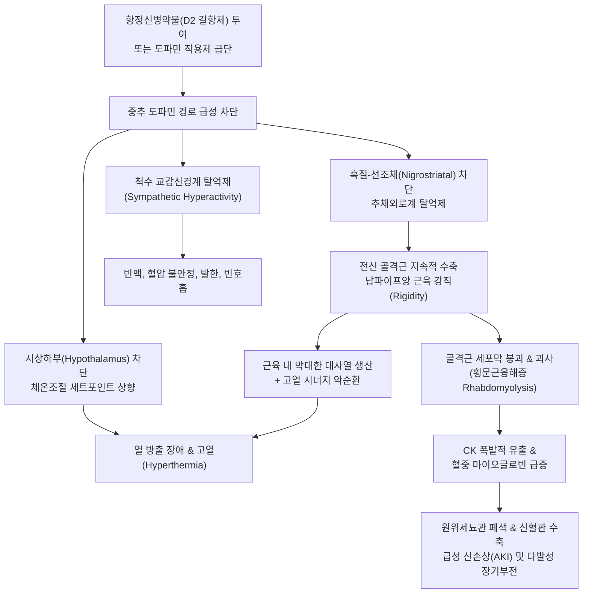

# 🩺 악성 신경이완 증후군 (Neuroleptic Malignant Syndrome, NMS)

> **핵심 3줄 요약 (Key Summary)**:
> - 📍 **병소 부위 & 해부·병태생리**: 항정신병 약물([[할로페리돌]], [[리스페리돈]] 등) 투여 또는 도파민 효능제의 급격한 중단으로 인해 흑질-선조체 경로 및 시상하부의 도파민 D2 수용체가 급격히 차단되어 전신 골격근의 극심한 강직과 체온조절 중추 마비가 초래되는 치명적 신경정신과적/근신경계 응급 질환이다.
> - 🚩 **전형적 임상 양상**: 4대 핵심 징후인 고열(Hyperthermia, >38.5°C~40°C), 전신 납파이프양(Lead-pipe) 근육 강직, 자율신경계 불안정(빈맥, 혈압 요동, 다한증, 빈호흡), 의식 변화(섬망, 혼미, 혼수)가 약물 시작 또는 증량 수일 내에 급격히 진행된다.
> - 🛠️ **핵심 검사 & 치료 전략**: 혈청 [[크레아틴 키나아제]](CK)의 현저한 급상승(보통 >1,000~100,000 IU/L), 백혈구 증가증, 전해질 및 신기능 검사(마이오글로빈뇨 및 급성 신부전 모니터링). 의심 즉시 원인 약물 중단 및 119를 통한 상급병원 중환자실(ICU) 긴급 후송이 원칙이며, 양방에서는 단트롤렌(Dantrolene) 및 브로모크립틴(Bromocriptine), 수액 요법을 시행한다.
> - ⚠️ **응급 의뢰 레드플래그**: 신경정신과 약물 복용 환자에서 38.5°C 이상의 고열과 함께 사지가 뻣뻣하게 굳는 근육 강직, 의식 혼탁, 갈색 소변이 관찰되면 치사율 10~20%에 이르는 절대적 응급 상태이므로 즉시 119 구급대를 호출하여 응급실로 전원해야 한다.

---

## 📌 목차
1. [질환 개요 & 해부학적 병태생리](#1-질환-개요--해부학적-병태생리)
2. [병태생리 메커니즘 & 생체역학적 악순환 네트워크](#2-병태생리-메커니즘--생체역학적-악순환-네트워크)
3. [임상 증상 & 이학적 검사(Physical Exam) 알고리즘](#3-임상-증상--이학적-검사physical-exam-알고리즘)
4. [감별 진단 매트릭스 (Differential Diagnosis)](#4-감별-진단-매트릭스-differential-diagnosis)
5. [한의 통합 치료 프로토콜 (침·약침·추나·한약)](#5-한의-통합-치료-프로토콜-침약침추나한약)
6. [양방 치료 & 병용·의뢰 기준 (Conventional Treatment & Referral)](#6-양방-치료--병용의뢰-기준-conventional-treatment--referral)
7. [재활 운동 & 생활습관 티칭 가이드](#7-재활-운동--생활습관-티칭-가이드)
8. [💡 사용자 진료실 핵심 필기 & 임상 노하우 (Melt-In 잔여 심화 집약)](#8--사용자-진료실-핵심-필기--임상-노하우-melt-in-잔여-심화-집약)
9. [출처 및 학술 참고 문헌 (References)](#9-출처-및-학술-참고-문헌-references)

---

![[악성신경이완증후군_01_원인_할로페리돌.jpg|450]]
> [그림 §: ① 원인 — 유발 약물(할로페리돌)] 할로페리돌(Haldol) 앰플 사진. 도파민 차단제가 악성 신경이완 증후군을 유발하며, 고열·근경직·의식 변화가 삼징후다. 출처: File:Haloperidol (Haldol).jpg (Wikimedia Commons) (CC BY-SA 3.0)

## 1. 질환 개요 & 해부학적 병태생리

* **질환 정의**:
  * 악성 신경이완 증후군(Neuroleptic Malignant Syndrome, NMS)은 도파민 D2 수용체를 차단하는 항정신병제(신경이완제) 복용 중이거나, 파킨슨병 치료를 위해 복용하던 도파민 효능제를 갑자기 중단했을 때 발생하는 드물지만 잠재적으로 치명적인 특이체질성(idiosyncratic) 이상반응 증후군이다.
  * 골격근의 전신성 연관(납파이프) 강직, 고열, 자율신경계 과활성 및 기능실조, 심각한 혈청 [[크레아틴 키나아제]](CK) 상승과 [[횡문근융해증]]을 특징으로 하며, 적절한 치료가 지연될 경우 다발성 장기 부전 및 사망(치사율 약 10~20%)으로 이어진다.

* **원인 약물군**:
  * **전형적(1세대) 항정신병제**: [[할로페리돌]](Haloperidol), 클로르프로마진(Chlorpromazine), 플루페나진(Fluphenazine) 등 고역가 D2 길항제(발생 위험 가장 높음).
  * **비전형적(2세대) 항정신병제**: [[올란자핀]](Olanzapine), [[리스페리돈]](Risperidone), [[쿠에티아핀]](Quetiapine), 아리피프라졸(Aripiprazole) (비전형적 NMS 양상 유발 가능).
  * **도파민 차단성 위장관 운동 조절제**: [[메토클로프라미드]](Metoclopramide), 레보설피리드(Levosulpiride).
  * **도파민 작용제 급격한 중단**: [[레보도파]](Levodopa), 아만타딘(Amantadine), 브로모크립틴(Bromocriptine) 투약의 갑작스러운 중지(Dopamine withdrawal NMS).

---

## 2. 병태생리 메커니즘 & 생체역학적 악순환 네트워크

* **중추 도파민 D2 수용체 급성 차단**:
  * **흑질-선조체 경로(Nigrostriatal pathway)**: 도파민성 억제 신호가 차단되면서 기저핵 출력이 과활성화되어 지속적이고 극심한 골격근 수축(근긴장이상 및 납파이프 강직)이 유발된다.
  * **시상하부(Hypothalamus)**: 전시상하부(Anterior hypothalamus)의 체온조절 중추가 마비되어 체온 세트포인트가 비정상적으로 상승하고 말초 열 방출 메커니즘(혈관 확장 등)이 상실된다.

* **말초 골격근 대사열 생산 및 세포 괴사**:
  * 전신 근육의 지속적 등척성 수축은 체내 열 생산(thermogenesis)을 폭발적으로 증가시켜 고열을 가속화한다.
  * 근육 내부의 극심한 기계적 긴장과 대사 부전은 세포막 붕괴를 초래하여 다량의 마이오글로빈과 [[크레아틴 키나아제]]를 순환계로 쏟아내며, 세뇨관을 폐색시켜 급성 세뇨관 괴사(ATN)를 유발한다.

---

## 3. 임상 증상 & 이학적 검사(Physical Exam) 알고리즘

* **4대 핵심 징후 (Cardinal Features)**:
  1. **고열 (Hyperthermia)**: 통상 38.0°C 이상, 심한 경우 40.0~42.0°C에 이르는 극심한 체온 상승 (단, 비전형적 NMS에서는 고열이 지연되거나 결여될 수 있음; Andafa et al., 2026).
  2. **납파이프양 근육 강직 (Lead-pipe Rigidity)**: 사지를 수동으로 굴곡/신전할 때 전 가동범위에 걸쳐 납 파이프를 구부리는 듯한 균일하고 극심한 저항감 발생 (톱니바퀴 징후 동반 가능).
  3. **의식 상태 변화 (Altered Mental Status)**: 초기 기면(Lethargy)과 초조에서 섬망, 혼미(Stupor), 반응성 결여의 혼수(Coma) 상태로 급속히 이행.
  4. **자율신경계 불안정 (Autonomic Instability)**: 안정 시 분당 100회 이상의 빈맥, 혈압의 극심한 요동(수축기 혈압 30mmHg 이상 급변), 다한증(Profuse diaphoresis), 빈호흡, 침흘림(Sialorrhea).

* **이학적 및 검사실 평가**:
  * **근긴장도 수동 평가**: 환자의 팔꿈치, 손목, 무릎 관절을 수동으로 굽히고 펴며 저항감(납파이프 강직) 평가.
  * **심부건반사(DTR) 평가**: NMS에서는 건반사가 대개 정상 또는 저하되는 반면, [[세로토닌 증후군]]에서는 뚜렷한 반사항진(Hyperreflexia) 및 족간대(Clonus)가 관찰됨.
  * **혈액 검사 소견**:
    * 혈청 CK: 정상의 수배에서 수백 배까지 폭증 (보통 >1,000 IU/L, 심한 경우 >50,000~100,000 IU/L).
    * 전혈구 검사(CBC): 백혈구 증가증(Leukocytosis, 10,000~40,000/μL).
    * 신기능: BUN/Cr 상승, 고칼륨혈증, 저칼슘혈증, 대사성 산증.

---

## 4. 감별 진단 매트릭스 (Differential Diagnosis)

| 질환명 | 주 유발 약제 | 근육 징후 | 핵심 특징 및 감별점 |
| :--- | :--- | :--- | :--- |
| **악성 신경이완 증후군 (NMS)** | 항정신병제(D2 차단제), 도파민 작용제 급단 | **납파이프(연관) 강직**, 서동 | 수일간 서서히 진행, 고열, CK 현저히 상승, DTR 저하/정상 |
| **[[세로토닌 증후군]] (Serotonin Syn.)** | SSRI, SNRI, MAOI, 트라마돌 | **족간대(Clonus)**, 진전, 반사항진 | 투약 후 수 시간 내 급발, 동공산대, 설사, 장음 항진 |
| **[[악성 고열증]] (Malignant Hyperthermia)** | 흡입마취제(할로탄), 석시닐콜린 | 교근 강직(Jaw rigidity), 전신 강직 | 수술실/마취 중 수 분~수 시간 내 발생, RyR1 유전자 돌연변이 |
| **치명적 긴장증 (Lethal Catatonia)** | 조현병, 양극성 장애 급성 악화 | 긴장증적 강직, 거부증, 납굴증 | 약물 노출 전 정신병적 흥분/함구증 선행, NMS와 유사한 응급 |
| **중추신경계 감염 ([[뇌수막염]]/[[뇌염]])** | 바이러스/세균 감염 | 경부 강직(Nuchal rigidity) | 두통, 구토, 뇌척수액(CSF) 세포 증다증, 국소 신경학적 결손 |

---

## 5. 한의 통합 치료 프로토콜 (침·약침·추나·한약)

* **한의 임상적 원칙과 한계**:
  * **🚨 원내 단독 치료 절대 금지**: NMS는 사망률이 높은 전신 내과적 응급 질환이므로, 한의원 진료실에서 진단되거나 의심되는 즉시 **119 구급대를 호출하여 상급종합병원 응급실/중환자실로 전원**해야 한다.
  * 한의 치료는 급성기 응급 전원 과정에서의 응급 소생술 보조 및 병원 중환자 치료 후 안정화된 아급성 회복기 후유증(근위약, 피로, 기혈 손상) 관리에 국한된다.

* **한의학적 병리 및 변증 (온병학적 관점)**:
  * **열독내함·역전심포 (熱毒內陷·逆傳心包)**: 극심한 약독(藥毒)과 화열(火熱)이 영분(營分)과 혈분(血分)으로 깊이 침입하여 심포(心包)를 침범함. 고열, 혼미, 섬망, 번조불녕.
  * **열극생풍·진액고갈 (熱極生風·津液枯竭)**: 극열(極熱)이 간풍(肝風)을 동동(動動)시켜 전신 근맥을 경축시키고 진액을 말림. 근육 강직, 치아 악물림, 갈색뇨.
  * **기음양허·어혈조락 (氣陰兩虛·瘀血阻絡 - 회복기)**: 급성 화열이 꺼진 후 기혈과 진액이 심하게 고갈되고 미세혈맥이 막힌 상태.

* **응급 이송 전 초응급 보조 혈위**:
  * 구급 구급혈: [[십선혈]](十宣穴) 점자출혈, [[인중]](GV26), [[용천]](KI1). 의식 소생 및 강한 개규(開竅) 자극.
  * 청열강역: [[곡지]](LI11), [[대추]](GV14), [[합곡]](LI4).

* **아급성 회복기 한약 치료 (ICU 퇴원 후 안정기)**:
  * **[[생맥산]](生脈散) 합 [[사물탕]](四物湯)**: 극심한 고열과 횡문근융해증을 겪은 후 고갈된 진액과 음혈(陰血)을 회복시키고 심장 기능을 보호.
  * **[[작약감초탕]](芍藥甘草湯)**: 잔존하는 골격근 강직 및 근육통 완화.

---

## 6. 양방 치료 & 병용·의뢰 기준 (Conventional Treatment & Referral)

* **응급 양방 집중 치료 프로토콜 (ICU Management)**:
  1. **원인 약물 즉시 중단 (Immediate Discontinuation)**:
     * 모든 항정신병제 및 도파민 차단 약물 투여 즉각 중단. 도파민 작용제 중단이 원인인 경우 해당 약물 재투여.
  2. **적극적 보존 및 냉각 요법 (Aggressive Supportive Care)**:
     * 냉각 담요, 얼음주머니, 알코올 스펀지 등을 이용한 적극적 물리적 냉각.
     * 대량 생리식염수 정맥 투여(시간당 수백 mL): 마이오글로빈에 의한 급성 세뇨관 괴사(ATN)를 막기 위해 시간당 100~200 mL 이상의 소변량 유지 및 소변 알칼리화(탄산수소나트륨 투여).
  3. **특이 약물 치료 (Specific Pharmacotherapy)**:
     * **단트롤렌(Dantrolene)**: 1~2.5 mg/kg 정맥 주사 (최대 10 mg/kg/일). 골격근 근소포체 RyR1 수용체에 작용하여 세포질 내 칼슘 방출을 차단함으로써 근육 강직과 대사열 생산을 신속히 억제.
     * **브로모크립틴(Bromocriptine)**: 2.5~5 mg 1일 3회 경구/비위관 투여 (중추 D2 수용체 효능제로 도파민성 긴장 회복).
     * **아만타딘(Amantadine)**: 도파민 방출 촉진 및 재흡수 억제제.
     * **로라제팜(Lorazepam)**: 근육 강직 완화 및 초조 조절을 위해 정맥 주사 (Chen & Bae, 2025).

* **한의원 1차 진료실 전원 기준**:
  * **🚨 100% 즉시 119 응급 후송**:
    * 항정신병 약물을 복용하는 환자가 고열(>38.0°C)과 함께 팔다리가 굳는 강직 증상이나 횡설수설하는 의식 변화를 보이면 한의원에서 어떠한 침이나 한약 치료도 시도하지 말고 **골든타임 확보를 위해 즉시 119 구급대를 호출**한다.

---

## 7. 재활 운동 & 생활습관 티칭 가이드

* **급성기 회복 후 신체 활동 관리**:
  * NMS 발병 후 최소 2~4주간은 절대 안정을 유지해야 하며, 과도한 신체 훈련이나 근육 운동은 횡문근융해증의 재발을 유발할 수 있으므로 금지한다.
  * CK 수치가 완전히 정상화되고 신기능이 안정화된 후 가벼운 일상 보행부터 점진적으로 시작한다.

* **수분 섭취 및 신장 보호**:
  * 회복기 환자는 매일 충분한 양(최소 2L 이상)의 미온수를 섭취하여 잔여 마이오글로빈 배출을 촉진하고 신손상을 예방해야 한다.

* **재투약 주의사항 교육**:
  * NMS 병력이 있는 환자는 향후 다른 항정신병제 투여 시에도 재발 위험이 높다.
  * 최소 2주 이상의 약물 휴지기(Washout)를 거친 후, 필요하다면 이전과 완전히 다른 계열의 비전형 항정신병제(예: 아리피프라졸, 클로자핀)를 초저용량부터 극도로 서서히 증량해야 함을 보호자에게 주지시킨다.

---

## 8. 💡 사용자 진료실 핵심 필기 & 임상 노하우 (Melt-In 잔여 심화 집약)

* **진료실 임상 팁**:
  * 정신과 약(조현병, 양극성 장애, 심한 불면증/우울증)을 복용 중인 환자가 "감기몸살이 심하게 왔다", "온몸이 쑤시고 굳는다"며 내원했을 때 체온을 재보고 팔을 굽혀보라.
  * 단순한 감기몸살이 아니라 팔다리가 뻣뻣하고 표정이 굳어 있으며(가면양 얼굴), 식은땀을 뻘뻘 흘리고 맥박이 분당 110회를 넘는다면 **1초의 지체도 없이 NMS를 의심**해야 한다.
  * 이때 침을 놓거나 안궁우황환을 먹이려고 시간을 끌면 환자가 급성 신부전이나 파종성 혈관내 응고(DIC)로 사망할 수 있다. 보호자에게 "약물 부작용에 의한 응급 상황"임을 신속히 설명하고 구급차를 불러 3차 병원 응급실로 직행시켜야 한다. 이것이 한의사의 정확한 감별 진단 능력이 생명을 살리는 순간이다.

---

## 9. 출처 및 학술 참고 문헌 (References)

* Andafa TW, Adekanmbi SA, Ugwumba CM, et al. (2026). Early Recognition of Neuroleptic Malignant Syndrome Without Hyperthermia: A Narrative Review. *Cureus*. 18(8):e114485. PMID: 42732346

* Ivarola P, Papazian O, Buompadre MC. (2026). [Neuroleptic Malignant Syndrome]. *Medicina (B Aires)*. 86(Suppl 3):157-161. PMID: 42659566

* Chen A, Bae M. (2025). Lorazepam in Managing Atypical Neuroleptic Malignant Syndrome: A Systematic Review of Case Reports. *West J Emerg Med*. 26(5):1446-1453. PMID: 41192984

---

## 관련 노트

- [[횡문근융해증]]
- [[크레아틴 키나아제]]
- [[세로토닌 증후군]]
- [[파킨슨병]]
- [[우황청심원]]
- [[작약감초탕]]
