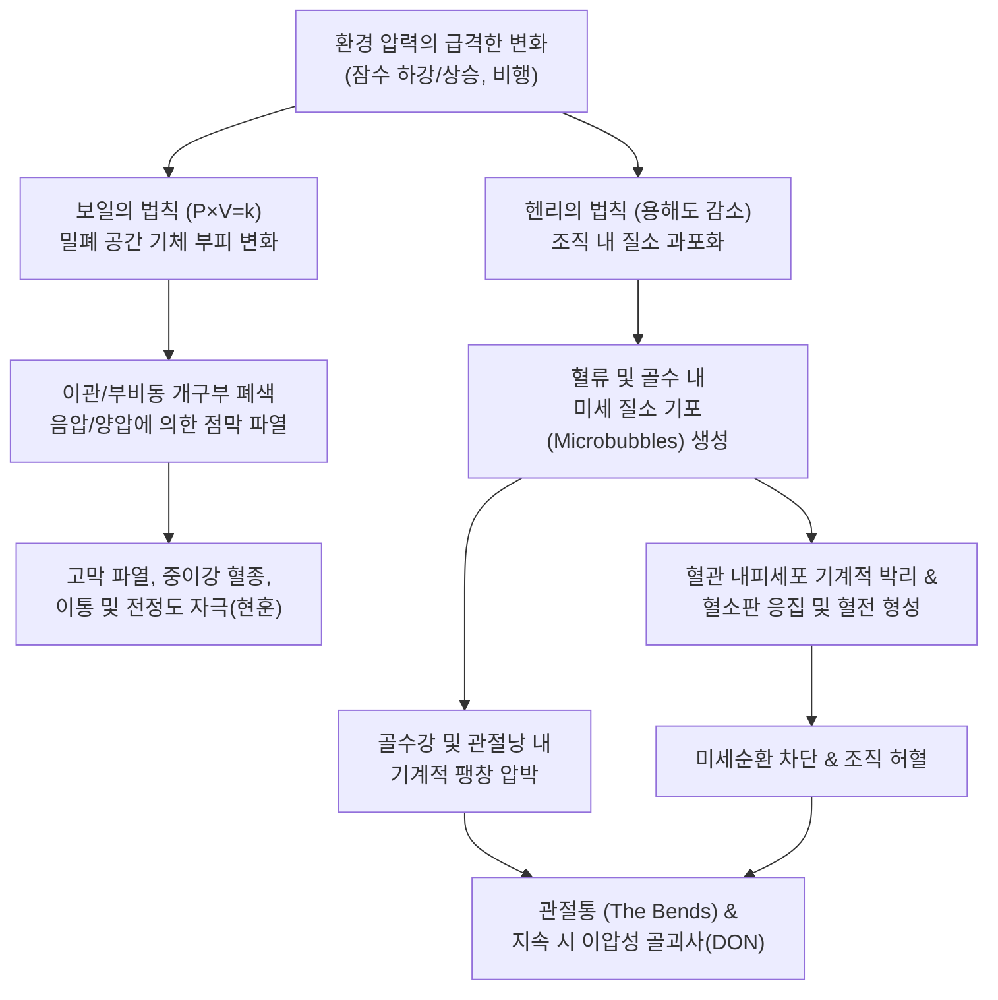

# 🩺 압력상해 (Barotrauma & 감압병)

> **핵심 3줄 요약 (Key Summary)**:
> - 📍 **병소 부위 & 해부·병태생리**: 수압 또는 기압의 급격한 변화(스쿠버 다이빙, 항공 비행 등) 시 보일의 법칙($P \times V = k$)에 따라 체내 밀폐된 공기 공간(중이강, 부비동, 폐포)이 팽창·수축하며 조직 파열을 일으키거나, 헨리의 법칙에 의해 조직에 과포화된 질소가 급격한 감압 시 기포(Microbubbles)로 유리되어 골수·관절강 미세혈관을 폐색(감압병 The Bends, 이압성 골괴사)시키는 물리적 환경 손상이다.
> - 🚩 **전형적 임상 양상**: 다이빙이나 비행 직후 귀의 극심한 통증(이통), 이명, 청력 저하, 고막 충혈·파열이 흔하며, 전신 감압병(DCS Type I)의 경우 어깨·무릎·고관절의 깊숙하고 둔하게 쑤시는 극심한 관절통 및 근육통(The Bends)이 나타난다.
> - 🛠️ **핵심 검사 & 치료 전략**: 다이빙/비행 프로필 상세 문진, 이경 검사(Teed 분류), 흉부 X-선/CT 및 관절 MRI 검사. 의심 즉시 100% 정상압 산소(NBO) 흡입 및 감압 챔버를 이용한 고압산소치료(HBOT) 시행. 만성기 이압성 관절통과 골괴사 후유증에 대해 한의학적으로 어혈통비(瘀血痛痺) 관점에서 침구 및 [[독활기생탕]], [[당귀수산]]을 적용한다.
> - ⚠️ **응급 의뢰 레드플래그**: 다이빙 상승 직후 흉통, 객혈, 피하기종, 호흡곤란 발생(폐 압력상해/기흉 의심), 사지 위약/마비, 감각 이상, 시야 장애, 의식 혼탁 발생(동맥기체색전증 AGE 또는 중추신경계 감압병 Type II) 시 즉시 100% 산소를 투여하며 고압산소챔버 구비 응급의료센터로 긴급 이송.

---

## 📌 목차
1. [질환 개요 & 해부학적 병태생리](#1-질환-개요--해부학적-병태생리)
2. [병태생리 메커니즘 & 생체역학적 악순환 네트워크](#2-병태생리-메커니즘--생체역학적-악순환-네트워크)
3. [임상 증상 & 이학적 검사(Physical Exam) 알고리즘](#3-임상-증상--이학적-검사physical-exam-알고리즘)
4. [감별 진단 매트릭스 (Differential Diagnosis)](#4-감별-진단-매트릭스-differential-diagnosis)
5. [한의 통합 치료 프로토콜 (침·약침·추나·한약)](#5-한의-통합-치료-프로토콜-침약침추나한약)
6. [양방 치료 & 병용·의뢰 기준 (Conventional Treatment & Referral)](#6-양방-치료--병용의뢰-기준-conventional-treatment--referral)
7. [재활 운동 & 생활습관 티칭 가이드](#7-재활-운동--생활습관-티칭-가이드)
8. [💡 사용자 진료실 핵심 필기 & 임상 노하우 (Melt-In 잔여 심화 집약)](#8--사용자-진료실-핵심-필기--임상-노하우-melt-in-잔여-심화-집약)
9. [출처 및 학술 참고 문헌 (References)](#9-출처-및-학술-참고-문헌-references)

---

![[압력상해_01_치료_감압챔버.jpg|450]]
> [그림 §: ② 치료 — 감압 챔버 치료] 감압 챔버 안에서 환자가 누워 산소를 공급받는 모습. 감압병에서 체내 기포를 다시 녹이기 위한 표준 치료다. 출처: File:Decompression chamber (US Navy).jpg (Wikimedia Commons) (Public domain)

![[압력상해_02_치료_챔버이송.jpg|450]]
> [그림 §: ② 치료 — 감압 챔버 이송] 감압 챔버 앞에서 환자를 이송하는 장면. 압력상해는 신속한 재가압이 예후를 좌우한다. 출처: File:Decompression chamber.jpg (Wikimedia Commons) (CC BY-SA 3.0)

![[압력상해_03_원인_잠수계기.jpg|450]]
> [그림 §: ① 원인 — 잠수 계기(수심 30 m)] 잠수용 계기가 수심 30 m와 최대 깊이를 표시한 사진. 압력상해는 감압 없이 급부상할 때 체내 기포가 형성되어 발생한다. 출처: File:Dive computer.jpg (Wikimedia Commons) (CC BY-SA 3.0)

## 1. 질환 개요 & 해부학적 병태생리

* **질환 정의**:
  * 압력상해(Barotrauma)는 신체 외부의 환경 압력(대기압 또는 수압)과 신체 내부 밀폐된 함기강(gas-filled space)의 내부 압력 사이에 불균형이 발생할 때, 기체의 팽창 또는 수축으로 인해 주변 연부조직과 장기가 물리적 손상을 입는 질환이다.
  * 잠수 의학(Diving Medicine)에서는 압력 변화에 의한 직접적 기계 손상인 '압력상해(Barotrauma)'와, 체내 용해 질소의 기포화로 관절·혈관을 차단하는 '감압병(Decompression Sickness, DCS)', 그리고 폐포 파열 기포가 동맥을 폐색하는 '동맥기체색전증(Arterial Gas Embolism, AGE)'을 통틀어 **감압 질환(Decompression Illness, DCI)**으로 포괄한다.

* **표적 해부 구조 및 손상 분류**:
  1. **이비인후과적 함기강**:
     * **중이강(Middle Ear)**: 이관(Eustachian tube)의 환기 부전으로 하강 시 음압이 발생하여 고막 함몰, 중이강 혈종 삼출 및 고막 파열 유발(가장 흔함; Sandoval et al., 2026).
     * **부비동(Paranasal Sinuses)**: 전두동, 상악동 자연공 폐색 시 안면통 및 혈성 비루 발생.
  2. **근골격계 및 혈관 질환**:
     * **근골격 감압병(The Bends / Type I DCS)**: 관절낭, 인대, 건, 골수강 내 질소 기포 형성으로 인한 허혈성 골관절통.
     * **이압성 골괴사(Dysbaric Osteonecrosis, DON)**: 반복적인 미세 기포 색전증으로 대퇴골두, 상완골두, 경골 간질에 비가역적 [[무혈성 괴사]] 발생.
  3. **폐 및 흉강**:
     * 폐 압력상해(Pulmonary Barotrauma): 상승 시 호흡을 참아 폐포가 과팽창 파열되면서 기흉(Pneumothorax), 기종격동, 전신 동맥색전 유발.

---

## 2. 병태생리 메커니즘 & 생체역학적 악순환 네트워크

* **보일의 법칙과 기계적 압착(Squeeze)**:
  * 잠수사가 잠강(Descent)할 때 수압이 증가하면 중이강 내 기체 부피가 수축한다. 이때 침 삼키기나 발살바법(Valsalva)으로 이관을 통해 공기를 주입(Equalization)하지 못하면 중이강 내 극심한 상대적 음압이 형성되어 모세혈관이 파열되고 고막이 안쪽으로 팽팽히 당겨지며 혈종이 형성된다.

* **기포 생성과 감압병 메커니즘 (Jin et al., 2026)**:
  * 고압 환경에서 신체 조직(특히 지질이 풍부한 골수, 신경조직, 지방)에 대량 용해되었던 불활성 질소 가스는 급격한 감압 시 액체 상태를 유지하지 못하고 미세 기포(Microbubbles)로 석출된다.
  * 기포는 혈관 내피세포를 손상시켜 von Willebrand factor와 미세입자(Microparticles) 방출을 유도하고, 혈소판 활성화와 내인성 응고 경로를 촉발하여 미세순환을 차폐한다(Arieli, 2026).
  * 골수강과 관절막 주변 정맥총이 차단되면서 골수내압이 급상승하여 뼈와 관절의 통각 수용기(C-fiber)를 자극해 격심한 골통증을 초래한다.

---

## 3. 임상 증상 & 이학적 검사(Physical Exam) 알고리즘

* **주요 임상 증상**:
  1. **이비인후과적 증상 (가장 흔함)**:
     * 귀가 먹먹하고 꽉 찬 느낌(이충만감), 날카로운 귀 통증(이통).
     * 고막 파열 시 차가운 물이 중이강으로 유입되며 반사성 안진과 극심한 어지럼증(교대압성 현훈), 오심, 구토 발생.
  2. **근골격계 감압병 (Type I DCS - The Bends)**:
     * 다이빙 후 1~6시간 이내(90% 이상 24시간 내) 발현.
     * 어깨, 팔꿈치, 손목, 무릎, 고관절 부위의 깊고 쑤시는 박동성 둔통.
     * 관절을 움직이거나 가압해도 통증이 가라앉지 않고 점진적으로 악화됨.
  3. **신경계 및 전신 증상 (Type II DCS / AGE - 응급)**:
     * 사지 저림, 감각 이상, 하지 마비(척수형 감압병), 언어 장애, 혼미, 흉골 후방 흉통, 숨가쁨(Chokes).

* **이학적 검사 및 등급 분류**:
  * **이경 검사 (Teed 고막 압력상해 분류)**:
    * **Grade 0**: 정상.
    * **Grade 1**: 이경 소견상 고막 충혈 및 이완부 혈관 확장.
    * **Grade 2**: 고막 전체의 심한 발적과 충혈.
    * **Grade 3**: 중이강 내 혈성 삼출액(고막 뒤 검붉은 액체 레벨).
    * **Grade 4**: 중이강 전체 혈종 및 고막 팽륜.
    * **Grade 5**: 고막 천공(Perforation).
  * **근골격 이학적 검사**:
    * 이환된 관절의 국소 종창이나 열감은 대개 동반되지 않으며, 수동적 가동범위는 유지되나 깊숙한 압박통을 호소함.
    * 혈압계 커프를 관절 근위부에 감고 150~200 mmHg로 가압했을 때 통증이 일시적으로 감소하면 가포화된 기포에 의한 벤즈(Bends) 가능성을 강력히 시사함.

---

## 4. 감별 진단 매트릭스 (Differential Diagnosis)

| 질환명 | 주 증상 및 병력 | 검사 소견 | 핵심 감별점 |
| :--- | :--- | :--- | :--- |
| **근골격 감압병 (The Bends)** | 다이빙/감압 후 수 시간 내 대관절 깊은 둔통 | X-선 정상(초기), 가압 시 통증 호전 반응 | 잠수 프로필(안전정지 누락 등), 100% 산소/챔버에 극적 반응 |
| **단순 근육 염좌/건염** | 격렬한 수영 동작 후 근육통 | 압통점 명확, 저항 수축 시 통증 재현 | 기압 변화와 무관, 가압 커프 검사 음성, 움직임에 따라 통증 변화 |
| **[[이압성 골괴사]] (DON)** | 만성 잠수사, 수개월~수년 후 진행성 관절통 | MRI상 대퇴골두/상완골두 괴사 신호 | 급성기가 아닌 만성 비가역적 골수 경색, 체중 부하 시 통증 |
| **중이염 (Otitis Media)** | 귀 통증, 발열, 이루 | 고막 팽륜, 황색 삼출물, 염증 수치 상승 | 상기도 감염 선행, 기압 변화와 무관, 항생제 치료 필요 |
| **전정신경염/이석증** | 체위 변화 시 회전성 어지럼증 | Dix-Hallpike 양성, 안진 관찰 | 청력 저하나 고막 이상 동반 없음, 다이빙 병력과 무관 |

---

## 5. 한의 통합 치료 프로토콜 (침·약침·추나·한약)

* **한의 치료의 적용 범위와 원칙**:
  * **급성기 DCI/기흉 의심 시 한의원 내 처치 절대 금지**: 100% 산소 공급과 함께 재가압 챔버 구비 병원으로 즉시 이송.
  * 한의 치료는 고압산소치료(HBOT)를 마친 후 잔존하는 만성 관절통(The Bends 후유증), 이압성 골괴사 초기 보존적 관리, 중이 압력상해 후 이명·이충만감 회복에 적용된다.

* **한의학적 변증**:
  1. **어혈저락·통비 (瘀血阻絡·痛痺)**: 기압 변화로 경락의 기혈 운행이 급격히 차폐되어 기체혈어(氣滯血瘀)가 발생함. 관절의 극심한 고정성 자통(刺痛), 야간통, 설어반, 맥삽.
  2. **기음양허·간신부족 (氣陰兩虛·肝腎不足)**: 고압 환경 노출 및 허혈로 근골(筋骨)과 골수가 손상된 상태. 만성 골통증, 무력감, 관절 강직.
  3. **풍열침습·이롱이명 (風熱侵襲·耳聾耳鳴 - 이압상해 후유)**: 청궁, 청회 주변 기혈 순환 저하로 먹먹함과 이명 지속.

* **침구 치료 프로토콜**:
  * **이압상해 후유 이명·이충만감**:
    * 이주 주변 혈위: [[이문]](TE21), [[청궁]](SI19), [[청회]](GB2, 담경), [[예풍]](TE17).
    * 원위 혈위: [[중저]](TE3), [[합곡]](LI4), [[태충]](LR3).
  * **근골격계 관절통 (어깨·무릎·고관절)**:
    * 견관절: [[견우]](LI15), [[견료]](TE14), [[견정]](GB21), [[노수]](SI10).
    * 슬관절: [[독비]](ST35), [[내슬안]], [[양릉천]](GB34), [[음릉천]](SP9).
    * 저주파(2Hz) 전침을 15분간 적용하여 심부 미세혈관 확장 및 관류 개선 촉진.

* **약침 치료**:
  * **자하거(Hominis Placenta) 약침**: 이압성 골괴사 초기 및 만성 관절통 부위 관절강 주변에 0.5~1.0cc 주입하여 골수 세포 재생 및 항염증 작용 도모.
  * **중성어혈 약침**: 관절낭 주변 압통점에 0.2~0.5cc 산자하여 국소 미세혈전 흡수 촉진.

* **한약 처방 프로토콜**:
  * **[[당귀수산]](當歸鬚散) 합 [[서경탕]](舒經湯)**:
    * 급성기 경과 후 남아있는 관절통과 어혈 정체에 당귀미, 도인, 홍화, 강황, 해동피를 활용하여 기혈 소통 및 어혈 제거.
  * **[[독활기생탕]](獨活寄生湯) 가감방**:
    * 잠수 직업인의 만성 관절 둔통 및 골괴사 초기 관리에 숙지황, 우슬, 두충, 속단을 증량하여 간신을 보하고 연골/골수 영양 공급.
  * **[[보양환오탕]](補陽還五湯)**:
    * 신경계 감압병 후유증으로 사지 감각 저하나 경미한 위약이 지속될 때 황기를 대용량(40~60g)으로 사용하여 신경 재생 촉진.

---

## 6. 양방 치료 & 병용·의뢰 기준 (Conventional Treatment & Referral)

* **응급 양방 치료 프로토콜 (Emergency Care)**:
  1. **초기 현장 처치 (First Aid)**:
     * 즉각 활동 중단 및 침상 안정 (좌측 앙와위/트렌델렌버그 자세는 더 이상 권장되지 않음).
     * **100% 정상압 고농도 산소(Normobaric Oxygen, NBO)**: 비재호흡 마스크(NRB mask)를 통해 분당 10~15L 투여 (질소 배출 촉진 및 허혈 완화).
     * 충분한 등장성 수액(생리식염수) 정맥 주사 (혈액 점도 저하 및 미세순환 개선).
  2. **재가압 고압산소치료 (Hyperbaric Oxygen Therapy, HBOT)**:
     * DCI의 결정적 표준 치료법 (Gold Standard).
     * **미 해군 치료표 6(US Navy Treatment Table 6)** 등이 표준적으로 적용되며, 2.8 ATA(절대기압) 환경에서 100% 산소를 간헐적으로 흡입시켜 기포 부피를 즉각 축소($V \propto 1/P$)시키고 체내 재흡수를 유도함.
  3. **중이 압력상해 약물 요법**:
     * 국소 비충혈제거제(Oxymetazoline 0.05% 스프레이 3~5일간) 또는 경구 슈도에페드린(Pseudoephedrine 60mg) 투여로 이관 부종 완화 (AlGhamdi et al., 2026).
     * 중이강 혈종 및 고막 팽륜이 심한 경우 경구 코르티코스테로이드 단기 투여.

* **양방·전문과 의뢰 기준 (Referral Criteria)**:
  * **🚨 즉각 119 및 해양경찰(DAN / 고압산소챔버) 긴급 의뢰 (Red Flags)**:
    1. 다이빙 직후 호흡곤란, 흉통, 피하기종(목 부위 바스락거림) 발생 (폐 파열/기흉 의심).
    2. 다이빙 후 보행 실조, 하지 마비, 감각 저하, 시야 결손, 의식 소실 등 신경학적 결손 징후.
    3. 전신의 극심한 관절통이 100% 산소 투여에도 지속되는 경우.

---

## 7. 재활 운동 & 생활습관 티칭 가이드

* **잠수 복귀 가이드라인 (Return to Diving)**:
  * 단순 중이 압력상해(Teed 1~2): 증상 완전 소실 및 고막 정상화 후 최소 1~2주간 잠수 금지.
  * 고막 천공(Teed 5): 고막이 완전히 자연 치유되거나 고막성형술 후 최소 6~8주간 귀에 물이 들어가지 않도록 보호.
  * 감압병(Type I DCS): 챔버 치료 후 증상 완전 소실 기준 최소 4주간 잠수 금지.
  * 신경계 감압병(Type II DCS): 최소 3~6개월간 잠수 금지 및 신경과/잠수의학 전문의 평가 필수.

* **이관 통기(Equalization) 기술 교육**:
  * 잠수 전 비염이나 상기도 감염이 있을 때는 절대 다이빙을 하지 않도록 교육.
  * 발살바법(Valsalva maneuver): 코를 쥐고 입을 다문 상태에서 부드럽게 숨을 내쉬어 양쪽 귀를 뚫어줌. 통증이 발생한 후에는 세게 불지 말고 수심을 1~2m 올려서 수행.
  * 프렌젤법(Frenzel maneuver): 성문을 닫고 혀 뒤쪽을 올려 인두압을 높이는 방식으로 중이 손상 위험이 적음.

* **다이빙 후 항공 여행 금지 지침 (No-Fly Rules)**:
  * 단일 무감압 다이빙: 최소 12시간 경과 후 비행기 탑승.
  * 다회/다일 다이빙: 최소 18~24시간 경과 후 비행기 탑승.
  * 감압 정지가 필요했던 다이빙 또는 감압병 치료 후: 최소 48시간 이상 대기.

---

## 8. 💡 사용자 진료실 핵심 필기 & 임상 노하우 (Melt-In 잔여 심화 집약)

* **진료실 임상 팁**:
  * "동남아나 제주도로 휴가를 다녀온 뒤 귀가 멍멍하고 아프다", 혹은 "어깨와 무릎이 쑤신다"며 내원한 20~40대 환자를 만나면 **반드시 스쿠버 다이빙, 프리다이빙, 또는 비행기 탑승 이력을 질문**해야 한다.
  * 단순한 오십견이나 염좌로 오진하고 핫팩과 침 치료만 하다가 신경계 감압병이나 폐기종의 골든타임을 놓칠 수 있다. 다이빙 후 24시간 이내에 발생한 관절통은 챔버 치료가 최우선이다.
  * 다이빙 후 이통 환자의 고막을 이경으로 보았을 때 고막 뒤로 자줏빛 피가 차 있거나 천공이 있다면 절대 이관 통기법을 세게 시키지 말고 외이도를 건조하게 유지시킨 채 이비인후과 의뢰를 병행해야 한다.

---

## 9. 출처 및 학술 참고 문헌 (References)

* Jin Z, Zhu Q, Zheng J, et al. (2026). Circulating Bubbles in Decompression Sickness: Pathophysiology and Experimental Models. *Biomolecules*. 16(9):1321. PMID: 42793171

* Sandoval M, Plaza G, Sinkkonen S, et al. (2026). Otitic Barotrauma Due to Eustachian Tube Dysfunction and Special Considerations in At-Risk Populations. *Otolaryngol Clin North Am*. 59(4):615-628. PMID: 42457460

* AlGhamdi MA, Katib RI, Bawazir RO, et al. (2026). Efficacy of Pseudoephedrine and Oxymetazoline in Preventing Otic Barotrauma: A Systematic Review and Meta-Analysis. *Otol Neurotol*. 47(6):768-776. PMID: 41931637

---

## 관련 노트

- [[무혈성 괴사]]
- [[대퇴골두 무혈성 괴사]]
- [[당귀수산]]
- [[독활기생탕]]
- [[보양환오탕]]
- [[이명]]
- [[어지럼증]]
