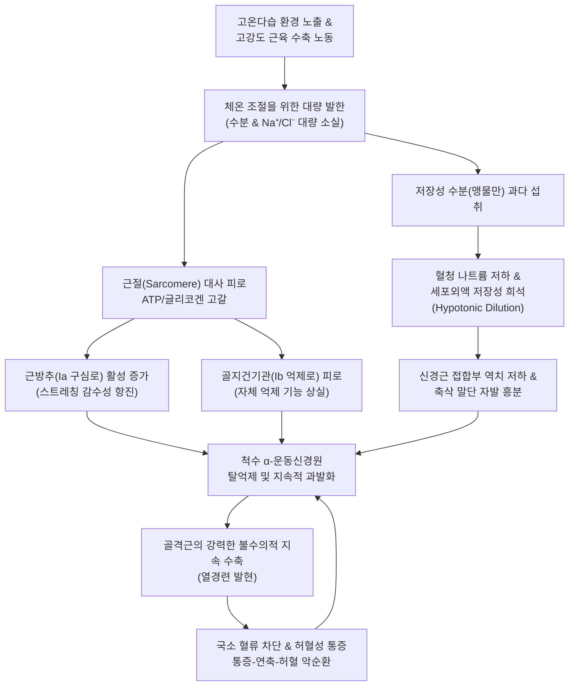

# 🩺 열경련 (Heat Cramps / 운동 유발성 근경련 EAMC)

> **핵심 3줄 요약 (Key Summary)**:
> - 📍 **병소 부위 & 해부·병태생리**: 고온 다습한 환경에서 고강도 노동이나 운동 후 대량의 땀 배출로 수분 및 전해질(나트륨, 염소, 마그네슘)이 결핍되고, 전해질 보충 없는 순수 수분(맹물) 과다 섭취로 세포외액이 저장성(Hypotonic)으로 희석되면서 척수 운동신경원 억제 신호 결손 및 근소포체 흥분성 항진으로 주로 [[비복근]], [[슬괵근]], 복직근에 발생하는 급성 불수의적 유통성 근육 경련이다.
> - 🚩 **전형적 임상 양상**: 체온은 정상이거나 미열(<38.5°C) 수준이며 의식은 명료하나, 종아리나 허벅지 근육이 딱딱한 돌덩이처럼 뭉치며(Knotted muscle) 찢어지는 듯한 극심한 발작성 통증이 나타나고 스트레칭 시 일시적 완화 후 재발을 반복한다.
> - 🛠️ **핵심 검사 & 치료 전략**: 혈청 전해질(Na⁺, Cl⁻, K⁺, Mg²⁺, Ca²⁺) 및 BUN/Cr 측정, 소변 비중 검사. 서늘한 곳에서 근육의 수동적 신장(골지건기관 GTO 활성화) 및 0.9% 생리식염수 수액 또는 경구 전해질액 보충. 한의학적으로 서열상진(暑熱傷津) 및 근맥실양(筋脈失養)으로 변증하여 근경련의 특효방인 [[작약감초탕]]과 [[승산]], [[위중]], [[양릉천]] 혈위 침구 치료를 시행한다.
> - ⚠️ **응급 의뢰 레드플래그**: 체온이 40.0°C 이상으로 급상승하거나, 의식 혼탁(섬망, 혼수, 지남력 상실), 경련 발작, 핍뇨, 콜라색 소변이 동반되는 경우 단순 열경련이 아닌 생명을 위협하는 [[열사병]](Heat Stroke) 또는 [[횡문근융해증]]이므로 즉시 119 구급대를 호출하여 응급 냉각 요법과 중환자실 치료로 연계해야 한다.

---

## 📌 목차
1. [질환 개요 & 해부학적 병태생리](#1-질환-개요--해부학적-병태생리)
2. [병태생리 메커니즘 & 생체역학적 악순환 네트워크](#2-병태생리-메커니즘--생체역학적-악순환-네트워크)
3. [임상 증상 & 이학적 검사(Physical Exam) 알고리즘](#3-임상-증상--이학적-검사physical-exam-알고리즘)
4. [감별 진단 매트릭스 (Differential Diagnosis)](#4-감별-진단-매트릭스-differential-diagnosis)
5. [한의 통합 치료 프로토콜 (침·약침·추나·한약)](#5-한의-통합-치료-프로토콜-침약침추나한약)
6. [양방 치료 & 병용·의뢰 기준 (Conventional Treatment & Referral)](#6-양방-치료--병용의뢰-기준-conventional-treatment--referral)
7. [재활 운동 & 생활습관 티칭 가이드](#7-재활-운동--생활습관-티칭-가이드)
8. [💡 사용자 진료실 핵심 필기 & 임상 노하우 (Melt-In 잔여 심화 집약)](#8--사용자-진료실-핵심-필기--임상-노하우-melt-in-잔여-심화-집약)
9. [출처 및 학술 참고 문헌 (References)](#9-출처-및-학술-참고-문헌-references)

---

## 1. 질환 개요 & 해부학적 병태생리

* **질환 정의**:
  * 열경련(Heat Cramps)은 열 손상(Heat-related illnesses) 스펙트럼 중 비교적 경증에 해당하는 질환군으로, 고온 환경에서 무거운 육체 노동자(건설현장, 제철소 등)나 운동선수(마라톤, 축구 등)가 과도하게 땀을 흘린 후 발생하는 통증을 동반한 급성 불수의적 골격근 연축(Spasm)이다.
  * 스포츠의학적으로는 운동 유발성 근경련(Exercise-Associated Muscle Cramps, EAMC)의 아형으로 분류되며, 체온 조절 중추의 파탄을 동반하지 않는 점이 [[열사병]]과 구별된다.

* **표적 해부 구조 및 호발 부위**:
  * 활동량이 가장 집중된 대근육군에 호발한다:
    * 하지: [[비복근]](Gastrocnemius, 종아리 알), [[가자미근]](Soleus), [[슬괵근]](Hamstrings), [[대퇴사두근]](Quadriceps).
    * 체간 및 상지: 복직근(Rectus abdominis), 요배근(척주기립근), 상완이두근.

---

## 2. 병태생리 메커니즘 & 생체역학적 악순환 네트워크

* **탈수-전해질 결핍 모델 (Dehydration-Electrolyte Model)**:
  * 인체는 땀을 통해 시간당 1~2.5L의 수분과 함께 리터당 40~80 mEq의 나트륨 및 염소를 배출한다.
  * 갈증을 해소하기 위해 전해질이 없는 순수 수분(생수)만을 다량 섭취할 경우, 혈관 내 및 간질액의 나트륨 농도가 급격히 희석되면서 삼투압 불균형이 초래된다.
  * 세포외액의 저장성 변화는 근신경 말단의 전기적 안정성을 교란하여 미세 자극에도 반복적인 활동전위가 연속 폭발(High-frequency discharge)하도록 만든다.

* **변형된 신경근 조절 모델 (Altered Neuromuscular Control Model; Takahashi, 2026; Costa et al., 2026)**:
  * 지속적인 근육 부하와 열 피로는 근육 내부의 고유수용성 감각 반사를 교란한다.
  * 근육 길이를 감지하는 근방추(Muscle spindle)는 과도하게 흥분하는 반면, 과도한 장력을 감지하여 반사적으로 이완시키는 골지건기관(Golgi tendon organ, GTO)의 억제 피드백은 피로로 인해 차단된다.
  * 그 결과 척수 전각의 알파 운동신경원에 대한 상행성 억제가 소실되어 근육이 지속적으로 최상 수축 상태에 갇히게 된다.

---

## 3. 임상 증상 & 이학적 검사(Physical Exam) 알고리즘

* **주요 임상 증상**:
  1. **돌발성 유통성 연축 (Sudden Painful Spasm)**:
     * 노동이나 운동 도중 또는 휴식 직후, 특히 비복근에 쥐가 나며 "근육이 찢어지는 것 같다", "뒤틀린다"고 호소.
  2. **국소 근육 경결 촉진**:
     * 이환된 근육이 육안적으로 단단하게 돌출되어 단단한 결절(Hard knot) 형태로 만져짐.
  3. **전신 전조 증상**:
     * 대량의 땀, 피부는 차갑고 축축함(Pale and clammy skin), 경미한 현기증, 전신 쇠약감 동반.
     * 체온은 정상이거나 미열(<38.0°C~38.5°C) 수준이며 의식은 완전히 명료함.

* **이학적 검사 및 감별 알고리즘**:
  * **수동적 스트레칭 검사**: 이환된 근육을 수동으로 천천히 길게 늘렸을 때 GTO가 자극되어 일시적으로 경련이 풀리는지 확인 (EAMC의 특징).
  * **체온 및 활력징후 측정**: 고막 또는 직장 체온 확인. 체온이 40°C를 넘거나 혈압이 급격히 떨어지면 즉시 열사병/열탈진 프로토콜로 전환.
  * **신경학적 검사**: 의식 명료도(GCS 15점), 동공 반사, 대칭성 건반사 확인(이상 없어야 정상 열경련).

---

## 4. 감별 진단 매트릭스 (Differential Diagnosis)

| 질환명 | 체온 (Core Temp) | 의식 상태 | 피부 소견 | 핵심 감별점 |
| :--- | :--- | :--- | :--- | :--- |
| **열경련 (Heat Cramps)** | 정상 ~ 경도 상승 (<38.5°C) | **명료 (Alert)** | 축축하고 땀이 남 | 활동 근육의 국소적 연축, 전해질/스트레칭에 즉각 반응 |
| **[[열탈진]] (Heat Exhaustion)** | 상승 (38.0°C ~ 40.0°C) | 명료 또는 경미한 현기증 | 다한증, 차갑고 창백함 | 전신 쇠약, 두통, 저혈압, 오심/구토 동반, 중등도 탈수 |
| **[[열사병]] (Heat Stroke)** | **초고열 (>40.0°C)** | **중증 이상 (섬망, 혼수)** | 뜨겁고 건조함 (무한증) 또는 땀 | **치명적 응급**, 다발성 장기부전, DIC, 즉각 냉각 필요 |
| **[[횡문근융해증]] (Rhabdomyolysis)** | 다양함 | 명료 | 근육 종창, 압통 | 근육통 지속, 콜라색 소변, 혈청 CK 정상치의 수십 배 폭증 |
| **저칼슘혈증 (Hypocalcemia/Tetany)** | 정상 | 명료 | 차보스텍/트루소 징후 양성 | 손발 연축(카포페달 연축), 입주위 감각 이상, 열 노출과 무관 |

---

## 5. 한의 통합 치료 프로토콜 (침·약침·추나·한약)

* **변증 분류**:
  1. **서열상진·기음양허 (暑熱傷津·氣陰兩虛)**: 서사(暑邪)가 체표를 핍박하여 땀이 과다 배출되어 진액과 기운이 고갈됨. 전신 피로, 심한 갈증, 호흡촉박, 설홍건, 맥홍대무력(洪大無力).
  2. **혈허근축·간신부족 (血虛筋縮·肝腎不足)**: 진혈(津血)이 마르고 간주근(肝主筋) 기능이 실조되어 근맥을 자양하지 못해 쥐가 남. 종아리 쥐, 근육 경직, 안색 창백, 설담, 맥현세(弦細).

* **침구 치료 프로토콜**:
  * **핵심 혈위 (종아리 및 하지 경련)**:
    * 족태양방광경: [[승산]](BL57, 경련 및 전근 轉筋의 특효혈), [[위중]](BL40, 합혈), [[승근]](BL56), [[곤륜]](BL60).
    * 족소양담경: [[양릉천]](GB34, 근회 筋會), [[현종]](GB39).
    * 족태음비경 & 족궐음간경: [[음릉천]](SP9), [[삼음교]](SP6), [[태충]](LR3).
  * **자침 기법**:
    * 승산과 양릉천에 직고(直刺)하여 득기감을 유도하고, 근육 긴장을 즉각적으로 해제하기 위해 침병을 가볍게 튕기거나 제삽 염전을 시행.
    * 심한 연축 시 승산 부위에 가벼운 건식 부항을 병용하여 울혈된 근육 간질압을 해소.

* **약침 치료**:
  * **자하거(Hominis Placenta) 약침**: 근육 피로와 혈허가 심한 환자의 양릉천 및 족삼리에 0.5cc 주입하여 근육 세포 재생과 진액 보충.
  * **황련해독탕 약침**: 체내 서열(暑熱)이 남아 번조감이 있는 경우 승산 압통점에 0.2~0.3cc 주입.

* **한약 처방 프로토콜**:
  * **[[작약감초탕]](芍藥甘草湯) (근경련의 제1선 방제)**:
    * 백작약 16~24g, 감초 8~12g.
    * 작약의 Paeoniflorin과 감초의 Glycyrrhizin이 복합 작용하여 운동신경 말단의 아세틸콜린 유출 억제 및 근소포체 칼슘 재흡수를 유도하여 10~20분 내에 경련을 신속 완화.
  * **[[생맥산]](生脈散) 가감**:
    * 맥문동 12g, 인삼 8g, 오미자 6g.
    * 땀을 많이 흘려 진액이 고갈되고 기운이 빠진 급성기 직후 진액 생성 및 심장 기능 보존.
  * **[[청서익기탕]](淸暑益氣湯)**:
    * 서열로 인해 기운이 탈진하고 소화기 기능까지 떨어진 여름철 근경련 환자에게 원기 회복과 제열(除熱)을 동시에 도모.

---

## 6. 양방 치료 & 병용·의뢰 기준 (Conventional Treatment & Referral)

* **현장 응급 처치 (First-Aid Management)**:
  1. **환경 격리**: 즉각 직사광선을 피하고 통풍이 잘되는 서늘한 그늘이나 에어컨 환경으로 이동.
  2. **수동적 지속 스트레칭 (Passive Static Stretching)**:
     * 종아리 경련 시 발목을 천천히 배굴(Dorsiflexion)시켜 비복근을 지속적으로 늘려줌. 절대로 갑작스럽거나 강한 충격으로 꺾지 않음.
     * 근육을 신장시키면 골지건기관(GTO)이 자극되어 척수 α-운동신경원에 억제성 신호를 전달해 경련이 반사적으로 멈춤.
  3. **전해질 및 수액 공급**:
     * 경증: 경구 전해질 보충제(스포츠 음료 또는 0.1~0.2% 식염수, 소금 한 티스푼을 물 1L에 희석)를 천천히 마시게 함.
     * 피클 주스(Pickle juice 60~85 mL): 피클 국물의 아세트산(산미)이 인두 구강 내 TRPV1/TRPA1 수용체를 자극하여 뇌간-척수 반사성으로 운동신경 발화를 억제함으로써 30~80초 내에 경련을 종결시킴.
     * 중등도/경구 섭취 곤란 시: 0.9% 생리식염수 500~1,000 mL 정맥 점적 투여.

* **양방·전문과 의뢰 기준 (Referral Criteria)**:
  * **🚨 즉각 119 응급실 이송 (Red Flags)**:
    1. 체온이 39.0°C 이상으로 측정되거나 의식이 흐려지고 횡설수설하는 경우 ([[열사병]] 의심).
    2. 수액 및 전해질 공급 후 1시간 이상 경과해도 근육 경련이 멈추지 않고 전신으로 번지는 경우.
    3. 구토가 지속되어 경구 수분 섭취가 전혀 불가능하고 수축기 혈압이 90 mmHg 이하로 떨어지는 경우.
    4. 소변 배출이 없거나 짙은 갈색 소변이 나오는 경우 ([[횡문근융해증]] 및 급성 신손상 의심).

---

## 7. 재활 운동 & 생활습관 티칭 가이드

* **고온 환경 노동/운동 예방 수칙**:
  * 갈증을 느끼기 전에 수분을 규칙적으로 섭취하되, 맹물만 마시지 말고 반드시 전해질(나트륨 0.5~1.0 g/L)이 포함된 음료를 마신다.
  * 작업 20분마다 5분씩 그늘에서 휴식을 취하고 통기성이 좋은 헐렁한 복장을 착용한다.
  * 카페인 음료(커피, 에너지 드링크)나 알코올은 이뇨 작용을 촉진하여 탈수를 가속화하므로 작업 전후 섭취를 금한다.

* **근육 경련 예방 스트레칭**:
  * 작업 전후 종아리 및 햄스트링 스트레칭을 30초 이상 지속적으로 실시한다.
  * 평소 하지 근육의 원심성 근력 강화 운동(힐 드롭 Calf raise-drop)을 통해 신경근 피로 저항성을 기른다.

---

## 8. 💡 사용자 진료실 핵심 필기 & 임상 노하우 (Melt-In 잔여 심화 집약)

* **진료실 임상 팁**:
  * 무더운 여름철, 야외 현장직 노동자나 군인, 운동선수가 "다리에 쥐가 나서 꼼짝을 못하겠다"며 부축받아 들어오면 **가장 먼저 체온을 재고 의식을 확인**하라.
  * 체온이 정상이면 안심할 수 있는 열경련이지만, 만약 체온이 39도 이상이거나 눈빛이 흐리멍덩하다면 단순 쥐가 아니라 생명이 위태로운 열사병이므로 원내에서 침 놓지 말고 119부터 불러야 한다.
  * 열경련 환자에게는 찬 생수를 벌컥벌컥 마시게 하면 저나트륨혈증이 심해져 경련이 더 악화된다. 이온음료나 미온수에 소금을 살짝 탄 물을 천천히 마시게 하고, **작약감초탕 엑스제 1포를 따뜻한 물에 녹여 복용시키면서 승산혈에 장침을 자침**하면 5분 내로 종아리 쥐가 씻은 듯이 풀린다.

---

## 9. 출처 및 학술 참고 문헌 (References)

* Costa LDS, Correa VAF, de Oliveira VF, et al. (2026). Risk Factors for Exercise-Associated Muscle Cramps: A Systematic Review With Meta-Analysis. *Muscle Nerve*. 74(5):1375-1386. PMID: 42693659

* Takahashi A. (2026). Muscle cramps as disorders of impaired termination of contraction: An integrated neurophysiological framework. *Physiol Rep*. 14(13):e71001. PMID: 42400240

* Kesik G, Altinok Ersoy N. (2023). The effect of nonpharmacologic interventions for muscle cramps and restless-leg syndrome in hemodialysis patients: A meta-analysis of randomized controlled trials. *Ther Apher Dial*. 27(4):636-654. PMID: 36691882

---

## 관련 노트

- [[열탈진]]
- [[열사병]]
- [[횡문근융해증]]
- [[작약감초탕]]
- [[생맥산]]
- [[청서익기탕]]
- [[비복근]]
- [[슬괵근]]
