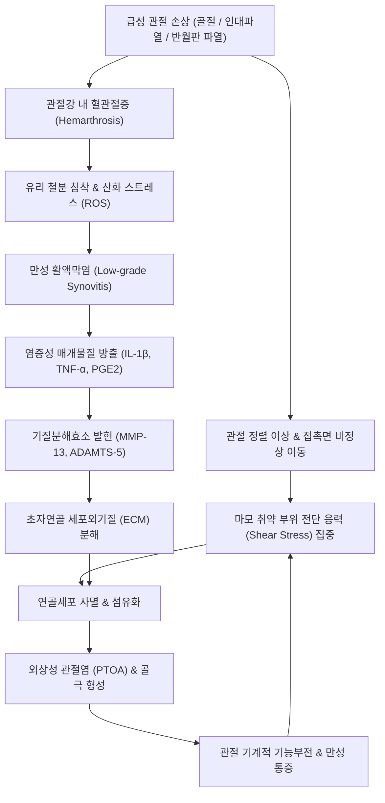

# 🩺 [[외상성 관절염]] (Post-Traumatic Osteoarthritis, PTOA / 外傷性 關節炎, ICD-10 M19.1)

> **핵심 3줄 요약 (Key Summary)**:
> - 📍 **병소 부위 & 해부·병태생리**: 관절내 골절(Intra-articular fracture), [[전방십자인대]] 파열, [[반월판 손상]], 관절 아탈구 및 심각한 염좌 등 외상 후 관절 연골의 물리적 파열, 활막 내 **혈관절증(Hemarthrosis)**과 만성 염증성 사이토카인(IL-1β, TNF-α) 폭증, 그리고 비정상적 생체역학 접촉 전단력으로 인해 발생하는 이차성 골관절염.
> - 🚩 **전형적 임상 양상 & 3대 징후**: 외상 후 수개월~수년의 잠복 치유기를 거친 후 서서히 진행하는 관절 부종 및 체중 부하 운동통, 관절 가동범위(ROM)의 단단한 뼈 끝느낌(Hard end-feel)을 동반한 구축, 연골 마모에 따른 기계적 마찰음(Crepitus) 및 관절 동요 불안정성.
> - 🛠️ **핵심 감별 검사 & 한·양방 다각적 치료 전략**: 체중부하 단순 방사선(X-ray 상 비대칭적 국소 관절강 협소화, 연골하골 경화, 골극 형성), **1년간의 자가치유·잠복기(골든타임)** 동안 관절 연골 보호 및 메이틀랜드(Maitland)·칼텐본(Kaltenborn) 관절가동추나, 관절강 소염재생 약침([[자하거약침]], [[봉독약침]], [[신바로약침]]) 및 [[독활기생탕]], [[당귀점통탕]], [[서경탕]], [[오적산]] 한약 투여.
> - <font color="#fa7e7e">⚠️ **응급 의뢰 레드플래그 & 악화 요인**: 외상 후 급격한 고열과 발적을 동반한 화농성 관절염 병발, 불유합 및 부정유합으로 인한 관절면의 급격한 함몰·붕괴, 중증 다발성 인대 파열로 인한 보행 불능 및 신경혈관 손상 의심 시 즉시 정형외과 전원.</font>

---

## 📌 목차
1. [질환 개요 & 해부학적 병태생리](#1-질환-개요--해부학적-병태생리)
2. [병태생리 메커니즘 & 생체역학적 악순환 네트워크](#2-병태생리-메커니즘--생체역학적-악순환-네트워크)
3. [임상 증상 & 이학적 검사(Physical Exam) 알고리즘](#3-임상-증상--이학적-검사physical-exam-알고리즘)
4. [감별 진단 매트릭스 (Differential Diagnosis)](#4-감별-진단-매트릭스-differential-diagnosis)
5. [한의 통합 치료 프로토콜 (침·약침·추나·한약)](#5-한의-통합-치료-프로토콜-침약침추나한약)
6. [양방 치료 & 병용·의뢰 기준 (Conventional Treatment & Referral)](#6-양방-치료--병용의뢰-기준-conventional-treatment--referral)
7. [재활 운동 & 생활습관 티칭 가이드](#7-재활-운동--생활습관-티칭-가이드)
8. [💡 사용자 진료실 핵심 필기 & 임상 노하우 (Melt-In 잔여 심화 집약)](#8--사용자-진료실-핵심-필기--임상-노하우-melt-in-잔여-심화-집약)
9. [출처 및 학술 참고 문헌 (References)](#9-출처-및-학술-참고-문헌-references)

---

## 1. 질환 개요 & 해부학적 병태생리

* **질환 정의 및 역학적 특성**:
  * 외상성 관절염(Post-Traumatic Osteoarthritis, PTOA)은 관절면에 가해진 급성 기계적 외상(골절, 탈구, 인대 파열, 연골 파열 등)으로 인해 **초기 연골세포 손상과 활막 염증, 그리고 잔여 생체역학적 관절 불안정성이 복합적으로 작용하여 발생하는 이차성 골관절염**이다.
  * **호발 연령의 특이성**: 노화에 따른 원발성 퇴행성 관절염(60~70대 이상 호발)과 달리, 스포츠 손상, 교통사고, 산업 재해 등 활동량이 왕성한 **20~50대의 젊은 층에서 호발**한다. 전체 골관절염 증례의 약 12%를 차지한다.
  * **호발 관절의 역학적 분포**:
    * **족관절 (Ankle joint / 거퇴관절)**: 임상적으로 가장 높은 외상성 관절염 발생률을 보인다. 발목 골관절염 환자의 **70% 이상이 과거 발목 골절(복사뼈 골절)이나 반복적인 중증 족관절 염좌(전거비인대 파열)에서 기인**한다(Backus et al., 2026).
    * **슬관절 (Knee joint)**: [[전방십자인대]](ACL) 파열 또는 [[내측반월판]]/[[외측반월판]] 절제술을 받은 환자의 50% 이상이 외상 후 10~15년 내에 명백한 방사선학적 골관절염으로 진행한다(Kaneguchi et al., 2026).
    * **고관절 (Hip joint)**: 비구 골절(Acetabular fracture) 또는 외상성 고관절 후방 탈구 후 발생.
    * **주관절 및 견관절 (Elbow & Shoulder)**: 주두 골절, 관절와순(Labrum) 파열, 재발성 견관절 탈구 후 발생.
* **관련 해부학적 구조물**:
  * **골격 및 관절면**: [[대퇴골]], [[경골]], [[슬개골]], [[거골]], [[비골]], [[종골]], 관절면의 적합성(Joint congruity).
  * **인대 및 동적 안정화 구조**: [[전방십자인대]], [[후방십자인대]], [[내측측부인대]], [[외측측부인대]], [[전거비인대]], [[종비인대]], 대퇴사두근건, 슬와근건.
  * **초자연골 및 섬유연골**: 관절면 초자연골(제2형 콜라겐, 아그레칸 프로테오글리칸 기질), 내측 및 외측 반월상 연골.
  * **활액막 및 관절낭 (Synovium & Joint Capsule)**: 급성기 혈관절증(Hemarthrosis) 반응 구역이자 만성기 섬유성 구축 발생 구역.

---

## 2. 병태생리 메커니즘 & 생체역학적 악순환 네트워크

### 1) 외상성 관절염의 3단계 연속 병태 기전 (ASCII 다이어그램)

```
[1단계: 급성 외상기 (0~3개월)]
   관절면 골절 / ACL 파열 / 반월판 파열
   │
   ├─► 기계적 충격: 연골세포 즉각 괴사 & 미토콘드리아 기능부전
   └─► 활막 출혈 (혈관절증 Hemarthrosis) ──► 적혈구 용혈 ──► 유리 철(Fe2+) 및 활성산소종(ROS) 폭증
         │
         ▼
[2단계: 아급성 염증 및 잠복 치유기 (3개월~1년, Golden Time)]
   활막 대식세포 활성화 ──► 염증 사이토카인 분비 (IL-1β, TNF-α, IL-6)
   │
   ├─► 이화 효소 분비 (MMP-13, ADAMTS-4, ADAMTS-5) ──► 제2형 콜라겐 & 프로테오글리칸 기질 분해
   ├─► 연골세포 자멸사 (Chondrocyte Apoptosis) 진행
   └─► 불완전한 섬유연골 재생 시도 (무증상 잠복기)
         │
         ▼
[3단계: 만성 구조적 개형기 (1년 이후 비가역적 진행)]
   인대 잔여 이완 / 관절면 부정유합 ──► 접촉 전단력 과부하 (Kinematic Shift)
   │
   ├─► 관절 연골 전층 섬유화 및 마모 탈락
   ├─► 연골하골 미세골절, 골경화 (Subchondral Sclerosis) 및 연골하 낭종
   └─► 관절 변연부 골극 형성 (Osteophyte) & 관절강 비대칭 협소화 (PTOA 확립)
```

### 2) 생체역학적 및 분자생물학적 악순환 네트워크 (Mermaid)



### 3) 세부 병태생리 고찰

* **급성 혈관절증(Hemarthrosis)과 철(Iron) 매개 세포 독성**:
  * 관절낭 내 출혈로 고인 적혈구가 파괴되면서 방출된 유리 헤모글로빈과 2가 철 이온($\text{Fe}^{2+}$)은 펜톤 반응(Fenton reaction)을 통해 하이드록실 라디칼($\cdot\text{OH}$)을 형성한다.
  * 이는 연골세포의 세포막 지질 과산화와 DNA 손상을 유발하여 초기 연골세포의 대량 사멸을 촉진하고, 활액막 내 대식세포를 자극하여 활막염을 영구화한다(Berenbaum, 2015).
* **전방십자인대(ACL) 재건술 후 관절염 진행의 역설**:
  * 해부학적으로 인대를 완벽하게 재건하더라도 수술 당시 이미 발생한 연골의 미세 손상과 분자 수준의 염증 반응은 차단되지 않는다.
  * 또한 재건된 인대는 정상 고유수용기(Proprioceptors)의 신경학적 피드백이 결손되어 있어, 보행 주기 중 대퇴-경골 관절면의 미세 전단 회전 활주(Tibial internal rotation shear)를 완벽히 통제하지 못해 관절염으로 진행한다(Kaneguchi et al., 2026).
* **1년의 자가치유·잠복기 (Window of Opportunity)**:
  * 외상 후 약 1년 동안은 연골 손상이 점진적으로 진행되면서도 신경 말단 손상과 인체의 일시적 보상 기전으로 인해 자각 증상이 미미한 '무증상 잠복기'를 거친다.
  * 이 골든타임에 적절한 한의 통합 치료(부하 경감, 관절가동추나, 항염증 한약)가 개입하지 못하면 비가역적인 전층 연골 손상으로 굳어진다.

---

## 3. 임상 증상 & 이학적 검사(Physical Exam) 알고리즘

### 1) 병기별 주소증 및 임상 양상
* **급성 외상기 (0~3개월)**:
  * 극심한 관절통, 관절강 내 혈종으로 인한 팽만감, 국소 열감, 완전한 체중 부하 불능, 심한 능동·수동 관절 가동범위 제한.
* **잠복 및 아급성기 (3개월~1년, 임상적 골든타임)**:
  * 급성 부종은 소실되었으나, 오래 걷거나 계단을 내려갈 때 뻐근하고 시큰거리는 통증.
  * 운동 후 관절 내 미세 삼출액 증가, 아침에 10~15분간 관절이 뻣뻣한 조조강직, 관절의 미세한 흔들림(불안정감).
* **만성 관절염 확립기 (1년 이후)**:
  * 체중 부하 시 지속되는 심부 둔통, 관절을 굽히고 펼 때 뼈끼리 갈리는 기계적 마찰음(Crepitus).
  * 골극 형성 및 관절낭 섬유화 구축으로 인한 굴곡/신전 제한(End-feel이 딱딱한 뼈 느낌).
  * 하지 정렬의 구조적 변형(슬관절 내반 변형/O자 다리, 족관절 편평외반 변형).

### 2) 필수 이학적 검사법 (Physical Examination)

```
[외상성 관절염 단계별 이학적 진찰 체계]
  1. 시진: 관절 부종(Effusion), 근위축([[대퇴사두근]], [[비복근]]), 하지 축 정렬(내반/외반), 보행 패턴
  2. 촉진: 관절선(Joint line) 압통점, 골극 촉진, 피하 열감, 건/인대 부착부 압통
  3. 안정성 유발 검사: 인대 이완도(Laxity) 및 반월판 손상 유발 검사
  4. 가동범위 및 마찰음: 수동 PROM 측정, 끝느낌(End-feel) 평가, 뼈 마찰음(Crepitus) 촉진
```

* **관절 안정성 및 인대 유발 검사**:
  * **[[라크만 검사]] (Lachman test)**: 슬관절을 20~30도 굴곡한 상태에서 경골을 전방으로 당겨 ACL 파열에 따른 전방 전위 및 부드러운 끝느낌(Soft end-feel) 확인.
  * **[[전방 서랍 검사]] (Anterior drawer test)**: 슬관절 90도 굴곡위에서 전방 전위 평가; 족관절에서는 거골의 전방 전위를 측정하여 전거비인대(ATFL) 잔여 불안정성 평가.
  * **[[맥머레이 검사]] (McMurray test)**: 슬관절을 회전 및 외반/내반 스트레스를 주며 신전할 때 관절선의 딸깍거리는 클릭음 및 통증 유발 확인 (반월판 파열 동반 평가).
* **관절강 삼출액 평가 검사**:
  * **부구 검사 (Patellar ballottement test)**: 검사자의 한 손으로 슬개상낭(Suprapatellar pouch)을 압박하고 다른 손가락으로 슬개골을 아래로 튕겨, 관절액 저류 시 슬개골이 뼈에 닿았다가 떠오르는 타격감 확인.
  * **밀킹 검사 (Bulge / Sweep test)**: 경미한 관절 삼출액(4~8mL)을 시각적으로 확인.
* **관절 마찰음 검사 (Patellar grind / Crepitus test)**:
  * 관절을 수동적으로 굴곡·신전시키면서 손바닥으로 관절면을 덮어 쥐었을 때 자갈이 굴러가는 듯한 미세 또는 거친 골마찰음 촉진.

---

## 4. 감별 진단 매트릭스 (Differential Diagnosis)

### 1) 감별 진단 일람표

| 감별 질환 | 호발 연령 및 선행 요인 | 침범 관절 패턴 | 통증 및 임상 특성 | 방사선학적 특징 (X-ray / MRI) |
| :--- | :--- | :--- | :--- | :--- |
| **[[외상성 관절염]] (본 질환)** | **20~50대**, 명확한 골절·인대파열 외상력 | **단일 관절 (비대칭성)** (발목, 무릎, 고관절) | 외상 후 수개월~수년 잠복기 후 발병, 체중 부하 시 악화 | 외상 손상 구역 중심의 **비대칭적 관절강 협착**, 국소 골극, 연골하 경화 |
| **[[퇴행성 관절염]] (원발성 OA)** | 60대 이상 고령, 노화, 비만, 과사용 | 양측성 대칭성 다발 (무릎, 고관절, 원위수지) | 서서히 진행하는 관절통, 조조강직 30분 미만 | 양측 내측 관절강 대칭 협착, 대칭적 골극 형성 |
| **[[류마티스 관절염]] (RA)** | 30~50대 여성, 자가면역 질환 | 양측 대칭성 소관절 (손목, MCP, PIP, 발) | 조조강직 1시간 이상, 전신 피로, 관절 종창 | 전반적 골감소증, 관절 변연부 골미란(Erosion), 관절강 균등 협착 |
| **[[화농성 관절염]] (Septic Arthritis)** | 전 연령, 세균 감염 (상처, 주사, 균혈증) | 급성 단일 관절 (무릎, 고관절) | **급격한 고열(>38.5℃), 관절 발적, 극심한 박동통, 보행 불가** | 관절액 흡인 상 혼탁한 농, 백혈구 >50,000/μL, 중성구 >90% |
| **[[반월판 손상]] 단독** | 10~40대 스포츠 손상 | 슬관절 단일 | 특정 각도에서 무릎이 걸려 펴지지 않는 잠김(Locking), 딸깍음 | 단순 X-ray 정상, MRI 상 고신호강도 파열선 및 관절연골 보존 |
| **박리성 골연골염 (OCD)** | 10~20대 청소년, 반복 미세외상 | 슬관절 내과, 거골 활차부 | 활동 시 둔통, 관절 내 유리체(Loose body)로 인한 잠김 | X-ray/MRI 상 연골하골의 국소 분리 및 괴사 골편 관찰 |

### 2) 🚨 정형외과 응급 의뢰 레드플래그 (Red Flags)
* **화농성 관절염 병발 의심**: 관절 천자 시 농성(Pus) 액 흡출, 전신 오한 및 고열, 수동 운동 시 관절을 전혀 움직이지 못하는 극심한 통증.
* **불유합 및 부정유합에 의한 관절면 급격한 붕괴**: 골절 수술 후 체중 부하 시 관절 각형성 변형 급격 악화, 골절선 사이의 이상 가동성(Abnormal mobility).
* **신경혈관 손상 징후**: 외상 부위 원위부 맥박(족배동맥, 후경골동맥) 소실, 족하수(Foot drop), 감각 소실.

---

## 5. 한의 통합 치료 프로토콜 (침·약침·추나·한약)

### 1) 한의학적 변증 체계 (TKM Pattern Identification)

* **어혈비 (瘀血痺)**:
  * **병태**: 외상 타박으로 인해 맥락이 파손되어 어혈이 관절강 및 경락에 정체됨.
  * **주증**: 외상 병력, 관절이 바늘로 찌르듯 아프고(刺痛) 통증 부위가 고정적임, 야간에 통증 악화, 피부에 자반이나 멍자국, 관절 주위 단단한 종창. 설질자암(舌質紫暗) 또는 어반(瘀斑), 맥삽(脈澁).
  * **치법**: 활혈화어(活血化瘀), 소종지통(消腫止痛).
* **간신휴손 (肝腎虧損)**:
  * **병태**: 간주근(肝主筋), 신주골(腎主骨) 원리에 따라 간신의 음혈과 정기가 부족하여 손상된 연골과 인대가 자가 치유되지 못하고 조기 퇴행함.
  * **주증**: 오래 걷거나 서 있으면 관절이 시큰거리고 힘이 빠짐(산연무력), 은은한 만성 관절통, 요슬산통(허리와 무릎의 시림), 관절 마찰음, 이명, 어지럼증. 설홍소태(舌紅少苔), 맥세약(脈細弱).
  * **치법**: 보익간신(補益肝腎), 강근장골(强筋壯骨).
* **풍한습비 (風寒濕痺)**:
  * **병태**: 관절 손상 후 기혈이 허약해진 틈을 타 풍한습 외사가 침범하여 경락 순환을 저해함.
  * **주증**: 날씨가 흐리거나 비가 오면 통증이 심해짐, 찬바람을 맞으면 관절이 시리고 굳어짐, 따뜻하게 찜질하면 완화됨, 관절이 무겁고 붓는 느낌. 설태백니(舌苔白膩), 맥유완(脈濡緩).
  * **치법**: 거풍제습(祛風除濕), 온경통락(溫經通絡).

### 2) 수동 관절가동추나 (Joint Mobilization Chuna)

```
[Maitland & Kaltenborn 관절가동술 등급 체계]
  • Maitland Grade I: 관절 가동범위 초기 10% 이내의 미세 진폭 진동 (극심한 통증 및 관절낭 자극 억제)
  • Maitland Grade II: 가동범위 50%까지의 큰 진폭 부드러운 진동 (아급성기 통증 조절 및 활액 순환)
  • Maitland Grade III: 조직 저항(R)에 도달하여 가동범위 끝까지 들어가는 큰 진폭 진동 (관절낭 유착 박리)
  • Maitland Grade IV: 가동범위 최종 한계선에서 미세한 진폭 진동 (구축된 관절 ROM 회복)
  • Kaltenborn Traction Grade I~II: 관절면에 가해지는 대기압 및 근육 압박을 중화하는 분리 견인 (관절면 마찰 방지)
  • Kaltenborn Glide Grade III: 관절면에 수직인 오목-볼록 법칙(Convex-concave rule)에 따른 생리적 활주 신장
```

* **슬관절 외상 후 관절가동술 프로토콜**:
  * **경골-대퇴골 장축 견인 (Tibiofemoral Axial Traction)**: 환자 앙와위에서 슬관절을 20~30도 굴곡하고 발목을 고정한 채 부드러운 1~2등급 견인을 적용하여 관절 내압을 낮추고 활액 분비를 촉진.
  * **경골 후방 활주 (Posterior Glide)**: 굴곡 가동범위 제한 시 대퇴골 원위부를 지지하고 경골 근위부를 후방으로 부드럽게 밀어 구축된 후방 관절낭 신장.
  * **슬개골 수동 가동술 (Patellar Mobilization)**: 슬개골을 상하·좌우로 수동 활주시추나하여 슬개대퇴관절의 유착 방지.
* **족관절 외상 후 관절가동술 프로토콜**:
  * **거골 후방 활주 (Talar Posterior Glide)**: 발목 염좌 및 골절 후 가장 흔한 배굴(Dorsiflexion) 제한을 해소하기 위해, 거골 경부를 후방으로 밀면서 족배굴곡 유도.

### 3) 침구 및 약침 치료 (Acupuncture & Pharmacopuncture)

* **주요 경혈 배혈**:
  * **슬관절 PTOA**: 독비(ST35), 내슬안(EX-LE4), 양릉천(GB34, 근회), 음릉천(SP9), 곡천(LR8), 족삼리(ST36), 혈해(SP10), 양구(ST34).
  * **족관절 PTOA**: 해계(ST41), 구허(GB40), 곤륜(BL60), 태계(KI3), 조해(KI6), 신맥(BL62), 상구(SP5).
  * **전침 요법 (Electroacupuncture)**: 독비-내슬안에 2Hz 저주파를 20분간 통전하여 내인성 오피오이드(엔도르핀) 분비 촉진 및 관절강 염증 사이토카인 억제.
* **약침 제제 선택 및 시술법**:
  * **급성기 / 염증 활성기 (0~3개월)**:
    * **황련해독탕약침 / 소염약침**: 관절강 내 및 측부인대 압통점에 0.5~1.0cc 주입하여 IL-1β, TNF-α 분비 억제.
    * **봉독약침 (Sweet Bee Venom 10%~20%)**: 관절선 및 인대 부착부 혈위 자입으로 강력한 소염진통 및 국소 혈류 개선.
  * **1년 잠복 치유기 및 만성기**:
    * **자하거약침 (Hominis Placenta)**: 연골 기질 손상 및 간신휴손 환자의 관절강 내 주입으로 연골세포 재생 및 성장인자(TGF-β, IGF-1) 분비 촉진.
    * **신바로약침 (GCSB-5)**: 연골 기질 분해효소(MMP-13) 억제 및 신경병증성 과민 반응 차단.

### 4) 한약 처방 (Herbal Medicine)

| 변증 유형 | 대표 한약 처방 | 구성 약물 및 방제 원리 | 임상 적응증 및 약리 작용 |
| :--- | :--- | :--- | :--- |
| **급성기 어혈비** | [[당귀수산]] (當歸鬚散) / [[화어전]] | 당귀미, 적작약, 오약, 향부자, 소목, 홍화, 도인, 계심, 감초 (파어소종, 행기지통) | 관절 외상 직후의 혈관절증, 심한 멍, 초기 어혈성 부종 및 격통 |
| **아급성 염증 및 관절종창** | [[당귀점통탕]] (當歸拈痛湯) / [[대강활탕]] | 당귀, 강활, 방풍, 승마, 갈근, 창출, 백출, 황금, 인진호, 지모, 택사, 저령, 고삼 | 관절 열감, 활액막염 삼출액 저류, 습열성 관절 부종 및 굴신불리 |
| **만성 풍한습비 / 연골 퇴행** | [[독활기생탕]] (獨活寄生湯) | 독활, 상기생, 두충, 우슬, 세신, 진교, 복령, 계심, 방풍, 천궁, 인삼, 숙지황, 백작약, 당귀, 감초 | 1년 잠복기 및 만성기 연골 마모 억제, 간신휴손 보익, 관절 강직 완화 |
| **풍한 어혈 겸증** | [[오적산]] (五積散) | 창출, 마황, 진피, 후박, 길경, 지각, 당귀, 백작약, 복령, 천궁, 백지, 반하, 건강, 육계, 감초 | 한랭 노출 시 악화되는 외상 후 관절통, 근육 경직 동반 |
| **상지 관절 외상 (주관절/견관절)** | [[서경탕]] (舒經湯) | 강활, 방풍, 당귀, 천궁, 백작약, 백출, 복령, 편자황금, 해동피, 감초, 생강 (통경락, 산한습) | 팔꿈치·어깨 외상 후 관절 구축, 팔의 굴신 장애 및 저림 |
| **기허 습담성 부종** | [[방기황기탕]] (防己黃芪湯) | 방기, 황기, 백출, 감초, 생강, 대조 (익기거풍, 건비이수) | 체질이 허약하고 땀을 많이 흘리며 무릎에 물이 차는 만성 삼출성 관절염 |

---

## 6. 양방 치료 & 병용·의뢰 기준 (Conventional Treatment & Referral)

### 1) 양방 약물 요법 (Conventional Medication)
* **비스테로이드성 소염진통제 (NSAIDs)**:
  * 세레콕시브(Celecoxib 200mg qd~bid), 아세클로페낙(Aceclofenac 100mg bid) 등 COX-2 억제제를 단기(2~4주) 투여하여 활막염 조절. 위궤양 고위험군에서는 PPI 병용.
* **진통 보조제**:
  * 아세트아미노펜(Acetaminophen 650mg tid), 트라마돌 복합제(Tramadol/Acetaminophen 37.5/325mg bid) 투여.

### 2) 비수술적 관절강 내 주사 시술 (Intra-articular Injections)
* **히알루론산 주사 (Hyaluronic Acid, HA)**:
  * 고분자 히알루론산 관절강 주입(주 1회, 3~5회 요법 또는 6개월 1회 단회 제형)으로 관절 활액의 점탄성 복원 및 연골면 윤활 작용 제공.
* **관절강 내 코르티코스테로이드 주사 (Corticosteroid)**:
  * 트리암시놀론 20~40mg 국소 주입. 급성 삼출액 저류 및 격통 시 단기 소염 효과가 탁월하나, 반복 투여 시 연골세포 사멸 촉진 및 연골 기질 소실을 가속하므로 연 3~4회 이하로 엄격히 제한.
* **자가 혈소판 풍부 혈장 주사 (PRP, Platelet-Rich Plasma)**:
  * 혈소판 내 농축된 PDGF, TGF-β, VEGF 등 성장인자를 주입하여 연골 기질 합성 유도 및 활막 염증 억제 시도.

### 3) 외과적 수술 적응증 (Surgical Indication)
* **조기 외과적 개복/관절경 정복 및 내고정술 (ORIF)**:
  * 관절내 골절 발생 시 관절면 단차(Step-off)가 **2mm 이상**이면 비정상 접촉 응력으로 PTOA가 100% 발생하므로, 조기에 해부학적 완전 정복(Anatomic reduction) 및 견고한 내고정 시행.
* **관절경하 변연절제술 및 세척술 (Debridement & Lavage)**:
  * 불안정한 연골 판막(Flap), 관절 내 유리체(Loose body), 파열된 반월판 절제.
* **교정 절골술 (Realignment Osteotomy)**:
  * 슬관절 근위 경골 절골술(HTO) 또는 원위 대퇴 절골술(DFO), 족관절 상과 절골술(Supramalleolar osteotomy)을 통해 손상된 관절면 부하를 정상 연골 부위로 분산(활동적인 젊은 환자의 관절 보존술).
* **관절 유합술 (Arthrodesis) 및 인공관절 치환술 (Arthroplasty)**:
  * 말기 관절 파괴 시 족관절은 거퇴관절 유합술 또는 인공발목관절 전치환술(TAR), 슬관절은 인공슬관절 전치환술(TKA), 고관절은 전치환술(THA) 시행.

### 4) 한의 병용 판단 및 의뢰 기준 (Combination & Referral)
* **병용 가능 (Synergy)**:
  * 히알루론산 주사 및 물리치료를 받는 환자에게 관절가동추나 및 [[독활기생탕]]을 병용하면 관절 가동범위 회복 속도를 2배 이상 단축시킴.
* **병용 주의**:
  * NSAIDs를 복용 중인 환자에게 소염 진통 목적의 한약을 병용할 경우 위장관 부작용 여부를 면밀히 모니터링하며, 통증 호전에 따라 NSAIDs를 단계적으로 테이퍼링(감량) 유도.
* **상급병원 정형외과 전원 기준**:
  * 급성 화농성 관절염 의심(고열, 극심한 관절 발적 및 농성 삼출액).
  * 관절내 골절 후 심각한 부정유합으로 관절 정렬 붕괴 진행.
  * 보존적 한양방 치료에도 불구하고 야간 안정 시 통증으로 일상생활이 전폐된 말기 골관절염(KL grade IV).

---

## 7. 재활 운동 & 생활습관 티칭 가이드

### 1) 단계별 운동 재활 프로토콜
* **1단계: 무부하 관절 가동성 및 등척성 운동 (Isometric Exercise)**:
  * **대퇴사두근 등척성 세팅 (Quad Sets)**: 무릎을 편 채 오금 아래에 수건을 깔고, 오금으로 수건을 바닥 쪽으로 5~10초간 지그시 누르기 (10회씩 3세트). 관절면 마찰 없이 대퇴사두근 위축 방지.
  * **직하지 거상 운동 (Straight Leg Raise, SLR)**: 누운 상태에서 발끝을 당기고 무릎을 편 채 30~45도 들어 올려 5초간 유지.
  * **족관절 밴드 저항 배굴 운동**: 세라밴드를 발등에 걸고 발목을 몸 쪽으로 당겨 전경골근 강화.
* **2단계: 폐쇄성 운동사슬(CKC) 체중 부하 운동**:
  * **벽 스쿼트 (Wall Squat, 0~45도)**: 등을 벽에 기대고 슬관절 굴곡 각도를 45도 이내로 제한하여 슬개대퇴관절 전단력을 최소화하며 대퇴사두근 및 둔근 강화.
  * **골반 브릿지 (Bridge)**: 대둔근 및 햄스트링 강화로 골반-무릎 안정성 확보.
* **3단계: 고유수용기 감각 훈련 (Proprioception Training)**:
  * 밸런스 패드(Balance pad) 또는 워블 보드(Wobble board) 위에서 한 발 서기 훈련을 통해 파열된 인대의 결손된 고유수용 감각 재교육.

### 2) 생활습관 및 관절 보호 수칙 (Joint Protection)
* **체중 감량 (Weight Management)**:
  * 보행 시 무릎에는 체중의 3~4배, 계단 보행 시 5~7배의 하중이 실리므로, 체중의 5%만 감량해도 관절염 진행 속도를 50% 이상 지연시킬 수 있음을 환자에게 강조.
* **지팡이 및 보조기 활용**:
  * 환측 관절 부하를 경감시키기 위해 **반대쪽 손에 지팡이(Cane)를 짚고 보행**하도록 지도 (환측 관절 부하 20~30% 즉각 감소).
  * 발목 관절염 환자는 단단한 레이스업(Lace-up) 발목 보조기 및 쿠션감이 좋은 롤커 바닥(Rocker-bottom) 신발 착용 권고.
* **저충격 유산소 운동 전환**:
  * 달리기, 등산, 축구, 줄넘기 등 관절에 수직 충격을 주는 운동을 전면 금지하고, 수영(자유형, 배영), 수중 걷기(아쿠아로빅), 실내 고정식 자전거 타기로 전환.

---

## 8. 💡 사용자 진료실 핵심 필기 & 임상 노하우 (Melt-In 잔여 심화 집약)

* **외상 후 '1년의 골든타임(Golden Time)' 티칭의 절대적 중요성**:
  * 환자들은 인대 재건술이나 깁스 고정 치료 후 3~6개월이 지나 붓기와 통증이 가라앉으면 "이제 완치되었다"고 착각하고 축구, 마라톤, 농구 등 격렬한 운동을 재개한다.
  * **외상 후 약 1년간은 미세 연골 손상이 스스로 아물거나 반대로 비가역적 관절염으로 굳어지는 중대한 갈림길(자가치유 기간)**이다.
  * 이 시기의 치료 목표는 단순 진통이 아니라, **① 관절 내 만성 미세 염증 억제, ② 생체역학적 부하 분산 보조, ③ 관절 연골 기질 회복 보조**임을 환자에게 명확히 교육해야 한다.
* **수동 관절가동술(Joint Mobilization)의 실전 손맛 노하우**:
  * 외상 후 굳어버린 관절을 환자 스스로 무리하게 꺾거나 기계로 강제 굴곡(CPM 과사용)시키면, 관절면 충돌로 인해 연골 마모가 폭발적으로 가속된다.
  * 진료실에서 **시술자가 수동으로 관절면을 잡고 축성 견인(Axial Traction, Kaltenborn Grade II)을 유지한 상태에서 부드럽게 전후 활주(Glide)를 주는 수동 관절가동추나**를 적용해야 관절면 손상 없이 관절낭 유착을 안전하게 분리할 수 있다.
* **진료실 필수 문진 체크리스트**:
  * 40~50대 환자가 "무릎이 시큰거리고 붓는다"고 내원했을 때, 원발성 퇴행성 관절염으로 예단하지 말고 반드시 다음을 질문해야 한다:
    * "10~20년 전 젊었을 때 군대나 축구 등 운동 중에 무릎이나 발목을 크게 삐끗하거나 깁스를 한 적이 있습니까?"
    * "과거에 관절 안에 피가 차서 주사기로 뽑아낸 적이 있습니까?"
  * 과거 외상력이 확인되면 전방 불안정성(라크만 검사) 및 비대칭적 국소 관절강 협착 여부를 집중적으로 추적해야 한다.

---

## 9. 출처 및 학술 참고 문헌 (References)

* **Backus JD, de Cesar Netto C, Johnson AH et al.** (2026). Advancing Prevention and Treatment of Ankle Osteoarthritis: A Translational Clinical Roadmap from the 2026 AOFAS/Arthritis Foundation Ankle Arthritis Think Tank. *Foot Ankle Orthop*, 11(3):24730114261267590. [PMID: 42602148](https://pubmed.ncbi.nlm.nih.gov/42602148/)
  * `[연구 요약]`: 발목 관절염의 70% 이상이 선행 외상(골절 및 염좌)에서 기인함을 규명하고, 조기 생체역학적 교정 및 분자 염증 억제를 통한 외상 후 발목 골관절염(PTOA) 예방 및 단계별 중재 임상 로드맵을 제시함.

* **Kaneguchi A, Ozawa J, Minamimoto K et al.** (2026). Why ACL reconstruction fails to prevent post-traumatic osteoarthritis: A narrative review of mechanical and biological perspectives. *Histol Histopathol*, 18880. [PMID: 42429168](https://pubmed.ncbi.nlm.nih.gov/42429168/)
  * `[연구 요약]`: 전방십자인대(ACL) 재건술 후에도 외상성 관절염으로 진행하는 역학적·생물학적 한계를 고찰하고, 초기 혈관절증으로 촉발된 연골 기질 분해효소 활성화와 잔여 미세 전단력이 비가역적 연골 파괴를 유발함을 분석함.

* **Berenbaum F.** (2015). Inflammation in osteoarthritis: changing views. *Osteoarthritis Cartilage*, 23(11):1809-1822. [PMID: 26521727](https://pubmed.ncbi.nlm.nih.gov/26521727/)
  * `[연구 요약]`: 관절 연골 손상 후 방출되는 염증성 사이토카인(IL-1β, TNF-α)과 미세 활막염이 연골세포 사멸 및 기질 분해효소(MMP-13, ADAMTS) 분비를 촉진하는 분자생물학적 악순환 네트워크를 체계적으로 규명함.