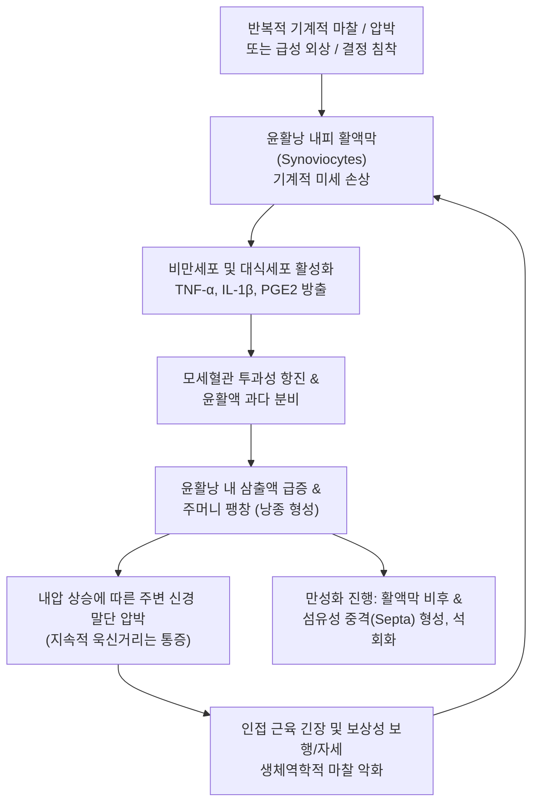

# 🩺 윤활낭염 (Bursitis / 점액낭염)

> **핵심 3줄 요약 (Key Summary)**:
> - 📍 **병소 부위 & 해부·병태생리**: 뼈 돌출부와 건, 인대, 근육, 피부 사이에 위치하여 마찰을 줄여주는 활액 주머니인 윤활낭(Bursa)이 반복적인 기계적 마찰, 과사용, 급성 외상, 요산 결정 침착, 또는 세균 감염에 의해 활액막 증식 및 삼출액 저류를 일으키는 염증성 질환이다.
> - 🚩 **전형적 임상 양상**: 표재성 윤활낭(주두, 슬개전)은 물혹처럼 불룩 튀어나오는 파동성 종창과 발적이 뚜렷하며, 심부 윤활낭(견봉하, 전자부, 장요근, 좌골)은 외관상 돌출은 적으나 깊은 국소 압통과 해당 관절 가동 시 날카로운 마찰성 통증을 호소한다.
> - 🛠️ **핵심 검사 & 치료 전략**: 고해상도 근골격계 초음파를 통한 활액막 비후 및 삼출액 평가, 감염/통풍 감별을 위한 윤활낭 천자액 분석(세포수, 그람염색, 편광현미경). 비감염성의 경우 천자 감압, 국소 냉각, 한의학적 습열비저(濕熱痺阻)·담음어혈(痰飮瘀血) 변증에 따른 [[봉약침]], [[황련해독탕]] 약침, [[오령산]] 또는 [[월비가출탕]] 투여를 복합 적용한다.
> - ⚠️ **응급 의뢰 레드플래그**: 윤활낭 부위의 극심한 발적, 작열감, 국소 열감과 함께 38°C 이상의 전신 발열, 오한이 동반되거나, 천자액이 혼탁한 고름(농양) 양상인 경우 화농성 윤활낭염(Septic bursitis)이므로 즉시 정형외과/감염내과로 의뢰하여 입원 정맥 항생제 및 절개 배농술을 시행해야 한다.

---

## 📌 목차
1. [질환 개요 & 해부학적 병태생리](#1-질환-개요--해부학적-병태생리)
2. [병태생리 메커니즘 & 생체역학적 악순환 네트워크](#2-병태생리-메커니즘--생체역학적-악순환-네트워크)
3. [임상 증상 & 이학적 검사(Physical Exam) 알고리즘](#3-임상-증상--이학적-검사physical-exam-알고리즘)
4. [감별 진단 매트릭스 (Differential Diagnosis)](#4-감별-진단-매트릭스-differential-diagnosis)
5. [한의 통합 치료 프로토콜 (침·약침·추나·한약)](#5-한의-통합-치료-프로토콜-침약침추나한약)
6. [양방 치료 & 병용·의뢰 기준 (Conventional Treatment & Referral)](#6-양방-치료--병용의뢰-기준-conventional-treatment--referral)
7. [재활 운동 & 생활습관 티칭 가이드](#7-재활-운동--생활습관-티칭-가이드)
8. [💡 사용자 진료실 핵심 필기 & 임상 노하우 (Melt-In 잔여 심화 집약)](#8--사용자-진료실-핵심-필기--임상-노하우-melt-in-잔여-심화-집약)
9. [출처 및 학술 참고 문헌 (References)](#9-출처-및-학술-참고-문헌-references)

---

![[윤활낭염_01_임상_주두부종.jpg|450]]
> [그림 §: ① 임상 — 주두 점액낭 부종] 팔꿈치 뒤가 부풀어 오른 실제 사진(파란 화살표). 주두 점액낭에 염증성 삼출이 고인 소견이다. 출처: File:Bursitis Elbow WCArrow.jpg (Wikimedia Commons) (CC BY-SA 3.0)

![[윤활낭염_02_해부_점액낭분포.jpg|450]]
> [그림 §: ① 해부 — 관절 주위 점액낭 분포] 무릎 관절 주위에 분포하는 점액낭들을 색으로 표시한 도해. 점액낭은 뼈 돌출부와 힘줄 사이에서 마찰을 줄이며, 여기에 염증이 생기면 윤활낭염이다. 출처: File:Bursae of knee joint.svg (Wikimedia Commons) (CC BY-SA 3.0)

![[윤활낭염_03_임상_주두종창.png|450]]
> [그림 §: ① 임상 — 주두 점액낭의 종창] 팔꿈치 뒤가 크게 부풀어 오른 측면 실사. 주두 점액낭에 삼출이 고여 팽창한 전형적 소견이다. 출처: Open-i(NLM) · PMC11010399 (BMC Infect Dis 2024) (CC BY 4.0)

## 1. 질환 개요 & 해부학적 병태생리

* **질환 정의**:
  * 윤활낭염(Bursitis, 점액낭염)은 인체 내 150개 이상 존재하는 윤활낭(Bursa)에 발생하는 급성 또는 만성 염증 상태를 통칭한다.
  * 윤활낭은 얇은 활액막 세포(Synoviocyte)로 둘러싸인 잠재적 공간(Potential space)으로, 평소에는 소량의 점액성 활액만 함유하여 인접 조직 간의 마찰을 흡수하는 완충 작용을 하지만, 염증 발생 시 다량의 삼출액이 고여 팽창한다.

* **해부학적 분류 및 호발 부위**:
  1. **표재성 윤활낭 (Superficial Bursae)**:
     * 피부 바로 아래 뼈 돌출부에 위치하여 외부 압박 및 피부 세균 침투에 취약함.
     * **[[주두 점액낭염]] (Olecranon bursitis)**: 팔꿈치 턱 괴기, 광부/학생 팔꿈치.
     * **[[슬개전점액낭염]] (Prepatellar bursitis)**: 무릎 꿇고 일하는 직업(가정부 무릎, 타일공).
     * **종골 피하 윤활낭염**: 뒤꿈치 신발 마찰.
  2. **심부 윤활낭 (Deep Bursae)**:
     * 건과 뼈, 또는 건과 건 사이에 위치하여 생체역학적 충돌 및 마찰과 직결됨.
     * **[[견봉하 점액낭염]] (Subacromial bursitis)**: 회전근개 충돌 증후군 동반 (어깨 통증의 가장 흔한 원인; Ding et al., 2026).
     * **[[대전자점액낭염]] (Trochanteric bursitis / GTPS)**: 대퇴골 대전자와 장경인대 사이 마찰.
     * **[[거위발 점액낭염]] (Pes anserine bursitis)**: 경골 내측 상부, 봉공근·박근·반건양근 부착부.
     * **[[좌골점액낭염]] (Ischial bursitis)**: 둔부 좌골결절 부위, 장시간 착석 노동자(직공 둔부).
     * **[[장요근점액낭염]] (Iliopsoas bursitis)**: 고관절 전면 서혜부 팽창.

---

## 2. 병태생리 메커니즘 & 생체역학적 악순환 네트워크

* **무균성 염증과 삼출액 형성**:
  * 반복적인 전단력(Shear stress)과 압박은 활액막 세포를 자극하여 염증성 사이토카인과 프로스타글란딘을 분비시킨다.
  * 혈관 확장과 삼출액 여과율 증가로 인해 윤활낭이 풍선처럼 부풀어 오르며, 팽창된 낭종 벽이 주변 신경 종말을 자극하여 압통과 자발통을 유발한다.

* **화농성 감염 기전 (Septic Bursitis; Maai et al., 2026)**:
  * 특히 표재성 윤활낭(주두, 슬개전)은 피부 찰과상, 열상, 미세 자침 자국, 또는 모낭염을 통해 피부 상재균인 황색포도상구균(Staphylococcus aureus, 약 80% 차지)이나 연쇄상구균이 직접 침입하여 발생한다.
  * 혈행성 파종은 드물며, 윤활낭 내는 혈관 분포가 적어 면역세포 유입이 제한되므로 급속도로 농양(Purulent effusion)으로 전환된다.

---

## 3. 임상 증상 & 이학적 검사(Physical Exam) 알고리즘

* **주요 임상 증상**:
  1. **표재성 윤활낭염**:
     * 팔꿈치나 무릎 앞쪽에 거위 알 또는 탁구공 크기의 물혹이 튀어나옴.
     * 만지면 물컹물컹한 파동감(Fluctuance)이 느껴지며, 피부가 당겨져 팽팽함.
     * 감염이 없으면 통증이 경미할 수 있으나 관절을 완전히 굽힐 때 팽만통 호소.
  2. **심부 윤활낭염**:
     * 외관상 부종은 두드러지지 않으나 해당 뼈 돌출부(대전자, 좌골, 견봉)를 깊게 누를 때 극심한 압통.
     * 야간에 환측으로 누워 잘 때 체중 압박으로 통증 심화(Sleep disturbance).
     * 계단 오르기(대전자/거위발), 장시간 앉기(좌골), 팔 위로 들어올리기(견봉하) 시 통증 악화.

* **화농성 vs 비화농성 감별 알고리즘 (Critical Step)**:
  * **화농성(Septic) 의심 징후**:
    1. 윤활낭 상부 피부의 뚜렷한 홍반(Erythema)과 열감(Warmth).
    2. 주변 연부조직으로 퍼지는 봉와직염성 부종.
    3. 전신 발열(>38.0°C), 오한, 빈맥.
    4. 자발통 및 극심한 압통.
  * **천자액 분석 (Diagnostic Aspiration)**:
    * 감염 의심 시 반드시 18~20G 바늘로 무균적 천자 시행:
      * 백혈구수 > 50,000/μL 및 중성구 > 80%: 화농성 강력 시사.
      * 그람 염색 및 균 배양 검사 필수.
      * 편광 현미경: 요산염 결정(MSU) 관찰 시 통풍성 윤활낭염 확진.

---

## 4. 감별 진단 매트릭스 (Differential Diagnosis)

| 질환명 | 주 병소 및 양상 | 관절 가동 범위 (ROM) | 핵심 감별점 |
| :--- | :--- | :--- | :--- |
| **비감염성 윤활낭염** | 윤활낭 국소 종창/압통, 피부 열감 없음 | **능동/수동 ROM 정상 유지** (끝범위 당김 제외) | 관절 자체의 병변이 아님, 과사용 병력, 혈액 염증 수치 정상 |
| **화농성 윤활낭염 (Septic)** | 국소 열감, 심한 홍반, 파동성 농양 | 관절 ROM은 비교적 보존 (관절염과 차이) | 전신 발열 동반 가능, 천자액 혼탁/고름, 황색포도상구균 호발 |
| **[[화농성 관절염]] (Septic Arthritis)** | 관절강 전체의 극심한 종창과 열감 | **미세한 수동 ROM에도 비명 (극심한 제한)** | 관절 내 질환으로 응급 관절 세척술 필요, 윤활낭염보다 훨씬 중증 |
| **[[봉와직염]] (Cellulitis)** | 피부 및 피하조직의 광범위 발적 | 정상 | 파동성 낭종 형성 없음, 피부 전반의 미만성 부종과 압통 |
| **결절종 (Ganglion Cyst)** | 손목/발목의 단단한 무통성 낭종 | 정상 | 투광 검사(Transillumination) 양성, 젤리형 점액 함유, 염증 없음 |
| **통풍성 윤활낭염 (Gouty)** | 주두/슬개전에 단단한 토피(Tophi) 동반 | 경도 제한 | 요산 결정 침착, 혈중 요산치 상승, 과거 통풍 발작력 |

---

## 5. 한의 통합 치료 프로토콜 (침·약침·추나·한약)

* **변증 분류**:
  1. **습열비저 (濕熱痺阻 - 급성 종창기)**: 습열의 사기가 경락과 근맥에 울체되어 낭종이 붓고 열감이 있으며 아픔. 국소 팽만, 조열감, 설홍태황니, 맥활삭.
  2. **담음어혈 (痰飮瘀血 - 만성 반복기)**: 진액이 정체되어 담음(수액)을 형성하고 미세혈액 순환 장애(어혈)와 결합하여 윤활낭 벽이 비후되고 단단해짐. 만성 둔통, 야간통, 설자암태백니, 맥현삽.
  3. **기허습담 (氣虛濕痰 - 노인/만성 소모성)**: 비기(脾氣) 허약으로 수습(水濕)을 운화하지 못하여 관절 주위에 삼출물이 지속적으로 고임. 설담체반, 맥세약.

* **침구 치료 프로토콜**:
  * **병소 국소 자침 (포위침법 圍刺法)**:
    * 비감염성 표재성 낭종의 기저부를 향해 4~6방향에서 사자(斜刺)하여 낭종 주변 미세순환을 촉진하고 림프 환류 유도.
    * 심부 윤활낭의 경우 해당 압통점 혈위 심부 자침.
  * **부위별 다용 혈위**:
    * 견봉하: [[견우]](LI15), [[견료]](TE14), [[노수]](SI10), [[비노]](LI14).
    * 주두: [[곡지]](LI11), [[천정]](TE10), [[소해]](HT3), [[척택]](LU5).
    * 대전자: [[환도]](GB30), [[거료]](GB29), [[풍시]](GB31).
    * 거위발/슬개: [[음릉천]](SP9), [[곡천]](LR8), [[혈해]](SP10), [[양릉천]](GB34).
  * **전침 요법**: 2Hz 연속파로 15분간 적용하여 통증 물질(P 물질) 배출 촉진 및 근경련 완화.

* **약침 치료**:
  * **황련해독탕 약침**: 습열성 급성 부종 및 열감이 있는 낭종 주변 연부조직에 0.5~1.0cc 산자하여 강력한 청열해독 및 소염 효과 도모.
  * **봉약침 (Sweet Bee Venom, BV)**: 만성 비감염성 윤활낭염에 0.1~0.3cc 극소량 점적하여 만성 염증 차단 및 국소 혈류 개선.
  * **신바로 또는 중성어혈 약침**: 대전자, 견봉하 심부 압통점에 0.5~1.0cc 심부 주입.

* **한약 처방 프로토콜**:
  * **급성기 삼출액 저류: [[오령산]](五苓散) 또는 [[월비가출탕]](越婢加朮湯)**
    * 오령산(택사, 복령, 저령, 백출, 육계)은 세포외 수분 삼출을 조절하여 관절 및 낭종 내 고인 체액을 소변으로 신속히 배출시킴.
    * 열감이 동반된 경우 마황, 석고가 배오된 월비가출탕을 사용하여 급성 부종을 신속히 가라앉힘.
  * **만성 비후 및 근력 저하: [[방기황기탕]](防己黃芪湯)**
    * 황기, 방기, 백출로 비기를 돋우고 기허성 부종과 무력감을 개선.
  * **통풍성/어혈성 만성 통증: [[당귀수산]](當歸鬚散) 또는 [[영선제통음]](靈仙除痛飲)**
    * 외상성 혈종이 동반된 경우 어혈을 풀고 연부조직 유착을 방지.

---

## 6. 양방 치료 & 병용·의뢰 기준 (Conventional Treatment & Referral)

* **비화농성 윤활낭염의 보존적 치료**:
  1. **초기 처치**: RICE 프로토콜 (안정, 냉찜질, 압박 붕대 적용).
  2. **약물 치료**: 경구 소염진통제(NSAIDs: 나프록센, 멜록시캄 등) 1~2주간 단기 투여.
  3. **치료적 천자 및 압박 (Aspiration & Compression)**:
     * 통증을 유발하는 다량의 삼출액을 18G 바늘로 흡인하여 감압 후, 체액 재저류를 막기 위해 탄력 붕대로 24~48시간 압박 유지.
  4. **국소 코르티코스테로이드 주사 (CSI)**:
     * 트리암시놀론(Triamcinolone 20~40 mg) 국소 주입: 보존 치료 실패 시 강력한 항염 효과를 제공하나, 반복 주사 시 피부 위축, 건 파열, 세균 감염 위험이 있으므로 표재성 윤활낭에는 극히 제한적으로 사용.
  5. **증식치료 (Prolotherapy; Zerzan et al., 2026)**:
     * 만성 견봉하/전자부 윤활낭염에서 고농도 포도당을 이용한 인대·건 부착부 증식치료가 장기적 기능 회복에 효과적임.

* **화농성 윤활낭염의 치료 (Septic Management)**:
  * 즉각적인 감염내과/정형외과 입원 치료.
  * 경험적 항생제(Cefazolin 1~2g IV q8h 또는 반코마이신) 투여 및 배양 결과에 따른 표적 항생제 변경 (최소 2~3주 투여).
  * 매일 반복적인 바늘 흡인 배농, 불응 시 관절경하 윤활낭 절제술(Bursectomy) 시행 (Maai et al., 2026).

* **양방·전문과 의뢰 기준 (Referral Criteria)**:
  * **🚨 즉각 정형외과/응급실 전원 (Red Flags)**:
    1. 윤활낭 상부 피부의 급격한 발적, 작열감, 38°C 이상의 전신 고열(화농성 점액낭염).
    2. 천자 시 탁한 고름이나 악취가 나는 삼출액이 흡인되는 경우.
    3. 보존적 한양방 치료 4~6주 이상에도 지속적으로 재발하여 일상생활이 불가능한 만성 섬유화 낭종(수술적 활액낭 절제술 적응증).

---

## 7. 재활 운동 & 생활습관 티칭 가이드

* **직업 및 일상 생활습관 교정**:
  * **외부 압박 차단**:
    * 팔꿈치를 책상에 괴는 습관 엄격히 금지 (도톰한 엘보 패드 착용).
    * 타일공, 청소원 등 무릎을 꿇는 직업군은 쿠션형 무릎 보호대(Knee pads) 착용 의무화.
    * 둔부 좌골 점액낭염 환자는 도넛 방석 또는 메모리폼 쿠션 사용.

* **단계적 관절 가동 및 근력 운동**:
  * 급성기 종창이 가라앉은 후 통증이 없는 범위 내에서 관절 가동 범위 운동(진자 운동, 가벼운 스트레칭) 시작.
  * 견봉하 점액낭염: 견갑골 안정화 운동(로우, Y-to-T 운동) 및 회전근개 외회전 근력 강화.
  * 대전자 점액낭염: [[중둔근]] 강화 운동(클램셸 Clamshell, 사이드 레그 레이즈) 및 장경인대 폼롤러 마사지.

---

## 8. 💡 사용자 진료실 핵심 필기 & 임상 노하우 (Melt-In 잔여 심화 집약)

* **진료실 임상 팁**:
  * 팔꿈치(주두)나 무릎(슬개전)에 물이 차서 물혹처럼 불룩 튀어나온 환자가 오면 **가장 먼저 손을 대서 피부 온도를 확인하고 붉은 기운이 있는지 살펴보라**.
  * 만약 손을 댔을 때 후끈거리는 열감이 있고 피부가 붉다면 침을 놓거나 원내에서 천자하지 말고 감염성(화농성) 여부를 의심해야 한다. 균 감염 상태에서 침을 놓으면 봉와직염으로 번질 수 있다.
  * 피부가 차갑고 열감이 없는 단순 기계적 물혹이라면 습부항이나 천자로 물을 뺀 후 즉시 탄력붕대로 단단하게 압박(Compression)해 주어야 다시 물이 차지 않는다.
  * 여기에 체내 수습을 말려주는 **오령산이나 월비가출탕을 5~7일간 투여하고, 황련해독탕 약침으로 낭종 기저부를 치료**하면 양방에서 스테로이드 주사를 맞고 재발하던 환자들도 깨끗하게 완치된다.

---

## 9. 출처 및 학술 참고 문헌 (References)

* Zerzan N, Ewart D, Sowerby C, et al. (2026). Dextrose prolotherapy for chronic symptomatic rotator cuff tendinopathy and subacromial bursitis: A systematic review and meta-analysis. *PM R*. (In press). PMID: 42825417

* Ding J, Liu S, Jiang P, et al. (2026). Subacromial bursitis: current evidence and future directions in injection-based therapies-A narrative review. *Ann Med*. 58(1):2673146. PMID: 42139015

* Maai N, Baarts J, Keller PM, et al. (2026). Nocardia farcinica septic bursitis - a case report and scoping literature review. *Swiss Med Wkly*. 156:5110. PMID: 42537630

---

## 관련 노트

- [[주두 점액낭염]]
- [[슬개전점액낭염]]
- [[대전자점액낭염]]
- [[견봉하 점액낭염]]
- [[거위발 점액낭염]]
- [[좌골점액낭염]]
- [[봉약침]]
- [[황련해독탕]]
- [[오령산]]
- [[월비가출탕]]
