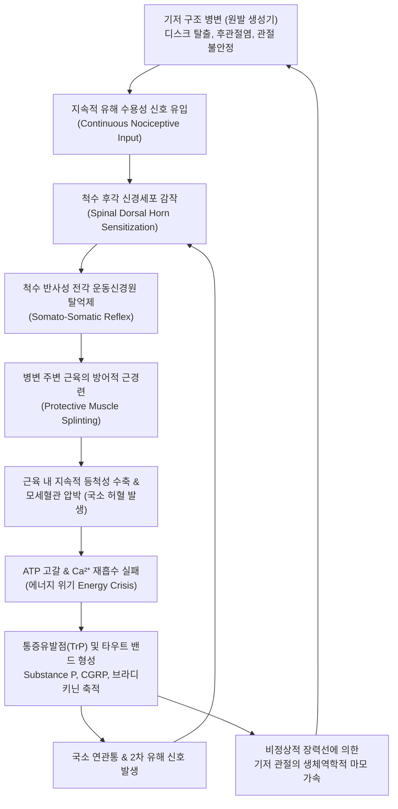

# 🩺 이차성 근막통증증후군 (Secondary Myofascial Pain Syndrome)

> **핵심 3줄 요약 (Key Summary)**:
> - 📍 **병소 부위 & 해부·병태생리**: 단순 근육 과사용에서 발생하는 원발성(Primary)과 달리, 기저의 척추·관절 구조적 병변([[요추 추간판 탈출증]], [[경추 추간판 탈출증]], 척추 후관절증, [[골관절염]], 관절 불안정증)에서 지속적으로 유입되는 통각 신호(Nociceptive barrage)에 대응하여 관절을 보호하려는 방어적 근경련(Splinting spasm) 및 보상성 생체역학적 과부하로 인해 이차적으로 통증유발점(TrP)이 만성화되는 복합 증후군이다.
> - 🚩 **전형적 임상 양상**: 목·어깨·허리·둔부 근육 내 단단한 띠(Taut band)와 압통점이 만져지며 특유의 연관통(Referred pain)을 방사하나, 통증유발점 주사(TPI)나 침 치료를 받아도 수일 내에 원위치로 재발하며 기저 질환의 징후(신경근 압박, 관절 마찰음, 가동 제한)가 병존한다.
> - 🛠️ **핵심 검사 & 치료 전략**: 근육 내 통증유발점 촉진(국소 연축 반응 LTR)과 더불어 반드시 원발성 척추/관절 병인(Primary generator)을 규명하기 위한 정밀 이학적 검사 및 영상의학적 검사(X-ray, MRI) 병행. 한의학적으로 표본겸치(標本兼治) 원칙에 따라 가지(標)에 해당하는 TrP 침구·약침 치료와 뿌리(本)에 해당하는 추나교정(척추·골반 변위 정렬) 및 [[독활기생탕]], [[작약감초탕]]을 복합 적용한다.
> - ⚠️ **응급 의뢰 레드플래그**: 단순 근육 뭉침으로 오인되었으나 진행성 하지 마비, 족하수(Foot drop), 안장 부위 감각 소실(Saddle anesthesia), 배뇨·배변 장애가 동반되는 마미증후군(Cauda equina syndrome) 소견이나 척수병증(Myelopathy) 징후 관찰 시 즉시 척추신경외과 응급 수술 의뢰.

---

## 📌 목차
1. [질환 개요 & 해부학적 병태생리](#1-질환-개요--해부학적-병태생리)
2. [병태생리 메커니즘 & 생체역학적 악순환 네트워크](#2-병태생리-메커니즘--생체역학적-악순환-네트워크)
3. [임상 증상 & 이학적 검사(Physical Exam) 알고리즘](#3-임상-증상--이학적-검사physical-exam-알고리즘)
4. [감별 진단 매트릭스 (Differential Diagnosis)](#4-감별-진단-매트릭스-differential-diagnosis)
5. [한의 통합 치료 프로토콜 (침·약침·추나·한약)](#5-한의-통합-치료-프로토콜-침약침추나한약)
6. [양방 치료 & 병용·의뢰 기준 (Conventional Treatment & Referral)](#6-양방-치료--병용의뢰-기준-conventional-treatment--referral)
7. [재활 운동 & 생활습관 티칭 가이드](#7-재활-운동--생활습관-티칭-가이드)
8. [💡 사용자 진료실 핵심 필기 & 임상 노하우 (Melt-In 잔여 심화 집약)](#8--사용자-진료실-핵심-필기--임상-노하우-melt-in-잔여-심화-집약)
9. [출처 및 학술 참고 문헌 (References)](#9-출처-및-학술-참고-문헌-references)

---

## 1. 질환 개요 & 해부학적 병태생리

* **질환 정의**:
  * 이차성 근막통증증후군(Secondary Myofascial Pain Syndrome, Secondary MPS)은 근육 자체의 급성 염좌나 과사용으로 촉발되는 원발성 근막통증과 달리, 신체의 다른 구조적 또는 신경학적 병변이 '원발성 통증 생성기(Primary Pain Generator)'로 작용하여 그 상하위 분절 근육에 만성적이고 난치성인 통증유발점(Myofascial Trigger Points, TrPs)을 유도하는 질환이다.
  * 임상에서 "침이나 주사를 맞을 때만 반짝 좋고 2~3일 지나면 도로 뭉친다"고 호소하는 만성 환자의 80% 이상이 이 범주에 속한다(Gür, 2026).

* **원발성 기저 병소(Primary Generators)의 범주**:
  1. **척추성 병변 (Spinal Pathology)**: 경추 및 요추의 추간판 탈출증(HNP), 척추관 협착증, 척추 후관절 증후군(Facet joint arthropathy), 척추전방전위증.
  2. **관절 및 연골 병변**: 고관절·슬관절의 [[골관절염]], 견관절 회전근개 파열 및 관절와순(SLAP) 손상, 턱관절 장애(TMD).
  3. **인대 및 골반 부정렬**: 천장관절 증후군(Sacroiliac joint dysfunction), 만성 인대이완증, 장골 골반 전후방 변위.
  4. **신경 포착 병변**: 흉곽출구증후군(TOS), 이상근증후군, 수근관증후군.

![[이차성_근막통증증후군_01_척추후관절해부위치및관절면도해.jpg]]
> [그림 1: 척추 분절 불안정성과 방척추근·다열근의 이차성 근막통증을 유발하는 척추 후관절(facet joints) 해부 도해 — 출처: Wikimedia Commons (File:Facet Joints.png)]

---

## 2. 병태생리 메커니즘 & 생체역학적 악순환 네트워크

* **보호성 근경련(Muscle Splinting)과 에너지 위기**:
  * 척추 분절이나 관절이 불안정해지면 중추신경계는 추가적인 신경 손상이나 관절 탈구를 막기 위해 해당 관절을 고정(Splint)하려는 반사성 근수축 명령을 내린다.
  * 지속적인 등척성 수축은 근육 내 혈류를 차단하여 국소 저산소증과 산성화를 유발한다. ATP가 고갈되면 근소포체로 칼슘을 회수하지 못해 액틴-마이오신 결합이 풀리지 않는 '지속적 구축(Contracture)' 상태에 빠지며 이것이 타우트 밴드(Taut band)를 형성한다.

* **감작(Sensitization)과 원격 전파**:
  * 지속적인 유해 자극은 척수 분절 내 광역수용신경세포(WDR neuron)를 감작시켜 수용야(Receptive field)를 인접 분절로 확장시킨다.
  * 그 결과 목 디스크 환자에서 승모근뿐만 아니라 능형근, 견갑거근, 극하근까지 도미노처럼 이차성 통증유발점이 확산된다(Gür, 2026; Jeon et al., 2026).

![[이차성_근막통증증후군_02_척추굴곡신전시추간판및후관절운동역학도해.jpg]]
> [그림 2: 척추 굴곡(flexion) 및 신전(extension) 시 추체·추간판과 후관절(facet joints)에 가해지는 기계적 부하 도해 — 출처: Wikimedia Commons (File:Facet-joints.png)]

![[이차성_근막통증증후군_02_천장관절골반해부도.jpg]]
> [그림 3: 중둔근·소둔근·이상근의 이차성 근막통증증후군 선행 병변이 되는 천장관절(sacroiliac joint, 적색 표시) 골반 해부도 — 출처: Wikimedia Commons (File:SI joint.png)]

---

## 3. 임상 증상 & 이학적 검사(Physical Exam) 알고리즘

* **주요 임상 증상**:
  1. **광범위한 연관통(Referred Pain)**:
     * 원발 부위와 떨어진 곳으로 묵직하고 쑤시는 통증 방사 (예: 둔부 중둔근 TrP -> 대퇴 외측 방사통; 견갑거근 TrP -> 경항부 및 견갑골 내측 연관통).
  2. **가동 범위(ROM)의 뻣뻣함과 조조강직**:
     * 아침에 일어났을 때 근육이 판자처럼 굳어 있으며 가벼운 스트레칭이나 온찜질 시 일시적 완화.
  3. **치료의 일시성 및 잦은 재발**:
     * 마사지나 침을 맞으면 몇 시간~하루는 시원하지만 기저 원인이 해결되지 않아 2~3일 내에 다시 단단하게 뭉침.

* **이학적 검사 알고리즘**:
  * **통증유발점(TrP) 4대 필수 징후 확인**:
    1. 촉진 가능한 팽팽한 띠(Taut band).
    2. 띠 내부의 극심한 압통점(Exquisite spot tenderness).
    3. 압박 시 환자가 호소하는 원래의 통증 패턴 재현(Jump sign & Referred pain).
    4. 횡단 촉진(Snapping palpation) 또는 자침 시 국소 연축 반응(Local twitch response, LTR).
  * **기저 원발 병소 역추적 검사 (Essential)**:
    * **경추 분절**: Spurling test, Jackson test, 경추 가동범위 및 후관절 압통 촉진.
    * **요추 및 골반 분절**: [[SLR Test]](직거상 검사), Kemp test, Patrick test(FABER), 천장관절 압박 검사.
    * 만약 하지 방사통과 함께 슬개건/아킬레스건 반사 저하나 무지신근 위약이 있다면 단순 MPS가 아닌 신경근 압박증을 반드시 진단에 포함해야 함.

![[이차성_근막통증증후군_03_경추C6C7추간판탈출증시상면MRI영상.jpg]]
> [그림 4: 경견부 및 견갑골 내측 근육의 이차성 근막 방어 경축을 유발하는 경추 C6-C7 추간판 탈출증 시상면 T2 MRI 영상 — 출처: Wikimedia Commons (File:C6-C7-disc-herniation-cevical-mri-scan.jpg)]

![[이차성_근막통증증후군_03_요추L4L5추간판탈출증시상면MRI영상.jpg]]
> [그림 5: 요방형근·둔근의 이차성 통증유발점 원인이 되는 요추 L4-L5 및 L5-S1 추간판 탈출증(적색 원) 시상면 MRI 영상 — 출처: Wikimedia Commons (File:Hernie discale L4 L5.png)]

---

## 4. 감별 진단 매트릭스 (Differential Diagnosis)

| 질환명 | 주 병소 및 원인 | 통증 양상 및 분포 | 핵심 감별점 |
| :--- | :--- | :--- | :--- |
| **이차성 근막통증 (Secondary MPS)** | 기저 척추/관절 질환에 따른 보상성 연축 | 국소 분절성 타우트 밴드, 뚜렷한 연관통 | **기저 질환 치료 없이는 반복 재발**, LTR 관찰, 수면장애는 부차적 |
| **원발성 근막통증 (Primary MPS)** | 단순 급성 염좌, 자세 불량, 일시적 과사용 | 단일 또는 소수 근육의 TrP | 기저 척추/관절 이상 없음, TrP 해제 시 영구적/장기적 호전 |
| [[섬유근육통]] (Fibromyalgia) | 중추성 통증 조절 이상 (중추감작) | **전신 4사분면 광범위 다발성 통증** | 18개 압통점 기준, 타우트 밴드나 LTR 없음, 만성 피로·수면장애 필수 |
| **신경근병증 (Radiculopathy)** | 추간판 탈출, 협착에 의한 신경근 직접 압박 | 피부분절(Dermatome)을 따르는 저림/자통 | 명확한 감각 저하, 운동 위약, 건반사 소실 동반 |
| **류마티스성 다발근통 (PMR)** | 전신 염증성 질환 (활액막염/윤활낭염) | 양측 어깨대 및 골반대의 심한 조조강직 | 50세 이상, 근육 TrP 없음, ESR/CRP 현저한 상승 |

---

## 5. 한의 통합 치료 프로토콜 (침·약침·추나·한약)

* **치료 원칙: 표본겸치 (標本兼治)**:
  * 가지(標)인 통증유발점만 풀면 며칠 내 재발하므로, 뿌리(本)인 척추 분절의 아탈구와 골반 부정렬을 추나로 바로잡고, 신경근 및 관절낭 염증을 약침으로 제어하며, 근육 내 허혈성 TrP를 침구로 해제하는 3단계 통합 치료를 적용한다.

* **침구 치료 프로토콜**:
  * **심부 통증유발점 자침 (Dry Needling / 침치료)**:
    * 타우트 밴드를 촉진하여 고정한 후 0.30×40~60mm 장침으로 TrP를 직접 관통하여 국소 연축 반응(LTR)을 유도. LTR 발생 시 세포외 아세틸콜린과 P 물질 농도가 즉각 급감함.
  * **척추 신경근 분절 배수혈 및 협척혈 자침**:
    * 경추부: [[풍지]](GB20), [[견정]](GB21), [[대추]](GV14), 경추 [[협척혈]](EX-B2).
    * 요배부: [[신수]](BL23), [[대장수]](BL25), [[환도]](GB30), 요추 협척혈.
  * **전침 치료**: 2Hz 연속파를 15분간 적용하여 척수 후각 레벨에서 엔돌핀 및 엔케팔린 분비를 유도, 척수 감작을 차단(Jongutchariya et al., 2026).

* **약침 치료**:
  * **신바로(Shinbaro) 약침 또는 황련해독탕 약침**:
    * 기저 질환인 디스크 탈출 부위 주변 후관절 및 천장관절 인대 부착부에 0.5~1.0cc 심부 주입하여 원발 통증 생성기의 염증성 사이토카인 억제.
  * **자하거(Hominis Placenta) 약침**:
    * 만성 허혈 상태의 근육 통증유발점에 0.5cc 주입하여 근섬유 미세순환 회복 및 조직 재생 유도.

* **추나 치료 (Chuna Manipulation - 본치 本治)**:
  * **골반 및 천장관절 교정**: 천골 기저부 변위와 장골 후하방 변위를 가동 및 교정 기법으로 바로잡아 둔부 및 척추 기립근에 걸리는 보상성 회전 장력 해소.
  * **경추/흉추 가동 및 신연 추나**: 후관절 잠김을 해소하여 척수 신경근의 기계적 자극을 차단.

* **한약 처방 프로토콜**:
  * [[작약감초탕]](芍藥甘草湯) (급성기 근긴장 해제):
    * 백작약 24g, 감초 12g. Paeoniflorin이 신경근 접합부 칼슘 유입을 조절하여 방어적 근경련을 신속히 완화.
  * [[독활기생탕]](獨活寄生湯) (기저 퇴행성 질환 병존 만성기):
    * 간신부족 및 기혈양허로 인한 만성 척추 관절통에 두충, 우슬, 상기생, 당귀 등으로 근골을 보강.
  * [[서경탕]](舒經湯) 또는 [[오적산]](五積散):
    * 한습(寒濕)과 기체어혈로 경락이 막혀 뻣뻣함이 심하고 날씨가 궂으면 악화되는 만성 근막통에 적용.

![[이차성_근막통증증후군_05_요방형근장요근척추기립근후복벽횡단면해부도.jpg]]
> [그림 6: 요추 병변에 이차적으로 과긴장되는 요방형근(quadratus lumborum)·장요근·척추기립근 및 흉요근막 횡단면 해부 도해 — 출처: Wikimedia Commons (File:Cross-sectional Diagram of Posterior Abdominal Wall Muscles and Fasciae.jpg)]

---

## 6. 양방 치료 & 병용·의뢰 기준 (Conventional Treatment & Referral)

* **통상적 양방 치료 (Conventional Management)**:
  * **약물 치료**:
    * 중추성 근이완제(에페리손 Eperisone, 티자니딘 Tizanidine), 소염진통제(NSAIDs).
    * 신경병증성 통증 동반 시 가바펜티노이드(프레가발린, 가바펜틴) 병용.
  * **통증유발점 주사 (Trigger Point Injection, TPI)**:
    * 0.5% 리도카인 국소 주입으로 타우트 밴드 기계적 파쇄 및 혈류 재개통.
  * **재생 주사 치료 (Prolotherapy / PRP; Jeon et al., 2026)**:
    * 기저의 인대 이완이나 천장관절 불안정성이 원인인 경우 고농도 포도당이나 PRP를 인대-골 부착부에 주입하여 인대 장력을 복원.
  * **신경차단술 (Nerve Block)**:
    * 원발 병소인 후관절 내측지 차단술(MBB) 또는 경막외 신경차단술(Epidural block).

* **양방·전문과 의뢰 기준 (Referral Criteria)**:
  * **🚨 즉각 신경외과/정형외과 의뢰 (Red Flags)**:
    1. 보행 시 발목이나 무릎에 힘이 빠져 주저앉는 명확한 운동 마비(Motor grade 3 이하).
    2. 항문 주위 감각 이상, 대소변 조절 장애가 동반된 마미증후군 의심 환자.
    3. 암 병력이 있는 환자에서 설명되지 않는 야간 골통증 및 체중 감소(척추 전이암 의심).

---

## 7. 재활 운동 & 생활습관 티칭 가이드

* **원발 병소 보호를 위한 자세 교정**:
  * 턱 당기기(Chin-tuck) 운동: 거북목 및 일자목으로 인한 후두하근과 상부 승모근의 이차성 연축 방지.
  * 요추 중립 골반 정렬 유지: 앉아 있을 때 허리 쿠션을 사용하여 요추 전만각을 유지하고 다리를 꼬는 자세 엄금.

* **자가 근막 이완 및 신장 운동**:
  * 폼롤러 및 마사지 볼을 이용한 둔근(이상근, 중둔근) 및 흉추 기립근 허혈성 압박(Ischemic compression, 30~60초간 지속 압박).
  * 맥켄지(McKenzie) 신전 운동: 디스크 내압을 감소시켜 척추 기립근의 반사성 근경련 차단.

---

## 8. 💡 사용자 진료실 핵심 필기 & 임상 노하우 (Melt-In 잔여 심화 집약)

* **진료실 임상 팁**:
  * "선생님, 다른 병원에서 목에 주사도 맞고 도수치료도 수십 번 받았는데 며칠만 지나면 승모근이 돌덩이처럼 다시 굳어요"라고 말하는 환자는 십중팔구 **경추 디스크나 후관절 이상에 의한 '이차성 근막통증'**이다.
  * 이때 승모근에 침만 열심히 놓으면 명의 소리를 못 듣는다. "환자분, 승모근이 뭉치는 것은 목 안의 디스크가 불안정해서 목뼈가 흔들리지 않도록 근육들이 필사적으로 목을 붙잡고 있는 방어 작용입니다. 승모근만 억지로 풀면 목 디스크가 더 덜컹거려 근육이 더 강하게 뭉치게 됩니다"라고 원리를 티칭해야 한다.
  * **경추 협척혈 약침과 골반/경추 추나로 척추 축을 안정시킨 뒤에 승모근 TrP를 자침**하면 매번 재발하던 만성 통증이 비로소 완전히 가라앉는다.

---

## 9. 출처 및 학술 참고 문헌 (References)

* Gür A. (2026). The stress-fascia-pain axis in myofascial pain syndrome: a mechanistic integrative review and conceptual synthesis. *Front Pain Res (Lausanne)*. 7:1834354. PMID: 42626590

* Jeon SY, Jung CH, Choi SY. (2026). Platelet-Rich Plasma Versus Polydeoxyribonucleotide for Myofascial Pain Syndrome and Musculoskeletal Disorders: A Narrative Review of Mechanisms, Clinical Evidence, and Translational Considerations. *Bioengineering (Basel)*. 13(9):1024. PMID: 42791917

* Jongutchariya T, Hangsaphruek S, Wongkiratimethawi T. (2026). Comparison of two repetitive peripheral magnetic stimulation protocols for upper trapezius myofascial pain syndrome: A randomized trial. *PLoS One*. 21(10):e0360355. PMID: 42848808

---

## 관련 노트

- [[근막통증후군]]
- [[요추 추간판 탈출증]]
- [[경추 추간판 탈출증]]
- [[골관절염]]
- [[섬유근육통]]
- [[작약감초탕]]
- [[독활기생탕]]
- [[추나치료]]
