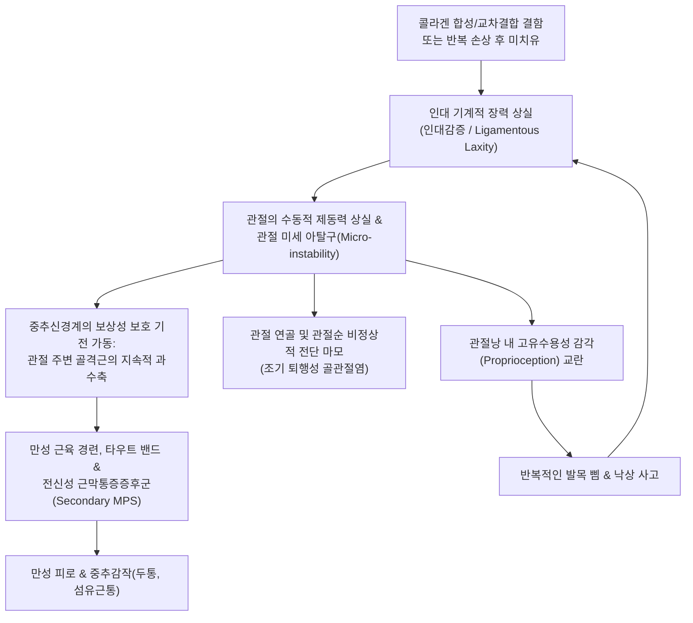

# 🩺 인대감증 (Ligamentous Laxity / 관절과가동성 스펙트럼 장애 HSD)

> **핵심 3줄 요약 (Key Summary)**:
> - 📍 **병소 부위 & 해부·병태생리**: 콜라겐(Type I·III·V) 기질 구성의 유전적 결함이나 외상 후 불완전 치유로 인해 관절을 안정화하는 인대(Ligament)의 기계적 장력이 병적으로 감소하여 전신 관절의 비정상적 과가동성(Joint Hypermobility)과 구조적 불안정성을 초래하는 결합조직 질환군이다.
> - 🚩 **전형적 임상 양상**: 관절이 지나치게 유연하여 '몸이 유연하다'는 소리를 자주 듣지만, 잦은 발목 접질림·관절 삐걱거림·습관성 아탈구가 발생하며, 인대 대신 관절을 붙잡기 위한 보상성 근육 과긴장으로 인해 전신 만성 근육통, 조기 관절염, 만성 피로, 두통 및 자율신경 이상(기립성 어지럼증)이 병발한다.
> - 🛠️ **핵심 검사 & 치료 전략**: 9점 만점의 Beighton 점수(성인 $\ge 5$점 시 양성) 및 관절 안정성 부하 검사. 인대를 강제로 늘리는 과도한 스트레칭이나 강한 척추 교정(HVLA)을 엄격히 배제하고, 동적 안정성(코어 및 관절 주변 근육) 강화 운동, 프롤로테라피(증식치료)와 더불어 한의학적 간신부족(肝腎不足)·비기허약(脾氣虛弱) 변증에 따른 인대 강화 한약([[보중익기탕]], [[독활기생탕]])과 자하거 약침을 적용한다.
> - ⚠️ **응급 의뢰 레드플래그**: 심한 인대 이완 환자에서 경추 불안정증(환축추 아탈구)으로 인한 사지 저림, 감각 이상, 보행 실조가 나타나거나, 혈관형 엘러스-단로스 증후군(vEDS) 소견인 대동맥 박리, 급성 흉통, 자발성 장천공 징후 발생 시 즉시 3차 상급병원 응급실로 전원.

---

## 📌 목차
1. [질환 개요 & 해부학적 병태생리](#1-질환-개요--해부학적-병태생리)
2. [병태생리 메커니즘 & 생체역학적 악순환 네트워크](#2-병태생리-메커니즘--생체역학적-악순환-네트워크)
3. [임상 증상 & 이학적 검사(Physical Exam) 알고리즘](#3-임상-증상--이학적-검사physical-exam-알고리즘)
4. [감별 진단 매트릭스 (Differential Diagnosis)](#4-감별-진단-매트릭스-differential-diagnosis)
5. [한의 통합 치료 프로토콜 (침·약침·추나·한약)](#5-한의-통합-치료-프로토콜-침약침추나한약)
6. [양방 치료 & 병용·의뢰 기준 (Conventional Treatment & Referral)](#6-양방-치료--병용의뢰-기준-conventional-treatment--referral)
7. [재활 운동 & 생활습관 티칭 가이드](#7-재활-운동--생활습관-티칭-가이드)
8. [💡 사용자 진료실 핵심 필기 & 임상 노하우 (Melt-In 잔여 심화 집약)](#8--사용자-진료실-핵심-필기--임상-노하우-melt-in-잔여-심화-집약)
9. [출처 및 학술 참고 문헌 (References)](#9-출처-및-학술-참고-문헌-references)

---

## 1. 질환 개요 & 해부학적 병태생리

* **질환 정의**:
  * 인대감증(靭帶弛緩症, Ligamentous Laxity / Ligamentous Hypo-tonicity)은 관절의 수동적 안정성을 유지하는 핵심 지지 구조물인 인대가 비정상적으로 늘어나 탄력적 복원력(Elastic recoil)을 상실한 상태를 의미한다.
  * 현대 의학적으로는 증상이 동반된 전신성 과가동성을 **관절과가동성 스펙트럼 장애(Hypermobility Spectrum Disorder, HSD)** 또는 과가동형 엘러스-단로스 증후군(Hypermobile Ehlers-Danlos Syndrome, hEDS)의 스펙트럼으로 다룬다(Oliveira et al., 2026; Kulin et al., 2026).

* **표적 해부 구조 및 결합조직 병리**:
  * **인대의 조직학적 구성**: 인대는 약 70~80%의 Type I 콜라겐과 소량의 Type III/V 콜라겐, 엘라스틴, 프로테오글리칸으로 구성된다.
  * **병태생리학적 이상**:
    * 콜라겐 원섬유(Fibril) 간의 교차 결합(Cross-linking) 결함으로 장력 강도(Tensile strength)가 취약해짐.
    * 관절이 외력에 의해 정상 해부학적 가동 범위를 쉽게 벗어나며, 관절낭(Capsule) 역시 느슨해져 관절 연골의 미세 동요(Micro-instability)가 발생함.
  * **호발 관절**: 슬관절(반월상연골 및 십자인대 부하 증가), 족관절(전거비인대 이완에 따른 만성 발목 불안정증), 견관절(다방향성 불안정증 MDI), 척추(경추 환축추 분절 및 요천추부).

![[인대감증_01_발목외측인대해부및염좌손상단계도해.jpg]]
> [그림 1: 발목 외측 인대(전거비인대·종비인대·후거비인대) 정상 구조 및 1도·2도·3도 인대 손상 단계 도해 — 출처: 질병관리청 국가건강정보포털 「염좌」 (cntntsSn=5441) 〈그림. 인대손상의 정도〉]

![[인대감증_01_엘러스단로스증후군수지관절과운동성임상사진.jpg]]
> [그림 2: 선천성 결합조직 질환(엘러스-단로스 증후군) 환자에서 나타나는 수지 관절 과운동성(joint hypermobility) 임상 사진 — 출처: Wikimedia Commons (File:Ehlers-Danlos syndrome2.jpg)]

---

## 2. 병태생리 메커니즘 & 생체역학적 악순환 네트워크

* **보상성 근육 과긴장과 만성 통증의 역설**:
  * 인대가 관절을 단단히 붙잡아주지 못하므로, 신체는 관절이 빠지지 않도록 관절 주위 근육(회전근개, 둔근, 척추기립근 등)을 24시간 내내 긴장시킨다.
  * 그 결과 인대감증 환자는 "인대가 늘어났는데도 온몸의 근육이 돌처럼 뭉치고 뻐근하다"고 호소하는 역설적인 상태(인대 이완 + 근육 경직의 공존)에 빠진다.

* **자율신경계 및 전신 동반 질환 (Kulin et al., 2026; Niedenfuehr et al., 2026)**:
  * 결합조직 취약성은 혈관벽과 내장 평활근에도 영향을 미친다.
  * 혈관 탄력 저하로 하지에 혈액이 저류되어 기립성 빈맥 증후군(POTS), 기립성 저혈압이 흔히 동반되며, 위장관 운동 저하(만성 소화불량, 변비), 골반저근 약화(골반통, 요실금)가 복합적으로 나타난다.

![[인대감증_02_콜라겐삼중나선결정구조모형.jpg]]
> [그림 3: 인대 결합조직의 인장강도와 탄성 복원력을 결정하는 콜라겐 삼중나선(collagen triple helix) 분자 구조 모형 — 출처: Wikimedia Commons (File:1K6F Crystal Structure Of The Collagen Triple Helix Model Pro- Pro-Gly103 03.png)]

![[인대감증_02_급성발목염좌인대손상및부종출혈소견.jpg]]
> [그림 4: 발목 외측 인대 손상 도해 및 급성 인대 손상으로 인한 관절 주위 부종·피하출혈 임상 소견 — 출처: 질병관리청 국가건강정보포털 「염좌」 (cntntsSn=5441) 〈그림. 급성 염좌로 인한 출혈 및 부종〉]

---

## 3. 임상 증상 & 이학적 검사(Physical Exam) 알고리즘

* **주요 임상 증상**:
  1. **관절 불안정성 및 잦은 외상**: 발목을 자주 삐끗함, 무릎이나 어깨가 빠질 것 같은 느낌(Giving way), 관절을 움직일 때마다 '두둑'거리는 다발성 염발음(Clicking sound).
  2. **전신성 만성 피로와 근육통**: 조금만 걷거나 서 있어도 허리와 다리가 천근만근 무거움, 만성 목·어깨 결림, 만성 두통(Oliveira et al., 2026).
  3. **피부 및 조직 소견**: 피부가 벨벳처럼 부드럽고 잘 늘어남, 멍이 쉽게 듦, 상처 회복 지연 및 담배종이 모양의 흉터(Cigarette paper scars).

* **이학적 검사: Beighton 점수 (9점 척도)**:
  1. **새끼손가락(소지)**: 중수수지관절 90도 이상 수동 과신전 (좌 1점, 우 1점).
  2. **엄지손가락(수지)**: 수동 굴곡 시 엄지손가락이 전완 안쪽에 닿음 (좌 1점, 우 1점).
  3. **팔꿈치(주관절)**: 10도 이상 과신전 (좌 1점, 우 1점).
  4. **무릎(슬관절)**: 10도 이상 과신전(Genu recurvatum) (좌 1점, 우 1점).
  5. **척추/고관절**: 무릎을 완전히 편 채 전방 굴곡 시 손바닥이 바닥에 닿음 (1점).
  * **판정 기준**: 성인 남녀 $\ge 5$점 (폐경 후 여성/50세 이상 $\ge 4$점) 시 전신성 관절과가동성(Generalized Joint Hypermobility, GJH) 양성으로 판정.

![[인대감증_03_무릎측부인대손상및스트레스부하방사선검사.jpg]]
> [그림 5: 슬관절 내·외측 측부인대 손상 도해 및 스트레스 부하 방사선 검사에서 인대 이완·파열에 의한 관절 간격 벌어짐 소견 — 출처: 질병관리청 국가건강정보포털 「염좌」 (cntntsSn=5441) 〈그림. 무릎 인대 손상 I〉]

---

## 4. 감별 진단 매트릭스 (Differential Diagnosis)

| 질환명 | 관절 가동성 | 피부 및 전신 징후 | 핵심 감별점 |
| :--- | :--- | :--- | :--- |
| **관절과가동성 증후군 (HSD/hEDS)** | **Beighton $\ge 5$점 (전신성)** | 피부 경도 신장, 만성 근골격통, 자율신경실조 | 유전성 결합조직 이상, 혈관 합병증 없음, 보존적 강화 필요 |
| **단순 생리적 유연성** | Beighton 고득점 가능 | **증상 없음 (무통성)** | 통증, 염좌, 불안정증, 피로감이 전혀 없는 정상 생리적 변이 |
| **혈관형 엘러스-단로스 (vEDS)** | 말초 관절에 국한될 수 있음 | 얇고 반투명한 피부, 정맥 도드라짐 | **치명적 질환**, COL3A1 돌연변이, 자발성 대동맥/장기 파열 위험 |
| **마르판 증후군 (Marfan)** | 과가동성 동반 | 거인증, 거미지증(Arachnodactyly), 수정체 탈구 | FBN1 유전자 변이, 대동맥근부 확장, 엄지/손목 징후 양성 |
| [[류마티스 관절염]] (RA) | 후기 인대 파괴로 불안정 | 관절 염증, 조조강직, 골미란 | 자가면역 활액막염 선행, 항CCP/RF 양성, Beighton 음성 |

---

## 5. 한의 통합 치료 프로토콜 (침·약침·추나·한약)

* **변증 분류**:
  1. **간신부족·근골위약 (肝腎不足·筋骨萎弱)**: 간주근(肝主筋), 신주골(腎主骨) 원리에 따라 선천적으로 신정(腎精)과 간혈(肝血)이 부족하여 인대와 힘줄의 결합력이 연약한 상태. 관절 산통, 요슬산연(腰膝酸軟), 보행 무력, 설담태소, 맥침세무력.
  2. **비위허약·기혈양허 (脾胃虛弱·氣血兩虛)**: 비주사말(脾主四末) 및 비기통혈(脾氣統血) 실조로 인대 조직에 영양 물질이 공급되지 못하고 장력이 늘어짐. 만성 피로, 소화불량, 잦은 멍(피하출혈), 설담체반, 맥세약.

* **침구 치료 프로토콜**:
  * **핵심 혈위**:
    * 인대 부착부 아시혈: 이완된 주관절/슬관절 측부인대 부착부.
    * 근골 회혈: [[양릉천]](GB34, 근회), [[현종]](GB39, 수회), [[족삼리]](ST36).
    * 간신 보익 혈위: [[태계]](KI3), [[태충]](LR3), [[신수]](BL23), [[간수]](BL18).
  * **자침 기법**:
    * 관절낭 및 인대 부착부 주변에 저주파(2Hz) 전침을 15분간 적용하여 감각신경 수용기(기계수용기)를 자극하고 관절의 고유수용성 감각(Proprioceptive feedback)을 증진.

* **약침 치료**:
  * **자하거(Hominis Placenta) 약침**:
    * 이완된 인대의 뼈 부착부(Enthesis)에 0.5~1.0cc 심부 주입하여 세포 재생 인자(EGF, FGF)를 공급하고 콜라겐 섬유 신생을 유도.
  * **황기 약침 또는 신바로 약침**:
    * 기허성 인대 이완 및 관절 마모에 따른 만성 활액막염 부위에 주입하여 인대 장력 복원과 항염 작용 도모.

* **추나 치료 시 절대 주의사항 (Critical Warning)**:
  * ⛔ **고속 저진폭 강제 교정 기법(HVLA Thrust) 절대 금지**: 인대가 이미 늘어나 관절을 지지하지 못하는 상태에서 '우두둑' 소리를 내는 강한 교정을 시행하면 인대가 더욱 이완되어 관절 불안정성이 영구적으로 악화된다.
  * ✅ **근에너지기법(MET) 및 관절 안정화 추나**: 환자 자신의 능동적 등장성 수축을 유도하여 관절 주변 심부 안정화 근육(Rotator cuff, 다열근, 복횡근)을 강화하는 비침습적 기법만 적용.

* **한약 처방 프로토콜**:
  * [[보중익기탕]](補中益氣湯) (중기하함 및 인대 이완 본치):
    * 황기 16~24g, 인삼, 백출, 승마, 시호.
    * 비기를 돋우고 기운을 들어 올리는(升提) 작용으로 느슨해진 결합조직의 기계적 톤(Tone)을 복원.
  * [[독활기생탕]](獨活寄生湯) 가감방:
    * 두충, 속단, 우슬, 상기생을 증량하여 인대-골 부착부의 교차결합 강도를 높이고 만성 관절통 완화.
  * [[사육탕]](四六湯) 또는 [[대보음환]](大補陰丸):
    * 진액 고갈과 관절 마찰음, 허열이 동반된 만성 결합조직 취약 환자에게 숙지황, 구판, 지모, 황백으로 음혈 보충.

![[인대감증_05_발목전거비인대압통부위촉진및치료표적.jpg]]
> [그림 6: 발목 외측 인대 해부 구조 및 인대 약화·이완 부위인 전거비인대 압통점 촉진 위치 도해 — 출처: 질병관리청 국가건강정보포털 「염좌」 (cntntsSn=5441) 〈그림. 발목 염좌〉]

---

## 6. 양방 치료 & 병용·의뢰 기준 (Conventional Treatment & Referral)

* **통상적 양방 보존 요법**:
  1. **프롤로테라피 (증식치료 / Prolotherapy)**:
     * 고농도 포도당(12.5~25% Dextrose) 또는 PRP를 이완된 인대 부착부(Enthesis)에 주입하여 국소 무균성 염증 반응을 유도.
     * 섬유아세포(Fibroblast) 증식을 촉진하여 새로운 Type I 콜라겐을 침착시킴으로써 인대 부피를 30~40% 증가시키고 장력을 회복시키는 핵심 치료법.
  2. **물리치료 및 운동 처방**:
     * 닫힌 사슬 운동(Closed Kinetic Chain, CKC): 관절 압박력을 높여 인대 부담을 줄이고 고유수용감각 증진.
     * **과도한 스트레칭, 요가, 유연성 운동 엄격 금지**.
  3. **관절 보조기 착용**: 만성 발목 불안정증 시 보조기(Aircast) 또는 테이핑을 적용하여 아탈구 예방.

* **양방·전문과 의뢰 기준 (Referral Criteria)**:
  * **🚨 즉각 신경외과/흉부외과/정형외과 의뢰 (Red Flags)**:
    1. 경추 인대 이완 환자가 고개를 숙일 때 팔다리로 전기가 통하는 느낌(Lhermitte sign)이나 보행 실조를 호소하는 경우 (경추 환축추 불안정증 C1-C2 Instability).
    2. 마르판 증후군이나 혈관형 엘러스-단로스 의심 소견(급작스러운 흉통, 심잡음, 안구 수정체 이상).
    3. 습관성 탈구로 인해 신경 마비가 동반되거나 관절와순/반월상연골이 광범위하게 파열된 경우 (수술적 관절낭 축소술 적응증).

---

## 7. 재활 운동 & 생활습관 티칭 가이드

* **운동 원칙: 유연성이 아닌 '근력과 안정성'**:
  * 환자들은 몸이 뻐근하다며 요가나 과도한 스트레칭을 더 많이 하는 경향이 있으나, 이는 늘어난 인대를 더 늘려 관절염을 앞당기는 치명적 실수이다.
  * 스트레칭을 즉시 중단시키고, 관절을 꽉 잡아주는 등척성(Isometric) 및 저항 근력 운동으로 전환해야 한다.

* **고유수용성 감각(Proprioception) 훈련**:
  * 밸런스 패드(Wobble board) 위에서 한 발로 서기, 눈 감고 균형 잡기.
  * 관절 위치 감각을 재훈련하여 발목 삠과 무릎 꺾임을 예방.

* **체위 및 생활습관 지도**:
  * 'W-자세로 바닥에 앉기'나 '다리 꼬기', '팔꿈치 과신전한 채 턱 괴기' 금지.
  * 서 있을 때 무릎을 뒤로 꺾어 뼈로 버티는 젖힌 무릎(Back-knee / Genu recurvatum) 자세를 의식적으로 피하고 살짝 무릎을 굽힌 중립 위치 유지.

---

## 8. 💡 사용자 진료실 핵심 필기 & 임상 노하우 (Melt-In 잔여 심화 집약)

* **진료실 임상 팁**:
  * 20~30대 젊은 여성이 "온몸이 쑤시고 아침마다 뻣뻣해서 섬유근육통 같아요", "발목을 한 달에 한 번씩 삐어요"라고 호소하면 **반드시 엄지손가락을 전완에 닿게 해보고 팔꿈치를 펴보게 하라(Beighton 점수 확인)**.
  * 이 환자들은 유연한 인대 때문에 관절이 덜컹거려 온몸의 근육이 관절을 지키느라 돌처럼 굳어있는 **인대감증/관절과가동성 환자**이다.
  * 이런 환자에게 도수치료로 관절을 꺾어 우두둑 소리를 내거나, 요가와 강한 스트레칭을 시키면 다음 날 환자는 통증으로 비명을 지르게 된다.
  * **"스트레칭은 독약입니다. 근육을 굳혀서 뼈를 지켜야 합니다"라고 티칭**하고, 인대 부착부에 자하거 약침을 놓고 보중익기탕이나 독활기생탕으로 속을 채워주면서 등척성 코어 운동을 시키면 삶의 질이 극적으로 개선된다.

---

## 9. 출처 및 학술 참고 문헌 (References)

* Oliveira WS, Hoffmann J, Jácomo AAE, et al. (2026). Headache in patients with joint hypermobility. *Cephalalgia*. 46(8):3331024261477381. PMID: 42640494

* Kulin D, Holtmann G, Fairlie T, et al. (2026). Meta-Analysis: Chronic Gastrointestinal Symptoms and Comorbidities in Hypermobile Ehlers-Danlos Syndrome and Hypermobility Spectrum Disorders. *Aliment Pharmacol Ther*. 64(5):574-589. PMID: 42437376

* Niedenfuehr J, Cuccaro P, Schick V, et al. (2026). An examination of the vulvar pain disorders, pain symptoms, and associated vulvovaginal findings experienced among hypermobile Ehlers-Danlos syndrome and hypermobility spectrum disorder patients: a scoping review. *Sex Med Rev*. 14(3):289-302. PMID: 42696871

---

## 관련 노트

- [[관절낭패턴]]
- [[대퇴사두근]]
- [[보중익기탕]]
- [[독활기생탕]]
- [[골관절염]]
- [[이상근증후군]]
