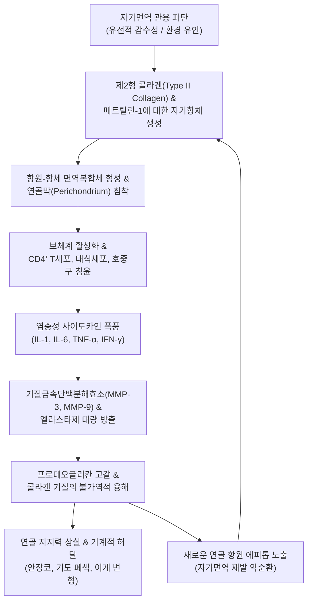

# 🩺 재발성 다발연골염 (Relapsing Polychondritis, RP)

> **핵심 3줄 요약 (Key Summary)**:
> - 📍 **병소 부위 & 해부·병태생리**: 제2형 콜라겐(Type II collagen) 및 연골 기질 단백질에 대한 자가면역 반응으로 인해 귀(이개), 코(비중격), 기도(후두·기관·기관지), 늑연골 및 관절 연골 등 전신의 연골 조직에 반복적인 염증성 파괴와 섬유화 허탈이 발생하는 희귀 전신성 류마티스 질환이다.
> - 🚩 **전형적 임상 양상**: 귀 연골 부위의 급성 발적·종창·통증이 나타나되 연골이 없는 **귓볼(이수, Ear lobule)은 정상으로 보존되는 특징적 이개 연골염**을 보이며, 콧등이 주저앉는 안장코(Saddle nose) 변형, 비미란성 다발관절통, 눈(상공막염/포도막염), 그리고 후두·기관지 침범에 의한 목쉼과 호흡곤란이 동반된다.
> - 🛠️ **핵심 검사 & 치료 전략**: McAdam/Damiani 진단 기준 적용, 18F-FDG PET/CT를 통한 전신 연골 염증 병소 평가, 기도 협착 평가를 위한 흉부 다절편 CT 및 기관지 내시경. 급성기 고용량 코르티코스테로이드 및 면역억제제(MTX, 아자티오프린, 생물학적 제제) 투여. 한의학적으로 풍열독성(風熱毒盛) 및 음허화왕(陰虛火旺)으로 변증하여 만성기 면역 안정과 조직 재생을 위한 한약([[지백지황탕]], [[선방활명음]])을 보조적으로 운용한다.
> - ⚠️ **응급 의뢰 레드플래그**: 애성(목쉼), 흡기성 천명(Stridor), 누웠을 때 악화되는 급성 질식성 호흡곤란 발생 시 후두·기관 연골의 염증성 허탈(Tracheomalacia)에 의한 기도 폐쇄 응급 상황이므로 즉시 기도 확보 및 상급병원 응급실/중환자실로 긴급 이송.

---

## 📌 목차
1. [질환 개요 & 해부학적 병태생리](#1-질환-개요--해부학적-병태생리)
2. [병태생리 메커니즘 & 생체역학적 악순환 네트워크](#2-병태생리-메커니즘--생체역학적-악순환-네트워크)
3. [임상 증상 & 이학적 검사(Physical Exam) 알고리즘](#3-임상-증상--이학적-검사physical-exam-알고리즘)
4. [감별 진단 매트릭스 (Differential Diagnosis)](#4-감별-진단-매트릭스-differential-diagnosis)
5. [한의 통합 치료 프로토콜 (침·약침·추나·한약)](#5-한의-통합-치료-프로토콜-침약침추나한약)
6. [양방 치료 & 병용·의뢰 기준 (Conventional Treatment & Referral)](#6-양방-치료--병용의뢰-기준-conventional-treatment--referral)
7. [재활 운동 & 생활습관 티칭 가이드](#7-재활-운동--생활습관-티칭-가이드)
8. [💡 사용자 진료실 핵심 필기 & 임상 노하우 (Melt-In 잔여 심화 집약)](#8--사용자-진료실-핵심-필기--임상-노하우-melt-in-잔여-심화-집약)
9. [출처 및 학술 참고 문헌 (References)](#9-출처-및-학술-참고-문헌-references)

---

## 1. 질환 개요 & 해부학적 병태생리

* **질환 정의**:
  * 재발성 다발연골염(Relapsing Polychondritis, RP)은 탄력 연골(귀, 코) 및 초자 연골(후두, 기관, 관절 연골)을 포함하여 프로테오글리칸이 풍부한 전신 연골 구조물에 진행성 염증과 파괴를 유발하는 원인 불명의 희귀 만성 자가면역 질환이다.
  * 질환 경과는 무증상 관해와 급성 재발을 반복하며, 연골 구조의 구조적 붕괴(안장코, 기도 연골 연화증)를 초래하여 생명을 위협할 수 있다(Zhou et al., 2026).

* **표적 해부 구조 및 병리 조직학**:
  1. **이개 연골(Auricular Cartilage)**: 환자의 85~90%에서 발현. 이륜(Helix)과 대이륜 연골에 국한되며 지방 조직으로만 구성된 귓볼(Lobule)은 침범하지 않음.
  2. **비중격 연골(Nasal Cartilage)**: 비중격 괴사로 콧등 지지력 상실.
  3. **후두-기관-기관지 연골(Laryngotracheobronchial Cartilage)**: 환자의 약 50%에서 발생하며, 기도의 연골 고리(Cartilage ring)가 녹아내려 호흡 시 기도가 짜부라지는 기관 연골 연화증 유발(주요 사망 원인).
  4. **관절 및 안구**: 말초 관절의 관절 연골(비미란성 활액막염), 공막 및 포도막.

---

## 2. 병태생리 메커니즘 & 생체역학적 악순환 네트워크

* **체액성 및 세포 매개 자가면역 기전**:
  * 환자의 혈청에서는 급성 활동기에 Type II 콜라겐 자가항체(Anti-type II collagen antibody) 및 Type IX, XI 콜라겐 항체, Matrilin-1 항체가 높은 역가로 검출된다.
  * 침윤된 T 세포와 단핵구가 분비하는 단백분해효소는 연골 특유의 염기성 기질(Basophilic matrix)을 분해하여 정상 호염기성을 상실시키고 호산구성 기질로 변성시킨다.

* **VEXAS 증후군과의 연관성 (Zhu et al., 2026)**:
  * 최근 유전체 연구를 통해 노년기 남성에서 재발성 연골염 소견과 함께 대구성 빈혈, 골수 내 공포 형성, 발열이 동반되는 경우 X-염색체의 UBA1 유전자 체세포 돌연변이에 기인한 자가염증 질환인 'VEXAS 증후군'으로 감별 및 재분류되고 있다.

---

## 3. 임상 증상 & 이학적 검사(Physical Exam) 알고리즘

* **주요 임상 증상**:
  1. **이개 연골염 (Auricular Chondritis)**:
     * 한쪽 또는 양쪽 귀가 불타는 듯이 붉어지고 부어오르며 극심한 박동성 통증 호소.
     * **결정적 진찰 소견**: 연골이 있는 이륜 부위는 심하게 붓고 붉지만, **아래쪽 귓볼(이수)은 피부색과 두께가 완전히 정상**으로 경계가 뚜렷함.
     * 반복 시 연골이 섬유화되어 귓바퀴가 힘없이 꺾이는 '콜리플라워 귀' 형성.
  2. **비연골염 및 안장코 변형 (Saddle-Nose Deformity)**:
     * 코의 욱신거리는 통증과 충혈, 코피가 선행한 후 비중격이 녹아 콧등 중앙이 안장 모양으로 푹 꺼짐.
  3. **호흡기계 증상 (치명적 기도 침범)**:
     * 쉰 목소리(애성), 마른 기침, 전경부(갑상연골 부위)의 압통.
     * 기도가 좁아져 숨을 들이쉴 때 쌕쌕거리는 천명음(Stridor) 발생.
  4. **관절 및 안구 증상**:
     * 무릎, 손목 등 말초 관절의 이동성 비미란성 관절염.
     * 눈 충혈 및 통증(상공막염, 공막염, 전방 포도막염).

* **진단 기준 (McAdam criteria, Damiani & Levine 수정)**:
  * 다음 6대 임상 범주 중 3개 이상 만족 시 확진:
    1. 양측성 재발성 이개 연골염.
    2. 비미란성 혈청음성 다발관절염.
    3. 비연골염 (안장코 변형).
    4. 안구 염증 (결막염, 상공막염, 공막염, 포도막염).
    5. 후두-기관 연골염 (애성, 천명, 기도 협착).
    6. 내이/전정 기능 장애 (감각신경성 난청, 이명, 현훈).
  * *18F-FDG PET/CT 영상 검사*: 전신 연골의 무증상 활성 병소를 평가하는 데 민감도 90% 이상(Malik et al., 2026).

---

## 4. 감별 진단 매트릭스 (Differential Diagnosis)

| 질환명 | 주 병소 및 양상 | 귓볼(이수) 침범 여부 | 핵심 감별점 |
| :--- | :--- | :--- | :--- |
| **재발성 다발연골염 (RP)** | 이개·비중격·기도 연골의 재발성 염증 | **침범 안 함 (보존됨)** | 안장코, 기도 협착, 비미란성 관절염, Type II 콜라겐 항체 |
| **이개 봉와직염 (Cellulitis)** | 외상/피어싱 후 귀의 급성 세균 감염 | **귓볼까지 전부 침범 (붉고 부음)** | 연골 경계 없이 피부 전체 감염, 항생제 치료에 즉각 반응 |
| **[[다발혈관염을 동반한 육아종증]] (GPA)** | 상/하부 호흡기 육아종, 안장코 | 드묾 | c-ANCA (PR3) 양성, 폐 공동 결절, 사구체신염 동반 |
| **[[베체트병]] (Behçet)** | 혈관염, 포도막염, 관절염 | 없음 | 재발성 구강/생식기 아프타 궤양, 피부 초과민 반응(Pathergy) |
| **VEXAS 증후군** | 노인 남성, 연골염, 골수 이상 | 이개 침범 가능 | UBA1 체세포 돌연변이, 대구성 빈혈, 골수 공포 형성 (Zhu et al., 2026) |

---

## 5. 한의 통합 치료 프로토콜 (침·약침·추나·한약)

* **한의 치료의 임상적 역할과 한계**:
  * 급성기 기도 침범이나 안구 염증은 실명 및 질식 위험이 있으므로 반드시 양방 면역억제 치료를 선행하여 기도를 확보해야 한다.
  * 한의 치료는 양방 면역억제제(스테로이드) 감량기 동안의 질환 재발 방지, 만성기 진액 손상 회복, 관절통 완화에 병용된다.

* **변증 분류**:
  1. **풍열독성·혈열어저 (風熱毒盛·血熱瘀阻 - 급성 활동기)**: 화열과 열독이 영혈(營血)에 맺혀 연골이 벌겋게 붓고 찌르는 듯이 아픔. 이개 종통, 안구 충혈, 번조, 설홍강태황, 맥삭.
  2. **음허화왕·골증노열 (陰虛火旺·骨蒸勞熱 - 아급성/만성 재발기)**: 오랜 염증과 고용량 스테로이드 복용으로 진음(眞陰)이 마르고 허화가 떠오름. 미열, 도한, 관절 둔통, 이명, 안구 건조, 설홍소태, 맥세삭.
  3. **담어호결 (痰瘀互結 - 구조 변형기)**: 연골이 섬유화되고 비후되며 기도가 좁아짐. 목쉼, 담다(痰多), 흉민.

* **침구 치료 프로토콜**:
  * ⚠️ **주의사항**: 염증이 있는 귀나 코 연골 부위에 직접 자침하면 세균 감염이나 연골 파괴를 촉진할 수 있으므로 **국소 연골 부위 자침은 절대 금기**이다.
  * **원위 및 경락 조절 혈위**:
    * 풍열 청열: [[곡지]](LI11), [[합곡]](LI4), [[외관]](TE5), [[대추]](GV14).
    * 이명/청각 보호: [[중저]](TE3), [[태충]](LR3), [[족임읍]](GB41).
    * 음허 허열 조절: [[태계]](KI3), [[삼음교]](SP6), [[조해]](KI6).
  * 2~4Hz 저주파 전침을 곡지-합곡에 적용하여 전신 면역 과활성 안정화.

* **한약 처방 프로토콜**:
  * **급성기 청열해독: [[선방활명음]](仙方活命飲) 또는 [[황련해독탕]](黃連解毒湯) 합 [[인진호탕]]**
    * 은화, 연교, 적작약, 목단피, 패모 등으로 연골막에 뭉친 화독(火毒)을 신속히 배출하고 미세순환 개선.
  * **만성기 음허화왕: [[지백지황탕]](知柏地黃湯) 합 [[생맥산]](生脈散)**
    * 지모, 황백, 숙지황, 산약, 맥문동, 인삼.
    * 자가면역성 만성 연골 파괴와 스테로이드 부작용(골다공증, 구갈, 피로)을 완화하고 기음(氣陰)을 보충.
  * **호흡기 점막 보호: [[청상보하탕]](淸上補下湯) 가감**
    * 기관지 연골 연화로 인한 기침, 가래, 애성에 맥문동, 행인, 길경을 증량하여 기도 점막을 윤택하게 보호.

---

## 6. 양방 치료 & 병용·의뢰 기준 (Conventional Treatment & Referral)

* **단계별 면역억제 치료 프로토콜 (Zhou et al., 2026)**:
  1. **경증 (이개 연골염, 비연골염, 말초 관절염 국한)**:
     * 경구 코르티코스테로이드: 프레드니손(Prednisone) 0.5~1 mg/kg/일 투여 후 증상 완화 시 점진적 감량.
     * 보조제: 답손(Dapsone 50~100 mg/일) 또는 콜키신(Colchicine), 경구 NSAIDs.
  2. **중증 (기도 침범, 안구 침범, 심혈관 합병증, 전신 혈관염)**:
     * 정맥 메틸프레드니솔론 펄스 요법(1 g/일 3일간) 즉각 투여.
     * 면역조절제 병용: 메토트렉세이트(MTX 15~25 mg/주), 아자티오프린(AZA), 시클로포스파미드(CYC).
     * 생물학적 제제: 불응 시 TNF 억제제(인플릭시맙, 아달리무맙) 또는 IL-6 수용체 길항제(토실리주맙 Tocilizumab).
  3. **기도 허탈 시 중재술**:
     * 동적 기관 연골 연화로 인한 기도 폐색 시 중환자실 기도 삽관, 기관절개술(Tracheostomy), 또는 기관지 스텐트(Stent) 삽입술.

* **양방·전문과 의뢰 기준 (Referral Criteria)**:
  * **🚨 즉각 응급실 의뢰 (Red Flags)**:
    1. 목소리가 쉬거나(애성), 숨을 들이쉴 때 그르렁거리는 천명(Stridor)이 들리고 누우면 숨이 차는 경우 (기도 허탈).
    2. 안구의 심한 통증과 시력 저하(괴사성 공막염/포도막염).
    3. 전신 부종, 심잡음, 호흡곤란(대동맥판막 폐쇄부전증 Aortic regurgitation).

---

## 7. 재활 운동 & 생활습관 티칭 가이드

* **기도 및 호흡기 감염 예방**:
  * 상기도 감염은 연골염 재발의 가장 흔한 유발 인자이므로 인플루엔자 및 폐렴구균 백신을 반드시 접종한다.
  * 미세먼지나 찬 공기 노출을 피하고 실내 습도를 50~60%로 유지하여 기도 점막의 건조를 방지한다.

* **외상 및 기계적 압박 회피**:
  * 이개 연골이 파괴되는 것을 막기 위해 옆으로 누워 잘 때 딱딱한 베개 사용을 금하고 중앙이 뚫린 도넛 베개를 사용한다.
  * 귀를 만지거나 비비지 않도록 주의하며 귀 피어싱은 연골염을 폭발시킬 수 있으므로 절대 금지한다.

---

## 8. 💡 사용자 진료실 핵심 필기 & 임상 노하우 (Melt-In 잔여 심화 집약)

* **진료실 임상 팁**:
  * 환자가 "귀가 새빨갛게 붓고 찌르듯이 아프다"며 내원했을 때 **반드시 귓볼(이수)을 확인**해야 한다.
  * 귓볼까지 다 빨갛다면 피부과나 이비인후과로 보낼 단순 봉와직염이지만, **귓바퀴 연골만 새빨갛고 아래 귓볼은 신기할 정도로 하얗고 깨끗하다면 그것이 바로 교과서적인 '재발성 다발연골염'**이다.
  * 이때 환자에게 "혹시 최근에 목소리가 쉬거나 숨 쉴 때 소리가 나지 않느냐", "코피가 자주 나거나 콧등이 아프지 않느냐"를 반드시 물어보아야 한다.
  * 기도 연골이 녹아내리면 자는 도중에 질식사할 수 있는 치명적 질환이므로, 한의원에서 잡고 있지 말고 즉시 대학병원 류마티스내과로 의뢰서를 써서 보내야 한다.

---

## 9. 출처 및 학술 참고 문헌 (References)

* Zhou P, Yu W, Ma J, et al. (2026). Diagnosis and treatment strategies for airway involvement in relapsing polychondritis: a comprehensive review. *Front Immunol*. 17:1843988. PMID: 42327756

* Malik P, Saraswat D, Aggarwal P, et al. (2026). The utility of 18F-fluorodeoxyglucose PET/computed tomography in relapsing polychondritis: a systematic review and meta-analysis. *Nucl Med Commun*. 47(10):1117-1125. PMID: 42712171

* Zhu Z, Dai T, Liu S, et al. (2026). VEXAS syndrome unmasked from relapsing polychondritis and infection mimicry: a case-based review. *Rheumatol Int*. 46(7):1532. PMID: 42405976

---

## 관련 노트

- [[다발혈관염을 동반한 육아종증]]
- [[베체트병]]
- [[류마티스 관절염]]
- [[골관절염]]
- [[황련해독탕]]
- [[생맥산]]
