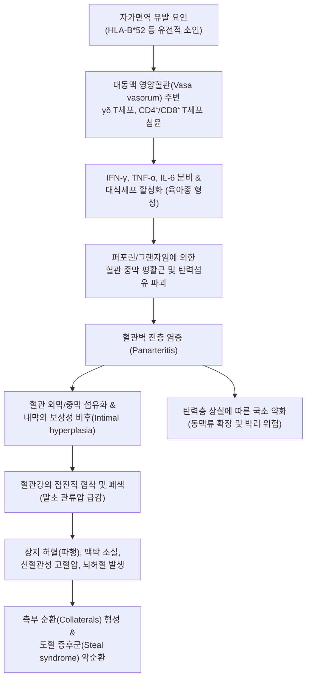

# 🩺 타카야수 동맥염 (Takayasu Arteritis / 무맥병 Pulseless Disease)

> **핵심 3줄 요약 (Key Summary)**:
> - 📍 **병소 부위 & 해부·병태생리**: 대동맥궁(Aortic arch) 및 그 주요 분지(쇄골하동맥, 총경동맥, 척추동맥, 신동맥, 폐동맥)의 전층을 침범하는 만성 육아종성 대혈관염(Large-vessel vasculitis)으로, 혈관벽 외막·중막의 염증과 내막의 비후성 섬유화로 인해 혈관강 협착, 폐색, 혈전 및 동맥류성 확장이 초래된다.
> - 🚩 **전형적 임상 양상**: 주로 가임기 젊은 여성(10~40세)에서 발생하며, 초기 발열·관절통·체중 감소 등 전신 증상에 이어 상지 사용 시 쥐가 나고 힘이 빠지는 상지 파행(Claudication), 요골동맥 맥박 감약·소실, 양측 상지 수축기 혈압 차이(>10~20 mmHg), 경동맥/쇄골하동맥 혈관 잡음(Bruit), 뇌허혈 증상이 나타난다.
> - 🛠️ **핵심 검사 & 치료 전략**: 양측 사지 4-Limb 혈압 측정 및 혈관 청진, 조영 증강 MRA/CTA 또는 18F-FDG PET/CT를 통한 대혈관벽 비후·협착 확인. 급성기 고용량 코르티코스테로이드 및 면역조절제(MTX, 아자티오프린, 토실리주맙) 투여, 중증 허혈 시 혈관 우회술. 한의학적으로 맥락어비(脈絡瘀痺) 및 기혈양허(氣血兩虛) 변증으로 [[보양환오탕]], [[당귀사역탕]]을 보조 운용한다.
> - ⚠️ **응급 의뢰 레드플래그**: 급작스러운 편마비·실어증 등 뇌졸중 징후, 흉통(심근경색), 등 쪽으로 찢어지는 듯한 통증(대동맥 박리), 악성 신혈관성 고혈압 발생 시 즉시 3차 상급병원 심뇌혈관센터 및 류마티스내과로 긴급 이송.

---

## 📌 목차
1. [질환 개요 & 해부학적 병태생리](#1-질환-개요--해부학적-병태생리)
2. [병태생리 메커니즘 & 생체역학적 악순환 네트워크](#2-병태생리-메커니즘--생체역학적-악순환-네트워크)
3. [임상 증상 & 이학적 검사(Physical Exam) 알고리즘](#3-임상-증상--이학적-검사physical-exam-알고리즘)
4. [감별 진단 매트릭스 (Differential Diagnosis)](#4-감별-진단-매트릭스-differential-diagnosis)
5. [한의 통합 치료 프로토콜 (침·약침·추나·한약)](#5-한의-통합-치료-프로토콜-침약침추나한약)
6. [양방 치료 & 병용·의뢰 기준 (Conventional Treatment & Referral)](#6-양방-치료--병용의뢰-기준-conventional-treatment--referral)
7. [재활 운동 & 생활습관 티칭 가이드](#7-재활-운동--생활습관-티칭-가이드)
8. [💡 사용자 진료실 핵심 필기 & 임상 노하우 (Melt-In 잔여 심화 집약)](#8--사용자-진료실-핵심-필기--임상-노하우-melt-in-잔여-심화-집약)
9. [출처 및 학술 참고 문헌 (References)](#9-출처-및-학술-참고-문헌-references)

---

## 1. 질환 개요 & 해부학적 병태생리

* **질환 정의**:
  * 타카야수 동맥염(Takayasu Arteritis, TAK)은 대동맥 및 그 주 분지 혈관을 특이적으로 침범하는 원인 불명의 만성 육아종성 혈관염(Granulomatous panarteritis)이다.
  * 요골동맥 맥박이 촉지되지 않아 '무맥병(Pulseless Disease)' 또는 '대동맥궁 증후군(Aortic Arch Syndrome)'으로도 불리며, 치료받지 않을 경우 중증 장기 허혈, 뇌경색, 심부전을 초래한다.

* **역학 및 표적 혈관**:
  * **호발 인구**: 40세 미만의 젊은 여성(여성 대 남성 비율 약 8~9:1)에서 압도적으로 호발하며, 아시아, 중동, 남미 인구에서 빈도가 높다.
  * **호발 혈관 분포 (Numano 분류)**:
    * Type I: 대동맥궁 분지 혈관(쇄골하동맥, 총경동맥) 침범 (가장 전형적).
    * Type IIa/IIb: 상행 대동맥, 흉부 하행 대동맥 침범.
    * Type III/IV: 복부 대동맥 및 신동맥(Renal artery), 장간막동맥 침범.
    * Type V: 전 대동맥 및 폐동맥(Pulmonary artery) 침범 (가장 광범위; Li et al., 2026).

---

![[타카야수동맥염_01_대동맥활분지_도해.jpg|450]]
> [그림 1: 대동맥과 그 분지를 그린 영어 해부도 — 우완두동맥(brachiocephalic), 좌총경동맥, 좌쇄골하동맥이 대동맥활에서 갈라지는 모습이 표시돼 있다. 타카야수 동맥염은 이 세 분지 기시부를 특히 잘 침범해 무맥·혈압차를 만든다 — 출처: Wikimedia Commons — File:2121 Aorta.jpg (CC BY 3.0)]

![[타카야수동맥염_02_흉대동맥_늑간지.png|450]]
> [그림 2: 흉부 단면에서 내려다본 흉대동맥과 늑간동맥 가지(그레이 해부학 도판) — 염증이 흉대동맥까지 이어지면 늑간동맥 협착으로 사지간혈압(팔·다리 혈압차)이 생긴다 — 출처: Wikimedia Commons — File:Gray530.png (Public domain)]

## 2. 병태생리 메커니즘 & 생체역학적 악순환 네트워크

* **육아종성 전층 혈관염(Panarteritis)**:
  * 초기 염증은 대동맥의 외막(Adventitia)에 혈액을 공급하는 영양혈관(Vasa vasorum) 주변에서 시작된다.
  * 대식세포와 다핵 거대세포(Multinucleated giant cells)가 침윤하여 육아종을 형성하고 탄력 섬유층(Elastic lamina)을 융해시킨다.

* **내막 증식과 협착-폐색**:
  * 만성 염증 반응에 대한 치유 기전으로 혈관 내피세포 및 평활근세포가 과증식하여 내막이 두꺼워지며 혈관 내경이 좁아진다.
  * 쇄골하동맥이 협착되면 팔로 가는 혈류가 부족해져 동측 척추동맥의 혈류가 거꾸로 흘러 팔로 빠져나가는 **쇄골하동맥 도혈 증후군(Subclavian steal syndrome)**이 유발되어 어지럼증과 실신이 일어난다.

---

![[타카야수동맥염_03_대동맥근부_절개.jpg|450]]
> [그림 3: 절개한 대동맥 — 대동맥판과 두 개의 관상동맥 개구부가 보인다. 타카야수 동맥염이 대동맥근부까지 침범하면 대동맥판막 역류가 동반되므로, 진찰에서 이완기 심잡음을 함께 들어야 한다 — 출처: Wikimedia Commons — File:An opened aorta.jpg (CC BY 3.0)]

## 3. 임상 증상 & 이학적 검사(Physical Exam) 알고리즘

* **질환의 2단계 진행 경과**:
  1. **전신 염증기 (Pre-pulseless stage - 초기)**:
     * 혈관 증상이 나타나기 전 수개월~수년간 지속.
     * 원인 불명의 미열, 피로, 야간 발한, 체중 감소, 유주성 다발 관절통, 근육통(Kumar et al., 2026).
  2. **혈관 폐색 및 허혈기 (Pulseless stage - 후기)**:
     * **상지 허혈**: 팔을 들어 머리를 빗거나 빨래를 널 때 팔이 저리고 무거워 쉬어야 하는 상지 파행(Arm claudication).
     * **무맥증(Pulselessness)**: 손목의 요골동맥 맥박이 매우 약하게 만져지거나 전혀 촉지되지 않음.
     * **혈압 불일치**: 양쪽 팔의 수축기 혈압 차이가 10~20 mmHg 이상 벌어짐.
     * **혈관 잡음(Bruit)**: 청진기로 쇄골상와(쇄골하동맥) 또는 경동맥 부위를 청진할 때 거친 수축기 잡음 청취.
     * **신혈관성 고혈압**: 신동맥 협착으로 레닌 분비가 증가하여 젊은 나이에 악성 고혈압 발생.

* **이학적 진찰 알고리즘 (Essential 4-Limb Exam)**:
  1. **4지 혈압 동시 측정**: 양측 상지와 하지의 혈압을 모두 측정하여 상지 간 혈압차(>10 mmHg) 및 하지 혈압 저하 여부 확인.
  2. **말초 맥박 촉진**: 요골동맥, 상완동맥, 경동맥, 대퇴동맥, 족배동맥 맥박의 대칭성과 강도 평가.
  3. **혈관 청진**: 쇄골하동맥, 총경동맥, 복부 대동맥, 신동맥 부위 혈관 잡음 청진.

---

![[타카야수동맥염_04_대동맥염_가성동맥류.jpg|450]]
> [그림 4: 대동맥벽 염증과 파열성 가성동맥류의 육안·조직 소견(원인은 결핵성 대동맥염 증례) — 혈관벽이 두꺼워지고 내강 쪽이 파괴된 모습으로, 타카야수 동맥염에서도 같은 방식으로 동맥류·협착이 진행한다. 감별에는 결핵·매독 등 감염성 대동맥염을 함께 고려한다 — 출처: Wikimedia Commons — File:Tuberculous aortitis with ruptured pseudoaneurysm (6539942397).jpg (CC BY-SA 2.0)]

## 4. 감별 진단 매트릭스 (Differential Diagnosis)

| 질환명 | 주 발병 연령 및 성별 | 주 침범 혈관 | 핵심 감별점 |
| :--- | :--- | :--- | :--- |
| **타카야수 동맥염 (TAK)** | **10~40세 (젊은 여성)** | **대동맥궁 및 주 분지 (대혈관)** | 무맥증, 양측 상지 혈압차, 쇄골하동맥 협착, 신혈관성 고혈압 |
| [[거대세포 동맥염]] (GCA) | **50세 이상 (고령자)** | 측두동맥, 안동맥, 쇄골하동맥 | 두통, 턱 파행, 시력 상실(허혈성 시신경병증), 류마티스 다발근통 동반 |
| **죽상동맥경화증 (Atherosclerosis)** | 60세 이상, 남성 우세 | 관상동맥, 하지 동맥, 경동맥 | 고혈압·당뇨·흡연력, 혈관벽 석회화, 전신 염증 소견 없음 |
| **섬유근이형성증 (FMD)** | 젊은 여성 | 신동맥, 내경동맥 | 염증 없는 비죽상경화성 질환, 혈관조영술상 '염주알 모양(String of beads)' |
| **흉곽출구증후군 (TOS)** | 젊은 층 | 쇄골하동맥의 기계적 압박 | 자세(Adson test 등)에 따라 일시적 맥박 소실, 혈관벽 염증 없음 |

---

## 5. 한의 통합 치료 프로토콜 (침·약침·추나·한약)

* **한의 치료의 임상적 역할과 한계**:
  * 대혈관의 염증성 협착을 방치하면 뇌경색과 대동맥류 파열이 초래되므로, 급성기 혈관염 조절은 양방 면역억제 요법이 필수적이다.
  * 한의 치료는 면역 관해기 환자의 사지 말초 혈류 관류 개선, 피로 및 관절통 회복, 스테로이드 장기 복용 부작용 경감에 집중한다.

* **변증 분류**:
  1. **맥락어비·기체혈어 (脈絡瘀痺·氣滯血瘀)**: 혈맥에 어혈이 맺혀 혈류가 차단된 상태. 사지 마목(저림), 파행, 피부 창백, 맥세삭 또는 맥미(微).
  2. **기혈양허·심비손상 (氣血兩虛·心脾損傷)**: 만성 염증으로 기혈이 소모되어 장기 관류가 저하됨. 만성 피로, 현훈, 심계, 안색 무화, 설담태백, 맥침세.
  3. **음허화왕 (陰虛火旺)**: 혈맥의 화열로 진음이 손상된 상태. 조열, 도한, 구갈, 수족심열, 설홍소태.

* **침구 치료 프로토콜**:
  * **말초 순환 개선 혈위**:
    * 상지: [[곡지]](LI11), [[수삼리]](LI10), [[내관]](PC6), [[외관]](TE5), [[합곡]](LI4).
    * 하지: [[족삼리]](ST36), [[양릉천]](GB34), [[삼음교]](SP6), [[태충]](LR3).
  * ⚠️ **주의사항**: 맥박이 약하거나 혈류가 차단된 상지 말초 부위에는 강한 사혈이나 강자극을 피하고, 부드러운 평보평사(平補平瀉)로 자침. 뜸(간접구)을 족삼리와 신수에 적용하여 원기를 보강.

* **한약 처방 프로토콜**:
  * [[보양환오탕]](補陽還五湯) 가감방 (말초 관류 개선의 주방):
    * 황기 30~60g (군약), 당귀미, 천궁, 적작약, 도인, 홍화, 지룡.
    * 대량의 황기로 보기(補氣)하여 혈류 추동력을 강화하고 어혈을 풀어 허혈성 사지 파행과 저림을 개선.
  * [[당귀사역탕]](當歸四逆湯):
    * 당귀, 백작약, 계지, 세신, 통초, 감초.
    * 혈맥이 차가워져 사지가 차고 맥박이 미세한 환자의 한응혈어(寒凝血瘀)를 해소.
  * [[혈부축어탕]](血府逐瘀湯):
    * 흉통, 두통, 현훈 등 상초의 혈맥 울체 증상이 뚜렷할 때 활혈거어(活血祛瘀) 목적으로 운용.

---

## 6. 양방 치료 & 병용·의뢰 기준 (Conventional Treatment & Referral)

* **통상적 약물 치료 (Medical Management)**:
  1. **코르티코스테로이드**:
     * 질환 활성기 표준 1선 치료: 프레드니솔론(Prednisolone) 0.5~1 mg/kg/일로 시작하여 염증 수치(ESR/CRP) 정상화 시 수개월에 걸쳐 점진적 감량.
  2. **면역조절제 병용 (Steroid-sparing agents)**:
     * 재발 방지 및 스테로이드 감량을 위해 조기 병용: 메토트렉세이트(MTX 15~25 mg/주), 아자티오프린(AZA 2 mg/kg/일), 마이코페놀레이트 모페틸(MMF).
  3. **생물학적 제제 (Biologics)**:
     * 불응성 또는 재발성 질환에 IL-6 수용체 길항제인 **토실리주맙(Tocilizumab)** 또는 TNF 억제제(Infliximab, Adalimumab) 투여.
  4. **항혈소판 요법**:
     * 혈관 협착 부위의 혈전 형성을 방지하기 위해 저용량 아스피린(100 mg/일) 복용.

* **혈관 중재술 및 수술적 치료 (Interventions; Gonzalez-Urquijo et al., 2026; Li et al., 2026)**:
  * **적응증**: 중증 뇌허혈, 상지/하지의 안정 시 허혈성 괴사, 신혈관성 고혈압, 대동맥 축착증, 심각한 대동맥판막 폐쇄부전.
  * **원칙**: 반드시 **혈관염의 활동성이 완전히 가라앉은 관해기(Remission)**에 시행해야 재협착과 문합부 파열을 방지할 수 있음.
  * 혈관 우회술(Bypass grafting - 경동맥-상완동맥 우회술 등) 또는 풍선 혈관성형술(PTA).

* **양방·전문과 의뢰 기준 (Referral Criteria)**:
  * **🚨 즉각 응급실 의뢰 (Red Flags)**:
    1. 젊은 여성이 돌발적인 편마비, 안면 마비, 실어증, 시야 장애를 보이는 경우 ([[뇌경색]] 의심).
    2. 극심한 흉통 또는 등 쪽 견갑골 사이로 뻗치는 찢어지는 통증 ([[대동맥 박리]] 의심).
    3. 수축기 혈압 180 mmHg 이상의 악성 고혈압과 두통, 시야 흐림.

---

## 7. 재활 운동 & 생활습관 티칭 가이드

* **체온 유지 및 말초 보온**:
  * 쇄골하동맥 협착 환자는 추위에 노출 시 혈관 경련이 유발되어 허혈이 급격히 악화되므로 겨울철 장갑과 보온 의류 착용을 철저히 지도한다.

* **사지 혈압 모니터링 교육**:
  * 환자 본인의 맥박이 잘 촉지되는 정상 팔을 미리 파악해 두고, 혈압 측정 시 항상 양팔을 번갈아 측정하여 차이를 기록하도록 한다.
  * 맥박이 소실된 팔에서는 자동 혈압계가 에러를 내거나 비정상적으로 낮게 측정되므로 주의한다.

* **혈관 부담 완화**:
  * 혈압을 급격히 올리는 무거운 무게 들기(발살바 호흡 유발 웨이트 트레이닝)를 피하고 걷기, 실내 자전거 등 가벼운 유산소 운동 유지.

---

## 8. 💡 사용자 진료실 핵심 필기 & 임상 노하우 (Melt-In 잔여 심화 집약)

* **진료실 임상 팁**:
  * 20~30대 젊은 여성이 "빨래를 널거나 머리를 감으려고 팔을 들면 팔이 너무 아프고 힘이 빠져요", "오십견인가 봐요"라며 내원하면 **반드시 양쪽 손목의 요골동맥을 동시에 짚어보라**.
  * 한쪽 손목에서 맥박이 거의 안 잡히거나 양쪽 혈압을 쟀을 때 20 mmHg 이상 차이가 난다면 단순 견관절 질환이 아니라 대동맥이 막혀가는 **'타카야수 동맥염'**이다.
  * 청진기를 쇄골 안쪽(쇄골하동맥)에 대보았을 때 "쉭- 쉭-"하는 혈관 잡음(Bruit)이 들린다면 진단은 거의 확실하다. 침 치료를 할 단계가 아니라 혈관이 막혀 뇌경색이 오기 전에 대학병원 류마티스내과와 혈관외과로 긴급 의뢰서를 작성해야 한다.

---

## 9. 출처 및 학술 참고 문헌 (References)

* Gonzalez-Urquijo M, Valdés F, Martin AM, et al. (2026). Takayasu Arteritis Presenting With Upper Extremity Ischemia Treated by Carotid-Humeral Bypass: A Case-Based Review. *Am Surg*. 31348261494194. PMID: 42802637

* Kumar A, Balan S, Mohan GP, et al. (2026). FDG-PET/MR in paediatric pyrexia of unknown origin: early detection of Takayasu arteritis-a single-centre experience. *Front Pediatr*. 14:1842712. PMID: 42835451

* Li X, Yang T, Luo Q, et al. (2026). Balloon pulmonary angioplasty for occlusive lesions of pulmonary artery in Takayasu arteritis: A cohort study. *Ther Adv Respir Dis*. 20:17534666261492547. PMID: 42803269

---

## 관련 노트

- [[거대세포 동맥염]]
- [[베체트병]]
- [[보양환오탕]]
- [[당귀사역탕]]
- [[혈부축어탕]]
- [[어지럼증]]
