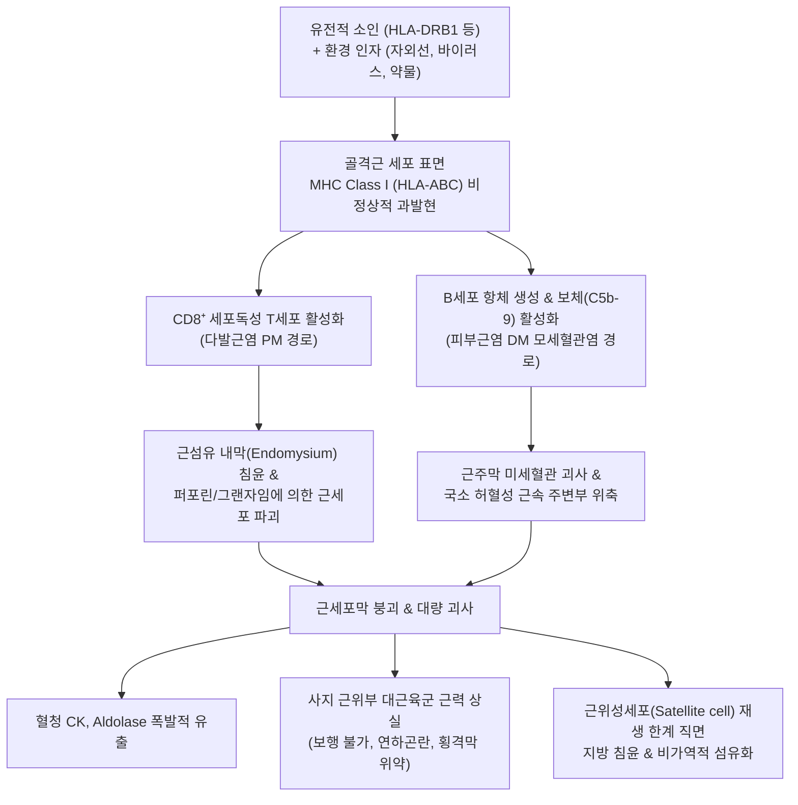

# 🩺 특발성 염증성 근육증 (Idiopathic Inflammatory Myopathies, IIM)

> **핵심 3줄 요약 (Key Summary)**:
> - 📍 **병소 부위 & 해부·병태생리**: 자가면역 기전에 의해 골격근의 근내막(Endomysium) 또는 근주막(Perimysium) 미세혈관에 세포독성 T세포(CD8⁺) 침윤 또는 보체 복합체(C5b-9)가 침착되어 전신 근위부 골격근(대퇴부, 골반대, 견갑대, 경부 굴근)의 광범위한 괴사와 재생 장애가 발생하는 전신성 자가면역 질환군이다.
> - 🚩 **전형적 임상 양상**: 대칭적인 사지 근위부 근위약(계단 오르기, 의자에서 일어나기, 빗질하기 곤란)이 수 주~수 개월에 걸쳐 점진적으로 진행되며, [[피부근염]](DM)의 경우 특징적인 피부 징후(헬리오트로프 발진, 고트론 구진)가 동반되고, 혈청 [[크레아틴 키나아제]](CK)가 정상치의 5~50배 폭증한다.
> - 🛠️ **핵심 검사 & 치료 전략**: 혈청 근육 효소(CK, Aldolase), 근염 특이 자가항체(MSAs: Anti-Jo-1, Mi-2, SRP, TIF1-γ, MDA5), 근전도(EMG), 근육 MRI(STIR 부종 확인) 및 근생검. 급성기 고용량 코르티코스테로이드 및 면역억제제(MTX, AZA, IVIG) 투여와 더불어 성인 환자에서는 악성종양 동반 여부 및 간질성 폐질환(ILD) 스크리닝이 필수적이다. 한의학적으로 위증(痿證) 관점에서 [[보중익기탕]], [[자하거]] 약침을 보조 적용한다.
> - ⚠️ **응급 의뢰 레드플래그**: 음식물을 삼키지 못하고 사레들리는 연하곤란(인두근 위약에 의한 흡인성 폐렴 위험), 횡격막 위약 또는 급속 진행성 간질성 폐질환(RP-ILD, 특히 Anti-MDA5 양성)에 의한 급성 호흡곤란 발생 시 즉시 상급종합병원 응급실 및 류마티스내과로 긴급 이송.

---

## 📌 목차
1. [질환 개요 & 해부학적 병태생리](#1-질환-개요--해부학적-병태생리)
2. [병태생리 메커니즘 & 생체역학적 악순환 네트워크](#2-병태생리-메커니즘--생체역학적-악순환-네트워크)
3. [임상 증상 & 이학적 검사(Physical Exam) 알고리즘](#3-임상-증상--이학적-검사physical-exam-알고리즘)
4. [감별 진단 매트릭스 (Differential Diagnosis)](#4-감별-진단-매트릭스-differential-diagnosis)
5. [한의 통합 치료 프로토콜 (침·약침·추나·한약)](#5-한의-통합-치료-프로토콜-침약침추나한약)
6. [양방 치료 & 병용·의뢰 기준 (Conventional Treatment & Referral)](#6-양방-치료--병용의뢰-기준-conventional-treatment--referral)
7. [재활 운동 & 생활습관 티칭 가이드](#7-재활-운동--생활습관-티칭-가이드)
8. [💡 사용자 진료실 핵심 필기 & 임상 노하우 (Melt-In 잔여 심화 집약)](#8--사용자-진료실-핵심-필기--임상-노하우-melt-in-잔여-심화-집약)
9. [출처 및 학술 참고 문헌 (References)](#9-출처-및-학술-참고-문헌-references)

---

## 1. 질환 개요 & 해부학적 병태생리

* **질환 정의**:
  * 특발성 염증성 근육증(Idiopathic Inflammatory Myopathies, IIM, 염증성 근병증)은 만성적인 골격근 염증과 진행성 근위부 근위약을 특징으로 하는 이질적인 전신 자가면역 질환군이다.
  * 질환은 병리 조직학적 소견과 임상적 표현형, 특이 자가항체에 따라 [[다발근염]](Polymyositis, PM), [[피부근염]](Dermatomyositis, DM), **면역매개 괴사성 근병증(Immune-Mediated Necrotizing Myopathy, IMNM)**, **봉입체 근염(Inclusion Body Myositis, IBM)**, **항합성효소 증후군(Antisynthetase Syndrome, ASS)**으로 세분화된다(Wilk et al., 2026; Wang et al., 2026).

* **아형별 표적 조직 및 병리 기전**:
  1. **다발근염 (PM)**:
     * 항원 제시 세포에 의해 활성화된 CD8⁺ 세포독성 T림프구가 비정상적으로 MHC Class I 분자를 발현하는 비괴사성 근섬유를 직접 둘러싸고 침윤하여 천공(Perforin) 및 세포사멸을 유발. 근내막(Endomysium) 침윤 우세.
  2. **피부근염 (DM)**:
     * B림프구 및 보체 활성화 매개 질환. 보체 복합체(C5b-9)가 근육 내 미세혈관 내피세포에 침착되어 혈전 형성 및 미세경색을 유발함. 근속 주변부 근위축(Perifascicular atrophy)과 근주막(Perimysium) 염증이 특징.
  3. **면역매개 괴사성 근병증 (IMNM)**:
     * 염증세포 침윤은 드물고 대식세포 침윤과 광범위한 근섬유 괴사/재생이 지배적임. Anti-SRP 또는 Anti-HMGCR 자가항체와 밀접하게 연관(스타틴 복용력 등).
  4. **봉입체 근염 (IBM)**:
     * 50세 이상 호발, 퇴행성 변화와 염증이 공존하며 근섬유 내 테두리 공포(Rimmed vacuoles) 및 아밀로이드 침착 관찰. 원위부 근육(손가락 굴근)과 대퇴사두근 비대칭 침범.

---

![[특발성염증성근육증_01_다발근염_근생검HE.jpg|450]]
> [그림 1: 다발근염 근생검 H&E — 근섬유 사이로 림프구가 침윤한 근내막(endomysial) 염증 소견. 섬유 크기가 고르지 않고 일부 위축섬유가 섞여 있다 — 출처: Wikimedia Commons — File:Polymyositis HE.jpg (CC BY-SA 3.0)]

## 2. 병태생리 메커니즘 & 생체역학적 악순환 네트워크

* **자가항체 프로파일과 임상 아형 (Talreja et al., 2026)**:
  * **Anti-Jo-1 (및 기타 항합성효소 항체)**: 간질성 폐질환(ILD), 관절염, 기계공의 손, 레이노 현상이 동반되는 항합성효소 증후군.
  * **Anti-Mi-2**: 피부근염의 전형적인 고전적 피부 발진과 연관, 스테로이드 반응성 및 예후 양호.
  * **Anti-TIF1-γ / Anti-NXP-2**: **악성종양 동반 근염(Cancer-associated myositis)**의 강력한 지표 (성인 피부근염 환자에서 암 발생률 5~8배 증가).
  * **Anti-MDA5**: 근염 증상은 경미하나 급속 진행성 간질성 폐질환(RP-ILD) 및 피부 궤양을 유발하여 치사율이 매우 높음.
  * **Anti-SRP / Anti-HMGCR**: 중증 급성 근괴사를 동반하는 IMNM.

---

![[특발성염증성근육증_02_피부근염_조직HE.jpg|450]]
> [그림 2: 피부근염 근조직 H&E — 근초(perimysium)와 혈관 주위에 염증세포가 몰려 있고 주변 근섬유가 위축된 모습. 피부근염의 특징인 근초혈관 염증 소견이다 — 출처: Wikimedia Commons — File:Dermatomyositis HE x40.jpg (CC BY-SA 3.0)]

![[특발성염증성근육증_03_피부근염_고배율.jpg|450]]
> [그림 3: 피부근염 고배율 H&E — 위축된 근섬유가 다발로 모여 있고 그 사이에 염증세포가 끼어 있다(주변부 위축, perifascicular atrophy) — 출처: Wikimedia Commons — File:Dermatomyositis - high mag.jpg (CC BY-SA 3.0)]

## 3. 임상 증상 & 이학적 검사(Physical Exam) 알고리즘

* **주요 임상 증상**:
  1. **진행성 대칭성 근위부 근위약 (Proximal Weakness)**:
     * "의자에서 손을 짚지 않고는 일어날 수 없다", "버스를 탈 때 계단을 오르기 힘들다", "머리를 빗거나 높은 선반의 물건을 내릴 때 팔이 안 올라간다"고 호소.
     * 감각 신경 이상(저림 등)은 대개 동반되지 않는 순수 운동 신경근 약화.
  2. **특이적 피부 징후 (피부근염 DM)**:
     * **헬리오트로프 발진 (Heliotrope rash)**: 양측 윗눈꺼풀의 자줏빛/적자색 홍반과 눈 주위 부종.
     * **고트론 구진 (Gottron's papules)**: 손가락 관절(MCP, PIP, DIP) 배면의 인설성 홍반성 구진 (병변이 관절 융기부에 국한됨).
     * **V-징후 및 숄 징후 (V-sign & Shawl sign)**: 앞가슴 V자 부위 및 목 뒤·어깨·등 상부의 자외선 노출 부위 홍반.
     * **기계공의 손 (Mechanic's hands)**: 손가락 외측 가장자리의 각화, 균열, 거친 피부(항합성효소 증후군 특징).
  3. **전신 합병증**:
     * 연하곤란(음식 삼킴 장애, 사레들림), 마른 기침 및 호흡곤란(ILD), 심근염.

* **이학적 검사 및 진단 평가**:
  * **도수근력검사 (MMT-8)**: 삼각근, 상완이두근, 손목 신근, 대퇴사두근, 장요근, 슬관절 굴근, 경부 굴근의 근력 단계 정량 평가 (Grade 0~5).
  * **Gowers 징후**: 바닥에서 일어설 때 허벅지를 손으로 짚고 기어오르듯 일어나는지 관찰.
  * **검사실 검사**:
    * 혈청 근육 효소: CK(정상의 수배~수십 배 상승), Aldolase, AST, ALT, LDH 동반 상승.
    * 자가항체 검사(Myositis Line Blot): 16종 근염 특이 자가항체 패널 검사.
  * **근전도 및 근육 MRI**:
    * 근전도(EMG): 섬유자발수축, 양성 예파 등 근육원성 삼징후 관찰.
    * 대퇴부 MRI(STIR 기법): 근육 내 고신호 강도로 활동성 염증 및 부종 시각화 (생검 부위 선정에 결정적).

---

![[특발성염증성근육증_04_고트론구진.jpg|450]]
> [그림 4: 손가락 관절 손등 쪽 피부에 붉은 자줏빛 구진이 줄지어 올라온 고트론 구진(Gottron papules). 피부근염에서 손등 MCP·IP 관절 위에 대칭으로 나타나는 병리소견 — 출처: Wikimedia Commons — File:Gottron papules .dermatomyocitis.jpg (CC BY-SA 4.0)]

![[특발성염증성근육증_05_IBM_대퇴MRI.jpg|450]]
> [그림 5: 봉입체근염(IBM) 환자의 대퇴부 축상 MRI — 좌우 대퇴사두근에 신호 변화(부종·지방대체)가 보이고 전내측 근군이 상대적으로 침범된 모습 — 출처: Wikimedia Commons — File:Inclusion body myositis MRI.jpg (CC BY 3.0)]

![[특발성염증성근육증_06_IBM_상지근위축.jpg|450]]
> [그림 6: 봉입체근염 환자의 양팔 — 팔을 들고 힘을 주었을 때 위팔·전완 근육이 꺼져 보이고 손가락 굽힘근이 위축된 모습. IBM은 대퇴사두근과 손가락 굴곡근을 비대칭으로 침범한다 — 출처: Wikimedia Commons — File:Inclusion body myositis arms.png (CC BY 4.0)]

## 4. 감별 진단 매트릭스 (Differential Diagnosis)

| 질환명 | 주 침범 근육 및 대칭성 | 혈청 CK 수치 | 피부 및 전신 징후 | 핵심 감별점 |
| :--- | :--- | :--- | :--- | :--- |
| **특발성 염증성 근육증 (IIM)** | **대칭성 근위부 골격근** | **현저한 급상승 (수배~수십 배)** | 헬리오트로프 발진, 고트론 구진, ILD | 자가면역 질환, MSA 항체 양성, 근생검상 염증/괴사 |
| [[스타틴 유발 근병증]] (SAMS) | 대칭성 근위부 근육통/위약 | 정상 ~ 경도 상승 (괴사형 제외) | 피부 발진 없음 | 스타틴 복용력, 약물 중단 시 호전 (단, anti-HMGCR 제외) |
| **중증 근무력증 (MG)** | 안근(눈꺼풀), 연하근, 근위부 | **정상** | 안검하수, 복시, 일중 변동(오후 악화) | 신경근 접합부 질환, 항AChR 항체 양성, 반복자극검사 감쇠 |
| **진행성 근이영양증 (Dystrophy)** | 근위부 (연령에 따라 다양) | 매우 높음 (초기) | 유전 질환, 서서히 수년간 진행 | 가족력, 유전자 돌연변이, 염증세포 침윤 없음 |
| [[류마티스 다발근통]] (PMR) | 어깨대 및 골반대 통증/강직 | **정상** | 50세 이상, 심한 조조강직 | 진성 근력 저하는 없음(통증에 의한 제한), ESR/CRP 급상승 |

---

## 5. 한의 통합 치료 프로토콜 (침·약침·추나·한약)

* **한의 치료의 임상적 역할과 한계**:
  * 급성기 염증성 근육증은 비가역적 근섬유 괴사와 폐 섬유화, 연하곤란을 동반하므로 양방의 면역억제 유도 요법(Induction therapy)이 최우선이다.
  * 한의 치료는 질환 안정기/관해기 환자의 근위축 회복, 피로 개선, 스테로이드 장기 복용에 따른 근병증(Steroid-induced myopathy) 감별 및 보익 관리에 병용된다.

* **한의학적 변증 (위증 痿證의 관점)**:
  1. **비위허약·중기하함 (脾胃虛弱·中氣下陷)**: 비주사말(脾主四末), 비주육(脾主肉) 이론에 따라 비위가 상하여 사지 근육을 영양하지 못함. 사지 위약, 식소변당, 피로 무력, 설담태백, 맥세약.
  2. **간신부족·음허근축 (肝腎不足·陰虛筋縮)**: 간주근, 신주골 실조로 근맥이 마르고 뼈가 약해짐. 만성 근위축, 요슬산연, 구건인조, 설홍소태, 맥세삭.
  3. **습열침음·기육생열 (濕熱浸淫·肌肉生熱 - 급성 피부근염기)**: 습열의 사기가 기육에 울체됨. 근육 미열감, 피부 홍반, 설홍태황니.

* **침구 치료 프로토콜**:
  * **사지 근위부 기혈 소통 혈위**:
    * 상지: [[견우]](LI15), [[곡지]](LI11), [[수삼리]](LI10), [[비노]](LI14).
    * 하지: [[비수]](BL20), [[신수]](BL23), [[족삼리]](ST36), [[양릉천]](GB34, 근회), [[혈해]](SP10), [[음릉천]](SP9).
  * **자침 기법**:
    * 근육 손상을 유발할 수 있는 강한 전침이나 강자극은 피하고, 저빈도(2Hz) 미세 전류를 적용하여 위축된 근섬유의 혈류 순환 및 PGC-1α 미토콘드리아 생합성 자극.

* **약침 치료**:
  * **자하거(Hominis Placenta) 약침**:
    * 만성기 근위약 부위(대퇴사두근, 삼각근) 및 비수, 신수에 0.5~1.0cc 심부 주입하여 근육 단백질 합성 촉진 및 면역 조절 도모.

* **한약 처방 프로토콜**:
  * [[보중익기탕]](補中益氣湯) (비위허약형 근위약 본치):
    * 황기 20~30g, 인삼, 백출, 승마, 시호, 당귀.
    * 비위의 기운을 보하고 근육 조직으로 영양을 끌어올려 사지 근력 회복 촉진.
  * [[가미삼묘환]](加味三妙丸) 또는 [[이묘환]]:
    * 급성기 습열로 인해 근육에 열감이 있고 피부 홍반이 동반될 때 황백, 창출, 우슬, 의이인을 사용하여 습열을 제거.
  * [[호잠환]](虎潛丸) 또는 [[육미지황탕]](六味地黃湯) 가미방:
    * 만성기 간신음허로 근육이 마르고 위축될 때 구판, 숙지황, 쇄양 등으로 음혈을 채우고 근골을 강건하게 함.

---

## 6. 양방 치료 & 병용·의뢰 기준 (Conventional Treatment & Referral)

* **단계별 면역억제 치료 전략 (Wilk et al., 2026)**:
  1. **1차 유도 요법 (Induction Therapy)**:
     * **경구 코르티코스테로이드**: 프레드니솔론(Prednisolone) 1 mg/kg/일 (최대 60~80 mg/일) 투여.
     * 중증(연하곤란, 호흡부전, 심근염) 시: 정맥 메틸프레드니솔론 1 g/일 3일간 펄스 요법.
  2. **면역조절제 조기 병용 (Steroid-sparing agents)**:
     * 메토트렉세이트(MTX 15~25 mg/주) 또는 아자티오프린(AZA 2~3 mg/kg/일).
     * 간질성 폐질환(ILD) 동반 시: 타크로리무스(Tacrolimus) 또는 마이코페놀레이트 모페틸(MMF) 선호.
  3. **2차/불응성 치료**:
     * 정맥 면역글로불린(IVIG 2 g/kg 분할 투여): 피부근염 및 중증 연하곤란에 신속한 효과.
     * 생물학적 제제: 리툭시맙(Rituximab - 항CD20 항체), JAK 억제제(토파시티닙 - 특히 Anti-MDA5 RP-ILD에 주목).

* **악성종양 동반 스크리닝 (Cancer Screening - 필수)**:
  * 피부근염 진단 후 3년 이내에는 반드시 흉부/복부/골반 CT, 내시경, 유방촬영술, 부인과 검진, 종양표지자 검사를 시행하여 숨은 고형암을 찾아내야 함.

* **양방·전문과 의뢰 기준 (Referral Criteria)**:
  * **🚨 즉각 응급실 의뢰 (Red Flags)**:
    1. 음식물이나 물을 삼킬 때 기도로 넘어가 기침이 나고 호흡이 곤란한 연하곤란 (흡인성 폐렴 위험).
    2. 평소보다 숨이 차고 기침이 나며 산소포화도가 93% 이하로 떨어지는 경우 (급성 간질성 폐질환 ILD 악화).
    3. 근위약이 급속도로 상행하여 목을 가누지 못하거나 사지 마비가 진행되는 경우.

---

## 7. 재활 운동 & 생활습관 티칭 가이드

* **단계별 운동 재활 지침**:
  * 급성 염증기(CK 수백 배 상승, 발열): 절대 안정. 무리한 운동은 근섬유 파괴를 가속화하므로 금지(침상 관절 가동 운동만 허용).
  * 아급성 회복기: CK가 안정화되기 시작하면 등척성 운동(Isometric)부터 시작하여, 통증이 없는 범위에서 점진적 저항 운동(PRT)으로 진행하여 근위축 방지.

* **자외선 차단 (피부근염 환자 필수)**:
  * 자외선(UV)은 각질세포의 세포사를 유도하여 자가항원 노출을 유발하므로 외출 시 SPF 50+ 자외선 차단제 도포 및 긴 소매 옷 착용 의무화.

* **식사 자세 지도 (연하곤란 예방)**:
  * 식사 시 턱을 아래로 살짝 당긴 자세(Chin-tuck)로 천천히 삼키도록 지도하고, 액체류는 점도 증진제(토로미)를 섞어 섭취.

---

## 8. 💡 사용자 진료실 핵심 필기 & 임상 노하우 (Melt-In 잔여 심화 집약)

* **진료실 임상 팁**:
  * 40~60대 환자가 "몇 달 전부터 계단 오르기가 너무 힘들고 버스 손잡이 잡기가 버겁다", "오십견이나 퇴행성 무릎 관절염 같다"며 내원했을 때, **환자의 양 손가락 마디와 눈꺼풀을 반드시 확인**하라.
  * 손가락 마디마디 관절 뼈 위에 붉은 각질 구진(고트론 구진)이 있거나 눈꺼풀이 보랏빛으로 부어 있다면, 관절염이 아니라 전신을 위협하는 **'피부근염(Dermatomyositis)'**이다.
  * 이 질환은 단순 근육통이 아니라 자가면역 질환이며, 특히 성인에서는 내장에 암(위암, 폐암, 난소암)이 숨어 있을 확률이 20~30%에 이른다. 침 치료로 시간을 끌지 말고 즉시 대학병원 류마티스내과로 의뢰하여 암 검사와 근생검을 받게 해야 환자의 생명을 구할 수 있다.

---

## 9. 출처 및 학술 참고 문헌 (References)

* Talreja T, Gupta L, Balse R, et al. (2026). Environmental exposures and risks for the idiopathic inflammatory myopathies and its phenotypes: a narrative review. *Curr Opin Rheumatol*. 38(6):437-447. PMID: 42682167

* Wilk N, Paik J, Needham M, et al. (2026). The current clinical trial landscape in idiopathic inflammatory myopathies. *Curr Opin Rheumatol*. 38(6):488-498. PMID: 42643001

* Wang G, Cui S, Yang L, et al. (2026). Animal Models of Idiopathic Inflammatory Myopathies: Bridging Mechanistic Insights and Clinical Translation. *Int J Mol Sci*. 27(15):8210. PMID: 42589354

---

## 관련 노트

- [[다발근염]]
- [[피부근염]]
- [[스타틴 유발 근병증]]
- [[횡문근융해증]]
- [[크레아틴 키나아제]]
- [[보중익기탕]]
