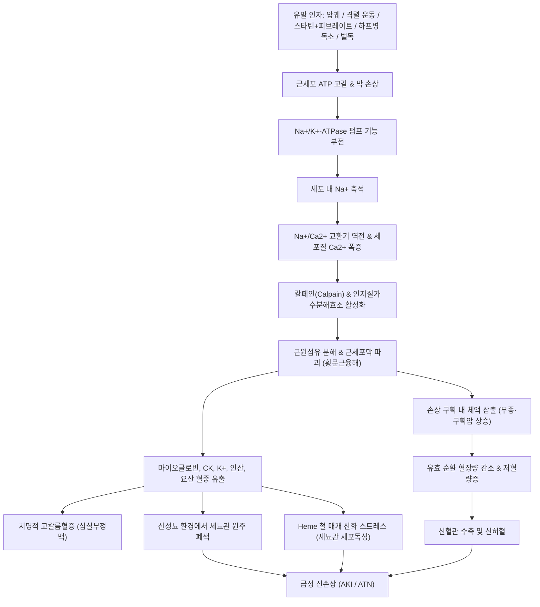

# 🩺 [[횡문근융해증]] (Rhabdomyolysis / 橫紋筋溶解症, ICD-10 M62.82, T79.6 / KCD M62.8 계열)

> **핵심 3줄 요약 (Key Summary)**:
> - 📍 병소 부위 & 해부·병태생리: 특정 국소 관절 질환이 아니라 체간 및 사지의 **전신 골격근(횡문근)** 전체가 병소다. 대근군([[대퇴사두근]], [[둔근]], [[척주기립근]], [[비복근]])의 급격한 괴사로 근세포막 무결성이 붕괴되며, 세포내 마이오글로빈, 크레아틴키나아제(CK), 칼륨, 젖산탈수소효소(LDH), 인산염, 요산이 순환계로 쏟아져 나와 2차적으로 [[신장]]([[사구체]], [[세뇨관]])과 밀폐된 [[근막구획]]을 파괴한다.
> - 🚩 전형적 임상 양상 & 3대 징후: **극심한 근육통(Muscle pain) + 전신 근력 약화(Weakness) + 콜라색/홍차색 소변(Cola-colored/Tea-colored urine)** 의 고전적 3대 징후. 단, 임상에서 3대 징후가 동시에 관찰되는 경우는 10% 미만으로 드물므로, 발병 전 유발 요인 문진과 조기 [[혈청 크레아틴키나아제(CK) 검사]]가 진단의 핵심이다.
> - 🛠️ 핵심 감별 검사 & 한·양방 다각적 치료 전략: [[소변 딥스틱 검사]](잠혈 양성이나 현미경 적혈구 음성 확인), [[전해질·신기능 검사]], [[구획압 측정]]이 필수적이다. 양방 1차 표준 치료는 **시간당 200~300 mL/hr의 대량 정맥 생리식염수 수액 소생술**과 요 알칼리화이며, 한의 치료는 급성기 응급 전원 후 신기능과 전해질이 안정된 아급성기·회복기에 위증(痿證), 육위(肉痿), 기체어혈, 비신양허 변증을 적용하여 침·약침·한약으로 잔여 기능 장애를 재건한다.
> - <font color="#fa7e7e">⚠️ 응급 의뢰 레드플래그 & 악화 요인: 혈청 CK 급상승(> 5,000 U/L), 핍뇨(< 0.5 mL/kg/h), 치명적 고칼륨혈증 및 ECG 텐트형 T파 변화, 구획증후군(수동 신전 시 극통, 구획 팽창, 이상감각), 파종성 혈관내 응고(DIC), 저혈량 쇼크, 의식 저하는 <b>즉시 3차 응급의료센터로 전원</b>해야 한다. 급성기 환부의 강한 마사지, 폼롤러, 자극적 침치료, 온열 요법은 절대 금기다.</font>

---

## 📌 목차
1. [질환 개요 & 해부학적 병태생리](#1-질환-개요--해부학적-병태생리)
2. [병태생리 메커니즘 & 생체역학적 악순환 네트워크](#2-병태생리-메커니즘--생체역학적-악순환-네트워크)
3. [임상 증상 & 이학적 검사(Physical Exam) 알고리즘](#3-임상-증상--이학적-검사physical-exam-알고리즘)
4. [감별 진단 매트릭스 (Differential Diagnosis)](#4-감별-진단-매트릭스-differential-diagnosis)
5. [한의 통합 치료 프로토콜 (침·약침·추나·한약)](#5-한의-통합-치료-프로토콜-침약침추나한약)
6. [양방 치료 & 병용·의뢰 기준 (Conventional Treatment & Referral)](#6-양방-치료--병용의뢰-기준-conventional-treatment--referral)
7. [재활 운동 & 생활습관 티칭 가이드](#7-재활-운동--생활습관-티칭-가이드)
8. [💡 사용자 진료실 핵심 필기 & 임상 노하우 (Melt-In 잔여 심화 집약)](#8--사용자-진료실-핵심-필기--임상-노하우-melt-in-잔여-심화-집약)
9. [출처 및 학술 참고 문헌 (References)](#9-출처-및-학술-참고-문헌-references)

---

## 1. 질환 개요 & 해부학적 병태생리

### 1) 질환의 정의 및 임상적 중요성
* **정의**: [[횡문근융해증]](Rhabdomyolysis)은 외상, 허혈, 대사 이상, 독소, 감염, 과도한 기계적 스트레스 등 다양한 병인에 의해 골격근(횡문근) 세포막(Sarcolemma)의 온전성이 파괴되면서 근세포 내 구성 성분—마이오글로빈(Myoglobin), 크레아틴키나아제(Creatine Kinase, CK), 젖산탈수소효소(LDH), 아스파르테이트아미노전달효소(AST), 칼륨(K⁺), 인산염(Phosphate), 요산(Uric acid)—이 순환계로 급격히 누출되는 전신성 파괴 증후군(Clinical syndrome)이다 (Cabral et al., 2020).
* **증후군적 관점**: 국소 근육의 단순 염증이나 근육통에 그치지 않고, 대량 방출된 마이오글로빈에 의한 급성 세뇨관 괴사(ATN), 치명적 고칼륨혈증성 부정맥, 체액의 근육 내 격리(Third-spacing)에 의한 저혈량 쇼크, [[구획증후군]](Compartment syndrome), 그리고 파종성 혈관내 응고([[DIC]])를 초래할 수 있는 내과적·정형외과적 초응급 질환이다.

### 2) 역학 및 호발 요인 분류
* **외상성 및 압궤성 원인 (Traumatic & Compressive)**:
  * **압궤 손상 (Crush injury)**: 지진, 건물 붕괴, 교통사고, 산업재해 등으로 근육이 장시간 물리적으로 압박받은 경우. 광범위한 압궤에 저혈량 쇼크와 신부전이 동반된 복합 상태를 [[압궤증후군]](Crush syndrome)이라 한다.
  * **장시간 부동 (Immobility / Compartmental compression)**: 뇌졸중, 두부 외상, 중증 알코올 중독, 약물 과다 복용 후 의식을 잃고 단단한 바닥에 수 시간 이상 동일 자세로 누워 자신의 체중에 의해 근육이 압박·허혈된 상태.
  * **고전압 감전 및 중증 화상**: 광범위한 직접 근섬유 열괴사 유발.
* **비외상성 과운동성 원인 (Exertional)**:
  * 평소 운동량이 적던 개인이 준비되지 않은 상태에서 수행한 고강도 운동(신병 훈련소 군대 행군, 크로스핏, 고강도 스피닝, 울트라마라톤).
  * 지속성 간질 발작(Status epilepticus), 파상풍, 진전섬망(Delirium tremens)으로 인한 지속적인 근육 연축.
* **약물 및 독소 유발 원인 (Toxic & Pharmacological)**:
  * **지질강하제**: HMG-CoA 환원효소 억제제인 [[스타틴]](Statin) 계열(아토르바스타틴, 심바스타틴 등)과 [[피브레이트]](Fibrate, 페노피브레이트 등)의 병용 투여 시 미토콘드리아 호흡 억제로 인한 횡문근융해 위험이 극적으로 상승한다.
  * **하프병 (Haff disease)**: 붉은잉어([[Cyprinus carpio rubrofuscus]]), 메기, 민물 가재 등 특정 수산물을 조리·섭취한 후 수 시간 내에 미지의 내열성 지질가용성 독소에 의해 발생하는 급성 횡문근융해증 클러스터 (Wang et al., 2026).
  * **벌독 (Wasp venom) 자상**: 말벌 다발성 자상 시 벌독의 멜리틴, 인지질가수분해효소 및 독성 펩타이드가 직접 근세포막을 용해하고 미토콘드리아 투과성 전이 구멍(mPTP)을 개방하여 중증 횡문근융해 및 급성 신손상을 유발 (Zhang et al., 2026).
  * 기타 약물: 신경이완제악성증후군(NMS)을 유발하는 항정신병제, 마취제(악성고열 Malignant hyperthermia), 코카인, 암페타민, MDMA, 알코올 중독.
* **감염 및 대사·내분비 요인 (Infectious & Metabolic)**:
  * 인플루엔자 A/B 바이러스, 엡스타인-바 바이러스(EBV), COVID-19, 레지오넬라 감염증, 세균성 패혈증. 특히 소아에서는 바이러스성 근염 후 발병이 가장 흔하다 (Szugye et al., 2020).
  * 저칼륨혈증, 저인산혈증, 당뇨병성 케톤산증(DKA), 점액수종성 혼수(중증 갑상선기능저하증).
  * 유전성 대사성 근병증: McArdle병(글리코겐 분해 효소 결핍), 카르니틴 팔미토일전달효소 결핍(CPT-II deficiency).

### 3) 관련 해부학적 구조물
* **골격 및 근막 구획 (Fascial Compartments)**:
  * 근육은 신축성이 극히 제한된 치밀한 결합조직인 근막(Fascia)에 둘러싸여 폐쇄된 구획을 형성한다.
  * 호발 구획: [[대퇴 전방 구획]](대퇴사두근), [[하퇴 전방 구획]](전경골근), [[하퇴 심부 후방 구획]](후경골근, 장지굴근), [[둔부 구획]](대둔근, 중둔근), [[상완 전방 구획]].
* **관련 대근군 (Major Muscle Groups)**:
  * 근육 체적이 크고 산소 소모량이 많은 항중력 대근군—[[대퇴사두근]](대퇴직근, 외측광근, 내측광근), [[대둔근]], [[척주기립근]], [[비복근]], [[가자미근]], [[광배근]]—이 손상될 때 폭발적인 양의 미오글로빈과 효소가 혈류로 쏟아져 나온다.
* **신경 및 혈관망**:
  * 구획 내 압력이 상승하면 가장 먼저 미세 모세혈관 관류가 정지되고, 이어서 감각 및 운동 신경인 [[비골신경]](Peroneal nerve, 족하수 유발), [[경골신경]](Tibial nerve), [[좌골신경]](Sciatic nerve)이 허혈성 압박을 받아 비가역적 축삭 손상에 노출된다.
* **2차 표적 장기 (신장 및 요로계)**:
  * [[신장]](Kidney): 사구체를 통과한 17.8 kDa의 단량체 마이오글로빈이 [[근위세뇨관]] 상피세포에 과부하를 일으키고, 산성 요 환경의 [[원위세뇨관]] 및 집합관에서 겔화되어 폐색을 일으킨다.

---

## 2. 병태생리 메커니즘 & 생체역학적 악순환 네트워크

### 1) ASCII 병태생리 다이어그램
```
+-----------------------------------------------------------------------------------------+
|                              다양한 급성 원인 손상 인자                                   |
| (외상 압궤 / 과도한 운동 / 스타틴+피브레이트 / 하프병 독소 / 벌독 자상 / 고열 / 허혈)          |
+-----------------------------------------------------------------------------------------+
                                           |
                                           v
             +-------------------------------------------------------------+
             |             근세포 내 ATP 고갈 & 세포막 무결성 파괴           |
             +-------------------------------------------------------------+
                                           |
                                           v
             +-------------------------------------------------------------+
             |      Na+/K+-ATPase 펌프 기능 부전  ==>  세포 내 Na+ 과다 축적  |
             +-------------------------------------------------------------+
                                           |
                                           v
             +-------------------------------------------------------------+
             |      Na+/Ca2+ 교환기 역전 (Reverse Mode) & 근소포체 Ca2+ 누출   |
             +-------------------------------------------------------------+
                                           |
                                           v
             +-------------------------------------------------------------+
             |       세포질 내 유리 칼슘 폭발적 축적 (Intracellular Ca2+ Overload)  |
             +-------------------------------------------------------------+
                                           |
                    +----------------------+----------------------+
                    |                                             |
                    v                                             v
+-----------------------------------------+   +-----------------------------------------+
|     칼슘의존성 단백분해효소 (Calpain) 활성화|   |   인지질가수분해효소 (Phospholipase A2) 활성화 |
|   - 근원섬유 골격단백 (Titin, Desmin) 파괴  |   |   - 세포막 인지질 분해, 리소좀 파괴     |
+-----------------------------------------+   +-----------------------------------------+
                    |                                             |
                    +----------------------+----------------------+
                                           |
                                           v
             +-------------------------------------------------------------+
             |              근세포막 완전 용해 및 괴사 (Myonecrosis)             |
             +-------------------------------------------------------------+
                                           |
                    +----------------------+----------------------+
                    |                                             |
                    v                                             v
+-----------------------------------------+   +-----------------------------------------+
|         [ 전신 혈류 내 독성 물질 방출 ]         |   |          [ 국소 근육 내 체액 격리 ]        |
|  - 마이오글로빈 (Myoglobin, 17.8 kDa)     |   |  - 손상 근막 구획 내 혈장 누출(Third-space)  |
|  - 크레아틴키나아제 (CK > 5,000~100,000 U/L) |   |  - 구획 내압 상승 ==> [[구획증후군]] 유발   |
|  - 칼륨 (K+), 인산염, 요산, LDH, AST     |   |  - 유효 순환 혈장량 급감 ==> 저혈량 쇼크    |
+-----------------------------------------+   +-----------------------------------------+
                    |                                             |
                    +----------------------+----------------------+
                                           |
                                           v
             +-------------------------------------------------------------+
             |                 신장 표적 3중 복합 독성 작용                     |
             | 1) 신혈관 수축: 저혈량증 + Endothelin 분비로 인한 신피질 허혈   |
             | 2) 세뇨관 원주 폐색: 산성 요에서 Tamm-Horsfall 단백과 겔 형성  |
             | 3) 직접 세뇨관 세포독성: Heme 철(Fe2+) 매개 펜톤 반응 산화 손상 |
             +-------------------------------------------------------------+
                                           |
                                           v
             +-------------------------------------------------------------+
             |          급성 신손상 (AKI) / 치명적 부정맥 / 파종성혈관내응고 (DIC) |
             +-------------------------------------------------------------+
```

### 2) 분자 생물학적 핵심 기전
* **에너지 고갈과 칼슘 항상성 붕괴**:
  * 정상 골격근 세포질의 유리 칼슘 농도는 약 100 nM로, 세포 외액(약 1~2 mM)에 비해 10,000배 낮게 유지된다.
  * 손상으로 인해 미토콘드리아 산화적인산화 장애 및 ATP 고갈이 발생하면, 세포막의 Na⁺/K⁺-ATPase가 정지된다.
  * 세포 내로 Na⁺이 유입되어 축적되면, Na⁺/Ca²⁺ 교환기(NCX)가 역방향(Reverse mode)으로 구동되어 세포 외 Ca²⁺을 세포질로 들이붓게 된다. 여기에 근소포체(SR)의 리아노딘 수용체(RyR)가 통제력을 잃고 Ca²⁺을 방출하여 세포질 내 칼슘 농도가 폭증한다.
* **단백분해 및 자가소화 폭포**:
  * 과잉 칼슘은 칼슘의존성 단백분해효소인 **칼페인(Calpain)**을 비가역적으로 활성화시켜 액틴, 미오신, 티틴(Titin), 데스민(Desmin) 등 근원섬유 구조단백질을 절단한다.
  * 동시에 **인지질가수분해효소 A2(Phospholipase A2)**를 활성화하여 세포막 인지질을 분해하고, 미토콘드리아 막 투과성 전이 구멍(mPTP)을 개방하여 아포토시스와 괴사를 촉진한다 (Zhang et al., 2026).
* **신장 손상의 3대 메커니즘**:
  1. **신혈관 수축 (Renal Vasoconstriction)**: 손상된 근육으로 수 리터의 체액이 빠져나가 제3공간 격리(Third-spacing)가 일어나면서 저혈량증이 발생한다. 이에 반응하여 레닌-안지오텐신-알도스테론계(RAAS), 교감신경계, 엔도텔린-1(Endothelin-1)이 과활성화되고, 혈관확장성 프로스타글란딘 합성은 억제되어 신피질 혈류가 급감한다.
  2. **세뇨관 원주 폐쇄 (Tubular Cast Formation)**: 사구체에서 여과된 유리 마이오글로빈은 헨레고리 상행각과 원위세뇨관에서 분비되는 탐-호스폴 점액단백질(Tamm-Horsfall glycoprotein)과 복합체를 이룬다. 특히 **소변 pH가 5.6 이하로 산성화되면 마이오글로빈의 침전 속도가 극대화**되어 짙은 갈색의 세뇨관 원주(Casts)를 형성하여 세뇨관 내강을 완전히 틀어막는다.
  3. **헴(Heme) 매개 직접 세포독성 (Heme-Induced Cytotoxicity)**: 산성 환경에서 마이오글로빈에서 분리된 헴 단백의 철 이온(Fe²⁺)이 펜톤 반응(Fenton reaction)을 촉매하여 하이드록실 라디칼(•OH) 등 활성산소종(ROS)을 대량 생성한다. 이는 근위세뇨관 상피세포의 지질 과산화와 DNA 손상을 유발하여 직접적인 세포 괴사를 일으킨다.



---

## 3. 임상 증상 & 이학적 검사(Physical Exam) 알고리즘

### 1) 주소증 및 임상 3대 징후
* **고전적 3대 징후 (Classical Triad)**:
  1. **근육통 (Myalgia)**: 손상된 대근군([[대퇴사두근]], [[비복근]], [[둔근]], 요배부)의 뻐근하고 터질듯한 통증, 압통, 종창, 팽만감. 통증은 특정 신경근 피부분절에 국한되지 않고 근육 단위로 양측성 대칭성으로 나타난다.
  2. **근력 약화 (Muscle Weakness)**: 근원섬유 괴사로 인한 현저한 운동 기능 저하. 보행 곤란, 계단 오르기 불능, 하지 거상 불능.
  3. **콜라색/홍차색 소변 (Tea-colored / Cola-colored Urine)**: 사구체로 여과된 마이오글로빈에 의한 육안적 이상 소변.
  * ⚠️ **임상적 주의점**: 고전적 3대 징후가 동시에 모두 발현하는 환자는 전체의 10% 미만이다 (Nance & Mammen, 2015). 통증 없이 단순 무력감이나 소변색 변화만으로 내원하거나, 반대로 소변색은 정상인데 극심한 근육통과 CK 수만 U/L 상승을 보이는 경우가 흔하므로 의심 지수가 높아야 한다.
* **전신 전구 증상 및 합병증 징후**:
  * 발열, 전신 권태감, 오한, 식욕 부진, 오심 및 구토.
  * 심계항진 및 흉부 불쾌감: 급격한 고칼륨혈증 및 저칼슘혈증에 의한 부정맥.
  * 핍뇨(Oliguria, < 400 mL/day 또는 < 0.5 mL/kg/h) 및 무뇨(Anuria): 급성 신손상 이행의 적신호.
  * 전신 부종 및 체중 증가: 신배설 저하 및 체액 과부하.
  * 점상 출혈, 비출혈, 주사 부위 지속 출혈: 파종성 혈관내 응고([[DIC]]) 징후.

### 2) 필수 이학적 검사 및 진료실 스크리닝
* **근육 촉진 및 둘레 측정**:
  * 환부 근육을 촉진했을 때 단단하게 부풀어 오른 나무토막 같은 질감(Woody induration), 심한 압통.
  * 양측 사지 둘레(대퇴부, 하퇴부)를 계측하여 비대칭적 종창 확인.
* **신경혈관 상태 평가**:
  * 말초 족배동맥(Dorsalis pedis) 및 후경골동맥(Posterior tibial artery) 맥박 촉지.
  * 피부분절 감각 검사: 제1족지간 복측([[심비골신경]]), 족저부([[경골신경]]) 감각 저하 확인.
* **수동 신전 유발 검사 (Passive Stretch Test)**:
  * 발목관절을 부드럽게 수동 배측굴곡시킬 때 하퇴 구획 내에 참을 수 없는 극심한 통증이 유발되면 급성 구획증후군을 강력히 시사한다.
* **구획압 측정 (Compartment Pressure Measurement)**:
  * 스트라이커 바늘(Stryker needle)을 이용해 구획 내압을 직접 측정.
  * **절대 구획압 > 30 mmHg** 또는 **이완기 혈압과의 차이(Delta pressure = Diastolic BP - Compartment Pressure) < 30 mmHg** 시 응급 근막절개술(Fasciotomy)을 즉시 시행해야 한다.

### 3) 검사실 진단 알고리즘
```
                               [ 횡문근융해증 의심 환자 접촉 ]
                 (격렬한 운동, 압궤 손상, 고지혈증약 복용, 벌독, 진한 소변)
                                              |
                                              v
               +--------------------------------------------------------------+
               | 1단계: 진료실 즉각 스크리닝 검사                               |
               | - 소변 딥스틱 검사 (Urine Dipstick)                           |
               | - 간이 심전도 (ECG: 고칼륨혈증 T파 확인)                       |
               +--------------------------------------------------------------+
                                              |
                     +------------------------+------------------------+
                     |                                                 |
                     v                                                 v
         [ 소변 딥스틱 잠혈(+) ]                              [ 소변 딥스틱 잠혈(-) ]
                     |                                                 |
                     v                                                 v
  +-------------------------------------+            +-----------------------------------+
  | 2단계: 요침사 현미경 검사              |            | CK 검사 여전히 고려               |
  | - RBC 관찰 안 됨 (0~2 /HPF)          |            | (발병 초기 소변 미오글로빈 배설 전 |
  | ==> [ 마이오글로빈뇨 확진 ]           |            |  가능성 배제 불가)                |
  +-------------------------------------+            +-----------------------------------+
                     |
                     +------------------------+
                                              |
                                              v
               +--------------------------------------------------------------+
               | 3단계: 혈액 확진 및 합병증 패널 검사                           |
               | - 혈청 CK: 정상의 5배 이상 (> 1,000 U/L), 중증 > 5,000 U/L   |
               | - 전해질: K+ (> 5.5 mEq/L 주의), Ca2+, 인산염, 요산             |
               | - 신기능: BUN, Creatinine, eGFR                              |
               | - 간효소 및 응고: AST, ALT, LDH, PT/aPTT, D-Dimer            |
               +--------------------------------------------------------------+
                                              |
                                              v
               +--------------------------------------------------------------+
               | 4단계: 위험도 평가 및 전원 결정                                |
               | - CK > 5,000 U/L 또는 K+ > 5.5 mEq/L 또는 핍뇨                |
               | ==> 즉시 3차 응급의료센터 전원 및 대량 정맥 수액 요법 가동     |
               +--------------------------------------------------------------+
```

---

## 4. 감별 진단 매트릭스 (Differential Diagnosis)

### 1) 비정상 암적색/갈색 소변 감별 매트릭스
| 구분 지표 | [[횡문근융해증]] (마이오글로빈뇨) | [[용혈성 빈혈]] / 혈색소뇨 | [[요로결석]] / 사구체신염 (진성 혈뇨) |
| :--- | :--- | :--- | :--- |
| **원인 병태** | 골격근 괴사 및 미오글로빈 유출 | 혈관 내 적혈구 대량 파괴 (용혈) | 신장-요로계 혈관 파열 또는 염증 |
| **소변 원심분리 후 상청액** | **적갈색/암갈색 유지** | **적갈색/적색 유지** | **투명한 황색으로 맑아짐** (침전물만 적색) |
| **소변 딥스틱 (잠혈/Heme)** | **강양성 (++++ )** | **강양성 (++++ )** | **양성 (++)** |
| **요침사 현미경 검사** | **적혈구 거의 없음 (0~2/HPF)** | **적혈구 거의 없음 (0~2/HPF)** | **다량의 온전한 적혈구 관찰** |
| **혈장/혈청 원심분리 색조** | **투명한 볏짚색 (맑음)** | **붉은색/분홍색 (Hemoglobinemia)**| **투명한 볏짚색 (맑음)** |
| **혈청 크레아틴키나아제(CK)**| **극적인 현저한 상승 (> 5,000~10만)** | 정상 또는 경도 상승 | 정상 범위 |
| **혈청 햅토글로빈 (Haptoglobin)**| 정상 범위 유지 | **현저한 고갈/검출 한계 이하** | 정상 범위 유지 |
| **혈청 LDH / 빌리루빈** | LDH 급상승, 빌리루빈 정상 | LDH 급상승, **간접 빌리루빈 상승** | 정상 범위 |

### 2) 근골격계 및 내과적 유사 질환 감별 매트릭스
| 감별 질환 | 호발 병소 및 병인 | 주소증 및 임상 양상 | 특이적 검사 소견 | 치료 접근 |
| :--- | :--- | :--- | :--- | :--- |
| **[[횡문근융해증]]** (본 질환) | 전신 골격근, 외상/운동/약물/독소 | 근육통, 근력 저하, 콜라색 소변, 전신 쇠약 | **CK 정상 5배 이상 급상승**, 소변 잠혈(+)/RBC(-), 고칼륨혈증 | **대량 수액 소생술**, 요 알칼리화, 긴급 전원 |
| **[[지연성 근육통]](DOMS)** | 편심성 운동 후 근섬유 미세손상 | 운동 24~72시간 후 통증 피크, 뻐근함, 소변색 정상 | CK 정상~경도 상승(< 1,000 U/L), 신기능 정상, 전해질 정상 | 휴식, 가벼운 마사지, 1주 내 자연 소퇴 |
| **[[다발성근염]] / [[피부근염]]** | 자가면역성 근막 및 근주막 만성 염증 | 양측 대칭성 근위부 근력 약화, 연하 곤란, 피부 발진(헬리오트로프 발진) | 만성적인 CK 상승, **항Jo-1 항체 양성**, 근전도 상 근병증 소견, 근생검 확진 | 고용량 [[스테로이드]], 면역억제제 |
| **[[급성 심근경색]](AMI)** | 관상동맥 폐색에 의한 심근 괴사 | 흉골 하부 압박감, 방사통(좌측 팔, 턱), 호흡곤란, 식은땀 | **Troponin-I/T 급상승**, ECG ST절 상승/T파 역위, CK-MB 특이 상승 | 관상동맥 중재술(PCI), 혈전용해제 |
| **[[구획증후군]]** (단독 또는 병발) | 폐쇄된 근막 구획 내 압력 상승 | 손상에 비례하지 않는 극심한 통증, 수동 신전 시 극통, 감각 마비 | **구획압 > 30 mmHg**, 이완기 혈압 차이 < 30 mmHg | **응급 근막절개술 (Fasciotomy)** |
| **[[발작성 야간 혈색소뇨증]](PNH)** | 조혈모세포 PIG-A 돌연변이, 보체 매개 용혈 | 아침 첫 소변의 흑갈색 변화, 만성 빈혈, 정맥 혈전증 | 유세포 분석 상 **CD55, CD59 결손**, Coombs 음성, CK 정상 | 에쿨리주맙(Eculizumab, 보체 억제제) |

---

## 5. 한의 통합 치료 프로토콜 (침·약침·추나·한약)

> [!WARNING]
> **횡문근융해증의 급성기는 한의원 단독 치료의 대상이 아니다.**
> 발병 초기(CK 급상승기, 핍뇨, 소변색 이상, 전해질 이상)에는 지체 없이 **서양의학적 대량 정맥 수액 소생술을 위해 상급병원 응급실로 전원**해야 한다. 한의 치료는 급성기 위험이 종결되고, 혈청 CK 수치가 안정화되며, 신기능이 보존된 **아급성기 및 회복기 단계에서 잔여 기능 회복, 근섬유 재생, 보상성 근골격계 부정렬 교정**을 목표로 체계적으로 시행한다.

### 1) 한의학적 변증 체계 및 치법
1. **열독상진형 (熱毒傷津型)**:
   * **임상 양상**: 고열, 극심한 구갈, 번조, 농갈색 소변, 근육 작열통, 혀는 홍강(紅絳)하고 설태는 황조(黃燥), 맥은 홍삭(洪數) 또는 세삭(細數).
   * **치법**: 청열해독(淸熱解毒), 생진윤조(生津潤燥), 양혈청열(凉血淸熱).
2. **습열하주형 (濕熱下注型)**:
   * **임상 양상**: 소변 적탁, 배뇨 곤란, 사지 침중감, 전신 부종, 오심, 구토, 설태 황니(黃膩), 맥 활삭(滑數).
   * **치법**: 청열이습(淸熱利濕), 통림분청(通淋分淸).
3. **기체어혈형 (氣滯瘀血型)**:
   * **임상 양상**: 압궤 외상 또는 격렬한 운동 후 국소 근육의 극심한 자통(刺痛), 야간통, 종창 및 경결, 피부 자반, 설자암(舌紫暗) 또는 어반(瘀斑), 맥 삽(澁) 또는 현(弦).
   * **치법**: 활혈거어(活血祛瘀), 행기통락(行氣通絡), 소종지통(消腫止痛).
4. **비신양허형 (脾腎兩虛型 / 육위 肉痿)**:
   * **임상 양상**: 회복기 잔여 증상으로 팔다리에 힘이 빠져 걷기 힘듦, 사지 냉감, 안면 창백, 만성 피로, 소변 청장 또는 야간뇨, 설담태백(舌淡苔白), 맥 침세무력(沈細無力).
   * **치법**: 온보비신(溫補脾腎), 보익기혈(補益氣血), 강근장골(强筋壯骨).

### 2) 침구 치료 프로토콜 (Acupuncture)
* **회복기 신기능 촉진 및 수습 대사 조절**:
  * **주요 혈위**: [[신수(BL23)]], [[방광수(BL28)]], [[비수(BL20)]], [[음릉천(SP9)]], [[삼음교(SP6)]], [[관원(CV4)]], [[중극(CV3)]], [[족삼리(ST36)]].
  * **자침 기법**: 0.25 × 40 mm 호침으로 평보평사(平補平瀉) 또는 보법(補法) 시술. 유침 20분.
* **손상 근육군 기능 회복 및 근막 유착 박리**:
  * **대퇴부/둔부 손상**: [[환도(GB30)]], [[풍시(GB31)]], [[혈해(SP10)]], [[양구(ST34)]], [[비관(ST31)]], [[승부(BL36)]].
  * **하퇴부 손상**: [[양릉천(GB34)]](근회 筋會), [[위중(BL40)]], [[승산(BL57)]], [[족삼리(ST36)]], [[조해(KI6)]].
  * **요배부 손상**: [[대장수(BL25)]], [[격수(BL17)]](혈회 血會), [[지실(BL52)]], 척주기립근 통증유발점([[TP]]).
* **전침 (Electroacupuncture) 파라미터 세팅**:
  * **원칙**: 급성기 전침 절대 금기 (근육 미세 수축이 추가 근효소 방출 유발 위험).
  * **회복기**: **2 Hz 저빈도 연속파**, 환자가 뻐근함을 편안하게 느끼는 역치 하 자극으로 15분간 적용. 근육의 국소 혈류 개선 및 일산화질소(NO) 분비 촉진. 100 Hz 고빈도 과자극은 피한다.

### 3) 약침 치료 프로토콜 (Pharmacopuncture)
* **적응증 및 원칙**: 신기능(BUN/Cr)이 완전히 정상 범위로 회복되고 국소 근육 강직 및 순환 부전이 지속되는 회복기 단계에서 적용.
* **약침 제제 선택**:
  * **중성어혈약침**: 어혈 정체로 인한 잔여 근육 경결 및 자통 부위 아시혈에 분할 주입 (총량 1.0~2.0 mL).
  * **자하거(Hominis Placenta) 약침**: 비신양허로 인한 극심한 근위축 및 사지 무력증 개선을 위해 [[신수(BL23)]], [[족삼리(ST36)]], [[비수(BL20)]]에 각 0.2~0.5 mL씩 심부 주입.
  * **황련해독탕 약침**: 잔여 미열감 및 국소 열독성 부종 부위에 피내·피하 소량 점적.
* **금기 사항**: 출혈 경향([[DIC]] 회복기), 혈소판 감소증 환자, 또는 신기능이 불안정한 환자에게는 절대 시술하지 않는다.

### 4) 추나 요법 프로토콜 (Chuna Manual Therapy)
* **급성기: 절대 금기 (Absolute Contraindication)**:
  * 괴사 및 부종 상태의 근육에 가해지는 관절 교정 수기나 강한 압박 마사지는 근막 파열, 혈종 형성, 급성 구획압 상승, 칼륨의 추가 유출을 촉진한다.
* **회복기 근막 이완 추나 (Myofascial Chuna)**:
  * 근막연쇄선(Kinetic Chain) 상에서 보상적으로 과긴장된 인접 분절을 치료 타깃으로 설정.
  * **기법**: 저강도 연부조직 이완 수기(JS 기법), 수동적 근막 스트레칭 기법 적용.
  * [[장요근]](Iliopsoas), [[대퇴근막장근]](TFL), [[비복근]](Gastrocnemius)의 단축을 완만하게 신장시키며, 통증이 없는 정상 가동범위 내에서 관절 가동화(Mobilization) 시행.

### 5) 한약 치료 프로토콜 (Herbal Medicine)
* **습열하주 및 어혈 정체기 (아급성 전환기)**:
  * **[[저령탕(猪苓湯)]]**: 저령, 복령, 택사, 활석, 아교 각 6~8g. 이수청열(利水淸熱), 자음(滋陰). 신세뇨관 상피세포의 삼투압 조절 및 잔여 미오글로빈 배설 촉진.
  * **[[팔정산(八正散)]]**: 구맥, 변축, 차전자, 활석, 목통, 황련 등. 요도 작열감 및 진탁뇨 개선.
  * **[[도홍사물탕(桃紅四物湯)]]**: 당귀, 천궁, 백작약, 숙지황, 도인, 홍화. 손상 근육의 미세순환 재건 및 어혈 소퇴.
* **기음양허 및 근육 재생기 (회복기 표준 처방)**:
  * **[[생맥산(生脈散)]]**: 맥문동 12g, 인삼 8g, 오미자 4g. 열독으로 손상된 진액을 보충하고 심폐 기능을 강화하여 전신 탈수 후유증 개선.
  * **[[사역탕(四逆湯)]]**: 부자 6g, 건강 6g, 감초 8g. 극심한 허혈 및 쇼크 후 사지 냉감, 양기 쇠약 상태를 회생.
  * **[[보양환오탕(補陽還五湯)]]**: 황기 40~60g, 당귀미 8g, 적작약 6g, 천궁 4g, 도인 4g, 홍화 4g, 지룡 4g. 기허어혈로 인한 사지 마비감 및 근력 저하 회복의 대표 처방.
  * **[[독활기생탕(獨活寄生湯)]]**: 간신휴손(肝腎虧損)으로 허리와 무릎에 힘이 없고 보행이 부자연스러운 만성기 재활 보약.

---

## 6. 양방 치료 & 병용·의뢰 기준 (Conventional Treatment & Referral)

### 1) 서양의학적 표준 응급 처치 프로토콜
* **1. 대량 정맥 수액 소생술 (Aggressive Intravenous Fluid Resuscitation)**:
  * **치료의 절대적 1순위**: 진단 즉시 가능한 한 빨리 대량의 등장성 결정질액(0.9% Normal Saline)을 투여해야 한다.
  * **투여 용량 및 속도**:
    * 초기 2~4시간: 시간당 1,000~1,500 mL/hr 투여 (성인 기준).
    * 유지 요법: 시간당 200~300 mL/hr로 유지하며, 중심정맥압(CVP) 또는 초음파상 하대정맥(IVC) 허탈도를 모니터링하여 용적 과부하(폐부종)를 방지한다.
    * **목표 소변량**: **시간당 200~300 mL/hr (체중당 3~4 mL/kg/hr)**를 지속적으로 유지하여 신세뇨관 내 마이오글로빈의 정체를 방지하고 플러싱(Flushing)한다.
* **2. 요 알칼리화 (Urine Alkalinization)**:
  * **원리**: 소변 pH를 6.5~7.0 이상으로 유지하면 마이오글로빈이 탐-호스폴 단백과 결합하여 침전되는 것을 차단하고, 헴 철에 의한 과산화지질 독성을 감소시킨다.
  * **방법**: 5% 포도당 수액 1L에 탄산수소나트륨(Sodium bicarbonate) 100~150 mEq를 혼합하여 주입.
  * **주의점**: 혈청 칼슘 농도가 저하되어 있거나 동맥혈 가스분석 상 대사성 알칼리증(pH > 7.5)이 동반된 경우 알칼리화 요법을 중단해야 한다 (저칼슘혈증성 테타니 및 심실 부정맥 위험).
* **3. 고칼륨혈증 긴급 처치 (Management of Hyperkalemia)**:
  * 혈청 칼륨 > 6.0 mEq/L 또는 심전도 변화 시 즉시 가동:
    * **10% 글루콘산칼슘 (Calcium Gluconate)**: 10~20 mL를 2~5분에 걸쳐 정맥 주사 (심근 세포막 탈분극 안정화, 칼륨 농도 자체는 낮추지 않음).
    * **인슐린 + 고장성 포도당**: 속효성 인슐린(RI) 10단위 + 50% 포도당 50 mL 정맥 투여 (세포 내로 칼륨 강제 이동, 15~30분 내 작용).
    * **흡입용 베타-2 작용제**: 알부테롤(Albuterol) 10~20 mg 네뷸라이저 흡입.
    * **칼륨 배설 촉진제**: 지르코늄(Lokelma) 또는 칼슘 폴리스티렌 설포네이트 경구/관장 투여.
* **4. 이뇨제 사용 기준 (Diuretics)**:
  * **충분한 수액 공급이 선행되지 않은 상태에서의 이뇨제 투여는 절대 금기**이다.
  * 충분한 수액 공급에도 불구하고 목표 소변량이 나오지 않는 용적 과부하 환자에게만 루프 이뇨제(Furosemide 40~100 mg IV) 또는 만니톨(20% Mannitol 100 mL IV)을 신중히 고려한다.
* **5. 응급 신대체요법 (Renal Replacement Therapy / CRRT)**:
  * **적응증**: 보존적 약물 치료에 반응하지 않는 고칼륨혈증(K⁺ > 6.5 mEq/L), 난치성 대사성 산증(pH < 7.1), 이뇨제에 불응하는 폐부종 및 체액 과부하, 요독증성 뇌증·심낭염.
  * 지속적 정정맥 혈액투석여과(CRRT)를 조기에 가동하여 혈역학적 불안정 없이 마이오글로빈과 전해질을 정화한다.
* **6. 외과적 감압술 (Fasciotomy)**:
  * 구획 내압이 30 mmHg를 초과하거나 조직 관류압이 위협받을 때 지체 없이 사지의 피부와 근막을 절개하여 압력을 감압한다.

### 2) 한의 치료 병용 판단 및 상호작용
* **병용 가능 (Synergistic Phase)**:
  * 양방의 수액 치료가 종료되고 급성 합병증이 배제된 아급성기·회복기 환자에서 침·약침·생맥산·보양환오탕 등의 병용은 손상된 근육의 산소 공급을 개선하고 근력 회복 기간을 대폭 단축시킨다.
* **병용 주의 및 금기 (Hazardous Phase)**:
  * **급성기 한약 단독 투여 금기**: 한약 복용으로 인한 체액 보충은 정맥 수액의 투여 속도와 정밀한 요량 제어를 대체할 수 없으며, 수액 개시 시점을 지연시켜 비가역적 신손상을 초래할 수 있다.
  * **칼륨 함유 본초 주의**: 신기능이 저하된 환자에게 칼륨 함량이 높은 특정 한약재(목통, 택사 등 대량 투여)의 무분별한 사용은 고칼륨혈증을 가중시킬 수 있으므로 전해질 수치를 필히 확인한다.

### 3) 양방 전문과 응급 의뢰 기준 (Referral Criteria)
* **즉시 3차 응급의료센터 이송 트리거**:
  * 1. 혈청 CK 수치 5,000 U/L 초과 또는 초기 측정치 대비 가파른 상승 추세.
  * 2. 콜라색/흑갈색 소변과 함께 최근 2시간 이상 시간당 소변량이 0.5 mL/kg 미만인 핍뇨 상태.
  * 3. 혈청 칼륨 5.5 mEq/L 이상 또는 심전도상 텐트형 T파, QRS 연장 등 부정맥 소견.
  * 4. 환부의 돌덩이 같은 팽창, 수동 신전 시 비명을 지를 정도의 통증, 말초 감각 마비 ([[구획증후군]]).
  * 5. 수축기 혈압 90 mmHg 미만의 저혈량 쇼크, 청색증, 호흡곤란, 의식 혼미.

---

## 7. 재활 운동 & 생활습관 티칭 가이드

### 1) 단계적 운동 복귀 (Return to Activity / RTP) 4단계 프로토콜
* **1단계: 절대 안정 및 세포 치유기 (Active Rest Phase)**:
  * **기간**: 발병 후 약 1~2주 (혈청 CK가 1,000 U/L 이하로 안정화되고 자각적 근육통이 소실될 때까지).
  * **내용**: 일체의 저항성 운동 및 유산소 훈련 금지. 일상생활 내 가벼운 보행만 허용.
  * 하루 2~3L 이상의 충분한 수분 섭취 유지.
* **2단계: 능동 보조 관절가동운동 및 경증 유산소기 (Mobility & Low-intensity Aerobic)**:
  * **조건**: 임상 증상 소실, 혈청 생화학 검사 완전 정상화.
  * **내용**: 손상 대근군의 부드러운 능동 관절가동범위(A-ROM) 운동.
  * 평지 걷기 15~20분, 실내 고정식 자전거 가벼운 페달링 (최대 심박수의 50% 미만).
  * **절대 원칙**: 운동 중 통증이나 피로감이 발생하면 즉각 중단.
* **3단계: 등척성 안정화 및 점진적 등장성 부하기 (Isometric & Submaximal Resistance)**:
  * **내용**: 관절 움직임 없이 근육에 장력만 가하는 등척성 수축 운동(Isometric contraction, 예: 벽 스쿼트 20초 버티기, 누워서 둔근 조이기).
  * 2~3주에 걸쳐 점진적으로 맨몸 스쿼트, 가벼운 탄성 밴드 운동으로 진행.
  * **원심성 수축(Eccentric contraction)의 지연 도입**: 근섬유 파괴 위험이 가장 높은 급격한 네거티브 동작(원심성 운동)은 가장 마지막 단계에 조심스럽게 적용.
* **4단계: 완전 스포츠 복귀 및 기능 훈련기 (Full Functional Return)**:
  * **부하 증량의 철칙**: **주당 훈련량(볼륨 및 강도)의 증가는 10% 이내**로 제한한다.
  * 운동 전후 충분한 웜업(Warm-up)과 쿨다운(Cool-down) 15분 이상 필수.

### 2) 생활습관 및 재발 방지 환자 교육
* **수분 섭취 골든 룰 (Hydration Strategy)**:
  * 고강도 운동 2시간 전 500 mL의 수분을 미리 섭취한다.
  * 운동 중에는 15~20분마다 150~200 mL씩 규칙적으로 수분을 공급한다.
  * 운동 직후 체중을 측정하여 빠진 체중 1 kg당 약 1.2~1.5 L의 전해질 함유 수분을 보충한다.
* **환경 요인 및 위험 행동 통제**:
  * 고온 다습한 환경(온도 28도 이상, 습도 70% 이상)에서의 장시간 훈련을 전면 금지한다.
  * 음주 후 찜질방, 사우나 이용은 탈수와 횡문근융해를 촉발하는 치명적 행위이므로 절대 금지한다.
  * 술에 취해 바닥이나 좁은 공간에서 한 자세로 장시간 잠드는 행동(압박성 허혈)을 엄격히 경고한다.
* **약물 및 건강보조식품 점검**:
  * 고지혈증약([[스타틴]]) 복용 환자가 감염병 치료를 위해 마크로라이드계 항생제나 항진균제를 처방받을 경우 근육통 증상을 면밀히 관찰한다.
  * 출처가 불분명한 단백질 보충제, 고용량 크레아틴(Creatine), 에페드린 함유 각성제, 불법 다이어트 약물 복용을 중단시킨다.

---

## 8. 💡 사용자 진료실 핵심 필기 & 임상 노하우 (Melt-In 잔여 심화 집약)

> [!IMPORTANT]
> 횡문근융해증은 **"한의원 1차 진료실에서 진단명을 떠올리는 순간 치료자 모드에서 전원 관리자 모드로 전환해야 하는 질환"**이다. 진료실에서 놓치기 쉬운 문진의 사각지대, 환자 설명 스크립트, 그리고 회복기 진료 팁을 집약한다.

### 1) 진료실 실전 감별 문진 3대 핵심 질문
환자가 극심한 다리 통증이나 요통으로 내원했을 때, 단순 염좌나 [[지연성 근육통(DOMS)]]으로 속단하기 전에 반드시 다음 3가지 질문을 던져야 한다:
1. **"소변 색깔이 콜라색, 흑설탕물색, 진한 보리차색으로 붉거나 어둡게 나온 적이 있습니까?"**
   * 환자들은 소변색이 붉어지면 비뇨기과 질환으로 오인하여 한의원에서는 자발적으로 말하지 않는 경우가 많다. 반드시 진료실에서 직접 물어야 한다.
2. **"최근 3일 이내에 평소에 안 하던 스피닝, 크로스핏, PT, 군대 유격훈련을 받거나 무거운 것에 깔린 적이 있습니까?"**
   * 특히 "스피닝 첫 수업 후 이틀 뒤" 내원하는 젊은 여성 환자는 횡문근융해증의 전형적인 임상 사례다.
3. **"고지혈증약(스타틴)을 새로 바꾸셨거나, 최근 심한 감기 몸살, 말벌 자상, 또는 민물 생선/자라 요리를 드신 적이 있습니까?"**
   * 약물 상호작용 및 최근 보고되는 하프병(Haff disease), 벌독 유발 증례(Wang et al., 2026; Zhang et al., 2026)를 포착하는 핵심 질문이다.

### 2) 진료실 즉각 대처 프로토콜
* 의심 즉시 원내 소변 검사기 또는 소변 딥스틱(Dipstick) 검사를 시행한다.
* **소변 딥스틱에서 Occult Blood(잠혈)가 3+, 4+로 강양성인데 현미경에서 적혈구가 보이지 않는다면 100% 횡문근융해증(마이오글로빈뇨)**이다.
* **침대 안정 및 즉시 수분 공급**: 환자에게 침상 안정을 지시하고, 진료실에 비치된 생수 500~1,000 mL를 즉시 천천히 마시게 한다.
* **절대 금기 수기**: "근육이 뭉쳤다"고 판단하여 환부에 핫팩(온열 요법), 강한 롤링 마사지, 폼롤러, 강한 자극의 도침·장침을 시술하는 것은 구획 내 부종을 폭발시켜 구획증후군과 신부전을 촉진하는 의료사고의 지름길이다.
* 즉시 인근 대학병원 응급의료센터로 유선 연락 후 진료의뢰서를 동봉하여 환자를 119 또는 자가 차량으로 후송한다.

### 3) 환자 및 보호자 설명 스크립트 (진료실 멘트)
* **전원 결정 시 설명**:
  > "환자분, 지금 종아리와 허벅지 근육의 세포막이 심하게 터져서 근육 안에 있던 '마이오글로빈'이라는 붉은 독성 단백질이 핏속으로 쏟아져 나오고 있습니다. 이 단백질이 콩팥의 가느다란 필터를 틀어막으면 급성 신부전이 오고 투석을 해야 할 수도 있습니다. 지금 가장 시급한 치료는 한의원 침이 아니라, 큰 병원 응급실에 가셔서 혈관으로 시간당 수백 밀리리터의 수액을 대량으로 주입하여 콩팥을 씻어내는 것입니다. 지체하지 마시고 지금 바로 큰 병원 응급실로 가셔야 합니다."
* **회복기 재발 방지 교육**:
  > "횡문근융해증을 한 번 겪은 근육은 정상 상태로 완전히 회복되기까지 최소 6주에서 8주가 걸립니다. 소변색이 맑아졌다고 다 나은 것이 아닙니다. 앞으로 한 달 동안은 숨이 찰 정도의 운동은 절대 하시면 안 되며, 운동 후 소변 색깔이 조금이라도 어두워지면 즉시 운동을 멈추고 하루 2리터 이상의 물을 마시며 응급실로 오셔야 합니다."

### 4) 회복기 진료실 치료의 손맛 노하우
* 3차 병원에서 수액 치료를 마치고 2~3주 후 진료실로 내원하는 환자들의 주소증은 **"다리가 굳어서 뻗정다리가 되었어요", "계단을 내려갈 때 무릎에 힘이 풀려 주저앉아요"**이다.
* 이때 환부 근육의 한가운데(근복부)를 세게 자극하지 말고, **건-골 접합부(Enthesis)와 원위 취혈점([[족삼리]], [[음릉천]], [[태충]])**을 부드럽게 취혈한다.
* 전침을 걸 때는 **2 Hz의 미세한 맥동**으로 침 끝이 살짝 떨리는 수준으로만 15분간 유침하여 근막 내 림프 순환과 미세 혈류를 재건한다.
* 탕약 처방 시 [[생맥산]]에 [[당귀]], [[천궁]], [[우슬]]을 가미하여 기음(氣陰)을 보하고 근육 내 혈행을 개선하는 것이 가장 예후가 우수하다.

---

## 9. 출처 및 학술 참고 문헌 (References)

1. Wang Y, Zhang X, Li M, Chen H, Lin Z. (2026). A Cluster of Haff Disease Associated with Consumption of Cyprinus carpio rubrofuscus - Heyuan City, Guangdong Province, China, 2026. *Emerg Infect Dis*, 32(4), 780-785.
   - [PubMed Link](https://pubmed.ncbi.nlm.nih.gov/42891124/) / PMID: 42891124
   - [연구 요약]: 광둥성 허위안시에서 붉은잉어(Cyprinus carpio rubrofuscus) 섭취 후 발생한 횡문근융해증 집단 발병(하프병, Haff disease) 역학 및 임상 양상 규명. 섭취 후 수 시간 내 발병하는 극심한 근육통과 혈청 CK 급상승, 조기 수액 소생술의 치료 경과를 보고함.

2. Zhang Y, Liu W, Wang K, Zhao J, Wu T. (2026). Cyclosporine A protects against wasp venom-induced rhabdomyolysis and acute kidney injury in rats by inhibiting the CypD-mPTP pathway. *Toxicol Appl Pharmacol*, 488, 116912.
   - [PubMed Link](https://pubmed.ncbi.nlm.nih.gov/42373385/) / PMID: 42373385
   - [연구 요약]: 말벌 독소에 의해 유도된 근세포 횡문근융해 및 급성 신손상 모델에서 미토콘드리아 투과성 전이 구멍(CypD-mPTP) 개방과 칼슘 과부하 병태 기전을 규명하고, 사이클로스포린 A 투여가 근원섬유 붕괴 및 신세뇨관 괴사를 방어함을 입증함.

3. Cabral BMI, Edding SN, Portocarrero JP, Lerma EV. (2020). Rhabdomyolysis. *Dis Mon*, 66(8), 101015.
   - [PubMed Link](https://pubmed.ncbi.nlm.nih.gov/32532456/) / PMID: 32532456
   - [연구 요약]: 횡문근융해증의 원인, 분자생물학적 병태생리, 진단적 접근, 급성 신손상 합병증 및 공격적 정맥 수액 소생술 지침을 포괄적으로 정리한 임상 종설.

4. Szugye HS. (2020). Pediatric Rhabdomyolysis. *Pediatr Rev*, 41(6), 265-275.
   - [PubMed Link](https://pubmed.ncbi.nlm.nih.gov/32482689/) / PMID: 32482689
   - [연구 요약]: 소아 및 청소년기 횡문근융해증의 역학적 특성, 바이러스성 감염 및 유전성 대사 질환과의 연관성, 소아 환자에서의 비특이적 증상 발현 양상과 조기 진단 가이드라인 제시.

5. Nance JR, Mammen AL. (2015). Diagnostic evaluation of rhabdomyolysis. *Muscle Nerve*, 51(6), 793-810.
   - [PubMed Link](https://pubmed.ncbi.nlm.nih.gov/25678154/) / PMID: 25678154
   - [연구 요약]: 횡문근융해증의 진단 평가에 관한 종설. 고전적 3대 징후의 임상적 한계, 혈청 크레아틴키나아제(CK)와 마이오글로빈의 동역학적 차이, 원인 불명 및 재발성 환자에서의 대사성·유전성 근병증 감별 알고리즘 제시.

6. Baeza-Trinidad R. (2022). Rhabdomyolysis: A syndrome to be considered. *Med Clin (Barc)*, 158(6), 277-283.
   - [PubMed Link](https://pubmed.ncbi.nlm.nih.gov/34872769/) / PMID: 34872769
   - [연구 요약]: 임상에서 간과되기 쉬운 횡문근융해 증후군의 다각적 원인(외상성 vs 비외상성), 신장 및 전해질 합병증 예방 전략, 조기 발견의 예후적 중요성을 강조한 종설.
