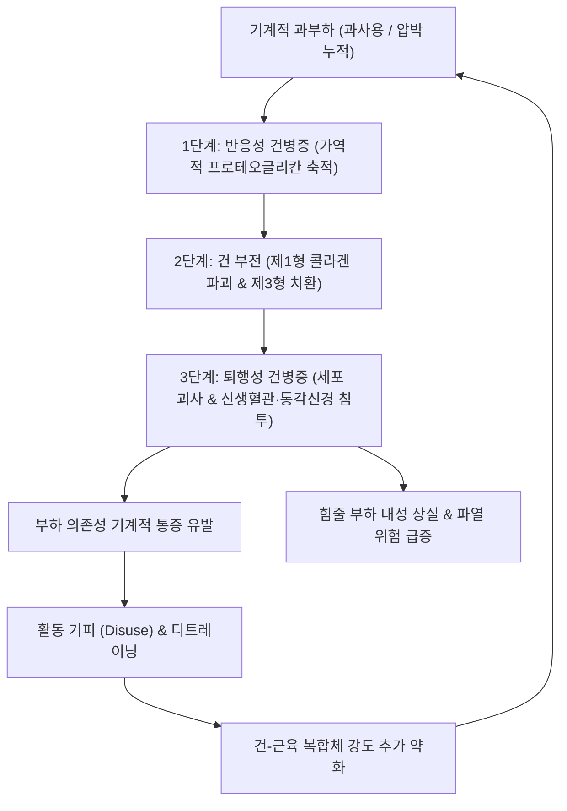

# 🩺 [[힘줄병증]] (Tendinopathy / 腱病症, ICD-10 M76 / M77 계열)

> **핵심 3줄 요약 (Key Summary)**:
> - 📍 병소 부위 & 해부·병태생리: 힘줄(Tendon) 실질 및 골 부착부(Enthesis)에 반복적 과부하와 미세 손상이 누적되어 발생하는 만성 질환이다. 조직학적으로 급성 염증세포 침윤(-itis)이 아닌 건세포(Tenocyte)의 자멸사, 제1형 콜라겐의 무질서한 제3형 콜라겐 치환, 프로테오글리칸 과축적, 무세포성 기질 괴사 및 비정상적 신생혈관·무수초 통각 신경의 동반 증식이 일어나는 '치유 실패(Failed healing)' 퇴행성 병변이다.
> - 🚩 전형적 임상 양상 & 3대 징후: **부하 의존성 국소 통증(Load-dependent pain) + 힘줄 부착부/실질의 뚜렷한 국소 압통(Localized tenderness) + 아침 기상 시 또는 휴식 후 첫 움직임에서의 뻣뻣함(Morning stiffness)**. 활동 시작 시 통증이 줄어들다가 휴식 후 다시 악화되는 전형적 '워밍업 현상(Warm-up phenomenon)'을 보인다.
> - 🛠️ 핵심 감별 검사 & 한·양방 다각적 치료 전략: 저항성 부하 유발 검사(한 발 스쿼트, 뒤꿈치 들기, 코젠 검사) 및 고해상도 초음파(건 비후, 저에코성 음영, 도플러 혈류 증가)로 확진한다. 치료 패러다임은 '항염(Anti-inflammation)'이 아닌 **'점진적 부하 관리(Load Management)'**이며, 등척성 수축을 통한 즉각 진통 후 중량 저속 저항(HSR) 및 편심성 재활을 시행한다. 한의 치료는 아시혈 자침, 화침(火鍼), 도침(Acupotomy), 약침, 추나요법을 통해 통증 역치를 즉각 상승시키고 국소 혈류와 콜라겐 리모델링을 촉진하여 점진적 재활 운동 진입을 돕는다.
> - <font color="#fa7e7e">⚠️ 응급 의뢰 레드플래그 & 악화 요인: 건의 급성 완전 파열(갑작스러운 단열음, 체중 지지 불능, 함몰 촉지), **힘줄 내 스테로이드 주사(단기 진통 효과 뒤 건세포 괴사 및 파열 위험 급증 - 절대 금기)**, 부착부 병변에서의 과도한 스트레칭(뼈 돌출부의 압박 부하로 악화), 감염 의심 징후.</font>

---

## 📌 목차
1. [질환 개요 & 해부학적 병태생리](#1-질환-개요--해부학적-병태생리)
2. [병태생리 메커니즘 & 생체역학적 악순환 네트워크](#2-병태생리-메커니즘--생체역학적-악순환-네트워크)
3. [임상 증상 & 이학적 검사(Physical Exam) 알고리즘](#3-임상-증상--이학적-검사physical-exam-알고리즘)
4. [감별 진단 매트릭스 (Differential Diagnosis)](#4-감별-진단-매트릭스-differential-diagnosis)
5. [한의 통합 치료 프로토콜 (침·약침·추나·한약)](#5-한의-통합-치료-프로토콜-침약침추나한약)
6. [양방 치료 & 병용·의뢰 기준 (Conventional Treatment & Referral)](#6-양방-치료--병용의뢰-기준-conventional-treatment--referral)
7. [재활 운동 & 생활습관 티칭 가이드](#7-재활-운동--생활습관-티칭-가이드)
8. [💡 사용자 진료실 핵심 필기 & 임상 노하우 (Melt-In 잔여 심화 집약)](#8--사용자-진료실-핵심-필기--임상-노하우-melt-in-잔여-심화-집약)
9. [출처 및 학술 참고 문헌 (References)](#9-출처-및-학술-참고-문헌-references)

---

## 1. 질환 개요 & 해부학적 병태생리

### 1) 질환 정의 및 임상 용어 표준화 패러다임
* **정의**: [[힘줄병증]](Tendinopathy)은 힘줄(Tendon) 및 그 뼈 부착부(Enthesis)에 과도하고 반복적인 기계적 부하(Mechanical load)가 가해져 발생하는 임상 증후군으로, 주소증은 부하와 연관된 국소 통증과 기능 저하이다 (Scott et al., 2020).
* **용어 표준화 (ICON 2019 합의문)**:
  * 전통적으로 건의 통증 상태를 '건염(Tendinitis)'이라 명명하였으나, 광범위한 조직병리학적 연구 결과 호중구, 림프구 등의 고전적 염증세포 침윤이 실질적으로 부재함이 규명되었다 (Cook & Purdam, 2009).
  * 대신 건세포의 기계적 부적응, 기질 단백질의 변성, 무질서한 비정상 혈관신생(Angioneogenesis) 및 신경 증식이 관찰되므로, 국제 힘줄병증 심포지엄 합의(ICON 2019)에 따라 **'힘줄병증(Tendinopathy)' 또는 '건병증/건증(Tendinosis)'**이 공식 표준 진단명으로 정립되었다 (Scott et al., 2020).

### 2) 호발 부위 및 관련 해부학적 구조물
* **하지 및 족부 (Lower Extremity)**:
  * **[[아킬레스건]](Achilles tendon)**:
    * **중간부 건병증 (Midportion tendinopathy)**: 종골 부착부 상방 2~6 cm 구역. 해부학적으로 혈관 관류가 가장 취약한 '분수계(Watershed zone)'로, 순수 인장력(Tensile load) 과부하에 의해 호발한다.
    * **부착부 건병증 (Insertional tendinopathy)**: 종골 후상방 부착부. 발목 배측굴곡 시 종골 뼈 돌출부(Retrocalcaneal prominence)와 건 심부 사이에서 발생하는 **압박 부하(Compressive load)**가 핵심 병인이다.
  * **[[슬개건]](Patellar tendon)**: 슬개골 하극(Inferior pole) 부착부. 점프와 착지 시 신장-단축 주기(Stretch-shortening cycle) 부하가 집중되어 발생하는 [[슬개골하건염]](점퍼스 니, Jumper's knee).
  * **[[족저근막]](Plantar fascia)**: 종골 내측 결절 부착부. 근막-건 복합체로서 보행 시 윈드라스 기전(Windlass mechanism)에 의해 반복 견인력을 받는다.
  * **[[후경골근건]](Posterior tibial tendon)**: 내과 후방 주행부. 족궁(내측 종아치)을 지지하는 핵심 건으로, 과회내(Overpronation) 시 퇴행성 기능부전 발생.
* **상지 및 주관절·견관절 (Upper Extremity)**:
  * **주관절 외측**: [[단요측수근신근]](ECRB) 기시부의 [[외측상과염]](Lateral epicondylalgia, 테니스 엘보). 손목의 반복적 신전 및 악력 파지 동작 시 상완골 외측상과 모서리에서 압박과 인장 부하를 동시에 받음.
  * **주관절 내측**: 요측수근굴근 및 원회내근 기시부의 [[내측상과염]](Medial epicondylalgia, 골퍼 엘보).
  * **견관절 회전근개 (Rotator Cuff)**: 견봉하 공간에서 오훼견봉인대와 상완골두 사이에 포착·압박되는 [[극상근]](Supraspinatus), [[극하근]](Infraspinatus), [[상완이두근]] 장두건.
* **골반 및 둔부 (Pelvis & Hip)**:
  * **[[근위 햄스트링 건병증]](PHT / Proximal Hamstring Tendinopathy)**: [[대퇴이두근]], [[반건양근]], [[반막양근]] 복합체가 좌골결절(Ischial tuberosity)에 부착하는 부위. 고관절 굴곡 시 좌골결절에 건이 강하게 눌리는 압박성 건병증 (Bremander et al., 2025).
  * **대전자 통증 증후군 (GTPS)**: [[중둔근]] 및 [[소둔근]] 건의 대전자 부착부 퇴행성 병변.

---

## 2. 병태생리 메커니즘 & 생체역학적 악순환 네트워크

### 1) ASCII 병태생리 다이어그램: 쿡 & 퍼담의 3단계 연속체 모델 (Continuum Model)
```
+-----------------------------------------------------------------------------------------+
|                  반복적 기계적 과부하 (급격한 훈련량 증가 / 과사용 / 압박 부하 누적)             |
+-----------------------------------------------------------------------------------------+
                                           |
                                           v
+-----------------------------------------------------------------------------------------+
|                    [ 1단계: 반응성 건병증 (Reactive Tendinopathy) ]                       |
|  - 급성 과부하 직후 건세포(Tenocyte)의 비염증성 적응 증식 반응                              |
|  - 수분을 끌어당기는 거대 프로테오글리칸(Aggrecan) 합성 급증                                 |
|  - 건 단면적이 일시적으로 비후되어 응력을 분산시킴 (Short-term protective adaptation)        |
|  - **가역적 단계 (부하를 적절히 조절하고 휴식하면 정상 건 구조로 완전 회복 가능)**          |
+-----------------------------------------------------------------------------------------+
                                           |  (과도한 기계적 부하 지속 & 치유 시간 부족)
                                           v
+-----------------------------------------------------------------------------------------+
|                    [ 2단계: 건 부전 / 치유 실패 (Tendon Disrepair) ]                     |
|  - 건 기질(Matrix)의 본격적인 미세구조 붕괴 시작                                           |
|  - 정상 평행 배열의 **제1형 콜라겐(Type I Collagen) 섬유 파열 및 단편화**                   |
|  - 무질서하고 기계적 강도가 취약한 **제3형 콜라겐(Type III Collagen) 침착**                 |
|  - 기질분해효소(MMP-2, MMP-9, ADAMTS) 활성화, 건세포의 원형화(Rounding) 및 연골양 화생    |
|  - 모세혈관 발아 및 비정상 신생혈관(Neovascularization) 초기 발생                          |
+-----------------------------------------------------------------------------------------+
                                           |  (만성 과부하, 국소 허혈, 스테로이드 노출 등)
                                           v
+-----------------------------------------------------------------------------------------+
|                 [ 3단계: 퇴행성 건병증 (Degenerative Tendinopathy) ]                     |
|  - 광범위한 건세포 자멸사(Tenocyte Apoptosis)로 인한 무세포성(Acellular) 괴사 구역 형성   |
|  - 기질의 점액양 변성(Mucoid degeneration) 및 지질 침착, 콜라겐 연속성 완전 붕괴         |
|  - 비정상적인 미세신생혈관과 **무수초 통각 신경섬유(C-fibers, Substance P)**의 병적 동반 증식|
|  - **비가역적 구조적 결함 단계 ==> 가벼운 외력에도 급성 힘줄 완전 파열(Rupture) 위험 급증**|
+-----------------------------------------------------------------------------------------+
                                           |
                    +----------------------+----------------------+
                    |                                             |
                    v                                             v
+-----------------------------------------+   +-----------------------------------------+
|       [ 신경혈관성 기계적 통증 발생 ]    |   |     [ 힘줄의 부하 수용능력(Capacity) 상실 ] |
|  - 신생혈관 주위 통각 신경의 기계적 자극|   |  - 인장 탄성 에너지 저장 및 방출 기능 상실|
|  - 통증 회피로 인한 활동 중단 (Disuse)  |   |  - 인접 근육 및 관절의 보상성 대상 작용  |
+-----------------------------------------+   +-----------------------------------------+
                    |                                             |
                    +----------------------+----------------------+
                                           |
                                           v
+-----------------------------------------------------------------------------------------+
|      생체역학적 악순환 (Vicious Cycle): 근건 복합체 약화 ==> 미세 부하에도 추가 퇴행 지속  |
+-----------------------------------------------------------------------------------------+
```

### 2) 분자생물학적 병태 기전 및 생체역학 이원화
* **기질 대사 불균형과 세포외 기질(ECM) 파괴**:
  * 정상 건은 95% 이상이 질서정연하게 평행 배열된 **제1형 콜라겐(Type I collagen)**으로 구성되어 인장 강도를 유지한다.
  * 건병증 병변에서는 건세포가 방추형에서 둥근 연골세포 형태로 변형(Chondroid metaplasia)되면서 콜라겐 합성 균형이 깨진다.
  * 기계적 인장력이 약한 **제3형 콜라겐(Type III collagen)**이 대량 침착되고, 아그레칸(Aggrecan), 베르시칸(Versican) 같은 친수성 대형 프로테오글리칸이 세포 사이에 축적되어 건의 결합 구조가 느슨해지고 부종성 비후가 발생한다.
  * 기질금속단백분해효소([[MMP-2]], [[MMP-9]])와 ADAMTS 계열 효소가 과활성화되어 정상 콜라겐 교차결합(Cross-linking)을 분해한다 (Graceffa et al., 2024).
* **신생혈관 증식과 통각 감작 (Neovascularization & Ingrowth of Nerves)**:
  * 만성 퇴행 단계에서는 저산소증 유도인자-1α(HIF-1α) 및 혈관내피세포성장인자([[VEGF]])가 분비되어 정상적으로는 무혈관 조직인 건 실질 내부로 모세혈관이 침투한다.
  * 이때 신생혈관 외막을 따라 **P물질(Substance P), 칼시토닌유전자관련펩타이드([[CGRP]])를 함유한 무수초성 감각 신경섬유(C-fiber)**가 함께 침투한다. 이것이 도플러 초음파에서 관찰되는 혈류 신호이며, 건이 신장되거나 압박받을 때 극심한 기계적 통증을 유발하는 생물학적 기전이다.
* **인장 부하(Tensile Load) vs 압박 부하(Compressive Load)의 생체역학적 분리 (Critical Insight)**:
  * **인장 부하 (Tensile Load)**: 근육이 수축할 때 건 복부에 가해지는 순수한 종축 견인력. 점프나 달리기 시 에너지를 저장하고 방출하는 스프링 작용을 한다 (예: 중간부 아킬레스건).
  * **압박 부하 (Compressive Load)**: 건 부착부(Enthesis)가 뼈의 돌출부 위를 감아 돌면서 꺾일 때, 건 심부 표면이 뼈에 직접 짓눌리는 횡축 전단력 및 압박력 (예: 부착부 아킬레스건, 대퇴골 외측상과의 단요측수근신근건, 좌골결절의 근위 햄스트링건).
  * ⚠️ **임상적 함의**: **부착부 힘줄병증에서는 과도한 스트레칭(예: 계단 끝에서 발목을 깊게 내리는 배측굴곡 스트레칭, 고관절을 깊게 굴곡하는 햄스트링 스트레칭)이 뼈와 건 사이의 압박 부하를 극대화하여 건세포를 기계적으로 으깨는 치명적 파괴 요인**으로 작용한다 (Bremander et al., 2025).



---

## 3. 임상 증상 & 이학적 검사(Physical Exam) 알고리즘

### 1) 주소증 및 부하 특이적 임상 양상
* **워밍업 현상 (Warm-up Phenomenon / The 'Hourglass' Pattern)**:
  * 아침에 일어나 첫 발을 디딜 때나 운동 시작 초기에는 힘줄이 뻣뻣하고 뻐근하게 아프다.
  * 그러나 가볍게 몸을 움직여 체온이 오르고 조직 순환이 증가하면 **통증이 일시적으로 경감되거나 사라져서 정상적인 활동이 가능**해진다.
  * 활동이 끝나고 휴식을 취하면 몇 시간 후 또는 **다음 날 아침에 더 심한 둔통, 열감, 뻣뻣함이 찾아오는 지연성 악화 패턴**이 나타난다.
* **부하 의존적 국소 통증 (Load-Dependent Localized Pain)**:
  * 건에 가해지는 에너지가 클수록(걷기 < 조깅 < 스프린트 < 플라이오메트릭 점프) 통증의 강도가 비례하여 증가한다.
  * 통증은 손가락 하나로 정확히 짚을 수 있을 만큼(Point tenderness) 국소적이며, 뻐근하거나 찌르는 듯한 양상이다.

### 2) 부위별 특이적 이학적 검사법 (Physical Examination)
* **1. 아킬레스건병증 (Achilles Tendinopathy)**:
  * **로얄 런던 병원 검사 (Royal London Hospital Test)**:
    * 족관절 중립위에서 아킬레스건의 압통 부위를 촉진하여 통증을 확인한 후, 발목을 최대로 배측굴곡(Dorsiflexion)시킨 상태에서 동일 부위를 다시 압박한다.
    * 배측굴곡 상태에서 건의 긴장도가 증가하여 통증이 현저히 감소하거나 사라지면 양성 (중간부 건병증의 특이적 검사).
  * **단하지 뒤꿈치 들기 (Single-Leg Heel Raise Test)**: 한 발로 체중을 지탱하고 뒤꿈치를 들어 올릴 때 국소 건 통증 재현 여부 및 최대 반복 횟수(지구력) 평가.
  * **호핑 검사 (Single-Leg Hopping Test)**: 한 발로 제자리 뛰기를 시행하여 플라이오메트릭 부하 시의 통증 유발 확인.
* **2. 슬개건병증 (Patellar Tendinopathy)**:
  * **25도 편각 단하지 스쿼트 검사 (Single-Leg Decline Squat Test, SLDS)**:
    * 25도 기울어진 경사판(Decline board) 위에 한 발로 서서 무릎을 굴곡하며 스쿼트를 시행.
    * 슬개골 하극 부착부에 체중의 수배에 달하는 대퇴사두근 인장력이 집중되어 즉각적인 국소 통증을 유발. 슬개건병증의 가장 민감한 부하 유발 검사.
* **3. 외측상과염 (Lateral Epicondylalgia)**:
  * **코젠 검사 (Cozen's Test)**: 검사자가 환자의 손목 굴곡 방향으로 저항을 줄 때, 환자가 주먹을 쥐고 전완을 회내한 채 손목을 강하게 저항 신전(Extension)할 때 단요측수근신근 기시부에 극통 발생 시 양성.
  * **밀스 검사 (Mill's Test)**: 팔꿈치를 신전하고 전완을 회내한 상태에서 검사자가 환자의 손목을 수동적으로 최대로 굴곡시켜 건 부착부의 인장 및 압박력을 유발.
  * **모즐리 중지 신전 검사 (Maudsley's Test)**: 제3수지(중지)의 근위지간관절을 저항 신전시킬 때 외측상과에 통증 재현.
* **4. 회전근개 건병증 (Rotator Cuff Tendinopathy)**:
  * **엠프티 캔 검사 (Empty Can / Jobe's Test)**: 견관절 90도 외전, 30도 수평 내전, 엄지손가락을 바닥으로 회내한 상태에서 하방 저항을 줄 때 극상근건 부착부 통증 유발.
  * **호킨스-케네디 검사 (Hawkins-Kennedy Test)**: 견관절 및 주관절 90도 굴곡 후 강제 내회전 시 견봉하 공간 포착 및 통증 유발.
* **5. 근위 햄스트링 건병증 (Proximal Hamstring Tendinopathy)**:
  * **벤트 니 스트레치 검사 (Bent-Knee Stretch Test)**: 앙와위에서 고관절과 슬관절을 최대로 굴곡시킨 후 검사자가 슬관절을 서서히 신전시킬 때 좌골결절 부착부 통증 재현.

### 3) 영상 진단 평가
* **근골격계 초음파 (Musculoskeletal Ultrasound)**:
  * 진료실에서 즉시 시행 가능한 1차 표준 영상 기법.
  * **특징적 3대 소견**: ① 건의 국소적/방추형 비후(Thickening); ② 정상적인 밝은 선상 섬유 패턴(Fibrillar pattern) 소실 및 국소 저에코(Hypoechoic) 기질 결손; ③ 파워 도플러(Power Doppler) 상 건 실질 내부의 병적 신생혈관(Neovascularization) 혈류 신호 확인.
* **자기공명영상 (MRI)**:
  * T1/T2 및 프로톤 강조영상(PD-weighted) 지방억제 영상에서 건 실질의 비후 및 중간/고신호강도 음영 관찰.
  * 부분 파열(Partial tear) 및 완전 파열, 인접 골수 부종(Bone marrow edema)의 정확한 감별에 유용.

---

## 4. 감별 진단 매트릭스 (Differential Diagnosis)

| 감별 질환 | 호발 병소 및 병태생리 | 통증 양상 및 유발 요인 | 특이적 이학적 검사 및 감별 포인트 | 초음파 / MRI 영상 소견 |
| :--- | :--- | :--- | :--- | :--- |
| **[[힘줄병증]]** (본 질환) | 건 실질 및 골 부착부, 반복 과부하에 의한 건세포 퇴행 | 부하 의존성 국소 통증, 뚜렷한 워밍업 현상, 지연성 둔통 | 건 부착부 1~2cm의 명확한 압통, **저항성 등척성 수축 시 통증 재현** | 건 방추형 비후, 저에코성 변성 음영, **파워 도플러 신생혈관 혈류** |
| **[[힘줄 파열]](급성 완전 파열)**| 건 실질의 기계적 단열 (퇴행성 건병증 바탕 위에 급성 파열) | 폭발적인 파열음("뚝" 소리), 즉각적인 근력 완전 상실, 보행 불능 | **건 결손 부위의 육안적/촉진상 함몰**, 톰슨 검사(Thompson test) 양성 | 건 섬유의 연속성 완전 단열, 파열단 사이에 혈종 및 액체 저류 |
| **[[활액낭염]](Bursitis)** | 건과 뼈 사이의 완충 주머니(Bursa)의 마찰성 염증 | 휴식 시에도 지속되는 욱신거림, 야간통, 종창, 열감 | 건 자체보다 **활액낭 위치의 팽만감 및 부종**, 수동적 압박 시 악화 | 활액낭 내 다량의 저에코성 삼출액(Effusion) 저류, 활액막 비후 |
| **[[말초신경 포착]](신경병증)** | 인접 신경의 근막 터널 내 협착 (예: [[요골관증후군]]) | 타는 듯한 통증, 저림, 이상감각, 야간 통증 악화 | 신경 주행 경로 압통([[Tinel 징후]]), 신경신장검사(ULNT) 양성 | 신경 단면적 비후, 건 구조는 정상 유지 |
| **[[척추관절염 부착부염]](SpA)** | 강직성척추염 등 전신 자가면역 질환에 의한 다발성 골부착부염 | 아침 강직 1시간 이상 지속, 휴식 시 악화, 활동 시 호전 | **양측 다발성 부착부 침범**, 천장관절 압통, HLA-B27 양성, CRP 상승 | 부착부 피질골 미란(Erosion), 골극(Enthesophyte), 골수 부종 |
| **[[골연골염]](연골 손상/반월판)**| 관절강 내부 연골 또는 반월상연골판의 기계적 손상 | 관절선 통증, 관절 잠김(Locking), 덜컥거림(Giving way) | **관절선 압통(Joint line tenderness)**, 맥머레이/애플리 검사 양성 | 관절 연골 결손, 반월판 파열선, 관절 삼출액 |

---

## 5. 한의 통합 치료 프로토콜 (침·약침·추나·한약)

> [!TIP]
> **힘줄병증에서 한의 치료의 현대적 핵심 역할 (The Gateway to Loading)**:
> 만성 힘줄병증 환자는 건의 퇴행과 통증 감작으로 인해 재활 운동을 수행하고 싶어도 통증 때문에 힘을 주지 못한다. 침, 화침, 도침, 약침 치료는 **"통증 역치를 즉각 낮추고 피질척수로 억제를 해제하여 환자가 점진적 부하 재활 운동으로 안전하게 진입할 수 있는 문을 열어주는 핵심 도구"**로 정의된다.

### 1) 한의학적 변증 체계 및 치법
1. **근비기혈어체형 (筋痺氣血瘀滯型)**:
   * **임상 양상**: 만성 과사용 후 국소 힘줄 부위의 찌르는 듯한 고정성 통증, 뻣뻣함, 야간통, 설자암(舌紫暗), 맥 현삽(弦澁).
   * **치법**: 활혈거어(活血祛瘀), 온경통락(溫經通絡), 소종지통(消腫止痛).
2. **기혈양허근맥실양형 (氣血兩虛筋脈失養型)**:
   * **임상 양상**: 힘줄이 얇아지고 힘이 없음, 가벼운 활동에도 쉽게 피로하고 쑤심, 지체 무력, 안면 창백, 설담(舌淡), 맥 세약(細弱).
   * **치법**: 익기보혈(益氣補血), 양근영락(養筋榮絡).
3. **간신부족풍한습비형 (肝腎不足風寒濕痺型)**:
   * **임상 양상**: 중장년층의 퇴행성 건병증, 날씨가 흐리거나 차가우면 통증 악화, 관절 가동 장애, 요슬산연(허리와 무릎 시림), 설태 백니, 맥 침지(沈遲).
   * **치법**: 보익간신(補益肝腎), 강근장골(强筋壯骨), 거풍제습(祛風除濕).

### 2) 침구 치료 프로토콜 (Acupuncture)
* **국소 아시혈 및 건 주위 결합조직 자침**:
  * **원리**: 건 실질을 무리하게 관통하지 않고, 건 주위 건막(Paratenon) 및 건-골 부착부에 0.25 × 30 mm 호침으로 사자(斜刺) 자침.
  * 국소 미세손상을 유발하여 국소 일산화질소(NO) 및 혈소판유래성장인자(PDGF), 형질전환성장인자([[TGF-beta]]) 분비를 촉진하고 건 미세혈류를 증진.
* **전침 (Electroacupuncture) 파라미터 세팅**:
  * **주파수**: **2~4 Hz 저빈도 자극 (Continuous or Mixed wave)**.
  * 뇌간 내인성 엔도르핀 및 다이노르핀 분비를 유도하여 중추성 진통 효과를 발휘하고, 국소 근육의 긴장을 이완. 15~20분간 유침.
* **화침 (火鍼 / 溫鍼 / Warm Needling)**:
  * **적용**: 만성 난치성 무혈관 퇴행성 건병증 병변.
  * 가열된 침의 온열 자극을 병소 심부에 직접 전달하여 건세포의 대사를 자극하고, 콜라겐 섬유아세포 증식 및 제1형 콜라겐 합성을 강력히 유도.

### 3) 도침 치료 프로토콜 (Acupotomy)
* **시술 목적**: 만성 퇴행성 건병증에서 형성된 비정상적 섬유성 반흔(Scar tissue), 건막 유착 및 비후된 결합조직을 외과적으로 미세 절개·박리.
* **시술 방법**:
  * 0.5 × 50 mm 소침도(Acupotomy)를 사용하여 건 주위 유착대를 힘줄 섬유 주행 방향과 평행하게 절개(소침도 종박리).
  * 국소 출혈(Micro-bleeding)을 유도하여 멈추어 있던 급성 치유 반응(Acute healing cascade)을 강제로 재가동시킴으로써 정상 기질 재형성을 촉발.

### 4) 약침 치료 프로토콜 (Pharmacopuncture)
* **약침 제제 선택 및 기전**:
  * **신바로(GCSB-5) 약침**: 강력한 신경·연부조직 소염 및 연골·기질 단백질 보호 작용.
  * **자하거(Hominis Placenta) 약침**: 성장인자(EGF, FGF) 및 펩타이드 성분이 풍부하여 노화되고 자멸사한 건세포의 재생 및 기질 합성을 자극.
  * **봉약침 (Sweet Bee Venom)**: 멜리틴 성분을 분리 정제한 저농도 봉약침을 사용하여 비정상 신생혈관 주위 통각 신경 전달을 차단하고 강력한 국소 진통 유도.
* **주입 테크닉 및 주의점**:
  * **절대 원칙**: **건 실질 내부로의 고압 직접 주입 금기** (건 내압 상승으로 인한 섬유 파열 위험). 반드시 건 주위막(Paratenon) 공간이나 인접 근막 부착부에 0.5~1.0 mL 범위 내로 부드럽게 분할 주입.

### 5) 추나 요법 프로토콜 (Chuna Manual Therapy)
* **관절가동추나 (Mulligan MWM / Maitland Mobilization)**:
  * 힘줄에 가해지는 생체역학적 전단력을 감소시키기 위해 인접 관절의 미세 변위(Positional fault)를 교정.
  * **외측상과염**: 주관절 외번 상태에서 요골두(Radial head) 후방 활주 추나 적용.
  * **아킬레스건병증**: 거골하관절(Subtalar joint) 및 족관절 후방 활주(Posterior talar glide)를 회복시켜 발목 관절의 부드러운 가동성 확보.
* **근막 이완 수기 (Myofascial Release / JS 기법)**:
  * 건에 직접 압박을 가하지 않고, 힘줄을 견인하는 상위 근육 복부([[비복근]], [[가자미근]], [[대퇴사두근]], [[전완 신근군]])의 근막 발화점 및 트리거포인트([[TP]])를 수기 이완하여 건에 걸리는 기저 인장 장력을 완화.

### 6) 한약 치료 프로토콜 (Herbal Medicine)
* **급성 반응성 및 통증기 (活血祛瘀, 溫經通絡)**:
  * **[[서경탕(舒經湯)]]**: 강황, 당귀, 해동피, 백출, 적작약, 천궁, 강활, 방풍 등. 상지 견관절 및 주관절 건병증의 혈액순환 장애와 저림을 개선.
  * **[[오적산(五積散)]]**: 풍·한·습·기·혈의 5적을 다스려 찬 곳에서 악화되는 만성 건 통증 완화.
  * **[[순기활혈탕(順氣活血湯)]]**: 외상이나 과사용으로 인한 어혈 정체 및 운동통 개선.
* **만성 퇴행성 및 재활 재생기 (補益肝腎, 强筋壯骨)**:
  * **[[독활기생탕(獨活寄生湯)]]**: 독활, 상기생, 두충, 우슬, 세신, 진범, 복령, 당귀, 백작약 등. 간신 부족으로 힘줄과 뼈가 마르고 퇴행한 노인성·만성 건병증의 핵심 처방.
  * **[[십전대보탕(十全大補湯)]] 가미방**: 황기, 당귀, 숙지황에 속단, 골쇄보, 두충을 가미하여 콜라겐 합성에 필요한 전신 기혈을 공급.

---

## 6. 양방 치료 & 병용·의뢰 기준 (Conventional Treatment & Referral)

### 1) 서양의학적 약물 및 보존적 치료의 허와 실
* **비스테로이드성 소염진통제 (NSAIDs)**:
  * **위치**: 단기(1~2주 이내) 급성 반응성 건병증에서 통증 완화 목적으로 사용할 수 있으나, 만성 퇴행성 건병증에서는 조직학적 염증이 없으므로 장기 복용의 치료적 이득이 없다.
  * 오히려 장기 NSAIDs 복용은 **건세포의 증식과 콜라겐 단백질 합성을 억제하여 장기적인 건 치유 과정을 방해**할 수 있다.
* **국소 스테로이드 주사의 치명적 역설 (The Steroid Trap — CRITICAL)**:
  * **단기 효과**: 덱사메타손이나 트리암시놀론 같은 스테로이드 국소 주사는 강력한 항염 작용으로 2~4주간 통증을 마법처럼 없애준다.
  * **장기적 재앙**: 수많은 무작위 대조 시험(RCT)과 코크란 리뷰에 따르면, 6~12주 이후 스테로이드 투여군은 위약군이나 운동군에 비해 **재발률이 3~5배 이상 급증**한다.
  * **기전**: 스테로이드는 건세포의 단백 합성을 영구 정지시키고 건세포 자멸사를 유도하며, 콜라겐 기질을 괴사시켜 힘줄의 인장 강도를 파괴한다.
  * ⚠️ **결론**: **힘줄 실질 내(Intratendinous) 스테로이드 직접 주사는 건의 완전 파열을 유발하는 절대 금기(Absolute contraindication)**이다.

### 2) 비약물 전문 시술 (Procedures)
* **체외충격파 치료 (ESWT / Extracorporeal Shock Wave Therapy)**:
  * **방사형 (rESWT)** 및 **집중형 (fESWT)**: 건 병변에 고에너지 음향파를 가하여 물질 P(Substance P)를 고갈시켜 진통을 유도하고, 신생혈관을 파괴하며 세포막 투과성을 높여 성장인자(VEGF, PCNA) 분비를 유도.
  * 주 1회 간격, 총 3~5회 적용 (Bremander et al., 2025).
* **혈소판 풍부 혈장 주사 (PRP / Platelet-Rich Plasma)**:
  * 환자의 자가 혈액을 원심분리하여 고농축 혈소판 성장인자(PDGF, TGF-β, IGF-1)를 건 주위에 주입하여 결손된 콜라겐 기질의 리모델링을 촉진.
* **경피적 건 절제술 및 흡인술 (Tenex / Barbotage)**:
  * 초음파 유도하에 미세 절삭 바늘을 삽입하여 석회화 병변이나 퇴행성 괴사 조직만 선택적으로 파쇄·흡인하는 최소 침습 시술.

### 3) 수술적 치료 적응증 (Surgical Indication)
* **적응증**: 최소 6~12개월 이상의 체계적인 점진적 부하 재활 및 보존적 치료(ESWT, 주사 치료 포함)에도 불구하고 일상생활 및 보행이 불가능한 난치성 통증이 지속되는 경우.
* **수술 방법**: 변성된 건 실질 괴사 부위 절제술(Debridement), 종골 후상방 골극 절제술, 건 이전술(Flexor hallucis longus transfer).

### 4) 한의 병용 판단 및 진료 지침
* **병용 가능 (Synergistic)**:
  * 양방 정형외과에서 진단 후 소염진통제를 복용 중인 환자에게 침, 도침, 약침 치료를 병용하면 진통제 투약 기간과 용량을 50% 이상 줄일 수 있으며, 조기에 점진적 부하 운동으로 전환할 수 있다.
  * 체외충격파(ESWT) 시술과 한의 침·도침 치료는 기전상 시너지(국소 재생 자극)를 발휘할 수 있으므로 2~3일의 시간차를 두고 병용 가능하다.
* **병용 주의**:
  * 타 병원에서 국소 스테로이드 주사를 맞은 환자는 최소 4~6주간 침이나 도침을 포함한 일체의 기계적 자극 시술을 피해야 한다 (조직 취약성으로 인한 감염 및 파열 위험).

### 5) 양방 정형외과 전원 및 의뢰 기준 (Referral Criteria)
* **즉각적 수술/정형외과 의뢰 레드플래그**:
  * 1. 활동 중 갑작스러운 '뚝' 하는 파열음과 함께 체중 지지가 불가능한 급성 기능 상실 ([[아킬레스건 파열]], [[회전근개 전층 파열]]).
  * 2. 손상 부위 힘줄 실질에 손가락이 쑥 들어갈 정도의 결손 함몰(Defect)이 촉지되는 경우.
  * 3. 톰슨 검사(Thompson test) 양성: 종아리를 쥐어짰을 때 발목의 족저굴곡 반응이 완전히 소실된 경우.
  * 4. 발열, 오한, 국소 피부 발적 및 화농성 삼출을 동반한 감염성 건막염 의심 소견.
  * 5. 야간통이 극심하여 잠을 전혀 이루지 못하며 체중 감소가 동반되는 악성 종양 의심 소견.

---

## 7. 재활 운동 & 생활습관 티칭 가이드

### 1) 점진적 건 부하 재활 4단계 프로토콜 (The Core Pillar of Treatment)
힘줄병증 치료의 유일한 근본 해결책은 **'힘줄의 부하 수용능력(Load capacity)을 점진적으로 재건하는 것'**이다.

```
+-----------------------------------------------------------------------------------------+
|                  [ 1단계: 등척성 수축 운동 (Isometric Loading Phase) ]                  |
|  - 관절의 각도 변화 없이 힘줄에 장력만 가하는 정적 버티기 운동                               |
|  - 45초 유지 × 5세트, 세트 간 2분 휴식, 1일 2~3회 시행                                       |
|  - 신경생리학적 진통 효과: 대뇌 피질척수로 억제를 해제하여 즉각적인 통증 완화 (Rio et al., 2015)|
|  - 운동 예시: 슬개건-스페인 스쿼트 버티기 / 아킬레스건-단하지 발꿈치 들고 버티기             |
+-----------------------------------------------------------------------------------------+
                                           |  (운동 중 통증 0~3점 안정화 시 진입)
                                           v
+-----------------------------------------------------------------------------------------+
|        [ 2단계: 등장성 중량 저속 저항 운동 (Isotonic Heavy Slow Resistance, HSR) ]       |
|  - 무거운 중량을 사용하여 천천히 3초간 올리고(동심성), 천천히 3초간 내리는(원심성) 운동      |
|  - 주 3회(격일) 시행, 4세트 × 6~8 RM 고부하 저반복 세팅                                     |
|  - 건세포에 최적의 기계적 신축 변형(Strain)을 주어 제1형 콜라겐 합성을 유도하는 황금 표준    |
|  - 운동 예시: 레그 프레스, 시티드 카프 레이즈, 덤벨 리스트 익스텐션                          |
+-----------------------------------------------------------------------------------------+
                                           |  (통증 없이 최대 근력의 85% 이상 회복 시 진입)
                                           v
+-----------------------------------------------------------------------------------------+
|              [ 3단계: 에너지 저장 및 방출 훈련 (Energy Storage & Plyometrics) ]          |
|  - 신장-단축 주기(Stretch-Shortening Cycle)를 훈련하여 힘줄의 스프링 탄성을 회복시키는 단계  |
|  - 주 2회 시행, 충분한 휴식일 보장                                                          |
|  - 운동 예시: 줄넘기, 가벼운 제자리 호핑(Hopping), 계단 뛰어오르기, 메디신볼 던지기         |
+-----------------------------------------------------------------------------------------+
                                           |  (스포츠 요구 부하 완전 적응 시 진입)
                                           v
+-----------------------------------------------------------------------------------------+
|                     [ 4단계: 스포츠 특이적 기능 훈련 (Return to Sport) ]                 |
|  - 실제 경기 상황에서의 급격한 감속(Deceleration), 방향 전환(Cutting), 전력 스프린트 훈련   |
|  - 점진적 경기 출전 시간 배분                                                               |
+-----------------------------------------------------------------------------------------+
```

### 2) 부착부 vs 중간부 힘줄병증의 재활 감별 (Critical Practice)
* **중간부 아킬레스건병증 (Midportion Achilles)**:
  * 전통적인 **알프레드손(Alfredson) 편심성 운동 프로토콜** 적용.
  * 계단 모서리에 발 앞부분만 딛고 서서, 뒤꿈치를 계단 발판 아래로 깊게 내리는 배측굴곡 신장 운동이 건 치유에 매우 효과적이다.
* **부착부(삽입부) 아킬레스건병증 (Insertional Achilles)**:
  * ⚠️ **계단 아래로 뒤꿈치를 내리는 운동은 절대 금기(Contraindicated)**!
  * 발목이 배측굴곡되는 순간 종골 후상방 뼈 돌출부가 부착부 건을 짓누르는 **압박 부하(Compressive load)**가 극대화되어 건세포 괴사를 촉진한다.
  * **저압박 재활 프로토콜 (LTCR, Low-Tendon-Compression Rehabilitation)**:
    1. **평지에서만 뒤꿈치 들기(Flat ground heel raise)**를 수행하여 배측굴곡을 엄격히 차단한다.
    2. 종아리 근육 스트레칭을 전면 중단한다.
    3. 신발 내부에 **1~1.5 cm의 힐 리프트(Heel lift) 패드**를 삽입하여 일상 보행 시 부착부 압박을 제거한다 (Bremander et al., 2025).

### 3) 통증 모니터링 신호등 시스템 (Traffic Light System)
환자가 자가 재활을 안전하게 지속하기 위해 진료실에서 교육하는 부하 판정 규칙:
* **초록불 (안전, 0~3점 / 10점 만점)**: 운동 중 통증이 경미하며 참을 수 있는 수준. 부하를 그대로 유지하거나 증량 가능.
* **노란불 (주의, 4~5점)**: 통증이 다소 있으나 견딜 만함. 단, **운동 후 24시간이 지난 다음 날 아침의 통증과 뻣뻣함이 운동 전 수준으로 회복**되어야 안전한 부하 용량으로 판정.
* **빨간불 (위험, 6점 이상)**: 운동 중 심한 통증이 발생하거나, 다음 날 아침 통증이 운동 전보다 2점 이상 증가한 경우. 부하 용량 초과 상태이므로 1단계 아래 운동으로 회귀.

---

## 8. 💡 사용자 진료실 핵심 필기 & 임상 노하우 (Melt-In 잔여 심화 집약)

> [!IMPORTANT]
> 본 섹션은 상부 1~7번에 서술된 표준 의학 지식 외에, **실제 임상 현장에서 힘줄병증 환자를 대할 때 치료 성공률을 획기적으로 가르는 실전 손맛과 문진 노하우, 환자 티칭 스크립트, 그리고 최신 논문 근거를 집약**한 것이다.

### 1) 진료실 실전 문진 체크리스트 & 감별 질문
1. **"아침에 일어나서 첫 발을 디딜 때 가장 아프고, 좀 걷다 보면 통증이 줄어드나요?"**
   * 전형적인 건병증의 '워밍업 현상'을 확인하는 질문. 만약 "걸을수록 점점 더 아프고 붓는다"면 활액낭염, 피로골절, 또는 급성 파열을 의심해야 한다.
2. **"스트레칭을 하거나 종아리를 쭉 늘리면 시원한가요, 아니면 오히려 더 아픈가요?"**
   * **압박성 건병증(부착부 아킬레스건, 근위 햄스트링건)을 걸러내는 가장 날카로운 질문**이다. 환자가 "스트레칭을 열심히 했는데 다음 날 더 아팠다"고 답한다면 즉시 모든 스트레칭을 중단시키고 힐 리프트나 좌위 쿠션을 처방해야 한다 (Bremander et al., 2025).
3. **"최근 6개월 이내에 정형외과나 통증의학과에서 '뼈주사(스테로이드)'를 맞으신 적이 있습니까? 몇 번 맞으셨습니까?"**
   * 스테로이드 주사 병력을 파악하여 조직의 취약성을 예측하고, 환자에게 반복 주사의 파열 위험성을 즉각 교육한다.

### 2) '치료 + 부하' 동일 세션 연결 공식 (Clinical Pearl)
* 한의원에서 침, 도침, 약침 시술 후 환자를 그대로 귀가시키면 치료 효과가 절반 이하로 떨어진다.
* **진료실 원스톱 3단계 루틴**:
  1. **1단계 (Pain Inhibition)**: 아시혈 자침, 화침, 도침 시술로 통증 역치를 즉각 올리고 피질척수로 억제를 해제한다.
  2. **2단계 (Immediate Verification)**: 침을 발침한 즉시 진료실 바닥에서 환자에게 아까 통증을 호소했던 저항 검사(한 발 서기, 코젠 검사)를 다시 시켜 **"어, 원장님! 아까보다 힘이 덜 아프게 들어가네요!"**라는 반응을 확인시킨다.
  3. **3단계 (Loading Prescription)**: 통증이 떨어진 바로 그 자리에서 환자에게 **1단계 등척성 운동(Isometric, 45초 버티기)**을 직접 시연 지도하고 자가 운동 일지를 손에 쥐여준다.

### 3) 환자 설명 스크립트 (진료실 전용 멘트)
* **스테로이드 주사의 유혹을 끊어내는 멘트**:
  > "환자분, 뼈주사(스테로이드)는 힘줄을 고치는 약이 아닙니다. 불이 났을 때 화재경보기의 배터리를 빼버리는 것과 같습니다. 경보기가 꺼지면 시끄럽지 않으니 다 나은 것 같아서 힘줄을 무리하게 쓰게 되고, 그 사이 불길은 힘줄을 다 태워버려 결국 힘줄이 썩어 뚝 끊어지게 됩니다. 지금 통증을 억지로 마비시킬 것이 아니라, 힘줄이 스스로 튼튼해지도록 무게를 견디는 훈련을 해야 합니다."
* **한의 치료의 본질을 설명하는 멘트**:
  > "침과 도침은 힘줄을 대신해서 튼튼하게 만들어줄 수 없습니다. 침과 도침의 진짜 역할은, 힘줄이 스스로 회복할 수 있는 운동을 시작할 수 있도록 **'통증의 문을 열어주는 열쇠'**입니다. 오늘 침을 맞고 덜 아파진 상태에서 제가 알려드리는 등척성 운동을 하루 세 번 반드시 하셔야 힘줄이 진짜로 살아납니다."

### 4) 최신 학술 연구 연계 임상 지침 (Melt-In 잔여 심화)
* **저출력 레이저(LLLT) 치료의 보조적 위치 (Phys Ther 2022, PMID 36171024)**:
  * 하지 건 조직 및 족저근막에서 저출력 레이저는 통증을 위약 대비 유의하게 줄이며(13.15 mm), 운동 요법에 부가할 때 18.15 mm의 추가적인 진통 효과를 발휘한다.
  * **용량 규칙**: 904 nm 파장은 지점당 최소 2 J 이상, 780~860 nm 파장은 지점당 최소 4 J 이상을 조사해야 임상적 효과가 나타나며, 결코 운동 요법을 대체할 수 없고 부하 재활의 보조 수단으로 병용해야 한다.
* **슬개건병증 재활의 기간과 순응도 관리 (BJSM 2020, PMID 33219115)**:
  * 슬개건병증에서 점진적 건부하 운동(PTLE)과 편심성 운동 모두 24주 시점에 유의한 개선을 보이나 **12주 시점에는 군간 차이가 없다**. 즉, 만성 건병증의 임상적 예후 판정은 최소 24주(6개월) 이상의 장기적인 호흡으로 바라보아야 한다.
  * 환자의 순응도가 40~50%에 그치는 경우가 많으므로, 운동 설계 자체보다 **'2주 간격 점검 및 운동 일지(TIDieR) 확인'**이 예후를 가르는 핵심이다.
* **근위 햄스트링 건병증(PHT)의 체외충격파 동등성 (Am J Sports Med 2025, PMID 41243328)**:
  * 좌골결절 부착부 건병증에서 12주간의 개별 물리치료(주당 약 2시간의 점진적 부하 운동)와 체외충격파 4회 시술(주 1회, 2,000회 충격, 최대 견딤 강도)은 52주 추적 관찰 시 대등한 임상적 개선 효과를 나타냈다.
  * 운동 순응도가 떨어지는 고령 환자나 바쁜 직장인의 경우 체외충격파 또는 한의 도침·화침 집중 시술이 훌륭한 대안 치료가 될 수 있다.

---

## 9. 출처 및 학술 참고 문헌 (References)

1. Cook JL, Rio E, Purdam CR, Docking SI. (2016). Revisiting the continuum model of tendon pathology: what is its merit in clinical practice and research? *Br J Sports Med*, 50(19), 1187-1191.
   - [PubMed Link](https://pubmed.ncbi.nlm.nih.gov/27127294/) / PMID: 27127294
   - [연구 요약]: 건병증 연속체 모델(Continuum model)을 임상 및 연구 관점에서 재조명한 종설. 반응성 건병증과 퇴행성 건병증의 병태생리학적 감별, 부하 관리 전략, 영상학적 비가역적 변화와 임상 증상 간의 불일치를 설명함.

2. Graceffa D, Amoroso A, Bonifati C, Chimenti MS. (2024). Pathways driving tendinopathy and enthesitis: siblings or distant cousins in musculoskeletal medicine? *Nat Rev Rheumatol*, 20(3), 164-180.
   - [PubMed Link](https://pubmed.ncbi.nlm.nih.gov/38251592/) / PMID: 38251592
   - [연구 요약]: 기계적 과사용에 의한 건병증과 전신 척추관절염에 의한 골부착부염(Enthesitis)의 분자생물학적 신호전달 경로, 사이토카인 네트워크, 면역학적 기전을 비교 분석하여 두 질환의 임상적 감별 기준을 제시함.

3. Cook JL, Purdam CR. (2009). Is tendon pathology a continuum? A pathology model to explain the clinical presentation of load-induced tendinopathy. *Br J Sports Med*, 43(6), 409-416.
   - [PubMed Link](https://pubmed.ncbi.nlm.nih.gov/18812414/) / PMID: 18812414
   - [연구 요약]: 건 질환을 반응성 건병증, 건 부전, 퇴행성 건병증의 3단계 연속체 모델로 최초 정립하고, 염증이 아닌 기계적 부하 불균형에 따른 세포외 기질 변성 병태생리를 체계화함.

4. Scott A, Squier K, Alfredson H, Bahr R, Cook JL, Coombes B, et al. (2020). ICON 2019: International Scientific Tendinopathy Symposium Consensus: Clinical Terminology. *Br J Sports Med*, 54(5), 260-262.
   - [PubMed Link](https://pubmed.ncbi.nlm.nih.gov/31399426/) / PMID: 31399426
   - [연구 요약]: 전 세계 건병증 전문가 합의문으로, 과거의 혼란스러운 '건염/건막염' 명칭을 배제하고 '힘줄병증(Tendinopathy)' 표준 임상 용어와 부하 기반 재활 치료 원칙을 정립함.

5. Rio E, Kidgell D, Purdam C, Gaida J, Moseley GL, Pearce AJ, Cook J. (2015). Isometric exercise induces analgesia and reduces inhibition in patellar tendinopathy. *Br J Sports Med*, 49(19), 1277-1283.
   - [PubMed Link](https://pubmed.ncbi.nlm.nih.gov/25979840/) / PMID: 25979840
   - [연구 요약]: 슬개건병증 환자에서 중등도 등척성 수축 운동(Isometric exercise, 45초 5회)이 즉각적인 진통 효과(Pain reduction)와 대뇌 피질척수로 억제 완화를 유도하여 점진적 편심성 운동 진입을 가능하게 하는 신경생리학적 메커니즘을 규명함.

6. Bremander A, Dahlberg LE, Roos EM, Eek F. (2025). Effectiveness of reducing tendon compression in the rehabilitation of insertional Achilles tendinopathy: a randomised clinical trial. *Br J Sports Med*, 59(9), 640-650.
   - [PubMed Link](https://pubmed.ncbi.nlm.nih.gov/40011018/) / PMID: 40011018
   - [연구 요약]: 부착부 아킬레스건병증 환자에서 뼈와 건 사이의 압박 부하를 차단하는 저압박 재활(LTCR: 배측굴곡 제한, 스트레칭 배제, 힐 리프트 착용)이 기존 편심성 스트레칭 대비 VISA-A 점수를 현저히 개선함을 입증한 무작위 대조 임상시험.

7. Breda SJ, Oei EHG, Zwerver J, Visser E, Waarsing E, Krestin GP, de Vos RJ. (2021). Effectiveness of progressive tendon-loading exercise therapy in patients with patellar tendinopathy: a randomised clinical trial. *Br J Sports Med*, 55(9), 501-509.
   - [PubMed Link](https://pubmed.ncbi.nlm.nih.gov/33219115/) / PMID: 33219115
   - [연구 요약]: 슬개건병증 환자에서 점진적 건부하 운동 치료(PTLE)가 전통적 편심성 운동 대비 24주 시점에서 임상적 개선 효과와 스포츠 복귀율에서 우수함을 입증한 다기관 RCT.

8. Larsson MEH, Käll I, Nilsson-Helander K. (2025). Physiotherapy Compared With Shockwave Therapy for the Treatment of Proximal Hamstring Tendinopathy: A Randomized Controlled Trial. *Am J Sports Med*, 53(14), 3396-3407.
   - [PubMed Link](https://pubmed.ncbi.nlm.nih.gov/41243328/) / PMID: 41243328
   - [연구 요약]: 좌골결절 부착부 근위 햄스트링 건병증(PHT) 환자를 대상으로 12주간의 개별 물리치료와 4회의 체외충격파(ESWT) 치료를 비교하여 52주 추적 관찰 시 두 치료 간 동등한 장기 임상 치료 효과를 확인한 무작위 대조 시험.

9. Martimbianco ALC, de Oliveira Ribeiro B, de Faria Santos Mendes T, Bussadori SK. (2022). Efficacy of low-level laser therapy in patients with lower extremity tendinopathy or plantar fasciitis: systematic review and meta-analysis of randomised controlled trials. *Phys Ther*, 102(11), pzac110.
   - [PubMed Link](https://pubmed.ncbi.nlm.nih.gov/36171024/) / PMID: 36171024
   - [연구 요약]: 하지 건병증 및 족저근막염 환자에서 저출력 레이저 치료(LLLT)의 유효성을 검증한 체계적 문헌고찰 및 메타분석. 운동 요법과 병용 시 추가적인 진통 효과와 임상적으로 유효한 최소 에너지 용량 기준을 도출함.
