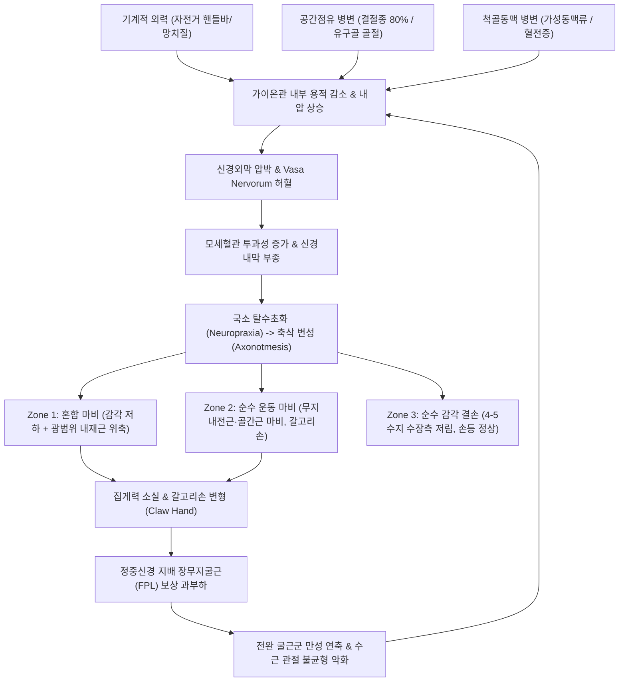

# 🩺 [[가이온관 증후군]] (Guyon's Canal Syndrome / 척골관 증후군, G56.2)

> **핵심 3줄 요약 (Key Summary)**:
> - 📍 병소 부위 & 해부·병태생리: 손목 전내측 수근부의 두상골(Pisiform)과 유구골 갈고리(Hook of hamate) 사이 섬유골성 통로인 가이온관(Guyon's canal)에서 [[척골신경]](Ulnar nerve) 및 척골동맥(Ulnar artery)이 압박·포착되는 말초 신경병증.
> - 🚩 전형적 임상 양상 & 3대 징후: 제4수지 척측 1/2 및 제5수지 수장측 저림/무감각(수배부 손등 감각 정상 보존), 제1배측골간근·[[무지내전근]] 위축, [[프로멘트 검사]](Froment sign) 양성 및 갈고리손([[갈고리손 변형]], Claw hand) 초래.
> - 🛠️ 핵심 감별 검사 & 한·양방 다각적 치료 전략: [[주관절 터널 증후군]]·[[수근관 증후군]]·[[경추 추간판 탈출증]] 감별(손등 감각 정상 여부가 핵심), 신문(HT7)·소해(HT3) 저주파 전침, 두상골-유구골 분리 가동 [[추나요법]], 초음파 유도하 하이드로다이섹션 및 점유병변 외과적 감압술.
> - <font color="#fa7e7e">⚠️ 응급 의뢰 레드플래그 & 악화 요인: 유구골 갈고리 급성 골절(골프 뒤땅, 야구 배트 충격), 급속한 수부 내재근 위축 및 비가역적 섬유화, 척골동맥 박동성 종괴(가성동맥류 의심) 또는 수지 허혈(창백·청색증) 발생 시 즉시 수부외과 전원.</font>

---

## 📌 목차
1. [질환 개요 & 해부학적 병태생리](#1-질환-개요--해부학적-병태생리)
2. [병태생리 메커니즘 & 생체역학적 악순환 네트워크](#2-병태생리-메커니즘--생체역학적-악순환-네트워크)
3. [임상 증상 & 이학적 검사(Physical Exam) 알고리즘](#3-임상-증상--이학적-검사physical-exam-알고리즘)
4. [감별 진단 매트릭스 (Differential Diagnosis)](#4-감별-진단-매트릭스-differential-diagnosis)
5. [한의 통합 치료 프로토콜 (침·약침·추나·한약)](#5-한의-통합-치료-프로토콜-침약침추나한약)
6. [양방 치료 & 병용·의뢰 기준 (Conventional Treatment & Referral)](#6-양방-치료--병용의뢰-기준-conventional-treatment--referral)
7. [재활 운동 & 생활습관 티칭 가이드](#7-재활-운동--생활습관-티칭-가이드)
8. [💡 사용자 진료실 핵심 필기 & 임상 노하우 (Melt-In 잔여 심화 집약)](#8--사용자-진료실-핵심-필기--임상-노하우-melt-in-잔여-심화-집약)
9. [출처 및 학술 참고 문헌 (References)](#9-출처-및-학술-참고-문헌-references)

---

## 1. 질환 개요 & 해부학적 병태생리

### 1) 질환 정의 및 역학적 특성
* **정의**: 가이온관 증후군(Guyon's canal syndrome)은 손목 안쪽 척측의 섬유골성 터널인 가이온관(Guyon's canal, 척골관) 내부를 주행하는 [[척골신경]](Ulnar nerve)과 척골동맥이 다양한 기계적 압박, 공간점유 병변, 또는 외상성 요인으로 인해 포착되어 발생하는 말초 포착성 신경병증(Entrapment neuropathy)이다.
* **역학 및 호발 직업군**:
  * 상지 말초신경 포착 질환 중 [[수근관 증후군]](Carpal tunnel syndrome)과 팔꿈치의 [[주관절 터널 증후군]](Cubital tunnel syndrome) 다음으로 흔하게 관찰된다.
  * 장거리 사이클 선수(핸들바 마비, Handlebar palsy), 모터사이클 라이더, 전동 드릴이나 착암기를 다루는 건설업 종사자, 망치질을 반복하는 목수 및 철공 기술자, 손바닥 척측을 망치처럼 사용하는 직업군(가설소지구 망치 증후군, Hypothenar hammer syndrome), 컴퓨터 타이핑 시 책상 모서리에 손목 안쪽을 지속적으로 압박하는 사무직 종사자에서 다발한다.
  * 골프나 야구, 테니스 등 손잡이(Grip)의 충격이 손바닥 내측으로 전달되는 스포츠 활동자에서도 유구골 갈고리 골절과 동반하여 흔히 호발한다.

### 2) 가이온관의 3차원 해부학적 경계 (Anatomical Boundaries)
가이온관은 근위부 두상골에서 시작하여 원위부 유구골 갈고리까지 이어지는 길이 약 $4.0\sim 4.5\text{ cm}$의 비신축성 섬유골성 통로이다. 가이온관 내부의 해부학적 공간 경계는 다음과 같이 엄격히 구획된다:
* **내측벽 (Medial Wall)**: [[두상골]](Pisiform)의 외측면, [[척측수근굴근]](Flexor carpi ulnaris, FCU) 건의 원위부 정지건막, 두수근인대(Pisohamate ligament).
* **외측벽 (Lateral Wall)**: [[유구골]] 갈고리(Hook of hamate)의 내측 돌출부, 횡수근인대(Flexor retinaculum)의 척측 기시부.
* **지붕 (Roof / Volar Boundary)**: 천수근인대(Volar carpal ligament, palmar carpal ligament), [[단장근]](Palmaris brevis) 근육 섬유, 천장건막의 연장부.
* **바닥 (Floor / Dorsal Boundary)**: 굴근지지대(Flexor retinaculum, 횡수근인대 심부), 두유구인대(Pisohamate ligament), 두중수인대(Pisometacarpal ligament), [[소지대립근]](Opponens digiti minimi) 및 [[단소지굴근]](Flexor digiti minimi brevis)의 기시부 섬유.
* **관내 주행 구조물 (Contents)**:
  * **[[척골신경]] (Ulnar nerve)**: 터널 내부에서 주간부로부터 심부 운동지와 천부 감각지로 분지된다.
  * **척골동맥 (Ulnar artery) 및 동반정맥 (Venae comitantes)**: 척골신경의 바로 요측(외측)에 밀착하여 주행하며, 천장동맥궁(Superficial palmar arch)을 형성한다.

### 3) Gross & Gelberman / Shea & McClain 3대 구역(Zones) 분류
가이온관 내부에서 척골신경이 압박받는 해부학적 위치에 따라 임상 증상(운동 마비 대 감각 결손)의 발현 양상이 명확히 구획되며, 이는 임상적 진단과 치료 전략 수립의 절대적 기준이 된다:

| 구역 (Zone) | 해부학적 위치 | 침범 신경 분지 | 주요 임상 소견 | 흔한 병인 및 기전 |
| :--- | :--- | :--- | :--- | :--- |
| **Zone 1 (근위부 주간)** | 가이온관 입구부 (신경 분지 이전 주간부) | **혼합 신경**<br>(운동지 + 감각지 동시 침범) | • 제4수지 척측 1/2 및 제5수지 수장측 저림/감각 저하<br>• 골간근, [[무지내전근]], 소지구근 전반 위축 및 근력 약화<br>• 심한 [[갈고리손 변형]](Claw hand)<br>• **손등(수배부) 감각은 100% 정상** | 결절종(Ganglion cyst), 유구골 갈고리 골절, 대형 혈종, 수근부 파쇄골절 |
| **Zone 2 (심부 운동지)** | 유구골 갈고리 기저부 주변 (심부 분지 통로) | **심부 운동지**<br>(Ramus profundus, Deep motor branch) | • **감각 장애 전무 (감각 100% 정상)**<br>• [[배측골간근]], [[장측골간근]], 제3·4 [[충양근]] 마비<br>• [[무지내전근]] 마비로 핀치력 결손 및 [[프로멘트 검사]] 양성<br>• 제1배측골간근 위축(합곡 혈자리 푹 꺼짐)<br>• 저명한 갈고리손 변형 초래 | 자전거 핸들바 지속 압박, 직업적 망치질 충격, 유구골 골절편 압박, 건초 결절종 |
| **Zone 3 (천부 감각지)** | 가이온관 출구부 (원위 천부 분지 통로) | **천부 감각지**<br>(Ramus superficialis, Superficial sensory) | • **운동 마비 및 근위축 전무 (근력 100% 정상)**<br>• 제4수지 척측 1/2 및 제5수지 수장측 저림·통증·무감각<br>• **손등(수배부) 척측 감각은 완전 정상 보존**<br>• 단장근 마비(경미한 피부 주름 소실) | 척골동맥 가성동맥류, 혈전증, 천부 결절종, 반복적 수장 압박 |

---

## 2. 병태생리 메커니즘 & 생체역학적 악순환 네트워크

### 1) 병태생리 및 압박 기전 다이어그램

```
+-----------------------------------------------------------------------------------------+
|                                가이온관 증후군 발병 및 진행 네트워크                               |
+-----------------------------------------------------------------------------------------+
                                             │
      ┌──────────────────────────────────────┴──────────────────────────────────────┐
      ▼                                                                             ▼
[외인성 기계적 부하 / 외상]                                                [내인성 공간점유 병변 / 혈관 질환]
• 자전거 핸들바 체중 부하 (Handlebar palsy)                                • 가이온관 내 결절종 (Ganglion cyst, 80%)
• 수포탄성 망치 작업 (Hypothenar hammer)                                  • 유구골 갈고리 골절편 전위 (Hook of hamate #)
• 전동공구 진동 / 목발 보행 압박                                          • 척골동맥 가성동맥류 (Pseudoaneurysm) 및 혈전
      │                                                                             │
      └──────────────────────────────────────┬──────────────────────────────────────┘
                                             ▼
                +---------------------------------------------------------+
                |     가이온관(두상골-유구골간 섬유골성 터널) 내부 압력 급증     |
                |     횡수근인대 척측 기시부 비후 & 수근장측인대 긴장           |
                +---------------------------------------------------------+
                                             │
                                             ▼
                +---------------------------------------------------------+
                |             척골신경 미세순환 허혈 (Micro-ischemia)        |
                |     • 모세혈관 관류압 저하 및 신경내막 부종(Endoneurial edema)    |
                |     • 척골동맥 vasa nervorum 혈류 차단                         |
                +---------------------------------------------------------+
                                             │
                      ┌──────────────────────┴──────────────────────┐
                      ▼                                             ▼
            [Zone 1 / Zone 3 침범]                        [Zone 1 / Zone 2 침범]
            • 천부 감각신경 축삭 전도 장애                • 심부 운동신경 축삭 탈신경
            • A-beta/C 섬유 탈수초화                       • 소지구근 / 충양근 3-4 / 골간근 마비
                      │                                             │
                      ▼                                             ▼
      +-------------------------------+             +-------------------------------+
      | 제4-5수지 수장측 이상감각/무감각  |             | • 무지내전근 마비 -> 집게력 소실  |
      | (수배부 손등 감각은 정상 보존)   |             | • 제1배측골간근 위축 (FDI 꺼짐)   |
      +-------------------------------+             | • 갈고리손 변형 (Claw hand)     |
                      │                             +-------------------------------+
                      │                                             │
                      └──────────────────────┬──────────────────────┘
                                             ▼
                +---------------------------------------------------------+
                |        수부 정밀 협응력 붕괴 & 이차적 생체역학적 악순환       |
                |  • 정중신경 지배 FPL/FDP 보상성 과수축 -> 수근부 굴근 건초염 |
                |  • 수근부 관절 정렬 붕괴 & 경추-상지 신경계 이중압박 연쇄    |
                +---------------------------------------------------------+
```



### 2) 외인성 역학적 요인과 직업성 병태생리
* **핸들바 마비 (Handlebar Palsy)**:
  * 로드 자전거를 탈 때 상체 체중의 약 $20\sim 30\%$가 손바닥으로 전달된다. 손목이 과신전된 상태에서 드롭바나 플랫바의 단단한 표면이 두상골과 유구골 갈고리 사이를 지속적으로 압박하여 터널 내부 신경 조직의 국소 빈혈을 유발한다.
* **가설소지구 망치 증후군 (Hypothenar Hammer Syndrome)**:
  * 손바닥 척측(소지구 부위)을 망치 대용으로 단단한 물체를 치거나 두드릴 때, 유구골 갈고리 바로 위에 위치한 척골동맥이 반복적으로 짓눌리며 동맥 내막 손상, 혈전 형성, 가성동맥류를 일으킨다. 비후된 동맥류성 종괴가 바로 인접한 척골신경을 기계적으로 압박하게 된다.
* **유구골 갈고리 골절 (Fracture of the Hook of Hamate)**:
  * 골프 스윙 시 클럽 헤드가 지면(디봇/아스팔트)을 강하게 치거나(Fat shot), 야구 배트 끝의 노브(Knob), 라켓 손잡이가 손바닥 내측을 강타할 때 발생한다. 골절된 골편이 변위되어 가이온관 외측벽을 붕괴시키고 척골신경 주간 또는 심부 운동지를 직접 파열·압박한다.

### 3) 공간점유 병변 및 생물학적 기전
* **결절종 (Ganglion Cyst)**: 가이온관 증후군에서 비외상성 원인의 $80\%$ 이상을 차지한다. 수근관절낭(두유구관절, 삼각수근관절)에서 발생한 점액성 낭종이 터널 내부로 자라나 척골신경 분지부를 선택적으로 압박한다.
* **신경내 허혈 및 축삭 수송 장애**:
  * 척골신경을 둘러싼 미세혈관(Vasa nervorum)의 관류압($30\sim 40\text{ mmHg}$)보다 터널 내압이 높아지면 모세혈관 순환이 차단되어 신경내막 허혈(Endoneurial ischemia)이 발생한다.
  * 역행성 및 순행성 축삭 수송이 차단되어 세포체(후근신경절 및 척수 전각세포)로부터의 신경영양인자(BDNF, NGF) 공급이 중단되며, 종말 운동판의 위축과 근섬유 탈신경(Denervation)이 급속도로 진행된다.

### 4) 이중 압박 증후군 (Double Crush Syndrome)
* 경추 C8-T1 분절의 신경근 압박([[경추 추간판 탈출증]] 또는 경추 후관절 비후)이나 사각근·[[소흉근]] 부위의 [[상완신경총]] 압박([[흉곽출구 증후군]])이 선행되어 있는 경우, 축삭 원형질 유동(Axoplasmic flow)이 저하되어 말초부인 가이온관에서의 미세한 기계적 압박에도 신경 증상이 극적으로 증폭되어 나타난다.

---

## 3. 임상 증상 & 이학적 검사(Physical Exam) 알고리즘

### 1) 주요 임상 증상
* **감각 이상 (Zone 1, Zone 3)**:
  * 제5수지 전체와 제4수지 척측 절반의 손바닥 및 손가락 끝마디 저림, 찌릿함, 둔감, 화끈거림(작열통).
  * ⚠️ **결정적 진단 단서**: **손등(수배부) 척측의 감각은 완전히 정상 보존**된다. 척골신경의 배측 수지 감각지(Dorsal cutaneous branch)는 가이온관 입구보다 근위부인 손목 상방 $5\sim 8\text{ cm}$ 지점에서 이미 분지하여 손등으로 주행하기 때문에 가이온관 내부 압박의 영향을 전혀 받지 않는다.
* **정밀 운동 장애 및 근위축 (Zone 1, Zone 2)**:
  * **수부 내재근 마비**: 모든 [[배측골간근]](Dorsal interossei, 4개), 모든 [[장측골간근]](Palmar interossei, 3개), 제3·4 [[충양근]](Lumbricals), [[무지내전근]](Adductor pollicis), 소지구근([[소지외전근]], [[단소지굴근]], [[소지대립근]])이 마비된다.
  * **정밀 조작 결손**: 단추 채우기, 젓가락질, 열쇠 돌리기, 동전 집기, 컴퓨터 타이핑 시 손가락이 꼬이고 힘이 빠지는 증상.
  * **제1배측골간근(FDI) 위축**: 엄지손가락과 검지손가락 사이 손등 부위(합곡혈 부위) 근육이 푹 꺼져 함몰되며, 손바닥 소지구 부위 살이 말라 평평해진다.
* **특징적 기형 및 신경 징후**:
  * **갈고리손 변형 ([[갈고리손 변형]], Ulnar Claw Hand)**: 제3·4 충양근과 골간근의 마비로 제4·5수지의 중수수지관절(MCP)은 과신전되고, 근위지간관절(PIP) 및 원위지간관절(DIP)은 굴곡되는 전형적 기형.
    * 💡 **척골신경 역설 (Ulnar Paradox)**: 고위 마비인 팔꿈치([[주관절 터널 증후군]]) 손상 시보다 저위 마비인 손목(가이온관 증후군) 손상 시 갈고리손 변형이 **훨씬 더 심하게 꺾여 나타난다**. 가이온관 손상 시에는 전완부의 [[심지굴근]](FDP, 제4·5지 분지) 기능이 온전히 살아있어 손가락 끝마디를 강력하게 구부리기 때문이다.
  * **와텐베르크 징후 (Wartenberg's Sign)**: 제3배측골간근의 약화로 새끼손가락을 넷째 손가락에 붙이지 못하고 바깥쪽으로 저절로 벌어지는 현상.

### 2) 필수 이학적 검사법 (Physical Examination)

```
+-----------------------------------------------------------------------------------------+
|                              가이온관 증후군 이학적 검진 알고리즘                             |
+-----------------------------------------------------------------------------------------+
                                             │
                                    [환자 주소증 확인]
                          제4·5수지 저림 / 손가락 힘빠짐 / 집게력 저하
                                             │
                                             ▼
                             [1단계: 손등(수배부) 척측 감각 평가]
                                             │
                      ┌──────────────────────┴──────────────────────┐
                      ▼                                             ▼
               [손등 감각 정상]                              [손등 감각 저하 동반]
                      │                                             │
                      ▼                                             ▼
         가이온관 증후군 강력 의심                     [[주관절 터널 증후군]] / 경추 신경근증
                      │                                             │
                      ▼                                             ▼
           [2단계: 가이온관 국소 유발 검사]                   팔꿈치 굴곡검사 / 스펄링 검사
           • 가이온관 티넬 징후 (두상골-유구골 타진)
           • 가이온관 직접 압박 검사 (30~60초)
                      │
                      ▼
           [3단계: 운동 신경 결손 특이 검사]
           • [[프로멘트 검사]] (Froment sign: 종이 당기기)
           • 잔느 징후 (Jeanne sign: MCP 과신전)
           • 와텐베르크 검사 (Wartenberg sign: 소지 외전)
           • 제1배측골간근(FDI) 저항 외전력 평가
                      │
                      ▼
           [4단계: 척골동맥 개통성 평가]
           • 앨런 검사 (Allen's test) -> 동맥류/혈전 감별
```

* **[[프로멘트 검사]] (Froment's Paper Sign)**:
  * **검사 목적**: 척골신경 지배의 [[무지내전근]](Adductor pollicis) 마비 여부 판별.
  * **시행 방법**: 검사자와 환자가 얇은 종이나 명함의 양끝을 엄지손가락과 검지손가락 측면으로 맞잡고 서로 반대 방향으로 잡아당긴다.
  * **양성 소견**: 정상 손은 엄지손가락을 곧게 펴서 종이를 단단히 고정하지만, 환측 손은 무지내전근이 마비되어 종이를 놓치지 않기 위해 [[정중신경]] 지배의 [[장무지굴근]](Flexor pollicis longus, FPL)을 보상적으로 최대 수축시켜 **엄지손가락 끝마디(IP 관절)를 90도 가까이 심하게 구부린다**.
* **잔느 징후 (Jeanne's Sign)**:
  * 프로멘트 검사 시 엄지손가락의 중수수지관절(MCP)이 불안정성으로 인해 비정상적으로 과신전(Hyperextension)되는 현상.
* **가이온관 티넬 징후 (Tinel's Sign at Guyon's Canal)**:
  * 두상골과 유구골 갈고리 사이의 수장측 함요부를 타진기나 검사자의 손가락 끝으로 가볍게 톡톡 두드렸을 때, 제4·5수지 끝으로 찌릿한 전기 통전감이나 저림이 방사되면 양성.
* **가이온관 압박 검사 (Guyon's Canal Compression Test)**:
  * 검사자의 엄지손가락으로 환자의 두상골 요측 가이온관을 $30\sim 60$초간 지속적으로 강하게 압박하여 저림과 통증이 재현되는지 확인.
* **와텐베르크 검사 (Wartenberg's Test)**:
  * 환자에게 손바닥을 책상 위에 편평하게 대고 모든 손가락을 모으게 했을 때, 새끼손가락이 넷째 손가락 쪽으로 모아지지 않고 제5지가 외전된 채 고정되어 있으면 양성.
* **앨런 검사 (Allen's Test)**:
  * 환자에게 주먹을 여러 번 쥐었다 폈다 하게 한 후 쥐게 하고, 검사자가 요골동맥과 척골동맥을 동시에 압박하여 혈류를 차단한다. 손바닥이 창백해진 상태에서 척골동맥 압박만 해제했을 때 손바닥의 발적 회복 시간이 5초 이상 지연되면 척골동맥 폐색 또는 혈전증을 시사.

---

## 4. 감별 진단 매트릭스 (Differential Diagnosis)

| 감별 질환 | 주요 병소 및 기전 | 주소증 및 감각 분포 차이 | 특이적 신체 검진 및 검사 소견 | 치료적 접근 차이점 |
| :--- | :--- | :--- | :--- | :--- |
| **[[가이온관 증후군]]**<br>(본 질환) | 손목 수장 척측<br>(두상골-유구골 가이온관) | • 제4·5수지 수장측 저림<br>• **손등(수배부) 감각 100% 정상**<br>• 심한 골간근 위축 및 갈고리손 | • 가이온관 티넬 징후 양성<br>• [[프로멘트 검사]] 양성<br>• 근전도: 손목 척골신경 잠복기 연장 | • 가이온관 감압술<br>• 손목 부목 고정<br>• 두상골-유구골 분리 추나 |
| **[[주관절 터널 증후군]]**<br>(Cubital Tunnel) | 팔꿈치 내측 주관<br>(Osborne 인대 하부) | • 제4·5수지 수장측 저림<br>• **손등(수배부) 척측 감각 저하 동반**<br>• 전완 내측 둔통 | • 주관 티넬 징후 양성<br>• 팔꿈치 굴곡 검사 양성<br>• FCU / FDP 4-5지 근력 약화 | • 팔꿈치 굴곡 제한 부목<br>• 주관 감압 및 전방전위술<br>• 소해혈 전침 |
| **[[수근관 증후군]]**<br>(Carpal Tunnel) | 손목 전방 정중앙<br>(횡수근인대 하부) | • 제1~3수지 및 4수지 요측 저림<br>• 야간통 악화로 손 털기(Flick sign)<br>• 무지구근 위축 | • 팔렌 검사(Phalen) 양성<br>• 수근관 티넬 징후 양성<br>• 무지 외전력 저하 | • 수근관 유리술<br>• 정중신경 하이드로다이섹션<br>• 대릉혈 전침 |
| **[[경추 추간판 탈출증]]**<br>(C8 Radiculopathy) | 경추 C7-T1 신경근<br>(추간판 탈출/골극) | • 경항통 및 견배부 방사통<br>• 전완 내측~제4·5수지 방사통<br>• 손등/손바닥 감각 동시 저하 | • [[스펄링 검사]](Spurling) 양성<br>• 경추 축성 압박 검사 양성<br>• 경추 MRI 상 신경근 압박 확인 | • 경추 견인 및 신경차단술<br>• 경추 추나 및 갈근탕<br>• 필요 시 경추 수술 |
| **[[흉곽출구 증후군]]**<br>(TOS) | 사각근 간극 / 늑쇄간극 / 소흉근 하부 | • 상지 내측 전반의 뻐근함<br>• 팔을 들어올릴 때 저림 악화<br>• 수부 냉감, 레이노 현상 | • 루스 검사(Roos) 양성<br>• 애드슨 검사(Adson) 양성<br>• 쇄골하혈관 압박 맥박 약화 | • 사각근/소흉근 스트레칭<br>• 흉곽출구 이완 추나<br>• 자세 교정 |
| **운동신경원 질환**<br>(ALS / 루게릭병) | 척수 전각세포 및 피질척수로 변성 | • **감각 이상 전혀 없음 (순수 운동)**<br>• 양측성 점진적 수부 근위축<br>• 근섬유 속상수축(Fasciculation) | • 상위/하위 운동신경원 징후 동반<br>• 턱반사 항진, 바빈스키 양성<br>• 광범위 탈신경 전위 확인 | • 신경과 즉시 의뢰<br>• 대증 치료 및 신경보호제 |

---

## 5. 한의 통합 치료 프로토콜 (침·약침·추나·한약)

### 1) 침구 및 저주파 전침 치료 (Acupuncture & Electroacupuncture)
* **국소 가이온관 감압 취혈**:
  * **신문(HT7)**: 두상골 요측 상연 함요처. 가이온관 입구부 척골신경 주행로에 직자 $0.3\sim 0.5$촌 자입하여 터널 내 결합조직 긴장 완화.
  * **음극(HT6), 통리(HT5)**: 척골신경 근위부 신경초 주위 자극.
  * **양곡(SI5), 완골(SI4)**: 척측 수근 관절막 및 두수근인대 이완.
  * **후계(SI3)**: 제5중수골 두 외측 함요처. 소지구근 긴장 완화 및 독맥 통혈 작용.
  * **소부(HT8), 노궁(PC8)**: 손바닥 굴근건막 및 소지구근 혈류 촉진.
* **신경 재생 저주파 전침 (Electroacupuncture) 프로토콜**:
  * **배혈 조합**: 신문(HT7) - 소해(HT3) 또는 신문(HT7) - 후계(SI3).
  * **파라미터 세팅**: $2\text{ Hz}$ 저주파 연속파, 통전 시간 20분.
  * **작용 기전**: $2\text{ Hz}$ 저주파 통전은 척골신경 미세혈관의 eNOS 활성화를 유도하여 신경 혈류량을 증가시키고, 신경영양인자(NGF, GDNF)의 분비를 촉진하여 손상된 축삭의 재수초화(Remyelination)를 가속화한다.
* **마비 근육 신경근 자극 (Motor Point Acupuncture)**:
  * **제1배측골간근(FDI)**: 합곡(LI4) 배면에서 제2중수골 척측으로 사자하여 근수축 유도.
  * **소지구근**: 소지외전근 및 단소지굴근의 운동점에 자침하여 탈신경성 근위축 방지.

### 2) 약침 치료 (Pharmacopuncture)
* **약침 제제 선택**:
  * **[[봉독약침]](Sweet Bee Venom, BV 10%~20%)**: 강력한 소염 진통 작용(Melittin 성분의 PLA2 억제 및 NF-kB 경로 차단), 신경막 주위 만성 무균성 염증 제거, 미세순환 촉진.
  * **[[신바로약침]]**: GCSB-5 성분의 신경 보호 및 재생 효과, 국소 결합조직 부종 소퇴.
  * **[[중성어혈약침]]**: 척골동맥 미세순환 장애 및 국소 혈전성 울혈 개선.
* **초음파 유도하 안전 주입술 (Ultrasound-Guided Technique)**:
  * **주입 표적**: 두상골 요측 가이온관 입구부 척골신경 외막 주위(Perineural space).
  * **안전 시술 절차**:
    1. 고주파 선형 초음파 프로브(12~18MHz)를 손목 원위 주름에 횡단 배치하여 두상골과 척골동맥, 척골신경을 확인한다.
    2. 도플러 모드로 척골동맥의 박동 위치를 명확히 확인한다.
    3. 척골동맥 손상을 원천 방지하기 위해 척골측(내측)에서 30G 미세 주사기를 평면 내(In-plane) 또는 평면 외(Out-of-plane)로 접근시킨다.
    4. 역흡인(Aspiration)을 시행하여 혈액이 흡인되지 않음을 확인한 후 약침액 $0.3\sim 0.5\text{ cc}$를 신경막 주위로 천천히 주입하여 신경과 주변 섬유성 지붕(Roof) 사이를 수압 박리한다.

### 3) 추나요법 (Chuna Manual Therapy)
* **두상골-유구골 분리 가동술 (Pisiform-Hamate Separation Mobilization)**:
  * **환자 체위**: 환자는 손바닥을 위로 향하게 하여 베드에 편안히 안치한다.
  * **술자 파지**: 술자의 양손 엄지손가락(모지두)을 환자의 손목에 접촉한다. 한쪽 엄지는 두상골(Pisiform)의 외측면에, 다른 쪽 엄지는 유구골 갈고리(Hook of hamate)의 내측면에 밀착시킨다.
  * **수기 기법**: 두상골은 근위·척측(Proximal-medial) 방향으로, 유구골 갈고리는 원위·요측(Distal-lateral) 방향으로 부드럽게 반대 방향으로 신장력을 가한다. 관절 가동 범위 끝에서 Grade III~IV의 진동성 신연을 15~30초간 3~5회 반복 적용한다.
  * **임상 효과**: 가이온관의 양측 뼈 기둥을 물리적으로 분리하여 관 내부 용적을 즉각 확장시키고 신경 포착을 해소한다.
* **수근장측인대 근막 이완술 (Volar Carpal Ligament MFR)**:
  * 가이온관의 지붕을 형성하는 비후된 인대와 단장근 근막을 횡단 마찰 기법(Cross-friction massage)으로 부드럽게 이완한다.
* **운동 역학적 연쇄 교정**:
  * 척골신경의 전 주행 경로를 고려하여 C8-T1 경추 분절의 관절가동추나 및 소흉근 단축에 대한 근막이완술을 병행하여 이중압박(Double crush)을 차단한다.

### 4) 한약 치료 (Herbal Medicine)
* **급성기 어혈조체 (외상·반복 압박·국소 부종)**:
  * **[[서경탕]](舒經湯)**: 강활, 방풍, 당귀, 천궁, 적작약, 백출, 생강, 감초 등으로 구성되어 상지 관절의 경락을 소통시키고 풍습과 어혈을 제거.
  * **[[당귀수산]](當歸鬚散)**: 유구골 타박 및 외상성 혈종이 동반된 급성 포착성 통증에 활혈거어(活血祛瘀).
* **만성기 한습울체 및 말초 허혈 (수족 냉증·저림)**:
  * **[[당귀사역가오수유생강탕]](當歸四逆加吳茱萸生薑탕)**: 말초 vasa nervorum의 혈관 연축을 해소하고 수족 한냉과 난치성 신경통을 개선.
* **만성기 기혈양허 및 신경마비 (근위축·갈고리손)**:
  * **[[황기계지오물탕]](黃芪桂枝五物湯)**: 황기(군약, 30~40g), 계지, 작약, 생강, 대조. 기표를 보하고 혈행을 촉진하여 마목부인(痲木不仁, 무감각) 및 근위축을 재생.
  * **[[보양환오탕]](補陽還五湯)**: 신경 축삭 손상에 따른 운동 마비 환자에서 활혈통락(活血通絡) 작용으로 말초 신경 재생 촉진.
  * **[[독활기생탕]](獨活寄生湯)**: 만성 퇴행성 수근관절염이 겸유된 고령자나 간신휴손형 척골신경 포착에 거풍습, 보간신, 익기혈.

---

## 6. 양방 치료 & 병용·의뢰 기준 (Conventional Treatment & Referral)

### 1) 양방 보존적 치료 및 약물 요법
* **약물 치료**:
  * **비체포성 소염진통제 (NSAIDs)**: 세레콕시브([[세레콕시브]], Celecoxib 200mg qd) 또는 록소프로펜([[록소프로펜]], Loxoprofen 60mg tid). 가이온관 내 활액막염 및 무균성 건초염 부종 소퇴 목적 ($2\sim 4$주 단기 투여).
  * **비타민 B12 제제 (메코발라민, Mecobalamin 500mcg tid)**: 신경 세포의 메티오닌 합성 효소를 활성화하여 수초(Myelin sheath) 합성과 축삭 수송을 촉진.
  * **신경병증성 통증 약물**: 타는 듯한 작열통이나 이상감각 동반 시 가바펜틴([[가바펜틴]], Gabapentin 300~900mg/day) 또는 프레가발린([[프레가발린]], Pregabalin 75~150mg bid) 적정 투여.
* **보조기 요법 (Splinting)**:
  * 손목을 중립위(Neutral, 0도 신전 및 약간의 척측 편위)로 유지하는 수근 부목을 야간 및 작업 시 4~6주간 착용하여 터널 내압 상승을 차단.
* **초음파 유도하 [[하이드로다이섹션]] (Hydrodissection)**:
  * 고해상도 초음파 감시 하에 5% 포도당 수액(D5W) 3~5cc 또는 저용량 트리암시놀론(Triamcinolone 10mg) + 1% 리도카인 혼합액을 신경 주위로 주입하여 유착된 결합조직을 물리적으로 박리.

### 2) 수술적 치료 적응증 (Surgical Indication)
* **절대적 수술 적응증**:
  1. **명확한 공간점유 병변 확인**: 초음파 또는 MRI 상 결절종(Ganglion), 지방종, 슈반세포종 등이 가이온관 내부를 점유하고 있는 경우 (보존적 치료로 소퇴 불가).
  2. **유구골 갈고리 골절편의 전위**: 골절편이 가이온관 내로 전위되어 신경이나 동맥을 기계적으로 손상시키는 경우.
  3. **척골동맥 가성동맥류 또는 혈전증**: 동맥 파열 위험 및 말초 수지 괴사 위험이 동반된 경우.
  4. **진행성 골간근 위축 및 비가역적 갈고리손 변형**: 내재근의 탈신경 위축이 3개월 이상 진행하여 [[근전도검사]] 및 [[신경전도검사]] 상 광범위 자발전위(Fibrillation potential)가 관찰되는 경우.
* **상대적 수술 적응증**:
  * 3~6개월 이상의 적극적인 한·양방 보존적 치료에도 일상생활이 불가능한 통증과 악력 저하가 지속되는 경우.
* **수술 술식**: 가이온관 감압술(Guyon's canal decompression & release) 및 미세신경박리술(External/Internal neurolysis), 결절종 적출술.

### 3) 한·양방 병용 판단 가이드
* **병용 가능 (Synergy)**:
  * 급성기 통증 조절 시 경구 NSAIDs 또는 신경병증성 약물 복용과 한의 침·약침·추나 치료를 병행하면 신경내 부종 감소와 기능 회복 속도가 현저히 빨라지며, 진통제 복용 기간을 단축시킬 수 있다.
* **병용 주의**:
  * 아스피린, 클로피도그렐, 와파린, NOAC 등 항혈전제를 복용 중인 환자의 경우, 가이온관 심부 약침 자입 시 척골동맥 손상에 의한 관내 대형 혈종(Compartment-like hematoma) 형성 위험이 있으므로 초음파로 동맥 주행을 철저히 확인하고 30G 이하 미세침을 사용해야 한다.
* **시술 금기**:
  * 척골동맥 가성동맥류가 의심되는 박동성 종괴 부위에는 어떠한 침도(Acupotomy)나 심부 맹목적 자침도 절대 금기한다.

### 4) 전문과 전원 및 의뢰 기준 (Referral Criteria)
* **수부외과 즉시 의뢰**:
  * 손바닥 척측에 박동성 종괴가 만져지거나 수지가 차갑고 창백해지는 허혈 징후가 동반될 때.
  * 골프나 야구 등 외상 후 발생한 극심한 수근부 압통 및 유구골 갈고리 골절 의심 소견 시.
  * 급격한 제1배측골간근 위축 및 엄지손가락 핀치력 완전 상실 시.
* **영상의학과 의뢰**:
  * 단순 방사선상 판독이 어려운 유구골 골절 및 결절종 감별을 위해 수근관 뷰(Carpal tunnel view) X-ray, 수부 초음파, 수근부 MRI 의뢰.

---

## 7. 재활 운동 & 생활습관 티칭 가이드

### 1) 척골신경 활주 운동 (Ulnar Nerve Gliding / Neurodynamics)
* **OK 사인 신경 스트레칭 (The "Mask" or "Glasses" Exercise)**:
  1. 어깨를 90도 외전하고 팔꿈치를 90도 굴곡하여 손바닥을 천장 방향으로 향하게 한다.
  2. 엄지손가락과 검지손가락 끝을 맞대어 동그라미(OK 사인)를 만든다.
  3. 손목을 뒤로 젖히면서 팔꿈치를 더 구부려 손가락 안경을 쓰듯이 눈가 주위로 가져간다.
  4. 척골신경이 가이온관과 주관절 터널을 따라 부드럽게 미끄러지도록 5초간 유지 후 원위치한다.
  5. 1회 10회씩, 하루 3~5회 반복한다. (통증이나 심한 저림이 유발되지 않는 범위 내에서 부드럽게 시행).

### 2) 수부 내재근 근력 강화 및 집게력 재활
* **고무줄 손가락 벌리기 운동 (Finger Abduction with Resistance)**:
  * 손가락 5개 외측에 탄력 고무줄을 걸고, 손가락을 부채꼴 모양으로 최대한 넓게 벌린 상태에서 5초간 등척성 유지 후 천천히 모은다. (골간근 및 소지외전근 근력 강화).
* **종이 쥐기 등척성 운동 (Paper Pinch Exercise)**:
  * 명함이나 종이를 엄지와 검지 끝으로 맞잡고, 엄지 끝마디(IP 관절)가 구부러지지 않도록 곧게 편 상태에서 10초간 힘을 주어 버틴다. (무지내전근 선택적 활성화).
* **스퀴즈 볼 훈련 (Putty Exercise)**:
  * 치료용 세라피 퍼티(Therapy putty)나 부드러운 폼볼을 손가락 끝으로 쥐고 펴는 조작 훈련.

### 3) 일상생활 및 인체공학적 환경 수정 (Ergonomics)
* **사이클리스트 티칭**:
  * 손바닥 척측(두상골 부위)에 두꺼운 젤 패드가 내장된 사이클링 전용 장갑 착용.
  * 핸들바에 충격 흡수 바테이프(Cushioned bar tape)를 2중으로 감기.
  * 라이딩 중 $15\sim 20$분마다 손의 파지 위치(후드, 탑, 드롭)를 지속적으로 변경.
* **컴퓨터 사무직 티칭**:
  * 키보드 및 마우스 사용 시 손목 안쪽 뼈가 책상 모서리에 직접 닿지 않도록 두툼한 메모리폼 팜레스트(Wrist rest) 필수 배치.
  * 손목이 위나 아래로 꺾이지 않는 수평 중립 상태에서 타이핑하도록 의자 및 책상 높이 조정.
* **수면 습관 교정**:
  * 수면 시 손목을 안쪽으로 꽉 구부리거나 손을 가슴 밑에 깔고 자는 습관을 교정하고, 필요 시 중립 부목을 착용하고 취침.

---

## 8. 💡 사용자 진료실 핵심 필기 & 임상 노하우 (Melt-In 잔여 심화 집약)

### 1) 진료실 실전 감별: 손등 감각 하나로 끝내는 1초 감별 노하우
* 넷째·다섯째 손가락이 저리다는 환자가 내원했을 때, 가장 먼저 해야 할 일은 손바닥이 아니라 **손등(Dorsal hand) 척측을 손톱으로 살짝 긁어보는 것**이다.
* **판정 기준**:
  * 손등 척측 감각이 무디다면 병소는 100% 팔꿈치([[주관절 터널 증후군]])나 목([[경추 추간판 탈출증]])에 있다.
  * **손등 감각은 멀쩡한데 손바닥 쪽 4·5지만 저리다면 병소는 100% 손목의 가이온관 증후군**이다.
* **해부학적 근거**: 척골신경의 배측 수지 감각지(Dorsal cutaneous branch)는 손목 상방 $5\sim 8\text{ cm}$에서 이미 분지하므로 가이온관 내부 압박으로는 절대 손등 감각이 손상되지 않는다. 이 단 하나의 감별점으로 불필요한 팔꿈치 치료나 오진을 완벽히 차단할 수 있다.

### 2) 유구골 갈고리(Hook of Hamate) 골절을 놓치지 않는 임상 촉진법
* 골프 초보자가 뒤땅(Fat shot)을 강하게 친 후, 또는 야구 배트를 휘두른 후 손바닥 안쪽 통증과 함께 손저림이 시작되었다면 단순 근육통이 아니라 유구골 갈고리 골절을 반드시 의심해야 한다.
* **촉진법**: 두상골에서 비스듬히 엄지손가락 쪽으로 약 2cm 떨어진 지점(유구골 갈고리 돌출부)을 깊게 압박했을 때 칼로 찌르는 듯한 국소 압통이 재현되면 골절 강력 시사.
* **주의**: 일반 손목 전후면(AP) X-ray에서는 유구골 갈고리가 다른 수근골과 겹쳐져 골절선이 전혀 보이지 않는다. 반드시 **수근관 뷰(Carpal tunnel view) X-ray**나 수근부 3D CT 촬영을 의뢰해야 미진단으로 인한 불유합 및 척골신경 영구 손상을 방지할 수 있다.

### 3) 가이온관 침도(Acupotomy) 절대 금기 및 자침 안전 가이드
* 가이온관 내부에는 척골동맥이 척골신경 바로 요측(외측)에 밀착하여 박동하고 있다.
* 수근관 증후군과 달리 가이온관은 터널 폭이 $5\text{ mm}$ 내외로 극도로 좁고 척골동맥의 가성동맥류나 대형 혈종 형성 위험이 극도로 높다.
* 따라서 **가이온관 내부를 향한 맹목적 도침(Acupotomy) 절개는 절대 금기**이다.
* 호침이나 약침을 자입할 때도 반드시 두상골의 요측 함요처에서 척골동맥의 박동을 손가락 끝으로 확인한 후, 동맥의 내측 안전 구역을 향해 30G 미세 주사기로 흡인(Aspiration)을 확인하며 시술해야 한다.

### 4) 환자 티칭 스크립트: "손바닥을 망치처럼 쓰지 마십시오"
* 손바닥 안쪽 살(소지구)로 병뚜껑을 따거나, 물건을 탕탕 치거나, 자동차 문을 밀어 닫는 사소한 습관이 가이온관 내 혈관 혈전과 신경 부종을 촉발한다. 환자에게 손바닥 척측은 뼈와 동맥, 신경이 바로 피부 밑에 노출된 취약 지점임을 설명하고 일체 충격을 주지 않도록 티칭한다.

---

## 9. 출처 및 학술 참고 문헌 (References)

1. **Yamada K, et al. (2024)**. *Surgical outcome for type I Guyon's canal syndrome with claw hand deformity: a review of 11 patients*. Acta Neurochir (Wien), 166(1):123. [PMID: 42065727](https://pubmed.ncbi.nlm.nih.gov/42065727/)
   - 연구 요약: 가이온관 증후군 1형(Zone 1)으로 인한 심각한 갈고리손 변형(Claw hand) 환자 11례를 대상으로 수술적 감압술 및 미세 신경박리술 후 운동 및 감각 기능 회복 경과를 분석한 연구.

2. **Schmidt M, et al. (2024)**. *Entrapment of the ulnar nerve at the Guyon's canal*. Orthopadie (Heidelb), 53(5):345-352. [PMID: 42838099](https://pubmed.ncbi.nlm.nih.gov/42838099/)
   - 연구 요약: 가이온관 내 척골신경 포착의 해부학적 구역 분류(Zone 1, 2, 3), 결절종 및 혈관성 병변 등 병인학적 감별 진단, 최신 전기진단검사 및 보존적·수술적 치료 지침을 정리한 임상 종설.

3. **Shea JD, McClain EJ. (1969)**. *Ulnar-nerve compression syndromes at and below the wrist*. J Bone Joint Surg Am, 51(6):1095-1103. [PMID: 5805411](https://pubmed.ncbi.nlm.nih.gov/5805411/)
   - 연구 요약: 가이온관 내 척골신경 압박 증후군을 해부학적 병소 위치에 따라 Zone 1(혼합), Zone 2(심부 운동지), Zone 3(천부 감각지)의 3대 구역으로 세계 최초로 체계화한 고전적 랜드마크 연구.

4. **Aleksenko D, Varacallo M. (2023)**. *Guyon Canal Syndrome*. StatPearls Publishing. [PMID: 28613717](https://pubmed.ncbi.nlm.nih.gov/28613717/)

   - 연구 요약: 가이온관 증후군의 역학, 핸들바 마비 및 결절종 등 주요 병인, 프로멘트 징후 진단법 및 단계별 보존적·수술적 치료 지침을 총망라한 종합 임상 가이드.

