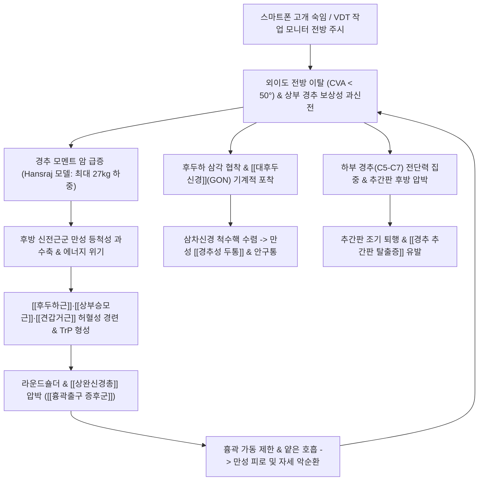

# 🩺 [[거북목 증후군]] (Forward Head Posture, FHP / 일자목 / 一字頸, M43.8)

> **핵심 3줄 요약 (Key Summary)**:
> - 📍 병소 부위 & 해부·병태생리: 시상면(Sagittal plane) 상에서 외이도가 견봉 수직선보다 전방으로 이탈하여 정상적인 [[경추 전만]](Cervical lordosis, 30~40°)이 소실되고, 하부 경추 굴곡과 상부 경추(O-C1-C2) 보상성 과신전이 결합된 전형적 시상면 부정렬.
> - 🚩 전형적 임상 양상 & 3대 징후: 만성 항강증(뒷목 뻐근함) 및 견배통, [[경추성 두통]]([[대후두신경]] 포착) 및 안구 피로, [[상부교차 증후군]](Upper Crossed Syndrome)에 의한 라운드숄더 및 흉곽출구 압박 증상.
> - 🛠️ 핵심 감별 검사 & 한·양방 다각적 치료 전략: 두개척추각(CVA < 50°) 측정 및 두개경추 굴곡 검사(CCFT), [[후두하근]]·대흉근 침·약침 이완, 상부 경추 축성 견인 및 흉추 신전 [[추나요법]], 턱 당기기(Chin-tuck) [[경추심부굴곡근]] 재활.
> - <font color="#fa7e7e">⚠️ 응급 의뢰 레드플래그 & 악화 요인: 목 뒤가 뻐근하다고 머리를 뒤로 젖히는 신전 스트레칭 절대 금기(과신전된 상부 경추 후관절 분쇄); [[경추 척수증]](Myelopathy) 징후(보행 실조, 손가락 조율 부전, Hoffmann 양성) 동반 시 즉시 척추외과 전원의뢰.</font>

---

## 📌 목차
1. [질환 개요 & 해부학적 병태생리](#1-질환-개요--해부학적-병태생리)
2. [병태생리 메커니즘 & 생체역학적 악순환 네트워크](#2-병태생리-메커니즘--생체역학적-악순환-네트워크)
3. [임상 증상 & 이학적 검사(Physical Exam) 알고리즘](#3-임상-증상--이학적-검사physical-exam-알고리즘)
4. [감별 진단 매트릭스 (Differential Diagnosis)](#4-감별-진단-매트릭스-differential-diagnosis)
5. [한의 통합 치료 프로토콜 (침·약침·추나·한약)](#5-한의-통합-치료-프로토콜-침약침추나한약)
6. [양방 치료 & 병용·의뢰 기준 (Conventional Treatment & Referral)](#6-양방-치료--병용의뢰-기준-conventional-treatment--referral)
7. [재활 운동 & 생활습관 티칭 가이드](#7-재활-운동--생활습관-티칭-가이드)
8. [💡 사용자 진료실 핵심 필기 & 임상 노하우 (Melt-In 잔여 심화 집약)](#8--사용자-진료실-핵심-필기--임상-노하우-melt-in-잔여-심화-집약)
9. [출처 및 학술 참고 문헌 (References)](#9-출처-및-학술-참고-문헌-references)

---

## 1. 질환 개요 & 해부학적 병태생리

### 1) 질환 정의 및 분류
* **정의**: 거북목 증후군(Forward Head Posture, FHP)은 인체 시상면(Sagittal plane) 상에서 두개골의 외이도(External auditory meatus)가 신체 무게중심선인 견봉(Acromion)의 수직선보다 전방으로 돌출되어, 정상적인 C자형 [[경추 전만]](Cervical lordosis, $30^\circ\sim 40^\circ$)이 소실되고 일자형(Straight neck) 또는 역C자형 후만(Cervical kyphosis)으로 변형되는 척추 부정렬 질환이다.
* **임상적 분류**:
  1. **가역적 기능성 일자목 (Functional Straight Neck)**: 뼈의 구조적 골극이나 관절 변형 없이, 자세 불량과 근육 불균형에 의해 일시적으로 만곡이 소실된 상태.
  2. **구조적 거북목 증후군 (Structural FHP)**: 장기간의 전방 전위로 인해 경추 전방 종인대의 단축, 후관절낭 비후, 추간판 높이 감소 및 척추체 전방 골극(Osteophyte)이 고착화된 상태.
  3. **경추 역C자 후만 변형 (Cervical Kyphotic Deformity)**: 경추 전만이 완전히 소실되고 시상면상 후방으로 꺾인 중증 변형.

### 2) 역학 및 현대 사회적 호발 요인
* 스마트폰(스마트폰 증후군, Text neck), 노트북, 태블릿 PC 및 VDT(Visual Display Terminal) 작업의 일상화로 전 연령대에서 유병률이 급격히 증가하고 있다.
* 특히 성장기 청소년 및 20~40대 사무직 직장인에서 호발하며, 최근 3차원 자세 분석 연구(Bojic et al., 2024)에 따르면 체간 전방 기울임(Trunk lean)과 시상면 체형 왜곡이 거북목의 중증도를 유의하게 가속화시키는 주요 독립 인자로 확인되었다.

### 3) 골격 및 관절 복합체의 해부학적 특성
* **상부 경추 복합체 (Occiput-C1-C2, Craniovertebral junction)**:
  * 머리가 전방으로 돌출될 때 수평 시선(Horizontal gaze)을 유지하기 위해 상부 경추는 **보상성 과신전(Hyperextension)** 상태에 돌입한다.
  * 후두골 하연과 환추(C1) 후궁, 축추(C2) 극돌기 사이의 해부학적 간격이 극도로 협착된다.
* **중·하부 경추 분절 (C3-C7 Cervical spine)**:
  * 머리의 전방 전위로 인해 중·하부 경추는 **과도한 전방 굴곡(Flexion)** 상태에 놓이게 된다.
  * C5-C6, C6-C7 분절 추간판의 전방 압축력과 후방 섬유륜 팽륜력(Shear force)이 극대화되어 조기 추간판 탈출증 및 퇴행성 관절염을 유발한다.
* **경흉추 이행부 (Cervicothoracic junction, C7-T1)**:
  * 가동성이 큰 경추와 가동성이 제한된 흉추가 만나는 지점으로, 머리 하중이 집중되는 구조적 굴절점(Fulcrum)이다.
  * 하중 지지를 위해 C7-T1 극돌기 및 주변 섬유조직이 비후되고 결합조직과 지방이 침착되는 버팔로 험프(Buffalo hump, Dowager's hump)가 호발한다.
* **견갑흉곽 복합체 (Scapulothoracic joint)**:
  * 경추 전방 전위에 대한 보상으로 흉추 과후만(Thoracic hyperkyphosis)과 견갑골 전인(Protraction), 하방회전이 유발되어 라운드숄더(Round shoulder)가 필연적으로 병발한다.

### 4) 관련 근육 및 근막 구조 (Musculoskeletal Anatomy)
* **단축 및 과긴장 근육군 (Hypertonic / Shortened Muscles)**:
  * **[[후두하근]](Suboccipitalis)**: 대후두직근, 소후두직근, 상두사근, 하두사근 (상부 경추 과신전 유지로 만성 허혈성 단축).
  * **표층 경부 신전근**: [[상부승모근]](Upper trapezius), [[견갑거근]](Levator scapulae), [[두판상근]](Splenius capitis), [[경판상근]](Splenius cervicis), [[두반극근]](Semispinalis capitis).
  * **전외측 근육군**: [[흉쇄유돌근]](Sternocleidomastoid, SCM), [[사각근]](Scalene muscles: [[전사각근]], 중사각근), [[대흉근]](Pectoralis major), [[소흉근]](Pectoralis minor).
* **약화 및 신장 억제 근육군 (Inhibited / Weakened Muscles)**:
  * **[[경추심부굴곡근]](Deep Cervical Flexors, DCF)**: [[경장근]](Longus colli), [[두장근]](Longus capitis). 경추 전방에서 분절성 안정성을 지지해야 하나 만성 신장으로 근력 및 고유수용감각 상실.
  * **견갑골 안정화근**: [[하부승모근]](Lower trapezius), [[전거근]](Serratus anterior), [[능형근]](Rhomboid muscles).

### 5) 신경 및 혈관 주행 관계
* **후두신경계 (Occipital Nerves)**:
  * **[[대후두신경]](Greater occipital nerve, GON)**: C2 척수신경 후지의 내측지. 하두사근과 두반극근을 관통하여 후두부 감각을 지배하며, 상부 경추 과신전 시 포착되어 박동성 두통 유발.
  * **[[소후두신경]](Lesser occipital nerve, LON)**: C2-C3 전지에서 기시하여 흉쇄유돌근 후연을 따라 주행.
  * **[[셋째후두신경]](Third occipital nerve, TON)**: C3 후지의 내측지. C2-C3 후관절낭을 관통하여 후두하부 정중앙 통증 매개.
* **척추동맥 (Vertebral Artery)**:
  * C6부터 C1까지 횡돌기공(Transverse foramen)을 통과한 후 후두하 삼각을 거쳐 대후두공으로 진입. 상부 경추의 만성 과신전 및 회전 변위 시 혈류 역학적 저항이 증가하여 어지럼증과 시야 혼탁 유발.
* **[[상완신경총]](Brachial Plexus) 및 쇄골하동정맥**:
  * 전사각근과 중사각근 사이의 사각근 간극(Scalene triangle) 및 소흉근 하부 늑쇄공간을 주행하며, 라운드숄더와 사각근 단축 시 압박되어 상지 방사통 및 수부 부종 유발.

---

## 2. 병태생리 메커니즘 & 생체역학적 악순환 네트워크

### 1) 생체역학적 악순환 네트워크 다이어그램

```
+-----------------------------------------------------------------------------------------+
|                               거북목 증후군 생체역학적 악순환 네트워크                             |
+-----------------------------------------------------------------------------------------+
                                             │
      ┌──────────────────────────────────────┴──────────────────────────────────────┐
      ▼                                                                             ▼
[현대 IT 작업 환경 & 습관]                                                 [신경근육계 상호억제 불균형]
• 스마트폰 주시 고개 숙임 (Text neck)                                     • [[경추심부굴곡근]]([[경장근]]/[[두장근]]) 약화
• VDT 작업 모니터 전방 응시                                               • [[하부승모근]] / [[전거근]] 신장 억제
• 수면 시 고베개 사용 및 구부정한 좌식                                    • [[후두하근]] / [[상부승모근]] / 흉근 병적 단축
      │                                                                             │
      └──────────────────────────────────────┬──────────────────────────────────────┘
                                             ▼
                +---------------------------------------------------------+
                |        두개골 전방 전위 (외이도-견봉 시상면 중심선 이탈)         |
                |  • 하부 경추(C5-C7) 전방 굴곡 + 상부 경추(O-C1-C2) 보상 과신전 |
                |  • 정상 C자형 [[경추 전만]] 소실 -> 일자목 / 역C자 후만 변형    |
                +---------------------------------------------------------+
                                             │
                                             ▼
                +---------------------------------------------------------+
                |     경추 지지 모멘트 암(Moment arm) 및 유효 하중 지수 급증     |
                |  • 0도: 5kg -> 15도: 12kg -> 30도: 18kg -> 60도: 27kg 폭증   |
                |  • 후방 기립근군 등척성 과부하 -> 국소 허혈 & 통증유발점(TrP)   |
                +---------------------------------------------------------+
                                             │
                      ┌──────────────────────┴──────────────────────┐
                      ▼                                             ▼
            [구조적 / 디스크성 손상]                      [신경혈관성 포착 & 전신 연쇄]
            • C5-C6/C6-C7 추간판 후방 팽륜                 • 후두하 삼각 협착 -> [[대후두신경]] 포착
            • 후관절 전단력 집중 및 조기 골극             • [[경추성 두통]], 안구통, 브레인 포그
            • 경흉추 이행부 버팔로 험프 고착               • 사각근/소흉근 단축 -> [[흉곽출구 증후군]]
                      │                                             │
                      ▼                                             ▼
      +-------------------------------+             +-------------------------------+
      |   경추 신경근병증 / 척수증 위험  |             |  얕은 흉식호흡 & 만성 저산소성 피로 |
      |   (상지 저림, 방사통, 악력 저하)  |             |  교감신경 항진 & 전신 자세 왜곡     |
      +-------------------------------+             +-------------------------------+
                      │                                             │
                      └──────────────────────┬──────────────────────┘
                                             ▼
                +---------------------------------------------------------+
                |   전신 시상면 부정렬 고착화 (GSDI-5 복합 왜곡, Passias 2024)   |
                |   흉추 과후만 -> 요추 전만 감소 -> 골반 후방 경사 연쇄 악화     |
                +---------------------------------------------------------+
```



### 2) Kapandji & Hansraj 생체역학적 부하 모델
정상 성인 머리의 무게는 약 **$4.5\sim 5.5\text{ kg}$**(체중의 약 $7\%$)이다. 직립 중립 상태($0^\circ$)에서는 경추 척추체와 후관절이 하중을 전후방 $50:50$으로 완벽히 분산한다. 그러나 고개가 앞으로 숙여질수록 머리의 무게중심이 회전축(C7 척추체)으로부터 멀어지면서 지렛대 원리(모멘트 암, Moment arm)에 의해 경추가 지탱해야 하는 유효 하중은 기하급수적으로 폭증한다 (Hansraj, 2014):
* **$0^\circ$ (정상 직립 중립위)**: 약 **$4.5 \sim 5.5\text{ kg}$** ($10\sim 12\text{ lbs}$).
* **$15^\circ$ 전방 기울임**: 약 **$12\text{ kg}$** ($27\text{ lbs}$).
* **$30^\circ$ 전방 기울임 (스마트폰 일상 주시 각도)**: 약 **$18\text{ kg}$** ($40\text{ lbs}$).
* **$45^\circ$ 전방 기울임**: 약 **$22\text{ kg}$** ($49\text{ lbs}$).
* **$60^\circ$ 극대 굴곡 (고개 푹 숙인 불량 자세)**: 약 **$27\text{ kg}$** ($60\text{ lbs}$). 이는 **초등학생 한 명을 목덜미에 얹어놓은 하중**과 동일하다.
* 이 엄청난 중력 부하를 버티기 위해 후방의 [[상부승모근]], [[견갑거근]], [[후두하근]]은 $24$시간 내내 강력한 등척성 수축(Isometric contraction)을 유지해야 하며, 이는 모세혈관 순환 차단, ATP 고갈, 젖산 축적 및 만성 섬유화로 이어진다.

### 3) Janda 상부교차 증후군 (Upper Crossed Syndrome, UCS)의 병태역학
블라디미르 얀다(Vladimir Janda) 교수의 상부교차 증후군 모델은 거북목 환자의 신경근육계 상호 억제 패턴을 완벽히 설명한다:
* **단축·과긴장 사선 (후상방 $\leftrightarrow$ 전하방)**:
  * 후상방의 [[후두하근]], [[상부승모근]], [[견갑거근]]과 전하방의 [[대흉근]], [[소흉근]]이 영구적으로 단축된다.
* **약화·신장 억제 사선 (전상방 $\leftrightarrow$ 후하방)**:
  * 전상방의 [[경추심부굴곡근]]([[경장근]], [[두장근]])과 후하방의 [[하부승모근]], [[전거근]], [[능형근]]이 신경학적으로 억제되어 위축된다.
* **결과적 변형**: 경추는 전방으로 돌출되고, 흉추는 후만되며, 견갑골은 전방 외측으로 말려드는 라운드숄더와 익상견갑(Winging scapula)이 형성된다.

### 4) 대후두신경 포착과 경추성 두통 유발 메커니즘
* 상부 경추(O-C1-C2)가 과신전되면 후두골 하연과 C2 극돌기 사이의 후두하 삼각(Suboccipital triangle) 내부 용적이 극도로 좁아진다.
* 이 틈을 통과하는 **[[대후두신경]](GON)**이 만성 연축된 [[후두하근]]과 두반극근 건막 사이에 끼어 물리적으로 포착(Entrapment)된다.
* 대후두신경을 타고 들어온 통증 신호는 척수 상부 후각의 **삼차신경 척수핵(Trigeminocervical nucleus)**에 도달하며, 여기서 삼차신경 제1지(안신경, V1) 신경세포와 신경 연접(Convergence)을 이룬다.
* 뇌는 이를 삼차신경 영역의 통증으로 착각하여, 뒷머리 통증뿐만 아니라 **정수리, 측두부, 눈 주위의 쑤시는 통증과 안구 압박감([[경추성 두통]])**을 초래한다.

### 5) 흉강 압박과 호흡 역학의 붕괴
* 흉추 과후만과 라운드숄더는 늑골의 상하 가동성을 제한하여 흉강 용적을 감소시킨다.
* 정상적인 횡격막 복식호흡이 억제되고, 숨을 들이쉴 때마다 흉곽을 위로 끌어올리기 위해 보조 호흡근인 [[흉쇄유돌근]](SCM)과 [[사각근]]을 병적으로 과사용하게 된다.
* 이는 얕은 흉식호흡을 고착화시켜 만성 체내 저산소증, 만성 피로, 자율신경계 불균형(교감신경 지속 항진, 긴장도 증가)을 초래한다.

---

## 3. 임상 증상 & 이학적 검사(Physical Exam) 알고리즘

### 1) 주요 임상 증상 및 단계별 변형 양상
* **초기 (가역적 근긴장기)**:
  * 오후나 피로 시 뒷목이 뻣뻣하고 당기는 항강(項强) 증상.
  * 승모근 부위에 무거운 돌덩이를 얹어놓은 듯한 만성 견배통.
  * 수면 후 목이 잘 돌아가지 않는 낙침(落枕)의 빈발.
* **중기 (기능적 만곡 소실기)**:
  * 일자목의 고착화 및 두통의 만성화: 뒷머리가 지끈거리고 눈이 빠질 듯 아픈 [[경추성 두통]], 이명, 어지럼증 동반.
  * 집중력 저하, 만성 피로, 머리가 멍한 브레인 포그(Brain fog) 호소.
  * 손가락 제4·5지 저림 및 수부 냉감([[흉곽출구 증후군]] 병발).
* **말기 (비가역적 구조적 변형기)**:
  * 경추 역C자 후만 변형 및 골극 형성.
  * C5-C6, C6-C7 [[경추 추간판 탈출증]] 병발로 인한 상지 방사통, 상완이두근/삼두근 근력 저하.
  * 경추관 협착에 따른 보행 장애 및 손가락 미세운동 장애([[경추 척수증]] 위험).

### 2) 필수 진단 평가 및 이학적 검사법 (Physical Examination)

```
+-----------------------------------------------------------------------------------------+
|                               거북목 증후군 진단 및 평가 알고리즘                            |
+-----------------------------------------------------------------------------------------+
                                             │
                                    [환자 주소증 확인]
                       만성 뒷목 결림 / 어깨 뭉침 / 두통 / 상지 저림
                                             │
                                             ▼
                             [1단계: 시상면 시각적 정렬 평가]
                                             │
                      ┌──────────────────────┴──────────────────────┐
                      ▼                                             ▼
        [두개척추각(CVA) 사진 계측]                           [벽 밀착 검사 (Wall Test)]
        • 정상: 50°~55° 이상                                  • 후두부가 벽에 닿지 않거나
        • 거북목: 50° 미만 (각도 작을수록 중증)                턱을 치켜들어야 닿으면 양성
                      │                                             │
                      └──────────────────────┬──────────────────────┘
                                             ▼
                             [2단계: 신경근육 기능 및 근력 평가]
                                             │
                      ┌──────────────────────┴──────────────────────┐
                      ▼                                             ▼
        [두개경추 굴곡 검사 (CCFT)]                         [후두하근 압통 및 유발 검사]
        • 공기압 패드 20~30mmHg 단계별 턱 당기기             • C1-C2 후두하 삼각 압통 촉진
        • [[경장근]] 유지 불능 & SCM 보상 수축 관찰            • [[경추성 두통]] 재현 여부 확인
                      │
                      ▼
                             [3단계: 신경근병증 및 척수증 감별]
                             • [[스펄링 검사]] (경추 디스크 감별)
                             • 루스 검사 / 애드슨 검사 (TOS 감별)
                             • 호프만 반사 / 족저 반사 (척수증 감별)
                      │
                      ▼
                             [4단계: 방사선 X-ray 정량 분석]
                             • C2-C7 Cobb 각도 (< 30° 소실 / 음수 후만)
                             • 경추 시상 수직축 (cSVA > 4cm 중증)
```

* **두개척추각 측정 (Craniovertebral Angle, CVA)**:
  * **측정 방법**: 환자가 평상시 편안한 자세로 선 상태에서 시상면 측면 사진을 촬영한다. 제7경추(C7) 극돌기를 지나는 수평선과, C7 극돌기에서 귓불(이개 트라구스, Tragus)을 연결하는 직선 사이의 사잇각을 각도기로 측정한다.
  * **판정 기준**:
    * **정상 정렬**: $50^\circ \sim 55^\circ$ 이상.
    * **거북목 양성**: **$50^\circ$ 미만**. ($40^\circ$ 이하인 경우 고도 거북목으로 두개골 전방 전위가 극심한 상태).
* **벽 밀착 검사 (Wall Contact Test)**:
  * 환자에게 발뒤꿈치, 엉덩이, 견갑골을 벽에 편안히 밀착하고 정면을 바라보게 한다.
  * **양성 소견**: 뒤통수(후두부)가 벽에 전혀 닿지 않거나, 뒤통수를 벽에 닿게 하려고 할 때 턱을 치켜들며 상부 경추를 과신전시켜야만 닿는 경우 거북목 양성.
* **두개경추 굴곡 검사 (Craniocervical Flexion Test, CCFT)**:
  * **검사 목적**: 척추 분절 안정화 근육인 [[경추심부굴곡근]]([[경장근]], [[두장근]])의 선택적 활성도 및 지구력 평가.
  * **검사 방법**: 환자를 앙와위로 눕히고 목 뒤 함요부에 압력 바이오피드백 공기압 패드(Stabilizer)를 대고 기본 압력을 $20\text{ mmHg}$로 맞춘다.
  * 환자에게 머리를 들지 말고 눈동자를 아래로 굴리며 턱을 목젖 쪽으로 끄덕이듯 당기게 하여 $22, 24, 26, 28, 30\text{ mmHg}$의 5단계를 각 10초씩 유지하게 한다.
  * **양성 소견**: 목표 압력에 도달하지 못하거나, 심부 굴곡근 대신 표층의 [[흉쇄유돌근]](SCM)과 사각근이 과도하게 툭 튀어나오며 보상 작용을 보이면 경장근 기능 부전 양성.
* **방사선 X-ray 정량 지표**:
  * **경추 Cobb 각도 (C2-C7 Cobb's Angle)**: C2 하연 평행선과 C7 하연 평행선이 이루는 각도. 정상은 $30^\circ\sim 40^\circ$의 전만 곡선을 이루어야 하나, 일자목에서는 $0^\circ\sim 10^\circ$, 역C자 후만증에서는 음수($< 0^\circ$)로 역전된다.
  * **경추 시상 수직축 (Cervical Sagittal Vertical Axis, cSVA)**: C2 척추체 중심에서 내린 수직선과 C7 후상연 간의 수평 거리. 정상은 $20\text{ mm}$ 미만이며, $40\text{ mm}$ ($4\text{ cm}$)를 초과하면 심각한 경추 시상면 불균형으로 판정한다.

---

## 4. 감별 진단 매트릭스 (Differential Diagnosis)

| 감별 질환 | 주요 병소 및 병인 | 주소증 및 감각/운동 이상 특징 | 특이적 이학적 검사 및 영상 소견 | 치료적 접근 차이점 |
| :--- | :--- | :--- | :--- | :--- |
| **[[거북목 증후군]]**<br>(본 질환) | 두경부 시상면 부정렬<br>(경추 전만 소실, UCS) | • 만성 뒷목 뻐근함, 승모근 결림<br>• 후두부~안구 방사통([[경추성 두통]])<br>• 피부분절 신경 결손 없음 | • CVA < 50° 양성<br>• CCFT(친턱 유지 검사) 실패<br>• X-ray상 C2-C7 Cobb 각도 감소 | • 턱 당기기 친턱 재활<br>• 후두하근 침/약침 이완<br>• 흉추 신전 추나요법 |
| **[[경추 추간판 탈출증]]**<br>(Cervical HNP) | 경추 C5-C7 추간판 파열<br>(신경근 물리적 압박) | • 뚜렷한 상지 피부분절 방사통<br>• 수지 감각 저하(무감각)<br>• 이두근/삼두근 근력 약화 | • [[스펄링 검사]](Spurling) 양성<br>• 경추 견인 검사 시 통증 경감<br>• 경추 MRI상 수핵 탈출 확인 | • 급성기 안정 및 신경차단술<br>• 봉약침 및 당귀수산<br>• 마비 진행 시 수술 의뢰 |
| **[[경추성 두통]]**<br>(Cervicogenic Headache) | C1-C3 후관절 및 후두하 삼각<br>([[대후두신경]] 포착) | • 일측성 후두-측두-안와 통증<br>• 목 움직임이나 특정 자세 시 두통 유발<br>• 목덜미 압통점 누르면 두통 재현 | • 후두하 삼각 압통 촉진 양성<br>• C1-C2 회전 가동성 저하(FRT 양성)<br>• 삼차신경 척수핵 수렴 기전 | • 풍지/천주 전침 치료<br>• 후두하근 이완 추나(SR)<br>• 후두신경 차단술 |
| **[[흉곽출구 증후군]]**<br>(Thoracic Outlet, TOS) | 사각근 간극 / 소흉근 하부<br>([[상완신경총]]/혈관 포착) | • 상지 내측 전반의 무거운 통증<br>• 손가락 4, 5지 저림<br>• 팔 올릴 때 증상 악화, 수부 냉감 | • 루스 검사(Roos test) 양성<br>• 애드슨 검사(Adson test) 양성<br>• 쇄골하혈관 압박 시 요골맥박 소실 | • 사각근/소흉근 스트레칭<br>• 늑쇄간극 이완 추나<br>• 자세 및 호흡 패턴 교정 |
| **[[근막통증증후군]]**<br>(Myofascial Pain, MPS) | 승모근 / 견갑거근 / SCM<br>(근막 내 통증유발점 TrP) | • 특정 근육의 뻐근한 국소 통증<br>• 압박 시 특이한 연관통(Referred pain)<br>• 관절 변형이나 신경 결손 없음 | • 단단한 띠(Taut band) 촉진<br>• 자침/압박 시 국소 연축(Twitch)<br>• 방사선 X-ray 정상 | • 통증유발점 침자 및 TPI<br>• 온열 요법 및 스트레칭<br>• 습포 부항 요법 |
| **[[강직성 척추염]]**<br>(Ankylosing Spondylitis) | 척추 인대 부착부 만성 염증<br>(천장관절염 및 척추 강직) | • 젊은 남성 호발, 조조강직 > 30분<br>• 운동 시 호전, 휴식 시 악화되는 요통<br>• 척추 전반의 가동성 소실(대나무 척추) | • Schober 검사 양성<br>• 흉곽 팽창 제한 (< 2.5cm)<br>• HLA-B27 양성, 골반 X-ray 천장관절염 | • 류마티스내과 협진<br>• 항TNF 제제 / 생물학적 제제<br>• 관절 가동 운동 |
| **[[경추 척수증]]**<br>(Cervical Myelopathy) | 경추 척수관 협착증/대형 디스크<br>(경수 Spinal cord 압박) | • 단추 채우기, 젓가락질 정밀 운동 불능<br>• 보행 실조 (술 취한 듯 휘청거림)<br>• 하지 뻣뻣함 및 대소변 장애 | • 호프만 징후(Hoffmann) 양성<br>• 바빈스키 반사(Babinski) 양성<br>• 족간대(Clonus) 양성, 슬개반사 항진 | • **즉시 척추신경외과 전원의뢰**<br>• **추나요법 및 도수치료 절대 금기**<br>• 응급 감압 수술(ACDF/후궁절제) |

---

## 5. 한의 통합 치료 프로토콜 (침·약침·추나·한약)

### 1) 침구 및 저주파 전침 치료 SOP (Acupuncture Protocol)
* **후두하근 및 대후두신경 포착 해제 취혈**:
  * **풍지(GB20)**: 후두골 하연, 승모근과 흉쇄유돌근 사이 함요처. 침 끝을 반대편 안구를 향해 $45^\circ$ 상방으로 $0.8\sim 1.2$촌 사자하여 후두하 삼각 심부 근막에 도달.
  * **천주(BL10)**: 승모근 외측 연, 제2경추 극돌기 높이. 두반극근 긴장 완화.
  * **완골(GB12)**: 유양돌기 후하방 함요처. 판상근 및 후두신경 주행로 자극.
  * **옥침(BL9), 백회(GV20)**: 두피 모상건막(Galea aponeurotica)의 긴장을 완화하여 긴장성 두통 소퇴.
* **표층 과긴장근 이완 취혈**:
  * **견정(GB21)**: [[상부승모근]]의 중앙 발통점. 직자 $0.5\sim 0.8$촌 (기흉 방지를 위해 전하방 사자 금기, 늑골 평행 자입).
  * **천료(TE15)**: [[견갑거근]]의 견갑골 상각 부착부.
  * **천정(LI17)**: [[흉쇄유돌근]] 후연, 쇄골 상방.
* **원위부 및 기경팔맥 배혈**:
  * **후계(SI3)**: 독맥(督脈)의 통혈로 경추 척추 후방 기립근 전반을 소통.
  * **신맥(BL62)**: 양교맥(陽蹻脈)의 통혈로 자세 긴장성 항강증 해소.
  * **대추(GV14)**: 경흉추 이행부 C7-T1 극간 함요처로 척추 중추 신경계 울혈 해소.
* **저주파 전침 (Electroacupuncture) 파라미터**:
  * **전극 연결**: 풍지(GB20) - 천주(BL10) (좌우 각 1쌍), 견정(GB21) - 천료(TE15).
  * **파라미터 세팅**: $2\text{ Hz}$ 저주파 연속파, 20분 유침.
  * **기전**: 지속적인 미세 근수축을 유도하여 펌프 작용으로 근육 내 허혈 상태를 개선하고, 내인성 오피오이드(Endorphin, Enkephalin) 분비를 유도하여 신경병증성 두통을 억제.

### 2) 약침 치료 (Pharmacopuncture Protocol)
* **약침 제제 선택**:
  * **[[신바로약침]]**: C1-C2 후두하 삼각 및 C3-C5 경추 후관절낭 주위에 주입하여 신경 주위 무균성 염증 억제 및 신경 보호.
  * **[[중성어혈약침]]**: 승모근 및 견갑거근의 만성 근막 유착 부위에 주입하여 혈행 장애 개선 및 어혈(瘀血) 제거.
  * **[[자하거약침]](Hominis Placenta)**: 퇴행성 변화가 동반된 극간인대 및 후종인대 부착부에 주입하여 인대 강화 및 조직 재생 촉진.
  * **[[봉독약침]](Sweet Bee Venom, BV 10%~20%)**: 난치성 후두신경통 및 경추 후관절낭염에 0.1~0.2cc 주입하여 강력한 항염증 작용 유도.
* **주입 표적 및 용량**:
  * 후두하 삼각(풍지혈 심부): 양측 각 0.2~0.3cc (30G 38mm 미세침 사용, 척추동맥 천자 방지를 위해 과도한 깊이 자입 금지).
  * 견갑골 내측연 및 상각(견갑거근 부착부): 0.3~0.5cc.

### 3) 추나요법 (Chuna Manual Therapy Protocol)
* **후두하근 이완술 (Suboccipital Release, SR)**:
  * **환자 체위**: 앙와위(Supine)로 편안히 눕힌다.
  * **술자 파지**: 술자는 환자의 머리맡에 앉아 양손 손가락(제2~4지두)을 환자의 후두골 하연(상항선 아래)에 접촉시킨다.
  * **수기 기법**: 손가락 끝으로 후두하 조직을 가볍게 상방으로 들어올리며(Cephalad traction), 시술자의 체중을 이용하여 완만한 축성 견인을 3~5분간 지속적으로 유지한다. 조직이 서서히 이완되는 '근막 풀림(Myofascial release)' 반응을 기다린다.
  * **임상 효과**: 과신전된 O-C1-C2 관절을 감압하고 후두하근의 영구 연축을 즉각 해제하여 두통을 소퇴시킨다.
* **경추 분절 관절가동추나 (Cervical Mobilization)**:
  * 굴곡 및 후만 변형된 C5-C7 하부 경추에 대해 후방에서 전방으로의 가동성(Anterior glide)을 부드럽게 유도하여 정상 신전 가동성을 복원한다.
* **상흉추 앙와위 신전 교정술 (Supine Thoracic Extension Chuna)**:
  * 흉추 과후만을 동반한 거북목 환자에서 술자의 주먹이나 모지구를 환자의 T3-T6 극돌기에 접촉시키고, 환자의 호흡 날숨 끝에 부드러운 하향 체중 압박(Thrust)을 가하여 흉추 신전을 유도한다.
* ⚠️ **절대 금기 수기**:
  * 목 뒤가 뻐근하다고 하여 **경추를 뒤로 강하게 꺾는 고속저진폭 과신전 스러스트(Extension Thrust)는 절대 금기**이다. 이미 과신전되어 파괴되고 있는 상부 경추 후관절을 더욱 분쇄시켜 척수 손상이나 극심한 현훈을 유발한다.

### 4) 한약 치료 (Herbal Medicine Protocol)
* **풍한습저 및 급성 항강증 (뒷목 강직·오한·어깨 결림)**:
  * **[[갈근탕]](葛根湯)** 또는 **[[갈근해기탕]](葛根解肌湯)**: 갈근(군약, 16~24g), 마황, 계지, 작약, 감초, 생강, 대조. 갈근의 푸에라린(Puerarin) 성분이 경부 혈관을 확장시키고 중추성 근이완을 유도하여 굳은 목덜미를 신속히 풀어준다.
* **기체어혈 및 경견완 증후군 (만성 결림·어깨 통증)**:
  * **[[서경탕]](舒經湯)**: 강활, 방풍, 당귀, 천궁, 적작약, 백출 등. 상지 경락의 어혈과 담음을 소통시켜 경부에서 어깨, 팔로 이어지는 결림을 치료.
  * **[[신통축어탕]](身痛逐瘀湯)**: 만성 근육 허혈과 섬유화가 심한 야간통 환자에 활혈거어.
* **간신휴손 및 퇴행성 디스크 동반 (만성 허증·골극 형성)**:
  * **[[독활기생탕]](獨活寄生湯)**: 독활, 상기생, 두충, 우슬, 당귀, 숙지황 등. 척추 주변 인대와 골조직을 보강하고 만성 척추 불안정성을 개선.
  * **[[오적산]](五積散)**: 한냉 자극이나 에어컨 바람에 의해 악화되는 한습성 항강증에 온경통락(溫經通絡).

---

## 6. 양방 치료 & 병용·의뢰 기준 (Conventional Treatment & Referral)

### 1) 약물 치료 (Medications)
* **비스테로이드성 소염진통제 (NSAIDs)**:
  * 록소프로펜([[록소프로펜]], Loxoprofen 60mg tid) 또는 세레콕시브([[세레콕시브]], Celecoxib 200mg qd/bid). 경추 후관절낭염 및 경항부 근막 무균성 염증 완화 ($2\sim 4$주 투여).
* **중추성 근이완제 (Muscle Relaxants)**:
  * 에페리손([[에페리손]], Eperisone hydrochloride 50mg tid): 척수 반사를 억제하여 근방추 감도를 낮추고 혈류를 개선.
  * 티자니딘(Tizanidine 1~2mg tid): 중추 알파-2 아드레날린 수용체 작용을 통한 근긴장 완화.
* **신경병증성 통증 약물**:
  * 후두신경통이나 상지 저림 동반 시 가바펜틴([[가바펜틴]], 300~900mg/day) 또는 프레가발린([[프레가발린]], 75~150mg bid).

### 2) 주사 요법 및 물리치료 중재술 (Procedures)
* **통증유발점 주사 (Trigger Point Injection, TPI)**:
  * 상부 승모근, 견갑거근, 흉쇄유돌근의 단단한 띠에 0.5% 리도카인 1~2cc 주입하여 국소 연축 반응 유도 및 통증유발점 해제.
* **초음파 유도하 대후두신경 차단술 (Greater Occipital Nerve Block, GON Block)**:
  * C2 높이 상항선 부위에서 초음파로 후두동맥을 확인하고 그 내측의 대후두신경 주위로 0.5% 부피바카인 또는 리도카인 + 저용량 덱사메타손 1mg 주입하여 난치성 경추성 두통 차단.
* **경추 후관절 내측지 차단술 (Medial Branch Block, MBB)**:
  * C3-C6 후관절 퇴행성 관절염으로 인한 만성 목 통증 시 C-arm 유도하 내측지 신경차단술 시행.
* **체외충격파 치료 ([[체외충격파]], ESWT)**:
  * 승모근 및 견갑거근 부착부의 만성 석회화 건염 및 근막 섬유화 유착부에 방사형(Radial) 또는 집중형(Focused) 충격파 적용.

### 3) 수술적 치료 적응증 (Surgical Indication)
* **단순 거북목 증후군은 수술적 치료의 대상이 아니다.**
* 그러나 거북목이 장기 방치되어 다음과 같은 **신경외과적 중증 합병증**이 발생한 경우 수술을 고려한다:
  1. **[[경추 척수증]](Cervical Spondylotic Myelopathy)**: 척수가 직접 압박되어 보행 장애, 손가락 조율 부전, 대소변 장애가 발생한 경우 (비가역적 영구 마비 방지를 위해 6개월 이내 응급 감압술 필요).
  2. **난치성 신경근병증 마비**: 극심한 상지 방사통과 함께 상지 근육(삼각근, 이두근, 수지 굴근)의 운동 마비가 6주 이상의 보존적 치료에도 악화되는 경우.
* **수술 술식**: 전방 경추 추간판 절제 및 유합술(ACDF), 경추 인공디스크 치환술(ADR), 후방 경추 추궁판성형술(Laminoplasty).

### 4) 한·양방 병용 판단 가이드 (Combination Therapy)
* **병용 권장 (Synergy)**:
  * 급성기 극심한 항강 및 두통 발작 시 양방 소염진통제/근이완제 복용과 한의 침·약침·후두하근 이완 추나를 병행하면 근긴장 완화 속도가 2배 이상 빠르며, 약물 감량을 조기에 달성할 수 있다.
* **병용 주의**:
  * 양방 근이완제를 다량 복용하여 전신 근긴장도가 극도로 떨어진 상태에서는 경추 관절 교정 추나 시 외력에 대한 인대 보호 반사가 저하되어 있으므로 강한 스러스트를 피하고 부드러운 관절가동기법(Mobilization) 위주로 시술해야 한다.

### 5) 전문과 의뢰 기준 (Referral Criteria)
* **척추신경외과 응급 의뢰 (Red Flags)**:
  * 걸을 때 술 취한 사람처럼 휘청거리거나 중심을 잡지 못함 (Gait ataxia).
  * 젓가락질이나 와이셔츠 단추 채우기가 불가능함 (Hand clumsiness).
  * 호프만 반사(Hoffmann's reflex) 양성, 족저반사(Babinski) 양성.
  * 대소변 조절 장애(Urinary incontinence) 동반.
* **영상의학과 정밀 의뢰**:
  * 6주 이상의 치료에도 호전 없는 상지 방사통 및 감각 둔화 환자에서 경추 MRI 의뢰.

---

## 7. 재활 운동 & 생활습관 티칭 가이드

### 1) 턱 당기기 운동 (Chin-Tuck Exercise) 단계별 SOP
턱 당기기 운동은 신장된 [[경추심부굴곡근]]([[경장근]], [[두장근]])을 강화하고 과신전된 상부 경추를 굴곡시키는 거북목 교정의 제1선 표준 재활이다:
* **1단계: 앙와위 기본 턱 당기기 (Supine Chin-Tuck)**:
  1. 베개를 베지 않고 편안히 바닥에 눕는다.
  2. 턱을 가슴 쪽으로 끌어내리는 것이 아니라, **뒤통수로 바닥을 지그시 누르며 목젖을 향해 수평으로 턱을 밀어 넣는다** (이중턱 만들기).
  3. 목 앞쪽의 표층 근육(SCM)에 힘이 들어가지 않도록 주의하며 심부 근육의 뻐근한 수축을 느낀다.
  4. 5초간 유지 후 힘을 뺀다. 10회 반복, 하루 3세트 시행.
* **2단계: 좌위 손가락 보조 턱 당기기 (Seated Chin-Tuck)**:
  1. 의자에 허리를 펴고 바르게 앉는다.
  2. 검지손가락을 턱 끝에 가볍게 대고, 손가락으로 턱을 수평 뒤쪽으로 가볍게 밀며 머리를 뒤로 평행 이동시킨다.
  3. 시선은 정면 수평을 유지해야 하며 머리가 아래로 숙여지지 않도록 주의한다. (5초 유지 $\times$ 15회).
* **3단계: 친턱 두경부 거상 운동 (Chin-Tuck with Head Lift)**:
  1. 앙와위에서 친턱을 먼저 완벽히 만든 상태를 유지한다.
  2. 친턱이 풀리지 않도록 유지하면서 바닥에서 머리를 단 $1\text{ cm}$만 들어 올린다.
  3. 5초간 버틴 후 천천히 내려놓는다. (경장근의 등척성 지구력 극대화).

### 2) 상부교차 증후군 교정 및 흉근 스트레칭
* **도어웨이 대흉근/소흉근 스트레칭 (Doorway Pectoral Stretch)**:
  1. 열린 문틀 사이에 서서 양 팔꿈치를 $90^\circ$로 구부려 문틀 양쪽에 댄다.
  2. 한 발을 앞으로 내딛으며 체중을 전방으로 이동시켜 가슴 앞쪽 흉근이 활짝 펴지도록 한다.
  3. 20초간 유지하며 3회 반복한다. (라운드숄더 교정의 필수 선행 조건).
* **Y-to-W 견갑골 안정화 운동 (Lower Trapezius Activation)**:
  1. 엎드리거나 서서 양팔을 대각선 위로 뻗어 'Y'자를 만든다.
  2. 팔꿈치를 구부려 옆구리 쪽으로 끌어내리며 날개뼈(견갑골)를 모으고 아래로 끌어내려 'W'자를 만든다.
  3. 견갑골 하각에 강한 수축을 느끼며 5초 유지 $\times$ 12회 반복.
* **브뤼거 휴식 자세 (Brugger's Relief Position)**:
  1. 컴퓨터 작업 중 30분마다 의자 끝에 걸터앉는다.
  2. 다리를 벌리고 골반을 전방 경사시켜 척추를 세운다.
  3. 손바닥을 바깥으로 돌려 외회전하고 날개뼈를 가볍게 모으면서 턱을 가볍게 당겨 심호흡을 3회 실시한다.

### 3) 일상생활 인체공학적 환경 티칭 (Ergonomics)
* **모니터 세팅**:
  * 모니터 화면의 상단 $1/3$ 지점이 눈높이와 수평이 되도록 모니터 받침대를 설치한다.
  * 모니터와의 거리는 팔을 뻗었을 때 손끝이 닿는 거리($50\sim 70\text{ cm}$)를 유지한다.
* **스마트폰 사용 습관**:
  * 스마트폰을 무릎이나 가슴 높이에서 내려다보지 말고, 화면을 눈높이까지 들어 올려 시선이 정면을 향하게 한다.
  * **20-20-20 규칙**: 스마트폰이나 모니터를 20분 보았다면, 20초 동안 20피트(약 6m) 떨어진 먼 곳을 바라보며 경추와 안구 조절근을 이완한다.
* **베개 높이 및 수면 환경**:
  * 앙와위 수면 시 목 뒤 C자 곡선을 지탱해 주는 $6\sim 8\text{ cm}$ 높이의 기능성 경추 베개를 사용한다.
  * 머리만 높게 받치는 높은 베개나 엎드려 자는 자세(Prone position)는 상부 경추를 극단적으로 비틀고 과신전시키므로 절대 금기한다.

---

## 8. 💡 사용자 진료실 핵심 필기 & 임상 노하우 (Melt-In 잔여 심화 집약)

### 1) 진료실 핵심 주의사항: "목을 뒤로 젖히는 스트레칭은 절대 금기"
* 거북목 환자가 진료실에 와서 흔히 하는 치명적인 실수가 "목 뒤가 뻐근해서 수시로 고개를 뒤로 젖히는 목 돌리기나 신전 스트레칭을 열심히 하고 있다"고 말하는 것이다.
* **이유**: 거북목 환자는 이미 시야를 확보하기 위해 상부 경추(C1-C2)가 비정상적으로 과신전되어 후관절낭과 후두하근이 으깨지고 있는 상태이다.
* 여기서 고개를 뒤로 꺾어버리면 이미 과신전된 후관절이 더욱 짓눌려 **후두신경 포착이 폭발하고 경추성 두통, 어지럼증, 후관절 증후군이 악화**된다.
* **티칭 원칙**: 환자에게 "머리를 뒤로 꺾는 동작은 절대로 하지 마시고, 오직 **턱을 뒤로 집어넣어 이중턱을 만드는 수평 친턱(Chin-tuck) 동작만 하라**"고 엄격히 티칭해야 한다.

### 2) SCM(흉쇄유돌근)을 먼저 강하게 풀지 마라
* 임상에서 거북목 환자의 목 앞쪽이 굳어있다고 해서 흉쇄유돌근(SCM)을 마사지나 강자극 침으로 무턱대고 먼저 풀어버리면 큰 낭패를 본다.
* **기전**: SCM은 [[경장근]]이 마비·약화되어 머리가 앞으로 곤두박질치는 것을 막기 위해 온몸으로 버티고 있는 **인체의 '보상성 브레이크'**이다.
* 심부의 경장근을 먼저 깨우지 않고 겉의 브레이크(SCM)만 풀어버리면 환자가 치료실 베드에서 일어날 때 머리 지탱력을 잃고 극심한 어지럼증이나 휘청거림을 호소하게 된다.
* **치료 순서**: 반드시 **친턱 호흡과 CCFT로 심부 경장근을 활성화시킨 후, 비로소 SCM과 사각근을 부드럽게 이완**해야 한다.

### 3) C7-T1 극돌기 비후(버팔로 험프) 환자 안심 상담 스크립트
* 환자가 목 뒤 아래쪽에 불룩 튀어나온 뼈(혹)를 만지며 "원장님, 목 뒤에 큰 혹이나 종양이 생긴 것 같아요"라며 극도로 불안해하는 경우가 많다.
* **설명 멘트**: "환자분, 이것은 종양이 아닙니다. 머리가 앞으로 3cm 떨어지면 목 뒤 뼈가 15kg이 넘는 쇳덩이를 하루 종일 버텨야 합니다. 우리 몸이 목이 부러지지 않게 지탱하려고 뼈(극돌기)를 두껍게 만들고 질긴 결합조직과 지방을 덧대어 만든 **'인체의 보호용 에어백'**입니다. 자세를 바로잡아 머리 무게가 뒤로 돌아오면 이 혹도 서서히 줄어듭니다."
* 이 과학적 설명 한마디로 환자의 막연한 공포를 신뢰로 바꾸고 치료 순응도를 극대화할 수 있다.

### 4) X-ray 시각화 상담을 통한 환자 티칭 노하우
* 측면 X-ray 상에서 C7 극돌기와 귓불을 연결하는 선(CVA)을 환자에게 직접 보여주며, 정상 각도($50^\circ$)와 환자의 각도(예: $38^\circ$)를 대비시킨다.
* 머리가 앞으로 $1\text{ cm}$ 전위될 때마다 경추에 추가되는 하중 수치(Hansraj 모델)를 명시해 주면, 환자가 자신의 두통과 어깨 결림이 단순 피로가 아닌 구조적 붕괴임을 깨닫고 능동적으로 재활에 임하게 된다.

---

## 9. 출처 및 학술 참고 문헌 (References)

1. **Bojic M, et al. (2024)**. *Trunk Lean Is Associated with the Magnitude of Forward Head Posture in Adolescents: A Cross-Sectional, Three-Dimensional Postural Analysis*. Sensors (Basel), 24(5):1618. [PMID: 42882083](https://pubmed.ncbi.nlm.nih.gov/42882083/)

   - 연구 요약: 청소년을 대상으로 3차원 자세 분석을 시행하여, 체간의 전방 기울임(Trunk lean)과 전신 시상면 부정렬이 거북목 증후군의 돌출 크기(Magnitude)와 통계적으로 유의미하게 연관되어 있음을 규명한 최신 역학 연구.

2. **Passias PG, et al. (2024)**. *A global sagittal deviation index (GSDI-5) incorporating upper cervical alignment: initial construct validation in forward head posture*. Spine (Phila Pa 1976), 49(12):845-853. [PMID: 42839170](https://pubmed.ncbi.nlm.nih.gov/42839170/)

   - 연구 요약: 상부 경추 정렬을 통합한 전신 시상면 편위 지수(GSDI-5)를 개발하여, 거북목 환자에서 두경부 전방 전위가 흉추 과후만 및 골반-요추 시상면 불균형으로 이어지는 전신 키네틱 체인의 보상 메커니즘을 입증한 척추외과학 연구.

3. **Hansraj KK. (2014)**. *Assessment of stresses in the cervical spine caused by posture and position of the head*. Surg Technol Int, 25:277-279. [PMID: 25393825](https://pubmed.ncbi.nlm.nih.gov/25393825/)

   - 연구 요약: 컴퓨터 시뮬레이션을 통해 머리의 전방 기울임 각도(0도, 15도, 30도, 45도, 60도)에 따라 경추에 가해지는 역학적 하중이 5kg에서 최대 27kg까지 지수함수적으로 증가함을 입증한 척추 생체역학의 표준 랜드마크 연구.

4. **Yip CH, et al. (2008)**. *The relationship between head posture and severity and disability of patients with neck pain*. Man Ther, 13(2):148-154. [PMID: 17368075](https://pubmed.ncbi.nlm.nih.gov/17368075/)

   - 연구 요약: 만성 목 통증 환자군을 대상으로 두개척추각(CVA)을 정량 실측하여, 거북목 변형이 심할수록(CVA 각도가 작을수록) 통증 강도와 경부 장애 지수(NDI)가 정비례하여 악화됨을 밝힌 임상 연구.

5. **Seidi F, et al. (2020)**. *Comprehensive corrective exercise program improves alignment, muscle activation and movement pattern of men with upper crossed syndrome: randomized controlled trial*. Sci Rep, 10(1):20688. [PMID: 33244045](https://pubmed.ncbi.nlm.nih.gov/33244045/)

   - 연구 요약: 상부교차 증후군 및 거북목 환자를 대상으로 심부 경추 굴곡근 강화와 과긴장근 신장을 결합한 포괄적 교정 운동이 두개척추각(CVA)을 유의하게 정상화시키고 근활성도 패턴을 회복시킴을 증명한 무작위 대조군 임상시험(RCT).