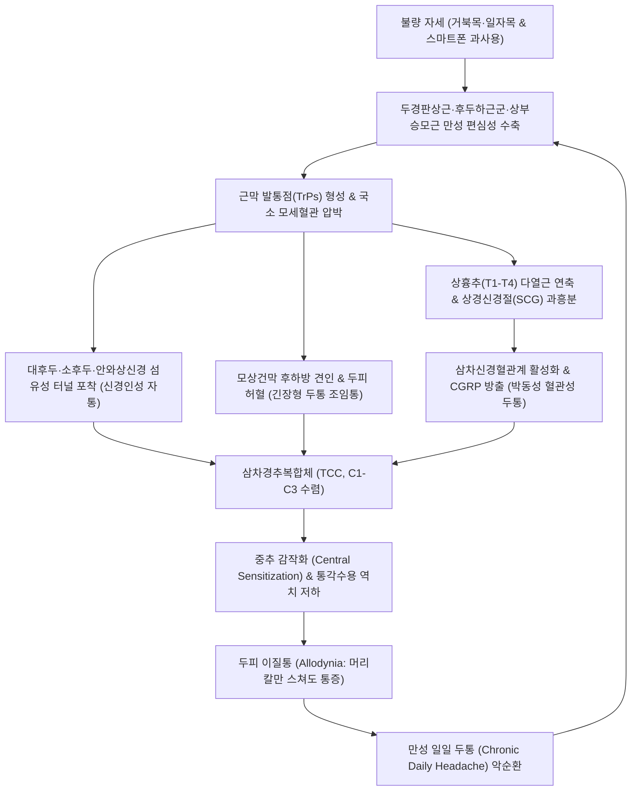

# 🩺 [[두통]] (Headache / Cephalalgia / 頭痛, G43, G44, R51)

> **핵심 3줄 요약 (Key Summary)**:
> - 📍 병소 부위 & 해부·병태생리: 원발성([[긴장성 두통]], [[편두통]], [[군발두통]])과 경추·근육·신경 포착성 이차성([[경추성 두통]])으로 분류되며, 체성 감각신경성([[대후두신경]]·[[소후두신경]] 포착), 체성 운동신경성([[모상건막]] 허혈), 자율신경성([[상경신경절]] 과흥분 및 삼차신경혈관계 CGRP 분비)의 3대 경로가 복합 작용합니다.
> - 🚩 전형적 임상 양상 & 3대 징후: 머리 전체를 압박하는 비박동성 띠 조임통(긴장형), 박동성 편측 통증과 오심·구토·광공포증(편두통), 경추 움직임에 따른 후두부-두정부-안와 방사통(경추성).
> - 🛠️ 핵심 감별 검사 & 한·양방 다각적 치료 전략: [[두판상근]] 발통점 불활성화, [[경추 굴곡 회전 검사]](CFRT), 후두신경 약침술, C0-C1 및 상흉추(T1-T4) 신전 교정 추나, [[천궁차조산]]·[[반하백출천마탕]]·[[조등산]] 투여, 양방 급성기 트립탄/게판트 및 예방 CGRP 항체/보톡스 병용.
> - <font color="#fa7e7e">⚠️ 응급 의뢰 레드플래그 & 악화 요인: 벼락두통(Thunderclap), 발열 동반 경부강직, 신경학적 결손, 50세 이후 신규 발현, 암 환자 신규 두통(SNOOP10 Red Flags) 시 지주막하출혈·뇌수막염·거대세포동맥염 배제를 위한 즉각적 응급 영상 검사 의뢰.</font>

---

## 📌 목차
1. [질환 개요 & 해부학적 병태생리](#1-질환-개요--해부학적-병태생리)
2. [병태생리 메커니즘 & 생체역학적 악순환 네트워크](#2-병태생리-메커니즘--생체역학적-악순환-네트워크)
3. [임상 증상 & 이학적 검사(Physical Exam) 알고리즘](#3-임상-증상--이학적-검사physical-exam-알고리즘)
4. [감별 진단 매트릭스 (Differential Diagnosis)](#4-감별-진단-매트릭스-differential-diagnosis)
5. [한의 통합 치료 프로토콜 (침·약침·추나·한약)](#5-한의-통합-치료-프로토콜-침약침추나한약)
6. [양방 치료 & 병용·의뢰 기준 (Conventional Treatment & Referral)](#6-양방-치료--병용의뢰-기준-conventional-treatment--referral)
7. [재활 운동 & 생활습관 티칭 가이드](#7-재활-운동--생활습관-티칭-가이드)
8. [💡 사용자 진료실 핵심 필기 & 임상 노하우 (Melt-In 잔여 심화 집약)](#8--사용자-진료실-핵심-필기--임상-노하우-melt-in-잔여-심화-집약)
9. [출처 및 학술 참고 문헌 (References)](#9-출처-및-학술-참고-문헌-references)

---

## 1. 질환 개요 & 해부학적 병태생리

### 1) 질환 정의 및 ICHD-3 분류 체계
[[두통]](Headache, Cephalalgia)은 두개골 외피, 두피 건막, 두개내 맥관 및 뇌막, 경추 상부 신경 구조물에서 발생하는 모든 통증 감각을 포괄하는 광범위한 증후군입니다. 국제두통학회(IHS)의 국제두통질환분류 3판(ICHD-3)에 따라 다음과 같이 체계적으로 대별됩니다:

1. **원발 두통 (Primary Headache Disorders)**:
   - 기저의 기질적 뇌병변이나 전신 질환 없이 두통 자체가 독립된 질환인 경우.
   - 대표 질환: [[긴장성 두통]](Tension-type headache, TTH, G44.2), [[편두통]](Migraine, G43), [[군발두통]](Cluster headache 및 삼차자율신경두통 TACs, G44.0).
2. **이차 두통 (Secondary Headache Disorders)**:
   - 두경부 외상, 혈관 질환, 감염, 약물 과용, 경추 및 두개골 구조물 장애 등 기저 원인 질환에 속발하여 나타나는 두통.
   - 대표 질환: [[경추성 두통]](Cervicogenic headache, CEH, G44.8), [[약물과용두통]](Medication-overuse headache, MOH, G44.41), [[지주막하출혈]](SAH), [[거대세포동맥염]](측두동맥염), [[뇌수막염]].
3. **통증성 뇌신경병증 및 기타 안면통 (Neuropathies & Facial Pains)**:
   - 삼차신경통, [[후두신경통]](Occipital neuralgia, M54.81).

### 2) 관련 해부학적 구조물
* **골격 및 관절 복합체**:
  - 후두골(C0), 환추(C1), 축추(C2), C3-C7 경추 후관절(Facet joints).
  - 상흉추(T1-T4) 늑척추관절 및 흉추 후관절: 상흉추 교감신경절 연계.
* **근육 및 근막계 (Myofascial System)**:
  - 심부 신전근군: [[두반극근]](Semispinalis capitis), [[경반극근]](Semispinalis cervicis), [[후두하근군]](대후두직근, 소후두직근, 상두사근, 하두사근).
  - 천층 신전 및 회전근군: [[두판상근]](Splenius capitis), [[경판상근]](Splenius cervicis), 상부 [[승모근]](Trapezius), [[견갑거근]](Levator scapulae).
  - 두피 건막 및 안면 근육: [[측두근]](Temporalis), [[모상건막]](Galea aponeurotica), [[후두전두근]](Occipitofrontalis), [[교근]](Masseter), [[익돌근]](Pterygoids).
* **신경 및 혈관 복합체 (Neurovascular Structures)**:
  - 후두 신경망: C2 척수신경 후지 내측계통인 [[대후두신경]](Greater occipital nerve, GON), C2-C3 경신경총 분지인 [[소후두신경]](Lesser occipital nerve, LON), C3 후지인 [[셋째후두신경]](Third occipital nerve, TON).
  - 안면 및 삼차신경 분지: 제1지(V1, [[안와상신경]], [[상활차신경]]), 제2지(V2, [[관골측두신경]]), 제3지(V3, [[이개측두신경]]).
  - 자율신경계: [[상경신경절]](Superior cervical ganglion, SCG), 경동맥신경총(Carotid plexus).
  - 혈관계: 표재측두동맥(Superficial temporal artery), 후두동맥(Occipital artery), 중경막동맥(Middle meningeal artery), 경동맥 및 추골동맥.

```
       =================================================================
       [두경부 신경-근막-혈관 포착 및 삼차경추복합체 수렴 해부 도식]
       =================================================================

                두정부 (Vertex) & 모상건막 (Galea Aponeurotica)
                             ▲                      ▲
           [안와상/상활차신경]  │                      │  [대후두신경 (GON)]
               (CN V1)       │                      │      (C2 후지)
                             │                      │
        이마/전두부 ─── [전두근] ─── 모상건막 ─── [후두근] ─── 후두골 상항선
                             │                      │          │
        관자놀이 ─────── [측두근]                     │     [승모근/두반극근
        (관골측두신경/       │                      │      건막 관통점 포착]
         표재측두동맥)        │                      │          │
                             ▼                      ▼          ▼
                        [삼차신경 척수핵] ◄═════════ [C1-C3 척수신경 후근]
                    (Spinal Trigeminal Nucleus)     (후두하근군 & 후관절)
                                  │
                                  ▼
                    ╔══════════════════════════════╗
                    ║   삼차경추복합체 (TCC 수렴)   ║
                    ║   Trigeminocervical Complex  ║
                    ╚══════════════════════════════╝
                                  │
                                  ▼  (시상 및 대뇌피질 투사)
                 전두부·안와통 · 관자놀이 맥박통 · 정수리 통증 투사
       =================================================================
```

### 3) 두통 발생의 3대 신경역학적 기전
1. **체성 감각신경성 기전 (Somatic Sensory-Nerve Mediated)**:
   - 말초 감각신경이 후경부 및 두피 천층의 근육막 관통 구멍(Fibrous tunnel)에서 압박·포착되어 발생합니다.
   - [[승모근]] 건막 및 [[두반극근]] 근복 관통부 연축 $\rightarrow$ [[대후두신경]](GON) 포착 $\rightarrow$ 후두부에서 정수리를 거쳐 안와부까지 뻗치는 날카로운 방사통 유발.
   - [[흉쇄유돌근]] 후연 중간부(Erb's point) 긴장 $\rightarrow$ [[소후두신경]](LON) 및 대이개신경 포착 $\rightarrow$ 유양돌기 후방 및 귓바퀴 둘레 통증.
   - [[측두근]] 심부 근막 비후 $\rightarrow$ [[관골측두신경]] 및 [[이개측두신경]] 압박 $\rightarrow$ 편측 측두부 및 외측 안와 조임통.
   - [[추미근]] 및 [[전두근]] 연축 $\rightarrow$ [[상활차신경]] 및 [[안와상신경]] 포착 $\rightarrow$ 미간부 찌릿한 통증 및 안와 상부 압박감.
2. **체성 운동신경성 기전 (Somatic Motor-Ischemic Mediated)**:
   - 후두골과 경흉추를 연결하는 두경판상근 복합체의 지속적인 편심성 수축 및 단축.
   - [[두판상근]] 긴장 $\rightarrow$ 전두근, 측두근, 후두근을 잇는 [[모상건막]]을 후하방으로 강하게 견인 $\rightarrow$ 두개골 건막 내압 상승 및 모세혈관 순환 차단 $\rightarrow$ 국소 허혈(Ischemia) 및 대사산물(젖산, Substance P) 축적 $\rightarrow$ 머리를 원형 띠로 조여매는 듯한 묵직한 조임통([[긴장성 두통]]) 발생.
3. **자율신경성 기전 (Autonomic-Vascular Mediated)**:
   - 상흉추(T1-T4) 분절의 심부 안정화 근육인 [[다열근]] 연축 $\rightarrow$ 추간공 내압 상승 $\rightarrow$ 교감신경 절전섬유 자극 $\rightarrow$ [[상경신경절]](SCG) 과흥분.
   - 두개내외 혈관의 급격한 혈관 연축 후 반동성 혈관 확장 유발.
   - 동시에 삼차신경혈관계(Trigeminovascular system) 활성화로 인한 혈관주위 CGRP(Calcitonin Gene-Related Peptide) 및 Substance P 방출 $\rightarrow$ 신경인성 염증(Neurogenic inflammation) 및 쿵쾅거리는 박동성 [[편두통]], 안구 충혈, 오심 초래.

---

## 2. 병태생리 메커니즘 & 생체역학적 악순환 네트워크

### 1) 삼차경추복합체(TCC) 수렴 메커니즘 (Convergence Mechanism)
경추성 두통과 편두통이 혼재되어 나타나는 근본적인 신경생리학적 원인은 **삼차경추복합체(Trigeminocervical Complex, TCC)**에서의 구심성 신경 수렴(Convergence)에 있습니다:
* 제1, 2, 3 경추 신경근(C1, C2, C3)의 후근을 통해 들어오는 경추 상부 후관절, 후두하근군, 인대, 경막의 체성 유해요인 정보가 **삼차신경 척수핵 미측핵(Spinal trigeminal nucleus caudalis)**으로 들어갑니다.
* 이때 안면 및 전두부 감각을 담당하는 삼차신경 제1지(V1, 안신경)의 유해감각 섬유 역시 동일한 척수핵 이차 신경원(Second-order neuron)에 시냅스를 형성합니다.
* 뇌의 중추 감각 피질은 C1-C3 경추 구조물에서 발생한 통증 신호를 삼차신경 제1지 지배 영역(이마, 안와, 측두부)에서 유래한 통증으로 착각하여 인식하게 되며, 이로 인해 경추부 긴장이 안와통 및 전두부 두통으로 투사됩니다.

### 2) 생체역학적 악순환 네트워크 (Mermaid Flowchart)



### 3) 주요 내인성 및 외인성 유발 요인
* **내인성 요인 (Intrinsic Factors)**:
  - 두경부 근막 유착 및 발통점: [[두판상근]], [[두반극근]], [[후두하근군]], [[승모근]]의 활성 발통점.
  - 측두하악관절(TMJ) 장애: 턱관절 내장증, 이갈이, 편측 저작습관에 의한 [[교근]], [[외측익돌근]] 연축과 두경부 근긴장 파급.
  - 경추 관절 기능장애: C0-C1(환추후두관절), C1-C2(환축관절), C2-C3 후관절의 관절낭 비후, 아탈구 및 퇴행성 관절증.
  - 호르몬 변동: 여성 에스트로겐 수치 급감(월경 연관 편두통).
* **외인성 요인 (Extrinsic Factors)**:
  - 심리사회적 스트레스: 교감신경계 항진 및 시상하부-뇌하수체-부신(HPA) 축 활성화에 따른 두피 근막 수축.
  - 한랭 노출 및 풍한(風寒) 자극: 급격한 기온 저하 시 두피 미세혈관 및 연부조직 급격 연축.
  - 수면 장애 및 저산소증: 폐쇄성 수면무호흡증(OSA)으로 인한 이산화탄소 저류 및 뇌혈관 확장 두통.
  - 식품 및 화학물질: 티라민(숙성 치즈, 와인), 아질산염(가공육), 인공감미료(아스파탐), 카페인 금단.

---

## 3. 임상 증상 & 이학적 검사(Physical Exam) 알고리즘

### 1) 병태생리별 3대 임상 양상 비교 매트릭스

| 분류 | 통증 양상 및 성상 | 주요 침범 부위 | 동반 증상 | 악화 요인 |
| :--- | :--- | :--- | :--- | :--- |
| **체성 감각신경성**<br>(신경포착형) | 찌릿함, 타는 듯한 날카로운 자통, 번개 치듯 뻗치는 방사통 | 후두부 $\rightarrow$ 두정부 $\rightarrow$ 안와 후방 ([[대후두신경]]), 측두부 | 두피 스침통([[이질통]]), 머리 빗을 때 통증 | 목 과신전, 특정 부위 압박 |
| **체성 운동신경성**<br>(근막허혈형) | 머리 둘레를 끈이나 띠로 조여매는 듯한 묵직함, 둔통, 두중감 | 양측 전두부, 측두부, 후두부, 모상건막 전체 | 경부 강직감, 어깨 결림, 턱관절 피로 | 정신적 피로, 오후 및 저녁 시간 |
| **자율신경성**<br>(혈관·신경염형) | 쿵쾅거리는 박동성 박동통, 욱신거림, 눈이 빠질 듯한 심부통 | 편측 전두-측두부, 안와 주위 및 안구 심부 | 오심, 구토, 광공포증, 소리공포증, 안구 충혈, 유루 | 일상 신체활동, 음주, 밝은 빛, 소음 |

### 2) 필수 이학적 검사 및 진단 알고리즘

```
       [두통 환자 내원 시 진단 평가 알고리즘]
                         │
                         ▼
        ┌────────────────────────────────┐
        │  1단계: SNOOP10 레드플래그 선별 │
        └────────────────────────────────┘
                         │
         ├── [레드플래그 양성] ──► 즉시 상급병원 응급실 의뢰 (뇌 CT/MRI/MRA, 뇌척수액 검사)
         │
         ▼ [레드플래그 음성: 원발성 및 근골격계 두통 평가]
        ┌────────────────────────────────┐
        │  2단계: 후두부 및 두피 촉진 검사│
        └────────────────────────────────┘
         ├── Pinch & Roll Test (피부 집기 굴리기 검사)
         │    └─ 양성 (두피 자통/유착): 체성 감각신경 포착 (대/소후두신경 약침 적응증)
         │
         ├── 후두신경 압박 및 Tinel 징후 검사
         │    └─ 양성 (안와/정수리 방사통 유발): 후두신경통 및 두반극근 연축
         │
         ▼
        ┌────────────────────────────────┐
        │  3단계: 경추 기능 및 관절 유발 검사│
        └────────────────────────────────┘
         ├── 경추 굴곡-회전 검사 (CFRT, Cervical Flexion-Rotation Test)
         │    └─ 양성 (회전 가동역 32° 이하 제한 및 편측 통증): C1-C2 기능부전 (경추성 두통)
         │
         ├── 스펄링 검사 (Spurling Test)
         │    └─ 양성 (경추 신전-측굴 압박 시 상지 방사통): 경추 신경근병증 동반 감별
         │
         ▼
        ┌────────────────────────────────┐
        │  4단계: 상흉추 및 교감신경 평가 │
        └────────────────────────────────┘
              └─ T1-T4 협척부 압통 및 기립근 강직: 자율신경성/혈관성 연계 확인
```

* **Pinch & Roll Test (피부 집기 굴리기 검사)**:
  - 검사 방법: 후두부, 유양돌기 후방, 측두부, 경추 상부의 피부 및 피하조직을 양손 엄지와 검지로 집어 올려 굴리면서 이동시킵니다.
  - 양성 소견: 건측에 비해 환측에서 극심한 자통, 작열감, 피하 유착이 발생하며, 이는 표재 감각신경의 포착 및 피하 신경성 염증을 강력히 시사합니다.
* **경추 굴곡-회전 검사 ([[경추 굴곡 회전 검사]], Cervical Flexion-Rotation Test, CFRT)**:
  - 검사 방법: 환자를 앙와위로 눕히고 경추를 최대로 수동 굴곡시켜 C2-C7 하부 경추의 움직임을 차단한 후, 머리를 좌우로 부드럽게 끝범위까지 회전시킵니다.
  - 정상 가동범위: 좌우 각각 약 40~44°.
  - 양성 소견: 정상치보다 10° 이상 감소(32° 미만)하거나 환측 회전 시 현저한 제한 및 두통 유발. C1-C2(환축관절) 기능부전성 [[경추성 두통]]을 확진하는 최고 신뢰도의 검사법(민감도 90%, 특이도 88%).
* **후두하 신경-근육 촉진 검사 (Suboccipital Palpation)**:
  - 상항선(Superior nuchal line) 외측 1/3 지점에서 [[대후두신경]](GON) 포착점을 촉진하여 안와부로 뻗치는 틴넬 징후(Tinel's sign) 및 압통 유발 확인.
  - C2 극돌기 외측 1.5cm 부위에서 [[두판상근]] 및 [[두반극근]]의 경결점과 방사통 확인.

---

## 4. 감별 진단 매트릭스 (Differential Diagnosis)

| 감별 질환 | 호발 연령 및 성별 | 통증 성상 및 분포 | 지속 시간 및 패턴 | 동반 증상 | 특이 진단 검사 및 반응 |
| :--- | :--- | :--- | :--- | :--- | :--- |
| **[[긴장성 두통]]**<br>(TTH) | 20~40대<br>여성 약간 우세 | 머리 전체를 압박하는 비박동성 띠 조임통 | 30분~7일<br>만성형은 지속적 | 신체활동에 악화 없음<br>광공포/소리공포 중 1개만 가능 | 두피 압통점 양성<br>신경학적 검사 정상 |
| **[[편두통]]**<br>(Migraine) | 10~40대<br>여성:남성=3:1 | 편측성(60%) 박동성 욱신거림, 중등도~중증 | 4~72시간<br>주기적 발작 | 오심, 구토, 광공포증, 소리공포증, 전조(섬광暗點) | 일상 활동에 악화<br>트립탄 제제 특이적 반응 |
| **[[경추성 두통]]**<br>(CEH) | 30~50대<br>남녀 유사 | 편측 후두부 기저 $\rightarrow$ 정수리, 관자놀이, 안와 방사 | 수시간~수일<br>목 움직임 연동 | 목의 뻣뻣함, 어깨 결림, 경추 가동역 감소 | [[경추 굴곡 회전 검사]] 양성<br>진단적 C2 신경차단에 소실 |
| **[[군발두통]]**<br>(Cluster) | 20~40대<br>남성:여성=3~4:1 | 한쪽 안와, 안와상부, 측두부의 극심한 작열통/천공통 | 15~180분<br>하루 1~8회 군발 | 동측 결막충혈, 유루, 비충혈, 비루, 눈꺼풀부종, 축동 | 고유량 산소 흡입(100%) 반응<br>환자가 안절부절못함 |
| **[[거대세포동맥염]]**<br>(측두동맥염) | 50세 이상<br>고령층 호발 | 편측 또는 양측 측두부 찌릿한 박동통, 두피 압통 | 지속적 둔통 및 간헐적 격통 | 턱 파행(음식 씹을 때 통증), 시력 저하(실명 위험), 류마티스다발통 | 측두동맥 비후 및 맥박 소실<br>ESR/CRP 현저한 상승 |
| **[[약물과용두통]]**<br>(MOH) | 전 연령<br>여성 우세 | 매일 아침 기상 시부터 시작되는 둔하고 묵직한 두통 | 월 15일 이상<br>3개월 이상 지속 | 수면장애, 불안, 위장장애, 진통제 갈망 | 단순진통제 월 15일 이상<br>또는 복합제/트립탄 월 10일 복용력 |

### ⚠️ 적색 깃발 징후 (Red Flags: SNOOP10 원칙)
진료실에서 다음 소견 중 하나라도 관찰되면 한의원 치료를 즉시 중단하고 뇌 MRI/MRA, CT, 뇌척수액(CSF) 검사 등 상급 병원 응급 의뢰를 시행해야 합니다:
* **S (Systemic symptoms/signs)**: 발열, 오한, 원인 불명의 체중 감소, 야간 발한.
* **S (Secondary risk factors)**: 악성 종양(암) 기왕력, 면역결핍 상태(HIV, 면역억제제 투여), 임신 또는 산욕기.
* **N (Neurologic symptoms or signs)**: 의식 저하, 혼돈, 편마비, 감각 이상, 복시, 구음장애, 보행 실조, 유두부종(Papilledema).
* **O (Onset: Sudden/abrupt)**: 벼락두통(Thunderclap headache - 발병 1분 이내에 최고조 강도 도달, [[지주막하출혈]] 의심).
* **O (Older age at onset)**: 50세 이후 생애 처음으로 발현된 새로운 양상의 두통([[거대세포동맥염]], 뇌종양, 뇌혈관질환).
* **P (Pattern change or Recent onset)**: 기존 두통의 빈도, 강도, 성상이 급격히 악화되거나 전혀 다른 양상으로 변화.
* **P (Positional headache)**: 일어설 때 악화(두개내 저압), 눕거나 고개 숙일 때 악화(두개내 고압).
* **P (Precipitated by sneezing, coughing, or exercise)**: 기침, 재채기, 발살바 수기, 성행위 시 유발되는 두통(후두개와 병변, 아놀드-키아리 기형).
* **P (Papilledema)**: 안저 검사상 유두부종 소견(두개내압 항진).
* **P (Progressive headache and atypical presentations)**: 치료에도 반응 없이 수주에 걸쳐 지속적으로 악화되는 비전형적 두통.

---

## 5. 한의 통합 치료 프로토콜 (침·약침·추나·한약)

### 1) 침구 치료 (Acupuncture & Electro-acupuncture)
* **표적 혈자리 및 신경근막 자극점**:
  - 풍지(風池, GB20): 두반극근 및 후두하근군 이완, [[대후두신경]] 및 추골동맥 순환 개선.
  - 천주(天柱, BL10): 승모근 건막 및 상부 경추 후관절낭 자극.
  - 백회(百會, GV20) 및 사신총(四神聰, EX-HN1): 두정부 모상건막 긴장 완화 및 중추 감작 진정.
  - 태양(太陽, EX-HN5) 및 솔곡(率谷, GB8): [[측두근]] 심부 발통점 및 관골측두신경 포착 해제.
  - 찬죽(攅竹, BL2) 및 어요(魚腰, EX-HN4): [[안와상신경]], [[상활차신경]] 포착 해소 및 안와통 완화.
  - 원위 취혈: 합곡(合谷, LI4), 태충(太衝, LR3)의 사관혈(四關穴) 배오(기혈 순환 및 중추 진통), 후계(後谿, SI3) 및 신맥(申脈, BL62)(독맥 및 방광경 소통).
* **전침(Electroacupuncture) 자극 프로토콜**:
  - 전침 연결: 풍지(GB20) - 천주(BL10) 및 양측 태양(EX-HN5) - 솔곡(GB8).
  - 통전 파라미터: 2~4Hz 저주파 연속파 또는 혼합파(Dense-Disperse wave, 2/100Hz), 20~30분간 유침.
  - 작용 기전: 척수 후각 내 엔도르핀(Endorphin), 엔케팔린(Enkephalin), 다이노르핀(Dynorphin) 분비를 촉진하고 삼차경추복합체(TCC) 신경원의 과흥분을 시냅스 전 억제.

### 2) 약침 치료 (Pharmacopuncture)
* **시술 부위 및 해부학적 타겟**:
  - 후두신경 관통 구멍: 상항선 외측 1/3 지점 [[대후두신경]](GON) 출구 및 유양돌기 후방 [[소후두신경]](LON) 주행로.
  - 경추 상부 화타협척혈: C1-C3 경추 후관절낭 주위 심부 연부조직.
  - 근막 발통점 거점: [[두판상근]] 정착부(유양돌기 하방), 상부 [[승모근]] TrP1, [[측두근]] 심부 TrP.
* **약침 제제 선택 가이드**:
  - **신바로약침 (GCSB-5)**: 경추 후관절염 및 만성 후두신경 유착 부위의 신경인성 염증 억제, 신경 보호 및 조직 재생.
  - **중성어혈약침 (AHP)**: 두피 미세혈관 순환 저하, 어혈성 고정 자통 및 외상성 두통에 강력한 활혈거어 작용.
  - **황련해독탕 약침**: 간화상항(肝火上亢) 및 풍열(風熱)형 박동성 편두통, 안면 상열감, 안구 충혈 동반 시 소염 청열.
  - **봉약침 (Sweet Bee Venom, BV)**: 0.1ml 내외의 저농도 미세 주입으로 만성 난치성 두통의 중추 감작 차단 및 강력한 척수 진통 회로 활성화 (사전 알레르기 스킨테스트 필수).

### 3) 추나 치료 (Chuna Manual Therapy)
* **경추 후두하 신연 및 C0-C1 가동술 (Suboccipital Decompression & C0-C1 Mobilization)**:
  - 환자 앙와위에서 술자는 후두골 아래에 손가락을 걸고 부드럽게 두개골을 장축 방향으로 견인하여 대후두공 및 C0-C1 관절강을 넓히고 [[후두하근군]]의 단축을 해소.
* **경추 회전-신연 기법 (Rotation-Traction Manipulation)**:
  - C1-C2 분절의 회전 변위를 확인하고, 안전한 경추 생리적 굴곡 상태에서 미세 회전-신연을 가하여 환축관절의 아탈구 교정.
* **상흉추(T1-T4) 신전 및 회전 교정 추나**:
  - 앙와위 또는 복와위에서 흉추 접촉 후 후전방(P-A) 압박 교정을 시행하여 상흉추 척추분절의 다열근 긴장을 제거하고, [[상경신경절]](SCG)로 전달되는 교감신경 과흥분 입력 차단.
* **근막 이완 수기요법 (Myofascial Release & JS 기법)**:
  - [[두판상근]], [[흉쇄유돌근]], [[모상건막]]에 대한 허혈성 압박(Ischemic compression) 및 등장성 수축 후 이완(PIR) 기법 적용.

### 4) 한약 치료 (Herbal Medicine)
변증(Pattern Identification)에 따른 단계별 정밀 투약:
* **풍한두통 (風寒頭痛) / 외감성 급성 두통**:
  - [[천궁차조산]](川芎茶調散): 천궁, 백지, 강활, 방풍, 세신, 박하 배오. 풍한사가 두경부 경락을 침범하여 오한, 발열과 함께 머리가 깨질 듯 아픈 초기 두통의 제1선 처방.
* **담탁상몽 (痰濁上蒙) / 소화장애 동반 긴장성 두통**:
  - [[반하백출천마탕]](半夏白朮天麻湯): 반하, 백출, 천마, 복령, 진피 배오. 비위 기능 저하로 담음(痰陰)이 정체되어 머리가 무겁고(두중감), 어지럼(현훈), 메스꺼움(오심)이 동반되는 두통에 탁월.
* **간양상항 (肝陽上亢) / 스트레스성 혈관성 박동 편두통**:
  - [[조등산]](釣藤散) 또는 천마구등음(天麻鉤藤飮): 조등구, 황금, 국화, 석결명, 우슬 배오. 정신적 스트레스, 분노, 혈압 상승으로 인해 관자놀이가 쿵쾅거리고 눈이 붉어지며 수면장애가 동반되는 박동성 두통을 평간잠양(平肝潛陽)시킴.
* **기혈허약 (氣血虛弱) / 만성 피로성 만성 일일 두통**:
  - [[순기화중탕]](順氣和中湯) 또는 보중익기탕 가 천궁 만형자: 과로 후 오후나 저녁에 두통이 심해지고, 눈이 침침하며 피로감이 극심한 허증 두통.
* **어혈조락 (瘀血阻絡) / 만성 난치성 자통**:
  - [[통규활혈탕]](通竅活血湯): 적작약, 천궁, 도인, 홍화, 생강, 대조, 사향(또는 석창포) 배오. 송곳으로 찌르는 듯한 특정 부위의 고정성 통증, 야간 악화, 외상 후 두통에 혈맥을 소통시킴.
* **풍열두통 (風熱頭痛) / 안면 상열 동반 급성 두통**:
  - [[청상견통탕]](淸上衒痛湯): 황금, 황련, 치자, 천궁, 당귀, 강활, 독활, 창출 배오. 얼굴로 열이 오르고 눈이 충혈되며 관자놀이가 붓고 쑤시는 풍열 두통.

---

## 6. 양방 치료 & 병용·의뢰 기준 (Conventional Treatment & Referral)

### 1) 계열별 약물 치료 (Medications)
* **급성기 완화 요법 (Acute Abortive Therapy)**:
  - **단순 진통제 및 NSAIDs**: [[아세트아미노펜]](1회 500~1000mg, 1일 최대 4000mg), [[이부프로펜]](400~800mg), [[나프록센]](500mg), [[덱시부프로펜]](300mg). 경도~중등도 긴장형 두통 및 편두통 초기 투여.
  - **트립탄 계열 (5-HT1B/1D 수용체 효능제)**: [[수마트립탄]](50~100mg), 졸미트립탄, 나라트립탄. 편두통 발작 초기에 복용하여 뇌혈관 수축 및 신경인성 염증 차단. (심근경색, 뇌졸중 환자 금기).
  - **신규 5-HT1F 효능제 (디탄 계열)**: [[라스미디탄]](Reyvow, 50~100mg). 혈관 수축 작용이 없어 심혈관계 질환자에게 사용 가능.
  - **CGRP 수용체 길항제 (게판트 계열)**: [[리메게판트]](Nurtec, 75mg), 우브로게판트. 혈관 수축 없이 편두통 급성기 치료 및 격일 복용으로 예방 동시 승인.
* **만성 두통 예방 요법 (Prophylactic Therapy)**:
  - **항우울제 (TCA)**: [[아미트립틸린]](Amitriptyline, 10~50mg 취침 전). 만성 긴장형 두통 및 편두통 예방의 일차 선택약.
  - **항경련제**: [[토피라메이트]](Topiramate, 25~100mg), 발프로산(Valproate). 신경세포 과흥분 억제.
  - **베타차단제**: [[프로프라놀롤]](Propranolol, 40~160mg). 편두통 예방 빈도 감소.
  - **칼슘채널차단제**: 플루나리진(Flunarizine).
  - **CGRP 표적 단클론항체 주사 (CGRP mAbs)**: 에레누맙(Aimovig, 월 1회 70/140mg), 프레마네주맙(Ajovy), 갈카네주맙(Emgality). 부작용이 적고 우수한 예방 효과.
  - **보툴리눔 톡신 (Botox)**: PREEMPT 프로토콜에 따라 전두근, 측두근, 후두근, 경추부 등 31개 부위에 총 155~195U 근육 주사 (만성 편두통 적응증).

### 2) 비약물 중재 시술 (Procedures)
* **대후두신경 차단술 (Greater Occipital Nerve Block, GON block)**:
  - 1~2% 리도카인과 트리암시놀론 혼합액을 상항선 대후두신경 주행 부위에 주입. 군발두통의 전이 치료 및 편두통 중증 발작 조절.
* **경추 후관절 내측지 차단술 (Medial Branch Block, MBB)**:
  - C2-C3 제3후두신경 및 C3-C5 경추 후관절 내측지에 국소마취제 주입으로 경추성 두통 진단 및 통증 차단. 반응 양호 시 고주파 열응고술(RF Neurotomy) 고려.
* **발통점 주사 (Trigger Point Injection, TPI)**:
  - 승모근, 두판상근 발통점에 국소마취제 주입으로 근막 유착 및 허혈 해소.

### 3) 한·양방 병용 판단 가이드 (Combination Therapy)
* **병용 가능 (Synergistic)**:
  - 한약([[조등산]], [[반하백출천마탕]])과 양방 급성기 진통제(NSAIDs, 아세트아미노펜)는 작용 기전이 상충하지 않으며, 한약 투여를 통해 위장관 점막을 보호하면서 양방 진통제의 필요 용량을 점진적으로 감량시킬 수 있습니다.
  - 만성 편두통에서 CGRP 억제제 주사 또는 보톡스 치료를 받는 환자에게 침구 및 추나 치료를 병행하면 경부 근막 긴장 해소와 중추 감작 억제 시너지 효과를 얻을 수 있습니다.
* **병용 주의 (Caution)**:
  - **트립탄 또는 SSRI/SNRI 항우울제 복용 환자**: 혈중 세로토닌 농도를 과도하게 높일 수 있는 특정 본초(과량의 마황 등)의 배오에 주의해야 합니다.
  - **항혈소판제/항응고제 복용 환자**: 후두부 심자침이나 습식 부항 시 출혈 및 혈종 형성 위험이 있으므로 침 자입 깊이를 조절하고 압박 지혈을 철저히 합니다.
* **약물과용두통(MOH) 환자 대처 전략**:
  - 단순 진통제를 월 15일 이상, 또는 트립탄/복합 진통제를 월 10일 이상 3개월을 초과하여 복용 중인 환자는 기존 약물을 즉각 또는 점진적으로 중단(Detoxification)해야 합니다.
  - 약물 중단 초기 발생하는 반동성 두통(Rebound headache) 시기에는 침구 치료(주 2~3회)와 청상견통탕, 조등산 등을 적극 투여하여 금단 증상을 완화시키고 진통제 의존을 끊도록 유도합니다.

### 4) 양방 및 전문과 의뢰 기준 (Referral Criteria)
* **즉각적 응급실 의뢰 (Emergency Transfer)**:
  - 벼락두통(Thunderclap), 신경학적 결손(반신마비, 시야결손, 언어장애), 뇌막자극징후(경부강직, Kernig/Brudzinski 양성), 의식 변화.
* **신경과 및 신경외과 정밀 의뢰 (Specialist Referral)**:
  - 50세 이상에서 새롭게 발생한 측두부 두통(거대세포동맥염 배제).
  - 기침, 힘주기, 체위 변화로 악화되는 두통(두개내압 이상, 뇌종양, 키아리기형 배제).
  - 1차선 한·양방 보존적 치료를 8주 이상 충실히 시행하였음에도 주당 2회 이상의 중증 발작이 지속되는 난치성 두통.

---

## 7. 재활 운동 & 생활습관 티칭 가이드

```
       =================================================================
       [두경부 자가 교정 및 근막 이완 4단계 홈케어 프로토콜]
       =================================================================

       [1단계: 모상건막 롤링] ──► 양손 끝으로 두피 전체를 잡고
                                   뼈 위에서 가죽을 굴리듯 마사지 (5분)
                                              │
                                              ▼
       [2단계: 후두하근 이완] ──► 폼롤러나 지압볼을 후두골 하단에 대고
                                   고개를 좌우로 천천히 회전 (3분)
                                              │
                                              ▼
       [3단계: 친턱 운동]     ──► 시선 수평 유지, 손가락으로 턱을 밀어
                                   이중턱 만들기 (10초 유지 x 10회)
                                              │
                                              ▼
       [4단계: 흉추 신전 운동] ──► 폼롤러를 견갑골 하단에 받치고
                                   양손 깍지 후 가슴 열기 (10회 반복)
       =================================================================
```

* **모상건막 셀프 마사지 (Galea Aponeurotica Self-Release)**:
  - 방법: 양손 손가락 끝 지문 부위로 두피를 강하게 누르고, 두피가 두개골 뼈 위에서 미끄러지듯 전후좌우로 원을 그리며 5분간 마사지합니다.
  - 효과: 후두근-전두근-측두근으로 연결되는 건막 긴장을 이완시키고 두피 모세혈관 순환을 즉각 개선합니다.
* **친턱 운동 (Chin-Tuck Exercise) & 경부 심부굴곡근(DCF) 강화**:
  - 방법: 등을 펴고 앉아 턱끝을 목젖 쪽으로 수평하게 당겨 '이중턱'을 만듭니다. 10초 유지 후 이완, 10회씩 하루 3세트 시행.
  - 주의: 고개를 아래로 숙이지 말고 서랍을 밀어 넣듯이 수평으로 뒤로 당겨야 하며, 경장근(Longus colli)과 두장근(Longus capitis)이 수축되는 것을 느낍니다.
* **후두하근군 테니스공 셀프 지압법**:
  - 방법: 양말에 테니스공 2개를 넣고 묶은 뒤, 바로 누워 후두골과 목이 만나는 오목한 부위에 받칩니다. 체중을 실어 가볍게 턱을 끄덕이며 3분간 심부 압박 이완을 진행합니다.
* **일상생활 인체공학적 자세 및 수면 티칭**:
  - 모니터 높이: 모니터 상단 1/3 지점이 눈높이와 일치하도록 조절하여 턱들기 자세를 방지.
  - 스마트폰 사용: 화면을 눈높이까지 들어 올려 경추 굴곡 각도를 15도 이내로 유지.
  - 베개 선택: 앙와위 수면 시 목 뒤 C자 곡선을 지지하는 높이 6~8cm의 경추 베개 권장. 엎드려 자는 자세는 경추 회전 압박을 유발하므로 절대 금기.
  - 냉온 요법 구분: 혈관성 편두통 발작기에는 관자놀이와 목뒤에 국소 냉찜질(얼음팩), 근막 긴장형 두통에는 후경부 온찜질을 지도.

---

## 8. 💡 사용자 진료실 핵심 필기 & 임상 노하우 (Melt-In 잔여 심화 집약)

### 1) 진료실 핵심 치료 표적: "두판상근(Splenius capitis) 최우선 불활성화"
* 두통 환자 진료 시 많은 임상의들이 승모근과 후두하근만 치료하고 치료 실패를 겪습니다.
* **[[두판상근]]은 감각신경, 운동신경, 자율신경 3대 경로 모두의 핵심 교차로**입니다:
  - **감각 경로**: 두판상근이 경결되면 C2-C3 신경근 후지와 [[대후두신경]] 관통 통로를 직접 물리적으로 조여 후두-두정부 방사통을 유발합니다.
  - **운동 경로**: 두판상근이 후하방으로 단축되면 [[모상건막]] 전체를 뒤로 강하게 잡아당겨 [[측두근]]과 [[전두근]]의 허혈성 연축과 띠 두른 듯한 두통을 만듭니다.
  - **자율 경로**: 두판상근의 긴장은 하부 경추 및 상흉추 기립근계(다열근, 회선근)로 연쇄 파급되어 상경신경절(SCG) 교감신경 흥분을 조장합니다.
* **자침 노하우**: 유양돌기 후하방 1.5~2cm 지점의 두판상근 정착부와 경추 C3-C5 횡돌기 외측 후연의 두판상근 심부 압통점을 반드시 촉진하여 40mm 침으로 심자하고, 신바로약침 0.2~0.5cc를 분주하면 진료실에서 즉각적인 "머리가 맑아진다"는 호전을 얻습니다.

### 2) 3대 두통 메커니즘 10초 분별 문진법
환자가 진료실 문을 열고 들어왔을 때, 다음 3가지 핵심 질문으로 병태생리적 주경로를 즉시 분별합니다:
1. *"머리카락만 살짝 스쳐도 따갑거나 번개 치듯 찌릿찌릿 쏩니까?"*
   $\rightarrow$ **체성 감각신경성 (포착형)**: Pinch & Roll 검사 후 [[대후두신경]], [[소후두신경]] 주행로 약침 및 봉침 집중.
2. *"오후나 저녁만 되면 머리에 무거운 띠를 꽉 두른 듯 묵직하고 멍합니까?"*
   $\rightarrow$ **체성 운동신경성 (근막허혈형)**: 두판상근-모상건막 이완 침치료, 온열 요법 및 [[반하백출천마탕]].
3. *"머리가 심장 뛰듯 쿵쾅쿵쾅 뛰면서 속이 울렁거리고 눈이 빠질 것 같습니까?"*
   $\rightarrow$ **자율신경성 (혈관·CGRP형)**: T1-T4 상흉추 교정 추나, 풍지-솔곡 전침 및 [[조등산]], 급성기 트립탄/게판트 병용 고려.

### 3) 득기(得氣) 유도 침 치료의 용량-반응 관계 (Neurology 2022 임상 근거 집약)
* 만성 긴장형 두통 환자 218명을 대상으로 한 대규모 무작위 대조군 연구(Zheng et al., 2022)에서, **득기를 유도한 실제 침 치료군이 2mm 이내 표재성 자침 대조군에 비해 통계적으로 현저하게 우월한 임상 효과**를 나타냈습니다.
  - 16주 반응률: 68.2% vs 48.1% (OR 2.65).
  - 월 두통 일수 감소: 평균 4.3일 차이, 32주 장기 추적에서도 4.5일 감소 지속 유지.
* **진료실 표준 침 치료 용량 설계**:
  - 치료 빈도: 8주간 총 20회 (첫 4주는 주 3회 $\rightarrow$ 후반 4주는 주 2회 집중 세팅).
  - 유침 시간: 30분간 유침.
  - 침 조작: 자침 후 염전·제삽으로 시큰하고 묵직한 **득기(De-qi)** 감각을 유도하고, 10분마다 10초간 재자극을 가함.
  - 필수 5혈 조합: 풍지(GB20), 천주(BL10), 백회(GV20), 태양(EX-HN5), 합곡(LI4).
  - 임상 티칭: 환자에게 "침 치료는 1~2회 단발성 시술로 끝나는 것이 아니라, 신경 감작을 리셋하기 위해 초기 4주간 주 3회의 정밀 용량이 투여되어야 뇌신경 흥분이 안정화된다"는 치료 프로토콜을 명확히 설명해야 치료 순응도가 비약적으로 상승합니다.

---

## 9. 출처 및 학술 참고 문헌 (References)

1. Wang X, et al. (2026). Comparative effects of pharmacological interventions in the prophylactic treatment of tension-type headache: systematic review and network meta-analysis. *Ann Med*, 58(1), 2314560. [PMID: 41548075](https://pubmed.ncbi.nlm.nih.gov/41548075/)

   - `[연구 요약]` 긴장형 두통의 예방적 약물 치료 효과를 체계적으로 평가한 네트워크 메타분석 연구로, 삼환계 항우울제(아미트립틸린)의 일차적 유효성과 더불어 다양한 약리학적 중재의 두통 일수 감소 및 부작용 프로파일을 비교 분석함.

2. Chen Y, et al. (2026). Regarding: "comparative effects of pharmacological interventions in the prophylactic treatment of tension-type headache: systematic review and network meta-analysis". *Ann Med*, 58(1), 2320140. [PMID: 41863830](https://pubmed.ncbi.nlm.nih.gov/41863830/)

   - `[연구 요약]` 긴장형 두통 약물 예방 네트워크 메타분석 연구에 대한 학술적 고찰로, 비약물적 요법(침구, 도수치료)과의 병용 시너지 평가 필요성 및 만성 긴장형 두통 환자의 약물 과용 두통(MOH) 배제 진단 기준의 중요성을 강조함.

3. Headache Classification Committee of the International Headache Society (IHS). (2018). The International Classification of Headache Disorders, 3rd edition (ICHD-3). *Cephalalgia*, 38(1), 1-211. [PMID: 29368949](https://pubmed.ncbi.nlm.nih.gov/29368949/)

   - `[연구 요약]` 국제두통학회의 정본 두통 분류 가이드라인으로, 원발 두통(편두통, 긴장형 두통, 군발두통) 및 이차 두통(경추성 두통, 약물과용두통 등)에 대한 국제 표준 진단 기준과 체계적 감별 알고리즘을 규정함.

4. Biondi DM. (2005). Cervicogenic headache: a review of diagnostic and treatment strategies. *J Am Osteopath Assoc*, 105(4 Suppl 2), 16S-22S. [PMID: 15928349](https://pubmed.ncbi.nlm.nih.gov/15928349/)

   - `[연구 요약]` 상부 경추 분절(C1-C3)과 삼차신경 척수핵 복합체(Trigeminocervical complex)의 신경해부학적 수렴 기전을 정립하고, 경추 도수치료 및 신경차단술의 진단 및 치료적 효용성을 제시함.

5. Linde K, et al. (2016). Acupuncture for the prevention of tension-type headache. *Cochrane Database Syst Rev*, (4), CD007587. [PMID: 27092807](https://pubmed.ncbi.nlm.nih.gov/27092807/)

   - `[연구 요약]` 긴장형 두통 환자를 대상으로 한 코크란 메타분석 연구로, 침 치료가 통상 치료나 가짜 침(Sham acupuncture)에 비해 두통 빈도와 강도를 통계적으로 유의하게 감소시키며 우수한 예방 효과를 나타냄을 입증함.

6. Zheng H, et al. (2022). Acupuncture for Patients With Chronic Tension-Type Headache: A Randomized Controlled Trial. *Neurology*, 99(8), e799-e807. [PMID: 35732505](https://pubmed.ncbi.nlm.nih.gov/35732505/)

   - `[연구 요약]` 만성 긴장형 두통 환자 218명을 대상으로 득기(De-qi)를 유도한 실제 침 치료군과 표재성 모조 침군을 비교한 RCT로, 8주간 20회의 득기 침 치료가 16주 반응률 68.2% 및 월 두통 일수 4.3일 유의미한 감소를 32주까지 장기 유지시킴을 입증함.
