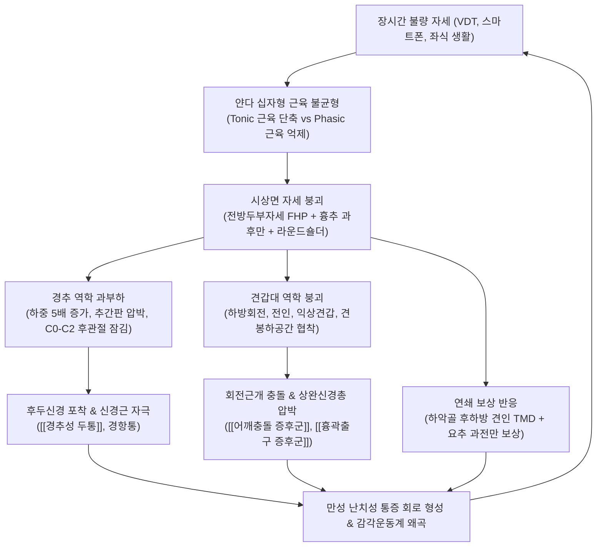

# 🩺 [[상부교차 증후군]] (Upper Crossed Syndrome / 얀다의 상부교차증후군, M53.8 / M62.8)

> **핵심 3줄 요약 (Key Summary)**:
> - 📍 병소 부위 & 해부·병태생리: 체코의 신경학자 블라디미르 얀다(Vladimir Janda)가 정립한 병태로, 두경부와 견갑대를 지지하는 강장성(Tonic) 단축 근육군([[상부승모근]], [[견갑거근]], [[후두하근]], [[대흉근]], [[소흉근]], [[흉쇄유돌근]])과 위상성(Phasic) 억제 근육군([[경장근]], [[두장근]], [[하부승모근]], [[전거근]], [[능형근]]) 간의 시상면 상 X자형 신경근육 불균형 및 만성 자세 변형 증후군.
> - 🚩 전형적 임상 양상 & 3대 징후: [[전방두부자세]](거북목, Forward Head Posture), 흉추 과후만 및 라운드 숄더(Round shoulder), 견갑골 익상(Winging) 및 하방회전. 이로 인해 유발되는 만성 후두부 방사통([[경추성 두통]]), 경추 추간판 압박력 폭증, [[흉곽출구 증후군]], [[어깨충돌 증후군]], [[턱관절 장애]](TMD).
> - 🛠️ 핵심 감별 검사 & 한·양방 다각적 치료 전략: [[두개경추 굴곡 검사]](CCFT), 벽 밀착 자세 평가, 전거근 도수근력검사(MMT)로 진단. 치료는 단축근 이완 선행(소흉근·후두하근 침·약침·도침·근막이완) 후 심부굴곡근·하부승모근 강화(Chin-in, Y-to-W 운동, 벽 견갑골 슬라이드) 및 원격재활(Telerehabilitation) 결합, C7-T1 및 흉추 신전 추나와 [[갈근탕]], [[회수산]], [[서경탕]] 변증 투약.
> - <font color="#fa7e7e">⚠️ 응급 의뢰 레드플래그 & 악화 요인: 수부 세밀 동작 장애 및 보행 실조를 동반한 경추 척수증(Cervical Myelopathy), 상지 맥박 소실 및 신경마비를 동반한 급성 흉곽출구 증후군 혈관 포착. 단순 거북목 교정을 위해 허리만 뒤로 젖히면 요추 과전만으로 파급되는 운동 연쇄(Kinetic chain) 보상 오류 주의.</font>

---

## 📌 목차
1. [질환 개요 & 해부학적 병태생리](#1-질환-개요--해부학적-병태생리)
2. [병태생리 메커니즘 & 생체역학적 악순환 네트워크](#2-병태생리-메커니즘--생체역학적-악순환-네트워크)
3. [임상 증상 & 이학적 검사(Physical Exam) 알고리즘](#3-임상-증상--이학적-검사physical-exam-알고리즘)
4. [감별 진단 매트릭스 (Differential Diagnosis)](#4-감별-진단-매트릭스-differential-diagnosis)
5. [한의 통합 치료 프로토콜 (침·약침·추나·한약)](#5-한의-통합-치료-프로토콜-침약침추나한약)
6. [양방 치료 & 병용·의뢰 기준 (Conventional Treatment & Referral)](#6-양방-치료--병용의뢰-기준-conventional-treatment--referral)
7. [재활 운동 & 생활습관 티칭 가이드](#7-재활-운동--생활습관-티칭-가이드)
8. [💡 사용자 진료실 핵심 필기 & 임상 노하우 (Melt-In 잔여 심화 집약)](#8--사용자-진료실-핵심-필기--임상-노하우-melt-in-잔여-심화-집약)
9. [출처 및 학술 참고 문헌 (References)](#9-출처-및-학술-참고-문헌-references)

---

## 1. 질환 개요 & 해부학적 병태생리

### 1) 질환의 정의 및 기능적 병리학적 배경
[[상부교차 증후군]](Upper Crossed Syndrome, UCS)은 체코의 신경학자이자 재활의학의 선구자인 블라디미르 얀다(Vladimir Janda)가 정립한 대표적인 만성 근골격계 기능부전(Neuromusculoskeletal dysfunction) 증후군이다. 장시간의 데스크워크, 컴퓨터 모니터 및 스마트폰 과사용, 고정된 불량 자세(Slouched sitting)는 경추부와 견갑대(Shoulder girdle)를 둘러싼 근육군의 생체역학적 불균형을 촉발한다. 

이 병태는 시상면(Sagittal plane) 상에서 특정 근육군들이 대각선 십자(X자) 형태로 서로 짝을 지어 한쪽 대각선은 병적으로 단축·과긴장(Facilitated / Hypertonic)되고, 다른 쪽 대각선은 상호 억제(Reciprocal inhibition)에 의해 병적으로 신장·약화(Inhibited / Weakened)되는 고착화된 신경근육성 기능장애를 나타낸다.

### 2) 강장성 근육(Tonic muscles)과 위상성 근육(Phasic muscles)의 생리학적 대립
얀다의 신경생리학적 관찰에 따르면, 인체의 골격근은 만성 스트레스, 통증 및 과부하 자극에 노출되었을 때 반응하는 신경학적 반응 양상에 따라 크게 두 가지 군으로 분화된다:

1. **자세유지근 / 강장성 근육군 (Tonic / Postural Muscles)**:
   - 계통발생학적으로 오래된 근육들로, 지속적인 중력 대항(Anti-gravity) 및 자세 유지 기능을 담당한다.
   - 주로 Type I (지근, Slow-twitch) 근섬유가 우세하게 분포하며, 만성적인 기계적 자극이나 심리적 긴장 상태에서 **과활성화(Facilitation), 과긴장(Hypertonicity), 단축(Shortening), 근막 섬유화(Myofascial fibrosis)**를 겪는 병리적 경향을 띤다.
   - **상부교차 증후군의 단축 근육군**:
     - 후상방: [[후두하근]](대후두직근, 소후두직근, 상두사근, 하두사근), [[상부승모근]], [[견갑거근]], [[두판상근]], [[경판상근]].
     - 전하방: [[대흉근]](쇄골부 및 흉늑부), [[소흉근]], [[흉쇄유돌근]], [[사각근]](전사각근, 중사각근), [[견갑하근]].

2. **동적운동근 / 위상성 근육군 (Phasic / Dynamic Muscles)**:
   - 계통발생학적으로 후기에 발달한 근육군으로, 관절의 정밀한 동적 움직임과 미세 궤적 조절(Fine motor control)을 담당한다.
   - 주로 Type II (속근, Fast-twitch) 근섬유가 우세하며, 대립하는 길항근의 지속적인 과긴장으로부터 유입되는 구심성 신호에 의해 **상호 억제(Inhibition), 근력 약화(Weakness), 구조적 신장(Lengthening), 불사용성 위축(Disuse atrophy)**에 취약하다.
   - **상부교차 증후군의 억제 근육군**:
     - 전상방: [[경추심부굴곡근]](Deep Cervical Flexors, DCF)인 [[경장근]](Longus colli), [[두장근]](Longus capitis).
     - 후하방: [[하부승모근]], [[중부승모근]], [[전거근]], [[능형근]].

### 3) 관련 해부학적 구조물
- **골격 및 관절 복합체**:
  - 두개경추 관절(C0-C1 환추후두관절, C1-C2 환축관절): 상부 경추의 병적 과신전이 집중되는 관절.
  - 하부 경추(C4-C7): 머리의 전방 이동으로 전단력(Shearing force)과 굴곡 모멘트가 증폭되는 분절.
  - 경흉추 접합부(C7-T1): 가동성이 큰 경추와 안정적인 흉추가 만나는 이행 분절로 과도한 굴곡 스트레스 집중.
  - 흉추(T1-T12) 및 늑골 복합체: 병적인 후만증(Kyphosis) 고착화 부위.
  - 견갑흉곽관절(Scapulothoracic joint), 견봉쇄골관절(AC joint), 흉쇄관절(SC joint): 견갑대의 삼차원적 위치 결정.
  - 측두하악관절([[턱관절]], TMJ): 하악골의 후하방 변위로 인해 관절원판 충돌이 격발되는 부위.
- **주요 신경 및 혈관 주행로**:
  - [[대후두신경]](Greater occipital nerve): 제2경추 신경 후지의 내측지로 후두하근군을 관통하며 포착 위험.
  - [[소후두신경]](Lesser occipital nerve): 경신경총 기원으로 흉쇄유돌근 후연을 따라 주행.
  - [[상완신경총]](Brachial plexus) 및 쇄골하 동맥·정맥: 전·중사각근 사이(사각근간극) 및 소흉근 하방(오훼돌기 하간극)을 통과하며 포착 위험 노출.
  - 장흉신경(Long thoracic nerve): 전거근 지배, 견갑골 하방회전 시 신장성 신경병증 위험.
  - 견갑배신경(Dorsal scapular nerve): 능형근 및 견갑거근 지배.

---

## 2. 병태생리 메커니즘 & 생체역학적 악순환 네트워크

```
+-----------------------------------------------------------------------------------------+
|                  상부교차 증후군 (Upper Crossed Syndrome) 신경근육 교차 메커니즘        |
+-----------------------------------------------------------------------------------------+
       [전상방: 심부 경추 굴곡근 억제]                [후상방: 후두하근·상부승모근 단축]
       - 경장근(Longus colli)                         - 대·소후두직근, 상·하두사근
       - 두장근(Longus capitis)                       - 상부승모근, 견갑거근, 두판상근
                     \                                      /
                      \                                    /
                       \      얀다(Janda) X자 교차        /
                        \                                /
                         \                              /
                          \                            /
                           \                          /
                            \                        /
                             \                      /
                              \                    /
                               \                  /
       [전하방: 대흉근·소흉근 단축]                   [후하방: 하부승모근·전거근 억제]
       - 대흉근 쇄골부/흉늑부                         - 중·하부승모근(Middle/Lower trapezius)
       - 소흉근(Pectoralis minor)                     - 전거근(Serratus anterior), 능형근
+-----------------------------------------------------------------------------------------+
                                           │
                                           ▼ [연쇄적 생체역학적 붕괴]
     ┌─────────────────────────────────────┼─────────────────────────────────────┐
     ▼                                     ▼                                     ▼
[두경부 & 경추 관절]               [견갑골 & 견관절]                     [흉곽 & 악관절 & 요골반]
- 경추 0도 대비 60도 굴곡 시       - 견갑골 상방회전 포스커플 와해       - 흉곽 용적 감소 & 호흡 보조근 과부하
  추간판 하중 5kg -> 27kg 폭증     - 소흉근 단축 -> 견갑골 하방회전·전인 - 설골하근군 긴장 -> 하악골 후하방 견인
- C0-C2 후관절 압박 & 대후두신경   - 견봉하 공간 협착 -> 어깨충돌증후군  - 흉추 후만 보상 -> 요추 과전만 유발
  포착 -> 경추성 두통 발생           회전근개 건염 및 점액낭염            (하부교차 증후군과의 연쇄 결합)
```



### 1) 셰링턴의 상호 억제 법칙(Sherrington's Law)과 신경 조절 장애
척수 반사 수준에서 특정 관절을 지배하는 주동근이 지속적으로 흥분하거나 과긴장 상태에 놓이면, 척수 개재신경원(Ia inhibitory interneuron)을 매개로 길항근의 알파 운동신경원(Alpha motor neuron) 발화가 억제된다. 
- 전방 데스크워크 자세에서는 **전하방의 [[대흉근]]과 [[소흉근]]이 지속 단축**되면서 길항 작용을 하는 **후하방의 [[하부승모근]]과 [[전거근]]으로 향하는 신경 활성 신호가 차단**되어 근력 약화와 이완성 신장이 유발된다.
- 동시에 머리가 전방으로 돌출되면서 시야를 전방으로 향하게 하기 위해 **후상방의 [[후두하근]]과 [[상부승모근]]이 지속적으로 과신전성 등척 수축**을 일으킨다. 이로 인해 대립하는 **전상방의 [[경장근]]과 [[두장근]](심부 경추 굴곡근)이 상호 억제**되어 척추 전방 안정자로서의 기능을 완전히 상실한다.
- 이 과정이 만성화되면 중추신경계의 감각운동계(Sensorimotor system)는 비정상적인 자세를 중립 상태로 오인식하는 고유수용성 감각 왜곡(Proprioceptive distortion)을 고착화한다.

### 2) 경추 생체역학적 부하 증폭: 한즈라지(Hansraj) 유한요소 모델
정상 성인의 직립 자세에서 중립 위치(0도 기울임)일 때 경추가 감당하는 두부 무게는 약 4.5~5.4kg(10~12 lbs)이다. 그러나 전방두부자세([[전방두부자세]], FHP)로 인해 머리가 앞으로 기울어질수록, 중력 중심선(Line of gravity)과 경추 회전축 사이의 모멘트 암(Moment arm)이 길어지면서 경추 후방 연부조직과 척추체에 걸리는 유효 하중은 지수함수적으로 폭증한다 (Hansraj et al., 2014):
- **15도 굴곡**: 약 12kg (27 lbs)
- **30도 굴곡**: 약 18kg (40 lbs)
- **45도 굴곡**: 약 22kg (49 lbs)
- **60도 굴곡**: 약 27kg (60 lbs) — **체중의 절반에 달하는 부하가 C5-C6-C7 분절에 집중**됨.
이러한 만성 과부하는 경추 추간판의 조기 퇴행성 변성을 촉발하여 [[경추 추간판 탈출증]]의 위험을 높이고, C0-C1-C2 후관절낭의 염증과 골극 형성을 가속화한다.

### 3) 견갑골 3차원 운동학 붕괴: 상방회전 포스 커플 와해
정상적인 견관절 외전 시, 견갑골은 상방회전 포스 커플(Force couple)인 [[상부승모근]], [[하부승모근]], [[전거근]]의 완벽한 협응 수축을 통해 관절와(Glenoid fossa)를 상방 60도 회전시켜 상완골두와의 충돌을 피한다.
- 상부교차 증후군에서는 [[전거근]]과 [[하부승모근]]이 마비되듯 약화되고, 단축된 [[소흉근]]과 [[견갑거근]], [[능형근]]이 견갑골을 아래로 잡아당겨 **견갑골 하방회전 증후군(Scapular Downward Rotation Syndrome)**을 초래한다.
- 또한 견갑골의 내측연이 흉벽에서 들리는 **익상 견갑(Scapular winging)**과 전방경사(Anterior tilt), 전인(Protraction)이 복합적으로 발생한다.
- 그 결과 견봉하 공간(Subacromial space)의 유효 높이가 좁아져 극상근 건(Supraspinatus tendon)과 견봉하 점액낭이 오훼견봉인대(Coracoacromial ligament) 하부에 끼이는 [[어깨충돌 증후군]] 및 2차성 [[회전근개 건염]]이 필연적으로 발생한다.

### 4) 악관절(TMJ)과 전신 운동 연쇄(Kinetic Chain) 보상 메커니즘
- **하악골 후하방 견인과 턱관절 장애(TMD)**:
  - 머리가 전방으로 2.5cm 돌출할 때마다 전방 경부 근막과 설골하근군(흉골설골근, 견갑설골근 등)은 하방으로 강한 장력을 형성한다.
  - 이 인장력은 설골상근군을 거쳐 하악골을 후하방(Posterior-inferior)으로 강하게 잡아당긴다.
  - 하악골이 후방 변위되면 악관절낭 후방의 혈관과 신경이 풍부한 양후판 조직(Bilaminar zone / Retrodiscal pad)이 하악과두에 의해 지속적으로 압박·압착된다.
  - 관절원판(Articular disc)은 전내측으로 전위되어 입을 벌릴 때 딱딱거리는 클릭음(Clicking sound), 개구 장애, 저작 시 극심한 안면 통증을 유발하는 [[턱관절 장애]](TMD)가 나타난다.
- **경흉요추-골반 보상 연쇄 (Pelvic-Spinal Compensation Chain)**:
  - 인체는 시각적 수평선(Visual horizontal gaze)을 확보하기 위해 전방으로 굴곡된 상부 흉추를 보상하고자 상부 경추(C0-C2)를 과도하게 신전시킨다.
  - 동시에 전방으로 쏠린 체중심을 지지 기저면(Base of support) 내로 유지하기 위해 골반을 전방으로 경사(Anterior pelvic tilt)시키고 요추 전만을 병적으로 증가시키는 보상 작용을 취한다.
  - 결과적으로 상부교차 증후군은 장요근과 대퇴직근이 굳고 둔근과 복근이 약화되는 [[하부교차 증후군]](Lower Crossed Syndrome)과 맞물려 척추 전반의 이중 S자 과만곡(Hyper-lordosis / Hyper-kyphosis)으로 악화된다.

---

## 3. 임상 증상 & 이학적 검사(Physical Exam) 알고리즘

### 1) 4대 핵심 임상 증상군
1. **두경부 및 후두 신경통 증상군**:
   - 만성적인 뒷목 뻐근함과 항강(項强), 후두골 하연의 묵직한 통증.
   - 단축된 [[후두하근]] 사이에 [[대후두신경]]이 포착되어 후두부에서 정수리를 거쳐 안와 후방(Retro-orbital)까지 뻗치는 [[경추성 두통]](Cervicogenic headache).
   - 경추 회전 및 신전 가동범위(ROM)의 현저한 제한.
2. **견갑대 및 상지 방사통 증상군**:
   - 무거운 물건을 얹어놓은 듯한 [[상부승모근]]과 [[견갑거근]]의 압통 및 피로감.
   - 견갑골 내측연([[능형근]])을 따라 지속되는 작열통 또는 칼로 쑤시는 듯한 견배통.
   - 단축된 [[소흉근]]과 [[사각근]] 틈새로 상완신경총이 압박되어 손가락 4, 5지 저림과 상지 냉감을 호소하는 [[흉곽출구 증후군]](TOS).
   - 팔을 머리 위로 외전할 때 견관절 전외측의 찌르는 듯한 통증([[어깨충돌 증후군]]).
3. **흉곽 및 호흡기능 이상 증상군**:
   - 흉추 후만과 대·소흉근의 단축으로 인한 늑골 팽창 제한.
   - 횡격막의 정상적인 복식 호흡이 제한되고, 상부 흉식 호흡(Chest breathing)에 의존하게 됨.
   - 이로 인해 호흡 보조근인 [[사각근]]과 [[흉쇄유돌근]]이 과로하여 목 어깨 긴장이 더욱 악화되고, 만성 산소 공급 저하에 따른 피로감과 가슴 답답함 호소.
4. **악관절 및 두개안면 증상군**:
   - 저작 시 턱관절의 통증 및 염발음, 개구 제한.
   - 측두근과 교근의 2차성 근막 연축, 만성 이갈이(Bruxism), 이명 및 어지럼증.

### 2) 필수 이학적 검사법 (Physical Examination)

```
[상부교차 증후군 진료실 이학적 검사 알고리즘]

               환자 내원 (만성 목·어깨 통증, 두통, 라운드숄더)
                                     │
                     ┌───────────────┴───────────────┐
                     ▼                               ▼
       [1단계: 시각적 체형 평가]         [2단계: 신경학적 위험 신호 배제]
       - 전방두부자세(FHP) 확인           - Hoffmann test, Spurling test
       - 라운드숄더 & 흉추 후만           - 수부 미세운동 장애 및 감각 결손
       - 벽 밀착 자세 평가(OWD)           - 양성 시 -> 경추 척수증/디스크 정밀검사
                     │                               │
                     └───────────────┬───────────────┘
                                     │ 음성
                                     ▼
                     [3단계: 근육 기능부전 정밀 평가]
       ┌─────────────────────────────┼─────────────────────────────┐
       ▼                             ▼                             ▼
 [경추심부굴곡근 평가]       [견갑 안정화근 평가]         [단축 근육군 길이 평가]
 - 두개경추굴곡검사(CCFT)     - 전거근 도수근력검사(MMT)   - 소흉근 길이 검사
 - 경추굴곡지구력검사(NFET)   - 벽 푸시업 익상견갑 관찰    - 상부승모/견갑거근 유연성
       │                             │                             │
       └─────────────────────────────┼─────────────────────────────┘
                                     ▼
                      [상부교차 증후군 기능적 진단 확정]
```

1. **두개경추 굴곡 검사 (Craniocervical Flexion Test, CCFT)**:
   - **검사 목적**: 표재성 목 근육의 보상 작용 없이 순수한 [[경장근]]과 [[두장근]](심부 굴곡근)의 미세 활성화 능력을 정량 평가.
   - **검사 방법**: 환자를 앙와위로 눕히고 경추 만곡 후방에 압력 바이오피드백 장치(Pressure Biofeedback Unit, PBU)를 위치시킨 후 기본 압력 20mmHg를 설정. 턱을 가볍게 끄덕이는 동작(Nodding motion)으로 22, 24, 26, 28, 30mmHg까지 단계별로 10초간 유지하도록 지시.
   - **양성 소견**: 26mmHg 이상을 유지하지 못하거나, 심부 근육 대신 겉근육인 [[흉쇄유돌근]]이나 [[사각근]]이 과도하게 융기·수축하며 턱을 당기면 심부 경추 굴곡근의 심각한 기능 장애로 판정.
2. **경추 굴곡 지구력 검사 (Neck Flexor Endurance Test, NFET)**:
   - 환자가 앙와위에서 턱을 당긴 채 침대에서 머리를 2.5cm 들어 올려 유지하는 시간을 초시계로 측정.
   - 정상 기준: 성인 남성 평균 38~39초, 성인 여성 평균 29~30초.
   - 상부교차 증후군 환자: 보통 15초 이내에 후두하근과 흉쇄유돌근의 피로로 턱이 들리며 머리가 떨어진다.
3. **벽 밀착 자세 평가 (Wall Posture Test & Occiput-to-Wall Distance, OWD)**:
   - 뒤꿈치, 둔부, 견갑골을 벽에 밀착하고 섰을 때 후두부가 벽에 편안히 닿는지 관찰.
   - 후두부가 벽에 닿지 않거나(OWD > 0cm), 억지로 닿게 할 때 턱이 위로 들리면 전방두부자세 확진.
4. **전거근 도수근력검사 (Serratus Anterior MMT & Wall Push-up Test)**:
   - 환자에게 벽을 짚고 푸시업 동작을 수행하게 하여 견갑골 내측연이 흉벽 뒤로 날개처럼 솟아오르는 익상 견갑(Scapular winging) 유무 확인.
5. **소흉근 길이 검사 (Pectoralis Minor Muscle Length Test)**:
   - 앙와위에서 양팔을 편안히 내렸을 때, 견봉 후면(Posterior border of acromion)과 검사대 바닥 사이의 수직 거리를 측정.
   - 2.5cm(1인치)를 초과하여 견봉이 바닥에서 높게 들려 있으면 소흉근의 병적 단축으로 확정.
6. **신경 포착 유발 검사**:
   - [[루스 검사]](Roos Test / EAST): 양팔을 90도 외전·외회전한 상태에서 3분간 주먹을 쥐었다 폈다 반복하여 소흉근 및 사각근 틈새의 신경혈관 압박 확인.
   - [[스펄링 검사]](Spurling Test): 경추 후관절 및 추간공 협착 감별.

---

## 4. 감별 진단 매트릭스 (Differential Diagnosis)

| 감별 질환 | 호발 병소 및 병태생리 | 주소증 차이점 | 특이적 이학적 및 영상 검사 소견 |
| :--- | :--- | :--- | :--- |
| **[[상부교차 증후군]] (UCS)**<br/>(본 질환) | 두경부-견갑대 강장근 단축 & 위상근 약화에 의한 자세 증후군 | 만성 목 어깨 결림, 후두부 묵직함, 라운드숄더, 자세 피로 | CCFT 양성, 익상 견갑, OWD 증가, 명확한 신경학적 결손 없음 |
| **[[경추 추간판 탈출증]]**<br/>(Cervical HIVD) | 경추 추간판 수핵 탈출로 인한 신경근(C5, C6, C7) 압박 | 상지 피부분절을 따르는 날카로운 방사통, 저림, 근력 저하 | [[스펄링 검사]] 양성, 건반사 저하, MRI상 수핵 탈출 확인 |
| **[[경추 척수증]]**<br/>(Cervical Myelopathy) | 경추 척수관 협착으로 인한 척수 실질(Spinal cord) 압박 | 단추 채우기 등 수부 미세동작 불능, 하지 강직성 보행 실조 | Hoffmann 징후 양성, 바빈스키 반사 양성, 족간대(Clonus) 출현 |
| **[[흉곽출구 증후군]]**<br/>(Thoracic Outlet Syndrome, TOS) | 사각근 삼각, 늑쇄간극, 소흉근 하강에서 상완신경총·혈관 포착 | 팔 전체의 저림, 4·5지 이상감각, 상지 냉감 및 청색증 | [[루스 검사]], [[애드슨 검사]], [[에덴 검사]] 양성, 맥박 소실 |
| **[[경추 후관절 증후군]]**<br/>(Cervical Facet Syndrome) | 상부 및 중하부 경추 후관절 활막염 및 관절낭 비후 | 경추 신전 및 환측 회전 시 극심한 국소 통증, 견갑골 연관통 | 경추 신전-회전 압박 검사 양성, 방사통이 팔꿈치를 넘지 않음 |
| **[[섬유근육통]]**<br/>(Fibromyalgia) | 중추신경계 감작(Central sensitization)에 의한 전신성 통증 | 전신 18개 압통점 중 11개 이상, 만성 수면장애, 우울, 전신 피로 | 관절 가동역 제한 없음, 신경학적 정상, 혈액학적 염증 지표 음성 |

---

## 5. 한의 통합 치료 프로토콜 (침·약침·추나·한약)

### 1) 변증 분류
- **담어조락(痰瘀阻絡)**: 오랜 좌식 생활과 불량한 자세로 기혈이 울체되어 경배부에 담음과 어혈이 맺힌 병태. 목과 어깨가 돌처럼 딱딱하게 굳고, 찌르는 듯한 통증과 후두부 팽만성 두통 호소.
- **기혈양허(氣血兩虛)**: 체간 심부 지지근육이 영양을 공급받지 못해 위축되고 무력해진 병태. 조금만 앉아 있어도 머리를 가누기 힘들고 피로가 극심하며, 자세를 바르게 유지하려 해도 힘이 빠져 붕괴됨.
- **간신휴손(肝腎虧損)**: 만성적인 척추 역학 파탄으로 경추 디스크와 인대가 조기 퇴행성 변화를 겪고 관절 불안정성이 만성화된 병태.

### 2) 침구 및 전침 치료 SOP
상부교차 증후군의 자침 원칙은 **"단축된 강장근은 억제 자침(Spasm release), 억제된 위상근은 촉진 전침(Motor activation)"**의 이원화 전략을 엄격히 적용한다.
- **단축 근육군 이완 자침 (억제 기법)**:
  - 풍지(GB20), 천주(BL10), 완골(GB12): [[후두하근]] 및 상부 [[두반극근]] 건부착부 직자 15~25mm, 제삽염전으로 근막 연축 유발 후 염전 유침.
  - 견정(GB21), 천료(TE15): [[상부승모근]] 및 [[견갑거근]] 경결점 자침.
  - 중부(LU1): 오훼돌기 내하방 1촌 부위로, 단축된 [[소흉근]] 정착부를 향해 외측으로 사자(기흉 방지를 위해 절대 늑간 방향 심자 금지).
  - 결분(ST12), 천정(LI17): [[사각근]] 긴장 완화.
- **약화 근육군 활성화 전침 (촉진 기법)**:
  - 인영(ST9) 외측 심부 투사: [[경장근]] 부착부를 목표로 완만하게 자입.
  - 견외수(SI14), 견중수(SI15), 비수(BL20), 고황(BL43): [[하부승모근]], [[전거근]], [[능형근]] 부위 혈위에 자침 후 저주파(2Hz, 강도: 환자가 견딜 수 있는 최대 편안한 근수축 수준) 전침을 15분간 통전하여 운동신경원의 활성도를 재교육.

### 3) 약침 및 도침 치료
- **약침 요법 (Pharmacopuncture)**:
  - **신바로약침 / 자하거약침**: 후두골 능선 [[후두하근]] 부착부와 견갑골 상각 [[견갑거근]] 부착부의 만성 인대-골막 연접부(Enthesis) 염증을 해소하고 조직 재생을 촉진하기 위해 포인트당 0.2~0.5cc 주입.
  - **중성어혈약침**: 견갑골 내측연 및 소흉근 건막 유착 부위에 주입하여 미세 혈류를 개선하고 근막 유착 박리.
  - **황련해독탕 약침**: 급성 근막 연축과 국소 발열감을 동반한 승모근 과긴장에 적용.
- **도침 치료 (Acupotomy)**:
  - 만성 환자에서 후두하부 건막과 견갑골 상각 부착부가 단단한 섬유성 결절로 고착된 경우, 0.5×50mm 소침도를 사용하여 골막면과 평행하게 미세 절개·박리(Enthesopathy release)를 시행함으로써 관절 가동성을 즉각 복원.

### 4) 추나요법 (Chuna Manual Therapy)
- **후두하근 이완술 (Suboccipital Release, JS 수기)**:
  - 환자를 앙와위로 눕히고, 술자의 제2~4수지 장측을 후두골 하연(C0-C1 분절)에 접촉.
  - 머리의 무게를 이용하여 상방으로 부드럽게 미세 축성 견인력을 2~3분간 유지하여 후두하 삼각근막을 지속 이완.
- **경흉추 접합부(C7-T1) 및 상부 흉추 신전 교정술 (HVLA Thrust)**:
  - 흉추 후만으로 인해 굴곡 변위된 C7-T1 분절에 환자 호흡에 맞추어 순간적인 신전 추력을 가하여 흉강 용적과 경추 신전 가동역을 확보.
- **견갑골 수동 가동술 (Scapular Mobilization)**:
  - 측와위에서 술자가 환자의 견갑골 상각과 하각을 감싸 쥐고, 흉벽에 유착된 견갑골을 들어 올리며 상방회전, 후인, 외전 방향으로 수동적 관절 가동 운동을 적용.
- **대흉근·소흉근 근막 가동술 (Pectoralis Myofascial Release)**:
  - 앙와위에서 소흉근 건 주행 방향을 따라 주두(Elbow) 또는 수근부로 압박하며 견관절의 외전·외회전을 수동 유도.

### 5) 한약 처방 (Herbal Medicine)
- **급성 경항강통 및 근경련기**:
  - [[갈근탕]](葛根湯): 갈근의 puerarin 성분이 관상동맥 및 두경부 혈류를 개선하고 경부 기립근의 급성 연축을 신속히 해소.
  - [[회수산]](回首散): 목을 좌우로 돌리기 힘든 급성 사경 및 항강통 치료.
- **견비통 및 라운드숄더 울혈기**:
  - [[서경탕]](舒經湯): 기혈 어체로 인해 어깨 관절이 굳고 팔로 뻗치는 묵직한 결림과 연관통을 다스림.
  - [[반하백출천마탕]](半夏白朮天麻湯): 후두신경 포착에 수반되는 두통, 어지럼증, 오심 등 담음(痰飮) 증상이 두드러질 때 합방.
- **만성 자세 피로 및 척추 퇴행기**:
  - [[보중익기탕]](補中益氣湯): 기허(氣虛)로 인해 상체를 꼿꼿이 세우지 못하고 척추가 무너지는 위상근 무력증에 승양익기(升陽益氣) 작용을 통해 근긴장도를 회복.
  - [[독활기생탕]](獨活寄生湯): 척추 인대의 만성 불안정성과 간신휴손을 다스려 경추 퇴행을 방지.

---

## 6. 양방 치료 & 병용·의뢰 기준 (Conventional Treatment & Referral)

### 1) 약물 치료 (Medication)
- **비스테로이드성 소염진통제 (NSAIDs)**:
  - [[세레콕시브]](Celecoxib 200mg qd), [[록소프로펜]](Loxoprofen 60mg tid). 급성 근막 통증 및 관절낭 염증 조절 목적.
- **중추성 골격근이완제 (Muscle Relaxants)**:
  - [[에페리손]](Eperisone 50mg tid), 티자니딘(Tizanidine 1-2mg tid). 척수 반사 수준에서 상부승모근 및 견갑거근의 과도한 근방추 발화를 억제.
- **진통보조제 및 위장보호제**:
  - 만성 신경병증성 두통 동반 시 가바펜틴(Gabapentin) 또는 프레가발린(Pregabalin) 병용, 위염 예방을 위한 PPI 제제 처방.

### 2) 비약물적 주사 및 중재 시술
- **발통점 주사 (Trigger Point Injection, TPI)**:
  - 상부승모근, 견갑거근, 두판상근, 소흉근 내의 통증유발점에 0.5% 리도카인을 주입하여 통증 유발점 파괴 및 근막 연축 차단.
- **보툴리눔 독소 (Botulinum Toxin / Botox) 주입**:
  - 보존적 치료에 저항하는 난치성 승모근 비후 및 연축 환자에게 신경근 접합부 아세틸콜린 분비를 3~6개월간 화학적으로 차단.
- **경추 후관절 차단술 (Cervical Medial Branch Block, MBB)**:
  - 만성적인 C2-C3, C3-C4 후관절 기원 통증에 대해 C-arm 투시 하에 관절지 신경을 차단.

### 3) 한의 병용 판단 및 약물 상호작용
- **병용 가능 및 시너지**:
  - 한의 침·약침·추나 치료와 양방 NSAIDs의 병용은 급성 통증기 조기 일상 복귀에 효과적이다. 침구 치료가 근막 이완을 달성하면 양방 근이완제 복용량을 조기 감량할 수 있다.
- **주의 및 금기**:
  - 잦은 TPI나 스테로이드 주사는 건-골 연접부의 국소 괴사 및 인대 약화를 유발하므로 3회 이상 연속 주사를 지양한다.
  - 항응고제 복용 환자의 경우 깊은 부위의 도침 및 침 치료 시 혈종 형성에 주의한다.

### 4) 양방·전문과 의뢰 기준 (Referral Criteria)
- **응급 의뢰 트리거 (Red Flags)**:
  - 경추 척수증 의심: 단추를 채우거나 젓가락질을 하기 힘든 수부 기능 장애, 하지 강직성 보행 실조, 대소변 장애 출현 시 즉시 신경외과로 전원.
  - 급성 흉곽출구 증후군 혈관 폐색: 상지 맥박 소실, 심각한 상지 청색증 및 급성 부종 동반 시 혈관외과 의뢰.
  - 원인 불명의 급격한 체중 감소, 야간 통증, 암 과거력이 있는 환자의 경추통: 척추 종양 배제 위해 정형외과/종양내과 정밀 영상 검사(MRI) 의뢰.

---

## 7. 재활 운동 & 생활습관 티칭 가이드

상부교차 증후군의 운동 재활은 얀다의 신경근육학적 원칙에 따라 반드시 **[1단계 억제(Inhibit) -> 2단계 신장(Lengthen) -> 3단계 강화(Activate) -> 4단계 통합(Integrate)]**의 순서를 엄격히 준수해야 한다.

### 1) 4단계 교정 운동 프로토콜
1. **1단계: 단축근 자가근막이완 (Self-Myofascial Release, SMR)**:
   - 마사지볼을 벽과 가슴 사이에 두고 [[소흉근]](쇄골 외측 하방)을 30~60초간 부드럽게 롤링.
   - 땅콩볼을 후두골 하연에 대고 누워 고개를 좌우로 천천히 회전하며 [[후두하근]] 압박 이완.
2. **2단계: 단축근 정적·동적 스트레칭 (Stretching)**:
   - **코너 체스트 스트레칭 (Doorway/Corner Stretch)**: 벽 모서리에 양 전완을 직각으로 거치하고 체중을 전방으로 이동시켜 대·소흉근을 20~30초간 신장 (허리를 꺾지 않도록 복부 긴장 유지).
   - **견갑거근 스트레칭**: 의자에 앉아 한 손으로 의자 모서리를 잡고, 고개를 반대측 겨드랑이 방향으로 45도 회전 후 가볍게 전하방으로 당김.
3. **3단계: 억제근 선택적 재활성화 (Activation)**:
   - **턱 당기기 (Chin-tuck / Chin-in 운동)**: 척추를 세운 상태에서 손가락으로 턱을 수평 후방으로 가볍게 밀어 넣으며 목 뒤쪽이 길어지는 느낌으로 5~10초간 유지 (고개를 숙이는 것이 아니라 귀와 어깨 중심선이 일치하도록 수평 이동). [[경장근]]과 [[두장근]] 활성화.
   - **벽 밀착 견갑골 슬라이드 (Wall Angels / Scapular Slide)**: 등과 후두부, 팔꿈치, 손등을 벽에 밀착하고 'W'자 모양에서 천천히 'Y'자 모양으로 올렸다 내리는 동작 반복. [[하부승모근]] 및 [[전거근]] 강화.
   - **Y-to-W 레이즈**: 복와위에서 엄지손가락을 하늘로 향하게 하고 견갑골을 모으며 Y자 및 W자 형태로 상체를 살짝 들어 올려 5초간 유지.
4. **4단계: 전신 신경근 협응 통합 (Integration)**:
   - 네발기기 자세(Quadruped)에서 척추 중립을 유지하며 턱 당김과 견갑골 밀어내기(Protraction)를 결합하여 코어와 견갑대를 통합적으로 훈련.

### 2) 최신 원격재활(Telerehabilitation) 임상 가이드
최근 무작위 대조군 연구 프로토콜에 따르면 (Verma et al., 2026), 스마트폰 애플리케이션 및 화상 모니터링을 결합한 원격재활(Telerehabilitation)은 다양한 연령대의 상부교차 증후군 환자에서 병원 방문 빈도를 줄이면서도 환자의 운동 순응도(Compliance)를 유의미하게 향상시키는 전략으로 보고되었다:
- 실시간 피드백을 통한 CCFT 및 친인 동작의 정확도 보정.
- 환자별 일상 데스크 환경 점검 및 자세 알림 타이머 세팅.

### 3) 운동 치료의 한계와 복합 중재의 필요성
최신 체계적 문헌고찰 및 메타분석 연구에 따르면 (Roghani et al., 2026), 교정 운동(Corrective exercises) 단독 요법은 두경추각(Craniovertebral angle, CVA) 및 둥근 어깨 각도 등 자세 지표를 강력하게 개선하지만, **환자가 실제로 체감하는 통증 지수나 일상 기능적 혜택(VAS, NDI)에서는 일관된 임상적 이점을 제공하지 못하는 한계**가 입증되었다:
- 따라서 자세 교정 운동에만 의존하지 말고, 침구 치료, 관절 가동 추나요법, 근막 유착 박리 등 수기·침습적 의학적 중재를 반드시 복합 적용하여 신경학적 통증 회로를 먼저 차단하는 것이 필수적이다.

### 4) 인체공학적(Ergonomic) 작업 환경 세팅
- **모니터 높이**: 모니터 상단 1/3 지점이 눈높이와 수평을 이루도록 거치대 설치.
- **키보드와 마우스**: 팔꿈치 각도가 90~100도를 유지하며 어깨가 으쓱 올라가지 않도록 책상 높이 조정.
- **포모도로 원칙**: 매 45~50분 작업 후 반드시 2~3분간 자리에서 일어나 가슴을 펴고 흉추 신전 스트레칭을 시행.

---

## 8. 💡 사용자 진료실 핵심 필기 & 임상 노하우 (Melt-In 잔여 심화 집약)

### 1) 진료실 핵심 원칙: "약한 근육을 먼저 강화하려 하지 마라"
- 상부교차 증후군 환자가 내원하면 대부분 유튜브나 헬스장에서 "등 근육이 약하니 턱걸이나 렛풀다운, 로우 운동을 열심히 하라"는 지도를 받고 옵니다.
- 그러나 **대흉근과 상부승모근이 강하게 굳어 있는 상태에서 등 운동을 무리하게 시키면, 뇌는 상호 억제(Reciprocal inhibition) 메커니즘 때문에 심부 하부승모근을 쓰지 못하고 겉의 상부승모근과 견갑거근만 더욱 쥐어짜게 됩니다**.
- 결국 운동 후 목 통증과 두통만 더 악화되어 내원하는 악순환에 빠집니다.
- **치료의 제1원칙은 반드시 단축된 근육([[소흉근]], [[후두하근]], [[견갑거근]])을 침, 약침, 도침, 근막이완술로 완벽히 풀어놓은(Release) 뒤에 비로소 약화된 근육 강화(Activation)로 넘어가야 한다는 점**입니다.

### 2) "어깨 펴세요"라고만 지도하면 요추 전만만 심해지는 보상 함정
- 환자에게 무턱대고 "허리와 어깨를 쫙 펴고 앉으세요"라고 지도하면, 굳어 있는 흉추는 그대로 둔 채 **배를 앞으로 쑥 내밀며 허리(요추)만 꺾어 요추 전만(Lordosis)을 급격히 증가**시킵니다.
- 흉추 후만은 그대로 방치된 채 요추 후관절 증후군과 척추전방전위증성 요통만 새로 생깁니다.
- 환자에게 설명할 때는 "허리를 뒤로 꺾지 마시고, **명치(흉골 하단)를 대각선 위로 5도만 가볍게 들어 올린다는 느낌을 가지면서 턱을 목구멍 쪽으로 살짝 당기라**"고 티칭해야 흉추 신전과 올바른 친턱이 결합됩니다.

### 3) 턱관절(TMD)과 거북목을 반드시 동시에 치료하라
- 외래에서 "턱에서 딱딱 소리가 나고 턱관절이 아파요"라며 내원하는 환자의 목과 체형을 살펴보면 예외 없이 100% 상부교차 증후군이 동반되어 있습니다.
- 머리가 앞으로 나간 상태에서는 앞목의 설골하근군이 아래턱을 뒤로 강하게 잡아채기 때문에, 턱 주변 교근과 측두근에만 아무리 침을 놓아도 턱관절은 제자리를 찾지 못합니다.
- 턱관절 환자를 진료할 때는 반드시 **소흉근과 후두하근을 풀고 C7-T1 및 상부 경추 정렬을 맞추어 아래턱에 걸린 후하방 인장력을 제거**해주어야 턱관절 교합이 영구적으로 안정됩니다.

### 4) 실전 진료실 문진 체크리스트 & 원장님 손맛 팁
1. **문진 체크리스트**:
   - "아침에 일어났을 때 베개가 불편하고 목 뒤가 항상 묵직한가요?" (후두하근 단축)
   - "장시간 컴퓨터 작업 시 눈 안쪽이 뻐근하거나 관자놀이 쪽으로 두통이 올라오나요?" (대후두신경 포착)
   - "팔을 올릴 때 어깨 앞쪽에서 걸리는 느낌이나 뚝 소리가 나나요?" (견갑 하방회전 & 충돌)
2. **시술 순서 손맛 팁**:
   - 환자를 앙와위로 눕힌 후 가장 먼저 **오훼돌기 하단 중부(LU1) 부근 소흉근을 자침**하여 둥근 어깨의 장력을 먼저 해제합니다.
   - 이어서 후두하근 풍지(GB20)와 천주(BL10)를 사자하여 상부 경추의 압박을 감압합니다.
   - 복와위로 체위를 변경한 뒤 견갑거근 부착부와 하부승모근 화타협척혈 부위에 2Hz 전침을 걸어주면, 단 1회 시술만으로도 환자가 고개를 들 때의 극적인 가벼움을 체감합니다.

---

## 9. 출처 및 학술 참고 문헌 (References)

1. Verma, S., et al. (2026). Effectiveness of Telerehabilitation in Individuals with Upper Crossed Syndrome Across Diverse Age Demographics: Study Protocol for a Randomized Controlled Trial. *Curr Protoc*, 6(1), e70042. [PMID: 42640692](https://pubmed.ncbi.nlm.nih.gov/42640692/)
   - [연구 요약] 다양한 연령대 인구를 대상으로 상부교차 증후군에 대한 원격재활(Telerehabilitation) 중재의 임상적 유효성을 평가하는 무작위 대조 시험 프로토콜로, 디지털 헬스케어 기반 자세 교정 및 신경근 재활의 표준화된 가이드라인을 제시함.

2. Roghani, T., et al. (2026). Corrective exercises strongly improve posture but fail to produce consistent clinical or functional benefits in patients with upper crossed syndrome: a systematic review and meta-analysis of randomized controlled trials. *BMC Sports Sci Med Rehabil*, 18(1), 45. [PMID: 42210327](https://pubmed.ncbi.nlm.nih.gov/42210327/)
   - [연구 요약] 상부교차 증후군 환자 대상 무작위 대조 시험들에 대한 체계적 문헌고찰 및 메타분석으로, 교정 운동이 자세 지표(두경추각 등)를 유의하게 개선하지만 통증 완화나 일상 기능 회복에는 일관된 효과를 나타내지 못함을 입증하여 수기·의학적 복합 치료의 당위성을 규명함.

3. Moore, M. K. (2004). Upper crossed syndrome and its relationship to cervicogenic headache. *J Manipulative Physiol Ther*, 27(6), 414-420. [PMID: 15319765](https://pubmed.ncbi.nlm.nih.gov/15319765/)
   - [연구 요약] 얀다의 상부교차 증후군(UCS)에서 나타나는 근육 불균형과 경추성 두통 발생 간의 인과관계를 체계적으로 분석하고, 도수치료와 자세 교정 운동의 임상적 치료 알고리즘을 정립함.

4. Seidi, F., et al. (2020). Comprehensive corrective exercise program improves alignment, muscle activation and movement pattern of men with upper crossed syndrome: randomized controlled trial. *Sci Rep*, 10(1), 20688. [PMID: 33244045](https://pubmed.ncbi.nlm.nih.gov/33244045/)
   - [연구 요약] 상부교차 증후군 성인을 대상으로 억제-신장-강화-통합 4단계 교정 운동 프로그램을 시행한 무작위 대조군 연구(RCT)로, 두경추각(CVA), 둥근 어깨 각도 및 상·하부 승모근과 전거근의 근활성도가 통계적으로 유의하게 정상화됨을 입증함.

5. Hansraj, K. K. (2014). Assessment of stresses in the cervical spine caused by posture and position of the head. *Surg Technol Int*, 25, 277-279. [PMID: 25393825](https://pubmed.ncbi.nlm.nih.gov/25393825/)
   - [연구 요약] 머리의 전방 기울임 각도(0도~60도)에 따라 경추와 주변 지지 연부조직에 가해지는 유효 하중이 5kg에서 최대 27kg까지 지수함수적으로 증가함을 컴퓨터 유한요소 모델링으로 입증한 고전 연구.