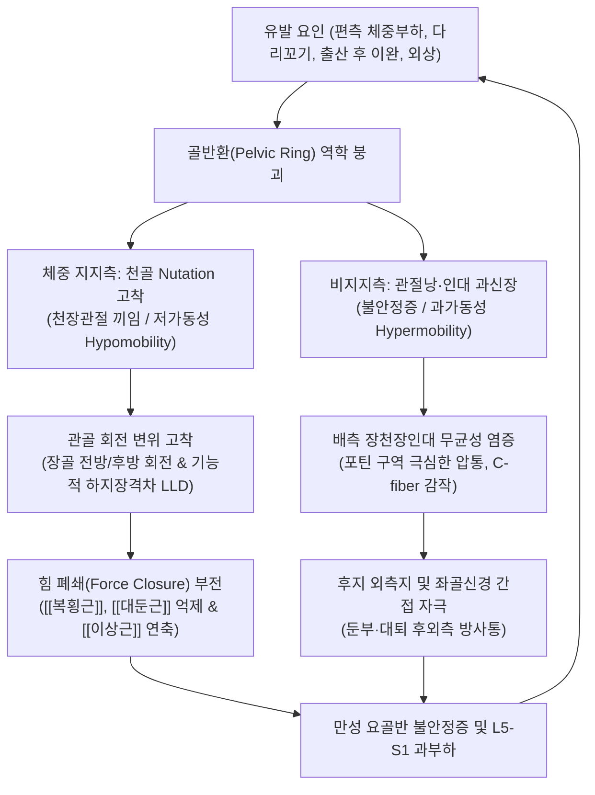

# 🩺 [[천장관절 증후군]] (Sacroiliac Joint Syndrome / SIJ 기능부전, M53.3)

> **핵심 3줄 요약 (Key Summary)**:
> - 📍 병소 부위 & 해부·병태생리: 척추 체중을 하지로 전달하는 [[천골]](Sacrum)과 [[장골]](Ilium) 사이의 활막-섬유 결합 관절인 [[천장관절]](Sacroiliac joint, SIJ)의 인대 염좌, 관절면 부정합(저가동성 끼임 또는 과가동성 불안정증), 천골 비틀림(Sacral torsion)으로 인한 무균성 염증 및 생체역학적 기능부전.
> - 🚩 전형적 임상 양상 & 3대 징후: [[후상장골극]](PSIS) 직하방 1cm 이내의 포틴 구역([[포틴 징후]], Fortin finger test) 국소 압통, 둔부·대퇴 후외측 및 서혜부 연관통, 앉았다 일어설 때·체위 변경 시 격발되는 편측 골반 자통, 기능적 하지 길이 차이(Functional LLD).
> - 🛠️ 핵심 감별 검사 & 한·양방 다각적 치료 전략: [[라스렛 검사 클러스터]](Laslett battery: 패트릭 FABER, 갠슬렌 Gaenslen, 장골 압박, 장골 이개, 대퇴 추력 Thigh thrust 중 3개 이상 양성)로 요추 디스크와 감별 확진. 치료는 골반 추나(럼버 롤 Lumbar roll, 수정 심스 Modified SIMS, 뮬리건 Mulligan 가동술, 메이틀랜드 Maitland, 골반 변위 교정), 침·약침·도침·화침 및 [[복횡근]] 드로잉-인 안정화 운동, [[독활기생탕]], [[신통축어탕]], [[오적산]] 투약과 초음파 유도하 관절강 주사/RFA 병용.
> - <font color="#fa7e7e">⚠️ 응급 의뢰 레드플래그 & 악화 요인: 강직성 척추염(Ankylosing spondylitis)에 의한 양측성 염증성 천장관절염(조조강직 > 30분, 야간통), 패혈성 천장관절염(발열, 백혈구 증가), 천골 피로골절. 단순 인대 치료에만 머물지 않고 복횡근·대둔근·흉요근막의 힘 폐쇄(Force closure) 회복이 핵심.</font>

---

## 📌 목차
1. [질환 개요 & 해부학적 병태생리](#1-질환-개요--해부학적-병태생리)
2. [병태생리 메커니즘 & 생체역학적 악순환 네트워크](#2-병태생리-메커니즘--생체역학적-악순환-네트워크)
3. [임상 증상 & 이학적 검사(Physical Exam) 알고리즘](#3-임상-증상--이학적-검사physical-exam-알고리즘)
4. [감별 진단 매트릭스 (Differential Diagnosis)](#4-감별-진단-매트릭스-differential-diagnosis)
5. [한의 통합 치료 프로토콜 (침·약침·추나·한약)](#5-한의-통합-치료-프로토콜-침약침추나한약)
6. [양방 치료 & 병용·의뢰 기준 (Conventional Treatment & Referral)](#6-양방-치료--병용의뢰-기준-conventional-treatment--referral)
7. [재활 운동 & 생활습관 티칭 가이드](#7-재활-운동--생활습관-티칭-가이드)
8. [💡 사용자 진료실 핵심 필기 & 임상 노하우 (Melt-In 잔여 심화 집약)](#8--사용자-진료실-핵심-필기--임상-노하우-melt-in-잔여-심화-집약)
9. [출처 및 학술 참고 문헌 (References)](#9-출처-및-학술-참고-문헌-references)

---

## 1. 질환 개요 & 해부학적 병태생리

### 1) 질환 정의 및 분류
[[천장관절 증후군]](Sacroiliac Joint Syndrome / SIJ Dysfunction / Sacroiliac Joint Incompetence)은 척추의 축성 하중(Axial load)을 양측 하지로 분산 전달하는 핵심 완충 관절인 천장관절(Sacroiliac joint, SIJ)의 생체역학적 기능부전, 인대 염좌, 관절면의 아탈구 및 주변 근막의 신경근육학적 불균형에 의해 발생하는 임상 증후군이다 (Cohen et al., 2005).

천장관절은 구조적으로 전하방 1/3의 **진성 활막 관절(True synovial joint)**과 후상방 2/3의 **섬유성 인대결합(Syndesmosis)**이 결합된 독특한 양면 복합 관절이다. 병태학적으로는 크게 두 가지 아형으로 분류된다:
1. **저가동성 기능부전 (Hypomobility / Joint Jamming / Locking)**:
   - 관절면의 마찰과 결합이 비정상적으로 증가하여 관절 유격(Joint play)이 소실되고 끼임이 고착화된 상태. 주로 편측 체중 지지측 골반에서 발생한다.
2. **과가동성 기능부전 (Hypermobility / Ligamentous Laxity / Instability)**:
   - 인대 지지력이 이완되거나 임신, 외상, 만성 전단력에 의해 관절이 헐거워져 체중 부하 시 전단 응력을 견디지 못하고 통증이 격발되는 상태.

### 2) 역학적 특성 및 호발 요인
- **만성 요통 및 둔부통에서의 비중**:
  - 임상적으로 비특이적 만성 요통 환자의 약 **15%~30%**가 요추 디스크나 후관절이 아닌 천장관절 기원의 통증으로 확진된다.
- **여성 호발 경향**:
  - 여성은 남성에 비해 골반강이 넓고 장골 익(Iliac wing)이 외측으로 벌어져 있어 천장관절면의 골성 맞물림 면적이 상대적으로 작다.
  - 임신 및 출산 과정에서 분비되는 **릴랙신(Relaxin)**과 에스트로겐 호르몬은 골간천장인대와 치골결합인대를 연화시켜 분만을 돕지만, 산후 릴랙신 분비 종료 후에도 인대 긴장도가 정상 복원되지 못하면 영구적인 만성 천장관절 불안정증으로 고착화된다.
- **자세 및 직업적 요인**:
  - 짝다리 짚기(편측 체중 부하), 다리 꼬고 앉기, 양반다리, 장시간의 비대칭적 운전 등 편측 골반에 지속적인 비틀림 전단력을 가하는 불량 자세 습관.
- **척추 수술 후 인접 분절 질환 (Adjacent Segment Disease)**:
  - 요천추 유합술(L4-S1 Spinal fusion)을 받은 환자의 최대 **40%**에서, 요추의 움직임 상실에 따른 보상성 충격이 직하방의 천장관절로 집중되어 이차성 천장관절염 및 조기 관절 파괴가 유발된다.

### 3) 관련 해부학적 구조물
- **골격 및 관절 복합체**:
  - 천골(Sacrum): S1~S3 추체가 유합된 쐐기형 뼈로, 상부 천골 기저부(Sacral base)와 하부 천골 첨부(Sacral apex)로 구성.
  - 장골(Ilium): 관골의 상부를 이루며 후상장골극(PSIS), 후하장골극(PIIS), 좌골결절(Ischial tuberosity)이 핵심 역학적 지표점.
  - 천장관절면(Auricular surface): C자형 귀 모양 관절면으로, 천골면은 두꺼운 초자연골(Hyaline cartilage, 1~3mm)로 덮여 있고 장골면은 얇은 섬유연골(Fibrocartilage, <1mm)로 덮여 있어 장골측 연골이 마모 및 퇴행에 훨씬 취약함.
  - [[치골결합]](Pubic symphysis): 골반환(Pelvic ring)의 전방 지지점으로, 천장관절 기능부전 시 흔히 보상성 전방 골반통을 동반.
- **인대 복합체 (수동 안정자)**:
  - **[[골간천장인대]](Interosseous Sacroiliac Ligament)**: 천골 결절과 장골 결절 사이를 잇는 인체에서 가장 두껍고 강력한 인대로, 장골과 천골이 벌어지지 않도록 강하게 결합.
  - **[[배측 장천장인대]](Long Posterior Sacroiliac Ligament / 능형인대)**: PSIS에서 S3-S4 천골 외측연을 잇는 인대로 천골 카운터뉴테이션을 제어하며, 임상에서 가장 흔히 압통이 촉진되는 부위.
  - **[[천결절인대]](Sacrotuberous Ligament)**: 천골 하외측연에서 좌골결절을 연결하며 [[대퇴이두근]] 건과 직접 근막적으로 연계됨.
  - **[[천극인대]](Sacrospinous Ligament)**: 천골에서 좌골극(Ischial spine)을 연결하여 대좌골공과 소좌골공을 형성.
  - **[[장요인대]](Iliolumbar Ligament)**: L5 횡돌기에서 장골능을 연결하여 요천추 접합부의 전방 전위를 방어.
- **신경 지배 (Innervation)**:
  - 후방 관절면 및 인대 복합체: 주로 **L4, L5, S1, S2, S3 척추신경 후지(Posterior primary rami)의 외측지(Lateral branches)**에 의해 풍부하게 신경 지배를 받음 (Cohen et al., 2005).
  - 전방 관절낭: L4, L5 척추신경 전지와 [[폐쇄신경]], [[상둔신경]]의 분지가 일부 기여.

---

## 2. 병태생리 메커니즘 & 생체역학적 악순환 네트워크

```
+-----------------------------------------------------------------------------------------+
|                  천장관절 증후군 (SIJ Syndrome) 생체역학적 안정성 및 파탄 모델          |
+-----------------------------------------------------------------------------------------+
       [형태 폐쇄 (Form Closure: 수동)]              [힘 폐쇄 (Force Closure: 능동)]
       - 천골 역쐐기형 뼈 맞물림                    - 후방 사선 슬링 (반대측 광배근 - 대둔근)
       - 골간천장인대·배측장천장인대                 - 로컬 코어 유닛 (복횡근·다열근·골반저근)
                     \                                      /
                      \                                    /
                       \      블레밍(Vleeming) 안정성     /
                        \                                /
                         \                              /
                          \                            /
                           ▼                          ▼
               [천골 자가 잠김 메커니즘 (Self-Locking Mechanism)]
               - 체중 부하 시 천골 전방 끄덕임(Nutation)
               - 천결절인대·골간인대 긴장 -> 전단력 방어
                                           │
                                           ▼ [편측 과부하 / 인대 이완 / 외상 발생]
     ┌─────────────────────────────────────┼─────────────────────────────────────┐
     ▼                                     ▼                                     ▼
[천골 끼임 (Nutation 고착)]        [인대 과신장 & 무균성 염증]           [운동 연쇄 보상 & 방사통]
- 체중 지지측 관절 유격 소실       - 비지지측 보상성 과가동성           - L5-S1 인접 분절 과부하
- 천장관절 부동화(Hypomobility)    - 배측 장천장인대·천결절인대 염좌    - 포틴 구역(PSIS 하방) 극심한 압통
- 장골 전·후방 회전 고착           - 후지 외측지 신경종성 자극           - 둔부·대퇴 후외측 연관통 & LLD 유발
```



### 1) 블레밍(Vleeming) 모델: 형태 폐쇄(Form Closure)와 힘 폐쇄(Force Closure)
안드리 블레밍(Andry Vleeming) 교수의 연구(Vleeming et al., 2012)에 따르면, 천장관절은 본래 가동 범위가 회전 1~4도, 병진 운동 1~2mm에 불과한 매우 견고한 미세 가동 관절이며, 두 가지 상호보완적 기전으로 전단력에 저항한다:
1. **형태 폐쇄 (Form Closure, 수동적 골성 맞물림)**:
   - 천골은 위가 넓고 아래가 좁으며 뒤가 넓고 앞이 좁은 3차원적 쐐기(Keystone) 형태를 띤다.
   - 관절면에는 불규칙한 돌출 능선(Ridge)과 함몰 구(Groove)가 정교하게 맞물려 있어, 수직 하중이 가해질수록 장골 사이로 천골이 쐐기처럼 박히며 구조적 잠김을 이룬다.
   - 골간천장인대와 배측인대 복합체가 수동적 장력으로 이를 보강한다.
2. **힘 폐쇄 (Force Closure, 능동적 근막 동적 압박)**:
   - 골성 형태 폐쇄만으로는 보행이나 한 발 서기 시 발생하는 막대한 회전 전단력(Shear stress)을 방어할 수 없다. 따라서 골반환을 외측에서 코르셋처럼 조여주는 근육 및 근막 슬링(Myofascial slings)의 능동적 수축력이 필수적이다:
     - **후방 사선 슬링 (Posterior Oblique Sling, POS)**: 한쪽 [[광배근]] $\rightarrow$ [[흉요근막]](Thoracolumbar fascia) $\rightarrow$ 반대측 [[대둔근]]으로 이어지는 교차 압박선.
     - **전방 사선 슬링 (Anterior Oblique Sling, AOS)**: [[외복사근]] $\rightarrow$ 복부 건막 $\rightarrow$ 반대측 [[내복사근]] 및 고관절 [[내전근]]으로 이어지는 전방 복벽 압박선.
     - **심부 종적 슬링 (Deep Longitudinal Sling, DLS)**: [[척추기립근]] $\rightarrow$ 천결절인대 $\rightarrow$ [[대퇴이두근]]으로 이어지는 시상면 압박선.
     - **로컬 코어 실린더 (Local Core Cylinder)**: 척추 심부의 [[복횡근]](Transversus abdominis), [[다열근]](Multifidus), [[골반기저근]](Pelvic floor)의 동시 수축으로 복강내압(IAP)을 상승시켜 천장관절을 수평 방향으로 압축 체결.

### 2) 천골 뉴테이션(Nutation)과 카운터뉴테이션(Counternutation)의 자가 잠김
- **뉴테이션 (Nutation / 전방 끄덕임)**:
  - 기립하거나 체중을 부하할 때 천골 저부가 장골에 대해 전하방으로 회전 이동하고, 천골 첨부는 후상방으로 이동하는 동작.
  - 이 동작이 일어나면 골간천장인대와 천결절인대, 천극인대가 극도로 팽팽하게 당겨지며 관절면이 더욱 견고하게 밀착되는 **자가 잠김 메커니즘(Self-locking mechanism)**이 완성되어 관절 안정성이 극대화된다.
- **카운터뉴테이션 (Counternutation / 후방 끄덕임)**:
  - 천골 저부가 후상방으로 들리고 첨부가 전하방으로 숙여지는 동작. 배측 장천장인대가 긴장하며 관절이 느슨해지는 언로킹(Unlocking) 상태가 된다.

### 3) 천골 비틀림(Sacral Torsion)과 끼임(Jamming)의 병리
- 현대인이 한쪽 다리로만 체중을 싣는 짝다리 자세나 다리 꼬기를 지속하면, 체중 부하측 천장관절은 천골이 과도하게 전방으로 깊숙이 박히는 **Nutation 고착(Sacral Jamming / 천골 끼임)** 상태에 도달한다.
- 천골이 끼어버린 쪽은 관절 유격이 완전히 소실된 **부동관절(Hypomobile joint)**이 되며, 충격을 흡수하지 못하고 관절 연골에 직접적인 기계적 마모가 발생한다.
- 반대로 체중을 덜 싣는 반대측 천장관절은 과도한 전단력을 홀로 감당하며 인대가 늘어나고 헐거워지는 보상적 **과가동성(Hypermobile joint)** 상태가 된다.
- 늘어난 배측 장천장인대에는 무균성 신경인성 염증(Neurogenic inflammation)이 발생하고, 통각 수용체(C-fiber)가 과감작되어 극심한 국소 압통과 둔부 연관통을 방사하게 된다.
- 동시에 골반 관골(Innominate bone)은 천골의 비틀림에 대응하여 한쪽 장골은 전방회전(Anterior rotation), 반대측 장골은 후방회전(Posterior rotation) 변위를 일으켜 골반 비대칭과 **기능적 하지 길이 차이(Functional Leg Length Discrepancy, LLD)**를 초래한다.

---

## 3. 임상 증상 & 이학적 검사(Physical Exam) 알고리즘

### 1) 주요 임상 증상
1. **포틴 징후 (Fortin Finger Test / 국소 압통)**:
   - 천장관절 통증을 확진하는 가장 신뢰할 만한 병력 청취 단서.
   - 환자에게 "가장 아픈 부위를 손가락 하나로 가리켜 보라"고 했을 때, 요추 중앙부가 아니라 후상장골극(PSIS)의 직하방 및 내측 1cm 이내(포틴 구역, Fortin's area)를 정확하게 손가락 끝으로 지목한다.
2. **연관통의 해부학적 분포 패턴**:
   - 주 통증은 환측 둔부 상외측에 집중된다.
   - 전형적인 연관통은 대퇴부 후외측을 따라 무릎관절 상부까지 내려가며, 환자의 약 10~15%에서는 천장관절 전방 관절낭 및 L4 피부분절의 자극으로 인해 **서혜부(Groin) 및 전방 대퇴부**로 뻐근한 통증이 방사된다.
   - **중요 감별점**: 진성 요추 신경근병증과 달리, 통증이 슬관절 이하(발등, 발바닥)로 방사되는 경우는 극히 드물며 족하수나 감각 마비 같은 객관적 신경학적 결손은 동반되지 않는다.
3. **체위 변경 시의 통증 격발 (Transitional Pain)**:
   - 의자에서 일어나는 순간(Sit-to-stand motion): 둔부에 찌릿한 격통이 발생하여 허리를 바로 펴지 못하고 엉거주춤하게 일어남.
   - 침대에서 옆으로 돌아누울 때, 자동차 시트에 타고 내릴 때, 바지를 입기 위해 한 발로 서서 체중을 지탱할 때 극심한 불안정성 통증 호소.

### 2) 라스렛 5대 유발 검사 클러스터 (Laslett Battery)
마크 라스렛(Mark Laslett)의 획기적인 임상 연구(Laslett et al., 2005)에 따르면, 단일 검사법은 진단적 가치가 떨어지나 아래 5가지 통증 유발 검사 중 **3개 이상 양성**일 경우 천장관절 기원 통증에 대한 **민감도 91%, 특이도 87%**로 확진할 수 있다.

```
[천장관절 증후군 라스렛(Laslett) 진단 알고리즘]

                         만성 요통 및 둔부통 환자
                                    │
                                    ▼
       [1단계: 중심화 현상(Centralization) 배제 - McKenzie 신전 평가]
       - 반복 요추 신전 시 통증이 허리 중앙으로 모이는가?
         ├─▶ [예]: [[요추 추간판 탈출증]] (디스크성 요통 관리)
         └─▶ [아니오]: 천장관절 평가 단계 진입
                                    │
                                    ▼
       [2단계: Laslett 5대 도발 검사 배터리 순차 시행]
       1. 장골 이개 검사 (Distraction Test)  ───────┐
       2. 대퇴 추력 검사 (Thigh Thrust Test) ───────┤
       3. 장골 압박 검사 (Compression Test)  ───────┼─▶ 3개 이상 양성 시
       4. 패트릭 검사 (FABER / Patrick Test) ───────┤   [천장관절 증후군 확진]
       5. 갠슬렌 검사 (Gaenslen's Test)      ───────┘   (민감도 91%, 특이도 87%)
                                    │
                                    ▼
       [3단계: 기능적 변위 평가 (추나 타겟팅)]
       - 복와위 하지 신전 검사 (천골 끼임 / Nutation 고착 확인)
       - 양와위-좌위 하지 장격차 검사 (장골 전·후방 회전 확인)
       - 배측 장천장인대(능형인대) 국소 압통점 촉진
```

1. **[[장골 이개 검사]] (Distraction Test)**:
   - 앙와위에서 검사자가 양측 전상장골극(ASIS)에 손바닥을 얹고, 후외측 방향으로 강하게 벌리듯 압박. 전천장인대에 인장력을 가하고 관절 후방부를 압박. 환측 둔부 통증 유발 시 양성.
2. **[[대퇴 추력 검사]] (Thigh Thrust Test / P4 Test)**:
   - 앙와위에서 환측 고관절을 90도 굴곡하고 가볍게 내전. 검사자는 한 손으로 천골 후방을 받치고, 다른 손으로 대퇴골 장축을 따라 바닥 쪽으로 후방 축성 추력(Axial thrust)을 강하게 가함.
   - **단일 검사 중 가장 민감도(88%)가 높은 핵심 검사**.
3. **[[장골 압박 검사]] (Compression Test)**:
   - 환자를 건측으로 눕힌 측와위에서 검사자가 환측 장골능(Iliac crest) 상단에 양손을 포개어 바닥 수직 방향으로 강하게 하방 압박. 후천장인대를 신장시키며 통증 유발 시 양성.
4. **패트릭 검사 ([[패트릭 검사]], FABER / Patrick Test)**:
   - 앙와위에서 환측 발목을 반대측 무릎 위에 올려놓아 4자 형태(Flexion, Abduction, External Rotation)를 취함. 건측 ASIS를 바닥으로 고정한 상태에서 환측 무릎을 하방으로 지그시 압박.
   - **감별점**: 전방 서혜부 통증 재현 시 [[고관절염]]이나 비구순 파열, 후방 PSIS 포틴 구역 통증 재현 시 천장관절 병변으로 판정.
5. **갠슬렌 검사 ([[갠슬렌 검사]], Gaenslen's Test)**:
   - 환측 하지는 진찰대 밖으로 떨어뜨려 고관절을 최대로 신전시키고, 건측 다리는 무릎을 가슴으로 강하게 굴곡하여 안도록 함. 검사자가 양 하지를 반대 방향으로 강하게 압박하여 양측 골반에 반대 방향의 회전 전단력(Torsion)을 유발. 환측 천장관절 통증 재현 시 양성.

### 3) 천골 끼임 확인: 복와위 하지 신전 검사 (Prone Hip Extension Test)
- 환자를 복와위로 편안히 눕힌 상태에서 무릎을 굽히지 않고 다리를 뒤로 천천히 들어 올리게 함.
- **실전 판독 노하우**: 다리가 부드럽게 15~20도 이상 잘 올라가지 않고, 골반이 바닥에 뻣뻣하게 달라붙어 저항감이 느껴지는 쪽이 바로 **천골이 깊숙이 끼어 있는(Nutation 고착 / 부동관절화) 환측**이다. 반대로 다리가 훌쩍 잘 들리는 쪽은 인대가 헐거워진 보상측이다.

---

## 4. 감별 진단 매트릭스 (Differential Diagnosis)

| 감별 질환 | 주요 병소 및 병태생리 | 주소증 및 방사통 양상 | 특이적 이학적 및 영상 검사 소견 |
| :--- | :--- | :--- | :--- |
| **[[천장관절 증후군]]**<br/>(본 질환) | 천장관절면의 저가동성 끼임 또는 인대 이완 불안정증 | **PSIS 직하방 포틴 구역 극심한 압통**, 둔부·대퇴 후외측 방사통 (슬관절 이하 드묾), 기립 시 악화 | [[라스렛 검사 클러스터]](대퇴추력, 패트릭, 갠슬렌 등) 3개 이상 양성, 신경학적 결손 없음 |
| **[[요추 추간판 탈출증]]**<br/>(Lumbar HIVD, L5/S1) | L4-L5, L5-S1 추간판 수핵 탈출에 의한 척추신경근 압박 | 요추 중앙부 및 방척추근 압통, **발등(L5) 또는 발바닥(S1)까지 찌릿한 방사통** | [[하지직거상검사]](SLR), [[브라가드 검사]](Bragard) 양성, 엄지발가락 족배굴곡 약화, 건반사 소실 |
| **[[이상근 증후군]]**<br/>(Piriformis Syndrome) | 비후되거나 단축된 이상근에 의한 좌골신경(Sciatic nerve) 포착 | 둔부 정중앙(좌골절흔)의 뻐근한 압통, 보행 시 대퇴 후면 저림 | FAIR 검사 양성, 비티(Beatty) 검사 양성, 앙와위 시 족부 과도 외회전(Pace sign) |
| **[[강직성 척추염]]**<br/>(Ankylosing Spondylitis) | HLA-B27 연관 자가면역성 만성 염증성 양측 천장관절염 | **양측성 둔부통, 30분 이상의 조조강직**, 운동 후 호전, 야간통으로 수면 방해 | 골반 X-ray상 천장관절 미란 및 관절강 소실(대나무 척추), ESR/CRP 상승, HLA-B27 양성 |
| **[[고관절 골관절염]]**<br/>(Hip Osteoarthritis) | 고관절 비구 및 대퇴골두의 연골 마모 및 골극 형성 | **전방 서혜부(Groin) 통증**, 보행 시 체중 부하 파행(Limping), 양반다리 불가 | 패트릭 검사 시 서혜부 통증, 고관절 내회전 가동역(IR) 현저한 감소, X-ray상 관절강 협착 |
| **[[요추 후관절 증후군]]**<br/>(Lumbar Facet Syndrome) | L4-L5, L5-S1 요추 후관절 활막염 및 골관절증 | 허리를 뒤로 젖히고 환측으로 회전할 때 요추부 국소 통증 악화 | [[켐프 검사]](Kemp's test) 양성, 방사통이 둔부를 넘지 않음, 천장관절 도발 검사 음성 |

---

## 5. 한의 통합 치료 프로토콜 (침·약침·추나·한약)

### 1) 변증 분류
- **어혈응체(瘀血凝滯)**: 낙상으로 엉덩방아를 찧었거나 무거운 물건을 들다 삐끗한 후 급성으로 발생. 환부의 찌르는 듯한 고정성 자통(刺痛), 야간에 통증이 극심하며 자세를 바꿀 때 비명을 지를 정도의 운동 제한 동반.
- **신허요통 및 근골위약(腎虛腰痛 筋骨痿弱)**: 산후 조리 부족, 다산(多産), 노화로 인해 신정(腎精)이 고갈되어 골반 인대와 힘줄의 탄력성이 소실된 병태. 허리와 골반이 은은하게 시리고 힘이 없으며, 오래 서 있거나 피로 시 골반이 빠질 듯한 묵직함 호소.
- **풍한습비(風寒濕痺)**: 차가운 바닥에 오래 앉았거나 습한 환경에 노출되어 발생. 골반과 둔부가 무겁고 뻣뻣하며 날씨가 흐리거나 비가 오면 통증이 심해지고 따뜻하게 온찜질을 하면 완화.

### 2) 침구 및 전침 치료 SOP
- **천장관절 국소 인대 표적 자침**:
  - [[차료]](BL32), 중료(BL33): 제2, 제3 후천골공 부위로, 0.30×60mm 호침을 사용하여 골간천장인대 및 후천장인대 부착부를 향해 골막에 닿을 때까지 사자(Oblique insertion)하여 심부 인대 유착을 박리하고 미세 순환을 촉진.
  - 방광수(BL28), 백환수(BL30), 포황(BL53): 천골 외측연과 배측 장천장인대 연접부를 포괄 자침.
  - 2Hz 저주파 [[전침]]을 차료-포황 간에 통전하여 엔도르핀 분비를 유도하고 심부 인대 통증 감각 신경을 탈감작.
- **힘 폐쇄(Force Closure) 안정화 근육군 자침**:
  - 환도(GB30), 질변(BL54): 연축된 [[이상근]] 및 심부 외회전근군 이완.
  - 거료(GB29), 통천: [[중둔근]] 및 [[대퇴근막장근]] 긴장 완화.
  - 신수(BL23), 대장수(BL25): 흉요근막 긴장 해소.
  - 장문(LR13), 대횡(SP15): 약화된 [[복횡근]] 및 내복사근 전침 자극.

### 3) 약침 및 특수 침 치료 (화침·도침)
- **[[약침]] 치료 (Pharmacopuncture)**:
  - **[[신바로약침]] / [[자하거약침]]**: 후상장골극(PSIS) 직하방 골간천장인대 부착부 및 배측 장천장인대에 1.0~2.0cc를 심부 골막면에 주입. 천연 항염증 물질을 통해 무균성 염증을 제거하고 인대 결합조직의 섬유모세포 활성화를 촉진하여 관절의 지지력을 강화.
  - **중성어혈약침**: 급성 염좌로 인한 어혈성 자통 및 타박 후 골반통에 적용하여 국소 혈종 흡수 촉진.
- **[[화침]] 요법 (Thermal Needle Therapy)**:
  - 만성 과가동성으로 인해 헐거워진 배측 천장인대에 0.40×50mm 특수 호침을 자입한 후 가열(온침/화침)하여, 이완된 인대 콜라겐 섬유의 열수축(Thermal shrinkage) 및 자가 증식을 유도하여 관절의 탄력적 결합력을 복원.
- **[[도침]] 치료 (Acupotomy)**:
  - 천결절인대(Sacrotuberous lig.) 부착부인 좌골결절 외측연 및 PSIS 내측 골막면에 만성 섬유성 경결이 고착된 경우, 소침도로 유착된 섬유 띠를 종축으로 미세 절개하여 신경 압박을 해소.

### 4) 추나요법 (Chuna Manual Therapy)
천장관절 추나요법은 관절 변위 형태에 따라 정밀하게 분화하여 시행한다 (Kumar et al., 2026; George et al., 2026):
- **럼버 롤 (Lumbar Roll) 및 고속저진폭 추력 (HVLA)**:
  - 측와위에서 환자의 상측 다리를 굴곡시키고 체간을 회전시킨 상태에서, 술자의 전완 또는 수근부로 PSIS 또는 좌골결절을 접촉하여 호흡 날숨 끝에 순간적인 고속저진폭 추력을 가하여 잠긴 천장관절의 유격을 해제하고 관골 회전 변위를 즉각 정렬.
- **수정 심스 기법 (Modified SIMS Technique)**:
  - 측와위와 복와위의 중간 체위(Sims position)에서 고관절 굴곡 각도를 조절하여 천장관절에 불필요한 요추 비틀림 없이 순수한 시상면 회전 전단력을 가하여 저가동성 천골을 부드럽게 가동화.
- **뮬리건 가동술 (Mulligan Mobilization with Movement, MWM)**:
  - 환자가 서 있거나 앙와위인 상태에서 술자가 천골 또는 장골에 지속적인 수기적 글라이딩(Sustained glide)을 유지하면서 환자에게 통증을 유발하던 동작(고관절 굴곡 또는 기립)을 통증 없이 반복하게 하여 신경근육성 관절 궤적을 재교육.
- **메이틀랜드 관절 가동술 (Maitland Mobilization)**:
  - Grade I~IV의 부드러운 율동적 진동 압박(Oscillation)을 복와위 천골 기저부 및 첨부에 가하여 관절강 내 활액 순환 촉진 및 기계수용체 자극을 통한 진통 효과 달성.
- **[[근에너지 기법]](MET: Muscle Energy Technique)**:
  - 장골 전방회전 변위: 환측 [[대둔근]]과 [[햄스트링]]의 등척성 수축을 유도하여 장골 후방회전 촉진.
  - 장골 후방회전 변위: 환측 [[장요근]]과 [[대퇴직근]]의 등척성 수축을 유도하여 장골 전방회전 복원.

### 5) 한약 치료 (Herbal Medicine)
- **급성 염증 및 어혈 자통기**:
  - [[신통축어탕]](身痛逐瘀湯): 도인, 홍화, 당귀, 천궁, 오령지, 몰약 등이 배오되어 골반환 손상 후 발생한 어혈을 흩뜨리고 모세혈관 순환을 개선하여 급성 자통을 신속 소퇴.
  - [[오적산]](五積散): 풍·한·습·기·혈의 오적(五積)을 다스리는 처방으로, 한랭 노출 및 비틀림으로 인한 급성 둔부 근막 강직과 신경통을 해소.
- **만성 불안정증 및 골반 인대 이완기**:
  - [[독활기생탕]](獨活寄生湯): 독활, 방풍, 상기생, 두충, 우슬 등이 풍습을 몰아내고 간신을 보하여, 이완된 천장인대와 주변 흉요근막의 결합력을 강화하고 척추 관절 퇴행을 방지.
  - [[보중익기탕]](補中益氣湯) 합 [[육미지황탕]](六味地黃湯): 산후 골반 지지력 약화 및 만성 피로로 인한 천장관절 과가동성 환자의 기혈을 보익.

---

## 6. 양방 치료 & 병용·의뢰 기준 (Conventional Treatment & Referral)

### 1) 약물 치료 (Medication)
- **소염진통제 (NSAIDs)**:
  - [[아세클로페낙]](Aceclofenac 100mg bid), [[멜록시캄]](Meloxicam 7.5~15mg qd), [[세레콕시브]](Celecoxib 200mg qd). 관절낭의 무균성 활막염 조절.
- **근이완제**:
  - [[에페리손]](Eperisone 50mg tid). 둔근 및 이상근의 2차성 근경련 완화.

### 2) 주사 및 중재 시술 (Injections & Interventions)
- **영상 유도하 천장관절강내 주사 (Intra-Articular SIJ Injection)**:
  - C-arm 투시 또는 정밀 고해상도 근골격계 초음파 유도 하에 천장관절 하부 1/3의 관절강 내로 22~25G 바늘을 정확히 진입.
  - 국소마취제(1% [[리도카인]] 또는 0.25% [[부피바카인]] 1~1.5cc)와 [[트리암시놀론]](Triamcinolone 20~40mg) 혼합액을 주입.
  - **진단적 가치**: 주사 직후 환자의 평소 통증이 **50~75% 이상 즉각 소실**되면 천장관절 기원 통증으로 확진(Diagnostic block)함과 동시에 치료적 효과 달성.
- **고농도 포도당 증식치료 (Dextrose Prolotherapy, DPT)**:
  - 만성 인대 이완성 불안정증 환자에게 15~20% 고장성 포도당액을 후천장인대, 골간천장인대, 천결절인대 다수 부착부에 주입하여 국소 염증 반응을 통한 콜라겐 섬유 증식과 관절 강화를 도모 (Cohen et al., 2005).
- **고주파 열응고술 (Radiofrequency Ablation, RFA)**:
  - 진단적 관절 차단술에 일시적으로만 반응하는 난치성 통증 환자에게 S1, S2, S3 천골 외측지 신경(Lateral branches)을 열응고 차단(60~90초간 80도 가열)하여 6~12개월간 감각 전도를 차단.

### 3) 수술적 치료 (Surgical Indication)
- **최소침습 천장관절 유합술 (Minimally Invasive SI Joint Fusion / iFuse System)**:
  - 6개월 이상의 적극적인 한·양방 보존적 치료(물리치료, 주사, 추나, 도수)에도 불구하고 일상생활이 불가능할 정도의 중증 기능 장애(ODI > 40)가 지속되는 경우 시행.
  - 측방 접근법을 통해 장골을 관통하여 천골 내로 3개의 삼각형 티타늄 임플란트를 압입 삽입하여 관절면을 영구 골유합.

### 4) 한의 병용 판단 및 상호작용
- **시너지 병용 프로토콜**:
  - 급성기 심한 염증으로 거동이 힘든 환자는 양방 초음파 유도하 관절강 주사로 염증성 통증을 조기 진정시킨 후, 즉각 한의 골반 교정 추나와 복횡근 힘 폐쇄 운동을 결합하여 구조적 재발을 방지하는 것이 최상의 임상 결과를 도출한다.
- **주의 및 금기**:
  - 스테로이드 관절강 주사를 3개월 내 3회 이상 과도하게 반복하면 관절 연골 마모와 인대 섬유 위축이 가속화되므로 주의를 요한다.

### 5) 양방·전문과 의뢰 기준 (Referral Criteria)
- **강직성 척추염 의심 환자**: 젊은 남성(20~40대)이 양측성 둔부통과 30분 이상의 조조강직, 야간 통증을 호소하고 혈액검사상 ESR/CRP 상승 및 골반 단순 방사선상 관절면 가성 확장/경화가 관찰되면 즉시 **류마티스내과**로 전원 의뢰.
- **화농성/패혈성 천장관절염 (Septic Sacroiliitis)**: 발열, 오한, 국소 열감, 백혈구 수치 급증을 동반한 급격한 편측 천장관절 통증 시 응급 정형외과/감염내과 전원.
- **천골 피로골절 (Sacral Insufficiency Fracture)**: 골다공증이 심한 고령 여성이나 장거리 육상 선수가 외상 없이 급작스러운 골반통을 호소할 경우 MRI 검사 위해 정형외과 의뢰.

---

## 7. 재활 운동 & 생활습관 티칭 가이드

천장관절 재활의 핵심 목표는 헐거워진 골반환에 대한 능동적 **힘 폐쇄(Force Closure)** 시스템을 재건하는 것이다.

### 1) 힘 폐쇄(Force Closure) 강화 핵심 3단계 운동
1. **1단계: 드로잉-인 (Drawing-in Maneuver) [[복횡근]] 활성화**:
   - 앙와위에서 양 무릎을 90도 세우고 편안히 눕는다.
   - 골반의 움직임이나 흉곽 팽창 없이, 숨을 천천히 내쉬면서 배꼽을 척추 쪽으로 등 뒤로 가볍게 쏙 집어넣는다는 느낌으로 복부 벽을 조인다 (복압 형성).
   - 이때 겉의 복직근이 불끈 튀어나오지 않고 심부 복횡근만 단단해지도록 유지하며 10초간 호흡을 유지 (10회 반복).
2. **2단계: 브릿지 (Bridge) 및 변형 둔근 활성화**:
   - 앙와위에서 양 무릎 사이에 작은 베개나 소프트볼을 끼우고(내전근 활성화), 드로잉-인 상태를 유지하며 둔부를 바닥에서 천천히 들어 올린다.
   - 무릎-골반-어깨가 일직선이 되도록 하여 [[대둔근]]과 [[광배근]]의 후방 사선 슬링(POS)을 자극 (5~10초 유지, 15회).
3. **3단계: 조개껍질 운동 (Clamshell) 및 사이드 플랭크**:
   - 측와위에서 양 무릎을 45도 굴곡하고 양 발뒤꿈치를 붙인 채, 골반이 뒤로 돌아가지 않도록 고정한 상태에서 위쪽 무릎을 조개껍질처럼 천천히 벌린다.
   - 골반 외측 안정자인 [[중둔근]] 후부 섬유를 강화하여 보행 시 골반 수평 유지 능력을 복원.

### 2) 단축 근육 스트레칭
- **[[이상근]] 스트레칭 (Figure-4 Stretch)**: 앙와위에서 환측 다리를 반대측 무릎 위에 4자 형태로 걸치고 반대측 허벅지 뒤를 양손으로 잡아 가슴 쪽으로 당겨 둔부 심부를 20~30초간 신장.
- **[[장요근]] 런지 스트레칭**: 반무릎 런지 자세에서 골반을 전하방으로 밀어주어 단축된 고관절 굴곡근을 이완.

### 3) 골반 지지 벨트 (Sacroiliac Belt) 착용 가이드
- 인대 이완이 극심한 산후 골반통 환자나 중증 과가동성 환자의 경우, 능동적 근력이 회복될 때까지 수동적 힘 폐쇄를 제공하기 위해 골반 벨트를 일시 적용한다.
- **올바른 착용 위치**: 허리(요추)가 아니라, **양측 대전자(Greater trochanter) 직상방과 PSIS를 가로지르는 골반 하단선**에 강하게 밀착 조여주어야 천장관절 전단력을 흡수할 수 있다.

### 4) 절대 금기 자세 및 일상생활 습관
- **다리 꼬기(Crossing legs) 절대 금지**: 골반에 가장 치명적인 비틀림 전단력을 가하는 주범.
- **양반다리 및 짝다리 짚기 금지**: 체중을 양측 좌골결절(Sitting bones)에 50:50으로 정확히 분산하여 의자 깊숙이 앉는 습관 체득.

---

## 8. 💡 사용자 진료실 핵심 필기 & 임상 노하우 (Melt-In 잔여 심화 집약)

### 1) 다리 길이 차이(LLD)의 본질: "구조적 단족은 1% 미만, 99%는 골반 회전 변위"
- 환자가 진료실에 들어서며 "원장님, 저는 태어날 때부터 다리 길이가 짝짝이라 골반과 허리가 아픕니다"라고 호소하는 경우가 대단히 많습니다.
- 그러나 실제 대퇴골이나 경골의 뼈 길이가 선천적으로 다른 진성 해부학적 단족(True Structural LLD)은 전체의 1% 미만에 불과합니다.
- 나머지 99%는 장골이 앞으로 돌아가(전방회전) 비구(Acetabulum)가 하방으로 이동하여 겉보기에 다리가 길어졌거나, 뒤로 돌아가(후방회전) 비구가 상방으로 이동하여 다리가 짧아진 **기능적 관골 회전 변위(Functional Innominate Torsion)**입니다.
- 환자를 앙와위와 복와위에서 세밀히 진찰한 뒤, 골반 교정 추나(MET 및 HVLA)로 장골 회전만 즉석에서 바로잡아주면 양 발뒤꿈치 길이가 완벽하게 일치하며 통증이 현장에서 극적으로 소실되는 것을 보여줄 수 있습니다.

### 2) 능형인대(배측 장천장인대) 압통과 복횡근 약화의 필연적 상관관계
- 천장관절 환자를 엎드리게 하고 PSIS 바로 아래를 꾹 눌렀을 때 깜짝 놀라며 자지러지는 통증을 호소하는 부위가 바로 **배측 장천장인대(Long posterior SI ligament, 일명 능형인대)**입니다.
- 이 인대의 만성 압통은 코어의 기둥인 **[[복횡근]](Transversus abdominis)의 억제 및 무력화**와 직결되어 있습니다.
- 침과 약침으로 인대 자체의 염증성 압통을 꺼주는 것은 치료의 절반에 불과합니다. 침 치료 후 환자에게 배꼽을 척추 쪽으로 당기는 드로잉-인 복횡근 호흡 운동을 진료실에서 직접 시연하고 숙제로 내주지 않으면, 며칠 뒤 일상생활에서 다시 인대가 늘어나 재발하여 내원하게 됩니다.

### 3) 복와위 하지 신전 검사의 실전 감별 직관
- 엎드린 상태에서 무릎을 펴고 양 다리를 번갈아 들어 올리게 했을 때:
  - **다리가 덜 올라가고 둔부가 뻣뻣하게 굳어 바닥에 붙어 있는 쪽** = 천골이 앞으로 꽉 끼어버린 **Nutation 고착(저가동성 부동관절) 측**.
  - **다리가 훌쩍 가볍게 잘 올라가는 쪽** = 인대가 헐거워져 덜렁거리는 **과가동성(보상측)**.
- 추나를 할 때는 덜 올라가는 쪽의 천골 기저부를 드롭 기법이나 럼버 롤로 강하게 쳐서 관절을 열어주어야(Mobilization) 완벽한 밸런스가 잡힙니다.

### 4) 고농도 포도당 프로로테라피(DPT) 병용 협진의 근거 (2026-10-08 연구 집약)
- 2026-10-08 무작위 대조 시험(RCT) 고찰에 따르면, 만성 요추 방사통 및 천장관절 통증 환자에게 초음파 유도하 **20% [[프로로테라피]](포도당 증식치료, Dextrose Prolotherapy, DPT)**를 후방 천장관절 인대와 후관절 부착부에 시행했을 때, 하지 통증 NRS(12개월 시점 5.2점 대 ESI군 6.9점)와 ODI 기능장애 지수가 1년 이상 지속적으로 우수한 개선을 유지함이 입증되었습니다.
- 한의원에서 침·추나 치료를 시행하면서도 인대 이완이 너무 심해 관절 지지력 회복이 정체된 만성 환자에게는, 초음파 유도하 고농도 포도당 인대 증식치료를 협진 옵션으로 환자에게 적극 설명하고 병용할 수 있는 강력한 임상적 근거가 됩니다.

### 5) 만성 골반통(CPP)과 자궁내막증에서의 천장관절 감별 (2026-10-11 부인과 연구 집약)
- 2026-10-11 임상 연구에 따르면, 만성 골반통을 호소하는 자궁내막증([[자궁내막증]]) 환자군에서 부인과적 병변뿐만 아니라 **골반환(Pelvic ring: 천장관절 및 요천추부)의 생체역학적 기능부전이 동반되어 통증을 상호 증폭**시키는 경우가 빈번합니다.
- 실제 임상 연구 프로토콜에서 천장관절 고속저진폭 추력(HVLA) 골반 교정술을 좌우 양측에 병행했을 때 환자의 만성 골반통 지수가 통계적으로 유의하게 호전되었습니다.
- 따라서 가임기 여성이 하복통과 둔부통을 동시에 호소할 경우, 부인과 질환으로만 치부하지 말고 반드시 PSIS 압통과 라스렛 도발 검사를 병행하여 천장관절 장애를 동시에 다스려야 합니다.

### 6) 실전 안전 시술 가이드: 차료혈 자침의 손맛
- 천장관절 치료를 위해 차료(BL32)혈을 자침할 때, 바늘이 후천골공(Posterior sacral foramen)을 완전히 관통하여 전천골공을 지나 골반강 내로 과도하게 진입하면 골반 장기 및 내장 신경총을 자극할 위험이 있습니다.
- 0.30×60mm 침을 사용할 때 반드시 천골 골면(Bone surface)의 단단한 저항감을 손끝으로 확인하며 골막 접촉 후 30~40mm 깊이 내에서 자침을 멈추고 제삽염전을 시행하는 것이 안전한 손맛의 핵심입니다.

---

## 9. 출처 및 학술 참고 문헌 (References)

1. George, S., et al. (2026). Efficacy of Mulligan Mobilization, Maitland Mobilization, High-Velocity Thrust, and Muscle Energy Technique for Pain, Disability, and Center-of-Gravity Displacement in Patients With Sacroiliac Joint Dysfunction: Protocol for a Randomized Controlled Trial. *JMIR Res Protoc*, 15, e78942. [PMID: 42627998](https://pubmed.ncbi.nlm.nih.gov/42627998/)
   - [연구 요약] 천장관절 기능부전 환자를 대상으로 뮬리건 동적 가동술(MWM), 메이틀랜드 관절 가동술, 고속저진폭 추력(HVLA), 근에너지 기법(MET)의 통증 완화, 장애 지수 개선 및 무게중심 변위 복원 효과를 정량적으로 비교 검증하는 무작위 대조 시험 임상 프로토콜.

2. Kumar, P., et al. (2026). A systematic review of current evidence on clinical outcomes of lumbar roll and modified SIMS manipulation techniques in sacroiliac joint dysfunction. *Arch Physiother*, 16(1), 12. [PMID: 42483277](https://pubmed.ncbi.nlm.nih.gov/42483277/)
   - [연구 요약] 천장관절 기능부전 환자에게 적용되는 대표적 수기 교정 기법인 럼버 롤(Lumbar roll)과 수정 심스(Modified SIMS) 기법의 임상적 치료 결과 및 골반 가동성 회복 효과에 대한 최신 체계적 문헌고찰 연구.

3. Cohen, S. P. (2005). Sacroiliac joint pain: a comprehensive review of anatomy, diagnosis, and treatment. *Anesth Analg*, 101(5), 1440-1453. [PMID: 16244008](https://pubmed.ncbi.nlm.nih.gov/16244008/)
   - [연구 요약] 천장관절의 해부학적 신경 지배(L4-S3 후지 외측지), 통증 유발 기전, 형광 투시 유도하 진단적 차단술 및 다각적 보존 치료의 임상적 유효성을 체계적으로 집대성한 표준 종설.

4. Vleeming, A., et al. (2012). The sacroiliac joint: an overview of its role in lumbopelvic pain and stability: a clinical and anatomical approach. *Eur Spine J*, 21(12), 2415-2448. [PMID: 22630613](https://pubmed.ncbi.nlm.nih.gov/22630613/)
   - [연구 요약] 천장관절의 형태 폐쇄(Form closure)와 힘 폐쇄(Force closure) 모델을 확립하고, 흉요근막과 주변 근육 슬링이 요골반 안정성에 미치는 생체역학적 상호작용 및 자가 잠김 메커니즘을 규명한 고전 명저.

5. Laslett, M., et al. (2005). Diagnosis of sacroiliac joint pain: validity of individual provocation tests and composites of tests. *Man Ther*, 10(3), 207-218. [PMID: 16038856](https://pubmed.ncbi.nlm.nih.gov/16038856/)
   - [연구 요약] 6대 천장관절 유발 검사 중 패트릭, 갠슬렌, 압박, 이개, 대퇴 추력 검사 중 3개 이상 양성 시 민감도 91%, 특이도 87%로 천장관절 기원 통증을 확진할 수 있음을 입증한 진단 클러스터 표준 연구.
