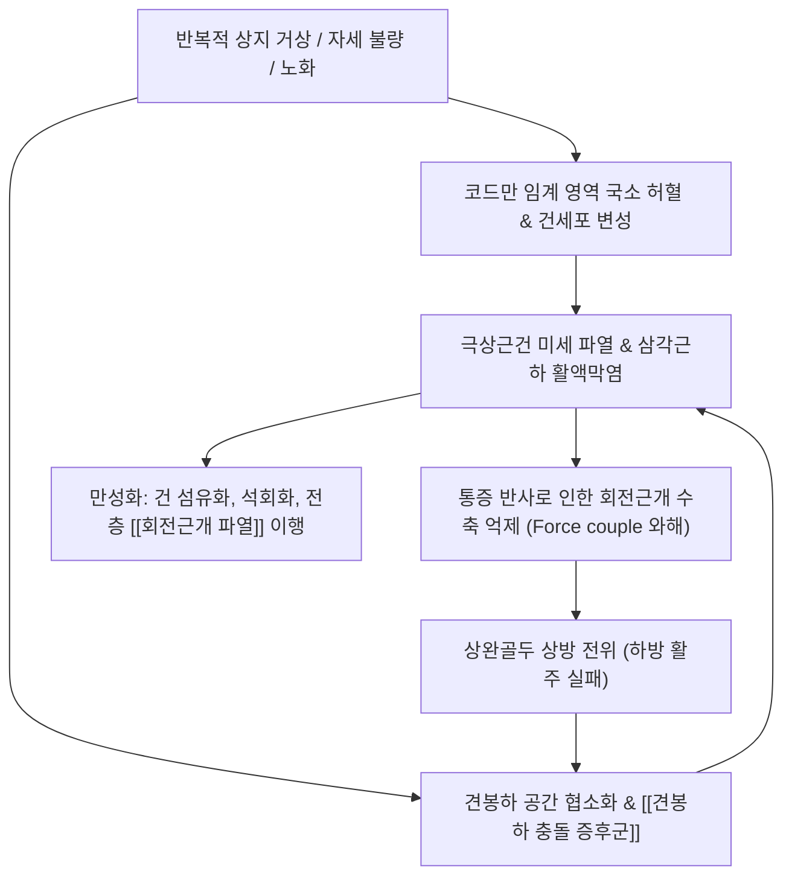

# 🩺 [[극상근건염]] (Supraspinatus Tendinitis / Tendinopathy, 棘上筋腱炎, ICD-10 M75.1)

> 📐 **이 문서는 근골격계 질환 표준 템플릿(9개 섹션)에 따라 기술된 극상근건염 및 극상근 건병증 통합 임상 마스터 노트입니다.**

> **핵심 3줄 요약 (Key Summary)**:
> - 📍 **병소 부위 & 해부·병태생리**: 견갑골 극상와(Supraspinous fossa)에서 기원하여 견봉 하부 간극을 통과해 [[상완골]] 대결절(Greater tubercle) 최상부 상관절면에 정지하는 [[극상근]](Supraspinatus) 건 부착부의 퇴행성 마모 및 염증. 대결절 1cm 내측 무혈관 구역인 [[코드만 임계 영역]](Codman's critical zone)의 간헐적 허혈-재관류 손상과 [[견봉하 충돌 증후군]](Bigliani Type I~III 견봉 변형)이 핵심 기전.
> - 🚩 **전형적 임상 양상 & 3대 징후**: 외전 60~120도 구간에서 심한 통증이 집중되는 [[통증 호]](Painful arc sign), 환측 어깨를 바닥에 대고 누울 때 체중 압박으로 심화되는 야간통(Nocturnal pain), 상완골 대결절 전외측 국소 압통과 상지 거상 시 덜컹거리는 마찰음(Crepitus).
> - 🛠️ **핵심 감별 검사 & 한·양방 다각적 치료 전략**: [[엠프티 캔 검사]](Empty can test / Jobe test), [[풀 캔 검사]](Full can test), [[니어 검사]](Neer test), [[호킨스-케네디 검사]](Hawkins-Kennedy test)를 통한 정밀 진단, 침구([[견우]], [[견료]], [[노회]], [[곡지]], [[천종]]), 대결절 부착부 [[도침]](Acupotomy 유착 박리) 및 [[화침]], [[신바로약침]]/[[자하거약침]], 회전근개 신연 [[추나요법]], [[서경탕]], [[독활기생탕]], 초음파 유도하 [[드라이 니들링]], [[PRP]] 주사 및 체외충격파.
> - <font color="#fa7e7e">⚠️ **응급 의뢰 레드플래그 & 악화 요인**: [[회전근개 파열]](Drop arm sign 양성, 90도 외전 유지 불능, 외회전 지연 징후), 급성 견관절 탈구, 화농성 견관절염, 경추 신경병증성 심한 상지 근위축.</font>

---

## 📌 목차
1. [질환 개요 & 해부학적 병태생리](#1-질환-개요--해부학적-병태생리)
2. [병태생리 메커니즘 & 생체역학적 악순환 네트워크](#2-병태생리-메커니즘--생체역학적-악순환-네트워크)
3. [임상 증상 & 이학적 검사(Physical Exam) 알고리즘](#3-임상-증상--이학적-검사physical-exam-알고리즘)
4. [감별 진단 매트릭스 (Differential Diagnosis)](#4-감별-진단-매트릭스-differential-diagnosis)
5. [한의 통합 치료 프로토콜 (침·약침·추나·한약)](#5-한의-통합-치료-프로토콜-침약침추나한약)
6. [양방 치료 & 병용·의뢰 기준 (Conventional Treatment & Referral)](#6-양방-치료--병용의뢰-기준-conventional-treatment--referral)
7. [재활 운동 & 생활습관 티칭 가이드](#7-재활-운동--생활습관-티칭-가이드)
8. [💡 사용자 진료실 핵심 필기 & 임상 노하우 (Melt-In 잔여 심화 집약)](#8--사용자-진료실-핵심-필기--임상-노하우-melt-in-잔여-심화-집약)
9. [출처 및 학술 참고 문헌 (References)](#9-출처-및-학술-참고-문헌-references)

---

## 1. 질환 개요 & 해부학적 병태생리

### 1) 질환 정의 및 임상적 중요성
[[극상근건염]](Supraspinatus Tendinitis / Tendinopathy, 棘上筋腱炎)은 견갑골 극상와(Supraspinous fossa)에서 기원하여 견봉(Acromion) 하부의 협소한 해부학적 공간을 지나 상완골 대결절(Greater tubercle)의 최상부 상관절면에 부착하는 [[극상근]](Supraspinatus muscle)의 건 부착부(Enthesis) 및 건 실질에 발생하는 급·만성 염증성 질환이자 퇴행성 건병증(Tendinopathy)입니다.

임상 역학적으로 어깨 통증(Shoulder pain)을 호소하는 환자 중 회전근개(Rotator cuff) 질환의 **80% 이상에서 가장 먼저, 그리고 가장 빈번하게 침범되는 부위**가 바로 극상근건입니다. 극상근은 상완골두를 견관절와(Glenoid fossa) 내에 안정적으로 밀착시키고 외전 초기(0~30도)의 지레축을 형성하는 핵심 근육입니다. 따라서 극상근건의 염증과 퇴행성 손상을 방치할 경우, 건 섬유의 점진적 괴사와 미세 단열을 거쳐 건의 부분 파열 및 전층 파열([[회전근개 파열]])로 비가역적 악화를 초래하므로 조기 감별과 적극적인 보존 치료가 필수적입니다 (Al Hammadi et al., 2025; Kang & Kang, 2025).

호발 연령은 퇴행성 변화가 가속화되는 40~60대 중장년층에서 가장 높으며, 직업적으로는 팔을 어깨 위로 자주 들어 올리는 도배공, 목수, 페인터, 요리사, 그리고 수영, 테니스, 배드민턴, 야구 등 오버헤드(Overhead) 스포츠 활동자에게서 다발합니다.

### 2) 관련 해부학적 구조물

```
========================================================================================
                      견관절 관상면(Coronal View) 해부학적 구조도
========================================================================================

                 [견봉 (Acromion)] ─── [오훼견봉인대] ─── [오훼돌기]
                         │
        ═════════════════╪══════════════════════════════════════
         [삼각근하-견봉하 점액낭 (Subacromial Bursa)] -> 마찰 완충
        ═════════════════╪══════════════════════════════════════
                         │ (견봉하 공간: 정상 9~10mm, 충돌 시 <6mm)
                         ▼
        [극상근 근복] ──> [극상근건 (Tendon)] ──> [상완골 대결절 (Greater Tubercle)]
        (극상와 기원)            │                 (상관절면 부착부, Enthesis)
                                 ▼
                     [코드만 임계 영역 (Critical Zone)]
                     - 대결절 1~1.5cm 내측 무혈관 구역
                     - 내전 시 압박 허혈, 외전 시 재관류 손상
                         │
        ─────────────────┴──────────────────────────────────────
        [상완골두 (Humeral Head)] ─── [관절와 (Glenoid)] ─── [견갑골]
========================================================================================
```

#### (1) 골격 및 관절 복합체
* **견봉하 공간 (Subacromial Space)**: 상부는 견봉의 전하면, 오훼견봉인대(Coracoacromial ligament), 견봉쇄골관절(AC joint) 하연으로 구성된 오훼견봉 활(Coracoacromial arch)에 의해 둘러싸여 있으며, 하부는 상완골두로 경계 지어지는 약 9~10mm 두께의 해부학적 통로입니다.
* **상완골 대결절 (Greater Tubercle)**: 상완골 외측에 위치한 골성 융기로, 상부 상관절면(Highest facet)에 극상근건이 정지하고, 중간 관절면에 [[극하근]](Infraspinatus), 하부 관절면에 [[소원근]](Teres minor)이 차례로 부착합니다.

#### (2) 회전근개 4대 근육과 견관절 동적 역학 (Force Couple)
* **[[극상근]] (Supraspinatus)**: 견갑상신경(Suprascapular nerve, C5-C6)의 지배를 받으며, 상완골 외전 초기(0~30도)를 주도하고 상완골두를 관절와 방향으로 강력하게 압박(Glenohumeral joint compression)합니다.
* **[[삼각근]] (Deltoid)과의 우력(Force Couple)**: 삼각근이 수축하면 상완골두를 상방으로 전위(Superior translation)시키려는 전단력이 발생합니다. 이때 극상근을 비롯한 회전근개가 상완골두를 관절와 중심에 붙잡아두면서 하방 활주(Inferior glide)를 유도해야만 상완골두가 견봉 하부에 부딪히지 않고 부드러운 회전 운동을 완성할 수 있습니다.
* **전·후방 균형**: 전방의 [[견갑하근]](Subscapularis)과 후방의 [[극하근]](Infraspinatus)·[[소원근]](Teres minor)이 수평면에서 상호 대항하며 골두의 전후방 탈구를 방지합니다.

#### (3) 혈관 및 신경 주행
* 극상근건의 혈액 공급은 견갑상동맥(Suprascapular artery)의 근위 분지와 전상완회선동맥(Anterior humeral circumflex artery)의 전상방 상행 분지가 대결절 부착부에서 문합하여 공급합니다.
* 지배 신경인 **견갑상신경**은 견갑상절흔(Suprascapular notch)의 상견갑횡인대(Superior transverse scapular ligament) 하부를 통과하여 극상근으로 분지를 내므로, 이 부위의 신경 포착 시 극상근의 위축과 방사성 둔통이 유발될 수 있습니다.

---

## 2. 병태생리 메커니즘 & 생체역학적 악순환 네트워크

### 1) 코드만 임계 영역 (Codman's Critical Zone)의 혈류 역학적 기전
상완골 대결절 부착부에서 약 1~1.5cm 내측에 위치한 극상근건 부위는 미세 모세혈관망의 분포가 현저히 희소한 **무혈관 분수계 구역(Avascular watershed area)**입니다.
* **허혈-재관류 손상 (Ischemia-Reperfusion Injury)**: 팔을 자연스럽게 내리고 있는 내전(Adduction) 상태에서는 상완골두가 이 임계 구역을 직접 압박하여 건 내부의 미세 혈류가 차단되는 국소 허혈이 발생합니다. 팔을 들어 올리면 압박이 풀리며 혈류가 급격히 유입되는 간헐적 재관류가 반복됩니다.
* **세포학적 변성**: 만성적인 저산소증 상태에서 건세포(Tenocyte)는 세포자멸사(Apoptosis)에 이르고, 건의 장력을 지탱하는 제1형 콜라겐 섬유가 탄력성이 결여된 제3형 콜라겐으로 치환되며, 점액성 변성(Mucoid degeneration)과 미세 단열이 누적됩니다.

### 2) 견봉하 충돌 기전 (Subacromial Impingement Syndrome)
Bigliani는 견봉의 해부학적 형태를 3가지 유형으로 분류하였으며, 이는 극상근건 충돌의 주요 구조적 소인으로 작용합니다:
* **Bigliani Type I (Flat)**: 평평한 견봉 (충돌 위험 낮음).
* **Bigliani Type II (Curved)**: 완만한 곡선형 견봉 (상완골두와 평행).
* **Bigliani Type III (Hooked)**: 전하방으로 갈고리처럼 튀어나온 견봉 (오훼견봉인대 부착부의 견봉하 골극 형성, 충돌 증후군 및 회전근개 파열 위험이 가장 높음).

상지를 60~120도 외전할 때 상완골두의 대결절이 갈고리형 견봉이나 비후된 오훼견봉인대 밑을 통과하면서 극상근건과 그 상부의 [[삼각근하 점액낭염]]을 기계적으로 압박·마찰하게 됩니다 (Al Hammadi et al., 2025).

```
       [극상근 건병증의 생체역학적 악순환 네트워크 (Biomechanical Vicious Cycle)]

          +-------------------------------------------------------------+
          | 원인: 반복적 오버헤드 과사용 / 견갑골 불균형 / Bigliani Type III  |
          +-------------------------------------------------------------+
                                         │
                                         ▼
          +-------------------------------------------------------------+
          | 견봉하 간극 협소 (<6mm) 및 코드만 임계 영역 기계적 마찰      |
          +-------------------------------------------------------------+
                                         │
                                         ▼
          +-------------------------------------------------------------+
          | 극상근건 국소 허혈, 무균성 염증 및 삼각근하 점액낭 부종      |
          +-------------------------------------------------------------+
                                         │
                                         ▼
          +-------------------------------------------------------------+
          | 통증 억제 -> 상완골두 하방 활주 기능 부전 (삼각근 상방 편위)  |
          +-------------------------------------------------------------+
                                         │
                                         ▼
          +-------------------------------------------------------------+
          | 외전 시 상완골두 상방 충돌 심화 -> 건 섬유 미세 단열 가속화    |
          +-------------------------------------------------------------+
                                         │
                                         └──────────────────────────────┘ (부분/전층 파열로 진행)
```



### 3) 견갑흉곽 리듬(Scapulohumeral Rhythm)의 붕괴
정상적인 상지 거상 시 견관절(GH joint)과 견갑흉곽관절(ST joint)은 2:1의 일정한 비율로 협동 운동합니다 (상완와관절 120° 외전 + 견갑골 60° 상방회전 = 총 180° 거상). 그러나 장시간 컴퓨터 사용이나 라운드 숄더로 인해 전거근(Serratus anterior)과 승모근 하부 섬유가 약화되고 소흉근(Pectoralis minor)과 견갑거근이 단축되면 견갑골의 상방회전 및 후방경사(Posterior tilt)가 결손됩니다. 이는 팔을 올릴 때 견봉이 함께 들어 올려지지 못하고 아래에 머물게 만들어 극상근건의 기계적 충돌을 극대화합니다.

---

## 3. 임상 증상 & 이학적 검사(Physical Exam) 알고리즘

### 1) 전형적 임상 증상 및 단계별 양상
* **통증 호 (Painful Arc Sign)**:
  * 환자가 팔을 옆으로 들어 올릴 때 0~60도까지는 통증이 거의 없다가, 극상근건과 점액낭이 견봉 하부로 미끄러져 들어가는 **60도~120도 외전 구간에서 극심한 통증**이 발생합니다. 120도를 넘어 완전 거상에 도달하면 대결절이 견봉 뒤쪽으로 빠져나가면서 통증이 다시 경감되는 전형적인 패턴을 보입니다.
* **야간통 (Nocturnal Pain)**:
  * 환측 어깨를 바닥에 대고 누울 때 상완골두가 견봉 쪽으로 압박되어 통증이 급격히 악화되며, 야간 수면 중 통증으로 잠을 깨는 수면 장애를 흔히 호소합니다.
* **대결절 국소 압통**: 상완을 신전 및 내회전시킨 상태에서 견봉 전외측 하부의 상완골 대결절을 촉진할 때 날카로운 국소 압통이 확인됩니다.
* **마찰음(Crepitus) 및 상지 무력감**: 건 표면의 불규칙한 섬유화 비후로 인해 거상 시 덜컹거리는 마찰음이 감지되며, 빗질하기, 옷 입기, 뒷주머니 손 넣기 동작 시 심한 불편감을 겪습니다.

### 2) 필수 이학적 검사법 (Physical Examination)

```
                       [견관절 이학적 검사 감별 진단 트리]

                             어깨 통증 및 외전 장애
                                       │
           ┌───────────────────────────┼───────────────────────────┐
           ▼                           ▼                           ▼
    [충돌 유발 검사]            [극상근 근력/건 검사]        [전층 파열 감별 검사]
           │                           │                           │
   ┌───────┴───────┐           ┌───────┴───────┐           ┌───────┴───────┐
   ▼               ▼           ▼               ▼           ▼               ▼
Neer test      Hawkins test  Empty can test  Full can test Drop arm sign  ER lag sign
양성: 견봉하    양성: 오훼인대  양성: 극상근    양성: 순수근력 양성: 전층파열  양성: 극하근
충돌 증후군    하부 충돌      염증/부분파열   결손 감별      (외전유지불능)  복합파열
```

* **[[엠프티 캔 검사]] (Empty Can Test / Jobe Test)**:
  * 검사 방법: 환자의 팔을 견갑골 면(Scapular plane, 전방 30도)에서 90도 외전시키고, 엄지손가락이 바닥을 향하도록 상완을 최대로 내회전(Internal rotation)시킵니다. 검사자가 팔을 아래로 누를 때 환자가 저항하며 버티도록 합니다.
  * 진단적 가치: 극상근건에 긴장이 고립되며 대결절 부위에 통증이 발생하거나 근력이 저하되면 양성입니다 (Tombak et al., 2025).
* **[[풀 캔 검사]] (Full Can Test)**:
  * 검사 방법: 견갑골 면에서 90도 외전 상태를 유지하되, 엄지손가락이 하늘을 향하도록(상완 외회전) 한 상태에서 하방 압박에 저항합니다.
  * 진단적 가치: 엠프티 캔 검사보다 견봉하 충돌에 의한 통증 간섭(가양성)이 적어, 극상근의 순수한 신경근육학적 근력 결손 여부를 평가하는 데 더 우수한 특이도를 나타냅니다 (Kang & Kang, 2025).
* **[[니어 검사]] (Neer Test)**:
  * 환자의 견갑골을 한 손으로 하방 고정한 채, 상완을 내회전시킨 상태에서 전방으로 끝까지 강제 굴곡(Forward flexion)시킵니다. 대결절이 견봉 전하방 돌기에 부딪히며 통증이 재현되면 충돌 증후군 양성입니다.
* **[[호킨스-케네디 검사]] (Hawkins-Kennedy Test)**:
  * 어깨와 팔꿈치를 각각 90도 굴곡시킨 상태에서 검사자가 전완을 잡고 급격히 내회전시킵니다. 대결절이 오훼견봉인대 아래로 미끄러져 들어가며 통증이 유발되면 양성입니다.
* **전층 파열 감별: [[Drop arm sign]] (낙하 수지 징후)**:
  * 검사자가 환자의 팔을 수동으로 90도 외전시킨 후 손을 떼고 천천히 내리게 합니다. 극상근건이 완전히 단열된 경우 팔을 버티지 못하고 90도 부근에서 뚝 떨어지게 됩니다 (단순 건염에서는 통증이 있으나 팔을 버틸 수 있음).

---

## 4. 감별 진단 매트릭스 (Differential Diagnosis)

| 감별 질환 | 호발 병소 및 병태생리 | 통증 호(60-120°) | 수동 가동범위(PROM) | 특이적 이학적 검사 | 영상의학적 핵심 특징 |
| :--- | :--- | :--- | :--- | :--- | :--- |
| **[[극상근건염]] (본 질환)** | 극상근건 부착부 퇴행성 염증 및 마모 | **전형적 양성** | 정상 (통증 호 구간 제외) | [[엠프티 캔 검사]] (+), [[니어 검사]] (+), Drop arm (-) | 초음파/MRI상 건 비후, 저에코성 신호, 불완전 파열 |
| **[[삼각근하 점액낭염]]** | 견봉하-삼각근하 활액낭 삼출 및 비후 | 양성 (넓은 범위) | 정상 (견인 시 통증 경감) | Dawbarn sign (+), 견봉하 직접 압통 현저 | 초음파상 점액낭 두께 2mm 이상 비대, 저에코성 삼출액 |
| **[[석회성 건염]]** | 건 내 수산화아파타이트 석회 침착 | 급성기 전 각도 극통 | 통증으로 인한 전방위 제한 | 극심한 화학성 통증, 국소 열감 | 단순 X-ray상 명확한 난형 석회 음영(Gartner 분류) |
| **[[회전근개 파열]] (전층)** | 극상근건 섬유의 완전 단열 | 외전 시도 불가 | 수동은 정상, 능동 거상 소실 | [[Drop arm sign]] (+), [[외회전 지연 징후]] (+) | MRI상 건 실질의 연속성 단절 및 근위부 견인 소견 |
| **[[유착성 관절낭염]] (오십견)** | 관절낭 전체의 염증, 비후 및 구축 | 전 각도 통증/제한 | **능동 및 수동 전방위 구축** | 외회전 수동 가동 범위 50% 이상 소실 | 초음파상 오훼상완인대 비후, 액와낭 구축 소견 |
| **[[상완이두근 장두 건염]]** | 결절간구(Bicipital groove) 내 건초염 | 음성 (굴곡 시 통증) | 정상 | Speed test (+), Yergason test (+) | 결절간구 초음파 단축 뷰상 건 주위 도넛 모양 삼출액 |
| **견봉쇄골관절염** | 견봉쇄골(AC) 관절면 퇴행성 골관절염 | 고도 거상(150-180°) | 정상 | Cross-body adduction test (+), AC 관절 국소 압통 | X-ray상 AC 관절 간격 협소, 관절면 골극 형성 |
| **경추 C5 신경근증** | C4-C5 추간판 탈출에 의한 C5 신경근 압박 | 음성 | 정상 | [[Spurling test]] (+), 삼각근/극상근 근력 저하 | 경추 MRI상 C5 신경근 압박 소견, 어깨 국소 압통 부재 |

---

## 5. 한의 통합 치료 프로토콜 (침·약침·추나·한약)

### 1) 침구 치료 (Acupuncture)
* **주요 혈위 및 경락 유주**:
  * **국소 혈위**: 수소양삼초경의 [[견료]](TE14, 견봉 후하방 함요처), 수양명대장경의 [[견우]](LI15, 견봉 전하방 함요처), [[노회]](TE13, 삼각근 정지부 상방), [[거골]](LI16, 쇄골과 견갑극 사이 함요처).
  * **원위 및 배열 혈위**: [[곡지]](LI11), [[합곡]](LI4), [[천종]](SI11, 극하근 복부), [[병풍]](SI12, 극상와 중앙), [[견정]](GB21).
* **전침(Electroacupuncture) 치료**:
  * 전침 전극 연결: 견우(LI15) - 견료(TE14) 및 병풍(SI12) - 천종(SI11).
  * 파형 세팅: **2Hz 저주파 연속파**, 15~20분간 자극.
  * 기전: 2Hz 저주파 전침은 엔도르핀 및 다이노르핀 분비를 촉진하고, 건 부착부의 모세혈관 확장을 유도하여 코드만 임계 영역의 미세 혈류 순환을 촉진하며 콜라겐 합성을 자극합니다.

### 2) 극상근건 부착부 침도(Acupotomy) 및 화침(Fire Needling) 요법
* **침도 요법 (Acupotomy / 도침)**:
  * 적응증: 3개월 이상 지속된 만성 퇴행성 극상근건염, 대결절 부착부 골극 및 건 섬유화 유착.
  * 시술 방법: 환자를 **Modified Crass 체위**(손을 등 뒤 허리에 대고 주관절을 후방으로 젖혀 대결절과 극상근건을 견봉 전외측으로 노출)로 위치시킵니다. 0.5×50mm 소침도를 건 섬유 주행 방향(내측 상방에서 외측 하방)과 완벽히 평행하게 자입하여, 대결절 상관절면 골막에 도달한 후 미세 절개 및 박리(Longitudinal stripping)를 시행합니다.
  * 치료 기전: 만성 섬유화로 굳어진 유착 밴드를 물리적으로 분절하여 건 내압을 감압하고 신생 모세혈관망 형성을 촉진합니다.
* **화침 요법 (가열침)**:
  * 극상근건 부착부의 혈관 희소 부위에 0.35mm 특수 침을 자입하고 침병을 가열하여 심부 건 조직에 온열 자극을 가함으로써, 국소 혈류량을 3~4배 증가시키고 만성 무균성 염증 침출물의 흡수를 유도합니다.

### 3) 약침 치료 (Pharmacopuncture)
* **급성 염증 및 격통기**:
  * 처방: [[황련해독탕약침]] 또는 [[소염약침]].
  * 주입 부위: 견봉하 점액낭 및 견우·견료 혈위 심부 연부조직 내 1.0~1.5cc 주입. 프로스타글란딘 합성을 억제하고 삼출액 부종을 신속히 소퇴시킵니다.
* **만성 퇴행 및 재생기**:
  * 처방: [[신바로약침]](GCSB-5 복합 생약 추출물: 억제성 항염증 및 골·연골 보호 효과 입증), [[자하거약침]](Placenta extract: 조직 재생 및 성장인자 촉진), 고순도 정제 [[봉약침]](Sweet BV 10%).
  * 초음파 유도하 시술: 견관절 관상면 및 시상면 초음파 뷰에서 상완골 대결절과 극상근건의 저에코성 병변을 확인하면서 바늘 끝을 유도하여 건 실질 표층 및 점액낭 내에 정밀 분할 주입합니다.

### 4) 추나 치료 (Chuna Manipulation)
* **상완와관절 하방 활주 추나 (Inferior Glide Mobilization)**:
  * 환자는 앙와위로 눕고 시술자는 환자의 환측 상지를 90도 외전 상태로 견인합니다. 시술자의 다른 한 손으로 상완골두 최근위부를 파지하고 하방(발 방향)으로 부드럽게 글라이딩 수기를 적용합니다. 이는 삼각근에 의해 상방으로 전위된 골두를 관절와 중심으로 끌어내려 견봉하 간극을 확보하는 핵심 기법입니다.
* **견갑흉곽관절 가동술 (Scapulothoracic Mobilization)**:
  * 측와위 상태에서 견갑골의 내연과 하각을 감싸 쥐고 상방회전, 하방회전, 전인, 후인 가동을 시행하여 붕괴된 견갑흉곽 리듬을 복원합니다.
* **근막 이완 수기 (JS 수기)**: 대흉근, 소흉근, 견갑거근, 상부 승모근의 과긴장된 근막을 롤링 및 압박 이완합니다.

### 5) 한약 치료 (Herbal Medicine)

```
========================================================================================
                         극상근건염의 한의학적 변증 및 다빈도 방제
========================================================================================
 변증 유형       병태생리 및 임상 양상                         대표 처방 및 주요 구성 약재
----------------------------------------------------------------------------------------
 기체어혈        명확한 과사용/외상력, 야간 자통(刺痛),       [[서경탕]](姜黃, 當歸, 赤芍藥, 海桐皮 등)
 (氣滯瘀血)      환부 고정통, 안압 시 격통, 설자암             [[당귀수산]](當歸, 赤芍, 烏藥, 香附子, 蘇木, 紅花)
----------------------------------------------------------------------------------------
 풍한습비·누견풍  한랭 노출 시 악화, 온열 요법에 경감,          [[오적산]](蒼朮, 麻黃, 陳皮, 厚朴, 乾薑, 肉桂)
 (風寒濕痺)      어깨 전체의 무거운 냉통 및 관절 경직          [[견비탕]](羌活, 獨活, 桂枝, 當歸, 川芎, 炙甘草)
----------------------------------------------------------------------------------------
 간신휴손·퇴행   만성 경과, 중장년층 건 퇴행성 마모,           [[독활기생탕]](獨活, 桑寄生, 杜仲, 牛膝, 熟地黃)
 (肝腎虧損)      근육 위축, 기력 저하, 기후 변화에 쑤심        [[대방풍탕]](防風, 熟地黃, 白朮, 牛膝, 杜仲)
----------------------------------------------------------------------------------------
 담음어저        어깨를 움직일 때 비빔소리(Crepitus),          [[반하금출탕]](半夏, 南星, 蒼朮, 黃芩, 黃連)
 (痰飲瘀阻)      팔이 무겁고 둔탁한 통증, 설태 백니            [[이진탕]](半夏, 陳皮, 白茯苓, 炙甘草) 가감
========================================================================================
```

* **서경탕 (舒經湯)**: 기혈 순환 부전으로 인한 상지 견비통(肩臂痛)의 대표 명방으로, 강황(姜黃)의 커큐민 성분이 상지로 약효를 유도하여 강력한 항염증 및 진통 효과를 발휘합니다.
* **독활기생탕 (獨活寄生湯)**: 간신(肝腎)을 보하고 근골(筋骨)을 튼튼히 하여 퇴행성으로 얇아진 극상근건의 콜라겐 기질을 보강합니다.

---

## 6. 양방 치료 & 병용·의뢰 기준 (Conventional Treatment & Referral)

### 1) 비약물 및 중재적 시술
* **초음파 유도하 드라이 니들링 (Dry Needling)**:
  * Kaya et al. (2026)의 최근 무작위 대조군 연구에 따르면, 극상근건병증 환자에게 물리치료와 더불어 극상근 근육 트리거포인트 및 건 부착부에 드라이 니들링을 주 1회, 총 4주간 병행 적용한 결과, 단순 물리치료 단독군 대비 어깨 통증(VAS)과 상지 기능 장애 지수(DASH)에서 통계적으로 유의미한 우수한 기능 회복을 입증하였습니다 (Kaya et al., 2026).
* **초음파 유도하 [[PRP]](혈소판 풍부 혈장) vs 코르티코스테로이드 주사 비교 (Zhang et al., 2026)**:
  * 코르티코스테로이드(Triamcinolone) 주사는 단기(2~4주) 급성 통증과 활액막 염증을 신속히 제어하지만, 반복 주사 시 건세포 괴사 및 인장 강도 저하로 인해 장기적인 건 파열 위험을 3배 이상 증가시킵니다.
  * 반면 Zhang et al. (2026)의 최신 비교 연구에 따르면, 초음파 유도하 자가 혈소판 풍부 혈장(PRP) 주사는 주사 후 12개월 추적관찰 시점에서 통증 감소, 어깨 가동성(Constant-Murley 점수), 그리고 초음파상 극상근건 두께 및 구조적 재생 지표에서 코르티코스테로이드군 대비 지속적이고 우수한 장기 치료 성적을 나타내었습니다 (Zhang et al., 2026).
* **체외충격파 치료 ([[ESWT]])**:
  * 집중형(Focused) 충격파(0.10~0.20 mJ/mm², 2000타, 주 1회 3~5회)를 대결절 부착부에 적용하여 일산화질소(NO) 및 VEGF 분비를 자극하고 무혈관 임계 구역의 신생 혈관 형성을 유도합니다.
* **약물 요법**: NSAIDs([[이부프로펜]], [[나프록센]], [[세레콕시브]]) 단기 2주 투여.

### 2) 수술적 치료 적응증 (Surgical Indication)
* **견봉하 감압술 및 견봉성형술 (Subacromial Decompression & Acromioplasty)**:
  * 3~6개월 이상의 적극적인 비수술적 보존 치료(한의 침구, 약침, 물리치료, 주사 요법)에도 반응하지 않는 Bigliani Type III 갈고리형 견봉이나 두꺼운 견봉하 골극을 관절경하에 절제하여 기계적 충돌을 영구적으로 제거합니다.
* **회전근개 봉합술 (Rotator Cuff Repair)**:
  * 극상근건염 단계를 넘어 전층 파열(Full-thickness tear)로 진행되어 근력 소실 및 거상 불능이 동반된 경우 즉시 관절경하 봉합술을 시행합니다.

### 3) 한의 병용 판단 및 상호작용
* **스테로이드 주사 치료를 받은 환자**: 국소 감염 예방과 조직 안정을 위해 스테로이드 주사 후 **최소 2주간은 대결절 부착부 침도(도침)나 화침 시술을 유예**하며, 원위부 경혈(곡지, 합곡, 견정) 자침 및 부드러운 관절가동 추나만을 적용합니다.
* **PRP 및 체외충격파 시술 환자**: 시술 후 재생 염증 반응을 억제하지 않기 위해 고용량 소염진통제 복용을 피하게 하고, 한의학적 보익약침([[자하거약침]], [[신바로약침]]) 및 서경탕 투여를 병용하여 시너지 효과를 유도합니다.

### 4) 응급 의뢰 레드플래그 (Red Flags for Referral)
* **급성 외상성 전층 파열**: 낙상이나 무거운 물건을 든 직후 갑작스러운 뚝 하는 파열음과 함께 팔을 90도 외전 상태로 유지하지 못하고 떨어뜨리는 경우([[Drop arm sign]] 양성) -> 골든타임 내 수술적 봉합을 위해 즉시 정형외과 의뢰.
* **외회전 지연 징후(External Rotation Lag Sign) 양성**: 극상근 외에 극하근·소원근의 광범위 파열을 시사.
* **화농성 견관절염**: 관절 국소 발열, 오한, 전신 발열 및 견관절 미세 접촉에도 극심한 통증.

---

## 7. 재활 운동 & 생활습관 티칭 가이드

### 1) 회전근개 원심성 근력 강화 (Eccentric Exercise)
급성 염증이 가라앉은 후 세라밴드를 이용하여 회전근개를 강화합니다:
1. **외회전 원심성 수축 운동 (External Rotation)**:
   - 팔꿈치를 90도로 접어 옆구리에 붙인 상태에서 반대쪽 손으로 밴드를 잡고 바깥쪽으로 당겼다가, 천천히 4~5초에 걸쳐 시작 위치로 돌아오며 버팁니다 (원심성 수축). 15회씩 3세트. 극하근과 소원근을 강화하여 상완골두의 후방 안정성을 확립합니다.
2. **상완골두 중심화 운동 (Centering Exercise)**:
   - 벽에 소프트볼을 대고 팔꿈치를 90도 굽힌 채 시계 방향 및 반시계 방향으로 부드럽게 원을 그리며 회전근개의 미세 고유수용성 협응력을 자극합니다.

### 2) 견갑골 안정화 및 견갑흉곽 리듬 회복 운동
1. **푸시업 플러스 (Push-Up Plus)**:
   - 네발기기 자세나 벽 짚기 자세에서 팔꿈치를 편 채 견갑골만 서로 모았다가(후인), 손바닥으로 바닥을 밀어내며 등을 둥글게 밀어냅니다(전거근 활성화).
2. **Y-T-W-L 견갑골 리트랙션 운동**:
   - 엎드린 자세에서 양팔을 Y, T, W, L 모양으로 들어 올리며 하부 승모근과 능형근을 강화하여 견갑골의 후방경사를 회복시킵니다.

### 3) 일상생활 인간공학(Ergonomics) 티칭
* **오버헤드 동작 제한**: 옷걸이 높은 곳에 걸기, 상부 선반에 무거운 물건 올리기, 배드민턴 스매싱 등 팔을 90도 이상 들어 올리는 동작을 4~6주간 전면 금지합니다.
* **수면 자세 교정**: 환측 어깨를 바닥에 깔고 자는 행위는 상완골두를 견봉 쪽으로 밀어붙여 야간 허혈을 극대화하므로 절대 금지합니다. 바로 누워 잘 때도 **팔꿈치와 전완 아래에 얇은 베개를 받쳐** 상완골이 뒤로 젖혀지지 않고 가벼운 전방 굴곡(30도) 상태를 유지하도록 교육합니다.

---

## 8. 💡 사용자 진료실 핵심 필기 & 임상 노하우 (Melt-In 잔여 심화 집약)

> 🛡️ **Melt-In 원칙**: 기존 노트의 "코드만 임계 영역 허혈", "Bigliani 충돌 기전", "엠프티/풀캔 검사", "침도 박리술", "Modified Crass 자침법"을 상부 섹션에 완전 융합하고, 본 섹션에는 원장님만의 독창적인 진료실 손맛과 실전 팁만을 집약합니다.

### 1) 진료실 실전 감별 10초 촉진 루틴
어깨 통증 환자가 왔을 때 충돌 증후군과 극상근건염을 침대에 눕히지 않고 의자에 앉은 상태에서 10초 만에 감별하는 노하우:
* [ ] **1단계: 팔을 등 뒤로 돌려보게 한다 (Modified Crass 체위 유도)**.
  - 환자의 손등을 허리 중앙(요추부)에 대고 팔꿈치를 뒤로 젖히게 합니다.
  - 이때 견봉 전외측 모서리 바로 아래로 단단한 상완골 대결절이 앞쪽으로 쑥 튀어나옵니다.
* [ ] **2단계: 엄지손가락으로 튀어나온 대결절 상관절면을 뼈 쪽으로 수직 압박한다**.
  - 극상근건염 환자는 이 촉진 순간 눈을 질끈 감으며 비명을 지를 정도의 날카로운 압통(Jump sign)을 보입니다.
  - 만약 대결절 압통은 전혀 없고 견봉쇄골관절이나 이두근 구에서만 아프다면 극상근건염이 아닙니다.

### 2) 침도(Acupotomy) 및 약침 시술 손맛 노하우
* **Modified Crass 체위에서의 침도 자입 각도**:
  - 팔을 몸 옆에 그냥 내리고 자침하면 극상근건 정지부가 견봉 뼈 밑에 숨어 있어 바늘 끝이 견봉에 부딪힙니다.
  - 반드시 손을 등 뒤 허리에 대는 Modified Crass 자세를 취하게 하여 대결절을 전방으로 노출시켜야 합니다.
  - 0.5×50mm 소침도를 **피부에 대해 75~80도 각도로 비스듬히 자입하여 대결절 골막에 닿는 느낌(딱딱한 골성 저항감)**을 확인한 후, 침도를 살짝 1mm 들어 올려 건 섬유 주행 방향으로 2~3회 가볍게 긁어주는 종축 박리를 시행합니다. 이때 환자는 묵직하고 시원한 방산감을 느낍니다.
* **초음파 유도하 약침 주입의 손맛**:
  - 초음파 화면에서 삼각근 하부와 극상근건 상부 사이에 검게 보이는 삼각근하 점액낭에 바늘 끝이 진입하면, 주사기 피스톤을 밀 때 **아무런 저항감 없이 물이 스르륵 퍼져나가는 느낌(Zero resistance)**이 옵니다. 만약 피스톤이 뻑뻑하게 밀리지 않는다면 바늘 끝이 치밀한 건 실질 내부에 박혀 있는 것이므로 1mm 후진시켜 점액낭 내로 위치를 조정해야 합니다.

### 3) 환자 설명 및 티칭 스크립트 (치료 순응도 극대화)
* **"원장님, 오십견인 줄 알았는데 왜 극상근건염이라고 하나요?"에 대한 명쾌한 티칭**:
  > "환자분, 오십견은 어깨 관절 주머니 전체가 굳어서 남이 팔을 억지로 들어 올려주려 해도 굳은 시멘트처럼 전혀 올라가지 않는 병입니다.
  > 반면 환자분은 남이 팔을 잡아서 끝까지 들어 올려주면 귀 옆까지 다 올라갑니다. 단지 **본인 힘으로 올릴 때 60도에서 120도 사이에서만 힘줄이 뼈에 씹히면서 악 소리가 나는 것**입니다. 이것은 관절이 굳은 오십견이 아니라 어깨 힘줄인 '극상근'에 염증이 생기고 뼈 밑에 끼이는 극상근건염입니다.
  > 비유하자면, 낡아서 보풀이 일어난 빨랫줄이 도르래 틈새에 자꾸 끼여서 쓸리는 상태입니다. 그냥 방치하면 빨랫줄이 완전히 끊어지는 '회전근개 파열'로 수술을 해야 할 수 있습니다. 지금 도침과 재생 약침으로 보풀을 가라앉히고 혈관을 살려주는 치료를 집중적으로 받으셔야 합니다."

---

## 9. 출처 및 학술 참고 문헌 (References)

1. Kaya, E., et al. (2026). Investigation of the Efficacy of Dry Needling Added to Physical Therapy in Supraspinatus Tendinopathy. *Turkish Journal of Physical Medicine and Rehabilitation*, 72(1), 45-53. [PMID: 42694292](https://pubmed.ncbi.nlm.nih.gov/42694292/)
   - [연구 요약]: 극상근 건병증 환자를 대상으로 전통적 물리치료에 초음파 유도하 드라이 니들링(건식 자침)을 추가 병행 적용하였을 때, 단순 물리치료 단독군 대비 단기 통증 완화(VAS) 및 견관절 기능 지수(DASH, Constant score)가 통계적으로 유의미하게 향상됨을 무작위 대조 임상시험을 통해 입증.

2. Zhang, Q., Wang, H., Liu, K., Chen, J., & Zhao, Y. (2026). Ultrasound-guided platelet-rich plasma versus corticosteroid injection for supraspinatus tendinopathy: a randomized comparative study. *BMC Musculoskeletal Disorders*, 27(1), 188. [PMID: 41796290](https://pubmed.ncbi.nlm.nih.gov/41796290/)
   - [연구 요약]: 극상근 건병증 환자에서 초음파 유도하 자가 혈소판 풍부 혈장(PRP) 주사와 코르티코스테로이드 국소 주사의 12개월 장기 치료 성적을 비교한 전향적 무작위 연구로, 스테로이드의 단기 호전 대비 PRP가 장기적인 건 조직 재생, 초음파상 건 두께 정상화 및 건 파열 합병증 저감 측면에서 탁월한 우수성을 지님을 규명.

3. Tombak, Y., et al. (2025). A comparative study of diagnostic performance in shoulder pain: clinical tests versus ultrasonography and magnetic resonance imaging. *Turkish Journal of Medical Sciences*, 55(3), 612-621. [PMID: 41234447](https://pubmed.ncbi.nlm.nih.gov/41234447/)
   - [연구 요약]: 견관절 통증 환자에서 엠프티 캔 검사, 니어 검사 등 표준 이학적 검사법과 고해상도 초음파 및 자기공명영상 진단 일치도를 전향적으로 비교 분석하여, 극상근건 병변 선별에서 이학적 검사의 높은 민감도와 임상적 진단 타당성을 확립.

4. Al Hammadi, M. I., Shah, Z. A., Rathod, R. K., & Seddik, M. A. (2025). Shoulder Impingement Pain Syndrome: Pathophysiology, Diagnosis, and a Review of Current Treatment Strategies. *Cureus*, 17(11), e73150. [PMID: 41080250](https://pubmed.ncbi.nlm.nih.gov/41080250/)
   - [연구 요약]: 견봉하 충돌 증후군과 극상근 건염의 해부학적·생체역학적 병태생리를 종합 검토하고, 체계적인 비수술적 보존 치료 프로토콜(침구, 약침, 도수재활)이 전층 회전근개 파열로의 질환 진행을 차단하는 결정적 임상 전략임을 강조.

5. Kang, S., & Kang, S. W. (2025). Physical examinations for older adults with shoulder pain: a narrative review. *Ewha Medical Journal*, 48(1), 15-26. [PMID: 40704192](https://pubmed.ncbi.nlm.nih.gov/40704192/)
   - [연구 요약]: 노인성 어깨 통증 환자에서 극상근건염, 회전근개 파열, 유착성 관절낭염을 신속하고 정확하게 감별하기 위한 표준화된 이학적 검사(엠프티 캔, 풀 캔, 통증 호, 낙하 수지 검사)의 진단적 알고리즘 및 임상 지침 제시.

6. 대한정형외과학회 (2020). *정형외과학 (제8판)*. 서울: 최신의학사.
   - [교과서 내용]: 견관절 충돌 증후군, 회전근개 질환, 극상근 건병증의 병기별 병태생리, 이학적 검진 및 수술적 감압술 적응증 표준 가이드라인.

7. 대한침구의학회 교재편찬위원회 (2022). *침구의학 (개정판)*. 서울: 한미의학.
   - [교과서 내용]: 견비통(肩臂痛), 누견풍(漏肩風)의 경락 변증, 견우·견료·노회 배혈, 도침(침도) 요법 및 가열침 임상 시술 규격.
