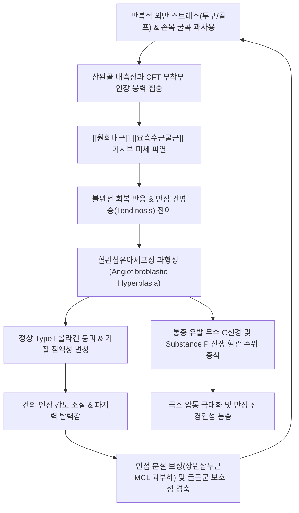

# ⛳ [[내측상과염]] (Medial Epicondylitis / 골퍼 엘보, M77.0)

> **핵심 3줄 요약 (Key Summary)**:
> - 📍 병소 부위 & 해부·병태생리: 주관절 상완골 내측상과(Medial Epicondyle)에 부착하는 공통 굴근건(Common Flexor Tendon, CFT: [[원회내근]], [[요측수근굴근]], [[장장근]], [[천지굴근]], [[척측수근굴근]]) 기시부의 만성 퇴행성 과사용 건병증. 반복 외반 장력(Valgus stress) 및 손목 굴곡/회내 부하에 의한 혈관섬유아세포성 과형성(Angiofibroblastic hyperplasia) 및 콜라겐 기질 붕괴.
> - 🚩 전형적 임상 양상 & 3대 징후: 손목 굴곡 및 전완 회내 시 팔꿈치 내측 통증, 상완골 내측상과 전하방 5~10mm 지점의 극심한 국소 압통, 파지력(Grip Strength) 약화 및 탈력감.
> - 🛠️ 핵심 감별 검사 & 한·양방 다각적 치료 전략: 저항성 손목 굴곡 검사, 저항성 전완 회내 검사, 골퍼 엘보 검사 양성. 내측상과 골막 안전 구역 침도 미세 박리술, 봉약침([[소해]], [[곡택]], [[수삼리]]), 화침, 리버스 타일러 트위스트(Reverse Tyler Twist) 원심성 운동, 체외충격파([[체외충격파]], ESWT) 및 [[서경탕]]·[[독활기생탕]].
> - <font color="#fa7e7e">⚠️ 응급 의뢰 레드플래그 & 악화 요인: 내측상과 후방 주관의 [[척골신경]] 아탈구 및 포착([[주관 증후군]], 제4~5수지 마목감·[[프로망 징후]]), 주관절 [[내측측부인대]](MCL) 전방 경사 섬유의 완전 파열에 따른 외반 관절 불안정성, 주관절 내 유리체 및 박리성 골연골염 감별.</font>

---

## 📌 목차
1. [질환 개요 & 해부학적 병태생리](#1-질환-개요--해부학적-병태생리)
2. [병태생리 메커니즘 & 생체역학적 악순환 네트워크](#2-병태생리-메커니즘--생체역학적-악순환-네트워크)
3. [임상 증상 & 이학적 검사(Physical Exam) 알고리즘](#3-임상-증상--이학적-검사physical-exam-알고리즘)
4. [감별 진단 매트릭스 (Differential Diagnosis)](#4-감별-진단-매트릭스-differential-diagnosis)
5. [한의 통합 치료 프로토콜 (침·약침·추나·한약)](#5-한의-통합-치료-프로토콜-침약침추나한약)
6. [양방 치료 & 병용·의뢰 기준 (Conventional Treatment & Referral)](#6-양방-치료--병용의뢰-기준-conventional-treatment--referral)
7. [재활 운동 & 생활습관 티칭 가이드](#7-재활-운동--생활습관-티칭-가이드)
8. [💡 사용자 진료실 핵심 필기 & 임상 노하우 (Melt-In 잔여 심화 집약)](#8--사용자-진료실-핵심-필기--임상-노하우-melt-in-잔여-심화-집약)
9. [출처 및 학술 참고 문헌 (References)](#9-출처-및-학술-참고-문헌-references)

---

## 1. 질환 개요 & 해부학적 병태생리

### 1) 질환의 정의 및 임상적 역학
* **정의**: 내측상과염(Medial Epicondylitis, 골퍼 엘보 / Golfer's elbow)은 상완골 내측상과에 기시하는 전완 굴근군-회내근 복합체(Flexor-Pronator Muscle Group) 건 부착부의 반복적인 과사용, 미세 외상, 견인력 집중으로 인해 발생하는 만성 건병증(Tendinopathy)이다.
* **임상적 역학**:
  * 외측상과염(테니스 엘보)에 비해 발병 빈도는 약 1:5에서 1:10 정도로 낮으나, 치료에 대한 반응이 상대적으로 느리고 만성화되기 쉽다 (Ciccotti et al., 2004).
  * 주 호발 연령대는 40~50대(전체 환자의 75% 이상)이며, 성별에 따른 차이는 크지 않으나 육체노동자나 특정 스포츠 선수에서는 활동도에 따라 차이를 보인다.
  * 골프 인구의 약 10~30%가 경험하며, 야구 투수, 창던지기 선수, 테니스 포핸드 탑스핀을 다용하는 선수, 수영(접영/평영), 볼링 선수 등에서 흔히 발생한다.
  * 직업적으로는 무거운 연장을 쥐고 반복적으로 손목을 비틀거나 굽히는 목수, 배관공, 요리사, 도축업자, 반복 타이핑 및 조립 공정 노동자 등에서 높은 유병률을 나타낸다 (Shiri et al., 2006).

### 2) 주관절 내측 공통 굴근건 복합체의 해부학적 구조
* **상완골 내측상과 (Medial Epicondyle)**:
  * 상완골 원위 내측에 돌출된 골성 융기로, 외측상과에 비해 훨씬 크고 뚜렷하게 돌출되어 있다.
  * 이는 전완 굴근군과 회내근의 강력한 지레 받침대(Fulcrum) 역할을 수행하며, 외반 모멘트(Valgus moment)에 대항하는 생체역학적 기저부이다.
* **관여 근건 복합체의 층별 구성과 기시부 (손상 빈도 순)**:
  1. **[[원회내근]](Pronator Teres)**:
     * 상완두(Humeral head)는 내측상과 상릉 및 내측상과 상부에서 기시하고, 척골두(Ulnar head)는 척골 관상돌기 내측에서 기시한다.
     * 전완 회내 시 가장 강력한 견인력을 발휘하며, 내측상과염 손상의 최다 호발 부위(전체 손상의 약 60~70% 관여)이다. 두 두부 사이로 [[정중신경]]이 통과하므로, 근복의 과긴장은 신경 포착을 유발할 수 있다.
  2. **[[요측수근굴근]](Flexor Carpi Radialis, FCR)**:
     * 내측상과 공통 굴근건의 중심부를 형성하며, 제2중수골 기저부(일부 제3중수골)에 정지한다.
     * 손목의 굴곡과 요측 편위를 주도하며, 원회내근과 함께 건 부착부의 혈관섬유아세포성 변성이 가장 집중되는 핵심 근육이다.
  3. **[[장장근]](Palmaris Longus, PL)**:
     * 인구의 약 10~15%에서 결손되기도 하나, 존재하는 경우 수장건막(Palmar aponeurosis)으로 이어져 파지 시 손바닥 피부를 긴장시킨다. 내측상과 표재층 중앙에서 기시한다.
  4. **[[천지굴근]](Flexor Digitorum Superficialis, FDS)**:
     * 상완척골두(Humero-ulnar head)의 일부가 공통 굴근건의 심층 후하방에서 기시하여 제2~5수지 중절골 측면에 정지한다. 강한 파지 동작 시 내측상과에 지속적 인장력을 가한다.
  5. **[[척측수근굴근]](Flexor Carpi Ulnaris, FCU)**:
     * 상완두는 내측상과에서 기시하고 척골두는 주두(Olecranon) 내측 연에서 기시하며 두 두부 사이의 섬유성 아치(Osborne's ligament)를 통해 [[척골신경]]이 주관절 구로 진입한다. 손목 굴곡 및 척측 편위를 담당한다.

```
[ 상완골 내측상과 부착부 층별 해부 구조 ]

             ┌── 상완골 내측상과 (Medial Epicondyle) ──┐
             │                                         │
     [표재층 CFT 복합체]                      [심층 안정화 구조]
     ├─ [[원회내근]] (기시부 전상방)           ├─ [[내측측부인대]](MCL) 전방섬유
     ├─ [[요측수근굴근]] (CFT 중심부)          ├─ 관절낭 (Joint capsule)
     ├─ [[장장근]] (표재 중앙)                 └─ [[심지굴근]] 기시 보조섬유
     ├─ [[천지굴근]] (심층 후방)                       │
     └─ [[척측수근굴근]] (후하방)                      │
             │                                         │
             └────── [후방 2~4mm 인접] ────────────────┘
                            │
                     [[척골신경]](Ulnar n.) & 주관(Cubital Tunnel)
```

### 3) 인접 신경·혈관 및 인대 구조물의 상관관계
* **[[내측측부인대]](Medial Collateral Ligament, MCL)**:
  * CFT 심층 바로 밑에 위치하며, 전방 경사 섬유(Anterior Bundle), 후방 섬유(Posterior Bundle), 횡인대(Transverse Ligament)로 구성된다.
  * 특히 전방 경사 섬유는 팔꿈치 굴곡 30°~120° 전 구간에서 외반 스트레스(Valgus stress)를 지탱하는 일차 안정화 구조물이다. 공통 굴근건은 MCL을 덮으며 동적 안정자(Dynamic stabilizer) 역할을 수행하므로, CFT가 손상되면 MCL에 전달되는 외반 부하가 급증하여 동반 손상이 유발된다.
* **[[척골신경]](Ulnar Nerve)**:
  * 상완 삼두근 내측두와 내측 근간중격을 지나 상완골 내측상과 후면의 주관절 구(Cubital tunnel)를 통과한다.
  * 내측상과 건 부착부와의 물리적 거리가 불과 2~4mm에 불과하여, 내측상과의 만성 염증, 골극 형성, 섬유화 비후, 또는 주사·침도 시술 시 신경 손상 및 포착([[주관 증후군]])의 위험이 매우 높다.
* **[[정중신경]](Median Nerve)**:
  * 주와(Cubital fossa)를 지나 상완동맥 내측을 따라 주행한 후 [[원회내근]]의 상완두와 척골두 사이로 진입한다. 원회내근의 과긴장 및 섬유성 비후 시 정중신경이 압박되어 원회내근 증후군을 유발할 수 있다.

---

## 2. 병태생리 메커니즘 & 생체역학적 악순환 네트워크

### 1) ASCII 병태생리 다이어그램
```
+-------------------------------------------------------------------------+
|                  생체역학적 과부하 (반복 외반 장력 & 손목 굴곡/회내)               |
+-------------------------------------------------------------------------+
                                     │
                                     ▼
+-------------------------------------------------------------------------+
|       상완골 내측상과 지레 축 부착부([[원회내근]]·[[요측수근굴근]])에 견인력 집중        |
+-------------------------------------------------------------------------+
                                     │
                                     ▼
+-------------------------------------------------------------------------+
|           공통 굴근건(CFT) 미세 섬유 단열 (Micro-tears at Enthesis)             |
+-------------------------------------------------------------------------+
                                     │
                                     ▼
+-------------------------------------------------------------------------+
|     불완전 치유 반응: 혈관섬유아세포성 과형성 (Angiofibroblastic Hyperplasia)   |
|   - Type I 정상 콜라겐 파괴 -> Type III 미성숙 콜라겐 및 점액성 기질 대체       |
|   - 기능 없는 미성숙 신생 모세혈관 증식 & 비정상 무수 C신경 섬유 침투              |
+-------------------------------------------------------------------------+
                                     │
                                     ▼
+-------------------------------------------------------------------------+
|     건 기질의 구조적 붕괴, 탄성 저하 및 만성 통증 역치 감소 (말초 감작화)        |
+-------------------------------------------------------------------------+
                                     │
                                     ▼
+-------------------------------------------------------------------------+
|     보상성 전완 굴근 경축, 악력 저하, 주관절 내측 불안정성 (MCL 과부하 전이)       |
+-------------------------------------------------------------------------+
                                     │
                                     └───────────► (악순환 반복)
```



### 2) 생체역학적 과부하 메커니즘
* **외반 과부하 증후군 (Valgus Overload Syndrome)**:
  * 야구 투구의 후기 코킹(Late cocking) 및 가속기(Acceleration phase), 골프 스윙의 다운스윙에서 임팩트로 진입하는 국면에서, 팔꿈치에는 최대 60~120 N·m에 달하는 거대한 외반 회전 토크가 발생한다.
  * 이때 주관절 내측의 동적 안정자인 [[원회내근]]과 [[요측수근굴근]]이 최대 수축하여 [[내측측부인대]]의 전방 섬유를 보호하려 시도하는데, 이 과정에서 건 부착부의 단위 면적당 견인 응력(Tensile stress)이 생리학적 한계치를 초과한다.
* **원심성 수축 부하 (Eccentric Overload)**:
  * 골프 스윙 시 지면(디봇)을 강하게 치거나(뒤땅 치기, Fat shot), 라켓 스포츠에서 상대방의 강한 공을 받아칠 때, 전완 굴근군은 수축하는 도중에 강제로 손목이 젖혀지는 강력한 원심성(Eccentric) 부하를 받는다.
  * 원심성 부하는 구심성 수축보다 근건 복합체에 2배 이상의 기계적 전단 응력을 유발하여 건-골 부착부(Enthesis)의 섬유 파열을 촉발한다.

### 3) 조직병리학적 특성: 혈관섬유아세포성 과형성 (Angiofibroblastic Hyperplasia)
* **비염증성 퇴행성 변화 (Tendinosis, not Tendinitis)**:
  * 과거에는 '내측상과염'이라는 명칭 때문에 호중구나 대식세포가 주도하는 급성 염증 질환으로 간주되었으나, 실제 조직학적 검사에서는 급성 염증 세포 침윤이 거의 관찰되지 않는다.
  * Nirschl의 분류에 따른 전형적인 혈관섬유아세포성 과형성(Angiofibroblastic Hyperplasia) 소견을 보인다:
    1. **콜라겐 기질 붕괴**: 질서정연하게 배열되어 있던 Type I 콜라겐 섬유가 찢어지고, 무정형의 기저물질과 점액성 변성(Myxoid degeneration)으로 대체된다.
    2. **비정상적 혈관 신생(Neovascularization)**: 혈류 순환 기능을 제대로 수행하지 못하는 미성숙 모세혈관 덩어리가 과도하게 형성된다.
    3. **비정상적 신경 침투(Hyperinnervation)**: 신생 혈관벽을 따라 통증 매개 물질인 Substance P와 CGRP(Calcitonin Gene-Related Peptide)를 함유한 무수 C신경 섬유가 자라나 극심한 기계적 압통과 통각과민(Hyperalgesia)을 유발한다.

---

## 3. 임상 증상 & 이학적 검사(Physical Exam) 알고리즘

### 1) 주요 임상 증상 및 단계별 진행
* **주소증**:
  * 상완골 내측상과 및 그 전하방 5~10mm 부위의 날카롭거나 둔한 통증.
  * 손목을 안으로 굽히거나(Flexion), 손바닥을 아래로 엎을 때(Pronation), 주먹을 강하게 쥘 때 통증이 전완 전내측을 타고 손가락 방향으로 방사됨.
  * 일상생활 동작 장애: 문손잡이를 안쪽으로 돌리기, 수건 짜기, 커피포트나 냄비 들어 올리기, 악수하기, 골프 임팩트 시 격통.
* **파지력(Grip Strength) 약화**:
  * 파지 시 손목 굴근건 기시부의 통증 억제 반사로 인해 악력이 정상 측 대비 20~40% 이상 감소하며, 컵이나 물건을 쥐다 힘이 빠져 떨어뜨리는 탈력감 호소.
* **임상 진행 4단계 (Nirschl 병기 기준)**:
  * **1단계 (초기 경증)**: 운동 직후 또는 무리한 작업 후 수 시간 동안 팔꿈치 내측이 뻐근하나, 휴식 시 완전히 소퇴됨. 일상생활 지장 없음.
  * **2단계 (중등도)**: 운동이나 작업 중에도 통증이 지속되며, 손잡이를 돌리거나 세수할 때 내측상과 압통 뚜렷. 휴식 시 점차 완화되나 다음 날까지 잔류.
  * **3단계 (중증)**: 가벼운 파지나 손목 굴곡 동작에서도 극심한 통증 발생. 악력 현저 저하. 야간통이 시작되어 수면 장애 유발 가능.
  * **4단계 (난치성 만성/구조적 파열)**: 안정 시에도 쑤시는 지속통 및 자발통. CFT 부분 파열 또는 석회화 동반, 주관절 완전 신전 제한, 척골신경 포착 증상 동반 가능.

### 2) 필수 이학적 검사법 (Physical Examination)
1. **국소 압통 촉진 (Pinpoint Tenderness Palpation)**:
   * 환자의 팔꿈치를 90° 굴곡한 상태에서 상완골 내측상과의 정점 및 전하방 5~10mm 지점(원회내근과 요측수근굴근의 기시부)을 엄지손가락으로 압박한다.
   * 질환 특이적인 극심한 국소 압통(Jump sign)이 재현되면 내측상과염을 강력히 시사한다.
2. **저항성 손목 굴곡 검사 (Resisted Wrist Flexion Test)**:
   * **수기**: 환자의 팔꿈치를 90° 굴곡하고 전완을 회외(Supination)시킨 상태에서, 환자에게 손목을 능동적으로 굽히게 하고 검사자는 손바닥에 손을 대어 강한 신전 저항을 가한다.
   * **양성 소견**: 내측상과 부착부에 날카로운 통증 재현 ([[요측수근굴근]] 및 CFT 평가).
3. **저항성 전완 회내 검사 (Resisted Forearm Pronation Test)**:
   * **수기**: 주관절 90° 굴곡 상태에서 환자에게 아래팔을 안쪽으로 엎으려(회내) 힘을 주게 하고, 검사자는 반대 방향(회외)으로 저항을 준다.
   * **양성 소견**: 내측상과 전상방에 통증 유발 ([[원회내근]] 기시부 손상 특이적).
4. **골퍼 엘보 검사 (Golfer's Elbow Test / 수동 신장 검사)**:
   * **수기**: 검사자가 환자의 주관절을 완전 신전(Extension)시키고 전완을 회외(Supination)시킨 상태에서, 환자의 손목과 손가락을 최대한 뒤로 젖혀 수동 과신전(Passive Hyperextension)을 유도한다.
   * **양성 소견**: 내측상과 건 부착부가 강하게 견인 신장되면서 격렬한 통증이 발생함.
5. **동반 병변 감별을 위한 필수 유발 검사**:
   * **외반 스트레스 검사 (Valgus Stress Test at 30°)**: 주관절을 30° 굴곡하여 주두의 골성 안정을 배제한 상태에서 외반력을 가하여 관절 간격 벌어짐 및 통증 확인 ([[내측측부인대]] 평가).
   * **주관절 굴곡 검사 (Elbow Flexion Test)**: 팔꿈치를 최대로 굴곡하고 손목을 신전한 상태를 60초간 유지하여 제4~5수지 저림 유발 확인 ([[주관 증후군]] 평가).
   * **주관 틴넬 징후 (Tinel's Sign at Cubital Tunnel)**: 내측상과 후방 주관절 구를 가볍게 타진할 때 척골신경 주행로를 따라 찌릿한 방전통 발생 여부 확인.

```
[ 내측상과염 진단 및 감별 진단 흐름도 ]

               주관절 내측 통증 환자 내원
                           │
                           ▼
              내측상과 국소 압통 검사
            ┌──────────────┴──────────────┐
          [양성]                        [음성]
            │                             │
    저항성 손목 굴곡/회내 검사          경추 신경근증([[스펄링 검사]])
            │                          주관절 내 유리체/골관절염
    ┌───────┴───────┐
  [양성]          [음성]
    │               │
  [[내측상과염]] 확진   내측 관절선 압통 및 불안정성 평가
    │               │
    │        ┌──────┴──────┐
    │     [양성]          [음성]
    │       │               │
    │     [[내측측부인대]](MCL)  척골신경 타진([[티넬 징후]])
    │     손상 정밀 검사    │
    │               ┌──────┴──────┐
    │             [양성]          [음성]
    │               │               │
    │             [[주관 증후군]]    기타 건초염/근막통
    │
    ▼
신경 포착 및 인대 손상 동반 여부 스크리닝 후 치료 프로토콜 수립
```

---

## 4. 감별 진단 매트릭스 (Differential Diagnosis)

| 감별 질환 | 호발 병소 및 병태생리 | 주소증 및 통증 유발 동작 | 특이적 이학적 검사 소견 | 영상 및 신경학적 소견 |
| :--- | :--- | :--- | :--- | :--- |
| **[[내측상과염]]** (본 질환) | 상완골 내측상과 공통 굴근건([[원회내근]]·[[요측수근굴근]]) 기시부 | 내측상과 전하방 5~10mm 압통, 손목 저항 굴곡/회내 시 통증 | 저항성 손목 굴곡 검사(+), 저항성 전완 회내 검사(+), 골퍼 엘보 검사(+) | 초음파상 CFT 비후 및 저에코, 신경학적 결손 없음 |
| **[[주관 증후군]]** (Cubital Tunnel Syn.) | 내측상과 후방 주관(Cubital tunnel) 내 [[척골신경]] 포착 | 전완 내측 및 제4~5수지 저림, 감각 둔마, 야간 저림 악화 | 주관 부위 [[티넬 징후]](+), 주관절 굴곡 검사(+), [[프로망 징후]](+) | 신경전도검사(NCV) 전도 지연, 심할 경우 골간근 위축 |
| **[[내측측부인대]](MCL) 파열** | MCL 전방 경사 섬유 손상 (투구 등 반복 외반 과부하) | 내측 관절선(Joint line) 통증, 투구 가속기 불안정성 및 덜컹거림 | 외반 스트레스 검사(Valgus stress at 30°)(+), 동적 외반 전단 검사(+) | MRI상 인대 파열, X-ray 외반 부하 시 관절 간격 벌어짐 |
| **[[경추 추간판 탈출증]] (C8-T1)** | 경추 C7-T1 신경근 압박 | 경항부 통증과 함께 상완 내측, 전완, 넷째·새끼손가락 방사통 | [[스펄링 검사]](Spurling test)(+), 경추 신전 및 회전 시 방사통 유발 | 경추 MRI 신경근 압박, 건반사 이상 및 분절성 감각 저하 |
| **[[원회내근 증후군]]** | 원회내근 두 두부 사이 [[정중신경]] 포착 | 전완 근위 전면부 심부 둔통, 무지·시지·중지 저림, 야간통 드묾 | 원회내근 저항 회내 시 전완 통증(+), 티넬 징후(원회내근 부위)(+) | 수근관 증후군과 달리 수장 피하지 감각 저하 동반 |
| **박리성 골연골염 ([[박리성 골연골염]], OCD)** | 상완골 소두 또는 활차의 무부혈관성 괴사 및 연골하 골절 | 청소년 투구 선수, 주관절 내측 굴신 제한, 관절 잠김(Locking) | 관절선 압통, 주관절 신전 제한, 마찰음(Crepitus) | X-ray/CT상 관절 내 유리체(Loose body) 및 연골 결손 |

---

## 5. 한의 통합 치료 프로토콜 (침·약침·추나·한약)

### 1) 한의학적 병인 및 변증 체계
* **근맥노손(筋脈勞損)**:
  * 반복적인 주관절 굴신 및 회내 동작으로 인해 경근(經筋)이 지속적으로 견인 손상되어 국소 기혈 순환이 차단되고 근맥이 자양을 잃은 상태. 만성 난치성 환자의 주 변증.
* **기체어혈(氣滯瘀血)**:
  * 급격한 충격이나 무리한 외반 부하로 인해 경맥이 파열되어 어혈이 형성된 상태. 주관절 내측이 찌르듯 아프고 통증 부위가 고정되어 있으며 야간에 극심해짐(거안, 拒按).
* **간신부족(肝腎不足) / 기혈양허(氣血兩虛)**:
  * 노화로 인해 간주근(肝主筋), 신주골(腎主骨) 기능이 저하되어 근골이 연약해진 상태에서 발생. 40~50대 이후 사소한 일상 동작에도 건병증이 재발하며 전신 무력감 동반.

### 2) 침구 치료 (Acupuncture & Electroacupuncture)
* **주관절 국소 핵심 취혈**:
  * [[소해]](HT3): 심경의 합혈(合穴). 상완골 내측상과 바로 전하방의 굴근건 기시부 병소에 위치하여 국소 염증 해소와 경락 소통의 핵심 혈위.
  * [[곡택]](PC3): 심포경의 합혈. 상완이두근건 내측 주와 횡문상에 위치하며 전완 회내근 복합체의 상부 긴장을 완화.
  * [[척택]](LU5): 폐경의 합혈. 주관절 외측 밸런스를 조율하여 상완요골근과 회내근 간의 전단력 상쇄.
  * [[극문]](PC4) 및 [[내관]](PC6): 전완 굴근군의 근복 중심부에 위치하여 심부 근막의 허혈성 경축을 직접 해소.
  * [[신문]](HT7) 및 [[대릉]](PC7): 손목 굴근건의 종지부 텐션을 이완시켜 기시부로 전달되는 장력을 차단.
* **전침 요법 (Electroacupuncture)**:
  * 내측상과 CFT 부착부([[소해]])와 전완 굴근군 근복([[극문]] 또는 [[원회내근]] TP)에 자침 후 전침 연결.
  * **주파수 세팅**: 2Hz 저주파는 내인성 오피오이드(β-endorphin) 분비를 자극하여 만성 둔통을 조절하고, 100Hz 고주파는 척수 후각 교양질(Substantia gelatinosa)에서 통증 관문 조절 기전(Gate control theory)을 작동시켜 즉각적인 진통 효과를 발휘함. 2/100Hz 혼합파(Dense-Disperse Wave)를 15~20분간 적용.

### 3) 미세침도 요법 (Acupotomy)
* **적응증**: 3개월 이상의 보존적 치료에도 호전되지 않는 만성 섬유화 유착성 내측상과염, 골막 비후 및 결절성 반흔 조직이 형성된 난치성 건병증.
* **해부학적 안전 시술 가이드 (Safe Zone 엄수)**:
  * ⚠️ **척골신경 손상 절대 방지**: 내측상과 후방 주관(Cubital tunnel)으로 주행하는 [[척골신경]]은 내측상과 골성 정점 후하방 불과 수 밀리미터 거리에 인접해 있다.
  * 침도 시술은 반드시 상완골 내측상과의 **정점 기준 전하방 5~10mm 안전 구역(Safe Zone)** 내에서만 시행해야 한다.
* **시술 방법**:
  * 환자를 편안히 앙와위로 눕히고 주관절을 90° 굴곡 및 외전시켜 시술 부위를 노출한다.
  * 0.35×40mm 소평인 침도를 사용하여 내측상과 뼈의 골막면을 향해 수직 직자(Vertical insertion)한다.
  * 침도 날끝이 골막면에 정확히 닿는 골성 저항감(Hard end-feel)을 확인한 후, 힘줄의 주행 방향과 평행하게 종축으로 1~2회 미세 절개 및 골막 박리(Peeling)를 시행하여 내부의 비정상적인 장력을 감압한다. 횡축 절개는 건 파열 위험이 있으므로 절대 금기이다.

### 4) 화침 및 온침 요법 (Fire & Warm Needling)
* 만성화된 저혈관성 건병증 부위에 화침(가열한 침을 순간적으로 자입 후 발침) 또는 온침을 1~2주 간격으로 적용한다.
* 열 자극을 통해 비정상적인 Type III 콜라겐을 용해하고 섬유아세포를 활성화시켜 정상적인 Type I 콜라겐의 신생 및 기질 리모델링을 강력히 촉진한다.

### 5) 약침 및 봉약침 치료 (Pharmacopuncture)
* **봉약침 (Bee Venom, BV)**:
  * **기전**: 멜리틴(Melittin)과 아파민(Apamin) 성분이 강력한 항염증 작용을 발휘하며, 만성 건병증 부위에 비정상적으로 신생된 무수 C신경 섬유의 통각 과민 반응을 차단한다.
  * **용법**: 1:10,000~1:30,000 정제 봉약침을 스킨테스트 음성 확인 후, [[소해]](HT3) 부착부 주변 결합조직에 0.1cc씩 분할 주입 (총 0.3~0.5cc). 건 실질 내 직접 주사 회피.
* **신바로약침 / 중성어혈약침**:
  * 급성기 염증 및 부종에는 신바로약침이나 황련해독탕 약침을 주입하고, 만성 섬유화 어혈 통증에는 중성어혈약침을 건초 주위에 0.5~1.0cc 피하·근막층으로 주입하여 미세 혈류 순환을 복원한다.

### 6) 추나 요법 및 근막 이완 (Chuna Manual Therapy)
* **상완척골관절(Humeroulnar Joint) 외반 감압 수기**:
  * 술자의 한 손으로 환자의 상완골 원위부를 고정하고, 다른 손으로 척골 근위부를 파지하여 외반 스트레스 방향의 반대인 내반(Varus) 및 경미한 장축 견인(Distraction)을 가해 관절 간격을 확보하고 CFT 기시부 견인력을 즉각 해소한다.
* **전완 굴근-회내근군 근막이완술(MFR) 및 MET**:
  * [[원회내근]]과 [[요측수근굴근]] 근복의 경결점([[TP]])을 모지 압박으로 접촉한 상태에서 환자에게 손목 굴곡 및 회외 방향으로 등장성 수축을 유도한 뒤, 날숨과 함께 심부 근막을 신장시키는 수축-이완(Post-Isometric Relaxation, PIR) 기법 적용.

### 7) 변증별 맞춤 한약 처방 (Herbal Medicine)
* **기체어혈 (氣滯瘀血)**:
  * 급성 과부하 및 외상성 파열 후 부종, 야간 자통.
  * **[[서경탕]](舒經湯)** 가감: 강황, 당귀, 백출, 적작약, 해동피, 계지 등으로 구성되어 상지 경락의 기혈 순환을 뚫어주고 주관절 인대와 건의 부종을 신속히 제거.
  * **[[당귀수산]](當歸鬚散)** 합 **[[오적산]](五積散)**: 타박 어혈 및 풍한습 응결 제거.
* **근맥노손 & 간신부족 (筋脈勞損 & 肝腎不足)**:
  * 3개월 이상 만성화된 난치성 골퍼 엘보, 40대 이상 중장년층 퇴행성 건병증.
  * **[[독활기생탕]](獨活寄生湯)**: 두충, 속단, 우슬, 상기생, 당귀 등을 증량하여 손상된 건과 인대의 결합조직을 보강하고 만성 비증(痺證)을 치료.
  * **[[대방풍탕]](大防風湯)** 또는 **보혈영근탕(補血榮筋湯)**: 혈허로 인한 완고한 근육 경련과 파지 무력증 개선.

---

## 6. 양방 치료 & 병용·의뢰 기준 (Conventional Treatment & Referral)

### 1) 약물 치료 (Medication)
* **NSAIDs (비스테로이드성 항염증제)**:
  * **국내 다빈도 처방**: Aceclofenac 100mg bid, Celecoxib 200mg qd, Meloxicam 7.5~15mg qd, Pelubiprofen 30mg tid 등을 1~2주간 단기 처방.
  * **임상적 한계 및 고려사항**: 급성기 통증 조절에는 효과적이나, 만성 건병증은 비염증성 혈관섬유아세포성 과형성이 본태이므로 장기 투여 시 오히려 콜라겐 합성을 저해하고 위장관·심혈관계 부작용을 초래할 수 있다. 한의 치료 도입 시 2주 이내로 점진적 감량을 유도한다.
* **근이완제 및 위장보호제**:
  * Eperisone HCl 50mg tid 병용 처방으로 전완 근육의 보호성 경축을 완화하며, PPI(Esomeprazole 등)를 병용하여 소화기 점막을 보호한다.

### 2) 비약물 시술 및 물리치료 (Procedures & Physical Therapy)
* **대항력 보조기 (Counterforce Brace / Elbow Strap)**:
  * 상완골 내측상과로부터 **원위부 2~3cm 지점**의 전완 굴근군 근복에 비탄력성 밴드를 단단히 착용한다.
  * **원리**: 근육이 수축할 때 새로운 가상의 기시부(Pseudo-origin)를 형성하여, 손목 동작 시 발생하는 인장 응력이 내측상과 뼈 부착부로 직접 전달되는 것을 30~40% 분산·차단한다.
* **체외충격파 치료 ([[체외충격파]], ESWT)**:
  * 방사형(Radial) 충격파로 전완 굴근 근육층을 이완시키고, 초점형(Focused) 충격파(1,500~2,000타, 0.1~0.25 mJ/mm²)를 내측상과 부착부에 가하여 미세 손상을 통한 혈관신생인자(VEGF) 분비 및 정상 콜라겐 재생을 유도한다.

### 3) 주사 요법의 최신 지견 (Injections)
* **국소 스테로이드 주사 (Corticosteroid Injection)**:
  * **단기 vs 장기 결과의 역설**: Triamcinolone acetonide 10~20mg을 국소 주입 시, 1개월 단기 통증 감소율은 우수하나(Hohmann et al., 2023), 3~6개월 이후 재발률이 위약군보다 높고 건 실질 파열, 피하지방 위축, 피부 탈색(Depigmentation)을 유발할 수 있다.
  * 특히 내측상과는 후방 척골신경과의 거리가 2~4mm에 불과하여, 스테로이드가 신경초로 누출될 경우 영구적인 척골신경 독성 및 마비가 발생할 수 있어 고도의 주의가 요구된다 (Kizilkaya et al., 2026).
* **PRP (Platelet-Rich Plasma, 자가 혈소판 풍부 혈장) 및 프롤로 주사**:
  * 고농도 성장인자(PDGF, TGF-β, IGF-1)를 초음파 유도하에 CFT 손상 부위에 정밀 주입하여 건 조직의 생물학적 재생을 유도한다.
  * 중장기 추적 관찰(6개월~1년)에서 스테로이드 주사 대비 현저히 우수한 통증 완화 및 기능 회복이 입증되었다 (Hohmann et al., 2023; Kamble et al., 2023).

### 4) 수술적 치료 적응증 (Surgical Indication)
* **적응증**:
  * 6~12개월 이상의 적극적인 보존적 치료(한의 치료, 체외충격파, 주사 요법, 운동 치료)에도 반응하지 않는 극심한 난치성 통증.
  * 초음파 또는 MRI상 CFT의 50% 이상 부분 파열 또는 전층 파열이 확인되며 일상생활 및 직업 복귀가 불가능한 경우.
* **대표적 술식 (Nirschl Procedure)**:
  * 내측상과 종절개를 통해 변성된 혈관섬유아세포성 과형성 조직(건병증 병변)을 완전히 절제하고, 상완골 내측상과 피질골에 미세 천공(Decortication)을 가해 골수 내 줄기세포 유출을 유도한 뒤 건을 골막에 견고히 재건 봉합한다. 동반된 척골신경 감압술을 병행하기도 한다.

### 5) 한의 병용 판단 및 상호작용 (Combination Therapy)
* **병용 가능**:
  * NSAIDs 및 근이완제 복용 중인 환자에게 침, 뜸, 부항, 추나, 한약([[서경탕]]) 병용 투여는 상가적 진통 효과 및 약물 복용량 감소(Opioid/NSAIDs-sparing effect)를 제공하므로 적극 권장된다.
* **병용 주의 및 시술 대기 기간**:
  * **스테로이드 주사 직후 환자**: 국소 스테로이드 주사를 맞은 지 최소 **4~6주**가 경과하지 않은 상태에서 내측상과 침도 요법을 시행하면 건 조직의 취약성으로 인해 건 파열 위험이 급증하므로 침도 시술을 유예하고 원위부 자침과 물리요법만 시행한다.
  * 항응고제(Warfarin, NOAC) 복용 환자는 침도 시술 시 혈종 형성 및 신경 압박 위험이 있으므로 INR 수치 확인 및 침도 대신 호침을 적용한다.

### 6) 양방·전문과 의뢰 기준 (Referral Criteria / Red Flags)
* **즉각적인 정형외과/수부외과 의뢰 트리거**:
  * 1. **척골신경 포착 마비 증상**: 제4~5수지 무감각증, 소지구근 및 골간근 위축, [[프로망 징후]] 양성 등 명백한 신경학적 결손 진행.
  * 2. **주관절 내측 완전 파열 및 불안정성**: 외반 스트레스 검사 시 관절이 덜컹거리며 벌어지는 외반 동요 관절(투구 불능).
  * 3. **감염성 병변 (의심 증상)**: 내측상과 부위의 급격한 발적, 작열감, 전신 발열, 백혈구 수치 상승(봉와직염, 화농성 활액낭염).
  * 4. **골연골 결손 및 유리체**: 주관절 굴신 운동 중 갑작스러운 관절 잠김(Locking) 현상이 반복되는 경우(박리성 골연골염 의심).

---

## 7. 재활 운동 & 생활습관 티칭 가이드

### 1) 단계별 재활 운동 프로그램
```
[ 내측상과염 4단계 기능적 재활 로드맵 ]

  1단계 (급성기: 1~2주)      2단계 (회복기: 3~6주)       3단계 (강화기: 7~10주)      4단계 (복귀기: 11주~)
┌─────────────────────┐   ┌─────────────────────┐   ┌─────────────────────┐   ┌─────────────────────┐
│ • 상대적 안정/보호대│   │ • 수동 신전 스트레칭│   │ • 리버스 타일러     │   │ • 스포츠 특이적 동작│
│ • 통증 없는 등척성  │──►│ • 저항 밴드 등척성  │──►│   트위스트(원심성)  │──►│ • 골프 스윙 궤도교정│
│   수축 훈련         │   │ • 척골/정중신경     │   │ • 덤벨 편심성 운동  │   │ • 근막 사슬 전신    │
│ • 무통 가동 범위 확보│   │   신경가동술(Gliding)│   │ • 악력 강화 훈련    │   │   통합 파워 훈련    │
└─────────────────────┘   └─────────────────────┘   └─────────────────────┘   └─────────────────────┘
```

* **1단계: 급성기 통증 조절 및 등척성 운동 (1~2주차)**:
  * 통증을 유발하는 모든 외반 스트레스 및 강력한 파지 동작 중단. 카운터포스 보조기 착용.
  * **손목 굴근 등척성 수축 (Isometric Wrist Flexion)**: 아픈 쪽 손목을 중립위(0°)에 두고 반대쪽 손바닥으로 환측 손바닥을 지지한 상태에서, 손목을 구부리는 힘을 5~10초간 가하되 관절 움직임은 발생하지 않도록 유지 (하루 10회씩 3세트). 통증 점수 3점(VAS) 이하 범위 유지.
* **2단계: 수동 신장 및 신경가동술 (3~6주차)**:
  * **전완 굴근 수동 신전 스트레칭**: 환측 팔꿈치를 완전히 펴고 손바닥이 앞을 향하도록 회외시킨 뒤, 반대쪽 손으로 환측 손가락 전체를 잡고 부드럽게 뒤로 젖힌다. 15~30초간 유지, 3~5회 반복.
  * **[[척골신경]] 신경가동술 (Ulnar Nerve Gliding)**: '안경 쓰기 동작'을 통해 내측상과 주관 내부의 유착된 척골신경을 활주시킨다. 팔꿈치를 굽히고 손목을 뒤로 젖히며 엄지와 검지로 원을 만들어 눈 주위로 가져오는 동작을 부드럽게 10회 반복.
* **3단계: 원심성 근력 강화 (Eccentric Strengthening, 7~10주차)**:
  * **리버스 타일러 트위스트 (Reverse Tyler Twist with FlexBar)**:
    1. 환측 손으로 플렉스바의 아래쪽을 잡고 손목을 완전히 굴곡시킨 상태로 세운다.
    2. 건측 손으로 플렉스바의 위쪽을 잡고 전방으로 비틀어 바를 비튼 상태를 유지한다.
    3. 양팔을 앞으로 곧게 뻗는다.
    4. 건측 손을 고정한 채, 환측 굴근건의 저항력을 이용해 환측 손목이 천천히 신전되도록 3~5초에 걸쳐 제어하며 풀어준다.
    * 15회씩 3세트 매일 시행. CFT 건 섬유의 정상 콜라겐 배열을 유도하는 최적의 운동법이다.
  * **덤벨 편심성 운동**: 0.5~1kg의 가벼운 덤벨을 쥐고 책상에 전완을 얹은 뒤, 건측 손으로 덤벨을 들어 올려 손목 굴곡 상태를 만들고, 환측 손목만으로 3~5초간 천천히 내린다.
* **4단계: 플라이오메트릭 및 스포츠 기능 복귀 (11주차 이후)**:
  * 메디신 볼 던지기, 라켓 스윙 궤도 훈련, 골프 하프 스윙부터 단계적 복귀.

### 2) 일상생활 및 스포츠 에체공학적 티칭
* **골프 스윙 수정**:
  * 다운스윙 시 클럽헤드가 급격하게 지면으로 떨어져 디봇을 깊게 파는 가파른 궤도(Steep angle of attack)를 교정하고, 쓸어 치는(Sweeping) 완만한 궤도로 전환.
  * 충격을 흡수하는 부드러운 그립(점보 그립 등)으로 교체하고, 임팩트 순간 그립을 과도하게 쥐어짜는(Death grip) 습관 교정.
* **작업 환경 및 컴퓨터 사용 티칭**:
  * 무거운 프라이팬이나 냄비를 들 때 한 손으로 손목만 꺾어 들지 말고, 반드시 양손으로 지지하거나 전완 전체를 몸통에 밀착시켜 체간 근육으로 무게를 지탱.
  * 마우스와 키보드를 사용할 때 전완이 공중에 뜨지 않도록 팔걸이와 젤 패드를 사용하고, 손목이 아래로 과도하게 꺾이지 않는 수평 인체공학적 자세 유지.

---

## 8. 💡 사용자 진료실 핵심 필기 & 임상 노하우 (Melt-In 잔여 심화 집약)

### 1) 진료실 핵심 문진 체크리스트
* [ ] **넷째·새끼손가락 마목감 문진**: "팔꿈치 안쪽이 아프면서 넷째, 새끼손가락 끝이 저리거나 전기가 통하듯 찌릿합니까?" (동반 시 내측상과염 단독이 아닌 [[주관 증후군]] 병발을 반드시 의심하고 주관 타진 시행).
* [ ] **외반 관절 불안정성 문진**: "야구공을 던지거나 골프 임팩트 시 팔꿈치 안쪽이 덜컹거리거나 관절이 빠질 것 같은 느낌이 듭니까?" (동반 시 [[내측측부인대]] 부분 파열 의심 하에 도침 시술 금기 및 외반 스트레스 검사 시행).
* [ ] **골프 스윙 습관 문진**: "연습장에서 매트 바닥을 강하게 찍어 치거나 뒤땅을 자주 칩니까?" (뒤땅 충격에 의한 원심성 파열 환자는 완치까지 골프 연습 절대 금지 처방 필수).

### 2) 내측상과 침도·약침 안전 시술 노하우 (Safety Pearls)
* **내측상과의 위험 해부학**:
  * 외측상과(테니스 엘보)는 부착부 주변에 주요 대혈관이나 신경 본간이 없어 상대적으로 침도 진입이 자유롭지만, 내측상과는 바로 뒤쪽 주관에 [[척골신경]](Ulnar nerve)이, 전방 주와에는 [[정중신경]](Median nerve)과 상완동맥이 주행하므로 고도의 공간 인지 능력이 필수적이다.
* **골막 전하방 안전 지대 원칙**:
  * 침도 시술 시 자입점은 반드시 상완골 내측상과 정점의 **전하방 5~8mm 지점**이어야 한다.
  * 침도 날의 방향은 척골신경이 있는 후방 주관절 구를 절대로 향해서는 안 되며, 전완의 장축(손가락 방향)과 엄격히 평행하게 유지한 채 뼈에 침 끝이 닿은 상태(Bone touch)에서만 1~2회 미세 절개 박리를 시행한다.
  * 침 자입 중 환자가 넷째·새끼손가락 쪽으로 전기가 통하는 듯한 방전감(Shooting pain)을 호소하면 즉각 자입을 중단하고 침을 1~2mm 후퇴시켜야 한다.

### 3) 원회내근 근복과 내측상과의 '투 트랙(Two-Track)' 치료 전략
* 내측상과 건 부착부의 통증만 보고 상과 뼈 주변에만 침을 놓으면 치료 효과가 일시적이고 금방 재발한다.
* 내측상과염의 장력을 유발하는 실체적 모터는 전완 근위 전외측의 [[원회내근]](Pronator Teres)과 [[요측수근굴근]](FCR)의 단축된 근복이다.
* **임상 팁**: 먼저 전완 상부 1/3 지점의 원회내근 발통점([[곡택]] 하방 2촌)에 0.30×40mm 호침으로 심자하여 국소 연축 반응(Local twitch response)을 유도하고 침전기자극(2Hz)을 걸어 긴장도를 떨어뜨린 후, 내측상과 기시부([[소해]])에 고농도 봉약침 0.2cc를 주입하면 당일 즉시 무통 파지력이 50% 이상 회복되는 손맛을 볼 수 있다.

### 4) 환자 티칭 스크립트 (진료실 소통 노하우)
* *"환자분, 골퍼 엘보는 단순히 팔꿈치에 염증이 생긴 것이 아닙니다. 낡은 밧줄이 풀리듯, 손목을 굽히고 비트는 힘줄이 뼈에 붙는 자리가 닳아서 굳은살과 미세 흉터가 엉켜 붙은 상태(건병증)입니다."*
* *"염증약(소염진통제)을 먹고 주사를 맞아도 자꾸 재발하는 이유는 이 흉터 조직에 혈액이 통하지 않기 때문입니다. 저희 한의원에서는 침도로 유착된 흉터를 미세하게 풀어주고, 봉약침으로 새로운 혈관과 정상 힘줄 세포가 자라나도록 재생을 돕습니다. 단, 치료받으시는 동안 골프 스윙과 꽉 쥐는 동작은 힘줄이 붙을 때까지 반드시 쉬어주셔야 합니다."*

---

## 9. 출처 및 학술 참고 문헌 (References)

1. Kizilkaya V, et al. (2026). Comparative clinical outcomes of monotherapy and combined conservative treatment strategies in lateral epicondylitis: a retrospective cohort study of 420 patients. *Eur J Orthop Surg Traumatol*. [PMID: 42776294](https://pubmed.ncbi.nlm.nih.gov/42776294/)

   - [연구 요약]: 상과염 환자 420명을 대상으로 단일 요법 및 복합 보존적 치료 전략의 임상 결과를 장기 후향적으로 분석한 대규모 코호트 연구. 단순 휴식이나 소염진통제 단일 투여에 비해 물리치료, 체외충격파, 주사 치료를 체계적으로 병용한 군에서 유의하게 높은 통증 완화율과 낮은 만성화율을 입증함.

2. Hohmann E, et al. (2023). Corticosteroid injections for the treatment of lateral epicondylitis are superior to platelet-rich plasma at 1 month but platelet-rich plasma is more effective at 6 months: an updated systematic review and meta-analysis of level 1 and 2 studies. *J Shoulder Elbow Surg*. [PMID: 37247780](https://pubmed.ncbi.nlm.nih.gov/37247780/)

   - [연구 요약]: 상과염 환자에서 국소 스테로이드 주사와 혈소판 풍부 혈장(PRP) 주사의 효과를 비교한 Level 1 및 Level 2 무작위 대조 시험의 최신 체계적 문헌고찰 및 메타분석. 스테로이드는 1개월 시점에서 통증 감소가 우수하였으나, 6개월 추적 관찰 시점에서는 PRP 주사군이 기능 점수 및 통증 재발 방지에서 통계적으로 유의미한 우월성을 보임을 규명함.

3. Kamble P, et al. (2023). Is Ultrasound (US)-Guided Platelet-Rich Plasma Injection More Efficacious as a Treatment Modality for Lateral Elbow Tendinopathy Than US-Guided Steroid Injection?: A Prospective Triple-Blinded Study with Midterm Follow-up. *Clin Orthop Surg*. [PMID: 37274509](https://pubmed.ncbi.nlm.nih.gov/37274509/)

   - [연구 요약]: 초음파 유도하 PRP 주사와 스테로이드 주사의 효능을 삼중 맹검으로 전향적 비교한 임상 연구. 정확한 병변 부위 타겟팅 주입 시 단기적으로는 스테로이드가 빠른 소염 작용을 보였으나, 중기 추적 관찰(6개월 이상)에서 PRP 군이 건의 구조적 회복 및 초음파상 저에코 병변의 호전에서 유의한 조직학적 회복을 나타냄을 보고함.

4. Ciccotti MC, Schwartz MA, Ciccotti MG. (2004). Diagnosis and treatment of medial epicondylitis of the elbow. *Clin Sports Med*. 23(4):693-705. [PMID: 15474230](https://pubmed.ncbi.nlm.nih.gov/15474230/)

   - [연구 요약]: 주관절 내측상과염의 해부학적 특성(원회내근 및 요측수근굴근 기시부 병변), 발생 기전, 척골신경 및 내측측부인대와의 감별 진단, 그리고 단계별 비수술적 및 수술적 치료 가이드라인을 집대성한 종설.

5. Shiri R, et al. (2006). Prevalence and determinants of lateral and medial epicondylitis: a population study. *Am J Epidemiol*. 164(11):1065-1074. [PMID: 16968862](https://pubmed.ncbi.nlm.nih.gov/16968862/)

   - [연구 요약]: 대규모 인구 집단을 대상으로 상과염의 유병률과 직업적·인구학적 위험 인자를 조사한 역학 연구. 반복적인 손목 굴곡 및 중량물 파지 노동이 내측상과염 발병 위험도를 유의하게 증가시킴을 증명함.

