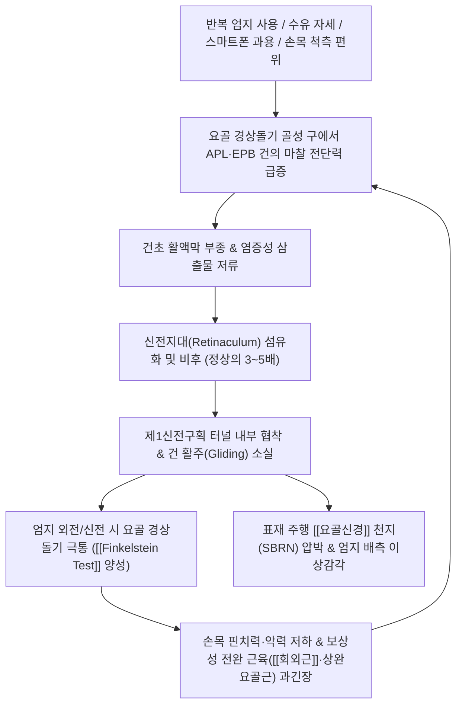

# 🩺 [[드퀘르벵 건초염]] (De Quervain Tenosynovitis, M65.4)

> **핵심 3줄 요약 (Key Summary)**:
> - 📍 병소 부위 & 해부·병태생리: 손목 요골 경상돌기(Radial Styloid) 배측 신근지대 제1신전구획(1st Extensor Compartment)의 섬유골성 터널을 통과하는 [[단무지신근]](EPB)과 [[장무지외전근]](APL) 건초의 반복 마찰에 의한 협착성 건초염(Stenosing Tenosynovitis). 격막(Septum) 변이에 따른 하부구획화 및 다발성 건 슬립(Multiple slips) 변이에 의한 마찰 면적 증가 및 건초 비후.
> - 🚩 전형적 임상 양상 & 3대 징후: 엄지손가락 움직임 및 척측 편위 시 요골 경상돌기 부위의 칼로 베는 듯한 극통, 국소 부종 및 건초 비후 결절 촉진, 찻잔이나 냄비를 들 때 떨어뜨리는 파지력 저하(Mommy's wrist, Texting thumb).
> - 🛠️ 핵심 감별 검사 & 한·양방 다각적 치료 전략: 핑켈스타인 검사([[Finkelstein Test]]), 아이히호프 검사([[Eichhoff Test]]), WHAT 검사 양성. 엄지 스파이카 부목(Thumb Spica Splint) 고정, 제1구획 신전지대 침도 감압술, 봉약침([[양계]], [[열결]], [[편력]], [[합곡]]), 화침(Agnikarma), [[서경탕]]·[[궁귀조혈음]]·[[계지가출부탕]].
> - <font color="#fa7e7e">⚠️ 응급 의뢰 레드플래그 & 악화 요인: 제1구획 표재층을 가로지르는 요골신경 천지([[요골신경]], SBRN) 포착에 따른 엄지 등쪽 작열통 및 감각 마비([[바르텐베르크 증후군]]), 급격한 종창과 고열을 동반한 화농성 건초염, 제1 CMC 관절염 및 주상골 골절 감별.</font>

---

## 📌 목차
1. [질환 개요 & 해부학적 병태생리](#1-질환-개요--해부학적-병태생리)
2. [병태생리 메커니즘 & 생체역학적 악순환 네트워크](#2-병태생리-메커니즘--생체역학적-악순환-네트워크)
3. [임상 증상 & 이학적 검사(Physical Exam) 알고리즘](#3-임상-증상--이학적-검사physical-exam-알고리즘)
4. [감별 진단 매트릭스 (Differential Diagnosis)](#4-감별-진단-매트릭스-differential-diagnosis)
5. [한의 통합 치료 프로토콜 (침·약침·추나·한약)](#5-한의-통합-치료-프로토콜-침약침추나한약)
6. [양방 치료 & 병용·의뢰 기준 (Conventional Treatment & Referral)](#6-양방-치료--병용의뢰-기준-conventional-treatment--referral)
7. [재활 운동 & 생활습관 티칭 가이드](#7-재활-운동--생활습관-티칭-가이드)
8. [💡 사용자 진료실 핵심 필기 & 임상 노하우 (Melt-In 잔여 심화 집약)](#8--사용자-진료실-핵심-필기--임상-노하우-melt-in-잔여-심화-집약)
9. [출처 및 학술 참고 문헌 (References)](#9-출처-및-학술-참고-문헌-references)

---

## 1. 질환 개요 & 해부학적 병태생리

### 1) 질환의 정의 및 임상적 역학
* **정의**: 드퀘르벵 건초염(De Quervain Tenosynovitis, 드퀘르벵 증후군 / De Quervain's Disease)은 1895년 스위스 외과의사 Fritz de Quervain에 의해 최초로 기술된 질환으로, 완관절 배측 신근지대 제1신전구획(1st Extensor Compartment) 내부를 주행하는 [[단무지신근]](Extensor Pollicis Brevis, EPB)과 [[장무지외전근]](Abductor Pollicis Longus, APL)의 건을 감싸고 있는 활액막성 건초(Synovial tendon sheath)의 만성 마찰과 비후로 인해 발생하는 협착성 건초염(Stenosing Tenosynovitis/Tendovaginitis)이다 (Ilyas et al., 2007; Fakoya et al., 2023).
* **역학적 특성**:
  * 30~50대 여성에서 남성보다 6~10배가량 압도적으로 호발한다.
  * 특히 출산 후 1~3개월 차의 수유부(산모)에서 폭발적인 유병률을 보이는데, 이는 임신 및 수유기 릴랙신(Relaxin) 호르몬 변화로 인한 관절 인대의 이완과 함께, 수유 및 목욕 시 아기의 머리와 둔부를 손목으로만 반복 지탱하는 생체역학적 과부하(Baby wrist / Mommy's thumb)가 결합되기 때문이다.
  * 현대에 들어서는 한 손으로 대화면 스마트폰을 쥐고 엄지손가락으로 화면을 광범위하게 스크롤하거나 반복 타이핑하는 '문자족 엄지(Texting thumb)' 환자가 급증하고 있다.
  * 직업적으로는 가위질을 반복하는 미용사, 마우스와 키보드를 과용하는 사무직, 칼질을 다용하는 조리사, 손목을 비틀어 연장을 쥐는 배관공 및 기술직, 피아니스트, 라켓 스포츠(테니스, 배드민턴) 동호인 등에서 다발한다.

### 2) 제1신전구획 (1st Extensor Compartment)의 섬유골성 터널 해부
* **해부학적 경계 (Anatomical Boundaries)**:
  * 완관절 배면에는 두꺼운 지대 섬유인 신전지대(Extensor Retinaculum)에 의해 총 6개의 독립된 신전건 터널 구획이 형성되어 있다.
  * 그중 가장 요측(엄지손가락 쪽)에 위치한 **제1신전구획**은 길이 약 1~2cm의 견고한 섬유골성 터널(Fibro-osseous Tunnel)이다.
  * **바닥(Floor)**: 요골 경상돌기(Radial Styloid Process) 외측면의 얕은 골성 구(Osseous groove).
  * **지붕(Roof)**: 완관절 신전지대의 요측 섬유막 띠.
* **터널을 통과하는 두 힘줄의 기시·정지 및 생역학**:
  1. **[[장무지외전근]](Abductor Pollicis Longus, APL)**:
     * 척골 및 요골 후면 간막에서 기시하여 제1신전구획을 통과한 후 **제1중수골(1st Metacarpal) 기저부 외측**(일부는 대능형골)에 정지한다.
     * 엄지손가락을 손바닥 평면에서 바깥쪽으로 벌리는 외전(Abduction)과 신전 보조, 손목의 요측 편위(Radial deviation)를 주도한다.
  2. **[[단무지신근]](Extensor Pollicis Brevis, EPB)**:
     * 요골 후면 및 골간막에서 기시하여 APL의 내측(척측)을 따라 나란히 주행하며, **엄지 기절골(Proximal phalanx) 기저부 배측**에 정지한다.
     * 엄지 중수수지관절(MCP joint)을 강력하게 신전(Extension)시키고 제1중수골 신전을 보조한다.

```
[ 손목 제1신전구획 및 해부학적 코담배갑 단면도 ]

      (배측 Skin)
          │
      ┌───┴─── 신전지대 (Extensor Retinaculum Roof) ───┐
      │                                                │
      │   ┌───────────────┐        ┌───────────────┐   │
      │   │ [[장무지외전근]] 건   │ <격막> │  [[단무지신근]] 건   │   │  <── (30~50% 하부구획 분리)
      │   │ (APL tendon)  │(Septum)│ (EPB tendon)  │   │
      │   └───────────────┘        └───────────────┘   │
      │           ▲                        ▲           │
      │           └────── 활액막성 건초 ─────┘           │
      └───────────────────────┬────────────────────────┘
                              │
               요골 경상돌기 골성 바닥 (Radial Styloid)
                              │
               [표재층 횡단] [[요골신경]] 천지(SBRN)
               [심부 원위]   해부학적 코담배갑([[양계]]) & 요골동맥
```

### 3) 결정적 해부학적 변이: 하부구획 격막(Septum)과 다발성 건 슬립(Multiple Slips)
* **섬유성 격막에 의한 하부구획화 (Subcompartment / Septation)**:
  * 해부학적 및 초음파 연구에 따르면, 정상 인구의 약 **30~50%**에서 제1신전구획 내부에 종축 섬유성 격막(Bony ridge or Fibrous septum)이 존재하여 APL 터널과 EPB 터널이 독립된 두 개의 서브컴파트먼트로 완전히 분리되어 있다 (Ilyas et al., 2007).
  * 임상적으로 협착성 병변은 상대적으로 터널 직경이 좁은 **EPB 하부구획**에 집중적으로 발생한다.
  * 격막이 존재하는 환자에게 맹검하에 스테로이드 주사를 시행할 경우, 약물이 부피가 큰 APL 구획에만 주입되고 병변이 있는 EPB 구획에는 도달하지 못하여 **주사 치료 실패 및 조기 재발의 최빈 원인**이 된다.
* **APL 건의 다발성 건 슬립 변이 (Multiple Slips)**:
  * APL 건은 단일 건이 아니라 2개에서 최대 4~5개의 복수 건 가닥으로 갈라져 주행하는 변이가 인구의 70% 이상에서 관찰된다. 건 슬립의 수가 많을수록 터널 내 마찰 표면적이 기하급수적으로 증가하여 건초염 발생 감수성을 높인다.

### 4) 인접 신경·혈관 복합체와의 관계
* **요골신경 천지([[요골신경]], Superficial Branch of Radial Nerve, SBRN)**:
  * 상완요골근과 장요측수근신근 사이를 뚫고 나와 피하층으로 주행하며, 제1신전구획의 바로 표재층을 비스듬히 가로질러 주행한다. 엄지 배측 및 수배 요측 반부의 피부 감각을 담당한다.
  * 제1구획 건초가 심하게 비후되거나 염증성 부종이 발생하면 SBRN이 압박을 받아 엄지 등쪽의 저림, 화끈거림, 감각 저하([[바르텐베르크 증후군]])가 병발하기 쉽다. 또한 침도나 수술적 절개 시 SBRN 손상에 의한 신경종(Neuroma) 합병증을 극도로 경계해야 한다.
* **해부학적 코담배갑 (Anatomical Snuffbox) & 요골동맥**:
  * 제1구획 건([[장무지외전근]], [[단무지신근]])의 외측 경계와 제3구획 건([[장무지신근]], EPL)의 내측 경계 사이에 형성된 오목한 삼각 공간이다. 바닥으로 요골동맥이 주행하고 주상골(Scaphoid)이 촉진된다. 한의학의 [[양계]](LI5) 혈위에 해당한다.

---

## 2. 병태생리 메커니즘 & 생체역학적 악순환 네트워크

### 1) ASCII 병태생리 다이어그램
```
+-------------------------------------------------------------------------+
|      생체역학적 유발: 손목 척측 편위(Ulnar Deviation) + 엄지 반복 외전·신전        |
+-------------------------------------------------------------------------+
                                     │
                                     ▼
+-------------------------------------------------------------------------+
|     요골 경상돌기 골성 능선 위에서 지레축 전단 응력(Shear Stress) 집중 발생      |
+-------------------------------------------------------------------------+
                                     │
                                     ▼
+-------------------------------------------------------------------------+
|     제1구획 신전지대와 APL/EPB 건초 간의 마찰 -> 활액막 무균성 염증 및 부종      |
+-------------------------------------------------------------------------+
                                     │
                                     ▼
+-------------------------------------------------------------------------+
|     만성화 기전: 비염증성 점액성 변성(Myxoid Degeneration) & 섬유연골성 화생     |
|   - 신전지대 두께가 정상(0.5mm) 대비 3~5배(최대 3mm)까지 병적 비후 및 경화     |
+-------------------------------------------------------------------------+
                                     │
                                     ▼
+-------------------------------------------------------------------------+
|     섬유골성 터널 내부 공간 협착 -> 힘줄의 정상 활주(Gliding) 폐색 (포착)        |
+-------------------------------------------------------------------------+
                                     │
                                     ▼
+-------------------------------------------------------------------------+
|     엄지 동작 시 칼로 베는 듯한 극통, 악력 상실, [[요골신경]] 천지 2차 포착      |
+-------------------------------------------------------------------------+
                                     │
                                     └───────────► (보상성 전완 긴장 & 악순환)
```



### 2) 생체역학적 전단 마찰 기전
* **손목 척측 편위의 지레 증폭 효과**:
  * 손목이 중립위에 있을 때보다 손목을 새끼손가락 쪽으로 꺾는 척측 편위(Ulnar deviation) 자세를 취할 때, APL과 EPB 건은 요골 경상돌기의 단단한 외측 모서리 위에서 급격한 각도로 꺾이게 된다.
  * 이 상태에서 엄지손가락을 벌리거나(외전) 뒤로 젖히는(신전) 힘을 주면, 도르래를 지나는 밧줄처럼 신전지대 내벽에 가해지는 단위 면적당 수직 압박력과 전단 마찰력이 평소의 4~5배 이상으로 증폭된다.
* **산후 릴랙신 분비와 근막 사슬 결함**:
  * 출산 전후 분비되는 릴랙신(Relaxin) 호르몬은 골반 결합뿐만 아니라 수근관절의 인대와 관절낭을 이완시킨다. 관절 지지력이 약화된 상태에서 전완 외측의 [[회외근]](Supinator)과 상완요골근(Brachioradialis)이 자세 유지를 위해 보상적으로 과긴장하면서, 제1구획 건의 근위부 견인 장력을 비정상적으로 높인다.

### 3) 조직병리학적 특성: 비염증성 점액성 변성
* **점액성 변성(Myxoid Degeneration) 및 콜라겐 단열**:
  * 급성기 짧은 염증 단계를 지나 만성화되면, 건초 조직 내에 염증 세포는 거의 관찰되지 않고, 정상 교원질 섬유가 분해되어 점액성 기질(Acid mucopolysaccharides)로 대체된다.
* **지대의 섬유연골성 화생(Fibrocartilaginous Metaplasia)**:
  * 반복적인 압박과 마찰에 저항하기 위해 신전지대 내벽 세포들이 연골세포 모양으로 변하는 섬유연골성 화생이 일어난다.
  * 이로 인해 정상적으로 0.5mm 내외이던 신전지대 두께가 2~3mm 이상으로 3~5배 두꺼워지고 도자기처럼 딱딱하게 굳어지면서, 터널 내부를 통과하는 힘줄의 자유로운 미끄러짐(Gliding)을 완전히 차단하는 기계적 협착(Stenosis)이 완성된다.

---

## 3. 임상 증상 & 이학적 검사(Physical Exam) 알고리즘

### 1) 주요 임상 증상
* **요골 경상돌기 국소 극통**:
  * 엄지손가락 쪽 손목 관절의 튀어나온 뼈(요골 붓돌) 주변에 찌르는 듯하거나 칼로 베는 듯한 날카로운 통증 발생. 통증은 엄지손가락 끝이나 전완 외측으로 방사될 수 있음.
* **기능적 악력 및 핀치력 상실**:
  * 열쇠 돌리기, 병뚜껑 따기, 젓가락질, 옷의 단추 잠그기, 프라이팬이나 냄비 들기, 아기 안아 올리기 동작 시 통증으로 인해 손에 힘이 빠지며 물건을 바닥에 떨어뜨림.
* **국소 종창 및 경결 결절 촉진**:
  * 요골 경상돌기 직상방의 제1구획 부위가 육안적으로 붓거나, 만졌을 때 쌀알 또는 콩알 크기의 단단하고 극심한 압통을 동반하는 섬유성 결절(Tendon sheath thickening)이 촉지됨.
* **염발음 및 삐걱거림 (Crepitus & Triggering)**:
  * 엄지손가락을 굽히고 펼 때 건초 내부에서 눈 밟는 소리 같은 사각사각하는 가죽 마찰음(Crepitus)이 느껴지거나, 심한 경우 힘줄이 협착된 터널을 억지로 통과하면서 '딸깍'하고 걸리는 방아쇠 현상(Triggering)이 발생함.

### 2) 필수 이학적 검사법 (Physical Examination)
1. **핑켈스타인 검사 ([[Finkelstein Test]]) — Dawson & Mudgal 4단계 점진 프로토콜**:
   * 전완을 중립위에 두고 환자의 손을 탁자에 놓은 뒤, 갑작스러운 손목 꺾기로 인한 불필요한 격통을 방지하고 위양성을 배제하기 위해 4단계로 점진 시행한다:
     * **1단계**: 엄지손가락을 손바닥 쪽으로 수동 굴곡시킴.
     * **2단계**: 손목을 능동적으로 척측 편위(Ulnar deviation)시킴.
     * **3단계**: 환자의 엄지를 굴곡시킨 상태에서 손목을 수동으로 부드럽게 척측 편위시킴.
     * **4단계**: 검사자가 환자의 엄지손가락을 단단히 파지하고 손목을 척측 방향으로 강하게 견인 신장시킴 (전형적인 원형 검사).
   * **양성 판정**: 제1신전구획(요골 경상돌기)에 찢어지는 듯한 극심한 통증이 즉각 재현됨.
2. **아이히호프 검사 ([[Eichhoff Test]])**:
   * 환자 스스로 엄지손가락을 손바닥 안으로 접어 넣고 네 손가락으로 엄지를 감싸 쥔 주먹을 만든 뒤, 손목을 새끼손가락 쪽(척측)으로 꺾도록 함.
   * **임상 주의점**: 일반인에서도 약 30~50%에서 경미한 당김 통증이 유발되는 위양성률(False positive)이 높으므로, 반드시 Finkelstein 4단계 검사 및 국소 압통과 대조하여 종합 판정해야 함.
3. **WHAT 검사 (Wrist Hyperflexion and Abduction of the Thumb)**:
   * 환자의 손목을 최대로 굴곡(Hyperflexion)시킨 상태에서 엄지손가락을 손바닥 평면과 수직으로 벌리는 외전(Abduction)을 능동적으로 시도하게 하고, 검사자가 이에 저항을 가함.
   * **장점**: 수동 신장에 의존하는 Finkelstein보다 활동성 근수축에 따른 전단력을 평가하므로 민감도 99%, 특이도 95% 이상으로 진단 정확도가 매우 높음.
4. **해부학적 코담배갑 압통 검사 (Snuffbox Palpation)**:
   * 제1구획보다 원위부인 코담배갑 바닥을 압박하여 주상골 골절 유무를 배제.
5. **그라인드 검사 (Grind Test)**:
   * 엄지 중수골을 축 방향으로 압박하며 회전시켜 제1 수근중수관절 골관절염을 감별.

```
[ 드퀘르벵 건초염 진료실 감별 알고리즘 ]

                 손목 요측(엄지 쪽) 통증 환자
                              │
                              ▼
                 요골 경상돌기 국소 압통 확인
               ┌──────────────┴──────────────┐
             [양성]                        [음성]
               │                             │
    [[Finkelstein Test]] 4단계 검사      해부학적 코담배갑 바닥 압통
               │                             │
       ┌───────┴───────┐             ┌───────┴───────┐
     [양성]          [음성]        [양성]          [음성]
       │               │             │               │
  [[드퀘르벵 건초염]]   Wartenberg   [[주상골 골절]]  경추 신경근증
       │               증후군 의심   (X-ray 촬영)   ([[스펄링 검사]])
       ▼               (티넬 확인)
  초음파 검사 (제1구획 건초 비후 & 하부구획 격막 유무 확인)
```

---

## 4. 감별 진단 매트릭스 (Differential Diagnosis)

| 감별 질환 | 호발 병소 및 병태생리 | 주소증 및 통증 위치 | 핵심 이학적 검사 소견 | 특이 감별 포인트 및 영상 소견 |
| :--- | :--- | :--- | :--- | :--- |
| **[[드퀘르벵 건초염]]** (본 질환) | 요골 경상돌기 제1신전구획(APL/EPB 건초) | 요골 경상돌기 국소 압통, 엄지 동작 시 찌르는 극통 | [[Finkelstein Test]](+), [[Eichhoff Test]](+), WHAT 검사(+) | 초음파상 제1구획 건초 비후, 도플러 혈류 증가, 격막 변이 |
| **교차 증후군 ([[교차점 증후군]])** | 요골 경상돌기 **근위부 4~6cm** 전완 배측 (제1구획과 제2구획 ECRL/ECRB 교차부) | 손목 4~6cm 위 전완 배측 통증, 손목 신전 시 삐걱거림 | 전완 배측 교차부 직접 압통, 손목 신전-굴곡 시 **현저한 마찰음(Crepitus)** | 병변 위치가 요골 경상돌기보다 확연히 근위부에 위치함 |
| **제1 CMC 관절염 ([[CMC 관절염]])** | 엄지 기저부 제1 수근중수관절(대능형골-제1중수골 간) 관절 연골 퇴행 | 엄지 뿌리 관절의 깊은 둔통, 병뚜껑 돌리기 불가, 관절 아탈구 | **그라인드 검사(Grind Test)**(+), 관절 견인 시 통증 완화 | 손목 X-ray상 제1 CMC 관절 간격 협소, 골극, 연골하 경화 |
| **[[바르텐베르크 증후군]]** (Wartenberg Syn.) | 요골 경상돌기 상방 피하의 요골신경 천지(SBRN) 압박 포착 | 엄지 배측 및 제1 웹스페이스의 **작열통, 저림, 이상감각** | 요골 경상돌기 근위 5cm 부위 **[[티넬 징후]](+)**, Finkelstein 위양성 가능 | **운동 장애나 건초 비후 없이 순수 감각 신경 이상 우세** |
| **[[주상골 골절]](Scaphoid Fracture)** | 넘어지며 손을 짚는 외상(FOOSH) 후 주상골 허리 골절 | 해부학적 코담배갑(Anatomical Snuffbox) 심부의 지속통 | **코담배갑 바닥 직접 압통(+)**, 축성 압박 검사(+) | 손목 외상력 필수, Scaphoid view X-ray 또는 MRI 골절선 확인 |
| **방아쇠 무지 ([[방아쇠 수지]], Trigger Thumb)** | 엄지 중수지관절(MCP) 장측 A1 도르래(Pulley) 건초 협착 | 엄지손가락 손바닥 쪽 마디 통증 및 굴신 시 '딸깍' 걸림 | MCP 관절 손바닥 쪽 결절 촉진 및 압통, 능동 신전 제한 | 통증 부위가 손목(요골 붓돌)이 아니라 **손가락 마디 장측**임 |

---

## 5. 한의 통합 치료 프로토콜 (침·약침·추나·한약)

### 1) 한의학적 병인 및 변증 체계
* **기체어혈(氣滯瘀血)**:
  * 반복 과사용이나 출산 후 어혈이 경락에 정체되어 발생. 통증이 칼로 베듯 날카롭고 부위가 고정되어 있으며 야간에 악화(거안, 拒按).
* **풍한습비(風寒濕痺)**:
  * 산후 조리 미흡으로 찬물에 손을 담그거나 찬 바람을 맞아 풍한습 사기가 경락에 응결된 상태. 관절이 시리고 뻣뻣하며 날씨가 흐리면 통증 악화.
* **간신부족 & 기혈양허(肝腎不足 & 氣血兩虛)**:
  * 수유와 출산으로 기혈과 진액이 고갈되어 근건을 자양하지 못해 발생하는 퇴행성 비증. 손목에 힘이 빠지고 무력감이 동반됨.

### 2) 침구 치료 (Acupuncture & Electroacupuncture)
* **제1구획 국소 핵심 취혈**:
  * [[양계]](LI5): 대장경의 경화혈(經火穴). 해부학적 코담배갑 오목한 부위. EPB 건과 EPL 건 사이에 위치하여 요골측 관절 내압을 감압.
  * [[열결]](LU7): 폐경의 낙혈(絡穴)이자 팔맥교회혈(통임맥). 요골 경상돌기 상방 1.5촌, APL과 EPB 건 사이 틈새에 위치하는 **드퀘르벵 건초염의 최고 특효혈**.
  * [[편력]](LI6): 대장경의 낙혈. 양계 상방 3촌으로 제1구획 근위부 근막 유착 해제.
  * [[태연]](LU9): 폐경의 원혈이자 맥회(脈會). 완관절 요측 혈류 순환 개선.
  * [[합곡]](LI4): 대장경의 원혈. 엄지 전체의 기혈 순환을 주도하고 원격 진통 유도.
  * ⚠️ **자침 안전 가이드**: 요골동맥 박동부와 요골신경 천지 주행로를 피해 피하층을 따라 10~15° 사자(Oblique) 또는 평자(Horizontal)로 0.3~0.5촌 부드럽게 자입한다.
* **전완부 근복 및 협응근 상류(Upstream) 감압 자침**:
  * 아픈 손목만 치료하면 팽팽해진 힘줄의 인장력을 낮출 수 없다.
  * 전완 외측 상부의 [[수삼리]](LI10), [[곡지]](LI11), [[공최]](LU6) 및 [[척택]](LU5) 부근에서 APL·EPB 근복과 [[회외근]](Supinator), 상완요골근의 발통점([[TP]])을 찾아 직침으로 심자(1~1.5촌)하여 근육의 과긴장을 선제적으로 해제한다.
* **전침 요법 (Electroacupuncture)**:
  * [[열결]](LU7)과 [[수삼리]](LI10) 또는 전완 APL 근복에 전침을 연결하고 2Hz/100Hz 혼합파를 15분간 통전하여 내인성 통증 억제 물질 분비 및 근막 이완을 유도한다.

### 3) 미세침도 요법 (Acupotomy)
* **적응증**: 2개월 이상의 보존 치료에도 호전되지 않는 만성 협착성 건초염, 신전지대 비후가 뚜렷하고 삐걱거림이나 방아쇠 현상이 동반된 난치성 환자.
* **시술 방법**:
  * 환자의 손목을 측와위로 두고 소독 후, 0.35×40mm 소평인 침도를 사용한다.
  * 요골 경상돌기 직상방의 가장 비후된 신전지대 부위를 촉진하고, 침도 날을 **힘줄의 주행 방향(장축)과 엄격히 평행하게** 위치시킨다.
  * 피하지방층을 지나 단단한 신전지대에 닿으면, 지대 섬유만을 목표로 1~2mm 범위 내에서 종축으로 미세 절개(감압)하여 터널 내압을 즉각적으로 해소한다.
  * ⚠️ **신경 보호**: 요골신경 천지(SBRN)가 표재층을 비스듬히 지나므로, 침도를 횡방향으로 비틀거나 긁는 조작은 절대 금기이다.

### 4) 화침 및 온침/뜸 요법 (Agnikarma & Warm Needling)
* 만성화된 비염증성 점액성 변성 건초에 화침(가열한 특수 침을 건초 비후부에 순간 자입) 또는 온침, 미세 간접구를 적용한다 (Garg et al., 2026).
* 국소 심부 온도를 상승시켜 콜라겐 조직의 점탄성을 개선하고 미세 혈류 순환을 촉진하여 두꺼워진 활액막의 흡수 리모델링을 강력히 유도한다.

### 5) 약침 및 봉약침 치료 (Pharmacopuncture)
* **봉약침 (Bee Venom, BV)**:
  * 1:10,000~1:30,000 희석 정제 봉약침을 스킨테스트 후 사용.
  * 강력한 항염증 펩타이드(멜리틴, 아도라핀)가 비후된 건초 내 혈관 증식과 활액막 부종을 신속히 가라앉힌다 (Hadianfard et al., 2014).
  * [[열결]](LU7) 및 건초 주변 결합조직(Peritendinous space)에 30G 니들로 포인트당 0.05~0.1cc씩 총 0.3~0.5cc 주입. **건 실질 내 직접 주입은 건 파열을 유발하므로 절대 회피**.
* **신바로약침 / 중성어혈약침**:
  * 급성기 열감과 부종이 심한 경우 신바로약침을 건초 주위에 주입하여 신경 염증을 진정시키고, 산후 어혈성 통증에는 중성어혈약침을 적용한다.

### 6) 추나 요법 및 관절 가동술 (Chuna Manual Therapy)
* **수근골 관절 가동술 (Carpal Mobilization)**:
  * 주상골(Scaphoid)과 대능형골(Trapezium)의 관절면을 파지하고 완만하게 장축 견인 및 배측-장측 활주 수기를 시행하여 요수근관절의 불균형 압박을 해소한다.
* **전완부 근막이완술 (MFR) 및 회외근 MET**:
  * 전완 외측 골간막 및 [[회외근]], 상완요골근을 모지 수기로 압박 이완하고, 등장성 수축 후 이완(PIR) 기법을 적용하여 APL/EPB 건에 걸리는 기저 장력을 차단한다.

### 7) 변증별 맞춤 한약 처방 (Herbal Medicine)
* **기체어혈 (氣滯瘀血) & 풍한습비 (風寒濕痺)**:
  * 직업적 과사용 만성형, 날씨 변화에 따른 쑤심.
  * **[[서경탕]](舒經湯)**: 강황, 해동피, 당귀, 적작약, 계지 등으로 상지 경락의 어혈과 습담을 통도(通導).
  * **[[오적산]](五積散)** 가미방: 한습이 울체된 관절 냉통 해소.
  * **[[당귀수산]](當歸鬚散)**: 급성 타박 및 국소 어혈 팽만 진정.
* **산후 기혈양허 & 간신부족 (産後 氣血兩虛 & 肝腎不足)**:
  * 수유기 산모의 건초염(Mommy's wrist), 전신 피로 및 손목 무력증.
  * **[[궁귀조혈음]](芎歸調血飮)** 합 **[[사물탕]](四物湯)**: 당귀, 천궁, 백작약, 숙지황, 익모초를 배합하여 산후 어혈을 제거하고 기혈을 대보(大補)하여 인대 조직 강화.
  * **[[계지가출부탕]](桂枝加朮附湯)**: 관절이 시리고 찬물에 닿으면 극심해지는 산후 풍비(風痺)에 탁월한 온경통락(溫經通絡) 효과.

---

## 6. 양방 치료 & 병용·의뢰 기준 (Conventional Treatment & Referral)

### 1) 고정 요법: 엄지 스파이카 부목 (Thumb Spica Splint)
* **일반 손목 밴드와의 본질적 차이**:
  * 시중의 일반 손목 보호대는 손목만 감싸고 엄지손가락을 자유롭게 움직이게 하므로, 엄지를 벌리거나 굽힐 때마다 힘줄이 터널 내벽을 지속적으로 마찰하여 질환을 악화시킨다.
  * 반드시 엄지 중수수지(MCP) 관절을 30° 외전 및 신전 상태로 고정하고 완관절을 20° 신전 상태로 단단히 유지해 주는 **엄지 스파이카 부목(Thumb Spica Splint)**을 최소 **2~4주간** 착용해야 한다.

### 2) 경구 약물 치료 (Medication)
* **NSAIDs 및 진통제**:
  * Aceclofenac 100mg bid, Celecoxib 200mg qd, Meloxicam 7.5mg qd 단기 처방.
  * 급성기 통증과 활액막 부종 완화에는 기여하나, 만성화된 점액성 변성 및 협착 자체를 해소하지는 못함. 수유부 산모의 경우 약물의 모유 이행 위험성을 고려하여 투여가 제한됨.

### 3) 국소 주사 요법의 득과 실 (Injections)
* **초음파 유도하 스테로이드 주사 (Corticosteroid Injection)**:
  * Triamcinolone acetonide 10~20mg + 1% Lidocaine을 제1구획 건초 내로 주입.
  * **치료 성적**: 약 70~80%의 환자에서 즉각적인 단기 증상 호전을 보임 (Fakoya et al., 2023).
  * **부작용 및 한계**:
    1. 하부구획 격막(Septum) 변이가 있는 경우 약물이 APL에만 들어가 EPB 구획의 병변이 잔류하여 재발함.
    2. 피하지방 위축(Subcutaneous fat atrophy), 영구적인 피부 탈색(Depigmentation), 건 실질 내 오주입 시 건 파열(Tendon rupture) 위험.
    3. 요골신경 천지(SBRN) 주변으로 약물이 누출될 경우 신경염 및 감각 이상 초래.
* **자가 혈소판 풍부 혈장 (PRP) 주사 요법**:
  * 최근 임상 연구에 따르면, 스테로이드 주사가 1개월 단기 효과는 빠르지만, 6개월 이상의 중장기 추적 관찰에서는 PRP 주사군이 건초의 기질 재생 및 재발 방지 측면에서 대등하거나 더 우수한 치료 결과를 나타냄이 보고됨 (Ashour et al., 2024).

### 4) 수술적 치료 적응증 (Surgical Release)
* **수술 적응증**:
  * 최소 6개월 이상의 체계적인 보존적 치료(부목 고정, 한의 침도/약침, 국소 주사)에도 호전이 없는 불응성 환자.
  * 통증으로 인해 일상생활이나 직업 활동이 완전히 불가능하며 힘줄의 잠김 현상(Triggering)이 지속되는 경우.
* **수술 방법 및 합병증 예방 (Release of 1st Dorsal Compartment)**:
  * 요골 경상돌기 부위 횡절개 또는 종절개를 통해 신전지대를 노출하고 종축으로 완전히 절개 감압한다.
  * **수술 핵심**: 수술 중 반드시 **EPB 하부구획(Subcompartment)의 존재 여부를 탐색하여 격막을 완전히 절개**해야 재발을 방지할 수 있다.
  * SBRN의 신경 분지들을 섬세하게 박리 보호하여 술 후 통증성 신경종(Painful neuroma) 형성을 원천 차단해야 한다.

### 5) 한의 병용 판단 및 상호작용 (Combination Therapy)
* **병용 가능**:
  * 엄지 스파이카 부목 착용 상태에서 침, 뜸, 봉약침, 한약([[서경탕]]) 병행은 건초의 물리적 휴식과 생물학적 항염 재생을 동시에 달성하는 최상의 조합이다.
* **병용 주의 및 시술 금기**:
  * 정형외과에서 스테로이드 주사를 맞은 지 **4주 이내**인 환자는 건초 조직이 극도로 약화되어 있으므로, 이 기간 동안 제1구획 내 침도(Acupotomy) 시술은 건 파열 위험이 있어 엄격히 금기이며 원위부 자침과 물리요법만 시행한다.

### 6) 양방·전문과 의뢰 기준 (Referral Criteria / Red Flags)
* **수부외과/정형외과 즉각 의뢰**:
  * 1. **요골신경 천지 완전 손상 징후**: 엄지 등쪽의 심한 작열통과 함께 감각 소실이 급격히 진행되는 경우.
  * 2. **화농성 건초염 의심**: 손목 요측의 극심한 발적, 열감, 전신 발열, 건초를 따른 급격한 상행성 부종(패혈증 예방을 위한 응급 배농 및 항생제 필요).
  * 3. **건 파열 의심**: 엄지 MCP 관절을 스스로 전혀 신전할 수 없는 탈력 상태.

---

## 7. 재활 운동 & 생활습관 티칭 가이드

### 1) 단계별 재활 운동 프로그램
```
[ 드퀘르벵 건초염 3단계 회복 로드맵 ]

     1단계: 급성 고정기 (1~2주)          2단계: 가동성 회복기 (3~4주)         3단계: 원심성 강화기 (5주~)
┌───────────────────────────────┐   ┌───────────────────────────────┐   ┌───────────────────────────────┐
│ • 엄지 스파이카 부목 고정     │   │ • 무통 범위 내 능동 관절운동 │   │ • 고무줄 저항 외전 훈련      │
│ • 통증 유발 엄지 조작 전면금지│──►│ • 요골신경 신경가동술         │──►│ • 원심성 수완 신전 훈련      │
│ • 냉찜질 및 림프 순환 마사지  │   │ • 전완 신근군 부드러운 신장  │   │ • 일상생활 동작 점진 복귀    │
└───────────────────────────────┘   └───────────────────────────────┘   └───────────────────────────────┘
```

* **1단계: 급성 고정기 (1~2주차)**:
  * 통증 점수 4점(VAS) 이상일 때는 무리한 스트레칭을 전면 금지하고 엄지 스파이카 부목으로 완전한 휴식을 취한다.
* **2단계: 가동성 회복 및 신경가동술 (3~4주차)**:
  * **엄지 능동 가동 운동**: 부목을 풀고 통증이 없는 범위 내에서 엄지를 손바닥 쪽으로 천천히 접었다 펴는 동작을 10회씩 반복.
  * **[[요골신경]] 신경가동술 (Radial Nerve Gliding)**:
    1. 선 자세에서 팔을 몸 뒤쪽으로 뻗는다.
    2. 손목을 안쪽으로 돌려 회내(Pronation)시키고 손목을 굴곡시킨다.
    3. 엄지손가락을 손바닥 안으로 굴곡시킨 뒤, 고개를 반대쪽 어깨로 갸우뚱 기울여 요골신경을 부드럽게 활주시킨다 (무리하게 당기지 말고 5초간 유지, 5회 반복).
* **3단계: 등척성 및 원심성 근력 강화 (5주차 이후)**:
  * **손가락 고무줄 벌리기 운동 (Finger Band Abduction)**: 다섯 손가락 끝에 고무줄을 끼우고 손가락을 부채처럼 바깥쪽으로 천천히 벌린 후 5초간 등척성으로 유지하고 천천히 모은다 (10회씩 3세트).
  * **원심성 엄지 신전 훈련**: 건측 손으로 환측 엄지를 뒤로 당겨 신전시킨 뒤, 환측 엄지의 버티는 힘을 이용해 천천히 원래 위치로 돌아오는 편심성 제어 훈련.

### 2) 산모 및 일상생활 인체공학적 자세 티칭
* **아기 안아 올리기 자세 교정 (스쿠프 기법, Scoop Technique)**:
  * **❌ 금기 동작**: 엄지와 검지 사이의 'L'자 홈으로 아기의 겨드랑이를 파고들어 손목 힘만으로 들어 올리는 자세 (제1구획 전단력 극대화).
  * **✅ 권장 동작**: 손목을 꺾지 말고, **양 손바닥 전체와 전완(아래팔)으로 아기의 둔부와 등 전체를 감싸 안듯이(Scoop)** 들어 올려 체중을 전완과 몸통 체간으로 분산시킬 것.
* **수유 자세**:
  * 수유 쿠션이나 베개를 충분히 높여 아기의 높이를 산모의 가슴 높이까지 맞추고, 손목으로 아기 머리를 받치지 말고 팔꿈치 안쪽 접히는 부위로 지탱할 것.
* **스마트폰 사용 습관**:
  * 스마트폰을 한 손으로 쥐고 엄지손가락만으로 화면 전체를 스와이프하거나 자판을 치는 동작 금지.
  * 반드시 양손으로 스마트폰을 파지하고, 스크롤 및 터치는 검지손가락을 사용할 것. 음성 입력 기능 적극 활용.

---

## 8. 💡 사용자 진료실 핵심 필기 & 임상 노하우 (Melt-In 잔여 심화 집약)

### 1) Thumb Spica 보호대 처방의 성패 요건
* 진료실에 내원하는 환자의 80%는 "약국에서 파는 손목 보호대를 2주 넘게 차고 다녔는데도 하나도 안 낫는다"고 호소한다.
* 일반 보호대는 손목 관절만 압박하고 엄지손가락은 자유롭게 밖으로 노출되어 있어, 환자가 보호대를 찬 채 엄지로 스마트폰을 만지거나 물건을 쥐면서 터널 내부에서 힘줄이 계속 비벼지기 때문에 전혀 호전되지 않는다.
* **원장님 팁**: 반드시 알루미늄이나 플라스틱 지지대가 엄지 첫째 마디(중수지관절)까지 올라와 **엄지의 굴곡·외전을 물리적으로 완벽히 잠가주는 '엄지 스파이카(Thumb Spica)'**를 구입하도록 지도해야 치료 성공률이 2배 이상 상승한다.

### 2) 전완 외측 회외근(Supinator)과 상완요골근의 상류(Upstream) 감압 손맛
* 드퀘르벵 건초염 환자들의 손목 요골 붓돌 부위는 이미 극도로 붓고 예민해져 있는 상태다.
* 이때 아픈 손목 부위에만 강하게 자침하거나 물리치료를 가하면, 환자는 다음 날 "치료받고 손목이 더 붓고 칼로 베는 것 같다"며 컴플레인을 제기한다.
* **실전 손맛 노하우**:
  1. 환자의 전완 외측 상부 1/3 지점에서 바위처럼 뭉쳐 있는 [[회외근]](Supinator)과 상완요골근, APL 근복([[곡지]] 하방 2~3촌)을 먼저 촉진한다.
  2. 이 부위에 0.30×40mm 호침으로 2~3개 자침하여 근막 연축(Twitch)을 일으켜 텐션을 먼저 털어준다.
  3. 상류에서 힘줄을 당기는 고무줄 장력이 느슨해진 것을 확인한 후, 손목 [[열결]](LU7) 부위에는 신바로약침이나 소염약침 0.2~0.3cc를 피하층으로 아주 부드럽게 주입한다.
  4. 이 '상류 감압 + 하류 소염' 콤비네이션을 적용하면 당일 즉시 핑켈스타인 통증이 절반 이하로 줄어드는 극적인 치료 효과를 얻을 수 있다.

### 3) 초음파 하 하부구획(Septum) 존재 시 환자 설명 노하우
* 진료실 초음파로 제1구획 단축상을 스캔했을 때, APL과 EPB 사이에 골성 돌출이나 섬유성 격막이 관찰되어 터널이 둘로 쪼개져 있는 환자가 있다.
* 이런 환자는 일반적인 치료 기간보다 최소 2~3배 이상 치료 기간이 길어지고 난치성으로 진행할 확률이 매우 높다.
* **환자 설명 멘트**: *"환자분은 힘줄이 지나가는 방이 일반인처럼 하나가 아니라, 가운데 벽이 있어서 방이 두 개로 나뉘어 있는 특수한 체질입니다. 힘줄이 더 좁은 방에 끼어 있어 치료가 까다롭고 재발이 쉽기 때문에, 남들보다 치료 기간을 2~3주 더 넉넉히 잡고 침도 요법으로 좁아진 방을 넓혀주는 치료가 꼭 필요합니다."*라고 미리 예후를 티칭해야 의료진에 대한 신뢰가 견고해진다.

### 4) 산모 환자의 정서적 지지와 봉약침 치료의 가치
* 출산 후 극심한 손목 통증으로 내원하는 산모들은 수유와 육아를 중단할 수 없다는 죄책감과 고통으로 심리적 우울감이 극에 달해 있다.
* 정형외과에서는 "스테로이드 주사를 맞거나 손을 쓰지 말라"고 하지만, 모유 수유 중 약물 우려와 독박 육아 현실에서 이는 불가능한 처방이다.
* **진료실 소통**: *"어머니, 수유를 중단하지 않고도 안전하게 염증을 가라앉힐 수 있는 천연 봉약침과 무독성 약침 치료가 있습니다. 아기를 안는 자세만 팔꿈치 받치기로 바꾸시면 수유하시면서도 충분히 다 나을 수 있습니다."*라는 현실적인 티칭과 공감이 환자의 치료 순응도를 극대화한다.

---

## 9. 출처 및 학술 참고 문헌 (References)

1. Garg P, et al. (2026). Management of De-Quervain's tenosynovitis by Agnikarma with Suvarana Shalaka: A case report. *J Ayurveda Integr Med*. [PMID: 42480413](https://pubmed.ncbi.nlm.nih.gov/42480413/)

   - [연구 요약]: 드퀘르벵 건초염 환자에서 금 침(Suvarana Shalaka)을 이용한 화침 요법(Agnikarma)의 치료 효과를 보고한 증례 연구. 비후된 건초 조직에 가해진 정밀한 열 자극이 만성 점액성 변성을 개선하고 염증성 통증 및 핑켈스타인 검사 소견을 신속히 관해시킴을 증명함.

2. Ashour AT, et al. (2024). A Comparison of the Results of Platelet-Rich Plasma Injection Versus the Results of Corticosteroid Injections in De-Quervain Tenosynovitis. *Cureus*. [PMID: 38953060](https://pubmed.ncbi.nlm.nih.gov/38953060/)

   - [연구 요약]: 드퀘르벵 건초염 환자에서 혈소판 풍부 혈장(PRP) 주사와 국소 스테로이드 주사의 임상 효능을 비교한 전향적 연구. 단기 1개월에는 스테로이드가 빠른 진통을 보였으나, 6개월 추적 관찰 시점에서는 PRP 군이 건의 구조적 재생, 통증 완화 지속도 및 낮은 재발률에서 우수한 결과를 나타냄을 규명함.

3. Fakoya AO, et al. (2023). De Quervain's Disease: A Discourse on Etiology, Diagnosis, and Treatment. *Cureus*. [PMID: 37252462](https://pubmed.ncbi.nlm.nih.gov/37252462/)

   - [연구 요약]: 드퀘르벵 병의 병인, 해부학적 제1구획 구조 및 격막 변이, 임상 증상, 진단 검사법(Finkelstein 및 WHAT 검사), 보존적 치료 및 수술적 감압술의 최신 지침을 총괄적으로 정리한 임상 종설.

4. Ilyas AM, et al. (2007). De Quervain tenosynovitis of the wrist. *J Am Acad Orthop Surg*. [PMID: 18063716](https://pubmed.ncbi.nlm.nih.gov/18063716/)

   - [연구 요약]: 제1신전구획의 해부학적 하부구획 격막 변이 빈도(인구의 30~50%)와 임상적 중요성을 강조하고, 핀켈스타인 검사의 진단적 가치와 단계별 보존적 부목 요법 및 수술적 절개술의 프로토콜을 정립한 미국정형외과학회(JAAOS)의 대표 종설.

5. Hadianfard M, et al. (2014). Efficacy of acupuncture versus local methylprednisolone acetate injection in De Quervain's tenosynovitis: a randomized controlled trial. *J Acupunct Meridian Stud*. [PMID: 24929455](https://pubmed.ncbi.nlm.nih.gov/24929455/)

   - [연구 요약]: 드퀘르벵 건초염 환자를 대상으로 침 치료와 국소 코르티코스테로이드 주사를 비교한 무작위 대조 임상시험(RCT). 침 치료군이 주사 치료군과 동등한 수준의 통증 감소 및 기능 회복을 보였으며, 주사제 특유의 조직 위축이나 탈색 부작용이 없는 안전한 치료법임을 입증함.

---
## 📎 개념 학습 보충 (2026-10-27 논문 연계)

**이 논문에서의 역할** — 이 질환에서 [[경근자법]](經筋刺法, sinew acupuncture)의 **무작위 대조 근거**를 처음 만든 시험의 대상 질환이다(2026-10-27 심층리뷰 1번, Phytomedicine 2022;104:154254, [PMID 35728386](https://pubmed.ncbi.nlm.nih.gov/35728386/)).

- **대상·설계**: 홍콩대학 중의학 임상센터 68명(침 34 vs 대기자 34). 18세 이상·통증 3개월 이상·지난 1주 평균 VAS ≥40/100 mm. 2주간 5회(주 2~3회), 6·12주 추적. 대조군은 대기자 명단으로 6주까지 평가만 받고 이후 교차 수령했다.
- **시술 프로토콜 실물**: 전완 요측의 경근(폐경·대장경 계열) 상에서 ① 압통점 ② 자극 시 증상 완화가 유발되는 점 ③ 결절(knot)을 골라 4~6점을 피하 횡자했다. 침첨은 요골경상돌기(제1 배측 구획) 통증점을 향하게 방향을 맞췄다. 침 규격·유침 시간은 원문 미기재.
- **결과**: 2주 시점 통증 VAS가 침군 −19.5 mm vs 대기자군 −3.4 mm(군간 차 −16.2 mm, 95% CI −26.7~−5.6, p=0.003), 12주에도 기저 대비 −30.6 mm(−39.6~−21.7)로 유지됐다. 이차 지표인 통증 강도·환측 악력·집기력·[[QuickDASH]]가 개선됐고 WHOQOL-BREF는 유의 변화가 없었다. 중대 이상반응 0건.
- **해석 포인트**: 군간 차 16.2 mm는 통증 VAS의 최소임상중요차(10~20 mm) **하한에 걸치는** 크기다. "극적 개선"이 아니라 "중등도 개선 + 기능 지표 동반 개선"으로 읽는 것이 정확하다. 대조군이 위약침이 아닌 대기자군이므로 기대·접촉 효과가 배제되지 않았고 단일맹검·68명이다.
- **진료실 배치**: 요골경상돌기 압통점을 침첨 목표로 두고 전완 요측 4~6점을 피하로 눕힌다. 5회/2주는 "주 2회 2주 + 경과 재평가, 호전 시 1~2회 추가"로 옮기기 쉽다. 엄지 사용 제한·보조대·활동 조절 교육이 본체이고 침은 가속 장치다.
- **안전**: 요골감각신경 표재분지가 제1 구획 표층을 지난다 → 시술 중 저림·전격통이 나타나면 침을 물려 후퇴한다. 항응고제 복용·응고장애·시술 부위 피부 감염은 금기다.
- **후속 근거와의 관계**: 침 메타분석(Postgrad Med J 2024;100:709-720, [PMID 38932434](https://pubmed.ncbi.nlm.nih.gov/38932434/)) — [연구 요약] 드퀘르벵 건초염 침 치료 연구를 통합해 통증·기능 개선 방향을 보고한 체계적 고찰·메타분석. / 보존치료 네트워크 메타분석(J Hand Ther 2026;39:479-495, [PMID 41298159](https://pubmed.ncbi.nlm.nih.gov/41298159/)) — [연구 요약] 주사·보조기·물리치료·침을 한 순위망에 놓고 비교한 NMA로, 침은 계열 중 하나의 선택지로 위치한다. 단일 시험의 결론을 계열 전체 결론으로 확장하지 않는다.
- **관련 개념**: [[경근자법]] · [[단무지외전근]] · [[단무지신근]] · [[QuickDASH]] · [[관문조절설]] · [[대기자 대조군]] · [[시각아날로그척도(VAS)]] · [[2026-10-27_근골격계-사지말초_개념학습]] 1번
