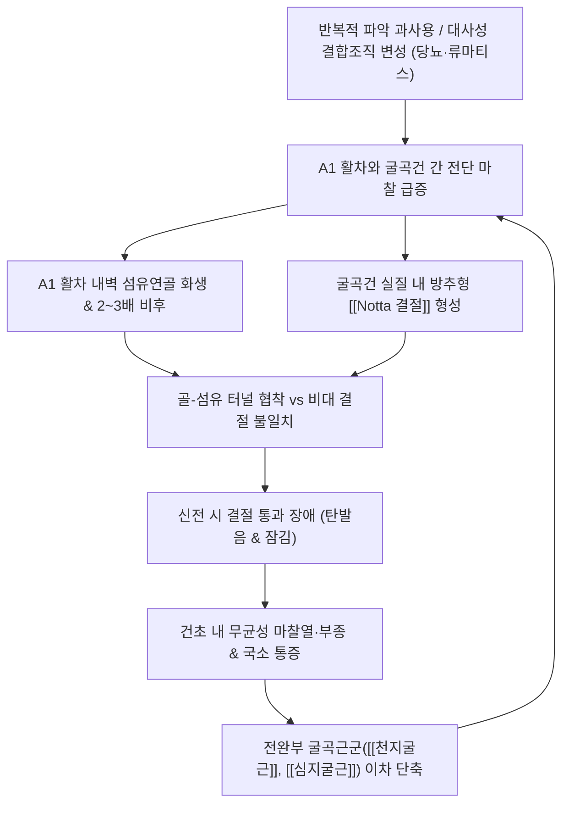

# 🩺 [[방아쇠 수지]] (Trigger Finger / 탄발지, M65.3)

> **핵심 3줄 요약 (Key Summary)**:
> - 📍 병소 부위 & 해부·병태생리: 중수수지관절([[MCP 관절]]) 수장측 제1 윤상 활차([[A1 활차]], A1 Pulley) 부위에서 [[천지굴근]](FDS)·[[심지굴근]](FDP)·[[장무지굴근]](FPL) 힘줄의 반복적 마찰과 압박으로 인해 활차 비후 및 방추형 결절([[Notta 결절]])이 형성되어 활주가 제한되는 협착성 건초염.
> - 🚩 전형적 임상 양상 & 3대 징후: 손가락 굴신 시 딸깍거리는 탄발음(Clicking/Snapping), 아침 기상 시 수지 굴곡 구축 및 잠김(Locking), [[MCP 관절]] 장측 활차 부위의 국소 결절성 압통 및 탄발 촉지 ([[Green 중증도 분류]] I~IV도).
> - 🛠️ 핵심 감별 검사 & 한·양방 다각적 치료 전략: 능동 탄발 유발 검사 및 결절 촉진. [[침도요법]](A1 활차 경피적 미세절개침/도침 감압술), 건초 주위 [[봉약침]], [[온침]], 야간 신전 부목, [[서경탕]]·[[소경활혈탕]]·[[독활기생탕]] 투여 및 보존 치료 실패 시 경피적/개방성 유리술 연계.
> - <font color="#fa7e7e">⚠️ 응급 의뢰 레드플래그 & 악화 요인: 침도 시술 시 수지 고유 신경·혈관 다발 손상 방지(수장측 정중선 종축 평행 자입 엄수), 스테로이드 건 실질 내 반복 주사로 인한 건 파열·피하위축 위험 경계, 급성 [[화농성 굴근건초염]](Kanavel 4대 징후) 동반 시 즉각 응급 배농 의뢰.</font>

---

## 📌 목차
1. [질환 개요 & 해부학적 병태생리](#1-질환-개요--해부학적-병태생리)
2. [병태생리 메커니즘 & 생체역학적 악순환 네트워크](#2-병태생리-메커니즘--생체역학적-악순환-네트워크)
3. [임상 증상 & 이학적 검사(Physical Exam) 알고리즘](#3-임상-증상--이학적-검사physical-exam-알고리즘)
4. [감별 진단 매트릭스 (Differential Diagnosis)](#4-감별-진단-매트릭스-differential-diagnosis)
5. [한의 통합 치료 프로토콜 (침·약침·추나·한약)](#5-한의-통합-치료-프로토콜-침약침추나한약)
6. [양방 치료 & 병용·의뢰 기준 (Conventional Treatment & Referral)](#6-양방-치료--병용의뢰-기준-conventional-treatment--referral)
7. [재활 운동 & 생활습관 티칭 가이드](#7-재활-운동--생활습관-티칭-가이드)
8. [💡 사용자 진료실 핵심 필기 & 임상 노하우 (Melt-In 잔여 심화 집약)](#8--사용자-진료실-핵심-필기--임상-노하우-melt-in-잔여-심화-집약)
9. [출처 및 학술 참고 문헌 (References)](#9-출처-및-학술-참고-문헌-references)

---

## 1. 질환 개요 & 해부학적 병태생리

### 1) 질환 정의 및 역학적 특성
* **정의**: 방아쇠 수지(Trigger Finger, 협착성 건초염, Stenosing Tenosynovitis, 彈發指)는 수부 굴곡건(Flexor Tendon)이 중수수지관절([[MCP 관절]]) 장측의 제1 윤상 활차([[A1 활차]], A1 Pulley)를 통과할 때, 활차의 비후 및 건 실질의 결절성 비대로 인해 활주 공간이 협소해져 손가락의 굴신 운동 시 저항, 통증, 딸깍거림(Snapping), 그리고 궁극적인 굴곡 잠김(Locking)을 유발하는 대표적인 수부 건초 질환이다.
* **역학 및 호발 대상**:
  * 일반 인구의 평생 유병률은 약 2~3%이나, 당뇨병 환자에서는 10~20%로 급증한다.
  * 호발 연령은 50~60대 여성에서 남성 대비 2~6배 호발하며, 직업적으로 강한 파악력(Grip force)을 요구하는 육체 노동자, 미용사, 요리사, 농업 종사자, 악기 연주자, 라켓 스포츠 동호인에게 빈발한다.
  * 호발 수지는 **제4지(약지) > 제3지(중지) > 제1지(엄지)** 순이며, 당뇨나 류마티스 등 전신 대사 질환 환자에서는 양측성 및 다발성으로 발생하는 경향이 뚜렷하다 (Lin et al., 2026).

### 2) 수부 굴곡건 활차 시스템 (Pulley-Tendon Sheath System)
수부 굴곡건 터널은 지골(Phalanx)에 건을 밀착시켜 손가락을 구부릴 때 건이 뼈에서 떨어져 나오는 '활시위 현상(Bowstringing)'을 물리적으로 방지하고, 건의 활주력을 최대 지렛대 효율로 관절 회전 운동으로 전환하는 정밀한 섬유-골 터널(Fibro-osseous tunnel) 구조를 이룬다.

```
[수부 굴곡건 활차 시스템의 해부학적 배열]

  중수골두(MC Head)      기절골(Proximal)          중절골(Middle)         원위지골(Distal)
┌──────────────┐     ┌──────────────────┐     ┌────────────────┐     ┌──────────────┐
│  A1 활차     │ ──> │   A2 활차        │ ──> │   A4 활차      │ ──> │  FDP 정지부   │
│  (MCP 관절)  │     │   (기절골 체부)  │     │   (중절골 체부)│     │  (DIP 관절)  │
└──────────────┘     └──────────────────┘     └────────────────┘     └──────────────┘
       │                      ▲                        ▲
       ▼                      │                        │
  [C1 활차] ─────────────> [C2 활차] ───────────────> [C3 활차]
  (A2-A3 사이)             (A3-A4 사이)               (A4-A5 사이)
```

* **5개의 윤상 활차 (Annular Pulleys: A1~A5)**:
  * **[[A1 활차]] (A1 Pulley)**: 중수골두 직하방 장측 판(Volar Plate) 및 기절골 기저부에 위치하며, 길이가 약 8~10mm이다. 굴곡건이 수근관을 나와 손가락 터널로 진입하는 첫 관문이자, 주먹을 쥘 때 가장 극심한 압축 하중과 전단 마찰력을 받아 병리적 비후가 집중되는 핵심 병소이다.
  * **A2 활차 & A4 활차**: 각각 기절골 및 중절골 체부에 단단히 부착되는 광범위하고 두꺼운 활차로, 활시위 방지에 절대적으로 필수적인 구조물이다. 어떠한 감압 수기(침도 절개술 등) 시에도 A2 활차의 손상은 절대적으로 금기된다.
  * **A3 활차 & A5 활차**: 각각 근위지간관절([[PIP 관절]]) 및 원위지간관절([[DIP 관절]])의 장측 판 상방에 위치하는 좁은 활차이다.
* **3개의 십자 활차 (Cruciate Pulleys: C1~C3)**:
  * 윤상 활차들 사이에 X자 형태로 교차 배열되어 손가락 굴곡 시 활차 터널이 찌그러지지 않고 유연하게 접히도록 공간적 순응성을 제공한다.

### 3) 관여하는 3대 굴곡근 및 건초의 해부학
* **[[천지굴근]](Flexor Digitorum Superficialis, FDS)**:
  * 전완부 내측상과, 척골 구상돌기, 요골 사선에서 기시하여 수근관을 통과한 후 중수골두 레벨에서 A1 활차로 진입한다.
  * 기절골 중간부에서 두 갈래로 갈라져(Camper's chiasm, 캄퍼 교차) 심지굴근건을 통과시킨 뒤 중절골 기저부 외측에 정지한다.
  * **기능**: 주로 [[PIP 관절]]의 굴곡을 주도한다.
* **[[심지굴근]](Flexor Digitorum Profundus, FDP)**:
  * 척골 전내측면 및 골간막에서 기시하여 수근관을 지나 A1 활차 내에서 FDS의 심부를 주행한다.
  * Camper's chiasm 부위에서 FDS의 분지 사이를 뚫고 나와 원위지골 기저부 수장측 결절에 정지한다.
  * **기능**: 유일하게 [[DIP 관절]]을 굴곡시키는 핵심 근육이다.
* **[[장무지굴근]](Flexor Pollicis Longus, FPL)**:
  * 요골 전면 및 골간막에서 기시하여 엄지손가락 수근관 외측을 거쳐 A1 활차를 통과한 후 엄지 말절골 기저부에 정지한다.
  * 엄지의 유일한 지간관절(IP 관절) 굴곡건이다.
* **수지 신경 및 혈관 다발 (Digital Neurovascular Bundle)**:
  * A1 활차의 양측 외측면(Radial & Ulnar borders)에 불과 1~2mm 간격을 두고 고유 수지 신경(Digital nerve)과 동맥이 주행하므로, 침도(Acupotomy)나 주사 치료 시 정중선을 엄격히 준수해야 한다.

---

## 2. 병태생리 메커니즘 & 생체역학적 악순환 네트워크

### 1) 조직병리학적 변화와 섬유연골성 화생
방아쇠 수지는 과거 단순한 '염증성 활액막염'으로 여겨졌으나, 최근 조직병리학 연구에 따르면 만성적인 기계적 마찰과 전단 응력(Shear stress)에 의해 유발되는 **퇴행성 섬유연골성 화생(Fibrocartilaginous metaplasia)** 및 결합조직 리모델링 질환으로 규명되었다 (Makkouk et al., 2008).

```
[방아쇠 수지의 병태생리학적 조직 변화 연쇄]

반복적 강한 파악 작업 / 대사성 결합조직 취약 (당뇨/류마티스)
                        │
                        ▼
       A1 활차 수장측 내벽과 굴곡건 표면 간 마찰력 급증
                        │
                        ▼
      활차 세포외기질 내 제3형 콜라겐(Type III Collagen) 축적
      프로테오글리칸(GAGs) 및 콘드로이틴 황산염 분비 증가
                        │
                        ▼
      [A1 활차의 섬유연골성 화생] ──> 정상 두께의 2~3배로 비후(협착)
                        │
                        ▼
      굴곡건 실질 내 결합조직 부종 및 허혈성 방추형 결절 형성
               ([[Notta 결절]], Notta's Nodule)
                        │
                        ▼
      [통로 협착] + [통과 물체 비대] = 기계적 통과 장애 (Mismatch)
```

* **A1 활차 내벽의 변화**: 마찰 자극을 받는 활차의 내측 활액막층 세포들이 연골세포 유사 세포(Chondrocyte-like cells)로 화생되어 연골 기질을 분비하며 두께가 정상(약 0.5mm)에서 1.5~2.5mm 이상으로 두꺼워진다.
* **굴곡건 실질의 변화**: A1 활차 근위부에서 건 섬유가 꺾이며 지속적인 압궤 손상을 받아 건 섬유 다발이 굵어지고 부종이 생기며, 방추형의 비후 병소인 **[[Notta 결절]](Notta's Nodule)**이 형성된다.

### 2) 생체역학적 악순환 네트워크 (ASCII Flowchart)

```
┌─────────────────────────────────────────────────────────────────┐
│     반복적 과사용 (골프, 가위질, 공구 작업) 및 전신 대사 질환    │
│     (당뇨병의 최종당화산물 AGEs 축적 / 류마티스성 활액막 비후)  │
└────────────────────────────────┬────────────────────────────────┘
                                 │
                                 ▼
┌─────────────────────────────────────────────────────────────────┐
│       A1 활차 입구에서 굴곡건(FDS/FDP)의 활주 전단 마찰 급증    │
└────────────────────────────────┬────────────────────────────────┘
                                 │
                                 ▼
┌─────────────────────────────────────────────────────────────────┐
│      A1 활차의 섬유성 비후 + 건 실질 내 [[Notta 결절]] 형성      │
└────────────────────────────────┬────────────────────────────────┘
                                 │
         ┌───────────────────────┴───────────────────────┐
         ▼                                               ▼
┌────────────────────────────────┐             ┌────────────────────────────────┐
│   손가락 신전 시 결절이 활차에 │             │   A1 활차 주변 건초 내 무균성  │
│   끼어 신전 제한 및 잠김 발생  │             │   염증 부종 및 허혈성 신경 자극│
│   ([[Quinnell 2~3기]] 잠김 현상)│             │   ([[MCP 관절]] 장측 극심한 압통)│
└────────────────┬───────────────┘             └────────────────┬───────────────┘
                 │                                               │
                 └───────────────────────┬───────────────────────┘
                                         │
                                         ▼
┌─────────────────────────────────────────────────────────────────┐
│   강한 외력으로 신전 시 활차를 결절이 억지로 통과하며 탄발 발생│
│   (Clicking/Snapping) ➔ 건 표면 마찰 손상 및 미세 파열 가속     │
└────────────────────────────────┬────────────────────────────────┘
                                 │
                                 ▼
┌─────────────────────────────────────────────────────────────────┐
│   보상적 전완 굴근군([[천지굴근]], [[심지굴근]]) 만성 단축 및 경축│
│   ➔ 건 견인 장력 증가로 A1 활차 내벽 압박 심화 (악순환 완성)   │
└─────────────────────────────────────────────────────────────────┘
```



---

## 3. 임상 증상 & 이학적 검사(Physical Exam) 알고리즘

### 1) 주요 임상 증상
* **아침 기상 시 잠김 (Morning Stiffness & Locking)**: 야간 수면 중 손가락을 가볍게 쥔 채 움직이지 않으면 건초 내 부종액이 축적되어, 기상 직후 손가락이 굽혀진 채 펴지지 않는 전형적인 잠김 현상을 호소한다. 따뜻한 물에 손을 씻거나 손가락을 주무르면 점차 풀린다.
* **탄발 현상 (Clicking / Triggering)**: 손가락을 완전히 구부렸다가 펼 때, 어느 한 지점에서 걸려 멈추었다가 힘을 주면 '툭' 하고 튕기듯 펴지며 심한 통증이 수반된다.
* **[[MCP 관절]] 수장측 압통 및 결절 촉진**: 손바닥의 원위 횡문(Distal palmar crease) 부위, 즉 A1 활차가 위치하는 중수골두 직하방을 누르면 날카로운 압통이 발생하며, 쌀알에서 콩알 크기의 단단한 결절([[Notta 결절]])이 만져진다. 환자가 손가락을 굴신할 때 이 결절이 상하로 이동하는 것을 직접 촉지할 수 있다.
* **방사통 및 연관통**: 병소는 손바닥 A1 활차에 있으나, 많은 환자들은 통증이 [[PIP 관절]]이나 [[DIP 관절]]에 있다고 호소하여 단순 손가락 관절염으로 오진하기 쉽다.

### 2) 중증도 분류 체계 (Quinnell 및 Green 분류)
임상적 치료 방침(보존 치료 vs 침도요법 vs 수술적 절개)을 결정하는 공인 분류법이다 (Ryzewicz & Wolf, 2006).

| 중증도 등급 | Quinnell 병기 | Green 분류 | 임상 양상 및 신체 소견 | 치료 전략 권고 |
| :--- | :--- | :--- | :--- | :--- |
| **Grade 0** | 0기 (Normal) | - | 정상적인 굴신 운동 | - |
| **Grade I (경도)** | 1기 (Uneven) | Pre-triggering | 손가락 움직임이 뻑뻑하고 부드럽지 못함, A1 활차 국소 압통 존재하나 뚜렷한 걸림 없음 | 온열 요법, 침치료, 스트레칭 |
| **Grade II (중등도)** | 2기 (Actively releasable) | Triggering (Active) | 굴신 시 뚜렷한 탄발(Triggering)이 발생하나, **환자 본인의 능동적 힘으로 억지로 펼 수 있음** | [[침도요법]], 건초 주위 [[봉약침]], 야간 부목 |
| **Grade III (중증)** | 3기 (Passively releasable) | Locking (Passive) | 손가락이 완전히 잠겨 스스로 펴지 못하고, **반대쪽 손으로 잡아당겨 수동으로 펴야만 풀림** (IIIA: 수동 신전 가능 / IIIB: 능동 굴곡 불능) | [[침도요법]](최우선 적응증), 스테로이드 주사 or 수술 |
| **Grade IV (고정구축)** | 4기 (Fixed deformity) | Contracture | [[PIP 관절]]에 고정된 굴곡 구축(Fixed flexion contracture)이 발생하여 수동으로도 펴지지 않음 | 관절낭 구축 해제 필요, 개방성 활차 절개술 |

### 3) 진료실 핵심 이학적 검사 알고리즘

```
[방아쇠 수지 이학적 진찰 흐름도]

1. 병력 청취: 아침 기상 시 손가락 굳음, 펴질 때 딸깍거림 여부 확인
                 │
                 ▼
2. 촉진 검사: 손바닥 원위 횡문([[MCP 관절]] 수장측 A1 활차) 정밀 촉진
   - 국소 압통(Tenderness) 확인
   - [[Notta 결절]](방추형 결절) 촉지
                 │
                 ▼
3. 능동 탄발 유발 검사 (Active Snapping Test):
   - 검사자의 엄지로 A1 활차 결절을 가볍게 누른 상태에서
   - 환자에게 주먹을 꽉 쥐었다가 천천히 펴도록 지시
   - ➔ 손가락이 걸렸다가 '툭' 튕기는 탄발 촉감 및 방사통 확인
                 │
         ┌───────┴───────┐
         ▼               ▼
     [스스로 펴짐]   [스스로 안 펴짐]
     (Grade II)          │
                         ▼
                 4. 수동 신전 검사 (Passive Extension Test):
                    - 반대 손이나 검사자의 힘으로 펴지는가?
                    ├─> 수동으로 펴짐 ➔ Grade III (Locking)
                    └─> 수동으로도 안 펴짐 ➔ Grade IV (Contracture vs Volar plate 구축)
```

* **DIP/PIP 분리 굴곡 검사 (Isolated Flexion Test)**:
  * 근위지간관절([[PIP 관절]])을 고정한 채 끝마디([[DIP 관절]])만 굴곡시키게 하여 [[심지굴근]](FDP)의 독립 기능을 평가하고, 인접 손가락을 신전 고정한 채 검사 손가락만 굴곡시켜 [[천지굴근]](FDS)을 평가하여 어느 건의 결절이 주원인인지 감별한다.

---

## 4. 감별 진단 매트릭스 (Differential Diagnosis)

| 감별 질환 | 호발 병소 및 손상 기전 | 주요 임상 증상 및 징후 | 핵심 감별 포인트 | 필수 검사 및 진단적 가치 |
| :--- | :--- | :--- | :--- | :--- |
| **[[방아쇠 수지]]** (본 질환) | [[MCP 관절]] 장측 [[A1 활차]] 비후 및 [[Notta 결절]] | 손가락 굴신 시 딸깍거림(Clicking), 아침 잠김, [[MCP 관절]] 압통 | 수동/능동 굴신 시 탄발음, 이동성 결절 촉지 | 능동 탄발 유발 검사 양성, 초음파상 A1 활차 비후 |
| **[[듀피트렌 구축]]** (Dupuytren) | 수장건막(Palmar aponeurosis)의 섬유종증 | 손바닥 피부 함몰, 단단한 결절 및 무통성 점진적 굴곡 구축 | **탄발음(Snapping)이 전혀 없음**, 건이 아닌 피하 건막 질환 | 테이블 탑 검사(손바닥 밀착 불능) 양성 |
| **[[저지 손가락]]** (Jersey Finger) | 원위지골 부착부 [[심지굴근]](FDP) 견열 파열 | **[[DIP 관절]] 능동 굴곡 완전 불능**, 손가락 펴짐 | 끝마디가 구부러지지 않음, 굴곡력 소실 (준응급 수술 대상) | [[DIP 관절]] 단독 능동 굴곡 검사 양성 |
| **[[말렛 핑거]]** (망치수지) | 원위지골 배측 신전건(Extensor tendon) 종말 파열 | **[[DIP 관절]] 능동 신전 불능**, 끝마디 처짐 | 끝마디가 펴지지 않고 아래로 처짐, 굴곡은 정상 | 능동 신전 제한, 단순 X-ray 견열 골절 확인 |
| **[[화농성 굴근건초염]]** (Infectious Tenosynovitis) | 수지 굴근건초 내 세균(황색포도상구균) 감염 | 손가락 전체의 극심한 발적, 소시지 모양 부종, 전신 발열 | **Kanavel 4대 징후** 양성, 응급 절개배농 질환 | 혈액 염증 수치(CRP/ESR) 급상승, 응급 수술 의뢰 |
| **수장판 손상** (Volar Plate Injury) | [[PIP 관절]]의 급성 과신전 외상 (공에 맞음) | [[PIP 관절]] 수장측 국소 부종, 극심한 압통 및 불안정성 | 외상 병력 명확, [[MCP 관절]]이 아닌 [[PIP 관절]] 장측 통증 | 스트레스 엑스레이, 관절 안정성 검사 |
| **[[MCP 관절]] 염좌 및 [[골관절염]]** | [[MCP 관절]] 연골 마모 또는 측부인대 손상 | 관절 운동 시 둔통, 관절면 압통, 골극 형성 | 결절 이동성 없음, 탄발음 대신 관절 마찰음(Crepitus) | X-ray상 관절강 협착, 골극(Osteophyte) |
| **수지 신경종** (Digital Neuroma) | 고유 수지 신경의 만성 압박 또는 신경초종 | 손가락 외측면 방사통, 저림, 이상감각 | 기계적 걸림 없음, 신경 타진 시 손가락 끝 찌릿함 | 신경 주행부 티넬 징후(Tinel sign) 양성 |

### 🔍 심화 감별: 저지 손가락(Jersey Finger, FDP 파열) 100% 흡수 상세 분석
기존 볼트에 통합 이관되었던 [[저지 손가락]]은 방아쇠 수지와 정반대의 손상 기전을 가지므로 진료실에서 절대 혼동해서는 안 된다:
* **병태생리 및 손상 기전**:
  * 미식축구, 럭비, 유도 등에서 상대 선수의 유니폼(Jersey)을 꽉 쥐고 있는 상태에서 상대가 급격히 도망치면서, 최대 굴곡 상태의 [[심지굴근]](FDP) 건에 급격한 강제 신전 외력(Eccentric overload)이 가해져 원위지골 기저부 부착부에서 건이 뜯겨 나가는 수부 1구역(Zone 1) 손상이다. 약지(제4지)에서 75% 이상 집중된다.
* **Leddy & Packer 4단계 분류**:
  * **Type I (손바닥 퇴축)**: 단열된 건이 장·단지간막(Vincula)을 모두 찢고 손바닥까지 말려 올라감. 건 혈류 완전 차단으로 **7~10일 이내 응급 수술** 필수 (지연 시 괴사로 1차 봉합 불능).
  * **Type II (PIP 관절 레벨 퇴축)**: 건이 Camper's chiasm에 걸려 [[PIP 관절]]에 머묾. 장지간막 혈류 유지.
  * **Type III (DIP 관절 직상부 골편 정지)**: 원위지골 기저부의 큰 골편이 떨어져 나와 A4 활차에 걸림.
  * **Type IV (복합 파열)**: 골편 견열 후 건 실질이 한 번 더 찢어져 손바닥으로 퇴축.
* **치료 및 감별 주의점**:
  * 방아쇠 수지는 '굴곡된 손가락이 펴지지 않는 잠김'인 반면, 저지 손가락은 **'손가락 끝마디([[DIP 관절]])를 전혀 구부리지 못하는 마비'**이다. 환자가 "손가락을 다쳤다"며 내원했을 때 단순 염좌로 오인하여 한의원에서 침 치료만 하며 10일을 넘기면 영구 장애가 남으므로 즉각적인 수부외과 수술 의뢰가 필수적이다.

---

## 5. 한의 통합 치료 프로토콜 (침·약침·추나·한약)

방아쇠 수지의 한의 치료는 비후된 [[A1 활차]]의 해부학적 감압(침도요법), 건초 내 무균성 부종 및 마찰열 제거([[봉약침]]), 전완 굴근군의 긴장도 완화(호침 및 전침), 그리고 건 조직의 탄력 복원([[한약]])을 다각적으로 병용하는 통합 프로토콜로 구성된다.

### 1) 침도요법 (Acupotomy) — A1 활차 경피적 미세 감압 절개술
침도요법은 방아쇠 수지([[Quinnell 2~3기]])의 구조적 병소를 근원적으로 해결하는 가장 강력한 비수술 신침요법이다 (Zhang et al., 2023).

```
[침도(Acupotomy)의 A1 활차 자입 해부학적 궤적]

             [손바닥 피부 표면]
                   │
                   ▼  (수직 90° 정중선 자입)
      ┌─────────────────────────────┐
      │     피하 지방층 및 장측 건막│
      └────────────┬────────────────┘
                   │
                   ▼
      ┌─────────────────────────────┐
      │   [[A1 활차]] 비후 조직      │ <── 침도 날(Blade)을 굴곡건 섬유 주행과
      │   (단단한 저항감: '사각사각')│     평행(종축 12시-6시)하게 일치시켜 절개
      └────────────┬────────────────┘
                   │
  [외측 신경·혈관] │ [내측 건 실질 보호]
  (양측으로 회피)  ▼
      ┌─────────────────────────────┐
      │   굴곡건([[천지굴근]]/[[심지굴근]])  │ <── 건 실질 손상 없이 활차만 유리
      └─────────────────────────────┘
```

* **기구 규격 및 자입 자세**:
  * 0.40×40mm 또는 0.50×40mm 일회용 멸균 소평인 침도 사용.
  * 환자는 앙와위 또는 좌위에서 손바닥을 위로 하여 시술대에 편안히 올리고 손가락을 가볍게 신전시킨다.
* **정밀 자입 수기 (Safety Protocol)**:
  * 1단계 (표지): [[MCP 관절]] 수장측 원위 횡문 부위에서 [[Notta 결절]]과 A1 활차의 압통점을 정확히 촉진하여 마킹한다.
  * 2단계 (신경 회피): 고유 수지 신경·혈관 다발은 활차의 요측 및 척측 변연에 밀착 주행하므로, **자입점은 반드시 손가락 장측 정중선(Midline)에 위치**해야 한다.
  * 3단계 (자입 및 절개): 침도 날을 손가락 장축(12시-6시 방향)과 완벽히 평행하게 맞춘 후 피부에 수직으로 직자한다. 피하를 지나 A1 활차에 도달하면 가죽을 뚫는 듯한 특유의 질긴 저항감이 느껴진다.
  * 4단계 (미세 유리): 침도 날 끝으로 활차의 원위단에서 근위단 방향으로 1~2mm씩 미세하게 절개하며 '사각사각' 소리와 함께 저항감이 소실되는 것을 감지한다.
  * 5단계 (즉각 확인): 침도를 발침하고 거즈로 압박 지혈하면서 환자에게 손가락을 능동적으로 쥐었다 펴보게 한다. 이때 즉시 탄발음과 잠김이 소실되면 시술이 성공적으로 완료된 것이다 (Huang et al., 2026).
* **시술 후 처치**: 3~5분간 국소 압박 지혈 후 멸균 드레싱. 시술 당일 물 접촉 금지, 다음 날부터 가벼운 손가락 운동 허용.

### 2) 약침 치료 (Pharmacopuncture)
* **건초 주위 침윤술 (Peritendinous Infiltration)**:
  * ⚠️ **건 실질 내 직접 주입은 건 괴사 및 파열을 유발할 수 있으므로 엄격히 금지**하며, A1 활차와 건 사이의 활액막초 공간(Sheath space)으로 정밀 주입한다.
* **약침 제제별 적용**:
  * **[[봉약침]](Sweet BV, 10%)**: 봉독의 핵심 성분인 멜리틴(Melittin)과 아파민(Apamin)이 phospholipase A2를 억제하여 비후된 활차의 만성 무균성 염증을 강력히 소염하고 조직 유착을 분해한다. 0.2~0.3cc를 30G 니들로 활차 주변에 주입.
  * **황련해독탕 약침**: 급성기 국소 열감과 부종이 심한 경우 활차 주변에 0.5cc 침윤 주입하여 부종을 신속히 감압.
  * **신바로약침 / 자하거 약침**: 만성 퇴행성 병소 및 노인성 결합조직 위축 환자에서 건 조직 재생 및 윤활액 분비 촉진.

### 3) 침구 및 온침 치료 (Acupuncture & Warm Needle)
* **국소 취혈 (Acupoints)**:
  * 엄지: 어제([[어제]]), 노궁([[노궁]]), 합곡([[합곡]]).
  * 시지~소지: 노궁([[노궁]]), 소부([[소부]]), 아시혈(A1 활차 상하단), 팔사([[팔사]]).
  * 자침 기법: 0.25×30mm 호침으로 결절 주변을 향해 사자(Oblique needling)하여 건초 내압을 완화.
* **전완 원위부 근복 취혈 (근막 장력 차단)**:
  * 곡택([[곡택]]), 극문([[극문]]), 내관([[내관]]), 공최([[공최]]), 수삼리([[수삼리]]): [[천지굴근]], [[심지굴근]], [[장무지굴근]]의 근복 TrP에 자침 후 저주파 전침(2Hz, 연속파, 15분)을 적용하여 원위부 힘줄로 전달되는 과도한 등장성 견인 장력을 차단.
* **온침(溫針) 및 간접구**:
  * 결절 부위에 쑥뜸이나 온침을 병행하여 국소 미세혈관을 확장시키고 축적된 세포외기질의 섬유성 경결을 연화시킴.

### 4) 추나 요법 (Chuna Manual Therapy)
* **수지 관절 장축 견인 및 활주술 (Digital Axial Traction & Gliding)**:
  * 술자가 환자의 이환 지골을 파지하고 장축 방향으로 부드럽게 견인력을 가한 상태에서 [[MCP 관절]]과 [[PIP 관절]]을 굴신시켜 활차 터널 내 건 활주면을 재정렬.
* **전완 굴근막 이완술 (Forearm Flexor Myofascial Release)**:
  * 무지구(Thenar) 및 소지구(Hypothenar) 근막과 전완 수근굴근군을 주관절에서 수근부 방향으로 심부 근막 이완(Deep tissue release) 기법으로 연화.

### 5) 변증별 맞춤 한약 치료 (Herbal Medicine)
* **풍한습비(風寒濕痺) / 기체어혈(氣滯瘀血) - 초기 급성 마찰형**:
  * 주증: 손가락이 붓고 뻣뻣하며 아침에 통증이 극심함, 혀에 어반이 있고 맥은 현삽(弦澁).
  * 처방: **[[서경탕]](舒經湯)** 또는 **[[소경활혈탕]](疎經活血湯)** 가미 (강황, 당귀, 천궁, 적작약, 도인, 홍화 각 6g, 방풍, 강활 각 4g).
* **기혈양허(氣血兩虛) / 간신부족(肝腎不足) - 만성 퇴행·당뇨 합병형**:
  * 주증: 수개월 이상 지속된 탄발, 여러 손가락의 다발성 잠김, 관절 변형, 피로감, 맥침세(脈沈細).
  * 처방: **[[독활기생탕]](獨活寄生湯)** 또는 **[[보양환오탕]](補陽還五湯)** 가감 (황기 20g, 당귀 10g, 독활 8g, 우슬 8g, 두충 8g, 속단 8g). 건의 결합조직을 보강하고 말초 미세혈류 순환을 촉진.
* **담음어저(痰飲瘀阻) - 거대 Notta 결절형**:
  * 처방: **[[활락효령단]](活絡效靈丹)** 합 이진탕 가미 (단삼, 당귀, 유향, 몰약, 반하, 진피, 백개자).

---

## 6. 양방 치료 & 병용·의뢰 기준 (Conventional Treatment & Referral)

### 1) 양방 약물 치료 및 한의 병용 가이드
* **경구 소염진통제 (NSAIDs)**:
  * 약물: Aceclofenac 100mg bid, Celecoxib 200mg qd, Meloxicam 7.5~15mg qd.
  * 기전: COX-2 억제를 통해 건초의 급성 염증성 삼출액 생성을 억제.
  * 한의 병용 전략: 급성기 통증이 극심한 경우 1~2주간 한약([[서경탕]])과 병용 가능하나, 장기 복용 시 위장관 장애 및 신독성이 발생하므로 통증 경감 즉시 약침과 침도로 전환하여 테이퍼링한다.

### 2) 스테로이드 건초 내 주사 (Corticosteroid Injection)
* **적응증 및 기전**:
  * Triamcinolone acetonide 10~20mg을 1% Lidocaine과 혼합하여 A1 활차 하방 건초 내로 주입. 강력한 항염증 및 결합조직 위축 유도로 60~80%의 단기 성공률을 보임.
* **🚨 당뇨병 환자에서의 치명적 주의점**:
  * 국소 스테로이드 주사라도 전신 흡수로 인해 **주사 후 3~7일간 급격한 혈당 상승(200~300mg/dL 이상)**이 발생할 수 있다. 당뇨 환자 시술 전 반드시 혈당 모니터링을 티칭해야 하며, 인슐린 용량 조절이 필요할 수 있다.
* **합병증 및 위험성**:
  * 동일 수지에 2~3회 이상 반복 주사 시 건 실질의 괴사로 인한 **굴곡건 파열(Tendon rupture)**, 피하 지방 위축(Fat atrophy), 피부 탈색(Hypopigmentation)의 비가역적 손상 위험이 급증함.

### 3) 수술적 치료 (Surgical Release)
* **경피적 A1 활차 절개술 (Percutaneous Release)**:
  * 18G 바늘이나 특수 가이드 K-wire(Kirschner wire)를 이용하여 국소 마취하에 피부 절개 없이 활차를 절단하는 술식 (Salha et al., 2026). 한의 침도요법과 유사한 원리이나, 맹검하 시술 시 신경 손상 위험이 있어 최근 초음파 유도하 시술이 증가함.
* **개방성 A1 활차 절개술 (Open Release)**:
  * 수장측 원위 횡문에 1~1.5cm 횡절개 또는 종절개를 가하고 수지 신경·혈관 다발을 직접 견인하여 확인한 후, A1 활차를 직시하에 종절개하는 전통적 표준 수술법.
  * 장점: 신경 손상 위험이 극히 낮고 확실한 절개가 가능함.
  * 단점: 수술 후 흉터 통증, 상처 감염, 건 유착, 회복 기간(2~4주) 필요.

### 4) 양방·전문과 의뢰 기준 (Referral Criteria)
* **🚨 즉각적 응급 수부외과 전원**:
  1. **[[화농성 굴근건초염]] 의심**: 손가락의 대칭적 종창, 굴곡 자세 유지, 건초 전장 압통, 수동 신전 시 극통 (Kanavel 징후) 동반 시 영구적 건 괴사를 막기 위해 24시간 이내 응급 절개배농 필요.
  2. **[[저지 손가락]](FDP 파열) 동반**: 수상 후 [[DIP 관절]] 단독 굴곡이 불가능한 경우 건 퇴축 전 7~10일 이내 응급 봉합술 의뢰.
* **정형외과 수술 의뢰 기준**:
  1. **Grade IV 고정 구축**: [[PIP 관절]]이 완전히 굳어 수동으로도 펴지지 않아 관절낭 유리술이 필요한 경우.
  2. **보존적 치료 실패**: 침도요법, 약침, 부목 등 체계적 한의 치료를 3~4회 이상 시행했음에도 일상생활이 불가능한 심한 잠김(Grade III)이 지속되는 경우.
  3. 시술 후 감각 저하 발생: 침도나 주사 시술 직후 수지 신경 손상이 의심되는 지속성 감각 마비 발생 시.

---

## 7. 재활 운동 & 생활습관 티칭 가이드

### 1) 4단계 건 활주 운동 (Tendon Gliding Exercises)
A1 활차 감압 후 굴곡건([[천지굴근]], [[심지굴근]])이 주변 섬유초와 유착되지 않고 독립적인 활주 가동역을 회복하도록 돕는 필수 재활 운동이다.

```
[굴곡건 활주 4단계 연속 동작]

(1) 편 손 (Straight)     (2) 갈고리 주먹 (Hook)   (3) 테이블 탑 (Table-top)  (4) 완전 주먹 (Full fist)
     │ │ │ │                    ╭──╮                    ┌──────┐                  ╭──╮
     │ │ │ │                    │  │                    │      │                  │  │
     │ │ │ │                    │  │                    └──┐   │                  └──┘
     └─┴─┴─┘                    └──┘                       │   │
  (기본 신전 위치)           (FDS/FDP 최대 활주)         (내재근 강화)          (전체 굴곡건 수축)
```

* **1단계: 편 손 (Straight Hand)**: 손가락과 손목을 완전히 편 상태에서 시작.
* **2단계: 갈고리 주먹 (Hook Fist)**: [[MCP 관절]]은 완전히 신전($0^\circ$)한 채, [[PIP 관절]]과 [[DIP 관절]]만 최대로 구부린다 (FDS와 FDP 건이 서로에 대해 최대 차등 활주를 일으키는 가장 중요한 동작).
* **3단계: 테이블 탑 (Table Top Fist)**: [[MCP 관절]]은 $90^\circ$ 굴곡하고, [[PIP 관절]]과 [[DIP 관절]]은 완전히 편다 (내재근 강화).
* **4단계: 완전 주먹 (Full Fist)**: [[MCP 관절]], [[PIP 관절]], [[DIP 관절]]을 모두 완전히 쥐어짜듯 구부린다.
* **방법**: 각 자세를 3~5초간 유지하며 1회에 10세트, 하루 3회 이상 시행.

### 2) 수동 신전 스트레칭 (Passive Flexor Stretch)
* 손바닥을 벽이나 책상에 완전히 밀착시키고 체중을 앞쪽으로 천천히 실어 손가락과 손목 굴근을 동시에 뒤로 젖히며 20초간 유지 (1일 5회).

### 3) 야간 신전 부목 (Night Extension Splinting)
* **목적**: 수면 중 무의식적으로 손가락을 굽힌 채 굳어 아침에 잠김이 발생하는 것을 차단.
* **착용법**: [[PIP 관절]]을 $0\sim 10^\circ$ 신전 상태로 지지하는 알루미늄 핑거 스플린트나 링 형태의 오벌 에이트(Oval-8) 부목을 야간에 6~8주간 착용.

### 4) 인체공학적 생활습관 티칭
* **손잡이 직경 확대**: 프라이팬, 칼, 공구, 골프채의 그립 부위에 폼 패딩을 덧대어 그립 두께를 두껍게 만들어 작은 반경으로 쥐어짜는 굴곡건 내압을 감소시킴.
* **기상 직후 온수욕 (Warm Water Soak)**: 아침에 일어나자마자 $40^\circ\text{C}$ 미온수에 손을 5~10분간 담그고 부드럽게 쥐었다 펴며 건초 내 부종액 흡수를 유도.
* **반복 악력 작업 분산**: 장시간 스마트폰 파지, 장시간 타자 작업 시 30분마다 손가락 털기 및 신전 스트레칭 의무화.

---

## 8. 💡 사용자 진료실 핵심 필기 & 임상 노하우 (Melt-In 잔여 심화 집약)

### 1) 천지굴근(PIP) vs 심지굴근(DIP)의 통증 감별 및 자침 순서 노하우
* **관절별 주원인 건의 분리 촉진**:
  * 환자가 손가락 통증을 호소할 때, 통증의 주 병소가 근위지간관절([[PIP 관절]])에 있는지 원위지간관절([[DIP 관절]])에 있는지를 반드시 명확히 분리하여 진찰해야 한다.
  * [[천지굴근]](FDS)은 중절골에 정지하여 [[PIP 관절]] 굴곡을 주도하므로, 환자가 "둘째 마디(PIP)가 펴지지 않고 골막이 뜯어지듯 아프다"고 하면 FDS의 과긴장 및 결절이 주범이다.
  * 반면 환자가 "손가락 맨 끝마디(DIP)까지 쑤시고 저리다"고 호소하면 A1 활차 내에서 FDS 사이를 관통하여 말절골까지 주행하는 [[심지굴근]](FDP)의 만성 과부하가 동반된 것이다.
* **손맛 노하우 (자침 순서)**:
  * A1 활차 부위만 침도나 약침으로 치료하면, 손바닥 통증은 줄어들지만 손가락 끝마디의 잔여 통증이 남아 환자의 만족도가 떨어진다.
  * **반드시 전완부로 올라가 팔꿈치 아래 내측에서 FDS와 FDP 근복을 각각 촉진하여 압통점을 확인한 뒤, 전완부 근복에 먼저 0.30×40mm 침을 심자하여 근긴장을 떨어뜨린 후 손바닥 A1 활차 도침을 시행해야** 손가락 원위부 통증까지 한 번에 완벽히 소실된다.

### 2) 침도(Acupotomy) 시술 시 수지 신경·혈관 손상 방지 절대 팁
* **정중선(Midline) 수직 자입의 법칙**:
  * ⚠️ 손가락 양측 외측면(3시 및 9시 방향)에는 고유 수지 신경(Digital Nerve)과 고유 수지 동맥이 활차 변연에서 불과 1~2mm 거리로 주행한다. 만약 침도 날이 외측으로 조금이라도 기울어지면 신경이 절단되어 손가락 반쪽의 영구적 감각 마비가 발생한다.
  * 따라서 바늘은 **반드시 손가락 장측 정중선(12시 방향)에서 피부와 정확히 $90^\circ$ 수직으로 진입**해야 한다.
  * 침도 날의 방향은 반드시 건 섬유 주행 방향과 일치하는 종축(12시-6시)을 유지해야 하며, 횡축으로 돌려 깎는 수기는 절대 금기이다.
  * 활차의 질긴 저항감(가죽을 뚫는 느낌)을 확인한 뒤 종방향으로 가볍게 긁어내듯 2~3회만 톡톡 절개하면 안전하게 감압된다.

### 3) 스테로이드 주사 남용 환자의 구제 전략
* **건 파열 직전 환자의 내원 양상**:
  * 정형외과나 통증의학과에서 트리암시놀론 스테로이드 주사를 2~3회 이상 맞고 재발하여 내원한 환자들은 건초 주변 피하 지방이 위축되어 피부가 하얗게 변색되어 있고, 건 실질이 연화(Softening)되어 파열 직전인 상태가 많다.
  * 이러한 환자에게 양방에서 다시 스테로이드를 주사하면 건이 완전히 단열되는 대참사가 발생한다.
* **한의 구제 프로토콜**:
  * 스테로이드 주사 병력이 있는 환자에게는 침도요법 시 매우 부드럽게 활차 외측만 살짝 유리하고, 건 실질을 절대 자극하지 않는다.
  * 시술 직후 **[[봉약침]](Sweet BV) 및 자하거 약침**을 건초 주변에 주입하여 스테로이드로 인해 위축된 콜라겐 조직의 재생을 유도하고, **[[독활기생탕]]에 속단·골쇄보·황기**를 증량 투여하여 건의 인장 강도를 회복시키는 것이 유일하고 안전한 해결책이다.

### 4) 저지 손가락(Jersey Finger) 오진 방지 루틴
* 손가락 외상 환자가 내원했을 때 외관상 멍과 붓기만 보고 "단순 염좌"로 오진하는 것을 방지하기 위해, **모든 수부 외상 환자에서 검사자가 환자의 PIP 관절을 잡고 끝마디([[DIP 관절]])만 단독으로 구부려보게 하는 검사를 진료실 필수 루틴으로 시행**한다. 끝마디가 1도도 안 굽혀지면 FDP 완전 파열(저지 손가락)이므로, 즉시 7일 이내 수술이 가능한 수부외과로 전원시켜 골든타임을 지켜주어야 한다.

---

## 9. 출처 및 학술 참고 문헌 (References)

Lin ZH, et al. (2026). Trigger finger and the risk of systemic inflammatory and autoimmune rheumatic diseases: real-world evidence. *Front Immunol*. [PMID: 42718585](https://pubmed.ncbi.nlm.nih.gov/42718585/)

- [연구 요약]: 대규모 실세계 빅데이터(Real-world evidence)를 바탕으로 방아쇠 수지 환자에서 류마티스 관절염, 전신홍반루푸스, 쇼그렌 증후군 등 전신 염증성 및 자가면역 류마티스 질환의 발병 위험이 유의미하게 증가함을 규명하고, 다발성 방아쇠 수지 발현 시 전신 류마티스 선별 검사의 필요성을 제언한 최신 코호트 연구.

Salha SJ, et al. (2026). Modified Guide-Assisted Percutaneous Trigger Finger Release Using a Custom-Made Kirschner Wire (K-wire): Long-Term Outcomes of a Retrospective Case Series From Gaza City. *Cureus*. [PMID: 42825279](https://pubmed.ncbi.nlm.nih.gov/42825279/)

- [연구 요약]: 특수 제작된 K-wire 가이드를 활용한 변형 경피적 A1 활차 유리술의 장기 추적 관찰 임상 연구로, 개방 수술과 대등한 96% 이상의 높은 증상 해소율과 신경·혈관 손상 없는 안전성을 입증하여 최소침습 경피적 감압술(침도요법과 유사 기전)의 유효성을 지지함.

Huang KC, et al. (2026). Comparative effectiveness of open versus percutaneous release for trigger fingers: A systematic review and meta-analysis of randomized controlled trials. *J Orthop Sci*. [PMID: 41571568](https://pubmed.ncbi.nlm.nih.gov/41571568/)

- [연구 요약]: 방아쇠 수지에 대한 개방성 활차 절개술과 경피적 활차 절개술의 무작위 대조군 시험(RCT)들을 메타분석한 최신 연구로, 두 술식 간에 장기 완치율에는 유의미한 차이가 없으나 경피적 절개술이 수술 시간, 술후 통증, 일상생활 복귀 속도에서 통계적으로 유의하게 우수함을 입증함.

Makkouk AH, et al. (2008). Trigger finger: etiology, evaluation, and treatment. *Curr Rev Musculoskelet Med*. 1(2):92-96. [PMID: 19468879](https://pubmed.ncbi.nlm.nih.gov/19468879/)

- [연구 요약]: 방아쇠 수지의 병태생리(A1 활차의 섬유연골성 화생 및 결절 형성), 역학적 위험 인자(당뇨, 여성, 직업적 과사용), 중증도 분류 및 보존적·수술적 치료 지침을 체계적으로 정립한 기초 임상 종설.

Ryzewicz M, Wolf JM. (2006). Trigger digits: principles, management, and complications. *J Hand Surg Am*. 31(1):135-146. [PMID: 16443118](https://pubmed.ncbi.nlm.nih.gov/16443118/)

- [연구 요약]: 수부 활차 시스템의 해부 구조, 굴곡건과의 상호작용 기전, 중증도 분류법, 건초 내 주사 요법과 경피적·개방성 활차 절개술의 효과 및 수지 신경 손상 방지 원칙을 집대성한 권위 있는 연구.

Zhang H, et al. (2023). Ultrasound-guided acupotomy for trigger finger: a systematic review and meta-analysis. *J Orthop Surg Res*. 18(1):665. [PMID: 37705066](https://pubmed.ncbi.nlm.nih.gov/37705066/)

- [연구 요약]: 방아쇠 수지에 대한 초음파 유도하 침도 요법(Acupotomy release)의 유효성과 안전성을 평가한 체계적 문헌고찰 및 메타분석으로, 기존 보존 치료 대비 유의미하게 높은 완치율과 개방 수술 대비 현저히 낮은 합병증 비율을 규명함.

