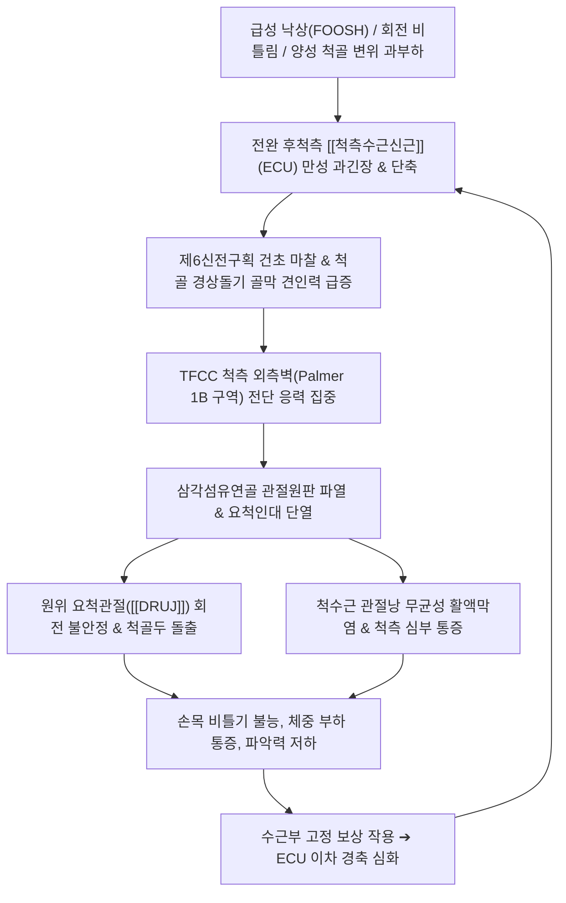

# 🩺 [[삼각섬유연골복합체 손상(TFCC 손상)]] (TFCC Injury / M70.8, S63.5)

> **핵심 3줄 요약 (Key Summary)**:
> - 📍 병소 부위 & 해부·병태생리: 손목 척측 관절면의 충격 흡수(전완 축성 하중의 약 20% 분산) 및 원위 요척관절([[DRUJ]])의 회전 안정성을 유지하는 핵심 해부 구조물인 삼각섬유연골복합체(TFCC: 관절원판 TFC proper, 장·배측 요척인대 RULs, 척측측부인대 UCL, 척월상/척삼각인대, 반월판 상동체, [[척측수근신근]](ECU) 아부건초)의 외상성 또는 퇴행성 파열.
> - 🚩 전형적 임상 양상 & 3대 징후: 손목 척측 심부 통증(문손잡이 비틀기, 걸레 짜기, 바닥 짚기 시 악화), 척골 함요부([[Fovea Sign]])의 극심한 압통, 손목 회선 시 덜컹거리는 탄발음(Clicking) 및 척골두 후방 돌출(피아노 건반 징후), 파악력(Grip strength) 저하.
> - 🛠️ 핵심 감별 검사 & 한·양방 다각적 치료 전략: 척골 함요 징후([[Fovea Sign]]), TFCC 압박/연삭 검사(Grind test), 피아노 건반 검사([[Piano Key Test]]), 체중 부하 검사(Press test); 손목 중립위 Muenster/Sugar-tong 부목 고정; [[양곡]], [[양지]], [[양로]], [[완골]], [[후계]] 자침 및 [[화침]]/[[온침]]; 척골 함요부 [[봉약침]] 및 자하거약침; [[원위 요척관절]] 정복 추나 및 전완 [[척측수근신근]](ECU) 이완; [[독활기생탕]], [[당귀점통탕]], [[서경탕]] 투여 및 보존 치료 불응 시 관절경하 봉합술/절제술 연계.
> - <font color="#fa7e7e">⚠️ 응급 의뢰 레드플래그 & 악화 요인: 원위 요척관절(DRUJ)의 육안적 완전 탈구 및 극심한 불안정성, 3개월 이상 체계적 보존 치료에 무반응인 중심부(Palmer 1A) 대형 파열, 수근골(주상골, 삼각골, 유구골 갈고리) 골절 동반 시 즉각 수부외과 정밀 영상 및 수술 연계.</font>

---

## 📌 목차
1. [질환 개요 & 해부학적 병태생리](#1-질환-개요--해부학적-병태생리)
2. [병태생리 메커니즘 & 생체역학적 악순환 네트워크](#2-병태생리-메커니즘--생체역학적-악순환-네트워크)
3. [임상 증상 & 이학적 검사(Physical Exam) 알고리즘](#3-임상-증상--이학적-검사physical-exam-알고리즘)
4. [감별 진단 매트릭스 (Differential Diagnosis)](#4-감별-진단-매트릭스-differential-diagnosis)
5. [한의 통합 치료 프로토콜 (침·약침·추나·한약)](#5-한의-통합-치료-프로토콜-침약침추나한약)
6. [양방 치료 & 병용·의뢰 기준 (Conventional Treatment & Referral)](#6-양방-치료--병용의뢰-기준-conventional-treatment--referral)
7. [재활 운동 & 생활습관 티칭 가이드](#7-재활-운동--생활습관-티칭-가이드)
8. [💡 사용자 진료실 핵심 필기 & 임상 노하우 (Melt-In 잔여 심화 집약)](#8--사용자-진료실-핵심-필기--임상-노하우-melt-in-잔여-심화-집약)
9. [출처 및 학술 참고 문헌 (References)](#9-출처-및-학술-참고-문헌-references)

---

## 1. 질환 개요 & 해부학적 병태생리

### 1) 질환 정의 및 임상적 중요성
* **정의**: 삼각섬유연골복합체 손상(Triangular Fibrocartilage Complex Tear, TFCC Tear)은 손목 관절 척측(새끼손가락 측)의 요골 원위부와 척골두, 그리고 근위 수근골([[월상골]], [[삼각골]]) 사이에 위치하는 섬유연골-인대 복합 구조물이 외상이나 퇴행성 마모로 인해 파열되어, 척측 손목 통증, 회전 운동 제한, 악력 저하 및 원위 요척관절([[DRUJ]]) 불안정성을 초래하는 질환이다.
* **손목의 반월판(Meniscus of the Wrist)**:
  * 무릎 관절에서 반월판 연골이 대퇴골과 경골 사이의 완충 작용과 관절 정합성을 담당하듯, TFCC는 손목 관절에서 회전 중심축 역할을 하는 척골두 상방을 덮어 충격을 흡수하고 전완의 회내(Pronation)·회외(Supination) 동작 시 원위 요척관절이 탈구되지 않도록 지탱하는 핵심 지지대이다 (Palmer, 1989).

### 2) TFCC 해부학적 6대 구성 요소

```
[삼각섬유연골복합체(TFCC)의 3차원 해부학적 구조 모식도]

                 [원위 수근골: [[월상골]] & [[삼각골]]]
                             ▲       ▲
                             │       │
              척월상인대(UL) │       │ 척삼각인대(UT)
                             │       │
        ┌────────────────────┴───────┴────────────────────┐
        │   반월판 상동체 (Meniscus Homologue)             │
        ├─────────────────────────────────────────────────┤
        │   중심 관절원판 (Articular Disc / TFC proper)   │ <── 무혈관성 (White zone, 80%)
        ├─────────────────────────────────────────────────┤
        │   장측 요척인대(Palmar RUL) / 배측 요척인대(Dorsal RUL) │ <── DRUJ 주안정자
        └────────────────────┬───────┬────────────────────┘
                             │       │
       요골 S상 절흔         │       │ 척골 함요(Fovea) & 경상돌기
    (Sigmoid Notch) 부착     ▼       ▼ (풍부한 혈관망: Red zone, 20%)
                    [요골 원위부]   [척골두 & 척골 경상돌기]
                                     │
                                     ▼
                      [[척측수근신근]](ECU) 아부건초 (Subsheath)
```

1. **중심 관절원판 (Articular Disc / TFC proper)**:
   * 요골 원위부의 에스모양 절흔(Sigmoid notch) 하연에서 기시하여 척골 경상돌기 기저부 및 함요부(Fovea)에 부착되는 양면오목(Biconcave) 형태의 섬유연골판이다. 중심부 두께는 1~2mm로 얇고 주변부는 3~5mm로 두껍다.
2. **장측 및 배측 요척인대 (Palmar & Dorsal Radioulnar Ligaments, RULs)**:
   * TFCC의 변연부를 감싸며 요골과 척골을 단단히 결속하는 인대성 기둥이다.
   * **배측 요척인대**: 회내(Pronation) 시 팽팽해져 척골두의 후방 전위를 막음.
   * **장측 요척인대**: 회외(Supination) 시 팽팽해져 척골두의 전방 전위를 막음.
3. **반월판 상동체 (Meniscus Homologue)**:
   * 척골 경상돌기 기저부에서 삼각골(Triquetrum) 사이의 공간을 채우는 삼각형의 섬유조직으로, 관절낭 외측을 보강한다.
4. **척수근인대군 (Ulnocarpal Ligaments)**:
   * 척월상인대(Ulnolunate ligament, UL)와 척삼각인대(Ulnotriquetral ligament, UT)로 구성되며, 척골두와 수근골 사이를 연결하여 손목 척측의 견인력을 분산한다.
5. **척측측부인대 복합체 (Ulnar Collateral Ligament Complex, UCL)**:
   * 척골 경상돌기 첨부에서 기시하여 삼각골 및 수장측 인대로 이어지는 지지 인대.
6. **[[척측수근신근]](Extensor Carpi Ulnaris, ECU) 아부건초 (Subsheath)**:
   * 제6 신전건 구획의 바닥을 이루며 TFCC의 배척측 인대 섬유와 유기적으로 융합되어 있어, ECU의 과긴장 및 건초염이 TFCC 파열의 직접적 견인력으로 작용한다 (Skalski et al., 2016).

### 3) 생체역학적 하중 분산과 양성 척골 변위 (Ulnar Variance)
* **정상 하중 분산**:
  * 정상 중립위에서 전완을 통해 전달되는 축성 하중(Axial load)의 약 **$80\%$는 요골-수근관절(Radiocarpal joint)**을 통과하고, 나머지 **$20\%$는 TFCC를 통해 척골두**로 전달된다.
* **양성 척골 변위 (Positive Ulnar Variance)**:
  * 척골 원위 관절면이 요골 관절면보다 2mm 이상 긴 경우를 말한다.
  * 척골이 2.5mm만 길어져도 TFCC와 척골두에 가해지는 하중이 **$40\%$ 이상으로 2배 급증**한다. 이로 인해 만성적인 척수근 충돌([[척골충돌증후군]]), 관절원판 마모, 월상골 연골연화증 및 퇴행성 중심부 파열(Palmer Class 2)이 필연적으로 발생한다 (Won et al., 2026).
* **음성 척골 변위 (Negative Ulnar Variance)**:
  * 척골이 요골보다 짧은 경우로, TFCC에 가해지는 하중은 감소하나 요골 관절면에 과부하가 걸려 [[킨베크병]](Kienböck disease, 월상골 무혈성 괴사)의 위험 인자가 된다.

### 4) 혈관 분포와 치유 잠재력 (Vascular Zonation)
* **외측 주변부 (Peripheral Red Zone, 10~20%)**:
  * 척골동맥(Ulnar artery) 및 전·후 골간동맥(Interosseous arteries)의 관절막 분지로부터 풍부한 모세혈관망이 유입된다.
  * **치유 잠재력**: 혈류가 풍부하여 파열(Palmer 1B) 발생 시 침구, 약침, 프롤로테라피 등 비수술 보존적 치료 및 관절경 봉합술에 매우 우수한 반응을 보인다.
* **중심 관절원판 (Central White Zone, 80%)**:
  * 연골세포로만 구성된 완전한 무혈관 영역(Avascular zone)으로, 활액(Synovial fluid)의 확산에 의해서만 영양을 공급받는다.
  * **치유 잠재력**: 파열(Palmer 1A) 시 스스로 치유되는 생물학적 능력이 결여되어 있어 자연 치유가 불가능하며, 보존 치료에 불응할 경우 관절경하 변연절제술(Debridement)이 요구된다.

---

## 2. 병태생리 메커니즘 & 생체역학적 악순환 네트워크

### 1) 외상성 파열 (Traumatic Tears) vs 퇴행성 마모 (Degenerative Tears)
* **외상성 기전 (FOOSH & 회전 비틀림)**:
  * 손을 짚고 넘어질 때(Fall Onto Outstretched Hand, FOOSH): 손목이 과도하게 신전(Hyperextension)되고 전완이 회내(Pronation)되면서 체중 전체가 척측 관절원판에 순간적으로 전달되어 파열 발생.
  * 골프 스윙 시 뒷땅을 치거나(Divot impact), 라켓 스포츠, 테니스 백핸드 스트로크, 야구 배트 스윙 중 손목이 강제로 비틀릴 때 인대 부착부 견열 파열(Palmer 1B)이 호발한다.
* **퇴행성 기전 (만성 미세 손상 & 척골 충돌)**:
  * 반복적인 손목 비틀기 작업(걸레 짜기, 드라이버 사용, 중장비 운전)과 컴퓨터 마우스 장시간 사용 등으로 인해 관절원판이 서서히 닳아 얇아지다 중심 천공으로 진행한다.

### 2) 팔머(Palmer) 분류 체계

| 분류 | 세부 유형 | 해부학적 파열 병소 | 혈관 분포 및 치유 특성 | 대표적 치료 접근 |
| :--- | :--- | :--- | :--- | :--- |
| **Class 1 (외상성)** | **1A** | 중심 관절원판(TFC proper)의 수평/사선 천공 | 무혈관대(White zone), 혈류 결손으로 자연 치유 불능 | 보존 치료 후 불응 시 관절경하 변연절제술 |
| | **1B** | 척골 부착부(Fovea 또는 경상돌기) 견열 파열 | **풍부한 혈관대(Red zone), 치유력 최상** | **침·약침, 부목 고정, 관절경 봉합술** |
| | **1C** | 원위 장측 척수근인대(척월상/척삼각) 파열 | 수근골 불안정성 동반, 척측 관절낭 이완 | 인대 증식 약침, 인대 재건술 |
| | **1D** | 요골 S상 절흔(Sigmoid notch) 박리 파열 | DRUJ 회전 불안정성 심화, 요척인대 분리 | 깁스 고정, 골관통 봉합술 |
| **Class 2 (퇴행성)** | **2A** | 중심 관절원판의 부분 마모 및 비박화 | 원판 연골 기질 손상 | 온열 요법, 침치료, 생활습관 교정 |
| | **2B** | 2A + [[월상골]] 또는 [[삼각골]] 연골연화증 | 척골 충돌 증후군 초기 | 약침 치료, 손목 스트랩 고정 |
| | **2C** | 2B + 중심 관절원판 완전 천공 | 전층 파열, 척골두 연골 노출 | 침도요법, 관절경하 절제술 |
| | **2D** | 2C + 월상삼각인대(LT ligament) 파열 | 수근골간 해리 동반 | 수근골 정복 추나, 관절경 수술 |
| | **2E** | 2D + 광범위 척수근 관절염 (Ulnocarpal arthritis) | 비가역적 관절 파괴, 만성 골극 형성 | 척골 단축 골절술, 관절 고정술 |

* **최신 배측 파열 분류 (Dorsal Tears of TFCC)**:
  * 최근 관절경 연구에 따르면 TFCC 배측 변연부 파열(Dorsal tear)은 배측 요척인대의 단독 손상을 유발하여 전완 회내 시 척골두의 미세 아탈구를 유발하는 독립적 병변으로 규명되었다 (Tan et al., 2026).

### 3) 생체역학적 악순환 네트워크 (ASCII Flowchart)

```
┌─────────────────────────────────────────────────────────────────┐
│     급성 외상(FOOSH 낙상 / 골프 뒷땅 비틀림) 또는 만성 과사용 │
│     (양성 척골 변위로 인한 만성 척수근 관절면 하중 과부하)     │
└────────────────────────────────┬────────────────────────────────┘
                                 │
                                 ▼
┌─────────────────────────────────────────────────────────────────┐
│   전완 후척측 [[척측수근신근]](ECU) 근복의 만성 과긴장 및 단축   │
└────────────────────────────────┬────────────────────────────────┘
                                 │
                                 ▼
┌─────────────────────────────────────────────────────────────────┐
│   제6신전구획 아부건초 마찰 & 척골 경상돌기 골막 견인력 증가   │
│   (Tendon Traction Point 형성 ➔ TFCC 외측 지지벽 전단력)       │
└────────────────────────────────┬────────────────────────────────┘
                                 │
                                 ▼
┌─────────────────────────────────────────────────────────────────┐
│   삼각섬유연골 디스크(TFC) 파열 & 장·배측 요척인대(RUL) 손상    │
└────────────────────────────────┬────────────────────────────────┘
                                 │
         ┌───────────────────────┴───────────────────────┐
         ▼                                               ▼
┌────────────────────────────────┐             ┌────────────────────────────────┐
│   원위 요척관절([[DRUJ]]) 불안정│             │   척수근 관절강 활액막염 및    │
│   ➔ 회선 시 척골두 후방 돌출   │             │   국소 염증성 삼출액 저류      │
│   (피아노 건반 현상, 아탈구)   │             │   (척골 함요부 심부 격통 발생) │
└────────────────┬───────────────┘             └────────────────┬───────────────┘
                 │                                               │
                 └───────────────────────┬───────────────────────┘
                                         │
                                         ▼
┌─────────────────────────────────────────────────────────────────┐
│   손목 비틀기(걸레짜기/문고리) 불가, 체중 지탱 시 통증, 악력 저하│
└────────────────────────────────┬────────────────────────────────┘
                                 │
                                 ▼
┌─────────────────────────────────────────────────────────────────┐
│   손목 관절 고정을 위한 전완 신근군([[척측수근신근]]) 이차 경축 │
│   ➔ 견인 장력 재증가로 TFCC 부착부 재파열 (악순환 고착화)      │
└─────────────────────────────────────────────────────────────────┘
```



---

## 3. 임상 증상 & 이학적 검사(Physical Exam) 알고리즘

### 1) 주요 임상 증상
* **손목 척측 심부 통증 (Deep Ulnar-sided Wrist Pain)**:
  * 환자는 손목 새끼손가락 쪽의 깊은 곳이 쑤시고 시큰거린다고 호소한다.
  * 특히 문손잡이 돌리기, 자동차 핸들 꺾기, 열쇠 돌리기, 걸레나 수건 짜기, 무거운 프라이팬 들기 등 손목을 비틀거나 척측으로 꺾을 때 날카로운 찌릿함이 엄습한다.
* **체중 부하 시 통증 (Load-bearing Pain)**:
  * 방바닥에 손바닥을 짚고 일어날 때, 푸시업을 할 때 손목이 뒤로 젖혀지면서 체중이 척골두에 실릴 때 극심한 통증으로 지탱하지 못한다.
* **관절 잡음 및 불안정성 (Clicking & Giving Way)**:
  * 손목을 돌릴 때 척골두 주변에서 '뚝' 또는 '딸깍'하는 소리가 나거나 무언가 끼었다 풀리는 느낌이 들며, 순간적으로 손에 힘이 빠지는 무력감(Giving way)을 경험한다.
* **악력 저하 (Grip Strength Weakness)**:
  * 통증과 DRUJ 불안정성으로 인해 주먹을 쥐는 힘이 건측 대비 30~50% 이상 감소한다.

### 2) 필수 이학적 검사법 (Physical Examination)
이학적 검사는 숙련된 진찰을 통해 90% 이상의 높은 진단 정확도를 확보할 수 있다 (Tay et al., 2007).

```
[TFCC 손상 이학적 검사 진단 알고리즘]

1. 척골 함요 징후 ([[Fovea Sign]]):
   - 척골 경상돌기와 FCU 건 사이 함요부를 엄지로 심부 압박
   ├─> 극심한 국소 통증 양성 ➔ TFCC 척골 부착부(Palmer 1B) 파열 강력 시사 (민감도 95%)
   └─> 음성 ➔ ECU 건초염 또는 수근골 관절염 감별
                 │
                 ▼
2. TFCC 압박/연삭 검사 (TFCC Compression / Grind Test):
   - 손목을 최대로 척측 편위(Ulnar deviation) + 축성 압박 + 전완 회선
   ├─> 척측 관절면 통증 및 염발음(Clicking) 재현 ➔ 관절원판 천공(TFC proper tear)
                 │
                 ▼
3. 피아노 건반 검사 ([[Piano Key Test]] / DRUJ Ballottement):
   - 전완 회내 상태에서 돌출된 척골두를 수장측으로 압박
   ├─> 스프링처럼 쑥 들어갔다 튀어오르며 통증 ➔ [[DRUJ]] 인대 완전 파열 및 불안정성 확진
                 │
                 ▼
4. 체중 부하 검사 ([[체중 부하 검사]], Press-up Test):
   - 의자 팔걸이를 손바닥으로 짚고 엉덩이를 들어올리도록 지시
   └─> 척측 통증으로 체중을 싣지 못함 ➔ 체중 부하 축성 전달 파열 양성
```

* **1) 척골 함요 징후 ([[Fovea Sign]] / Ulnar Fovea Sign)**:
  * 술자의 엄지손가락으로 척골 경상돌기(Ulnar styloid), 척측수근굴근(FCU) 건, 두상골(Pisiform), 척골두 사이의 오목하게 들어간 '척골 함요(Fovea)'를 깊숙이 압박한다.
  * **양성**: 환자가 비명을 지를 정도의 날카로운 국소 압통 재현. Palmer 1B 파열 및 척수근인대 단열에 대해 민감도 $95.2\%$, 특이도 $86.5\%$를 나타내는 가장 중요한 검사이다.
* **2) TFCC 압박 및 연삭 검사 (TFCC Compression / Grind Test)**:
  * 환자의 팔꿈치를 책상에 받치고 손목을 수동으로 최대한 척측 편위(Ulnar deviation)시킨 상태에서, 술자가 장축 방향으로 강력한 축성 압박력(Axial compression)을 가하며 손목을 비틀어 회내·회외시킨다.
  * **양성**: 척측 관절면의 마찰음(Crepitus)이나 극심한 통증 발생. 관절원판 중심부 파열을 진단.
* **3) 피아노 건반 검사 ([[Piano Key Test]])**:
  * 환자의 전완을 완전히 회내(Pronation)시켜 손바닥이 바닥을 향하게 한 상태에서, 후방으로 툭 튀어나온 척골두를 술자의 엄지로 피아노 건반 누르듯 아래로 강하게 압박했다가 놓는다.
  * **양성**: 척골두가 저항 없이 덜컹거리며 아래로 쑥 들어갔다가 손을 떼면 위로 솟아오름. 장·배측 요척인대 파열로 인한 [[DRUJ]] 불안정성 확진.
* **4) 체중 부하 검사 ([[체중 부하 검사]], Press Test)**:
  * 의자에 앉은 환자에게 양손으로 의자 팔걸이나 책상을 손바닥으로 짚고 엉덩이를 들어 올리게 한다.
  * **양성**: 손목 척측에 체중이 실리는 순간 통증으로 지탱하지 못하고 주저앉음 (민감도 100%).
* **5) ECU 저항 검사 (ECU Synergy Test)**:
  * 환자의 팔꿈치를 90도 굴곡하고 손바닥을 위로 한(Supination) 상태에서, 검사자가 환자의 엄지와 검지를 저항하며 손목을 척측 신전시킬 때 통증이 유발되면 [[척측수근신근건염]]과의 감별 포인트가 된다.

---

## 4. 감별 진단 매트릭스 (Differential Diagnosis)

손목 척측 통증(Ulnar-sided wrist pain)은 수많은 해부 구조물이 좁은 공간에 밀집되어 있어 '손목의 블랙홀'이라 불릴 만큼 감별이 까다롭다.

| 감별 질환 | 호발 병소 및 손상 기전 | 주요 임상 증상 및 주소증 | 핵심 감별 포인트 | 필수 진단 검사 |
| :--- | :--- | :--- | :--- | :--- |
| **[[삼각섬유연골복합체 손상(TFCC 손상)]]** (본 질환) | 척골-수근골 사이 관절원판 및 요척인대 | 손목 비틀기(걸레짜기) 시 척측 심부 통증, 바닥 짚기 불가 | **[[Fovea Sign]] 양성**, [[Piano Key Test]] 덜컹거림 | 손목 MRI (3T 전용 코일), 관절경 |
| **[[척측수근신근건염]] (ECU Tendinitis)** | 제6신전건 구획 건초 및 척골 고랑 | 척골두 바로 위 표재성 찌릿함, 저항 신전통 | 척골두 후외측 도랑을 따른 표재성 압통, 건초 마찰음 | 근골격계 초음파상 건초 부종 및 삼출액 |
| **[[척측수근신근]] 아탈구 (ECU Subluxation)** | 제6구획 신전지대 파열로 인한 건 이탈 | 전완 회외(Supination) 시 뚝 소리와 함께 힘줄 튐 | 척골 고랑에서 ECU 힘줄이 육안으로 튀어나옴 | 동적 초음파(Dynamic US)로 탈구 확인 |
| **[[척골충돌증후군]] (Ulnar Impaction)** | 양성 척골 변위로 인한 척골두-월상골 충돌 | 만성적이고 둔한 척측 통증, 체중 부하 시 악화 | **단순 방사선상 척골이 요골보다 2mm 이상 김** | 손목 X-ray (Neutral PA), 월상골 경화 |
| **척골 경상돌기 불유합 (Ulnar Styloid Nonunion)** | 과거 원위 요골 골절(Colles) 동반 견열 | 척골 뼈 끝 부위의 국소적 타진통 및 압통 | 뼈 융기부 자체의 압통, 골편의 독립적 가동성 | X-ray 측면상 경상돌기 골절편 불유합 |
| **월상삼각 해리 (Lunotriquetral Dissociation)** | 월상삼각인대 파열로 인한 수근골 불안정 | 손목 중앙 척측의 심부 통증, 손목 굴신 시 잡음 | Reagan Ballottement(수근골 흔들기) 검사 양성 | 특수 스트레스 X-ray, MRI |
| **유구골 갈고리 골절 (Hook of Hamate Fracture)** | 골프채, 야구 배트 손잡이에 의한 직격 타박 | 손바닥 척측 기저부(두상골 원위) 국소 압통 | 손바닥 안쪽 타진통, 제4·5지 굴곡건 마찰통 | 수근관 뷰(Carpal tunnel view) X-ray, CT |
| **삼각골 골절 (Triquetrum Fracture)** | 손목 과신전 외상 시 배측 피질골 견열 | 손목 배측 척측의 급성 종창 및 멍, 배측 압통 | 손목 배측 융기부 압통, 낙상 직후 급성 손상 | 손목 사위상(Oblique view) X-ray |
| **[[가이온관 증후군]] (Guyon Canal Syndrome)** | 두상골-유구골 갈고리 사이 척골신경 포착 | 제4·5수지 수장측 저림, 골간근 위축, 약력 저하 | **감각 이상 및 근위축 동반 (기계적 통증 아님)** | [[프로멘트 검사]] 양성, 신경전도검사(EMG) |

---

## 5. 한의 통합 치료 프로토콜 (침·약침·추나·한약)

TFCC 손상의 한의 치료는 손상 구역(Red zone vs White zone)에 따라 차별화된 전략을 취한다. 혈류가 풍부한 척골 부착부(Palmer 1B)는 인대 증식 약침과 온침을 통해 조직 재생을 유도하고, 전완부 [[척측수근신근]](ECU) 근복 이완과 원위 요척관절 정복 추나를 통해 관절면에 가해지는 생체역학적 전단력을 차단한다.

### 1) 침구 치료 (Acupuncture)
* **손목 척측 국소 경혈 (관절강 활액막염 진정)**:
  * [[양곡]](SI5): 척골 경상돌기와 삼각골 사이 함요처. TFCC 관절원판 직상방 취혈. 0.25×30mm 호침으로 10~15mm 수직 사자.
  * [[양지]](TE4): 손등 완관절 횡문 중앙, 총지신근건 척측. 요수근 관절내압 완화.
  * [[양로]](SI6): 전완을 가슴에 댈 때 척골두 배측에 형성되는 골간 함요부. 손목 회선 장애 및 척골 신경통 완화의 요혈.
  * [[완골]](SI4), [[후계]](SI3), [[중저]](TE3), [[외관]](TE5): 수태양소장경과 수소양삼초경의 기혈 순환 촉진.
* **전완부 근육성 긴장 완화 (핵심 치료점)**:
  * [[지구]](TE6), [[소해]](SI8), [[수삼리]](LI10): 전완 후척측의 [[척측수근신근]](ECU) 및 [[척측수근굴근]](FCU) 근복 발통점에 0.30×40mm 호침으로 20~25mm 깊이 심자.
  * 침전기자극술(전침): 2~4Hz 저주파 연속파를 15분간 적용하여 과긴장된 ECU 근섬유를 탈진·이완시킴으로써 척골 경상돌기 골막에 걸리는 만성 견인력을 차단.

### 2) 화침(온침) 요법 — 심부 섬유연골 재생 유도
* **기전**: 백색 섬유연골 복합체 특성상 심부 혈류 유입이 제한적이므로, 호침의 침체에 쑥탄을 얹어 태우는 온침(溫針)이나 침체를 순간 가열하여 자입하는 화침(火針)을 [[양곡]], [[양지]] 부위에 적용한다.
* **효과**: 국소 심부 온도를 상승시켜 혈관 내피세포 증식 인자(VEGF) 분비를 유도하고, 섬유아세포(Fibroblast)를 자극하여 콜라겐 섬유의 교차 결합(Cross-linking) 및 리모델링을 촉진한다.

### 3) 약침 치료 (Pharmacopuncture)
* **인대 강화 및 결합조직 증식 약침 (Palmer 1B 타겟)**:
  * 척골 함요(Ulnar Fovea) 및 척월상/척삼각인대 주변(Red zone)으로 **자하거 약침** 또는 **신바로약침** 0.5~1.0cc를 30G 니들로 관절낭 표재층에 정밀 주입.
  * 태반 유래 성장 인자와 항염증 생약 성분이 손상된 섬유 결합조직의 재생을 가속화함.
* **[[봉약침]](Sweet BV, 10%)**:
  * 급성 부종 및 열감이 동반된 활액막염기에 1:10,000~1:20,000 희석액 0.2cc를 양곡·양지 주변에 소량 주입하여 삼출액을 흡수하고 통증 신경 말단을 탈감작.
* **중성어혈약침**:
  * 급성 낙상 후 관절 내 혈종 및 연조직 림프 부종을 신속히 배출.

### 4) 추나 요법 (Chuna Manual Therapy)
* **원위 요척관절(DRUJ) 정복 가동술**:
  * 환자의 전완을 중립위로 유지한 상태에서, 술자의 한 손으로 요골 원위부를 고정하고 반대 손 엄지 구두로 후방 돌출된 척골두를 수장측(Volar) 방향으로 부드럽게 글라이딩(Volar glide)하여 아탈구된 관절면을 재정렬.
* **수근골 견인 감압술 (Carpal Distraction Traction)**:
  * 요수근 관절을 장축 방향으로 가볍게 견인하여 척골두와 수근골([[월상골]], [[삼각골]]) 사이의 관절강 내 압박력을 순간적으로 해소.
* **전완 골간막 및 ECU 근막 이완 (MET)**:
  * 요골과 척골 사이의 회전 불균형을 바로잡기 위해 전완 골간막(Interosseous membrane)을 따라 엄지 지복으로 심부 횡마찰 마사지를 적용.

### 5) 변증별 맞춤 한약 치료 (Herbal Medicine)
* **기체어혈(氣滯瘀血) - 급성 외상 파열형**:
  * 주증: 넘어지거나 손목을 삔 후 붓고 찌르는 듯한 극심한 통증, 야간통.
  * 처방: **[[당귀수산]](當歸鬚散)** 또는 **[[서경탕]](舒經湯)** 가감 (당귀 10g, 적작약 8g, 도인 6g, 홍화 6g, 소목 6g, 유향 4g, 몰약 4g, 강황 6g). 어혈을 제거하고 미세혈관 순환 촉진.
* **간신부족(肝腎不足) / 기혈양허(氣血兩虛) - 만성 퇴행·연골 마모형**:
  * 주증: 수개월 이상 지속된 둔통, 손목이 헐렁거리고 시큰거림, 척골두 돌출, 악력 저하.
  * 처방: **[[독활기생탕]](獨活寄生湯)** 또는 **[[당귀점통탕]](當歸拈痛湯)** 가감 (독활 8g, 상기생 8g, 두충 8g, 우슬 8g, 속단 8g, 골쇄보 8g, 당귀 8g, 황기 15g). 손상된 연골 기질을 보강하고 인대 인장 강도를 회복.
* **한습저체(寒濕阻滯) - 날씨 변화 민감형**:
  * 처방: **[[오적산]](五積散)** 가감 (마황, 백지, 천궁, 복령, 창출, 건강).

---

## 6. 양방 치료 & 병용·의뢰 기준 (Conventional Treatment & Referral)

### 1) 보존적 고정 치료 (Immobilization Protocols)
* **초기 고정의 중요성**:
  * 단순 손목 밴드는 손목의 굴신만 제한할 뿐 전완의 회내·회외를 전혀 막지 못하므로 TFCC 파열부를 계속 비틀리게 만든다.
* **상완 포함 부목 vs 전완 단독 부목**:
  * 최근 후향적 비교 임상 연구에 따르면, DRUJ 탈구가 없는 부분 TFCC 파열(Partial tear) 환자에서는 주관절을 고정하는 상완 부목(Above-elbow splint)과 전완 단독 부목(Below-elbow splint) 간에 6주 후 통증 및 기능 회복에 유의미한 차이가 없었으며, 전완 단독 고정으로도 충분한 치료 효과를 거둘 수 있음이 입증되었다 (Outcomes of Below-Elbow Versus Above-Elbow Immobilization, 2024).
  * 급성기 4~6주간 중립위 전완 부목(Sugar-tong 또는 Muenster splint)을 적용하여 전완 회전을 제한하는 것이 표준 프로토콜이다.

### 2) 주사 치료 (Injections)
* **스테로이드 관절강 내 주사**:
  * Triamcinolone 10~20mg 주입 시 급성 활액막염 통증을 빠르게 진정시키나, 관절 연골 기질 합성을 억제하여 연골 파괴를 가속화하므로 연 1~2회 이하로 극히 제한해야 한다.
* **프롤로테라피 (Prolotherapy) 및 자가혈소판풍부혈장 (PRP)**:
  * 12.5~15% 고농도 포도당액이나 PRP를 척골 함요부 및 외측 인대 부착부에 주입하여 만성 인대 이완 환자의 콜라겐 합성을 유도함.

### 3) 수술적 치료 적응증 및 최신 술식
* **수술 적응증**:
  * 3개월 이상의 철저한 보존 치료(부목 고정, 침구, 약침)에도 호전되지 않는 일상생활 불가능한 통증.
  * 단순 방사선 및 MRI상 확인되는 명백한 DRUJ 탈구 또는 척골두 후방 불안정성.
* **수술 술식**:
  * **관절경하 변연절제술 (Arthroscopic Debridement)**: 무혈관성 중심부 파열(Palmer 1A)에서 너덜너덜해진 연골판 조각을 다듬어 관절 내 끼임 현상을 제거.
  * **관절경하 경골터널 봉합술 (Transosseous / Foveal Repair)**: 혈류가 있는 외측 척골 부착부(Palmer 1B) 파열 시 척골두에 미세 골터널을 뚫고 봉합사를 통과시켜 척골 함요(Fovea)에 견고히 재부착 (Nam et al., 2026; Won et al., 2026).
  * **척골 단축 절골술 (Ulnar Shortening Osteotomy, USO)**: 양성 척골 변위(+2mm 이상)가 동반된 만성 척골 충돌 증후군 환자에서 척골 간부를 2~3mm 절제하고 금속판으로 고정하여 척수근 관절면 하중을 $20\%$ 이하로 감압.

### 4) 양방·전문과 의뢰 기준 (Referral Criteria)
* **🚨 즉각적 정형외과(수부외과) 수술 의뢰**:
  1. 외상 후 척골두가 육안으로 튀어나와 덜컹거리며 정복되지 않는 **원위 요척관절(DRUJ) 급성 완전 탈구**.
  2. 단순 방사선 사진상 주상골 골절, 삼각골 견열 골절, 유구골 갈고리 골절이 동반된 복합 손상.
* **전문과 정밀 검사(3T MRI) 의뢰**:
  1. 4~6주간의 부목 고정 및 한의 복합 치료에도 물건을 쥐거나 비틀 때 통증이 전혀 호전되지 않는 경우.

---

## 7. 재활 운동 & 생활습관 티칭 가이드

### 1) 손목 보호대 착용 티칭 (WristWidget Mechanics)
* **원리**: 척골두와 요골두만을 선택적으로 감싸 쥐어짜 주는 듀얼 스트랩 구조의 TFCC 전용 보호대(WristWidget)를 착용시켜, 수근관절 가동 범위는 유지하면서도 전완 회전 시 DRUJ의 벌어짐을 물리적으로 방지한다.
* **효과**: 착용 즉시 파악력(Grip strength)이 건측 수준으로 회복되며 일상 복귀를 촉진한다.

### 2) 3단계 점진적 재활 운동 프로그램 (Andersson et al., 2023)

```
[TFCC 3단계 점진적 재활 프로토콜]

1단계: 통증 없는 중립위 등척성 운동 (0~4주)
  - 전완 중립위(Neutral)에서 손바닥을 위/아래로 돌리는 힘에 반대 손으로 저항 (5초 유지, 10회)
  - 손가락 쥐기(악력) 가벼운 등척성 수축
                 │
                 ▼
2단계: 능동 보조 가동역 및 편심성 신근 훈련 (4~8주)
  - 통증 없는 범위 내에서 전완 회내/회외 능동 운동
  - 0.5kg 가벼운 아령이나 망치를 잡고 [[척측수근신근]](ECU) 편심성(Eccentric) 강화
                 │
                 ▼
3단계: 고유수용감각 회복 및 기능적 사슬 강화 (8주 이후)
  - 불안정한 볼 위에서 체중 지탱 훈련
  - 회전근개(Rotator cuff) 및 견갑골 안정화 운동을 병행하여 손목으로 전달되는 회전 부하 분산
```

### 3) 일상생활 금기 동작 및 생활 지도
* **바닥 손바닥 짚기 절대 금지**:
  * 바닥에서 일어날 때 손바닥을 짚으면 척골두가 연골판을 맷돌처럼 짓이긴다. **반드시 주먹을 쥐고 너클(Knuckle) 부위로 짚거나 팔꿈치를 이용**하여 일어나도록 지도한다.
* **비틀림 스트레스 차단**:
  * 걸레나 젖은 수건을 양손으로 쥐어짜는 행위 절대 금지 (탈수기 사용).
  * 뻑뻑한 문고리나 병뚜껑을 강하게 비틀지 말고 전용 오프너 사용.
* **헬스 운동 지도**:
  * 벤치프레스, 푸시업, 숄더프레스 시 손목이 뒤로 꺾이지 않도록 단단한 손목 랩(Wrist wrap)을 착용하고, 덤벨을 쥘 때는 손목을 11자 중립으로 세우는 중립 그립(Neutral grip)을 유지하도록 교육.

---

## 8. 💡 사용자 진료실 핵심 필기 & 임상 노하우 (Melt-In 잔여 심화 집약)

### 1) ECU 건초염과 TFCC 파열의 닭과 달걀 관계
* **임상 진찰의 결정적 맹점**:
  * 진료실에 "손목 바깥쪽이 아프다"며 내원하는 환자의 80% 이상은 TFCC 단독 손상이 아니라, 그보다 1~2cm 근위부의 [[척측수근신근]](ECU) 건초염을 동반하고 있다.
  * ECU 건초의 바닥벽은 해부학적으로 TFCC의 배척측 인대와 한 덩어리로 융합되어 있다. 따라서 전완부에서 ECU 근육이 만성적으로 뭉쳐 단축되어 있으면, 손목을 움직일 때마다 ECU 건이 척골 고랑을 벗어나며 TFCC 외측벽을 지속적으로 잡아 뜯게 된다.
* **치료 성공의 열쇠**:
  * TFCC 부위(손목)에만 약침을 놓고 치료하면 일시적으로만 통증이 줄고 손목을 돌릴 때 다시 재발한다.
  * **반드시 팔꿈치 아래 5cm 부위의 ECU 근복([[지구]], [[소해]])을 손가락으로 튕기듯 촉진하여 극심한 통증을 호소하는 경결 밴드를 찾아내고, 여기에 전침 자극을 주어 ECU의 장력을 완전히 풀어주어야만 TFCC 파열부가 아물 수 있는 환경이 조성된다.**

### 2) 척골 함요 징후(Fovea Sign)의 '손맛' 진찰 노하우
* 단순히 손목 뼈(척골 경상돌기)를 위에서 툭툭 누르면 뼈 자체의 골막 압통과 혼동된다.
* 검사자의 엄지손가락 끝을 척골 경상돌기 바로 밑, 척측수근굴근(FCU) 힘줄 바로 옆의 말랑말랑하고 쏙 들어간 홈(Fovea) 속으로 **뼈 밑을 파고들듯이 비스듬히 깊숙이 밀어 넣으며 압박**해야 한다.
* 이때 환자가 깜짝 놀라며 손을 뒤로 빼거나 비명을 지르면 십중팔구 TFCC 척골 부착부(Palmer 1B) 파열이다.

### 3) 척골 단축 테이핑(Ulnar Stabilizing Taping) 즉각 처치 노하우
* 비탄력 테이프(C-tape, 2.5cm 폭)를 준비한다.
* 환자의 손목을 가볍게 회외(Supination)시킨 상태에서, 술자의 엄지로 후방 돌출된 척골두를 손바닥 방향(Volar)으로 강하게 밀어 넣으면서 척골두 상방에서 시작하여 요골 쪽으로 손목을 한 바퀴 단단히 감아 돌리는 횡방향 원형 테이핑을 적용한다.
* 테이핑 직후 환자에게 주먹을 쥐고 책상을 짚어보게 하면, 덜컹거리던 척골두가 고정되면서 즉시 체중 지탱 통증이 50% 이상 감소하는 극적인 진통 효과를 확인할 수 있다.

### 4) 수술 의뢰의 결정적 레드플래그 (진료실 방어 기준)
* 모든 TFCC 손상을 한의원에서 치료할 수 있는 것은 아니다.
* 환자가 내원했을 때 육안으로도 척골두가 혹처럼 툭 튀어나와 있고, 피아노 건반 검사 시 뼈가 아무런 저항 없이 덜컹거리며 요골과 척골이 완전히 따로 노는 느낌(Gross DRUJ Dislocation)이 든다면 이미 대형 인대 파열로 관절이 탈구된 것이다.
* 또한 3개월 이상 철저한 부목 고정과 약침 치료를 시행했음에도 중심부 결손으로 인해 극심한 걸림과 통증이 지속되는 중심부 파열(Palmer 1A)은 지체 없이 수부외과 관절경 수술을 의뢰해야 환자의 영구적 관절염 진행을 막을 수 있다.

---

## 9. 출처 및 학술 참고 문헌 (References)

Tan HS, et al. (2026). Clinical, Radiographical, and Arthroscopic Features of Dorsal Tears of the TFCC. *J Wrist Surg*. [PMID: 42788186](https://pubmed.ncbi.nlm.nih.gov/42788186/)

- [연구 요약]: 삼각섬유연골복합체(TFCC) 배측 파열(Dorsal tear) 환자들의 임상 증상, 방사선 소견 및 관절경적 특징을 분석한 최신 연구로, 배측 요척인대 손상이 전완 회내 시 미세 척골두 아탈구 및 만성 척측 통증을 유발하는 독립적 병변임을 규명하고 진단적 가이드라인을 제시함.

Nam JJ, et al. (2026). Optimizing Drill Guide Positioning for Foveal Targeting in Arthroscopic One-Bone Tunnel Triangular Fibrocartilage Complex Repair: A Radiographic and Magnetic Resonance Imaging-Based Study. *Clin Orthop Surg*. [PMID: 42553903](https://pubmed.ncbi.nlm.nih.gov/42553903/)

- [연구 요약]: 관절경하 단일 골터널 TFCC 봉합술 시 척골 함요(Fovea)를 정밀 타겟팅하기 위한 드릴 가이드 위치 설정의 최적화를 영상학적으로 분석한 연구로, 해부학적 fovea 재부착의 정확도를 높여 술후 DRUJ 안정성 및 기능 회복을 극대화하는 수술 기법을 확립함.

Won JH, et al. (2026). Effect of ulnar positive variance on outcomes after arthroscopic transosseous repair of palmer 1B TFCC foveal tears. *J Orthop Surg Res*. [PMID: 42243925](https://pubmed.ncbi.nlm.nih.gov/42243925/)

- [연구 요약]: Palmer 1B 척골 함요 파열에 대한 관절경하 경골터널 봉합술 후 양성 척골 변위(Positive ulnar variance)가 임상 예후에 미치는 영향을 추적 관찰한 연구로, 척골 변위가 클수록 잔여 척측 충돌 통증이 지속될 수 있어 척골 단축술 병행의 필요성 기준을 제시함.

Palmer AK. (1989). Triangular fibrocartilage complex lesions: a classification. *J Hand Surg Am*. 14(4):594-606. [PMID: 2666492](https://pubmed.ncbi.nlm.nih.gov/2666492/)

- [연구 요약]: 삼각섬유연골복합체(TFCC) 파열을 외상성(Class 1A~1D)과 퇴행성(Class 2A~2E)으로 명확히 구분하고, 해부학적 파열 위치와 척골 변위에 따른 병태생리 및 치료 지침을 최초로 정립한 전 세계 공인 표준 분류 논문.

Skalski MR, et al. (2016). The Traumatized TFCC: An Illustrated Review of the Anatomy and Injury Patterns of the Triangular Fibrocartilage Complex. *Curr Probl Diagn Radiol*. 45(1):39-50. [PMID: 26117527](https://pubmed.ncbi.nlm.nih.gov/26117527/)

- [연구 요약]: TFCC의 3차원 복합 해부 구조, 척수근인대 및 ECU 건초와의 상호 연결성, 외상성 손상 기전 및 고해상도 MRI 영상 판독 가이드를 일러스트와 함께 총정리한 권위 있는 종설.

Andersson JK, et al. (2023). A structured non-operative treatment program for traumatic triangular fibrocartilage complex tear: A quasi-experimental study. *Hand Surg Rehabil*. 42(5):415-422. [PMID: 37490953](https://pubmed.ncbi.nlm.nih.gov/37490953/)

- [연구 요약]: 외상성 TFCC 파열 환자를 대상으로 한 3단계 체계적 비수술 보존 치료 및 점진적 재활 프로토콜의 임상 연구로, 80% 이상의 환자에서 수술 없이 통증 감소, 악력 회복 및 DRUJ 안정화가 달성됨을 입증함.

Outcomes of Below-Elbow Versus Above-Elbow Immobilization in the Management of a Partial Triangular Fibrocartilage Complex Tear Without Distal Radio-Ulnar Joint Disruption: A Retrospective Study. (2024). *J Hand Surg*. [PMID: 40959371](https://pubmed.ncbi.nlm.nih.gov/40959371/)

- [연구 요약]: DRUJ 탈구가 없는 부분 TFCC 파열 환자에서 상완 고정 부목과 전완 고정 부목의 임상 치료 결과를 비교한 후향적 연구로, 일상생활 순응도가 높은 전완 고정(Below-elbow)만으로도 대등한 치료 효과를 얻을 수 있음을 규명함.

Tay SC, et al. (2007). The "ulnar fovea sign" for defining ulnar wrist pain: an analysis of sensitivity and specificity. *J Hand Surg Am*. 32(4):438-444. [PMID: 17398352](https://pubmed.ncbi.nlm.nih.gov/17398352/)

- [연구 요약]: 손목 척측 통증 환자에서 척골 함요 징후(Ulnar fovea sign)의 진단적 민감도(95.2%)와 특이도(86.5%)를 관절경 검사 소견과 대조하여 통계적으로 입증한 기념비적인 임상 진단 논문.
