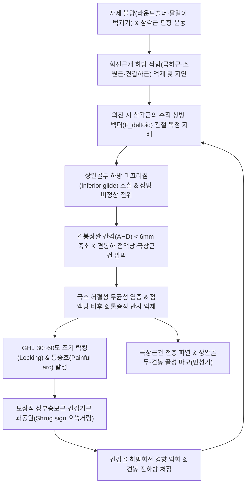

# 🩺 [[상완골 상방 활주 증후군]] (Humeral Superior Glide Syndrome / 上腕骨上方滑走症候群, ICD-10: M75.8)

> **핵심 3줄 요약 (Key Summary)**:
> - 📍 병소 부위 & 해부·병태생리: 팔을 외전(Abduction)·굴곡(Flexion)할 때 정상적인 견관절(GHJ)에서는 상완골두가 관절와(Glenoid fossa) 내에서 아래로 미끄러지는 하방 활주(Inferior glide)가 일어나야 하나, [[삼각근]](Deltoid)의 과도한 수직 상방 견인력과 회전근개 하방 짝힘([[극하근]], [[소원근]], [[견갑하근]]) 부전으로 인해 상완골두가 견봉(Acromion) 아래 공간으로 과도하게 치솟아 견봉하 공간(Subacromial space)을 압박하는 셜먼(Shirley Sahrmann) 운동손상증후군.
> - 🚩 전형적 임상 양상 & 3대 징후: 외전 60~120도 구간에서 상완 전상방과 견봉 하단이 찝히는 전형적인 [[동통호]](Painful arc), 통증 부위가 삼각근 조면(Deltoid tuberosity)으로 방사되는 연관 둔통, 견상완관절의 조기 기계적 락킹(Locking)을 보상하기 위해 어깨 전체를 귀 쪽으로 치켜올리는 흉견갑관절(TSJ)의 기형적 으쓱임 징후(Shrug sign / Hitch sign).
> - 🛠️ 핵심 감별 검사 & 한·양방 다각적 치료 전략: 검사자가 상완골두를 수동으로 하방 활주시킨 채 팔을 외전시킬 때 통증이 즉각 소실되는 증상 변조 검사(Symptom alteration test), [[니어 검사]], [[호킨스 검사]]; 삼각근 억제 사법 자침([[비노]], [[견우]], [[견료]]), 하방 활주근군 저주파 전침([[천종]], [[노수]], [[견정]]), 신바로·자하거 약침 견봉하 주입, JS 견관절 하방 활주 추나(Maitland Grade III-IV), [[서경탕]], [[오적산]], [[대방풍탕]].
> - <font color="#fa7e7e">⚠️ 응급 의뢰 레드플래그 & 악화 요인: 만성 방치 시 견봉상완 간격(AHD)이 6mm 미만으로 좁아지며 극상근건 전층 파열([[회전근개 파열]]) 및 상완골두-견봉 골성 마모(Cuff tear arthropathy)로 비가역적 파괴가 진행되므로 의자 팔걸이에 팔꿈치를 대고 턱을 괴는 상방 압박 불량 자세 즉각 교정.</font>

---

## 📌 목차
1. [질환 개요 & 해부학적 병태생리](#1-질환-개요--해부학적-병태생리)
2. [병태생리 메커니즘 & 생체역학적 악순환 네트워크](#2-병태생리-메커니즘--생체역학적-악순환-네트워크)
3. [임상 증상 & 이학적 검사(Physical Exam) 알고리즘](#3-임상-증상--이학적-검사physical-exam-알고리즘)
4. [감별 진단 매트릭스 (Differential Diagnosis)](#4-감별-진단-매트릭스-differential-diagnosis)
5. [한의 통합 치료 프로토콜 (침·약침·추나·한약)](#5-한의-통합-치료-프로토콜-침약침추나한약)
6. [양방 치료 & 병용·의뢰 기준 (Conventional Treatment & Referral)](#6-양방-치료--병용의뢰-기준-conventional-treatment--referral)
7. [재활 운동 & 생활습관 티칭 가이드](#7-재활-운동--생활습관-티칭-가이드)
8. [💡 사용자 진료실 핵심 필기 & 임상 노하우 (Melt-In 잔여 심화 집약)](#8--사용자-진료실-핵심-필기--임상-노하우-melt-in-잔여-심화-집약)
9. [출처 및 학술 참고 문헌 (References)](#9-출처-및-학술-참고-문헌-references)

---

## 1. 질환 개요 & 해부학적 병태생리

### (1) 정의 및 본태
[[상완골 상방 활주 증후군]](Humeral Superior Glide Syndrome)은 워싱턴 대학교 물리치료학 명예교수인 셜리 셜만(Shirley Sahrmann)이 정립한 견관절 운동계 손상 증후군(Movement System Impairment, MSI)의 대표적인 병태역학적 질환군이다.

정상적인 견상완관절(Glenohumeral Joint, GHJ)은 볼록한 상완골두(Humeral head)가 오목한 견갑골 관절와(Glenoid fossa)와 접촉하는 전형적인 볼록-오목 관절(Convex-on-Concave surface)이다. 칼텐본(Kaltenborn) 및 셜만의 관절운동학 법칙(Arthrokinematics)에 따르면, 볼록한 상완골두가 위로 구를 때(Roll superiorly) 회전축의 중심을 관절와 중앙에 안정적으로 유지하기 위해서는 반드시 반대 방향인 하방으로의 미끄러짐(Glide inferiorly)이 동시에 정밀하게 일어나야 한다.

그러나 본 증후군에서는 상완골두를 관절와 아래쪽으로 끌어내리는 회전근개 하방 짝힘(Force couple: [[극하근]], [[소원근]], [[견갑하근]])이 억제·약화되거나, 상완골 간부를 위로 끌어올리는 [[삼각근]](Deltoid) 및 [[상부승모근]]이 병적으로 과활성화되어 하방 활주 기전이 상실된다. 그 결과 팔을 거상(Elevation)할 때 상완골두가 견봉 밑면으로 치솟아 견봉하 공간(Subacromial space)을 기계적으로 압박하고, 그 속에 주행하는 [[극상근]]건, [[상완이두근]] 장두건, 견봉하 점액낭(Subacromial bursa)의 마찰·마모 및 허혈성 건병증을 유발한다.

### (2) 역학 및 호발 조건
* **호발 연령 및 성별**:
  - 40~60대 중장년층에서 회전근개 건의 퇴행성 변화 및 콜라겐 섬유 변성으로 인해 가장 빈발한다.
  - 20~30대 젊은 층에서는 웨이트 트레이닝 과부하 또는 오버헤드 스포츠 선수에서 기능적 불균형으로 호발한다.
* **불량한 체형 및 자세적 소인**:
  - **라운드 숄더(Round shoulder) 및 흉추 후만(Thoracic kyphosis)**: 흉추가 굽으면 견갑골이 전방 경사(Anterior tilt) 및 하방회전(Downward rotation)되어 견봉의 전외측이 아래로 처지며 견봉하 공간이 선천적·자세적으로 협소해진다.
  - **거북목 증후군([[거북목]])**: 경추 전만 소실과 흉곽 압박으로 견갑거근과 상부승모근이 단축되고 하부승모근과 전거근이 약화되어 견갑상완 리듬이 파괴된다.
  - **책상 및 의자 불량 습관**: 의자 팔걸이에 팔꿈치를 얹고 체중을 실어 턱을 괴는 자세는 주두(Olecranon)를 통해 상완골 간부에 상방 수직 축력을 직접 전달하여 상완골두를 견봉 천장으로 강제 압박하는 결정적 악화 요인이다.
* **근력 불균형 및 운동 오류**:
  - 숄더 프레스(Overhead dumbbell press), 래터럴 레이즈(Side lateral raise), 업라이트 로우(Upright row) 등 천층 대근육인 [[삼각근]]만을 고립 발달시키고, 심부 회전근개와 등 하부 안정화 근육([[광배근]], [[하부승모근]], [[전거근]])을 방치한 피트니스 동호인.
  - 상완골두를 중심화하는 고유수용성 감각 신경근 제어(Neuromuscular control)의 결손 (Weng et al., 2026).

### (3) 견봉하 공간(Subacromial Space)과 오훼견봉궁(Coracoacromial Arch)의 정밀 해부학
견봉하 공간은 천장 역할을 하는 단단하고 신장성이 없는 오훼견봉궁(Coracoacromial arch)과 바닥 역할을 하는 상완골두의 대결절(Greater tubercle) 사이에 위치한 폐쇄된 해부학적 구획이다.

```
+-------------------------------------------------------------+
|                  오훼견봉궁 (Coracoacromial Arch)            |
|       [ 견봉(Acromion) ] <==== 오훼견봉인대 ====> [ 오훼돌기 ]|
+-------------------------------------------------------------+
                               |
               견봉상완 거리(AHD: 9~10mm)
                               |
        =============================================
        |     견봉하 점액낭 (Subacromial Bursa)     |  <-- 활액 분비 및 완충
        =============================================
        |     극상근건 (Supraspinatus Tendon)       |  <-- 저혈관 임계 구역(Critical Zone)
        =============================================
        |   상완이두근 장두건 (Biceps Long Head)    |  <-- 결절간구 주행
        =============================================
                               |
+-------------------------------------------------------------+
|                  상완골두 (Humeral Head)                    |
|                [ 대결절 ]           [ 소결절 ]              |
+-------------------------------------------------------------+
```

* **오훼견봉궁의 구성**: [[견봉]](Acromion) 전방 1/3, [[오훼돌기]](Coracoid process), 이 둘을 팽팽하게 연결하는 오훼견봉인대(Coracoacromial ligament) 및 [[견봉쇄골관절]](AC joint)의 하부 관절낭으로 구성된 단단한 섬유골성 천장이다.
* **견봉상완 간격(Acromiohumeral Distance, AHD)**:
  - 정상 성인의 안정 시 중립위 방사선(X-ray) 및 초음파상 AHD는 9.0~10.5mm이다 (Arráez-Aybar et al., 2026).
  - 팔을 60~90도 외전할 때 상완골 대결절이 견봉 밑을 통과하면서 정상적으로도 AHD가 생리적으로 좁아져 약 6~8mm에 달한다.
  - 상완골 상방 활주 증후군 환자에서는 안정 시 또는 외전 초기(30~60도)에 이미 AHD가 6.0mm 이하, 심한 경우 4.0mm 미만으로 급격히 축소된다.
  - **임계역치(Critical Threshold)**: AHD < 6mm는 [[극상근]]건의 전층 파열 및 만성 견봉하 활액낭 섬유화와 통계학적으로 가장 강력하게 연관되는 병리적 지표이다 (Baek et al., 2026).
* **위험 노출 연부조직**:
  - **견봉하 점액낭**: 마찰을 줄이기 위한 활액 주머니이나, 상방 활주로 압박되면 급성 종창과 무균성 삼출액이 발생하여 부피가 팽창하고 공간을 더욱 잠식한다.
  - **극상근건의 저혈관 임계 구역(Codman's Critical Zone)**: 대결절 부착부 직전 1cm 부위는 혈류 공급이 희소하여 상방 활주로 인한 반복 압박 시 국소 허혈(Ischemia)과 섬유성 변성, 골극(Osteophyte) 형성이 촉진된다.
  - **[[상완이두근]] 장두건**: 관절와순 상부 부착부에서 결절간구로 진입하는 굴곡부에서 상방 활주 골두와 견봉 전연 사이에서 2차 협착 및 건초염을 겪는다.

---

## 2. 병태생리 메커니즘 & 생체역학적 악순환 네트워크

### (1) 상하 짝힘(Force Couple)의 역학적 붕괴와 지렛대 기전
견관절의 안정성은 뼈의 구조적 형태보다는 관절을 둘러싼 근육군의 동적 짝힘(Dynamic force couple)에 전적으로 의존한다.

```
       [ 견봉 (Acromion) ]
             ▲
             |  ▲ F_deltoid (수직 상방 견인 벡터)
             |  |
        +----+--+----+
        | 상완골두   |  ---> [상방 전위 / 충돌 발생]
        +----+--+----+
             |  |
             |  ▼ F_rotator_cuff (하방 누름 & 관절와 안착 벡터)
             ▼
       [ 관절와 (Glenoid) ]
```

#### ASCII 역학 벡터 분석
```
                     [견봉 천장 (Acromial Roof)]
                                  ^
                                  |   [F_deltoid] (외전 초기 0~60° 수직 지배)
                                  |   (크기: 강함, 방향: 직상방 80~90°)
                                  |
                           +--------------+
                           |  상완골두    |
   [관절와(Glenoid)] <==== | (Humeral     | ====> [외측 견인력]
   <-- [F_compression]     |   Head)      |
   (극상근의 중심 압박)    +--------------+
                                  |
                                  |   [F_inferior_glide] (극하근·소원근·견갑하근)
                                  |   + [F_long_lever] (광배근·대원근·흉근하부)
                                  v   (정상 시 상방력을 상쇄해야 하나 마비·억제됨)
```

1. **외전 0~30도 구간의 수직 전단력(Vertical Shear Force)**:
   - 팔을 옆으로 들어 올리는 동작 초기에는 삼각근 중부 섬유의 근섬유 주행 방향이 상완골 간부와 거의 평행하여 수직 상방 벡터($F_{deltoid}$)가 힘의 90% 이상을 차지한다.
   - 이때 상완골두를 회전와 중심에 박아두는 관절 압박력(Joint compression)은 [[극상근]]이 담당하고, 아래쪽으로 잡아당기는 하방 활주력은 [[극하근]], [[소원근]], [[견갑하근]]의 하부 섬유가 발휘해야 한다.
   - 회전근개가 건병증이나 신경인성 억제로 인해 0.1초라도 늦게 반응하면(Delayed onset timing), 삼각근의 거대한 상방 견인력이 상완골두를 수직으로 들어 올려 견봉 밑바닥을 가격한다 (Weng et al., 2026).
2. **장축 모멘트 암을 가진 하방 견인근([[광배근]], [[대원근]])의 약화**:
   - [[광배근]](Latissimus dorsi)과 [[대원근]](Teres major)은 상완골 소결절 능선에 정지하여 체간과 골반에 고정되므로, 상완골 전체를 아래로 끌어내리는 가장 강력한 장축 하방 브레이크 역할을 한다.
   - 흉요근막의 약화와 코어 불안정성, 라운드 숄더로 광배근의 주행 축이 변형되면 이 하방 브레이크가 풀리며 상방 거상이 통제 불능 상태에 빠진다.

### (2) 견갑상완 리듬(Scapulohumeral Rhythm)의 파괴와 흉견갑관절(TSJ)의 보상 작용
* **정상 견갑상완 리듬**:
  - 팔을 180도 완전 거상할 때 견상완관절(GHJ)에서 120도, 흉견갑관절(TSJ)의 견갑골 상방회전에서 60도가 발생하여 정밀한 **2:1의 생체역학적 동조 비율**을 유지한다.
  - 외전 30도까지는 견갑골이 거의 움직이지 않는 세팅 단계(Setting phase)이며, 이후 상완골두의 하방 미끄러짐과 함께 견갑골이 하각을 외측 상방으로 회전시키며 견봉 천장을 위로 들어 올려 충돌을 회피한다.
* **상방 활주 시의 기계적 락킹(Mechanical Locking)**:
  - 상완골 상방 활주 증후군에서는 외전 30~60도 부근에서 이미 상완골 대결절이 견봉 전외측과 조기 골성 접촉(Impingement)을 일으킨다.
  - 이로 인해 GHJ의 관절 내 운동학이 정지되며 조기 락킹에 걸려 더 이상의 독립적 외전이 불가능해진다.
* **어깨 으쓱임(Shrug Sign)의 발생 기전**:
  - GHJ가 굳어버리자 환자는 팔을 계속 들어 올리기 위해 흉견갑관절(TSJ)을 비정상적으로 과동원한다.
  - [[상부승모근]](Upper trapezius)과 [[견갑거근]](Levator scapulae)을 과도하게 수축시켜 견갑골 전체를 거상(Elevation)시키며 귀 쪽으로 치켜올리는 으쓱임 대상 작용(Compensatory shrugging / Hitch sign)을 고착화시킨다.
  - 이 보상 작용은 다시 상부승모근의 과긴장을 부르고 하부 안정근을 더욱 억제하는 치명적인 악순환을 유발한다.

### (3) 생체역학적 악순환 네트워크 (Vicious Cycle Network)



---

## 3. 임상 증상 & 이학적 검사(Physical Exam) 알고리즘

### (1) 주요 임상 증상 및 주소증
* **전방위적 운동통 및 통증호(Painful Arc)**:
  - 팔을 외전(Abduction)할 때 60도 이전에는 통증이 없다가, 60~120도 구간에서 견봉 바로 밑과 상완 전외측이 심하게 찝히며 칼로 베는 듯한 날카로운 통증이 발생하고, 120도를 넘어가면 대결절이 견봉 뒤로 빠져나가면서 통증이 일시적으로 감소하는 전형적인 [[동통호]](Painful arc)를 보인다.
  - 굴곡(Flexion), 내회전(손을 뒤로 돌릴 때), 팔을 앞으로 뻗는 동작에서도 상완골두가 상방으로 솟구치며 지속적인 마찰통을 유발한다.
* **삼각근 조면(Deltoid Tuberosity) 방사통**:
  - 실제 병소는 견봉하 공간의 극상근건과 점액낭이지만, C5 감각신경 지배 영역을 따라 통증이 상완골 외측 중간 부위인 삼각근 정지부(Deltoid tuberosity)로 강하게 투사된다.
  - 환자들은 흔히 "어깨 관절보다 팔뚝 바깥쪽 살이 찢어질 것처럼 뻐근하고 부서질 것 같다"고 호소하며 주소증을 오도하기 쉽다.
* **기형적 어깨 으쓱임 징후(Shrug Sign / Hitch Sign)**:
  - 거울을 보며 양팔을 옆으로 들어 올리게 하면, 환측 어깨가 45도 부근에서부터 견갑골이 귀에 닿을 정도로 불쑥 솟아오르며 팔과 몸통이 통째로 들리는 보상 운동이 육안으로 뚜렷하게 관찰된다.
* **견봉하 염발음(Crepitus)**:
  - 상완골두를 회전시키거나 거상할 때 견봉 아래에서 모래가 갈리거나 뚝뚝 걸리는 마찰성 염발음이 청진 및 촉진된다.
* **수면 장애 및 야간통(Night Pain)**:
  - 환측 어깨를 바닥에 깔고 누우면 체중에 의해 상완골두가 견봉 천장으로 더 깊숙이 밀려들어가 견봉하 점액낭이 강하게 짓눌리므로 극심한 야간통이 발생하여 수면 장애를 초래한다.

### (2) 단계별 임상 진행 경과
| 임상 단계 | 병태역학 소견 | 핵심 증상 및 기능 수준 | 영상학적 지표 (AHD) |
| :--- | :--- | :--- | :--- |
| **1단계 (기능성 상방활주기)** | 연골 및 건 파열 없음, 삼각근-회전근개 타이밍 불일치, 회전근개 억제 | 외전 60~120도 동통호, 가벼운 으쓱임 징후, 휴식 시 및 야간 통증 없음 | AHD: 7.5 ~ 9.0 mm (동적 거상 시에만 감소) |
| **2단계 (점액낭염·건병증기)** | 견봉하 점액낭 부종·비후, 극상근건 부분 미세 손상 및 염증 삼출 | 지속적 둔통, 야간 침상통 발생, 일상적 세수·빗질 동작 제한, 뚜렷한 Shrug sign | AHD: 6.0 ~ 7.5 mm (정적 방사선에서도 축소 확인) |
| **3단계 (회전근개 전층 파열기)** | 극상근건 전층 파열, 견봉 밑면 골극 형성, 상완골두-견봉 골성 마찰 | 능동 외전 불능(드롭암 양성), 90도 이상 자력 거상 실패, 영구적 근위축 | AHD: < 6.0 mm (심한 경우 2~3mm로 상완골두 완전 상방 탈구) |

### (3) 필수 이학적 검사 알고리즘

```
                     [견관절 거상 시 상외측 통증 호소]
                                     |
                                     v
                 [수동 견갑골 상방회전 보조 검사 (Scapular Upward Rotation Test)]
                     검사자가 견갑골 하각을 잡고 상방회전을 보조하며 외전
                                     |
                   +-----------------+-----------------+
                   |                                   |
                   v                                   v
             [통증 즉각 소실]                  [통증 불변 및 찝힘 지속]
                   |                                   |
                   v                                   v
        [견갑골 하방회전 증후군]               [상완골두 상방 거상 의심]
                                                       |
                                                       v
                                 [수동 상완골두 하방 활주 보조 검사 (Humeral Inferior Glide Test)]
                                  상완골 근위부를 아래로 누르며 능동 외전 재평가
                                                       |
                                     +-----------------+-----------------+
                                     |                                   |
                                     v                                   v
                               [통증 즉각 소실]                    [통증 호전 없음]
                                     |                                   |
                                     v                                   v
                        [상완골 상방 활주 증후군 확진]          [관절낭 완전구축(오십견)]
                                     |                        [또는 신경근병증 감별]
                                     v
                        [충돌 및 건파열 동반 평가]
                        - 니어(Neer) / 호킨스(Hawkins)
                        - 드롭암(Drop Arm) / 엠프티캔(Empty Can)
```

1. **결정적 감별 1: 수동 견갑골 상방회전 보조 검사 (Scapular Assistance Test, SAT)**:
   - 환자가 통증을 느끼는 외전 각도를 확인한 후, 검사자가 한 손으로 쇄골과 견봉을 안정시키고 다른 손으로 견갑골 하각(Inferior angle)을 잡아 외측 상방으로 강하게 밀어주며 견갑골 상방회전을 수동 보조한다.
   - **판정**: 보조 시 통증이 70% 이상 소실되면 견갑골 거동 결함인 '[[견갑골 운동이상증]](Scapular dyskinesis) / 견갑골 하방회전 증후군'이다. 반면 **견갑골을 아무리 완벽하게 올려주어도 견봉 아래에서 뼈가 딱 걸리는 통증이 지속되면 상완골두 자체가 치솟아 있는 [[상완골 상방 활주 증후군]]을 시사한다**.
2. **결정적 확진 2: 수동 상완골두 하방 활주 보조 검사 (Humeral Head Depressor Test)**:
   - 환자의 상완골 근위부(외측 삼각근 직하부)에 검사자의 손바닥을 밀착시키고 바닥/미측(Inferior) 방향으로 3~5kg의 지속적인 하방 활주 압박을 가한 상태에서 환자에게 팔을 다시 외전하도록 지시한다.
   - **판정**: 검사자가 골두를 아래로 눌러주는 순간 외전 60~120도의 극심했던 충돌통이 거짓말처럼 사라지고 부드럽게 180도 완전 거상이 가능해지면 **100% 상완골 상방 활주 증후군으로 확진**한다.
3. **주관절 굴신 변형 검사 (Elbow Flexion-Extension Relief Test)**:
   - 팔을 90도 굴곡하여 통증이 발생한 상태에서 주관절을 90도 수동 굴곡시킨다.
   - **판정**: 주관절을 구부렸을 때 통증이 완화되면 [[상완이두근]] 장두건의 과긴장이 해소되면서 상완골두를 상방으로 끌어당기던 전단력이 감소한 것으로, 이두근 장두 기여도를 입증한다.
4. **표준 충돌 및 회전근개 검사**:
   - [[니어 검사]](Neer Test): 검사자가 환자의 견갑골을 후방에서 하방 고정한 뒤, 상완골을 내회전시킨 상태에서 전방 거상(Forward flexion)을 강제한다. 견봉 전외측 통증 유발 시 양성 (견봉하 충돌).
   - [[호킨스 검사]](Hawkins-Kennedy Test): 견관절 90도 굴곡, 주관절 90도 굴곡 상태에서 급격한 수동 내회전을 가한다. 대결절이 오훼견봉인대 하부로 미끄러져 들어가며 통증 발생 시 양성.
   - [[드롭암 검사]](Drop Arm Test): 검사자가 팔을 90도 외전시킨 후 손을 떼었을 때 환자가 자력으로 팔을 유지하지 못하고 툭 떨어뜨리거나 통증으로 주저앉으면 극상근건 전층 파열 동반을 의미.
   - [[엠프티캔 검사]](Empty Can / Jobe Test): 견갑골 면(Scaption, 전방 30도)에서 90도 외전 및 엄지손가락을 바닥으로 향하게(내회전) 한 뒤 하방 저항을 주었을 때의 근력 약화 및 통증 평가.

---

## 4. 감별 진단 매트릭스 (Differential Diagnosis)

견관절 통증을 호소하는 환자에서 상완골 상방 활주 증후군과 임상적 징후가 유사한 주요 6대 질환을 정밀 감별해야 한다.

| 감별 포인트 | [[상완골 상방 활주 증후군]] (본 질환) | 단순 [[견봉하 충돌 증후군]] | [[상완골 전방 활주 증후군]] | 회전근개 전층 파열 ([[회전근개 파열]]) | [[유착성 관절낭염]] (오십견) | [[견봉쇄골관절염]] |
| :--- | :--- | :--- | :--- | :--- | :--- | :--- |
| **원인 병태** | 회전근개 하방 짝힘 부전 + 삼각근 상방 편향 | 견봉 형태 이상(Type II, III 골극) 또는 점액낭염 | 견갑하근 약화 + 후관절낭 구축으로 전방 전위 | 극상근/극하근 건의 완전 해부학적 단열 | 관절낭 전반의 만성 염증성 수축 및 섬유화 | AC joint 연골 마모 및 골극 형성 |
| **주요 통증 위치** | 견봉 직하방 및 **삼각근 조면 방사통** | 견봉 전외측 | **견관절 전면(결절간구, 오훼돌기)** | 대결절 외측 및 심부 전반 | 견관절 심부 전반 및 야간 광범위통 | **어깨 최상단 AC 관절 국소 압통** |
| **특이 유발 동작** | **외전 60~120도 (전방위 거상 충돌)** | 외전 60~120도 | **끝범위 굴곡, 수평내전, 내회전, 신전** | 능동 거상 개시 불능 (외전 0~30도 마비) | **수동/능동 전 방향 관절 가동 제한** | 수평내전(Cross-body), 완전 거상 끝범위 |
| **수동 보정 검사** | **상완골두 하방 활주 보조 시 통증 즉각 소실** | 하방 활주 시 부분 호전 | **상완골두 후방 활주 보조 시 통증 즉각 소실** | 하방 활주해도 근력 결손으로 능동 유지 불가 | **수동 보정을 해도 관절낭 구축으로 불변** | 보정 반응 없음 (국소 압박 시 악화) |
| **견갑골 보조 반응** | 견갑골 상방회전 보조해도 **통증 불변** | 견갑골 보조 시 통증 완화 가능 | 견갑골 보조와 무관 | 통증보다 무력감 우세 | 구축으로 인해 견갑골 보조 시도 불가 | 무관 |
| **특이 이학적 소견** | Shrug Sign 양성, 하방활주 유도 검사 양성 | Neer, Hawkins 양성 | Relocation test 양성, GIRD 동반 | Drop Arm 양성, External Lag 양성 | AROM/PROM 동등하게 50% 이상 소실 | Paxinos test 양성, Cross-body adduction 양성 |
| **영상 소견 (X-ray/MRI)** | AHD < 6mm 축소, 상완골두 상방 거상 | 견봉 골극(Hooked), 견봉하 점액낭염 | 상완골두 전방 아탈구 소견 | 건 연속성 완전 단열, 근위축 및 지방변성 | 관절강 용적 < 10ml, 관절낭 하부 비후 | AC 관절강 협착, 관절면 골극 및 골경화 |

---

## 5. 한의 통합 치료 프로토콜 (침·약침·추나·한약)

### (1) 한의 변증 및 병리 기전
한의학적으로 상완골 상방 활주 증후군은 **견비통(肩臂痛)**, **누견풍(漏肩風)**, **견응증(肩凝症)**의 범주에 속하며, 주된 병태는 경락의 소통 장애와 근골의 영양 실조가 결합된 것이다.

* **기혈어체(氣血瘀滯) 및 풍한습비(風寒濕痺)**:
  - 삼각근과 견봉하 공간은 **수양명대장경(LI)**, **수소양삼초경(TE)**, **수태양소장경(SI)**이 교차하는 부위이다.
  - 상완골두의 반복적 마찰과 충돌로 인해 경락의 맥락(絡脈)이 손상되어 미세 혈종과 어혈(瘀血)이 형성되고, 풍한습의 사기가 침범하여 불통즉통(不通則痛)의 극심한 주간·야간 통증을 유발한다.
* **간신휴손(肝腎虧損) 및 근실영양(筋失榮養)**:
  - 간주근(肝主筋), 신주골(腎主骨) 원리에 따라 중장년층 환자에서 간신의 정혈이 쇠약해지면 회전근개 건과 인대의 진액이 고갈되어 탄력을 잃고 굳어지며(건병증), 상완골두를 관절와에 묶어두는 결속력이 무너져 상방 전위가 촉발된다.

### (2) 침구 치료 및 전침(Electroacupuncture) SOP

```
[치료 목표]: 상방 견인근(삼각근)의 연축 억제(Inhibition) + 하방 활주근(극하근·소원근·광배근)의 수축 촉진(Facilitation)
```

#### 1) 삼각근 상방 벡터 억제 취혈 (Inhibition Protocol - 瀉法)
* **목표**: 비정상적으로 과긴장하여 골두를 위로 끌어당기는 삼각근 전부, 중부, 후부의 근방추 긴장을 완화.
* **주요 혈위**:
  - **[[비노]](LI14)**: 삼각근 정지부(Deltoid tuberosity) 직상방, 0.30×40mm 호침으로 골면을 향해 15~20mm 사자(Oblique insertion)하여 심한 방사통 트리거포인트를 해제.
  - **[[견우]](LI15)**: 견봉 전외측 함요처, 견봉하 점액낭 방향으로 0.30×40mm 호침을 20~25mm 사자 진침.
  - **[[견료]](TE14)**: 견봉 후외측 함요처, 상완골두 상연을 향해 0.30×40mm 호침을 20mm 자입.
  - **[[노회]](TE13)**: 삼각근 후연, 요골신경 주행을 피하여 15mm 직자.
* **자침 수기**: 염전사법(撚轉瀉法) 및 제삽사법을 통해 묵직한 산창감(득기)을 유도한 뒤 전침을 걸지 않고 단순 유침(20분)하여 근육의 수축 톤을 떨어뜨린다.

#### 2) 하방 활주 근육군 활성화 취혈 (Facilitation Protocol - 補法 & 전침)
* **목표**: 잠들어 있는 회전근개 하방 섬유([[극하근]], [[소원근]])와 [[대원근]], [[광배근]]을 저주파 전침으로 강축하여 골두를 관절와 아래쪽으로 지속적으로 내리누르는 힘을 회복.
* **주요 혈위**:
  - **[[천종]](SI11)**: 견갑골 극하와(Infraspinous fossa) 중앙 함요처, 극하근의 운동점(Motor point). 0.35×60mm 장침으로 견갑골 골면에 닿을 때까지 35~45mm 직자(기흉 위험이 없도록 수직 또는 외하방 사자).
  - **[[노수]](SI10)**: 견봉 후연 수직 하방, 액와 후문 상방 함요처. 소원근 및 액와신경 관통부. 0.30×50mm 호침으로 30~40mm 직자.
  - **[[견정]](SI9)**: 액와 후문 직상 1촌, 대원근과 광배근 건 부착부. 0.30×50mm 호침으로 30mm 직자.
* **전침 파라미터 세팅**:
  - **채널 연결**: 채널 1 = 천종(SI11) (+) <-> 노수(SI10) (-), 채널 2 = 견정(SI9) (+) <-> 광배근 트리거포인트 (-).
  - **주파수 및 모드**: **2~4Hz 저주파(Low frequency), 연속파(Continuous mode)**.
  - **강도**: 환자가 통증을 느끼지 않으면서 극하근과 소원근이 육안으로 율동적으로 수축(Visible muscle twitch)하여 상완골두가 아래로 쿵쿵 내려앉는 것이 관찰되는 강도(약 2.0~3.5mA).
  - **시간**: 15~20분간 통전. (저주파 통전은 근섬유의 위축을 방지하고 하방 누름 근육의 신경근 재교육을 유도).

### (3) 약침 치료 (Pharmacopuncture) 프로토콜
* **견봉하 관절강 감압 약침술**:
  - **처방 약침**: **신바로약침(GCSB-5)** 또는 **황련해독탕 약침** (급성 마찰성 염증 및 삼출액 억제).
  - **주입 도구**: 30G 1.5인치(38mm) 멸균 주사기, 1.5 ~ 2.0cc.
  - **자입 경로**: 환자를 좌위 또는 측와위로 하고 견봉 후외측 각(Posterolateral acromial corner) 하방 1cm 지점을 촉지한 뒤, 견봉 밑바닥(Acromial undersurface)을 스치듯이 수평에서 전내측 15도 상방을 향해 25~30mm 진입. 견봉하 점액낭 내로 진입 시 저항 소실감(Loss of resistance)을 확인하고 부드럽게 약액 1.5cc를 분주.
  - **작용 기전**: 충돌로 짓이겨진 점액낭 및 극상근건의 COX-2, IL-1β, TNF-α 등 전염증성 사이토카인을 강력하게 억제하고 혈관 투과성을 정상화.
* **퇴행성 건병증 재생 약침술**:
  - **처방 약침**: **자하거(Hominis Placenta) 약침** 또는 **녹용약침**.
  - **혈위 및 용량**: 천종(SI11) 및 노수(SI10)에 각 0.5cc씩 총 1.0cc 주입.
  - **작용 기전**: 만성화된 극하근·소원근의 교원질 섬유 변성을 억제하고 FGF, TGF-β 등 성장인자를 자극하여 힘줄의 인장 강도와 하방 활주 탄력을 복원.
* **완고성 신경포착 치료**:
  - **처방 약침**: **봉약침(Sweet Bee Venom, 10%~20%)**.
  - **적용**: 결절간구 상완이두근 장두건초 및 삼각근하 점액낭에 0.1cc씩 소량 점적 주입 (시술 전 Skin prick test 필수).

### (4) 추나 치료 (Chuna Manipulation) - JS 견관절 하방 활주 기법
상완골 상방 활주 증후군 추나 치료의 핵심은 **하부 관절낭(Inferior capsule)의 유착 신장**과 **상완골두의 관절와 내 하방 정렬 재건**이다.

```
       [치료사 손 1: 견갑골 하강 고정]
                      |
                      v
             [견봉 / 견갑골 안정화]
                      |
    ======================================
    |        환자 상완골두 (GHJ)         |
    ======================================
                      |
                      v
       [치료사 손 2: 상완골 근위부 파지]
                      |
                      v
      ===> 미측 45도 하방 견인력 (Inferior Glide Traction) <===
```

* **환자 체위**: 앙와위(Supine position). 환측 상완골을 약 30도 외전 및 경미한 굴곡(Scapular plane, 견갑골면) 상태로 두고 환자의 전완을 치료사의 체간에 편안히 지지.
* **치료사 파지 및 자세**:
  - 치료사는 환측 어깨 옆에 서서, 외측 손으로 환자의 주관절 부위를 부드럽게 감싸 지지한다.
  - 내측 손(작업 손)의 웹 스페이스(First web space, 모지와 검지 사이)를 환자의 액와 바로 바깥쪽, 상완골두의 최상근위부 외측에 밀착시킨다.
  - 치료사의 다른 손이나 보조 벨트로 환자의 견봉과 쇄골 상부를 하방으로 단단히 고정하여 견갑골의 동반 하강을 차단한다.
* **시술 방법 (Maitland Grade III~IV Inferior Glide Mobilization)**:
  - 1단계: 상완골 장축을 따라 미세한 관절 신연(Distraction Grade I)을 가해 관절면 마찰을 제거한다.
  - 2단계: 상완골 근위부에 접촉한 치료사의 손으로 환자의 발 방향(Caudad, 미측) 및 외하방 45도 방향으로 일정한 힘을 주어 상완골두를 관절와 아래쪽으로 밀어낸다.
  - 3단계: 관절낭의 조직 저항선(Tissue resistance)에 도달한 상태에서 **1초에 2~3회 빈도로 크고 부드러운 진폭(Grade III) 또는 작은 진폭의 끝범위 율동적 진동(Grade IV)**을 15~20회 연속 적용한다.
  - 총 3~5세트 반복 시행.
* **기대 효과**: 비후되고 단축된 하부 관절낭 및 오훼상완인대를 신장시켜 외전 시 상완골두가 아래로 미끄러져 들어갈 수 있는 물리적 수용 공간을 확보.

### (5) 한약 치료 (Herbal Medicine)
| 병기 및 변증 | 대표 처방 | 주요 구성 약재 및 용량(1첩 기준) | 병태역학적 적응증 및 치법 |
| :--- | :--- | :--- | :--- |
| **급성 충돌기 (기혈어체·염증종창)** | **[[서경탕]](舒經湯)** | [[강황]] 8g, [[당귀]] 6g, [[적작약]] 6g, [[해동피]] 6g, [[백출]] 4g, [[침향]] 2g, [[감초]] 2g | 견봉하 활액낭의 급성 무균성 삼출액 흡수, 미세 혈전 제거 및 극심한 마찰통 소염. |
| **한습응체기 (풍한습비·야간통)** | **[[오적산]](五積散)** | [[창출]] 8g, [[마황]] 4g, [[진피]] 4g, [[후박]] 4g, [[당귀]] 4g, [[천궁]] 4g, [[백지]] 4g, [[육계]] 3g | 어깨가 차가우면 통증이 극심해지고 야간에 쑤시는 한습성 비통, 천층 근육 이완 및 한사(寒邪) 온통(溫通). |
| **만성 건병기 (간신휴손·근위)** | **[[대방풍탕]](大防風湯)** | [[숙지황]] 6g, [[백출]] 6g, [[방풍]] 4g, [[당귀]] 4g, [[백작약]] 4g, [[황기]] 4g, [[두충]] 4g, [[우슬]] 4g, [[부자]] 2g | 회전근개의 만성 퇴행성 마모, 힘줄 탄력 저하, 상완골두를 지탱하지 못하는 근위축에 기혈과 간신 음혈 보충. |
| **퇴행성 관절염 병발기** | **[[독활기생탕]](獨活寄生湯)** | [[독활]] 6g, [[상기생]] 6g, [[두충]] 4g, [[우슬]] 4g, [[진교]] 4g, [[복령]] 4g, [[인삼]] 4g, [[당귀]] 4g, [[골쇄보]] 6g | AHD 6mm 이하로 진행된 상완골두-견봉 골성 마찰, 골극 형성 방지 및 골관절 복합 재생. |

---

## 6. 양방 치료 & 병용·의뢰 기준 (Conventional Treatment & Referral)

### (1) 약물 치료 (Conventional Pharmacotherapy)
* **비스테로이드성 소염진통제 (NSAIDs)**:
  - **1차 선택제**: Celecoxib 200mg 1일 1회(위장관 부작용 위험군), 또는 Aceclofenac 100mg 1일 2회, Meloxicam 7.5~15mg 1일 1회.
  - **투여 목적**: 견봉하 점액낭염 및 급성 건초염의 염증성 부종을 완화하여 통증호 구간의 통증 역치를 상승시킴.
  - **투여 기간**: 급성 악화기 2~4주 이내로 단기 사용 권장.
* **골격근 이완제 (Skeletal Muscle Relaxants)**:
  - Eperisone hydrochloride 50mg 1일 3회, 또는 Afloqualone 20mg 1일 3회 병용.
  - 삼각근 및 상부승모근의 과도한 보호성 근긴장(Guarding spasm)을 해제.
* **단기 경구 스테로이드 요법 (Oral Corticosteroid Tapering)**:
  - 야간통으로 수면이 불가능하고 경구 NSAIDs에 반응하지 않는 급성 점액낭염 환자에게 Methylprednisolone 4mg 제제(Medrol Dosepack)를 6일간 점감 경구 투여.

### (2) 비약물 시술 및 주사 치료 (Procedures & Injections)
* **견봉하 공간 스테로이드 주사 (Subacromial Corticosteroid Injection, CSI)**:
  - **약제 조성**: Triamcinolone acetonide 20~40mg + 1% Lidocaine 3~4ml 혼합액.
  - **초음파 유도하 시술**: 견봉하 점액낭 내로 정밀 주입하여 활액막 비후를 억제.
  - **주의점 및 한계**: 단기(2~6주) 통증 완화 효과는 강력하나, 연간 3회 이상 반복 주입 시 극상근건의 콜라겐 교차결합을 파괴하여 건 파열을 촉진하고 건봉합술 시 실패율을 급격히 증가시킴.
* **히알루론산(HA) 견봉하 주입술**:
  - 고분자 히알루론산(Sodium Hyaluronate) 2.5ml를 1~2주 간격으로 3회 견봉하 점액낭에 주입.
  - 상완골두와 견봉 천장 사이의 기계적 마찰 계수를 감소시키는 완충 윤활 작용.
* **체외충격파 치료 (ESWT)**:
  - 방사형(Radial)으로 삼각근과 상부승모근의 근막통증증후군(MPS)을 이완시키고, 초점형(Focused) 0.08~0.15 mJ/mm² 강도로 극상근건 부착부의 석회화 및 만성 건병증 부위에 2,000타 타격하여 신생혈관 형성을 자극.

### (3) 수술적 치료 적응증 (Surgical Indications)
보존적 치료(한의 및 양방)를 3~6개월간 체계적으로 시행하였음에도 불구하고 증상 호전이 없고 일상생활이 불가능한 경우 정형외과적 수술을 고려한다.

1. **관절경하 견봉하 감압술 (Arthroscopic Subacromial Decompression, ASD)**:
   - 비후된 견봉하 점액낭을 완전 절제(Bursectomy)하고, 오훼견봉인대를 유리하며, 전하방 견봉 골극을 평평하게 깎아내는 견봉성형술(Acromioplasty)을 통해 상완골두가 치솟아도 걸리지 않도록 물리적 공간을 확장.
2. **회전근개 봉합술 (Rotator Cuff Repair, RCR)**:
   - 상방 활주의 방치로 극상근건이 전층 파열된 경우 관절경하 봉합술(단열된 건을 대결절 풋프린트에 봉합 앵커로 고정)을 시행하여 하방 안착력을 재건.
3. **하부 승모근 건 이전술 (Lower Trapezius Tendon Transfer, LTT)**:
   - 광범위 회전근개 파열로 상완골두가 완전히 상방 전위된 난치성 환자에서, 하부 승모근 건을 아킬레스 동종건으로 연장하여 상완골 대결절에 이전함으로써 상완골두를 아래와 뒤로 눌러주는 하방 짝힘을 복원 (Baek et al., 2026).
4. **역행성 인공견관절 치환술 (Reverse Total Shoulder Arthroplasty, RTSA)**:
   - 회전근개가 완전히 소실되고 관절염이 동반된 관절증(Cuff tear arthropathy, AHD < 2mm)에서, 관절와에 볼(Glenosphere)을 달고 상완골에 소켓을 형성하여 오직 삼각근의 힘만으로 상완골두를 상방 충돌 없이 회전 거상할 수 있도록 관절 역학을 역전시키는 최종 수술법.

### (4) 한·양방 병용 치료 가이드라인 (Combination Therapy)
* **병용 가능 (Synergy)**:
  - 양방 NSAIDs 복용 중 한의 침, 전침, 추나, 신바로약침 병용은 매우 안전하며 소염진통 효과의 상승작용을 나타낸다.
  - ESWT 시행 후 한의 침구 치료 및 JS 관절가동술을 병용하면 조직 재생과 관절 가동역 회복 속도가 배가된다.
* **병용 주의 및 시차 조정**:
  - **스테로이드 견봉하 주사 후 침치료 간격**: 스테로이드 주사를 맞은 당일 및 48시간 이내에는 관절강 감염(Septic arthritis) 위험을 방지하기 위해 주사 부위에 심자침, 약침, 관절가동 추나를 금지하며, 원위부 경혈(합곡, 후계, 족삼리) 위주로 시술한다.
  - **NSAIDs 감량 타이밍**: 한약([[서경탕]]) 복용 후 자각적 통증이 50% 이상 감소하고 야간통이 소실되면, 양방 처방의와 상의하여 NSAIDs를 PRN(필요시 복용)으로 전환하고 최종적으로 중단하도록 유도한다.
* **절대 금기**:
  - 스테로이드 주사 직후 고강도 도수 견인이나 급격한 관절 스러스트(Thrust) 추나는 약화된 힘줄의 급성 파열을 초래할 수 있으므로 절대 금기이다.

### (5) 전문과 의뢰 기준 (Red Flags & Referral Criteria)
다음 소견이 관찰될 경우 즉시 정형외과 또는 응급의료기관으로 의뢰(Referral)해야 한다:
* **급성 외상성 전층 파열 (Traumatic Full-Thickness Tear)**: 낙상이나 무거운 물건을 든 후 어깨에서 뚝 소리와 함께 자력으로 외전이 전혀 되지 않는 경우 (드롭암 검사 양성, 48시간 내 MRI 의뢰 필요).
* **화농성 관절염(Septic Arthritis) 의심**: 견관절 국소의 극심한 발적, 작열감, 부종과 함께 38.0℃ 이상의 고열, 오한, 백혈구 수치 상승이 동반될 때.
* **경추 척수증 및 악성 종양 (Malignancy & Myelopathy)**: 양측 상지 반사항진, 보행 장애(Gait disturbance), 원인 불명의 체중 감소, 야간 안정 시에도 쉬지 않고 뼈를 갉아먹는 듯한 지속통.

---

## 7. 재활 운동 & 생활습관 티칭 가이드

### (1) 삼각근 차단 회전근개 단독 강화 운동 (Deltoid-Off Rotator Cuff Activation)
상완골 상방 활주 환자에게 서서 아령을 들고 외회전 운동을 시키면 중력에 대항하기 위해 [[삼각근]]이 먼저 수축하여 상완골두를 위로 쳐올려 병을 악화시킨다. 따라서 삼각근의 개입을 완전히 차단하는 중력 제거 체위에서 운동해야 한다.

```
       [측와위 외회전 운동 (Sidelying External Rotation)]
       - 환측을 위로 하고 옆으로 누운 자세
       - 상완골 아래 수건 롤을 끼워 30도 외전 유지
       - 팔꿈치 90도 고정 후 전완만 천천히 천장 방향으로 회전

             (천장)
               ^
               |  [전완 외회전 궤적]
          O====+
         /     |
        [수건] | (상완골을 체간에 고정하여 삼각근 억제)
       ========+====== (체간 / 침대 바닥)
```

* **측와위 외회전 운동 (Sidelying External Rotation)**:
  - **자세**: 환측 어깨를 위로 하여 바닥에 옆으로 눕는다. 팔꿈치와 체간 사이에 얇은 수건 롤을 끼워 상완골을 약 20~30도 외전 및 견갑골 면에 정렬한다.
  - **동작**: 주관절을 90도 굴곡한 상태에서, 팔꿈치가 몸통에서 떨어지지 않도록 유지하며 전완을 바닥에서 천장 방향으로 천천히 들어 올린다(외회전 45도까지).
  - **횟수 및 강도**: 맨손 또는 0.5kg 덤벨로 15회씩 3세트, 주 4~5회 시행. 극하근과 소원근의 수축을 촉진하되 삼각근의 긴장이 만져지지 않아야 한다.

### (2) 광배근·대원근 하방 활주 등척성 활성화 운동 (Inferior Glide Isometric Drill)
* **팔꿈치 하방 누르기 (Elbow Depression Isometric)**:
  - 의자에 바르게 앉아 팔꿈치를 90도 구부리고 주관절 뒤쪽을 벽이나 등받이에 댄다.
  - 어깨를 으쓱이지 않은 상태에서, 팔꿈치로 벽이나 등받이를 뒤쪽 및 **아래쪽(발 방향)**으로 지그시 5~10초간 밀어낸다(최대 근력의 30~40% 강도).
  - 이때 상완골두가 관절와 아래쪽으로 쏙 내려앉는 감각을 인지시킨다. 10회씩 3세트 반복.

### (3) 견갑골 상방회전 재교육 운동 (Scapular Upward Rotation Reeducation)
* **전거근 벽 밀기 슬라이드 (Wall Slide with Serratus Activation)**:
  - 벽을 마주보고 서서 전완을 11자로 벽에 대고 폼롤러나 수건을 댄다.
  - 견갑골을 전인(Protraction)시켜 등을 넓게 펼친 후, 팔을 위로 밀어 올리며 견갑골 하각이 겨드랑이 바깥쪽으로 부드럽게 회전해 나오는 감각을 익힌다.
  - 귀와 어깨가 가까워지는 으쓱임이 발생하기 직전 각도에서 3초간 멈춘 후 천천히 내려온다.

### (4) 일상생활 인체공학적 티칭 (Ergonomics)
* **팔걸이에 기대 턱괴기 절대 금지 (Absolute Contraindication)**:
  - 의자 팔걸이나 책상에 팔꿈치를 짚고 체중을 실어 턱을 괴는 동작은 상완골두를 수직으로 밀어 올려 견봉 밑을 파괴하는 주범이므로 절대 금기한다.
* **수면 자세 교정**:
  - 환측 어깨를 깔고 자지 않도록 하며, 똑바로 누워 잘 때는 환측 팔꿈치 밑에 얇은 베개를 받쳐 상완골이 뒤로 처지거나 위로 솟구치지 않고 중립위에 머물도록 지지한다.
* **웨이트 트레이닝 수정**:
  - 통증이 소실될 때까지 숄더 프레스, 딥스, 업라이트 로우는 전면 중단한다. 벤치프레스는 그립을 좁게 잡고 가슴에 바벨이 닿기 전(팔꿈치가 몸통 선과 일치하는 지점)에서 멈추도록 지도한다.

---

## 8. 💡 사용자 진료실 핵심 필기 & 임상 노하우 (Melt-In 잔여 심화 집약)

### (1) 진료실 실전 감별 노하우 (원장님 시크릿)
* **"삼각근이 아프다고 삼각근에 침 놓지 말라" (삼각근은 독박 노동의 피해자)**:
  - 환자가 진료실에 들어와 "원장님, 어깨 옆쪽 삼각근 자리가 찢어지게 아파요"라고 호소할 때 초심자는 삼각근에 침을 집중적으로 놓는다. 하지만 이는 근본적인 해결책이 아니다.
  - 삼각근이 아픈 진짜 이유는 일을 해야 할 회전근개(극하근·소원근·견갑하근)와 광배근이 파업을 해서, 삼각근 혼자 독박을 쓰고 상완골을 억지로 끌어올리다 탈이 난 것이다.
  - 치료의 승부처는 **삼각근의 과활성을 사법(瀉法)으로 꺼뜨리고(Inhibition), 잠자고 있는 회전근개 하방 누름 근육과 광배근을 저주파 전침으로 깨우는 것(Activation)**이다.
* **견갑 하방회전 vs 상완골 상방 활주의 10초 원포인트 감별**:
  - 환자가 팔을 들지 못하고 으쓱거릴 때 검사자가 뒤에 서서 환자의 견갑골 하각을 잡고 수동으로 위로 휙 돌려주어라.
  - 견갑골을 돌려주었을 때 "어? 원장님 팔이 쑥 올라가요! 하나도 안 아파요!" 하면 100% 견갑골 문제([[견갑골 운동이상증]])이다.
  - 반면 견갑골을 아무리 잘 올려주어도 "아니요, 여전히 어깨 뼈 속에서 딱 걸려서 똑같이 아파요" 하면 100% 상완골두 자체가 치솟아 있는 [[상완골 상방 활주 증후군]]이다.

### (2) 3분 라포(Rapport) 형성 환자 티칭 스크립트
* **환자 체감형 시연 멘트**:
  - "환자분, 지금 팔을 옆으로 들어보세요. 으쓱하면서 여기서 딱 걸리고 아프시죠?"
  - (환자가 아파할 때, 원장님이 손바닥으로 환자 어깨 바깥쪽 상완골두를 발 방향으로 지그시 5kg 힘으로 내리누른다)
  - "자, 제가 어깨뼈를 아래로 살짝 내려드렸습니다. 이 상태에서 다시 천천히 들어보세요. 어떠세요?"
  - 환자: "어? 원장님, 누르고 계시니까 팔이 하나도 안 아프고 번쩍 들려요!"
  - 원장: "맞습니다. 환자분의 어깨 속 힘줄이 찢어진 게 아니라, 팔뼈를 아래로 잡아당겨 주는 근육이 힘이 빠져서 뼈가 위로 솟구쳐 견봉 밑바닥을 찧고 있었던 겁니다. 제가 침과 추나로 이 솟구친 뼈를 내려주는 치료를 해드릴 테니 안심하세요."
  - 이 1회의 촉진과 체감만으로 환자는 치료에 대한 절대적인 신뢰를 갖게 된다.

### (3) 손맛 노하우 & 자침 디테일
* **천종(SI11)과 노수(SI10) 자침 시 손맛**:
  - 천종혈에 60mm 장침을 자입할 때 견갑골 극하와 골면에 도달하기 직전, 단단하게 뭉친 극하근 근막을 뚫는 순간 '툭' 하는 저항감과 함께 환자가 어깨 앞쪽으로 찌릿한 득기감(De-qi)을 호소한다.
  - 이때 바늘을 살짝 0.5mm 후퇴시켜 골막 자극을 피한 뒤 전침을 걸어야 신경 손상 없이 가장 순수한 근육 펌핑 수축을 얻을 수 있다.
* **JS 하방 활주 추나 시 체위 팁**:
  - 환자의 팔을 단순히 옆으로 벌리지 말고 전방 30도(견갑골 면)로 유도해야 관절낭의 긴장도가 균일해져 통증 없이 부드러운 하방 활주가 유도된다.
  - 치료사의 손바닥이 환자 피부에서 미끄러지지 않도록 면 거즈를 상완골두 부위에 대고 파지하면 훨씬 정밀한 힘 전달이 가능하다.

### (4) 실전 문진 체크리스트
- [ ] 팔을 들어 올릴 때 자연스럽게 올라가지 않고 어깨를 귀 쪽으로 으쓱하게 되는가?
- [ ] 통증이 어깨 꼭대기보다 팔뚝 바깥쪽(삼각근 부착부)으로 내려오는가?
- [ ] 의자 팔걸이나 책상에 팔꿈치를 대고 턱을 괴는 습관이 있는가?
- [ ] 헬스장에서 숄더 프레스나 사이드 래터럴 레이즈를 할 때 어깨가 찝히는가?
- [ ] 아픈 쪽 어깨를 바닥에 깔고 옆으로 누워 잘 때 통증으로 깨는가?

---

## 9. 출처 및 학술 참고 문헌 (References)

1. Arráez-Aybar, L. A., García-de-Pereda-Notario, C. M., Palomeque-Del-Cerro, L., et al. (2026). Multilevel Determinants of Acromiohumeral Distance Within a Systems-Based Functional Morphology Framework and Their Implications for Personalized Neuromusculoskeletal Modelling. *Journal of Functional Morphology and Kinesiology*, 11(3):72. PMID: 42647356
   - **[연구 요약]**: 견봉상완 거리(AHD)의 다수준 형태학적 결정 요인을 분석하여 상완골두 상방 이동과 견봉하 충돌 및 회전근개 마모 위험도의 정량적 상관관계를 입증함.

2. Weng, Y. H., Lin, Y. S., Chen, Y. T., et al. (2026). Neuromuscular signatures differentiating functional and impaired cases in full-thickness rotator cuff tears. *Journal of Shoulder and Elbow Surgery*, 35(11):2697-2707. PMID: 42167484
   - **[연구 요약]**: 회전근개 전층 파열 환자에서 기능 보존군과 기능 상실군을 구분하는 신경근 시그니처를 분석하여, 삼각근의 상방 견인력에 맞서는 회전근개 하방 짝힘의 근전도학적 동조 타이밍 결손이 상완골두 상방 전위의 핵심 기전임을 규명함.

3. Baek, C. H., Kim, B. T., & Phuc, H. N. (2026). Outcomes of lower trapezius tendon transfer in patients with superior humeral migration: Comparable results between acromiohumeral distance >=6 mm and <6 mm. *Journal of Orthopaedics*, 77:43-48. PMID: 42179369
   - **[연구 요약]**: 상완골 상방 전위(Superior humeral migration)를 보이는 회전근개 부전 환자에서 하부 승모근 건 이전술(LTT) 후 견봉상완 간격 감소 환자군의 임상적 가동역 및 하방 안정성 회복 경과를 정량적으로 비교 검증함.
