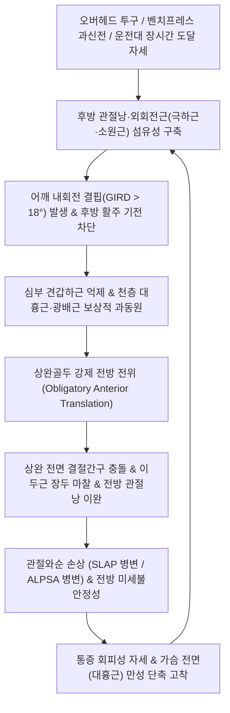

# 🩺 [[상완골 전방 활주 증후군]] (Humeral Anterior Glide Syndrome / 上腕骨前方滑走症候群, ICD-10: M75.8)

> **핵심 3줄 요약 (Key Summary)**:
> - 📍 병소 부위 & 해부·병태생리: 견관절 전방 동적 중심화(Centering)를 담당하는 유일한 심부 회전근개인 [[견갑하근]](Subscapularis)의 억제·약화와 후방 관절낭(Posterior capsule) 및 외회전근([[극하근]], [[소원근]])의 섬유성 구축으로 인해, 상완골두가 후방으로 미끄러지지 못하고 지레 작용에 의해 앞쪽으로 튕겨져 나오는 강제 전방 전위(Obligatory anterior translation, 비누 토막 효과)가 일어나는 셜먼(Shirley Sahrmann) 운동손상증후군.
> - 🚩 전형적 임상 양상 & 3대 징후: 팔을 앞으로 끝까지 들어 올리는 굴곡 끝단계, 수평 내전(Horizontal adduction), 과신전, 뒷주머니에 손을 넣는 내회전 동작 시 견관절 전면부(결절간구, 오훼돌기 하방)의 날카로운 찝힘통, 상완골두 중심축이 견봉 전연보다 1/3 이상 앞쪽으로 돌출되는 징후, 건측 대비 18~20도 이상 내회전이 소실되는 어깨 내회전 결핍 증후군([[어깨 내회전 결핍 증후군]], GIRD).
> - 🛠️ 핵심 감별 검사 & 한·양방 다각적 치료 전략: 앙와위 90도 외전·외회전 시 통증을 유발한 후 검사자가 상완골두를 침대 바닥(후방)으로 지그시 밀면 통증이 즉각 소실되는 증상 변조 재배치 검사(Relocation test); 전면 단축근([[대흉근]], [[소흉근]]) 이완 자침([[중부]], [[운문]]), 액와 후벽 견갑하근 심자침, 후방 관절낭 전침([[천종]], [[노수]], [[견정]]), 신바로 약침 및 JS 후방 활주 추나(Maitland Grade III-IV), [[당귀점통탕]], [[신통축어탕]], [[서경탕]].
> - <font color="#fa7e7e">⚠️ 응급 의뢰 레드플래그 & 악화 요인: 만성 전방 불안정성 방치 시 상부 관절와순 파열([[SLAP 병변]]), 전하방 관절와순 파열([[방카르트 병변]], ALPSA), 상완이두근 장두건 아탈구로 진행하므로 벤치프레스 과신전 및 앙와위 수면 시 팔 처짐 불량 자세를 즉각 금지.</font>

---

## 📌 목차
1. [질환 개요 & 해부학적 병태생리](#1-질환-개요--해부학적-병태생리)
2. [병태생리 메커니즘 & 생체역학적 악순환 네트워크](#2-병태생리-메커니즘--생체역학적-악순환-네트워크)
3. [임상 증상 & 이학적 검사(Physical Exam) 알고리즘](#3-임상-증상--이학적-검사physical-exam-알고리즘)
4. [감별 진단 매트릭스 (Differential Diagnosis)](#4-감별-진단-매트릭스-differential-diagnosis)
5. [한의 통합 치료 프로토콜 (침·약침·추나·한약)](#5-한의-통합-치료-프로토콜-침약침추나한약)
6. [양방 치료 & 병용·의뢰 기준 (Conventional Treatment & Referral)](#6-양방-치료--병용의뢰-기준-conventional-treatment--referral)
7. [재활 운동 & 생활습관 티칭 가이드](#7-재활-운동--생활습관-티칭-가이드)
8. [💡 사용자 진료실 핵심 필기 & 임상 노하우 (Melt-In 잔여 심화 집약)](#8--사용자-진료실-핵심-필기--임상-노하우-melt-in-잔여-심화-집약)
9. [출처 및 학술 참고 문헌 (References)](#9-출처-및-학술-참고-문헌-references)

---

## 1. 질환 개요 & 해부학적 병태생리

### (1) 정의 및 본태
[[상완골 전방 활주 증후군]](Humeral Anterior Glide Syndrome)은 견상완관절(GHJ)의 동적 움직임 시 상완골두가 관절와(Glenoid fossa)의 중심에 안착하지 못하고 과도하게 앞쪽으로 미끄러져 돌출되는 운동계 기능부전 증후군이다. 셜리 셜만(Shirley Sahrmann)의 견관절 손상 분류 체계에서 임상적으로 가장 빈번하게 관찰되는 질환군으로, 단순한 전방 아탈구(Subluxation)와 달리 관절의 인대성 완전 탈구가 아니라 **상완골두의 후방 활주(Posterior glide) 결여와 전방 동적 제어력 상실로 인한 미세 전위(Micro-instability) 및 전방 충돌**을 본태로 한다.

정상 견관절에서 팔을 굴곡하거나 수평 내전할 때 상완골두는 관절와 내에서 뒤쪽으로 미끄러져야(Posterior glide) 관절와순의 중심선상에 안전하게 유지된다. 그러나 후방 관절낭이 단단하게 굳어 있거나 전방 안정화의 핵심인 [[견갑하근]](Subscapularis)이 억제되면, 해리먼(Harryman et al.)의 관절운동학 원리에 따라 골두가 뒤로 물러나지 못하고 전방으로 강제 이송(Obligatory anterior translation)되어 전방 관절와순, 오훼오구인대, [[상완이두근]] 장두건을 전방에서 압박·마찰시킨다.

### (2) 역학 및 호발 조건
* **오버헤드 스포츠 및 투구 선수**:
  - 야구 투수, 테니스, 배구, 배드민턴, 수영 선수에서 극도로 빈발한다.
  - 투구 동작의 후기 코킹(Late cocking) 및 감속기(Deceleration)에서 반복적인 강력한 외회전 및 전단력이 가해져 전방 관절낭은 늘어나고 후하방 관절낭은 비후·섬유화되는 적응적 변화가 발생한다.
* **웨이트 트레이닝 과부하 환자군**:
  - 벤치프레스(Bench press), 체스트 딥스(Chest dips), 펙덱 플라이(Pec deck fly) 시 팔꿈치를 과도하게 몸통 뒤로 젖히는 과신전(Hyperextension)을 반복하여, 상완골두 전면이 팽팽한 전방 관절낭을 반복적으로 타격하는 헬스 동호인.
* **일상 자세 및 직업적 소인**:
  - 장시간 자동차 운전대를 앞으로 뻗어 잡거나, 컴퓨터 마우스를 몸에서 멀리 뻗어 사용하는 사무직 종사자.
  - 똑바로 천장을 보고 누워 잘 때 팔이 뒤로 처지는 자세로 수면을 취하는 습관 보유자.

### (3) 견관절 전방 구획 및 중심화(Centering) 정밀 해부학
견관절 전방은 골성 지지가 취약하여 연부조직 복합체의 긴밀한 조화에 안정성을 의존한다.

```
+-------------------------------------------------------------+
|                 견관절 전방 안정화 구조물                   |
|                                                             |
|   [오훼돌기 (Coracoid)] <=== 오훼상완인대 ===> [대결절/소결절]|
|   [상완이두근 단두 & 오훼완근 건]                           |
+-------------------------------------------------------------+
                               |
               상완골두 전방 피복 (Subscapularis Tendon)
                               |
        =============================================
        |     견갑하근건 (Subscapularis Tendon)     |  <-- 전방 유일의 동적 벽
        =============================================
        |   상완이두근 장두건 (Biceps Long Head)    |  <-- 결절간구 주행
        =============================================
        |   관절상완인대 복합체 (SGHL, MGHL, aIGHL) |  <-- 정적 제동 장치
        =============================================
                               |
+-------------------------------------------------------------+
|        관절와순 (Glenoid Labrum) & 관절와 (Glenoid)         |
|     [전상방: SLAP 병변 호발]   [전하방: Bankart/ALPSA 호발]  |
+-------------------------------------------------------------+
```

* **심부 전방 동적 벽 — [[견갑하근]](Subscapularis)**:
  - 견갑골 늑골면(전면) 전체에서 기시하여 상완골 소결절(Lesser tubercle)에 정지하는 견관절 전면의 유일한 회전근개 근육이다.
  - 상완골두를 관절와 후방으로 강하게 밀어 넣으며 회전축을 중심화(Centering)시키는 절대적 수호자이다. 상·하견갑하신경(Upper & Lower subscapular nerves, C5-C6)의 지배를 받는다.
* **천층 대근육군 — [[대흉근]](Pectoralis major), [[광배근]](Latissimus dorsi)**:
  - 상완골 간부에 정지하며 모멘트 암이 길어 견관절을 내전·내회전시키는 거대한 힘을 낸다.
  - 심부 견갑하근이 약화되면 이들 겉근육이 보상적으로 과활성화되는데, 주행 방향상 상완골두를 전하방 및 전상방으로 강하게 전위시키는 전단력을 형성한다.
* **정적 안정화 인대 및 관절와순**:
  - **상완관절인대(GHL)**: 상관절상완인대(SGHL), 중간관절상완인대(MGHL), 하관절상완인대 전방섬유(aIGHL). aIGHL은 외전 90도 외회전 시 전방 탈구를 막는 핵심 정적 억제대이다 (Fury et al., 2026).
  - **관절와순([[관절와순]])**: 관절와의 깊이를 50% 증가시켜 오목성을 제공한다 (Bauer et al., 2026). 전상방 와순 손상은 [[SLAP 병변]], 전하방 와순-골막 박리는 ALPSA(Anterior Labroligamentous Periosteal Sleeve Avulsion) 병변을 초래한다 (Ismail et al., 2026).

---

## 2. 병태생리 메커니즘 & 생체역학적 악순환 네트워크

### (1) 후방 관절낭 구축과 "비누 토막 효과(Soap-Bar Effect)"
견관절 운동학에서 상완골 전방 활주를 유발하는 가장 결정적인 역학적 원인은 **후방 관절낭(Posterior capsule)의 비후와 섬유성 단축**이다.

```
                           [수평 단면 (Horizontal View)]

             (전방 Anterior)
                    ▲
                    |  ▲ [F_anterior_glide] (전방 밀려남)
                    |  |
             +------+--+------+
             |   상완골두     | <=== [견갑하근 부전: 후방 밀기 실패]
             +------+--+------+
                    |  ▲
                    |  | [지레 받침점 작용: 전방 강제 전위]
                    ▼  |
             [후방 관절낭 구축]
             (Posterior Capsule Tightness)
             (후방 Posterior)
```

#### ASCII 수평단면 역학 메커니즘
```
                                  [전 방 (Anterior)]
                                          ^
                                          | [전방 전위 벡터]
                                          | (대흉근 과활성 + 골두 돌출)
                          +---------------+---------------+
                          |   상완골두 (Humeral Head)     |
                          +---------------+---------------+
                                  ^               |
     [전방 관절와순 / SLAP] <==== |               | ====> [결절간구 압박]
                                  | 지레작용       |
                                  | (Lever)       |
                          +---------------+-------+-------+
                          |      관절와 (Glenoid Fossa)   |
                          +-------------------------------+
                                          ^
                                          |
                              [후방 관절낭 섬유성 구축]
                              (Posterior Capsule & Infraspinatus)
                              상완골두가 뒤로 미끄러지지 못하고
                              비누 토막처럼 앞으로 튕겨져 나감!
                                          |
                                  [후 방 (Posterior)]
```

* **비누 토막 효과(Soap-Bar Effect)**:
  - 젖은 비누의 뒤쪽을 강하게 쥐면 비누가 앞쪽으로 쑥 미끄러져 튀어나가듯이, 단단하게 구축된 후방 관절낭과 [[극하근]], [[소원근]]은 팔을 굴곡하거나 내회전할 때 상완골두의 정상적인 후방 활주를 기계적으로 차단한다.
  - 그 결과 상완골두는 굳어버린 후방 조직을 지레의 받침점(Fulcrum)으로 삼아 회전하면서, 저항이 가장 약한 전방 관절낭 쪽으로 튕겨져 나가게 된다 (Harryman's Obligatory Anterior Translation).

### (2) 어깨 내회전 결핍 증후군(GIRD)과의 상호 연계
* **GIRD(Glenohumeral Internal Rotation Deficit)의 정의**:
  - 견관절 90도 외전 상태에서 측정한 환측의 수동 내회전 각도가 건측(정상측)에 비해 **18~20도 이상 감소**된 상태를 말한다.
* **전체 회전 가동역(Total Arc of Motion, TAM)의 보존 여부**:
  - 정상 견관절의 TAM(외회전 각도 + 내회전 각도)은 약 180도이다.
  - 투구 선수나 오버헤드 운동선수에서 후방 관절낭 구축으로 GIRD가 발생하면 내회전은 줄어들고 외회전은 과도하게 증가하여 총 회전 가동역 중심축이 후상방으로 이동한다.
  - 이 상태에서 팔을 내회전하거나 수평 내전할 때 상완골두가 관절와 후방으로 미끄러져 들어가지 못하고 전상방 와순 및 오훼돌기 하단과 강력하게 충돌하여 2차적인 내적 충돌(Internal impingement)과 전방 마찰을 일으킨다.

### (3) 내회전 근육군의 동적 불균형: 심부 견갑하근 vs 천층 대흉근
1. **견갑하근의 상실**:
   - 정상 상태에서 팔을 안으로 돌릴 때 [[견갑하근]]은 상완골두 전면을 감싸 쥐며 골두를 뒤쪽으로 당겨 관절와 중심에 밀착시킨다.
   - 통증 반사 억제나 건병증으로 견갑하근의 발화가 억제되면 골두를 뒤로 잡아줄 고삐가 풀리게 된다.
2. **대흉근과 광배근의 폭주**:
   - 인체는 내회전력을 유지하기 위해 천층 대근육인 [[대흉근]](Pectoralis major)과 [[광배근]](Latissimus dorsi)을 과도하게 수축시킨다.
   - 대흉근은 흉골과 쇄골에서 시작하여 상완골 대결절 능선에 붙으므로, 수축 시 상완골두를 앞쪽과 안쪽으로 강하게 끌어당긴다.
   - 결국 **"후방 관절낭이 뒤에서 밀고 + 대흉근이 앞에서 잡아당기며 + 견갑하근은 중심을 잡지 못하는"** 삼중 파탄이 완성된다.

### (4) 생체역학적 악순환 네트워크 (Vicious Cycle Network)



---

## 3. 임상 증상 & 이학적 검사(Physical Exam) 알고리즘

### (1) 주요 임상 증상 및 주소증
* **상완골 전면부의 날카로운 찝힘통(Anterior Pinching Pain)**:
  - 팔을 앞으로 끝까지 들어 올리는 굴곡 끝단계(End-range flexion), 가슴 안쪽으로 모으는 수평 내전(Horizontal adduction), 팔을 뒤로 뻗는 과신전(Hyperextension), 바지 뒷주머니에 손을 넣거나 브래지어 끈을 매는 내회전 동작 시 결절간구(Bicipital groove)와 오훼돌기 외측에서 날카롭게 찝히는 통증.
* **상완골두 전방 돌출 징후 (Anterior Displacement Sign)**:
  - 편안히 선 자세에서 환자의 어깨를 측면에서 관찰하면, 상완골두의 중심축이 견봉 전연 수직선보다 **1/3 이상 앞쪽으로 툭 튀어나와** 관찰된다.
  - 전면에서 어깨를 만져보면 쇄골 하부 외측에서 둥근 골두 전면이 비정상적으로 도드라지게 촉지된다.
* **수면 체위성 통증 (Sleep Posture Aggravation)**:
  - 똑바로 천장을 보고 앙와위로 누웠을 때 팔꿈치가 침대 바닥으로 처지면서 상완골이 수동적 신전 상태에 놓이게 된다.
  - 이때 상완골두가 전방으로 솟구치며 팽팽해진 전방 관절낭과 이두근 장두건을 밤새 짓눌러 극심한 수면 장애를 유발한다.
* **던지기 및 밀기 동작 시의 불안정감 (Giving Way / Clicking)**:
  - 야구공을 던지거나 벤치프레스를 밀 때 어깨 앞쪽에서 '뚝' 하는 탄발음(Clicking)과 함께 힘이 빠지는 무력감을 호소한다.

### (2) 단계별 임상 진행 경과
| 임상 단계 | 병태역학 상태 | 핵심 증상 및 기능 수준 | 영상학적 지표 |
| :--- | :--- | :--- | :--- |
| **1단계 (기능성 전방활주기)** | 견갑하근 가벼운 억제, 후방 관절낭 초기 긴장, GIRD < 15도 | 투구 끝단계 또는 과신전 시에만 결절간구 뻐근함, 휴식 시 정상 | MRI상 관절낭 정상, 동적 초음파상 골두 경미한 전방 이동 |
| **2단계 (GIRD 및 전방 관절낭 신장기)** | GIRD 18~25도 결핍, 후관절낭 비후, 전방 관절낭 영구 신장 | 일상적 내회전 시 날카로운 통증, 야간 침상통, 골두 1/3 전방 돌출 | MRI상 후하방 관절낭 비후(>4mm), 이두근건초 활액 삼출 |
| **3단계 (관절순 손상 및 복합 파열기)** | 상부 관절와순 파열([[SLAP 병변]]), ALPSA 병변, 이두근건 아탈구 | 팔 움직일 때마다 염발음, 불안정감 양성, 재배치 검사 강양성 | MRI 관절조영술(MRA)상 관절와순 파열 및 골성 결손 확인 |

### (3) 필수 이학적 검사 알고리즘

```
                     [견관절 전면부 찝힘통 및 가동 제한]
                                     |
                                     v
                   [GIRD 검사 (양측 90도 외전 수동 내회전 각도 대조)]
                                     |
                   +-----------------+-----------------+
                   |                                   |
                   v                                   v
             [GIRD < 15도]                      [GIRD >= 18~20도]
                   |                                   |
                   v                                   v
          [단순 이두근건염 감별]                 [후방 관절낭 구축 확인]
                                                       |
                                                       v
                                     [결정적 확진: 재배치 검사 (Relocation Test)]
                                     앙와위 90도 외전·외회전 후 골두를 후방으로 압박
                                                       |
                                     +-----------------+-----------------+
                                     |                                   |
                                     v                                   v
                               [통증 즉각 소실]                    [통증 불변]
                                     |                                   |
                                     v                                   v
                        [상완골 전방 활주 증후군 확진]          [오훼돌기 충돌 / 진성 탈구]
                                     |
                                     v
                        [전방 구조물 복합 손상 감별]
                        - SLAP 병변: O'Brien test / Crank test
                        - 이두근 장두건염: Speed / Yergason test
                        - 견갑하근 부전: Belly-Press / Lift-Off test
```

1. **결정적 확진: 증상 변조 재배치 검사 (Symptom Alteration Relocation Test)**:
   - 환자를 침대에 앙와위로 눕히고, 견관절을 90도 외전시킨 상태에서 최대 외회전을 수동으로 유도하여 어깨 전면 통증이나 불안정성을 유발한다(불안 검사 자세).
   - 이때 검사자가 **한 손바닥으로 환자의 상완골두 전면을 침대 바닥 방향(후방)으로 지그시 3~5kg 힘으로 눌러주었을 때 통증이 즉각 씻은 듯이 사라지면 100% [[상완골 전방 활주 증후군]]으로 확진**한다.
   - 손을 떼었을 때 통증이 즉시 재발하면 양성 소견이 더욱 확실해진다(Surprise / Release test).
2. **GIRD 및 후방 관절낭 구축 측정 검사**:
   - 환자를 앙와위로 눕히고 검사자가 한 손으로 견봉과 오훼돌기를 단단히 눌러 견갑골을 침대에 고정한 뒤, 견관절을 90도 외전한 상태에서 전완을 바닥 쪽으로 내려 수동 내회전 각도를 각도기(Goniometer)로 측정한다.
   - 건측 대비 환측의 내회전 각도가 18도 이상 부족하면 후방 관절낭의 중증 구축으로 진단한다.
3. **견갑하근 기능 특이 검사**:
   - **배꼽 누르기 검사(Belly-Press / Napoleon Test)**: 손바닥을 배꼽에 대고 배를 안쪽으로 누르게 할 때, 팔꿈치가 몸통 뒤로 빠지거나 손목이 꺾이면 견갑하근 부전 양성.
   - **리프트 오프 검사(Lift-Off Test)**: 손등을 허리 뒤에 대고 손을 등에서 뒤로 떼어내게 할 때, 손을 떼지 못하거나 통증이 발생하면 양성.
4. **이두근 장두건 및 관절와순 평가**:
   - [[스피드 검사]](Speed's Test): 전완 회외 및 주관절 신전 상태에서 전방 거상 저항 시 결절간구 통증 $\to$ 양성.
   - [[야거슨 검사]](Yergason's Test): 주관절 90도 굴곡 상태에서 저항성 전완 회외 시 통증 $\to$ 양성.
   - [[오브라이언 검사]](O'Brien Test): 90도 굴곡, 10도 내전, 엄지 바닥(내회전) 상태에서 하방 저항 시 어깨 심부 통증 유발 후 엄지 천장(외회전) 시 완화 $\to$ [[SLAP 병변]] 양성.

---

## 4. 감별 진단 매트릭스 (Differential Diagnosis)

상완골 전방 활주 증후군은 어깨 앞쪽 통증을 유발하는 여러 질환과 증상이 중첩되므로 정밀 감별이 필수적이다.

| 감별 포인트 | [[상완골 전방 활주 증후군]] (본 질환) | [[상완이두근]] 장두건염 | 상부 관절와순 파열 ([[SLAP 병변]]) | 전방 견관절 불안정성 / [[방카르트 병변]] | [[상완골 상방 활주 증후군]] | 오훼돌기 충돌 증후군 |
| :--- | :--- | :--- | :--- | :--- | :--- | :--- |
| **원인 병태** | 견갑하근 약화 + 후관절낭 구축으로 전방 전위 | 이두근 장두건의 마찰성 활액초염 | 이두근 장두 기시부 와순 박리 단열 | 전하방 관절와순-골막 파열로 인한 탈구 경향 | 회전근개 하방 짝힘 부전 + 삼각근 상방 편향 | 오훼돌기와 소결절 사이 공간 협착 |
| **주요 통증 부위** | **상완골두 전면, 결절간구 전방** | 결절간구 고립 압통 | 관절 심부 꼭대기 통증 | 견관절 전하방 심부 | **견봉 직하방, 외측 삼각근 조면** | **오훼돌기 내측 및 전하방** |
| **통증 유발 동작** | **끝범위 굴곡, 수평내전, 과신전, 내회전** | 저항성 팔꿈치 굴곡·전완 회외 | 오버헤드 투구 감속기, 로딩 시 뚝 소리 | 외전 90도 + 외회전 끝단계 | 외전 60~120도 동통호 | **굴곡 90도 + 수평내전 + 극단적 내회전** |
| **재배치 검사 반응** | **골두 후방 압박 시 통증 즉각 소실** | 골두 압박해도 건 압통 지속 | 부분 완화 또는 심부 클릭 지속 | **불안감(Apprehension) 극적 완화** | 반응 없음 (하방 활주 시에만 완화) | 골두 후방 압박해도 찝힘 지속 |
| **GIRD 동반율** | **90% 이상 동반 (내회전 18도 이상 결핍)** | 무관 | 흔히 동반됨 | 가변적 | 드뭄 | 무관 |
| **특이 검사 소견** | Relocation test 양성, Belly-Press 이상 | Speed, Yergason 양성 | O'Brien, Crank, Biceps Load II 양성 | Apprehension, Relocation, Surprise 양성 | Shrug Sign, Neer, Hawkins 양성 | Coracoid impingement test 양성 |
| **영상 소견** | 골두 전방 돌출, 후하방 관절낭 비후 | 결절간구 삼출액 고임 | 상부 와순 내 조영제 침투, 연골 박리 | 전하방 와순 파열(Bankart/ALPSA), Hill-Sachs 골결손 | AHD < 6mm, 상완골두 상방 전위 | 오훼상완 간격(CH distance) < 6mm 협착 |

---

## 5. 한의 통합 치료 프로토콜 (침·약침·추나·한약)

### (1) 한의 변증 및 병리 기전
* **견전통(肩前痛) 및 어혈조체(瘀血阻滯)**:
  - 어깨 전면부는 **수태음폐경(LU)**의 중부·운문과 **수양명대장경(LI)**의 견우 부위로, 상완골두의 전방 충돌로 인해 기혈이 울결되고 어혈이 혈맥을 막아 찌르는 듯한 고정성 야간통을 초래한다.
* **근실균형(筋失均衡) 및 간신음허(肝腎陰虛)**:
  - 앞쪽의 표층 대근육([[대흉근]])은 기체어혈로 경결·단축되고, 뒤쪽과 안쪽의 심부 안정근([[견갑하근]])은 기혈 허약으로 무력해져 관절의 음양 평형(상호 억제와 길항)이 파괴된 병태이다.

### (2) 침구 치료 및 전침(Electroacupuncture) SOP

```
[치료 목표]: 전면 단축근(대흉근·소흉근) 이완 + 심부 견갑하근 활성화 + 후방 관절낭 신장
```

#### 1) 전면 단축근 및 결절간구 이완 취혈 (Anterior Decompression)
* **주요 혈위**:
  - **[[중부]](LU1)**: 쇄골 하와 외측, 소흉근과 대흉근 근막 통과점. 0.30×40mm 호침으로 외측 상방을 향해 15~20mm 사자(기흉 방지를 위해 늑골면을 향한 직자 절대 금기).
  - **[[운문]](LU2)**: 쇄골 하와 함요처, 오훼돌기 내측. 대흉근 쇄골두 이완. 15mm 외측 사자.
  - **[[결분]](ST12)**: 쇄골상와 중앙, 전사각근 및 경추 신경근 이완을 위해 얕게 10mm 사자.
  - **[[극천]](HT1)**: 액와 중앙 액화동맥 박동처 후방, 대원근 및 광배근 정지부 건막 이완을 위해 20mm 직자.
* **자침 수기**: 염전사법을 통해 가슴 전면의 팽팽한 근막 텐션을 해제.

#### 2) 심부 견갑하근 활성화 심자 취혈 (Subscapularis Deep Needling)
* **해부학적 접근 경로**:
  - 견갑하근은 견갑골 전면(갈비뼈 쪽)에 위치하므로 일반적인 후방 자침으로는 도달할 수 없다.
  - **액와 후벽 접근법**: 환자의 팔을 90도 외전시킨 상태에서, 액와 후벽(광배근과 대원근으로 형성된 주름)의 전내측으로 손가락을 밀어 넣어 견갑골 전면 늑골면을 촉지한다.
  - **침 규격 및 자입 심도**: **0.35×60mm 멸균 장침**을 사용하여 견갑골 늑골면을 스치듯이 견갑골 바닥을 향해 **40~50mm 심자(Deep insertion)**한다.
  - **주의 사항**: 바늘 끝이 내측 흉벽(갈비뼈 사이)으로 향하지 않고 오직 견갑골 뼈의 전면을 향하도록 각도를 정밀 유지하여 기흉 위험을 완벽히 차단한다.
* **기대 효과**: 잠자고 있던 견갑하근의 운동점을 직접 자극하여 골두 후방 안착 반사를 즉각 재활성화.

#### 3) 후방 관절낭 및 외회전근 이완 전침 취혈 (Posterior Capsular Release)
* **주요 혈위**:
  - **[[견정]](SI9)**: 액와 후문 직상 1촌, 후하방 관절낭 및 대원근. 0.30×50mm 호침으로 30mm 직자.
  - **[[노수]](SI10)**: 견봉 후연 하방, 소원근 및 후관절낭 유착부. 30mm 직자.
  - **[[천종]](SI11)**: 극하근 중심 트리거포인트. 40mm 직자.
* **전침 파라미터 세팅**:
  - 견정(SI9)과 천종(SI11)을 연결하여 **2Hz 저주파 통전, 15분간 적용**.
  - 극하근과 소원근의 섬유성 단축을 풀어주어 후방 관절낭의 신장성을 복원.

### (3) 약침 치료 (Pharmacopuncture) 프로토콜
* **결절간구 및 전방 관절낭 소염 약침술**:
  - **처방 약침**: **신바로약침(GCSB-5)** 또는 **황련해독탕 약침**.
  - **용량 및 도구**: 30G 1인치 주사기, 1.0 ~ 1.5cc.
  - **자입점**: 상완골 소결절과 대결절 사이의 결절간구(Bicipital groove) 압통점을 촉지하고, 상완이두근 장두건초(Tendon sheath) 주변으로 약액을 주입하여 충돌성 건초염과 전방 관절낭 부종을 신속 소염.
* **후방 관절낭 및 견갑하근 부착부 재생 약침술**:
  - **처방 약침**: **중성어혈약침** 또는 **자하거(Hominis Placenta) 약침**.
  - **자입점 및 용량**:
    - 소결절 견갑하근 건 정지부에 중성어혈약침 0.5cc 주입하여 미세 유착 박리.
    - 노수(SI10) 및 후관절낭 부착부에 자하거약침 1.0cc를 심부 분주하여 만성 섬유화 조직의 유연성을 증진.

### (4) 추나 치료 (Chuna Manipulation) - JS 견관절 후방 활주 기법
상완골 전방 활주 증후군 추나 교정의 핵심은 **후방 관절낭의 유착을 뜯어내고(Stretch), 상완골두를 관절와 후방 중심에 강제로 재배치(Posterior Centering)**하는 것이다.

```
       [치료사의 체중 부하 압박: 후방 수직 벡터]
                      |
                      v
             [환자 주관절 파지]
                      |
    ======================================
    |        상완골 장축 (Humeral Shaft) |
    ======================================
                      |
                      v
      ===> 침대 바닥 방향 후방 활주 (Posterior Glide Grade III~IV) <===
                      |
                      v
         [견갑골 후면: 침대 바닥에 완전 고정]
```

* **환자 체위**: 앙와위(Supine position). 환측 견관절을 90도 굴곡하고 약 10~15도 수평 내전(Horizontal adduction) 및 경미한 내회전 상태로 둔다.
* **치료사 파지 및 자세**:
  - 치료사는 환측 가슴 옆에 서서, 양손으로 환자의 주관절을 감싸 쥔다.
  - 치료사의 체간 중심을 환자의 주관절 바로 위에 위치시킨다.
  - 환자의 견갑골 후면 아래에 얇은 모래주머니나 치료사의 손을 받쳐 견갑골이 뒤로 밀리지 않도록 침대에 견고히 안정화시킨다.
* **시술 방법 (Maitland Grade III~IV Posterior Glide Mobilization)**:
  - 1단계: 상완골 장축을 따라 환자의 팔꿈치에서 상완골두 방향으로 침대 바닥(수직 후방)을 향해 3~5kg의 지속적인 축성 압박을 가한다.
  - 2단계: 후방 관절낭의 단단한 저항선(End-feel)을 감지한 상태에서, 치료사의 상체 체중을 이용하여 **1초에 2회의 리듬으로 크고 부드러운 진폭(Grade III) 또는 끝범위 미세 진동(Grade IV)**을 15~20회 연속 적용한다.
  - 3단계: 후방 활주를 유지한 채로 견관절을 수평 내전 방향으로 천천히 움직여 후관절낭의 후하방 섬유를 3차원적으로 신장시킨다.
  - 총 3~5세트 반복 시행.
* **크로스바디 추나 스트레칭 (Cross-Body Chuna Stretch)**:
  - 견갑골 외측연을 치료사의 손으로 단단히 붙잡아 전인(Protraction)되지 못하게 고정한 뒤, 환자의 상완골을 반대편 어깨 쪽으로 수평 내전시켜 후관절낭을 30초간 지속 신장.

### (5) 한약 치료 (Herbal Medicine)
| 병기 및 변증 | 대표 처방 | 주요 구성 약재 및 용량(1첩 기준) | 병태역학적 적응증 및 치법 |
| :--- | :--- | :--- | :--- |
| **급성기 전면 찝힘통 (습열조체·기혈어체)** | **[[당귀점통탕]](當歸拈痛湯)** | [[당귀]] 6g, [[강활]] 6g, [[고삼]] 4g, [[승마]] 4g, [[갈근]] 4g, [[창출]] 4g, [[방풍]] 4g, [[택사]] 4g, [[황금]] 4g, [[인삼]] 4g | 결절간구의 급성 종창, 작열감, 찌르는 듯한 날카로운 마찰성 건초염과 습열(濕熱) 삼출물 흡수. |
| **만성 어혈성 야간통 (어혈저락)** | **[[신통축어탕]](身痛逐瘀湯)** | [[진교]] 4g, [[천궁]] 4g, [[도인]] 4g, [[홍화]] 4g, [[당귀]] 6g, [[오령지]] 4g, [[단삼]] 6g, [[몰약]] 3g, [[우슬]] 4g, [[지각]] 4g | 침상에서 팔이 뒤로 처질 때 잠을 깨우는 고정성 야간 자통(刺痛), 전방 관절낭 미세 혈종 제거. |
| **기경팔맥 경락 불통 (풍한습비)** | **[[서경탕]](舒經湯)** | [[강황]] 8g, [[당귀]] 6g, [[해동피]] 6g, [[적작약]] 6g, [[백출]] 4g, [[침향]] 2g, [[감초]] 2g | 수태음폐경과 수양명대장경 경락 소통, 어깨 전면 뻐근함 완화 및 관절 활액 순환 촉진. |
| **GIRD 만성화 및 인대 이완 (기혈양허·근골무력)** | **[[보중익기탕]](補中益氣湯)** 합 **[[독활기생탕]](獨活寄生湯)** | [[황기]] 8g, [[인삼]] 4g, [[백출]] 4g, [[당귀]] 4g, [[숙지황]] 6g, [[두충]] 4g, [[우슬]] 4g, [[속단]] 4g, [[모과]] 4g, [[승마]] 2g, [[시호]] 2g | 만성 전방 관절낭 이완, 견갑하근의 만성 근위축, 투구 후 피로성 무력증에 기운 승제(升提) 및 건골(健骨). |

---

## 6. 양방 치료 & 병용·의뢰 기준 (Conventional Treatment & Referral)

### (1) 약물 치료 (Conventional Pharmacotherapy)
* **소염진통제 및 근이완제 처방**:
  - NSAIDs: Nabumetone 500mg 1일 2회, 또는 Meloxicam 7.5~15mg 1일 1회 경구 투여.
  - 전방 결절간구 이두근건초염 및 활액막염의 통증 물질(Prostaglandin) 합성을 억제.
  - 근이완제(Afloqualone 20mg tid): 대흉근 및 소흉근의 만성 경축 완화.

### (2) 주사 요법 및 비수술 시술
* **초음파 유도하 이두근 장두건초 주사 (US-guided Biceps Sheath Injection)**:
  - 1% Lidocaine 2ml + Triamcinolone 20mg 혼합액을 결절간구 내 건 섬유를 피해 건초 내강에 정확히 주입.
  - 주의: 건 실질 내로 직접 주입될 경우 건 괴사 및 파열을 유발하므로 반드시 고해상도 근골격계 초음파 감시하에 시행.
* **후방 관절낭 수압팽창술 (Posterior Capsular Hydrodilatation)**:
  - 중증 GIRD(내회전 결핍 > 30도)로 인해 도수 치료에 전혀 반응하지 않는 환자에게 생리식염수 15~20ml와 조영제를 후방 관절강 내로 고압 주입하여 유착된 후하방 관절낭을 기계적으로 박리·확장.
* **PDRN / 재생 주사 요법**:
  - 전방 관절낭 미세 파열 부위에 폴리디옥시리보뉴클레오티드(PDRN)를 주입하여 섬유아세포 증식 및 콜라겐 합성을 유도.

### (3) 수술적 치료 적응증 (Surgical Indications)
1. **관절경하 후방 관절낭 절제술 (Arthroscopic Posterior Capsular Release)**:
   - 6개월 이상의 보존적 스트레칭과 한의 추나 치료에도 GIRD가 20도 이상 지속되고 전방 충돌통이 재발하는 엘리트 투구 선수에서, 관절경으로 후하방 관절낭을 절개하여 후방 활주 공간을 해부학적으로 개방.
2. **관절경하 ALPSA / 방카르트 봉합술 (Bankart & ALPSA Repair)**:
   - 전방 관절와순이 박리되어 전방 불안정성이 구조화된 경우, 관절경하 이중 봉합열 기법(Double-row repair)으로 와순을 관절와 연연에 단단히 재고정 (Ismail et al., 2026).
3. **골 결손 동반 시 관절와 골 이식술 (Glenoid Bone Augmentation)**:
   - 상완골두의 반복 전방 탈구로 관절와 골 결손이 15~20% 이상 발생한 경우 오목성을 회복하기 위해 각진 골 블록(Angled bone blocks) 또는 오훼돌기 이전술(Latarjet procedure) 시행 (Bauer et al., 2026).
4. **관절낭 재건술 및 위치 교정술 (Capsular Reconstruction & Shift)**:
   - 늘어난 전방 관절낭을 축소 봉합하는 관절낭 중첩술(Capsular shift) 또는 동종건 이식을 통한 상완골두 위치 재정렬 (Fury et al., 2026).

### (4) 한·양방 병용 치료 가이드라인 (Combination Therapy)
* **병용 가능 (Synergy)**:
  - 양방 약물 치료(NSAIDs)로 급성 통증을 제어한 상태에서 한의 JS 후방 활주 추나와 슬리퍼 스트레칭을 병용하면 관절 가동역 회복 기간을 50% 단축시킬 수 있다.
  - 전면 결절간구 소염을 위한 신바로약침과 후방 관절낭 유착을 해소하는 침/추나 병용은 가장 강력한 보존적 치료 조합이다.
* **병용 주의**:
  - 스테로이드 주사 직후 3일간은 침치료 및 강한 추나 관절 신연을 중단한다.
* **절대 금기**:
  - 진성 전방 탈구(Bankart lesion 전복) 상태에서 무리한 회전 추나 스러스트는 상완신경총 및 액와신경 견인 손상을 유발할 수 있으므로 금기이다.

### (5) 전문과 의뢰 기준 (Red Flags & Referral Criteria)
* **재발성 진성 전방 탈구 (Recurrent Frank Dislocation)**: 경미한 외회전 동작에서도 상완골두가 관절와 밖으로 완전히 빠져나가 정복이 필요한 상태.
* **신경학적 결손**: 액와신경(Axillary nerve) 손상으로 인한 삼각근 감각 소실 및 외전 마비, 근피신경(Musculocutaneous nerve) 손상으로 인한 주관절 굴곡 마비.
* **관절 내 유리체(Loose Body)**: 관절와순이나 연골 조각이 관절강 내에 끼어 팔이 특정 각도에서 전혀 움직이지 않는 잠김(True locking) 증상.

---

## 7. 재활 운동 & 생활습관 티칭 가이드

### (1) 후방 관절낭 집중 신장 스트레칭
후방 관절낭을 신장할 때 견갑골이 따라 움직이면 스트레칭 효과가 0이 되므로, 반드시 견갑골을 체중이나 벽으로 고정해야 한다.

```
       [슬리퍼 스트레칭 (Sleeper's Stretch)]
       - 환측을 바닥으로 하여 옆으로 누운 자세
       - 몸통을 뒤로 30도 젖혀 견갑골을 바닥에 압박 고정!
       - 어깨 90도 외전 + 주관절 90도 굴곡
       - 반대 손으로 환측 손목을 바닥 방향으로 지그시 내회전

       (천장)
         |
         |  [반대 손 하향 압박]
         v
        [환측 손목] ====> 바닥 방향으로 지그시 (내회전 유도)
         |
        [주관절 90°]
         |
        [상완골두] <---- (후방 관절낭 타겟 신장!)
       ========== (침대 바닥: 견갑골 밀착 고정)
```

1. **변형 슬리퍼 스트레칭 (Modified Sleeper's Stretch)**:
   - **자세**: 환측 어깨를 바닥에 대고 옆으로 눕는다. 이때 **몸통을 뒤로 약 30~40도 기울여 환측 견갑골의 외측연이 바닥에 단단히 깔리도록 고정**한다(견봉하 충돌 방지 핵심 팁).
   - **동작**: 견관절을 90도 굴곡 및 주관절 90도 굴곡 상태로 두고, 반대쪽 손으로 환측 손목을 잡아 천천히 침대 바닥 쪽으로 지그시 눌러 내회전을 유도한다.
   - **강도**: 어깨 뒤쪽이 뻐근하게 당기는 지점에서 30초간 정지, 3~5회 반복. (어깨 앞쪽이 찝히면 각도를 즉시 낮추어야 함).
2. **크로스바디 스트레칭 (Cross-Body Stretch with Scapular Stabilization)**:
   - 벽을 등지고 서서 환측 견갑골을 벽에 단단히 밀착시킨다.
   - 반대쪽 손으로 환측 팔꿈치를 감싸 쥐고 가슴을 가로질러 반대편 어깨 쪽으로 끌어당겨 30초간 유지.

### (2) 견갑하근 고립 강화 운동 (Subscapularis Isolated Activation)
겉근육인 대흉근과 삼각근이 수축하지 못하도록 통제하고 순수한 견갑하근의 내회전 토크만을 끌어내는 훈련이다.

```
       [배꼽 누르기 등척성 운동 (Belly-Press Isometric Drill)]
       - 환측 손바닥을 배꼽 위에 평평하게 안착
       - 팔꿈치가 몸통 뒤로 빠지지 않도록 앞으로 유지!
       - 손바닥으로 배꼽을 안쪽(척추 방향)으로 꾹 누름

             [환자 체간]
            +-----------+
            |   (배꼽)  | <=== [손바닥으로 직하방 압박]
            |    (O)    |      (대흉근 억제 / 견갑하근 단독 수축)
            +-----+-----+
                  |
             [손목 일직선]
                  |
             [팔꿈치 전방 위치 유지] (절대 뒤로 빠지지 말 것!)
```

* **배꼽 누르기 등척성 운동 (Belly-Press Isometric Drill)**:
  - 의자에 바르게 앉아 환측 손바닥을 배꼽 위에 얹는다.
  - **절대 주의점**: 누르는 동안 **팔꿈치가 몸통 뒤로 빠지거나 어깨가 앞으로 말려 나오지 않도록 팔꿈치를 약간 앞쪽에 고정**한다.
  - 손목을 꺾지 않고 순수하게 손바닥으로 배를 척추 방향으로 5~10초간 지그시 누른다(최대 근력의 40% 강도). 10회씩 3세트.
* **수건 롤 앙와위 내회전 운동 (Supine IR with Towel Roll)**:
  - 침대에 앙와위로 누워 팔꿈치와 몸통 사이에 말은 수건을 끼워 30도 외전 상태를 유지한다.
  - 밴드나 가벼운 덤벨(0.5~1kg)을 쥐고 전완을 배 쪽으로 천천히 회전시킨다. 수건을 떨어뜨리지 않음으로써 대흉근의 과도한 내전을 억제.

### (3) 대흉근·소흉근 근막 스트레칭 (Pectoralis Release)
* **문틀 스트레칭 (Doorway Stretch)**:
  - 문틀에 팔꿈치를 90도로 대고 한 발을 앞으로 내딛으며 가슴 전면을 앞으로 밀어내어 대흉근과 소흉근을 30초간 이완.

### (4) 일상생활 인체공학적 티칭 (Ergonomics)
* **수면 자세 수정 (Critical)**:
  - 천장을 보고 누워 잘 때 팔이 침대 바닥으로 처지지 않도록, **환측 팔꿈치 밑에 작은 쿠션이나 접은 수건을 받쳐 팔꿈치가 몸통 높이보다 약간 높게 유지되도록** 지도.
* **웨이트 트레이닝 수정**:
  - 벤치프레스나 푸시업 시 바벨이나 가슴이 완전히 바닥에 닿을 때까지 내리지 말고, 팔꿈치가 몸통 선과 일치하는 지점에서 하강을 멈추도록 제한(Over-extension 금지). 딥스는 전면 중단.
* **운전 및 컴퓨터 자세**:
  - 운전대를 잡을 때 팔을 앞으로 쭉 뻗지 말고 시트를 앞으로 당겨 팔꿈치가 가볍게 구부러진 상태를 유지.

---

## 8. 💡 사용자 진료실 핵심 필기 & 임상 노하우 (Melt-In 잔여 심화 집약)

### (1) 진료실 실전 감별 노하우 (원장님 시크릿)
* **"진료는 짧고 간결하며, 자신감을 가지고 해야 한다"**:
  - 환자에게 신뢰를 얻는 비결은 장황한 라틴어 해부학 강의가 아니다.
  - 환자가 진료실 문을 열고 들어와 "원장님, 팔을 앞으로 들 때 어깨 앞쪽이 콕콕 쑤셔요"라고 한마디 하면, 차트를 보며 즉각 이렇게 맞받아쳐라:
  - **"환자분, 혹시 바지 뒷주머니에 손 넣을 때 찌릿하거나, 밤에 반듯이 누워 잘 때 팔이 뒤로 툭 처지면 어깨 앞이 부서질 듯이 아파서 잠을 깨시죠?"**
  - 환자는 자기 고통을 미리 꿰뚫어 보는 순간 눈이 동그랗게 커지며 의사에 대한 절대적 믿음을 갖게 된다.
* **"바깥쪽 겉근육(대흉근·광배근·삼각근)을 꺼야 견갑하근이 살아난다"**:
  - 회전근개가 약해지면 인체는 본능적으로 바깥의 큰 근육들을 과도하게 동원한다.
  - 가슴 앞쪽(대흉근 중부·운문)과 겨드랑이 뒤(광배근 극천)를 사법 자침으로 먼저 부드럽게 꺼뜨려 놓지 않고 무작정 견갑하근 내회전 운동을 시키면, 겉근육만 더 굳어져 상완골두가 앞쪽으로 더 흉측하게 튀어나온다. **반드시 겉근육 이완이 선행되어야 속근육이 반응한다**.

### (2) 3분 라포(Rapport) 형성 원포인트 재배치 테크닉
* **진료실 즉석 체감 시연**:
  - 환자를 진료 베드에 앙와위로 편안히 눕힌다.
  - 환자의 팔을 90도 벌리고 바깥으로 천천히 돌려(외회전) "아! 원장님, 거기 앞쪽이 딱 찝혀요!" 하는 통증 유발 각도를 정확히 잡는다.
  - 그 상태에서 원장님의 손바닥으로 환자 어깨 앞쪽 상완골두를 침대 바닥 쪽으로 지그시 5kg 힘으로 꾹 눌러준다.
  - **"자, 제가 뼈를 뒤로 살짝 밀어 넣었습니다. 지금 어떠세요? 조금 더 돌려볼까요?"**
  - 환자: **"어? 어라? 아까는 찢어지게 아팠는데, 원장님이 누르고 있으니까 하나도 안 아파요!"**
  - 원장: **"그렇죠? 관절와순이 찢어져서 아픈 게 아니라, 뼈가 앞쪽으로 탈출해서 찝히고 있었던 겁니다. 제가 침으로 앞의 큰 근육을 풀고 뒤로 쏙 집어넣어 주는 추나 치료를 해드릴 테니 걱정 마세요."**
  - 이 3분간의 이학적 검사와 체감만으로 환자는 치료에 100% 순응하게 된다.

### (3) 손맛 노하우 & 자침 디테일
* **액와 후벽 견갑하근 심자 시 안전 손맛**:
  - 장침(60mm)으로 액와 후벽을 뚫고 들어갈 때 바늘 끝이 반드시 견갑골의 단단한 뼈 전면에 닿아야 한다.
  - 뼈에 닿기 전 묵직한 근육 저항을 뚫는 순간 환자의 어깨 안쪽 깊숙한 곳에서 '묵직하고 뻐근한' 감각이 발생한다. 바늘 끝이 갈비뼈 쪽으로 향하면 절대 안 되며, 오직 견갑골 골면을 향해 긁듯이 전진해야 한다.
* **JS 후방 활주 추나 시 압박 벡터**:
  - 상완골 장축을 바닥으로 누를 때 팔꿈치를 단순히 아래로 누르기만 하면 주관절에 무리가 간다.
  - 팔꿈치를 살짝 10도 안쪽으로 모으면서(수평 내전) 어깨 관절와를 향해 대각선 후내측으로 체중을 실어주어야 후방 관절낭이 가장 안전하고 깊숙하게 신장된다.

### (4) 실전 문진 체크리스트
- [ ] 바지 뒷주머니에 손을 넣거나 열중쉬어 자세를 할 때 어깨 앞이 찌릿하게 걸리는가?
- [ ] 똑바로 천장을 보고 누워 잘 때 팔이 뒤로 처지면서 통증이 악화되는가?
- [ ] 헬스장에서 벤치프레스나 딥스를 할 때 어깨 앞쪽에 날카로운 통증이 발생하는가?
- [ ] 팔을 앞으로 끝까지 들어 올릴 때 어깨 앞쪽 뼈가 튀어나오며 걸리는 느낌이 드는가?
- [ ] 거울을 보고 섰을 때 아픈 쪽 어깨의 앞쪽 뼈가 반대쪽보다 툭 튀어나와 보이는가?

---

## 9. 출처 및 학술 참고 문헌 (References)

1. Ismail, A. A. A., Abdelhady, A. M., Elgeidi, A., et al. (2026). Arthroscopic Double-Row Repair of ALPSA Lesions: Prospective Outcomes at 2 and 5 Years Abstract. *Orthopedic Reviews*, 18:171211. PMID: 42889837
   - **[연구 요약]**: 전방 견관절 불안정성 및 상완골 전방 전위로 인해 발생하는 ALPSA(전하방 관절와순-골막 파열) 병변에 대한 관절경하 이중 봉합열 수술의 2년 및 5년 전향적 추적 관찰을 통해 관절와순의 해부학적 복원 및 재발률 억제 효과를 입증함.

2. Bauer, J., Lacheta, L., Imhoff, F. B., et al. (2026). Restoring Glenoid Concavity: Angled Bone Blocks Provide Biomechanically Superior Function and Restore Glenohumeral Forces Over Flat Constructs in Glenoid Augmentation. *The American Journal of Sports Medicine*, 54(6):1306-1313. PMID: 41934353
   - **[연구 요약]**: 반복적인 전방 활주 및 아탈구로 인한 관절와 골 결손 모델에서, 각진 골 블록(Angled bone blocks)을 이용한 관절와 재건술이 평평한 이식편에 비해 관절와 오목성 및 상완골두 중심화 생체역학적 안정성을 유의하게 복원함을 입증함.

3. Fury, M. S., Hebert, M., Frank, R. M., et al. (2026). The Effect of Capsular Repair Location on Humeral Head Position and Translation After Distal Tibial Allograft Reconstruction: A Cadaveric Study. *The American Journal of Sports Medicine*, 54(1):128-134. PMID: 41476406
   - **[연구 요약]**: 카다버 생체역학 실험을 통해 관절낭 봉합 위치가 상완골두의 정적 위치와 동적 전방 전위에 미치는 영향을 분석하여, 관절낭 장력과 봉합 부위의 정밀도가 상완골두 전방 활주 억제에 미치는 임상적 중요성을 규명함.
