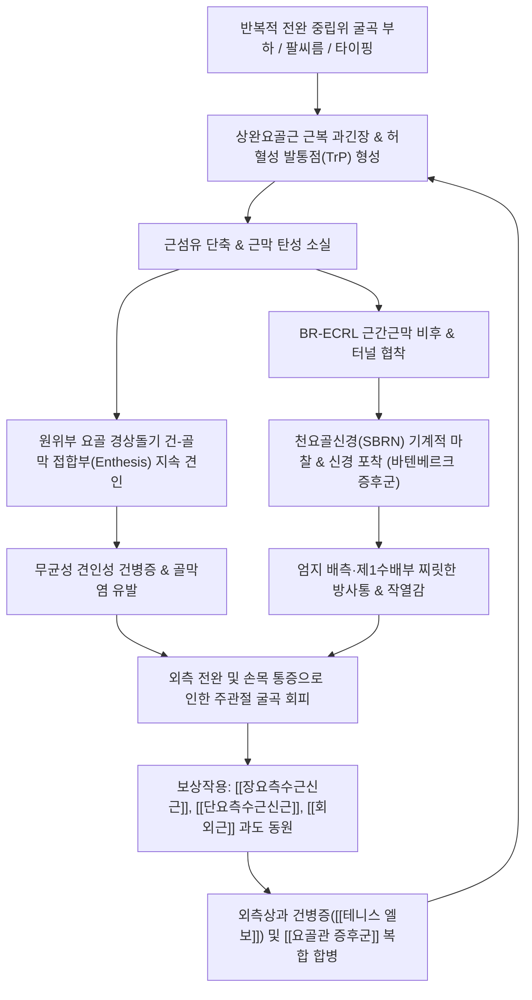

# 🦾 상완요골근 증후군 (Brachioradialis Syndrome / Wartenberg 감별 / M77.8)

> **상위 분류**: [[근골격계 질환]] > [[상지 질환]] > [[주관절 질환]] / [[전완부 질환]] > [[건병증]] / [[신경포착 증후군]]
> **핵심 3줄 요약 (Key Summary)**:
> - 📍 병소 부위 & 해부·병태생리: 상완골 외측상과 융선에서 기시하여 요골 경상돌기 기저부로 주행하는 [[상완요골근]](Brachioradialis)의 과긴장 및 단축, 원위 건-골막 접합부(Enthesis) 견인성 건병증과, 근복-건 이행부 심층을 관통하는 [[천요골신경]](Superficial branch of radial nerve, SBRN)의 기계적 마찰·포착으로 유발되는 [[바텐베르크 증후군]](Wartenberg's Syndrome / Cheiralgia paresthetica) 복합 병변.
> - 🚩 전형적 임상 양상 & 3대 징후: 전완 외측 상부 근복부 둔통 및 Taut band, 요골 경상돌기 국소 견인통, 전완 중립위(Neutral position) 저항성 주관절 굴곡 시 날카로운 외측 전완 통증, 손목 상방 5~8cm 상완요골근 건 부착부 타진 시 제1수배부 및 엄지·검지 배측으로 찌릿하게 방사되는 티넬 징후(Tinel's sign).
> - 🛠️ 핵심 감별 검사 & 한·양방 다각적 치료 전략: 중립위 저항성 주관절 굴곡 검사 양성, 코젠 검사([[외측상과염]]) 음성, 핀켈스타인 검사([[드퀘르벵 증후군]]) 음성 감별. [[수삼리]], [[곡지]], [[수오리]] 중심의 침도([[도침]]) 근막 유착 박리술, 요골신경 주위 초음파 유도하 하이드로다이섹션 및 소염·어혈 약침 주입, 전완 신전근 이완 및 신경 활주 운동, 기체혈어·풍한습비 변증에 따른 [[서경탕]], [[황기계지오물탕]] 투여.
> - <font color="#fa7e7e">⚠️ 응급 의뢰 레드플래그 & 악화 요인: 천요골신경의 지속적 기계 압박에 따른 제1수배부 영구 감각 소실 및 작열통성 신경병증(CRPS), 팔씨름 후 급격한 종창 및 불안정성을 동반한 [[주관절 외측 측부인대]] 파열 복합 손상 감별.</font>

---

## 📌 목차
1. [질환 개요 & 해부학적 병태생리](#1-질환-개요--해부학적-병태생리)
2. [병태생리 메커니즘 & 생체역학적 악순환 네트워크](#2-병태생리-메커니즘--생체역학적-악순환-네트워크)
3. [임상 증상 & 이학적 검사(Physical Exam) 알고리즘](#3-임상-증상--이학적-검사physical-exam-알고리즘)
4. [감별 진단 매트릭스 (Differential Diagnosis)](#4-감별-진단-매트릭스-differential-diagnosis)
5. [한의 통합 치료 프로토콜 (침·약침·추나·한약)](#5-한의-통합-치료-프로토콜-침약침추나한약)
6. [양방 치료 & 병용·의뢰 기준 (Conventional Treatment & Referral)](#6-양방-치료--병용의뢰-기준-conventional-treatment--referral)
7. [재활 운동 & 생활습관 티칭 가이드](#7-재활-운동--생활습관-티칭-가이드)
8. [💡 사용자 진료실 핵심 필기 & 임상 노하우 (Melt-In 잔여 심화 집약)](#8--사용자-진료실-핵심-필기--임상-노하우-melt-in-잔여-심화-집약)
9. [출처 및 학술 참고 문헌 (References)](#9-출처-및-학술-참고-문헌-references)

---

## 1. 질환 개요 & 해부학적 병태생리

### 1.1 질환 정의 및 임상적 의의
**상완요골근 증후군(Brachioradialis Syndrome / Brachioradialis Tendinopathy, ICD-10 M77.8)**은 [[상완골]] 외측상과 상릉에서 기시하여 [[요골]] 원위부 경상돌기에 정지하는 [[상완요골근]](Brachioradialis muscle)의 급·만성 과사용, 고부하 원심성 수축, 또는 직접적 기계적 외상에 의해 근복(Muscle belly) 내 허혈성 [[발통점]](Trigger Point, TrP) 형성 및 원위 건-골막 접합부(Enthesis)의 견인성 미세 손상과 무균성 염증이 발생하는 질환이다.

동시에, 상완요골근의 심층과 내측 경계를 따라 주행하다가 전완 원위 1/3 지점에서 상완요골근과 [[장요측수근신근]](Extensor carpi radialis longus, ECRL) 건 사이를 뚫고 피하지방층으로 주행하는 **[[천요골신경]](Superficial branch of radial nerve, SBRN)**이 비후된 상완요골근 건막이나 근막 띠에 의해 동적·정적으로 포착(Entrapment)되는 **[[바텐베르크 증후군]](Wartenberg's Syndrome / Cheiralgia paresthetica / 수통증, ICD-10 G56.3)**과 해부학적·임상적으로 긴밀히 중첩되어 발생한다 (Hill et al., 2023).

임상 현장에서 본 질환은 외측 팔꿈치 통증을 유발하는 [[외측상과염]](테니스 엘보), 손목 엄지 측 통증을 야기하는 [[드퀘르벵 증후군]](제1신근구획 건초염), 전완 심부 통증을 일으키는 [[요골관 증후군]](Radial tunnel syndrome)으로 오진되기 쉬우며, 정확한 병소 타겟팅 없이 외측상과나 완관절에 국한된 치료만 반복할 경우 수개월 이상 만성화되는 대표적인 "숨은 건병증-신경포착 복합증후군"이다.

### 1.2 정밀 국소 해부학
상완요골근은 전완의 외측 구획을 형성하는 가장 표층의 근육으로, 해부학적 구조와 신경 주행은 다음과 같다.

1. **기시부 (Origin)**:
   - [[상완골]] 외측상과 융선(Lateral supracondylar ridge of humerus) 상부 2/3.
   - 외측 근간중격(Lateral intermuscular septum).
   - 기시부가 주관절 관절낭보다 상방에 위치하므로, 주관절 굴곡 시 긴 모멘트 암(Moment arm)을 확보한다.

2. **주행 및 정지부 (Insertion)**:
   - 상완골에서 시작된 근복은 전완 전외측면을 비스듬히 하행하며, 전완 중간부에서 납작하고 긴 건(Tendon)으로 전환된다.
   - 원위부에서 [[요골 경상돌기]](Radial styloid process) 기저부 외측면에 견고하게 정지한다.
   - 이 정지부는 수근관절의 제1신근구획(단무지신근 건 및 장무지외전근 건)의 바로 기위 및 외측에 인접하여 주행한다.

3. **신경 지배 (Innervation) 및 신경학적 고유성**:
   - **[[요골신경]] 본간(Radial nerve trunk, C5-C6)**에서 직접 분지한다.
   - 중요 감별점: 상완요골근으로 향하는 신경 분지는 주관절 상방(상완골 외측상과 상방 2~3cm 지점)에서 요골신경이 [[천요골신경]](SBRN)과 [[심요골신경]](Deep branch of radial nerve / [[후골간신경]], PIN)으로 분기하기 **이전에** 본간에서 직접 갈라져 나온다.
   - 따라서 회외근(Supinator)의 프로세 아케이드(Arcade of Frohse)에서 발생하는 후골간신경 포착(요골관 증후군)이나 회외근 마비 시에도 상완요골근의 굴곡 근력과 신경학적 반사는 정상으로 보존된다.

4. **생체역학적 기능 (Actions & Biomechanics)**:
   - **주관절 굴곡의 최강자 (전완 중립위)**: 전완이 완전 회외(Supination)되었을 때는 [[상완이두근]]이 주동 굴곡근으로 작용하고, 완전 회내(Pronation) 시에는 [[상완근]]이 주도하지만, **전완이 중립위(Neutral position, 엄지손가락이 하늘을 향하는 자세)**일 때 상완요골근의 기계적 회전 모멘트가 극대화되어 가장 강력한 주관절 굴곡력을 발휘한다.
   - **원심성 안정화 (Centrifugal Stabilizer)**: 빠른 달리기, 팔 흔들기, 던지기 동작의 감속기(Deceleration phase)에서 원심성 수축(Eccentric contraction)을 통해 주관절이 과신전되거나 외측으로 전위되는 것을 방지하는 제동 장치 역할을 수행한다.
   - **전완 회전 보조**: 완전 회내 위치에서는 약 15~20도 회외를 보조하고, 완전 회외 위치에서는 중립위까지 회내를 보조하여 전완을 기능적 중립 위치로 복원시킨다.

5. **인접 신경혈관 주행 및 해부학적 병목 구간 (The Anatomical Bottleneck)**:
   - 전완 근위 1/3에서 요골동맥 및 천요골신경은 상완요골근의 심층 내측면을 따라 나란히 주행한다.
   - 전완 중간부에서 원위 1/3로 이행하는 지점(손목 주름 상방 약 7~9cm)에서 천요골신경(SBRN)은 상완요골근 건의 심층에서 외측 피하지방층으로 빠져나온다.
   - 이때 상완요골근 건과 [[장요측수근신근]](ECRL) 건 사이의 좁은 근막 간극(Fascial cleft)을 관통하게 되는데, 이 부위가 전완 회내 시 가위처럼 교차 압박을 받는 해부학적 취약 지점이다 (Choi et al., 2024).

```
[ 상완요골근 및 천요골신경 해부학적 주행 모식도 ]

  상완골 (Humerus)
       │
       ├─ [요골신경 본간 (Radial Nerve, C5-C6)]
       │        │ (주관절 상방 분지)
       │        ├──────────► [[상완요골근]] (Brachioradialis)
       │        │
       │   [외측상과 수준 분기]
       │        ├─ 심요골신경/PIN ──► [[회외근]] 터널 (Arcade of Frohse) 통과 (순수 운동지)
       │        │
       │        └─ [[천요골신경]] (SBRN, 순수 감각지)
       │                 │
       │                 ▼ (상완요골근 심층 주행)
       │           ┌─────────────┐
       │           │ 전완 원위부 │ ◄── [병목 압박 구간: BR 건과 ECRL 건 사이 관통]
       │           └─────────────┘     (가위 교차 작용: 회내 및 척측 편위 시 협착)
       │                 │
       ▼                 ▼
요골 경상돌기      제1수배부 (엄지·검지 배측 피부 감각 지배)
(BR 건 부착부)     (바텐베르크 증후군 방사통 발현지)
```

### 1.3 역학 및 호발 대상군
1. **스포츠 선수 및 피트니스 활동가**:
   - **팔씨름(Arm wrestling)**: 전완 중립위에서 주관절 굴곡력을 최대 한계치까지 폭발적으로 동원할 때 원심성-등척성 과부하가 집중되어 상완요골근 건-골막 파열 및 근복 파열이 호발한다.
   - **프로 야구 투수**: 투구 감속기에서 전완의 급격한 회내 및 신전 스트레스로 인해 상완요골근 건이 종축 분할(Split tendon variation)되며 신경을 압박하는 증례가 보고된다 (Potter et al., 2023).
   - **라켓 스포츠(테니스 백핸드 스트로크, 배드민턴)**: 백핸드 타구 시 임팩트 충격이 전완 외측 신전근군 및 상완요골근으로 전달됨.
   - **헬스/보디빌딩**: 해머 컬(Hammer curl), 리버스 컬(Reverse curl), 중량 턱걸이(Neutral-grip pull-up) 과다 시행자.

2. **직업적 고위험군**:
   - 망치질, 드라이버 조이기, 렌치 회전 작업을 반복하는 목수, 배관공, 기계 정비공.
   - 무거운 박스나 식자재를 손목 중립위로 옆구리에 끼고 나르는 택배 물류 종사자 및 조리사.
   - 장시간 키보드 타이핑과 마우스 조작을 지속하며 전완을 과회내 상태로 고정하는 사무직 및 프로그래머.
   - 꽉 끼는 시계, 수갑, 손목 보호대, 깁스(Cast) 착용으로 인해 전완 원위부 SBRN이 외부에서 직접 압박된 환자.

---

## 2. 병태생리 메커니즘 & 생체역학적 악순환 네트워크

### 2.1 생체역학적 병태생리 상세 기전
상완요골근 증후군의 병리 기전은 크게 **근막성 발통점 기전**, **견인성 건-골막염 기전**, **신경 포착성 기전**의 세 축으로 맞물려 진행된다.

```
       [ 과도한 전완 중립위 굴곡 부하 & 반복 회내 스트레스 ]
                                │
                                ▼
         ┌──────────────────────────────────────────┐
         │ 1. 상완요골근 근복 내 에너지 위기 (Energy Crisis) │
         │    - 지속적 액틴-미오신 결합 및 근섬유 구축       │
         │    - 국소 모세혈관 압박으로 허혈(Ischemia) 초래 │
         │    - 산성 대사산물 축적 및 활성 발통점(TrP) 형성 │
         └──────────────────────────────────────────┘
                                │
        ┌───────────────────────┴───────────────────────┐
        ▼                                               ▼
┌───────────────────────────────┐     ┌───────────────────────────────┐
│ 2. 원위 견인성 건병증 (Enthesis) │     │ 3. 요골신경 천지(SBRN) 압박   │
│  - 단축된 근복의 지속적 견인력│     │  - 비후된 BR-ECRL 건막 협착   │
│  - 요골 경상돌기 골막 미세손상│     │  - 전완 회내 시 가위 압박 기전│
│  - 무균성 염증, 부종, 섬유화 │     │  - 신경 주위 부종 및 축삭 허혈│
└───────────────────────────────┘     └───────────────────────────────┘
        │                                               │
        └───────────────────────┬───────────────────────┘
                                ▼
         ┌──────────────────────────────────────────┐
         │     통증-연축-기능장애의 악순환 네트워크    │
         │  - 주관절 굴곡력 약화 및 외측 전완 방사통 │
         │  - 엄지 배측 이상감각, 저림, 작열감 동반  │
         │  - 인접 [[단요측수근신근]], [[회외근]] 보상 과부하│
         └──────────────────────────────────────────┘
```

#### 1) 근복부 발통점(TrP) 형성과 근막 통증 증후군 (MPS)
- 반복적인 고부하 수축(해머 컬, 팔씨름 등)이나 저강도 정적 긴장(키보드 타이핑 시 전완 지지)은 상완요골근 근섬유 내 근소포체(Sarcoplasmic reticulum) 손상을 유발한다.
- 과다 분비된 칼슘 이온으로 인해 지속적인 근절(Sarcomere) 구축이 유발되고, 국소 순환 차단으로 **에너지 위기(Energy crisis)**가 발생한다.
- 젖산, 브라디키닌, Substance P 등 발통 물질이 축적되면서 근복 중앙부에 단단한 띠(Taut band)와 압통성 발통점이 형성된다.
- 이 TrP는 상완골 외측상과 하방에서부터 요골 경상돌기, 나아가 엄지와 검지 사이의 배측 제1수간강(First web space)으로 연관통을 방사한다.

#### 2) 요골 경상돌기 건-골막 접합부의 견인성 건병증 (Traction Enthesopathy)
- 상완요골근의 근복이 단축되고 유연성을 상실하면, 주관절 신전이나 수근관절 운동 시 건에 가해지는 장력이 흡수되지 못하고 원위부 정지부로 고스란히 전달된다.
- [[요골 경상돌기]] 골막은 매우 얇고 신경 종말(지각 신경)이 조밀하게 분포하여 미세 견인력에도 극심한 통증을 일으킨다.
- 반복적인 견인 스트레스는 건-골 부착부(Enthesis)의 콜라겐 섬유 미세 단열, 기질 점액성 변성, 무균성 반응성 골막염을 초래한다.

#### 3) 바텐베르크 증후군 (Wartenberg's Syndrome)과의 신경역학적 연계
- 천요골신경(SBRN)은 순수 감각 신경으로, 상완요골근과 장요측수근신근(ECRL) 사이를 통과할 때 두 건의 가장자리에 의해 둘러싸인다.
- **가위 작용 기전(Scissor Effect)**: 전완을 회내(Pronation)시키면 상완요골근 건이 장요측수근신근 건의 상방을 가로지르면서 두 건이 가위처럼 엇갈리게 닫힌다. 이때 사이에 낀 SBRN이 강하게 조여진다 (Hill et al., 2023).
- 손목을 굴곡시키고 척측 편위(Ulnar deviation)할 때 SBRN은 길이 방향으로 최대 10~15% 신장 장력을 받게 되는데, 상완요골근이 비후되거나 섬유화되어 있으면 활주(Gliding)가 차단되어 신경 내 혈류 차단(Ischemic neuropathy)과 축삭 압박이 가중된다.
- 해부학적 변이로서 상완요골근 건이 두 가닥으로 갈라져 SBRN이 건 실질을 뚫고 지나가는 경우(Split tendon), 근육 수축 시마다 직접적인 신경 분쇄 손상이 발생한다 (Potter et al., 2023).

### 2.2 생체역학적 악순환 네트워크 (Mermaid)


---

## 3. 임상 증상 & 이학적 검사(Physical Exam) 알고리즘

### 3.1 주요 임상 증상 분석
1. **국소 근육 증상 (Myofascial Symptoms)**:
   - 전완 외측 상부(외측상과 하방 2~5cm 지점)의 묵직하고 뻐근한 둔통과 근육 피로감.
   - 상완요골근 근복부를 손가락으로 누르면 단단한 띠가 만져지며, 환자가 펄쩍 뛸 정도의 극심한 압통(Jump sign)이 관찰됨.
   - 무거운 물건(장바구니, 맥주잔, 아령)을 엄지가 위로 향한 채 들어 올릴 때 외측 전완이 끊어질 듯한 통증 호소.

2. **건 부착부 증상 (Enthesopathy Symptoms)**:
   - [[요골 경상돌기]] 부위의 날카로운 국소 압통.
   - 손목을 척측으로 꺾거나 비틀 때 손목 바깥쪽 뼈 부위의 견인통.
   - 흔히 드퀘르벵 건초염으로 착각하여 엄지를 움직이지 않아도 손목 뼈 자체에 욱신거리는 통증 잔존.

3. **신경학적 증상 (SBRN Neuropathy / Wartenberg Symptoms)**:
   - 엄지손가락 배측면(Dorsal thumb), 제1수간강(First interosseous web space), 검지 손가락 기저부 배측의 저림, 찌릿함, 개미가 기어가는 듯한 이상감각(Formication), 감각 저하(Hypoesthesia) 또는 스치기만 해도 아픈 이질통(Allodynia).
   - 손목시계나 소매 단추, 타이트한 가방 끈이 전완 원위부 외측을 압박할 때 엄지 손등 쪽으로 전기 통하듯 뻗치는 방사통.
   - 운동 신경 마비(운동 탈력)는 **원칙적으로 발생하지 않음** (SBRN은 순수 감각 신경임). 만약 손가락 하수(Drop finger)나 무지 신전 불능이 관찰된다면 후골간신경(PIN) 손상이나 요골신경 마비를 의심해야 함.

### 3.2 필수 이학적 검사법 (Physical Examination)

```
[ 상완요골근 증후군 이학적 검사 감별 알고리즘 ]

                  환자의 주소증: 외측 전완통 / 엄지 배측 저림
                                      │
                                      ▼
                ┌───────────────────────────────────┐
                │ 1. 중립위 저항성 주관절 굴곡 검사  │
                └───────────────────────────────────┘
                         │                 │
                      [양 성]           [음 성]
                         │                 │
                         ▼                 ▼
          ┌───────────────────────┐   ┌───────────────────────┐
          │ 상완요골근 증후군 강력│   │ 타 주관절 질환 감별  │
          │ 의심 (근복/건부착부통)│   │ Cozen(+): 외측상과염  │
          └───────────────────────┘   │ Maudsley(+): 요골관증 │
                         │            └───────────────────────┘
                         ▼
                ┌───────────────────────────────────┐
                │ 2. SBRN 티넬 징후 (Tinel's sign)  │
                │    (손목 상방 5~8cm BR 건 타진)   │
                └───────────────────────────────────┘
                         │                 │
                      [양 성]           [음 성]
                         │                 │
                         ▼                 ▼
          ┌───────────────────────┐   ┌───────────────────────┐
          │ 바텐베르크 증후군 동반│   │ 단순 근막성 TrP 및   │
          │ (SBRN 포착 복합형)    │   │ 견인성 건병증 단독형  │
          └───────────────────────┘   └───────────────────────┘
                         │
                         ▼
                ┌───────────────────────────────────┐
                │ 3. 핀켈스타인 검사 (Finkelstein)  │
                └───────────────────────────────────┘
                         │                 │
                      [양 성]           [음 성]
                         │                 │
                         ▼                 ▼
          ┌───────────────────────┐   ┌───────────────────────┐
          │ 변형 핀켈스타인 재평가│   │ 드퀘르벵 건초염 배제  │
          │ (엄지 배제 척측 편위) │   │ 순수 상완요골근/SBRN  │
          └───────────────────────┘   └───────────────────────┘
```

1. **중립위 저항성 주관절 굴곡 검사 (Resisted Elbow Flexion in Neutral Forearm)**:
   - **검사 목적**: 상완요골근의 선택적 최대 수축을 유도하여 병변 부위의 통증을 재현하는 가장 민감한 확진 검사.
   - **검사 수기**: 환자는 주관절을 90도 굴곡하고 전완을 완벽한 **중립위(엄지가 위를 향함)**로 유지한다. 검사자는 환자의 전완 원위부를 아래 방향으로 신전시키려 강한 저항을 가하고, 환자는 이에 맞서 팔꿈치를 굽힌다.
   - **양성 소견**: 상완요골근 근복(전완 외측 상부) 또는 원위 정지부(요골 경상돌기)에 날카로운 통증이 유발되면 양성.
   - **비교 평가**: 전완을 완전 회외(Supination)시킨 상태에서 저항 굴곡을 시키면 상완이두근이 부하를 분담하므로 통증이 현저히 감소함.

2. **상완요골근 집게 촉진 검사 (Pincer Palpation of Muscle Belly)**:
   - **검사 수기**: 외측상과 하방 2~4cm 부위에서 검사자의 엄지와 검지로 상완요골근 근복을 가로지르며 깊게 집어 올린다.
   - **양성 소견**: 팽팽한 근섬유 띠(Taut band)가 촉진되며, 압박 시 국소 연축 반응(Local twitch response)과 함께 제1수배부로 뻗치는 전형적인 연관통이 유발됨.

3. **요골신경 천지 티넬 징후 (Tinel's Sign over SBRN)**:
   - **검사 수기**: 손목 주름 상방 약 5~8cm 지점, 상완요골근 건이 장요측수근신근 건과 교차하여 천부로 나오는 부위를 타진기나 검사자의 손가락 끝으로 가볍게 톡톡 두드린다.
   - **양성 소견**: 타진 부위에서 시작하여 전완 원위 외측, 엄지 손등 및 검지 기저부로 전기 쇼크 같은 찌릿한 통증이나 저림이 방사됨 (바텐베르크 증후군 확진 소견).

4. **강제 회내-수근 굴곡-척측 편위 유발 검사 (Forced Pronation & Ulnar Deviation Test)**:
   - **검사 수기**: 주관절을 완전히 펴고, 전완을 최대로 회내(Pronation)시킨 상태에서, 손목을 굴곡(Flexion) 및 척측 편위(Ulnar deviation)시킨다.
   - **메커니즘**: 상완요골근 건과 ECRL 건이 가위 형태로 교차 압박을 극대화하고 SBRN을 최대로 신장시키는 유발 검사.
   - **양성 소견**: 엄지 배측의 이상감각 및 통증이 즉각적으로 격화됨.

5. **변형 핀켈스타인 검사 (Modified Finkelstein's Test for Differential Diagnosis)**:
   - **드퀘르벵 가양성 감별 요령**: 표준 핀켈스타인 검사(엄지를 쥐고 척측 편위) 시 SBRN도 신장되므로 상완요골근 증후군에서도 통증이 발생할 수 있다.
   - **감별 수기**: 환자에게 **엄지손가락을 자유롭게 편 상태(엄지를 쥐지 않음)**로 손목만 단순 척측 편위시킨다.
   - **판정**: 엄지를 쥐지 않았는데도 요골 경상돌기 부근에서 통증이 심하게 재현된다면 상완요골근 건 정지부 병변 또는 SBRN 포착이며, 엄지를 감싸 쥘 때만 통증이 발생한다면 제1신근구획 내의 순수 [[드퀘르벵 증후군]]이다.

---

## 4. 감별 진단 매트릭스 (Differential Diagnosis)

| 감별 질환 | 호발 병소 및 해부 구조 | 주요 증상 양상 및 방사통 | 특이적 이학적 검사 | 신경학적 결손 유무 | 결정적 감별 포인트 |
| :--- | :--- | :--- | :--- | :--- | :--- |
| **[[상완요골근 증후군]] (본 질환)** | 상완요골근 근복 및 요골 경상돌기 정지부 | 전완 외측 둔통, 경상돌기 견인통, 무거운 것 들 때 외측 주관절통 | **중립위 저항성 굴곡검사(+)**, 상완요골근 집게촉진(+) | 원칙적 결손 없음 (SBRN 포착 시 감각만 저하) | 전완 중립위 주관절 굴곡 저항통이 핵심 지표 |
| **[[바텐베르크 증후군]] (SBRN 포착)** | 전완 원위 1/3 BR-ECRL 건 교차 간극 | 제1수간강 및 엄지·검지 손등의 찌릿한 작열통, 감각 이상 | **SBRN 티넬 징후(+)**, 강제 회내 척측편위 유발(+) | **엄지 배측 피부분절 감각 저하 (순수 감각)** | 운동 마비 전무, 손목시계/팔찌 착용 시 격통 |
| **[[외측상과염]] (테니스 엘보)** | 상완골 외측상과 뼈 자체 및 [[단요측수근신근]](ECRB) 기시부 | 외측상과 뼈 부위의 날카로운 압통, 주먹 쥘 때 통증 | **Cozen 검사(+)**, Mill 검사(+) | 신경학적 결손 없음 | 손목 신전 저항 시 외측상과 뼈 정점 압통 |
| **[[요골관 증후군]] (RTS)** | 회외근 아케이드(Frohse) 및 요골신경 분지 | 전완 근위 외측 심부 둔통, 야간통, 휴식 시 지속통 | **중지 저항 신전 검사(Maudsley)(+)**, 회외 저항통(+) | 감각/운동 결손 없음 (후골간신경 기계적 자극) | 외측상과 4~5cm 하방 회외근 압통, ECRB 기시부와 구분 |
| **후골간신경 마비 (PIN Palsy)** | 회외근 심층 후골간신경 본간 | 통증은 거의 없거나 경미, 손가락 펴기 불능 | 손가락 신전 검사 시 Drop finger (무지·지절 신전 마비) | **순수 운동 마비 (손하수), 감각은 완전 정상** | 감각 정상인 채 손가락 신전 근력만 마비 |
| **[[드퀘르벵 증후군]]** | 손목 제1신근구획 (장무지외전근·단무지신근 건초) | 요골 경상돌기 건초 부종, 엄지 움직일 때 국소 마찰통 | **Finkelstein 검사(+)** (엄지 감싸 쥘 때 통증) | 신경학적 결손 없음 | 엄지 능동 운동 시 건초 내 비후 및 마찰음 |
| **경추 C6 신경근병증** | 경추 C5-C6 추간판 및 C6 신경근 | 목 통증, 견갑골 내측연 통증, 상완 외측-전완 외측-엄지 방사통 | **Spurling 검사(+)**, 경추 신전-회전 유발(+) | **상완이두근/상완요골근 건반사 저하, C6 피부분절 감각 저하** | 경추 자세 및 목 움직임에 따른 통증 유발 |

---

## 5. 한의 통합 치료 프로토콜 (침·약침·추나·한약)

### 5.1 침구 및 전침 치료 프로토콜
침구 치료는 상완요골근의 과긴장된 근막 발통점(TrP)을 물리적으로 해제하고, 요골 경상돌기 정지부의 미세 순환을 촉진하며, SBRN 주변의 부종을 배출시키는 데 목적이 있다.

1. **상완요골근 근복부 트리거포인트 자침**:
   - **주요 경혈**: **[[수삼리]](LI10)** 외측 0.5촌, **[[곡지]](LI11)** 하방 1촌(상완요골근 근복 최고 융기부), **[[수오리]](LI13)**.
   - **자침 기법**: 0.25×40mm 또는 0.30×40mm 멸균 호침을 사용하여 상완요골근 근복의 Taut band를 향해 1.0~1.5촌 깊이로 직자 또는 사자한다.
   - **국소 연축 유도(Fasciculation)**: 침첨으로 근막 띠를 부드럽게 탐색하여 국소 연축 반응(Local twitch)을 1~2회 유도함으로써 근섬유 내 아세틸콜린 수용체 고갈과 단축된 근절의 즉각적 이완을 유도한다.
   - **주의 사항**: 심층으로 지나치게 깊이 자침하면 요골신경 본간이나 요골동맥을 자극할 수 있으므로, 근육을 엄지와 검지로 집어 올려 안전하게 자침하는 집게 파지 자침법(Pincer needling)을 적용한다.

2. **원위 건-골막 접합부 자침 (Enthesopathy Decompression)**:
   - **주요 경혈**: **[[열결]](LU7)**, **[[경거]](LU8)**, **[[공최]](LU6)**.
   - **자침 기법**: 요골 경상돌기 외측면의 건 부착부를 향해 침을 15~30도 각도로 눕혀 골막 표면을 가볍게 긁어주듯 사자(Oblique needling)한다. 골막의 미세 순환을 촉진하여 혈관신생과 조직 재생을 도모한다.

3. **전침 치료 (Electroacupuncture)**:
   - **배혈 조합**: [[수삼리]](LI10) - [[곡지]](LI11) (근복부 이완 전극) 및 근복부 TrP - 요골 경상돌기 정지부.
   - **파형 및 파라미터**: **2Hz / 100Hz 혼합 소밀파(Dense-Disperse Wave)** 또는 2Hz 연속 저주파를 적용한다.
   - **시간 및 강도**: 15~20분간 환자가 뻐근한 득기감을 느끼면서 전완 근육이 규칙적으로 율동적 수축을 일으키는 역치 수준으로 조절한다.
   - **기전**: 2Hz 저주파 자극은 척수 및 뇌간 수준에서 엔도르핀(Endorphin) 및 엔케팔린(Enkephalin) 분비를 유도하여 만성 통증을 억제하고, 근육의 펌프 작용을 통해 근육 내 허혈 상태를 개선한다.

### 5.2 침도 요법 (Acupotomy / 미세 근막 유착 박리술)
만성화되어 섬유화된 상완요골근 근막이나 SBRN 포착 부위의 근막 비후는 일반 호침만으로 박리가 어려우므로, 정밀 침도 요법을 적용한다.

1. **시술 목표 부위**:
   - 상완요골근과 장요측수근신근(ECRL) 사이의 근막 유착 지점 (전완 중간부 및 원위 1/3 교차부).
   - 요골 경상돌기 부착부의 비후된 건-골막 접합부 띠.

2. **시술 기법 및 절차**:
   - **환자 체위**: 주관절 90도 굴곡, 전완 중립위 상태에서 지지대에 전완을 안정적으로 거치.
   - **도침 규격**: 0.4×40mm 또는 0.5×40mm 일자형 미세 침도.
   - **자침선 방향**: 신경과 혈관 손상을 방지하기 위해 도침의 칼날면(Blade)을 반드시 **전완의 장축(신경 및 근섬유 주행 방향)과 완벽히 평행하게** 정렬하여 진침한다.
   - **수기법**: 병변 근막에 침첨이 도달하여 단단한 저항감이 느껴지면, 종축으로 2~3회 가볍게 밀고 당기며 박리하는 종박법(Longitudinal slicing)을 시행한다. 횡단 절개(Transverse cutting)는 절대 금기이다.

### 5.3 약침 치료 (Pharmacopuncture & Hydrodissection)
1. **약침 제제 선택**:
   - **급성기 / 신경 포착성 신경통**: **[[황련해독탕 약침]]** 또는 **청열소염약침** (1.0~1.5cc) — 화학적 신경염 및 근막 부종 완화.
   - **아급성기 / 어혈성 건병증**: **[[중성어혈약침]]** (1.0cc) — 미세 순환 개선, 혈종 흡수 및 통증 차단.
   - **만성 퇴행성 건병증 및 신경 영양 장애**: **[[신바로약침]]** (1.0~2.0cc) 또는 **[[자하거약침]]** (0.5~1.0cc) — 손상된 건 조직의 콜라겐 재생 촉진 및 신경 보호.
   - **난치성 부착부염**: **[[봉약침]](Sweet BV)** 0.05~0.1cc 미량 시술 (봉독 과민반응 피부 테스트 선행 필수).

2. **초음파 유도하 약침 신경 하이드로다이섹션 (Acupuncture Hydrodissection)**:
   - 초음파 가이드 하에 또는 해부학적 랜드마크 촉진 하에 SBRN이 BR 건막을 뚫고 나오는 지점에 0.30×40mm 멸균침으로 접근.
   - 약침액 1.0~1.5cc를 SBRN 주위 외막(Perineural sheath) 공간으로 서서히 주입하여 신경과 주변 근막 사이의 물리적 유착을 수압으로 분리 박리(Hydrodissection)한다.

### 5.4 추나 요법 및 근막 이완 수기 (Chuna Manipulation & MFR)
1. **상완요골근 종축 스트리핑 및 허혈성 압박 (Striping & Ischemic Compression)**:
   - 환자의 주관절을 가볍게 굴곡시킨 상태에서, 한의사의 양측 무지를 상완골 기시부(외측상과 융선)에 접촉한다.
   - 체중을 실어 강한 압박을 유지하면서 근섬유 주행 방향을 따라 요골 경상돌기 원위부 방향으로 천천히 밀고 내려가는 종축 심부 조직 마사지를 5~10회 반복한다.

2. **요골두(Radial Head) 전·후방 아탈구 교정 추나**:
   - 전완의 반복적 회전 손상으로 요골두의 경미한 후방 변위가 동반된 경우, 주관절을 굴곡-회외 상태로 유도하며 한의사의 무지로 요골두 후면을 전방으로 지긋이 밀어 넣는 관절가동 교정술을 적용한다.

3. **요수근관절(Radiocarpal Joint) 견인 가동술**:
   - 한의사가 환자의 완관절을 양손으로 파지하고 원위 방향으로 장축 견인(Long-axis traction)을 가하면서, 완전 회내와 완전 회외를 교대로 부드럽게 유도하여 전완 골간막과 근간중격의 긴장도를 해소한다.

### 5.5 한약 변증 처방 프로토콜
1. **기체혈어형 (氣滯血瘀型 — 팔씨름, 급성 외상, 통증 고정, 야간통 악화)**:
   - **처방**: **[[서경탕]](舒經湯)** 또는 **[[당귀수산]](當歸鬚散)** 가미방.
   - **주요 구성**: 강황(姜黃), 당귀(當歸), 계지(桂枝), 적작약(赤芍藥), 해동피(海桐皮), 천궁(川芎), 홍화(紅花).
   - **기전**: 상지 경락의 어혈을 제거하고 경락 순환을 소통(通經活絡)시켜 급성 건 손상 후의 혈종과 염증을 흡수시킨다.

2. **기혈양허 및 신경 영양 장애형 (氣血兩虛型 — 만성 피로, 엄지 감각 저하, 저림, 근위축)**:
   - **처방**: **[[황기계지오물탕]](黃芪桂枝五物湯)** 합 **[[보양환오탕]](補陽還五湯)** 가미방.
   - **주요 구성**: 황기(黃芪, 30~40g 군약), 계지(桂枝), 백작약(白芍藥), 생강(生薑), 대조(大棗), 당귀미(當歸尾), 지룡(地龍).
   - **기전**: 황기의 강력한 보기(補氣) 작용과 지룡의 통락(通絡) 작용이 결합하여 허혈성 신경 손상 부위의 미세혈류를 개선하고 축삭 재생을 촉진한다.

3. **풍한습비형 (風寒濕痺型 — 날씨가 흐리거나 찬 바람을 쐬면 팔꿈치와 손목이 시리고 굳음)**:
   - **처방**: **[[오적산]](五積散)** 가미방 (창출, 마황, 진피, 후박, 지각, 길경, 백지, 천궁, 당귀, 작약, 복령, 반하, 계심, 건강, 감초).
   - **기전**: 온경산한(溫經散寒), 제습지통(除濕止痛)하여 한랭 노출로 유발된 근막 경직을 완화한다.

---

## 6. 양방 치료 & 병용·의뢰 기준 (Conventional Treatment & Referral)

### 6.1 약물 요법 (Pharmacotherapy)
1. **비스테로이드성 소염진통제 (NSAIDs)**:
   - **처방 약제**: Aceclofenac 100mg bid, Meloxicam 7.5~15mg qd, Celecoxib 200mg qd~bid.
   - **투여 목적**: 건 부착부의 급성 견인성 염증 반응 및 통증 차단 (대개 2~4주 단기 처방).
   - **위장관 보호제 병용**: 위궤양 및 소화기 증상 예방을 위해 PPI(Esomeprazole 등)나 Rebamipide 등을 반드시 병용 처방하는 것이 국내 임상 관행임.
2. **근이완제 (Muscle Relaxants)**:
   - Eperisone HCl 50mg tid 또는 Afloqualone 20mg tid: 상완요골근 근복의 반사성 근경련을 완화하기 위해 병용.
3. **신경병증성 통증 약물 (바텐베르크 증후군 동반 시)**:
   - Pregabalin 75mg bid 또는 Gabapentin 300mg tid: SBRN 포착으로 인한 엄지 배측 작열통, 이질통 증상 조절.

### 6.2 비수술적 중재 시술 (Interventional Procedures)
1. **초음파 유도하 국소 주사 치료 (Ultrasound-Guided Injection)**:
   - **스테로이드 주사(Corticosteroid Infiltration)**: Triamcinolone acetonide 10~20mg + 1% Lidocaine 혼합액을 SBRN 주변이나 상완요골근과 ECRL 건막 사이에 주입.
   - **⚠️ 절대 주의사항**: 상완요골근 건 실질 내(Intratendinous)로 스테로이드를 직접 주입해서는 안 된다. 건 괴사 및 영구적 건 파열을 초래할 수 있으므로, 반드시 초음파 유도하에 건초 주변(Peritendinous) 또는 신경 주위로만 주입해야 한다.
2. **신경 하이드로다이섹션 (Hydrodissection)**:
   - 생리식염수 또는 5% 포도당 용액(D5W) 3~5cc를 초음파 실시간 모니터링 하에 SBRN 신경 외막 둘레로 주입하여 주변 유착을 분리. 스테로이드의 부작용(피부 탈색, 지방 위축) 없이 신경 감압을 달성할 수 있어 선호됨.
3. **체외충격파 치료 (ESWT)**:
   - 요골 경상돌기 정지부의 만성 건병증에는 집중형 충격파(fESWT, 0.08~0.15 mJ/mm², 2000타, 주 1회, 총 3~5회)를 적용하여 혈관신생과 콜라겐 재생을 유도.
   - 상완요골근 근복부 긴장에는 방사형 충격파(rESWT)를 적용하여 근막 이완 도모.

### 6.3 수술적 적응증 및 술식 (Surgical Indications & Procedures)
1. **수술 적응증**:
   - 최소 3~6개월 이상의 적극적인 보존적 치료(한의 치료, 약물, 주사, 물리치료 등)에도 불구하고 참을 수 없는 통증이 지속되는 경우.
   - SBRN의 영구적 감각 소실이나 신경종(Neuroma) 형성이 확인된 경우.
   - 해부학적 건 이상(Split tendon 등)으로 인해 보존적 치료로 신경 압박 해소가 불가능한 경우 (Potter et al., 2023).
2. **수술 방법**:
   - **상완요골근 건 절개술 및 신경 감압술(Brachioradialis Tenotomy & SBRN Decompression)**:
     - 전완 원위부 외측을 절개하여 SBRN을 노출시키고, 신경을 누르고 있는 상완요골근 건막 및 ECRL과의 결합 조직을 완전히 유리한다.
     - 난치성 건병증과 신경 포착이 심할 경우 상완요골근 건의 부분 절제 또는 건 절개술(Tenotomy)을 시행하여 통증 완화와 삶의 질 개선을 도모한다 (Hill et al., 2023).

### 6.4 한·양방 병용 판단 기준 및 주의사항
1. **병용 가능 (Synergy)**:
   - 양방 경구 NSAIDs 복용 중 침·전침 치료 병용: 약리적 소염 작용과 물리적 근막 이완이 결합하여 시너지 효과 발휘.
   - ESWT 시술 후 한의 침구 및 근막 추나 치료 병용: 조직 재생기 근막 긴장 완화에 유효.
2. **주의 및 금기 (Precautions & Contraindications)**:
   - **스테로이드 주사 직후 침 치료 간격**: 양방 정형외과나 통증의학과에서 국소 스테로이드 주사를 맞은 당일 및 48~72시간 동안은 주사 부위 감염 위험과 조직 약화가 있으므로 주사 부위에 직접적인 침자나 부항, 약침 시술을 금기한다. (원위부 취혈이나 반대측 치료로 대체).
   - **NSAIDs 복용 환자 한약 투여 시 주의**: NSAIDs를 수주 이상 복용한 환자는 위점막 손상이 흔하므로, 활혈거어제 투여 시 소화기 장애를 유발하지 않도록 백출, 백작약, 감초 등 건비위(健脾胃) 약재를 충분히 배합한다.

### 6.5 양방·전문과 의뢰 기준 (Referral Criteria)
1. **즉시 상급병원 응급 의뢰 (Red Flags)**:
   - 팔씨름이나 강력한 외상 직후 팔꿈치 관절 내측 및 외측의 급격한 종창, 변형, 피하 출혈 및 관절 불안정성이 나타난 경우 (주관절 탈구, 측부인대 완전 파열, 상완골 과상 골절 감별).
   - 전완 구획의 극심한 압력 상승, 수동 신전 시 극통, 맥박 소실 (구획 증후군 의심).
2. **정형외과 / 수부외과 전문의 의뢰**:
   - 3개월 이상의 한의 집중 치료에도 불구하고 엄지 배측 감각 저하가 점진적으로 악화되거나 근력 저하가 동반되는 경우 (근전도/신경전도 검사 및 MRI 정밀 평가 의뢰).
   - 신경종 형성으로 가벼운 접촉에도 심한 작열통성 반사가 일어나는 복합부위통증증후군(CRPS) 의심 시.

---

## 7. 재활 운동 & 생활습관 티칭 가이드

```
[ 상완요골근 및 SBRN 자가 재활 스트레칭 단계 ]

1단계: 주관절 완전 신전 (팔꿈치를 앞으로 쭉 편다)
                      │
                      ▼
2단계: 전완 완전 회내 (손등이 안쪽/위쪽을 보게 손바닥을 바깥으로 돌림)
                      │
                      ▼
3단계: 수근관절 굴곡 & 척측 편위 (반대 손으로 손목을 바닥 쪽 & 새끼손가락 쪽으로 당김)
                      │
                      ▼
[외측 전완부터 엄지 손등까지 기분 좋은 긴장감을 유지하며 20~30초 유지, 호흡 유지]
```

### 7.1 단계별 재활 운동 프로토콜
1. **상완요골근 자가 신장 스트레칭 (Brachioradialis Self-Stretching)**:
   - **방법**: 통증이 있는 팔의 팔꿈치를 완전히 편다. 전완을 완전히 안쪽으로 돌려(완전 회내, Pronation) 손바닥이 바깥쪽을 향하게 한다. 반대쪽 손으로 아픈 손의 손등을 감싸 쥐고 손바닥 방향으로 굴곡시키면서 동시에 새끼손가락 방향(척측 편위)으로 지긋이 당긴다.
   - **용량**: 전완 외측 상부부터 손목까지 시원하게 늘어나는 느낌을 유지하며 20~30초간 유지, 1회 3~5세트, 하루 3회 이상 시행.

2. **천요골신경 신경 활주 운동 (SBRN Nerve Flossing / Gliding)**:
   - **방법**:
     - 시작 자세: 팔꿈치를 90도 굽히고 손목을 중립으로 둔다.
     - 동작 1 (신경 장력 완화): 어깨를 뒤로 당기고 팔꿈치를 펴면서 손목을 가볍게 신전시킨다.
     - 동작 2 (신경 활주 유도): 팔꿈치를 펴면서 동시에 전완을 회내시키고, 손목을 굴곡 및 척측 편위시키며 고개를 반대쪽으로 기울인다.
     - 동작 1과 동작 2를 부드럽게 왕복하며 신경이 근막 터널 사이를 미끄러지도록 유도한다 (10회 1세트, 통증 없는 범위 내).

3. **원심성 근력 강화 운동 (Eccentric Strengthening — 아급성기 이후)**:
   - **방법**: 0.5~1kg의 가벼운 덤벨이나 생수병을 손에 쥐고 전완 중립위(해머 컬 자세)를 취한다.
   - 반대쪽 손을 받쳐주어 들어 올릴 때는 힘을 쓰지 않고 굴곡시킨 뒤, 내릴 때 반대 손을 떼고 **4~5초에 걸쳐 아주 천천히 버티며** 팔꿈치를 편다.
   - 10~12회 3세트 시행하여 건 조직의 인장 강도를 회복시킨다.

### 7.2 일상생활 동작 및 인체공학적 개선 티칭
1. **물건 파지법 수정**:
   - 무거운 물건이나 장바구니를 들 때 전완 중립위(엄지가 위로 가게)로 들지 말고, 반드시 **손바닥이 하늘을 향하게(Supination)** 하여 상완이두근과 상완근으로 하중을 분산시킨다.
2. **사무 환경 개선**:
   - 마우스 사용 시 전완이 과도하게 회내되는 일반 평면 마우스 대신, 손목을 50~60도 각도로 세워주는 **버티컬 마우스(Vertical mouse)**를 사용한다.
   - 키보드 타이핑 시 손목 받침대(팜레스트)를 사용하여 전완 외측이 책상 모서리에 직접 압박받는 것을 차단한다.
3. **외부 압박 요인 제거**:
   - 손목시계, 스마트워치, 조이는 팔찌를 느슨하게 착용하거나 통증이 있는 동안 반대쪽 팔로 이동 착용한다.
4. **운동 금기 지도**:
   - 팔씨름, 무거운 덤벨 해머 컬, 로프 당기기, 테니스 백핸드 연습은 통증이 소퇴될 때까지 엄격히 중단시킨다.

---

## 8. 💡 사용자 진료실 핵심 필기 & 임상 노하우 (Melt-In 잔여 심화 집약)

> 🛡️ **Melt-In 원칙**: 기존 필기의 해부학, 증상, 이학적 검사, 한양방 치료 등은 상부 1~7번 섹션에 100% 유기적으로 융합되었으며, 본 8번 섹션에는 상부에 다 담기지 않은 **임상 현장의 독창적 진료실 노하우, 원장님의 실전 문진 체크리스트, 손맛 팁 및 환자 설명 스크립트**만을 엄선 집약하였다.

### 8.1 진료실 실전 감별 노하우 & 진단적 직관
1. **"테니스 엘보 치료 실패" 환자의 80%는 상완요골근을 놓쳤다**:
   - 외측상과 부착부(ECRB)에 프롤로테라피, 봉약침, 스테로이드, 체외충격파를 10회 이상 맞고도 "팔꿈치 바깥쪽 아래가 여전히 무겁고, 물건을 들 때마다 쑤신다"며 내원하는 환자가 매우 많다.
   - 이때 외측상과 뼈를 눌러보면 압통이 없거나 경미한데, **외측상과 하방 2~3cm 지점의 상완요골근 근복을 집게 모양(Pincer)으로 집어 올리는 순간** 환자가 비명을 지르며 펄쩍 뛴다.
   - 이 경우 테니스 엘보 치료를 전면 중단하고 상완요골근 TrP 자침과 요골 경상돌기 정지부 소염 치료로 전환하면 단 2~3회 치료만으로 극적인 호전을 보인다.

2. **팔씨름 부상 환자의 2대 체크포인트 (인대 vs 근건)**:
   - 젊은 남성 환자가 "어제 술자리에서 팔씨름을 세게 한 뒤 팔꿈치와 손목이 아파서 팔을 못 쓰겠다"며 내원했을 때:
     - 1순위 확인: 주관절 내측을 눌러 [[주관절 내측 측부인대]](MCL) 파열 여부 확인 (외반 스트레스 검사).
     - 2순위 확인: 외측 전완을 촉진하여 상완요골근 근복 파열 및 요골 경상돌기 견인 손상 확인.
   - 팔씨름 손상 시 상완요골근의 급성 고부하 원심성 견인으로 인해 요골 경상돌기 골막이 뜯기듯 손상되는 경우가 흔하므로, 반드시 손목 바깥쪽 뼈까지 함께 촉진해야 오진을 피할 수 있다.

3. **핀켈스타인(Finkelstein) 양성의 함정을 피하는 손맛 비결**:
   - 손목 엄지 쪽이 아프다고 하여 엄지를 주먹 안에 쥐게 하고 손목을 꺾었을 때 통증을 호소하면 대부분 드퀘르벵 건초염으로 진단한다.
   - 그러나 손목을 척측 편위시키면 상완요골근 건도 최대로 팽팽해지며 요골 경상돌기를 잡아당긴다.
   - **진료실 직관 팁**: 환자에게 엄지를 손바닥에 넣지 말고 완전히 편 상태에서 손목만 꺾어보게 한다. 그래도 아프다면 십중팔구 상완요골근 건병증이거나 SBRN 신경 포착이지, 순수 드퀘르벵(제1신근구획염)이 아니다.

### 8.2 시술 노하우 & 손맛 팁 (Acupuncture & Chuna Pearl)
1. **상완요골근 자침 시 최적의 파지와 심도**:
   - 상완요골근은 전완 근육 중 가장 유동성이 크다. 평면 상태에서 침을 찌르면 근육이 옆으로 미끄러져 근막 발통점을 정확히 타격하기 어렵다.
   - 시술자의 비우세손(왼손) 엄지와 검지로 상완요골근 근복을 빵빵하게 집어 올려 고정한 상태에서, 근복 중앙을 향해 수직으로 30~40mm 침을 1.2촌가량 진침한다.
   - 침첨이 발통점에 닿으면 "툭" 하는 질긴 저항감과 함께 근육이 튕기는 국소 연축이 손끝으로 전해진다. 이때 유침하거나 2Hz 전침을 걸어주면 근육 긴장도가 순식간에 풀린다.

2. **요골 경상돌기 정지부 약침 주입 팁**:
   - 요골 경상돌기 뼈 바로 위는 피하지방이 얇고 요골동맥 주행로와 가깝다.
   - 30G 인슐린 주사기나 0.30×25mm 약침용 주사기를 사용하여 골막에 닿을 때까지 비스듬히 접근한 뒤, 뼈를 살짝 터치하고 0.5mm 후퇴하여 0.3cc 내외로 소량 분할 주입한다. 급격히 많은 양을 넣으면 내압 상승으로 환자가 심한 팽창통을 호소하므로 주의한다.

### 8.3 환자 티칭 스크립트 및 문진 체크리스트
1. **진료실 문진 체크리스트**:
   - [ ] 물건을 들 때 손바닥이 위를 향할 때보다, 엄지가 위를 향할 때(예: 책을 꽂을 때, 잔을 들 때) 더 아픈가요?
   - [ ] 팔꿈치 바깥쪽뿐만 아니라 손목의 엄지 쪽 뼈 부위도 함께 쑤시거나 아픈가요?
   - [ ] 손목시계를 차거나 스웨터 소매가 닿을 때 엄지손가락 손등 쪽으로 전기가 통하듯 찌릿한가요?
   - [ ] 최근 팔씨름, 무거운 짐 들기, 도배/목공/망치질, 컴퓨터 타이핑을 과도하게 하셨나요?

2. **환자 설명 스크립트 (원장실 멘트)**:
   > "환자분, 지금 아프신 곳은 흔히 말하는 테니스 엘보나 단순 손목 염좌가 아닙니다. 팔꿈치 위쪽에서 시작해서 손목 엄지 쪽 뼈까지 길게 이어지는 '상완요골근'이라는 강력한 근육이 과부하로 굳어버린 상태입니다. 이 근육이 고무줄처럼 팽팽하게 굳으면서 아래쪽 손목 뼈를 계속 잡아당겨 염증을 일으키고, 그 밑을 지나 손등으로 가는 감각 신경까지 꽉 쥐어짜서 엄지 손등이 저리고 찌릿한 것입니다. 오늘 이 굳어버린 근육 매듭을 침과 약침으로 풀어드리고 신경 압박을 벗겨낼 테니, 댁에서는 당분간 물건을 들 때 손바닥이 하늘을 향하게 해서 들어주시고, 제가 알려드린 스트레칭을 틈틈이 해주셔야 재발하지 않습니다."

---

## 9. 출처 및 학술 참고 문헌 (References)

1. **Hill EJR, et al. (2023)**. Decompression with Brachioradialis Tenotomy Improves Pain and Quality of Life in Patients with Radial Sensory Nerve Compression. *Plast Reconstr Surg*, 151(2):368e-376e. [PMID: 36729886](https://pubmed.ncbi.nlm.nih.gov/36729886/)
   - *[연구 요약]*: 난치성 요골 감각 신경(SBRN) 압박 환자에서 상완요골근 건 절개술(Tenotomy) 및 신경 감압술이 통증 지수(VAS) 및 삶의 질(QoL)을 유의하게 개선함을 입증한 전향적 임상 연구.

2. **Potter DC, et al. (2023)**. Split Brachioradialis Tendon Causing Wartenberg Syndrome in a Professional Baseball Pitcher. *J Hand Surg Glob Online*, 5(2):245-248. [PMID: 36974288](https://pubmed.ncbi.nlm.nih.gov/36974288/)
   - *[연구 요약]*: 프로 야구 투수에서 상완요골근 건의 선천적 종축 분할(Split tendon) 해부학적 변이로 인해 천요골신경이 동적으로 압박되어 발생한 바텐베르크 증후군의 진단과 외과적 감압 치험례.

3. **Choi C, et al. (2024)**. Superficial Radial Neuropathy due to Anatomic Variation: A Case Report. *J Korean Soc Radiol*, 85(2):412-416. [PMID: 38617854](https://pubmed.ncbi.nlm.nih.gov/38617854/)
   - *[연구 요약]*: 상완요골근과 장요측수근신근 사이의 해부학적 주행 변이 및 건 비후로 인해 촉발된 천요골신경 포착성 신경병증의 고해상도 초음파 및 MRI 영상의학적 소견 보고.

4. **Moore KL, Dalley AF, & Agur AM. (2018)**. *Clinically Oriented Anatomy* (8th ed.). Wolters Kluwer.
   - *[연구 요약]*: 상완골 외측상과 융선 기시 상완요골근의 3차원 주행, 요골신경 본간 분지 지배 및 전완 회전-굴곡 생체역학에 관한 해부학 표준 교과서.

5. **Travell JG, & Simons DG. (1999)**. *Myofascial Pain and Dysfunction: The Trigger Point Manual (Vol. 1: Upper Half of Body)* (2nd ed.). Williams & Wilkins.
   - *[연구 요약]*: 상완요골근 근막 발통점(TrP)의 전완 외측 및 제1수배부 방사통 패턴, 테니스 엘보 오진 기전 및 허혈성 압박 치료 지침.
