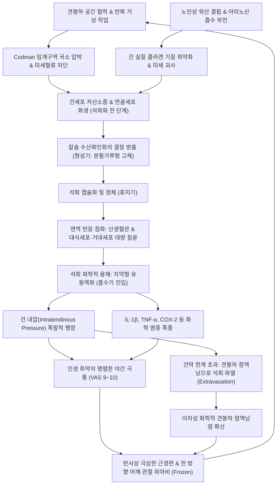

# 🩺 석회성 건염 (Calcific Tendinitis of the Shoulder / M75.3)

> **상위 분류**: [[근골격계 질환]] > [[상지 질환]] > [[견관절 질환]] > [[건병증]] / 대사성 결합조직 질환
> **핵심 3줄 요약 (Key Summary)**:
> - 📍 병소 부위 & 해부·병태생리: 견관절 [[회전근개]](주로 [[극상근]] 건 부착부 1~2cm 근위부 Codman 임계구역) 실질 내에 국소 허혈·저산소증 및 세포 매개성(Cell-mediated) 화생으로 인해 칼슘 [[수산화인회석]](Calcium hydroxyapatite) 결정이 침착되는 수산화인회석 침착 질환(HADD, M75.3).
> - 🚩 전형적 임상 양상 & 3대 징후: 외상 없이 갑자기 발생하는 칼로 베는 듯한 극심한 급통(VAS 9~10), 앙와위 시 건 내압 급상승으로 수면이 불가능한 맹렬한 야간통, 특히 대식세포와 모세혈관이 석회를 용해·배출하는 **흡수기(Resorptive phase)**에 건 내압 폭증으로 응급실을 찾을 정도의 통증 폭발 및 전 방향 관절 가동 범위(ROM)의 위마비성 급성 차단.
> - 🛠️ 핵심 감별 검사 & 한·양방 다각적 치료 전략: 단순 방사선 X-ray(Gartner & Heyer 분류) 및 초음파(음향 음영 고에코 병변) 확진. Modified Crass 자세 하 침도([[도침]]) 미세 천공 감압술(Barbotage & Fenestration), [[견우]], [[견료]], [[노회]], [[곡지]], [[천종]] 중심의 자침 및 청열소염·자하거 약침, **급성 흡수기 온열 요법 절대 금기(냉찜질 티칭)**, [[당귀점통탕]], [[오적산]], [[대천마환]] 투여 및 노인성 위산 저하 교정을 위한 감식초 식이 요법.
> - <font color="#fa7e7e">⚠️ 응급 의뢰 레드플래그 & 악화 요인: 건 내압을 견디지 못한 석회가 견봉하 점액낭으로 터져 나와 극심한 이차성 화학적 활액막염을 초래한 경우, 전신 발열·오한 및 관절 국소 열감을 동반하여 감별이 필요한 [[화농성 관절염]](Septic arthritis) 의심 시 즉시 상급병원 응급 배농 의뢰.</font>

---

## 📌 목차
1. [질환 개요 & 해부학적 병태생리](#1-질환-개요--해부학적-병태생리)
2. [병태생리 메커니즘 & 생체역학적 악순환 네트워크](#2-병태생리-메커니즘--생체역학적-악순환-네트워크)
3. [임상 증상 & 이학적 검사(Physical Exam) 알고리즘](#3-임상-증상--이학적-검사physical-exam-알고리즘)
4. [감별 진단 매트릭스 (Differential Diagnosis)](#4-감별-진단-매트릭스-differential-diagnosis)
5. [한의 통합 치료 프로토콜 (침·약침·추나·한약)](#5-한의-통합-치료-프로토콜-침약침추나한약)
6. [양방 치료 & 병용·의뢰 기준 (Conventional Treatment & Referral)](#6-양방-치료--병용의뢰-기준-conventional-treatment--referral)
7. [재활 운동 & 생활습관 티칭 가이드](#7-재활-운동--생활습관-티칭-가이드)
8. [💡 사용자 진료실 핵심 필기 & 임상 노하우 (Melt-In 잔여 심화 집약)](#8--사용자-진료실-핵심-필기--임상-노하우-melt-in-잔여-심화-집약)
9. [출처 및 학술 참고 문헌 (References)](#9-출처-및-학술-참고-문헌-references)

---

## 1. 질환 개요 & 해부학적 병태생리

### 1.1 질환 정의 및 임상적 성격
**석회성 건염(Calcific Tendinitis of the Shoulder, ICD-10 M75.3)** 또는 **수산화인회석 침착 질환(Hydroxyapatite Deposition Disease, HADD)**은 인체 건(Tendon) 실질 조직 내에 칼슘염 결정, 구체적으로 **[[수산화인회석]](Calcium hydroxyapatite, $Ca_{10}(PO_4)_6(OH)_2$)**이 비정상적으로 침착되어 건 내 압력 상승과 극심한 화학적 염증 반응을 유발하는 자가 제한적(Self-limiting) 대사성-퇴행성 복합 질환이다 (Uhthoff & Sarkar, 1989; Ten Hove et al., 2024).

과거에는 단순한 노화성 마모나 건의 파열 부위에 칼슘이 가라앉는 수동적 '이영양성 석회화(Dystrophic calcification)'로 이해되었으나, 현대 분자생물학적 연구에 따르면 국소 혈류 장애와 저산소증에 반응하여 건세포(Tenocyte)가 능동적으로 연골세포(Chondrocyte)로 화생(Metaplasia)하고, 이후 대식세포와 파골세포가 침윤하여 석회를 흡수하는 **능동적 세포 매개성(Cell-mediated) 대사 주기**를 거치는 독특한 질환군으로 규명되었다 (Demirtas et al., 2026).

임상적으로는 아무런 외상이나 전조 증상 없이 하룻밤 사이에 팔을 조금도 움직이지 못할 정도의 격통(VAS 9~10)으로 응급실을 찾게 만드는 대표적인 질환이며, 침도(Acupotomy) 또는 주사 바늘을 이용한 미세 천공 감압(Needling & Barbotage)으로 건 내압을 빼주는 즉시 통증이 획기적으로 소실되는 특징을 보인다.

### 1.2 정밀 국소 해부학 및 호발 부위

```
[ 견관절 전외측 회전근개 및 Codman 임계구역 모식도 ]

          견봉 (Acromion)
          ┌───────────────────┐
          │  견봉하 점액낭    │ ◄── [화학적 점액낭염 파급 부위]
          │ (Subacromial Bursa)│
          └─────────┬─────────┘
                    │
   [[극상근]] 건 ───┴────────────────────────┐
   (Supraspinatus Tendon)                    │
        │                                    ▼
        │     ┌──────────────────────────────────────────────┐
        │     │  Codman 임계구역 (Critical Zone of Codman)   │
        └────►│  - 대결절 부착부 1~2cm 근위부 무혈성 영역    │
              │  - 상완골두 압박으로 상시 국소 저산소증 호발 │
              │  - 석회(수산화인회석) 결정의 80%가 집중 침착 │
              └──────────────────────┬───────────────────────┘
                                     │
                                     ▼
                            상완골 대결절 (Greater Tubercle)
```

1. **이환 힘줄 분포**:
   - **[[극상근]](Supraspinatus muscle) 건 (약 70~80%)**: 견관절 석회성 건염의 압도적 다수가 극상근건 실질 내에 발생한다.
   - **[[극하근]](Infraspinatus muscle) 건 (약 15%)**: 상완골 대결절 후외측면에 침착되며, 내회전 동작 시 충돌통을 유발한다.
   - **[[견갑하근]](Subscapularis muscle) 건 (약 5%)**: 상완골 소결절 부착부에 발생하며, 상완이두근 장두구 내측과 인접하여 전방 통증을 초래한다.
   - **[[소원근]](Teres minor muscle) 건 (1% 미만)**: 매우 드물게 대결절 최하단 부위에 발생한다.
   - **기타 관절**: 견관절 외에도 고관절(대퇴직근 기시부, 둔근 건), 주관절(상완삼두근 건), 슬관절(슬개건), 족관절([[아킬레스건]]) 등 전신 어디에서나 HADD가 발현될 수 있다.

2. **코드만 임계구역 (Critical Zone of Codman)**:
   - 극상근 건이 [[상완골]] 대결절에 부착하기 직전 1~2cm 근위부 영역을 '코드만 임계구역'이라 부른다.
   - 이 구역은 앞쪽에서 전상완회선동맥(Anterior circumflex humeral artery)의 분지가 들어오고, 뒤쪽에서 견갑상동맥(Suprascapular artery)의 분지가 유입되는 말단 문합부(Watershed area)에 해당한다.
   - 팔을 신체 옆에 붙이고 내전(Adduction)시킬 때 상완골두가 이 부위를 강하게 압박하여 혈관이 허탈되므로 생리적인 국소 저산소 상태(Hypoxia)에 지속적으로 노출된다.

3. **인접 해부학적 구조물과의 공간 관계**:
   - **[[견봉하 점액낭]](Subacromial-subdeltoid bursa)**: 극상근건 바로 상방에 위치하며, 견봉 및 삼각근과의 마찰을 완충한다. 석회성 건염 흡수기에서 건 내압이 한계치를 초과하면 석회질이 이 점액낭 속으로 누출(Extravasation)되어 폭발적인 이차성 점액낭염을 일으킨다.
   - **오구견봉 궁(Coracoacromial arch)**: [[견봉]], 오구돌기, 오구견봉인대로 구성된 터널로, 석회 침착으로 힘줄이 두꺼워지면 2차성 기계적 [[어깨충돌 증후군]]을 유발한다.

### 1.3 역학 및 호발 환자군 특성
1. **연령 및 성별 분포**:
   - 30~50대의 활동기 연령층에서 호발하며, 60~70대 퇴행성 [[회전근개 파열]] 환자군보다 젊은 층에서 집중적으로 나타난다.
   - 여성 환자가 남성에 비해 약 1.5~2배가량 호발하며, 주로 비우세측 팔보다 우세측(자주 사용하는 팔)에 더 흔하다.

2. **대사성 질환과의 밀접한 연관성**:
   - **내분비 대사 이상**: 당뇨병(Diabetes Mellitus), 갑상선 기능 저하증 및 항진증, 에스트로겐 대사 이상 환자에서 유병률이 일반인에 비해 3~4배 높다.
   - **노인성 위산 결핍(Hypochlorhydria)**: 위산 분비 저하로 인한 식이 단백질 흡수 장애 및 결합조직 취약화 환자군에서 만성 재발성 경향을 보인다.
   - 가사 노동자, 교사, 미용사, 배드민턴/수영 동호인 등 팔을 어깨 위로 자주 거상하는 직업군에서 기계적 자극이 방아쇠 역할을 한다.

---

## 2. 병태생리 메커니즘 & 생체역학적 악순환 네트워크

### 2.1 Uhthoff의 3단계 4시기 자연 경과
Uhthoff와 Sarkar의 고전적 분류에 따르면, 석회성 건염은 세포 매개성 변화에 의해 **석회화 전 단계**, **석회화 단계(형성기-휴지기-흡수기)**, **석회화 후 단계**의 명확한 생화학적 사이클을 거친다 (Uhthoff & Sarkar, 1989; Demirtas et al., 2026).

```
[ Uhthoff 석회성 건염 3단계 4시기 병기 모식도 ]

1. 석회화 전 단계 (Precalcific Phase)
   - 국소 저산소증 & 혈류 차단 ──► 건세포의 섬유연골 화생 (무증상)
                     │
                     ▼
2. 석회화 단계 (Calcific Phase)
   ├─ ① 형성기 (Formative Phase)
   │     - 세포 매개성 칼슘 침착, "분필가루(Chalky)" 양상 건조 고체
   │     - 경미한 둔통 또는 무증상
   │
   ├─ ② 휴지기 (Resting Phase)
   │     - 섬유성 피막 형성, 석회 크기 고정 및 정체
   │     - 기계적 충돌 시에만 둔통 호소
   │
   └─ ③ 흡수기 (Resorptive Phase) ★★★ [진료실 극통·응급실 내원의 핵심]
         - 모세혈관 신생 & 대식세포·파골세포의 대량 침윤
         - 석회의 수화(Hydration): "치약(Toothpaste)" 양상 점성 액체화
         - 건 내압(Intratendinous Pressure)의 폭발적 상승
         - 맹렬한 화학적 급통(VAS 9~10) 및 수면 불가 야간통
                     │
                     ▼
3. 석회화 후 단계 (Postcalcific Phase)
   - 섬유아세포 침윤 & 육아조직 형성 ──► Type I 콜라겐 재배열 및 힘줄 치유
```

#### 1) 석회화 전 단계 (Precalcific Phase)
- 반복적인 견봉하 압박과 국소 혈류 차단으로 Codman 임계구역 내에 만성 저산소 상태가 유도된다.
- 건 실질 내의 정상적인 건세포(Tenocyte)가 저산소 유도 인자(HIF-1α)의 자극을 받아 연골세포 양상으로 형질 변환(Chondroid metaplasia)을 일으킨다.
- 프로테오글리칸(Proteoglycan)과 Type II 콜라겐 합성이 증가하여 기질이 연골화되며, 이 단계에서는 환자가 전혀 통증을 느끼지 못한다.

#### 2) 석회화 단계 (Calcific Phase)
- **형성기 (Formative Phase)**:
  - 변성된 기질 내로 기질 소포(Matrix vesicles)가 방출되며 칼슘 이온과 인산 이온이 결합하여 수산화인회석 결정 침착이 시작된다.
  - 석회 물질은 분필 가루(Chalk)처럼 매우 건조하고 단단하며, X-ray 상 경계가 선명한 백색 고음영으로 나타난다.
- **휴지기 (Resting Phase)**:
  - 결정화가 중단되고 석회 침착물 주변으로 얇은 섬유성 결합조직 피막이 형성되어 캡슐화된다.
  - 석회 덩어리가 커져서 견봉 하단과 부딪힐 경우 가벼운 충돌통을 느끼지만, 급성 통증은 없다.
- **흡수기 (Resorptive Phase — 응급실 극통의 원인)**:
  - 석회 주변 모세혈관이 폭발적으로 신생되고, 혈액 내에서 대식세포(Macrophages)와 다핵 파골세포(Multinucleated giant cells)가 대거 침윤한다.
  - 대식세포가 산성 분비물과 효소를 내뿜어 고체 석회를 화학적으로 녹여내며, 이 과정에서 석회가 수분을 흡수하여 **치약(Toothpaste)이나 액체 우유 형태의 걸쭉한 유동체**로 전환된다.
  - 밀폐된 힘줄 내부 공간에서 석회의 부피가 팽창하면서 **건 내압(Intratendinous pressure)이 비정상적으로 치솟고**, IL-1β, TNF-α, COX-2, PGE2 등 염증 매개 사이토카인이 폭포수처럼 쏟아져 나온다.
  - 건막 내의 지각 신경 말단(A-delta 및 C 섬유)이 극도로 자극받아 환자는 "칼로 어깨를 난도질하는 듯한", "인생 최악의 극통(VAS 9~10)"을 경험하게 된다.

#### 3) 석회화 후 단계 (Postcalcific Phase)
- 석회가 대식세포에 의해 흡수 배출되고 나면 비어 있는 건 결손 부위로 섬유아세포(Fibroblasts)가 침투한다.
- 미성숙 Type III 콜라겐 육아조직이 형성된 후 점차 성숙한 Type I 콜라겐 섬유로 리모델링되어 정상적인 건 구조로 치유된다 (수개월 소요).

### 2.2 노인성 위산 결핍과 대사성 결합조직 취약화 기전
- 고령 환자, 만성 위축성 위염 환자, H2 차단제 및 PPI(Proton Pump Inhibitor) 장기 복용 환자는 위내 염산(HCl) 분비가 현저히 감소하는 **위산 결핍증(Hypochlorhydria)** 상태에 놓인다.
- 단백질 소화의 첫 단추인 펩시노겐 활성화가 차단되어 음식물로 섭취한 단백질이 펩타이드 및 아미노산(글리신, 프롤린, 하이드록시프롤린 등 콜라겐 핵심 구성 아미노산)으로 적절히 분해·흡수되지 못한다.
- 체내 콜라겐 합성 속도가 퇴행성 마모 속도를 따라가지 못하여 회전근개 힘줄 전반이 푸석푸석하게 취약해지고, 미세 괴사가 만연한 조직 부위에 보상적으로 칼슘 결정이 달라붙는 대사성 악순환이 완성된다.

### 2.3 생체역학적 및 병태생리 악순환 네트워크 (Mermaid)


---

## 3. 임상 증상 & 이학적 검사(Physical Exam) 알고리즘

### 3.1 주요 임상 증상 분석
1. **흡수기 돌발 극통 (Acute Resorptive Phase Pain)**:
   - 환자는 "어제저녁까지는 멀쩡했는데, 자고 일어났더니 어깨가 칼로 도려내는 것처럼 아파서 옷도 못 입겠다"고 호소한다.
   - 통증 강도는 **VAS 9~10**으로 여성 환자들은 흔히 "출산의 고통보다 더 심하다"고 묘사하며, 진료실에 들어올 때 환측 팔을 반대 손으로 아기처럼 감싸 쥐고 몸을 웅크린 채 들어온다.
   - 가벼운 옷깃이 닿거나 검사자가 어깨를 살짝 건드리기만 해도 자지러지는 듯한 통증을 보인다.

2. **극심한 야간통 (Severe Nocturnal Pain)**:
   - 앙와위로 누우면 상완골두가 후방으로 밀리고 중력 방향으로 어깨 내압이 증가하여 건 내압이 한계치를 돌파한다.
   - 침대에 눕는 순간 통증이 10배로 증폭되어 밤새 누워보지도 못하고 거실을 서성거리거나 소파에 앉아서 밤을 꼬박 지새운다.

3. **가동 범위의 급격한 전방위 차단 (Pseudoparalysis)**:
   - 능동적 거상은 1도도 불가능하며, 수동적으로 팔을 들어 올리려 해도 환자의 극심한 통증과 방어적 근경련(Muscle guarding)으로 인해 전 방향 ROM이 완전 차단된다. (진성 신경 마비가 아닌 통증에 의한 **가성 마비 / 위마비**).

4. **점액낭 파열(Extravasation) 시의 임상적 전개**:
   - 건 내압이 극에 달해 팽창하던 석회가 견봉하 점액낭으로 터져 나가면, 힘줄 자체의 내압이 일시적으로 감압되면서 "순간적으로 찌르는 듯한 극통은 약간 덜해지는" 느낌을 받는다.
   - 그러나 몇 시간 이내에 점액낭 전체로 화학적 석회 죽(Paste)이 퍼져나가면서 어깨 바깥쪽(삼각근 부착부) 전체가 벌겋게 붓고 욱신거리는 광범위한 둔통과 종창이 뒤따른다.

### 3.2 필수 이학적 검사법 (Physical Examination)
1. **외전 및 내회전 통증호 (Painful Arc Test)**:
   - 만성 형성기나 휴지기 환자에서는 팔을 외전할 때 60~120도 구간에서 석회가 견봉 하단에 물리적으로 부딪히며 통증이 발생하고, 120도를 넘어가면 통증이 줄어드는 전형적인 충돌 징후를 보인다.
   - 단, **급성 흡수기 환자에서는 통증호 검사 자체가 불가능**하다 (0도에서 팔을 떼는 순간 극통 유발).

2. **충돌 유발 검사 (Neer & Hawkins-Kennedy Test)**:
   - **Neer 검사**: 검사자가 견갑골을 고정한 채 환자의 팔을 내회전시킨 상태에서 전방으로 강제 거상한다.
   - **Hawkins-Kennedy 검사**: 어깨와 팔꿈치를 90도 굴곡한 상태에서 전완을 강제로 내회전시킨다.
   - 견봉하 공간에서 석회가 끼이며 비명을 지를 정도의 통증이 유발되면 극양성이다.

3. **압통점 촉진 (Point Tenderness)**:
   - 대결절 부착부(견봉 전외측 하방 1~2cm)를 엄지손가락으로 압박할 때 국소적인 찌릿한 격통이 촉진된다.

```
[ 석회성 건염 진단 및 영상 평가 알고리즘 ]

               어깨의 급성 맹렬통 (VAS 8~10) / 야간통
                                  │
                                  ▼
            ┌──────────────────────────────────────────┐
            │ 1. 단순 방사선 X-ray (Shoulder AP/Axillary)│
            └──────────────────────────────────────────┘
                                  │
                  ┌───────────────┴───────────────┐
                  ▼                               ▼
       [석회 음영 확인됨]                 [석회 음영 없음]
                  │                               │
                  │                               ▼
                  │                    타 질환 감별:
                  │                    - 급성 [[어깨충돌 증후군]]
                  │                    - 급성 점액낭염
                  │                    - 경추 C5 신경근증
                  │
                  ▼
            ┌──────────────────────────────────────────┐
            │ 2. Gartner & Heyer 석회 음영 형태학적 판정 │
            └──────────────────────────────────────────┘
                  │
        ┌─────────┴───────────────────────┐
        ▼                                 ▼
   [Type I / II]                     [Type III]
   - 경계 뚜렷, 균일 고밀도          - 구름/솜사탕 양상 저밀도
   - 형성기 / 휴지기 고체            - 경계 불명확한 흡수기 액체
   - 만성 둔통, 충돌 징후            - 응급실 내원 극통 (치약형)
        │                                 │
        ▼                                 ▼
   [ESWT / 한의 침구·추나]           [침도 미세감압 / 냉찜질 티칭]
```

### 3.3 영상의학적 정밀 평가
1. **단순 방사선 사진 (Shoulder Plain Radiography)**:
   - **필수 촬영 뷰**: Shoulder True AP (외회전 뷰, 내회전 뷰), Axillary view, Scapular Y-view.
   - 극상근건은 AP 외회전 뷰에서 대결절 상방에 가장 잘 보이며, 극하근건은 AP 내회전 뷰에서, 견갑하근건은 Axillary 뷰에서 소결절 부위에 잘 관찰된다.
   - **Gartner & Heyer 방사선학적 분류**:
     - **Type I (형성기/휴지기)**: 석회 음영의 경계가 마치 조약돌처럼 칼로 자른 듯 명확하고(Well-defined), 내부 밀도가 균일하게 빽빽한 고음영(Dense).
     - **Type II (이행기)**: 경계는 명확하나 내부 밀도가 불균일하거나, 경계가 일부 흐릿한 혼합 형태.
     - **Type III (흡수기)**: 경계가 솜사탕이나 구름처럼 흩어져 흐릿하고(Fluffy / Ill-defined), 내부 밀도가 묽고 투명하여 방사선 투과성이 증가한 양상.

2. **근골격계 초음파 검사 (MSK Ultrasonography)**:
   - 힘줄 내부에서 주변 건 섬유보다 하얗게 보이는 **강한 고에코(Hyperechoic) 병변**으로 관찰된다.
   - **단단한 형성기 석회**: 고에코 병변 뒤쪽으로 초음파 빔이 통과하지 못해 짙은 그림자가 드리워지는 **후방 음향 음영(Posterior acoustic shadow)**이 뚜렷하다.
   - **치약형 흡수기 석회**: 석회가 액체화되어 후방 음향 음영이 약화되거나 소실되고, 병변 내부가 저에코로 보일 수 있으며, 파워 도플러(Power Doppler) 검사 시 석회 주변 건 조직으로 모세혈관이 신생되어 붉고 푸른 혈류 신호가 폭발적으로 증가된 소견(Hypervascularity)을 나타낸다 (Ten Hove et al., 2024).

---

## 4. 감별 진단 매트릭스 (Differential Diagnosis)

| 감별 질환 | 호발 연령 및 통증 양상 | 수동 ROM 제한 양상 | 단순 X-ray 소견 | 초음파 / MRI 핵심 소견 | 결정적 감별 포인트 |
| :--- | :--- | :--- | :--- | :--- | :--- |
| **[[석회성 건염]] (본 질환)** | 30~50대 여성 호발, 하룻밤 새 돌발 극통(VAS 9~10), 극심한 야간통 | 급성기 통증과 근경련으로 전 방향 완전 차단(위마비) | 회전근개 부착부 방사선 불투과성 석회 침착 음영 | 건 실질 내 고에코 병변, 후방 음영, 도플러상 주변 혈류 급증 | 침도 감압 시 즉각적 통증 격감, X-ray상 명확한 석회 |
| **[[유착성 관절낭염]] (오십견)** | 50대 호발, 수주~수개월에 걸쳐 점진적 발병, 둔통 | **모든 방향(외회전, 외전, 내회전) 수동 ROM 영구적 기계적 제한** | 정상 (석회 음영 전무, 골다공증 소견 가능) | 관절낭 하부(Axillary pouch) 비후, 오구상완인대 비후 | 수동 운동 시 '단단한 기계적 저항(End-feel)', 발병 속도 완만 |
| **[[회전근개 파열]]** | 50~70대, 무거운 것 든 후 또는 외상, 거상 시 힘 빠짐 | **수동 ROM은 정상 유지**, 능동 거상만 제한 또는 유지 불능 | 견봉 골극, 상완골두 상방 전위 가능 | 회전근개 건 실질의 불연속성(Tear defect), 건 퇴축 | **Drop Arm 검사(+)**, 수동 거상 상태에서 팔을 유지하지 못함 |
| **[[어깨충돌 증후군]]** | 40대 이상, 머리 위 작업 시 악화, 야간통은 덜함 | 수동 ROM 정상, **외전 60~120도 구간 통증호(Painful arc)** | 견봉 골극(Acromial spur, Type II/III 견봉) | 견봉하 점액낭 비후, 건증(Tendinosis) 소견 | 동작 특이적 통증, 휴식 시에는 심한 통증 없음 |
| **[[화농성 관절염]] (Septic Arthritis)** | 전 연령대, 급격한 악화, **전신 발열, 오한, 전신 쇠약 동반** | 극심한 열감과 종창으로 ROM 전면 불가 | 관절강 삼출액 음영, 골 미란 | 관절강 내 다량의 삼출액 및 활액막 비후 | **관절 천자 시 고름(화농성 활액), 혈액 ESR/CRP 급상승 (응급)** |
| **통풍성 관절염 (Gout)** | 40~60대 남성 호발, 음주/고기 섭취 후 급성 통증 | 극심한 발적과 종창으로 움직임 불가 | 만성 시 관절 주변 골 미란(Punched-out) | 요산 결정 침착에 의한 이중 윤곽 징후(Double contour) | 관절 천자액 편광현미경 상 **음성 이색성 침상 요산 결정** |
| **경추 C5 신경근병증** | 40~60대, 목 움직임 시 어깨 외측 및 상완부 방사통 | 어깨 자체의 능동/수동 ROM은 대부분 정상 | 경추 퇴행성 변화, 추간공 협착 | 경추 MRI상 C4-C5 추간판 탈출 및 C5 신경근 압박 | **Spurling 검사(+)**, 견관절 자체의 압통점 전무 |

---

## 5. 한의 통합 치료 프로토콜 (침·약침·추나·한약)

### 5.1 침도 미세 천공 감압술 (Acupotomy Needling & Barbotage)
석회성 건염 흡수기의 극심한 통증은 팽창된 건 내압에서 기인하므로, 침도를 이용한 미세 감압술은 양방의 주사 바늘 세척술(Barbotage)과 동일한 원리로 즉각적인 통증 차단 효과를 발휘한다 (Demirtas et al., 2026).

```
[ Modified Crass 체위 및 침도 감압술 자침 모식도 ]

 환자 자세: 등 뒤 허리에 손을 얹는 체위 (견봉하 숨은 극상근건을 전방으로 노출)
 
       견봉 (Acromion)
          │
          ▼ (후퇴된 상태)
      [  침도 직자입  ] ──► 0.5×50mm 멸균 침도
          │
          ▼
   ┌──────────────────────────────────────────────┐
   │  극상근건 석회 병소 (대결절 1~2cm 근위부)   │
   │  - 다발성 미세 천공 (Multiple Fenestration)  │
   │  - 팽창된 치약형 유동성 석회 건 내압 즉각 감압│
   │  - 피막 절개로 석회의 자연 배출 촉진         │
   └──────────────────────────────────────────────┘
```

1. **환자 체위 세팅 — Modified Crass Position (필수 술기)**:
   - 극상근건은 상완골이 중립위에 있을 때 견봉 뼈 바로 밑에 숨어 있어 직자가 불가능하다.
   - 환자의 팔을 뒤로 돌려 **손등을 등 뒤 허리 벨트 라인에 얹게 하고, 팔꿈치를 앞으로 살짝 내미는 Modified Crass 포지션**을 취하게 한다.
   - 이 자세를 취하면 상완골 대결절과 극상근 건이 견봉 앞쪽 전하방으로 완전히 회전되어 피하에 노출되므로 안전하고 정확한 자침 공간이 확보된다.

2. **침도 감압술 시술 절차**:
   - **준비**: 시술 부위를 포비돈 및 알코올로 철저히 멸균 소독한다.
   - **규격**: 0.5×50mm 또는 0.6×50mm 일자형 멸균 침도(Acupotomy).
   - **진침**: 초음파 유도하 또는 대결절 랜드마크 촉진 하에 극상근건 석회 중심부를 향해 직자한다.
   - **손끝 저항감 확인**: 피하지방과 삼각근을 지나 건 피막에 닿으면 팽팽한 풍선을 찌르는 듯한 강한 저항감이 느껴지며, 석회 내로 진입하면 저항이 급격히 빠지는 느낌(Loss of resistance)이 든다.
   - **다발성 미세 천공(Fenestration)**: 침도 날을 이용하여 석회 피막을 3~5개소 미세 천공하여 갇혀 있던 유동성 석회가 삼각근하 점액낭 공간으로 빠져나오게 감압시킨다.
   - 시술 직후 환자에게 수동 외전을 시켜보아 찌르는 듯한 통증이 즉각 반감되었는지 확인한다.

### 5.2 침구 및 전침 치료 프로토콜
1. **국소 취혈 및 근막 자침**:
   - **주요 경혈**: **[[견우]](LI15)**, **[[견료]](TE14)**, **[[노회]](TE13)**, **[[거골]](LI16)**, **[[천종]](SI11)**, **[[곡지]](LI11)**, **[[견정]](GB21)**.
   - **견우·견료 자침법**: 견봉 전연과 후연의 함몰부에서 상완골두를 향해 1.5~2.0촌 깊이로 사자하여 견봉하 공간 및 회전근개 주변 연부조직의 미세 순환을 촉진한다.
   - **천종 자침법**: 극하근 TrP 중심부인 천종혈에 1.0~1.5촌 직자하여 상완 외측으로 방사되는 연관통과 회전근개의 2차성 근경련을 해제한다.

2. **원격 취혈 및 동기 침법 (Motion-Style Acupuncture)**:
   - **[[조구]](ST38)** 투 **[[승산]](BL57)**, **[[합곡]](LI4)**, **[[후계]](SI3)**.
   - 원격 혈위에 강자극을 주어 득기한 상태에서 환자에게 천천히 통증이 없는 범위 내에서 어깨를 수동·능동적으로 움직이게 유도(동기침법)하여 뇌간 통증 조절계(DNIC)를 활성화한다.

3. **전침 치료**:
   - 배혈: [[견우]](LI15) - [[견료]](TE14) 및 견봉하 - 천종.
   - 파형: 급성 극통기에는 **100Hz 연속 고주파**를 적용하여 척수 관문 조절설(Gate Control Theory)을 통한 빠른 진통 효과를 유도하고, 아급성기에는 **2Hz/100Hz 혼합파**를 적용하여 내인성 오피오이드 분비와 근막 이완을 도모한다 (15분간 유침).

### 5.3 약침 치료 (Pharmacopuncture)
1. **약침 제제 선택 및 병기별 적용**:
   - **급성 흡수기 (화학적 염증 폭발기)**:
     - **[[황련해독탕 약침]]** 또는 **청열소염약침** (1.5~2.0cc 분할 주입).
     - 침도 감압술 직후 견봉하 점액낭 및 건초 주변에 주입하여 사이토카인 분비를 억제하고 급성 부종을 신속 소퇴시킨다.
   - **아급성기 (석회 흡수 촉진 및 어혈 제거기)**:
     - **[[중성어혈약침]]** (1.0~1.5cc) — 미세 순환 개선 및 잔류 칼슘염의 대식세포 흡수 촉진.
   - **만성 회복기 (건 조직 재생 및 결합조직 보강기)**:
     - **[[신바로약침]]** 또는 **[[자하거약침]](Hominis Placenta)** (1.0cc) — 손상된 건 실질의 Type I 콜라겐 합성 유도 및 결합조직 탄성 회복.

2. **주입 기법 및 안전 가이드**:
   - 건 실질 내 고압 주입을 피하고, 견봉하 공간(Subacromial space)과 대결절 골막 주변에 부드럽게 분할 주입하여 2차성 팽창통을 방지한다.

### 5.4 추나 요법 (Chuna Manipulation)
1. **급성기 금기 사항**:
   - **급성 흡수기 극통 상태에서 고속저진폭(HVLA) 관절 교정 추나는 절대 금기**이다. 무리한 관절 쓰러스트는 건 파열과 극심한 염증 확산을 야기한다.

2. **아급성기 및 회복기 관절가동 추나**:
   - **견관절 하방 활주 기법 (Inferior Glide)**: 환자를 앙와위로 눕히고 시술자가 환자의 상완골두를 아래 방향으로 지긋이 밀어내려 상완골두의 상방 전위를 억제하고 견봉하 공간을 물리적으로 확장시킨다.
   - **견갑골 가동술 (Scapular Mobilization)**: 측와위에서 견갑골 내측연과 하각을 파지하여 상방회전, 거상, 내전을 유도하여 견흉관절(Scapulothoracic joint)의 가동성을 회복시킨다.

### 5.5 한약 변증 처방 프로토콜
1. **습열비/열비형 (濕熱痺·熱痺型 — 급성 흡수기, 칼로 베는 극통, 작열감, 야간통, 맥 활삭)**:
   - **처방**: **[[당귀점통탕]](當歸拈痛湯)** 합 **[[황련해독탕]](黃連解毒湯)** 가미방.
   - **주요 구성**: 당귀, 강활, 방풍, 승마, 갈근, 창출, 백출, 황금, 인진호, 지모, 택사, 저령, 고삼, 황련, 황백, 치자.
   - **기전**: 청열이습(淸熱利濕), 활혈통락(活血通絡)하여 힘줄 주변의 급성 화학적 염증 부종을 신속히 배출시키고 건 내압을 떨어뜨린다.

2. **담음어혈형 (痰飲瘀血型 — 아급성기, 석회가 완전히 녹지 않고 굳어짐, 찌르는 듯한 고정통, 기상통)**:
   - **처방**: **[[오적산]](五積散)** 합 **[[대천마환]](大天麻丸)** 또는 **[[소경활혈탕]](疎經活血湯)** 가미방.
   - **주요 구성**: 백작약, 당귀, 천궁, 도인, 홍화, 우슬, 반하, 진피, 천마, 남성, 강황.
   - **기전**: 조습화담(燥濕化痰), 활혈거어(活血祛瘀)하여 건 내에 침착된 비정상적 병리 대사산물(수산화인회석)을 체내 대식세포가 원활히 탐식·흡수하도록 미세혈류를 개통한다.

3. **기혈양허 및 간신휴손형 (氣血兩虛·肝腎虧損型 — 만성 노인성 재발, 힘줄 위축, 무력감 동반)**:
   - **처방**: **[[독활기생탕]](獨活寄生湯)** 가미방 (독활, 상기생, 두충, 우슬, 세신, 진교, 복령, 구척, 당귀, 작약, 숙지황, 인삼).
   - **기전**: 간신을 보하여 근골을 튼튼히 하고(補肝腎 强筋骨) 만성적으로 퇴행된 회전근개 힘줄의 자가 재생력을 증진한다.

### 5.6 대사 보강 식이 요법 (노인성 위산 결핍 교정을 위한 감식초 요법)
- 만성 재발성 환자에게 **천연 발효 감식초 또는 사과식초를 매 식사 직후 따뜻한 물 한 컵에 1~2스푼(10~15ml)씩 타서 복용**하도록 티칭한다.
- 저하된 위산 분비를 보조하여 위내 산도를 정상 pH(1.5~2.0)로 유지시키고, 펩신 활성화를 통해 음식물 단백질의 펩타이드 분해를 촉진함으로써 건 콜라겐 합성에 필수적인 아미노산 공급을 근본적으로 정상화한다.

---

## 6. 양방 치료 & 병용·의뢰 기준 (Conventional Treatment & Referral)

### 6.1 보존적 양방 치료 (Conservative Treatment)
1. **경구 약물 요법**:
   - **NSAIDs**: Ibuprofen 600~800mg tid, Naproxen 500mg bid, Celecoxib 200mg bid (급성 흡수기 염증 차단).
   - **경구 스테로이드 (Oral Steroid)**: 극심한 통증으로 일상생활이 전면 마비된 경우 Methylprednisolone dose pack (4mg 정제를 6일간 단계적 감량)을 단기 투여하여 급성 부종을 제어함.
   - **위장관 보호제 병용**: 위점막 출혈 예방을 위해 PPI 복용 필수.

2. **초음파 유도하 세척흡인술 (Ultrasound-Guided Needling & Lavage / Barbotage)**:
   - **술기**: 국소 마취 하에 초음파 실시간 모니터링을 보며 18~20G 굵은 바늘을 석회 내부로 진입시킨다.
   - 생리식염수를 주입하여 석회를 풀고 다시 흡인하는 과정을 반복하여 치약 양상의 석회를 물리적으로 빨아내어 제거한다 (Ten Hove et al., 2024).
   - **임상 성적**: 세척 흡인 후 Platelet-Rich Plasma(PRP) 또는 스테로이드를 주입하는 비교 연구에서, 미세 침 천자(Needling) 자체만으로도 건 내압 감압을 통해 통증 지수가 급격히 호전됨이 증명되었다 (Demirtas et al., 2026).

3. **스테로이드 견봉하 주사 (Subacromial Corticosteroid Injection)**:
   - Triamcinolone 20~40mg + 1% Lidocaine을 견봉하 점액낭 내로 주입.
   - **⚠️ 절대 금기**: 건 실질 내 직접 주입은 건세포 괴사와 영구적 회전근개 파열을 촉발하므로 반드시 점액낭 내로만 주입해야 함.

4. **체외충격파 치료 (Extracorporeal Shock Wave Therapy, ESWT)**:
   - **병기별 적용 원칙 (중요)**:
     - **급성 흡수기 극통 상태에서는 ESWT 절대 금기**: 이미 염증과 내압이 폭발한 상태에서 충격파를 치면 통증이 극대화되어 환자가 쇼크 상태에 빠질 수 있음.
     - **만성 형성기 및 휴지기 적응증**: 단단한 석회를 기계적 에너지로 미세 분쇄하고, 국소 신생혈관을 자극하여 흡수 반응을 유도하기 위해 집중형 충격파(fESWT, 0.15~0.30 mJ/mm², 2000~3000타, 주 1회, 4~6주)를 시행함.

### 6.2 수술적 치료 (Surgical Treatment)
1. **수술 적응증**:
   - 3~6개월 이상의 침도 감압술, 초음파 세척술, ESWT 등 적극적인 보존적 치료에도 불구하고 일상생활이 불가능한 통증이 지속되는 경우.
   - 석회 제거 후 회전근개 힘줄의 광범위 결손(Tear)이 동반된 경우.

2. **관절경하 석회 제거술 및 회전근개 봉합술 (Arthroscopic Debridement & Repair)**:
   - 관절경으로 견봉하 점액낭을 절제하여 시야를 확보한 후, 극상근건을 종축으로 절개하여 치약/분필 양상의 석회를 큐렛(Curette)과 셰이버(Shaver)로 긁어내어 완전히 세척 배출한다 (Brusalis et al., 2024).
   - 석회 제거 부위의 건 결손이 크거나 힘줄이 얇아진 경우, 2차 파열을 방지하기 위해 봉합 나사못(Suture anchor)을 이용한 회전근개 건 봉합술을 동시에 시행한다.

### 6.3 한·양방 병용 지침 및 주의사항
1. **병용 가능 및 시너지**:
   - 양방 소염진통제(NSAIDs) 복용 중 한의 침도 감압술 및 침구 치료 병용: 화학적 염증 억제와 물리적 내압 감압이 동시에 이루어져 치료 기간을 절반 이하로 단축시킴.
   - 양방 초음파 세척술(Barbotage) 실패 후 잔여 통증에 한의 활혈거어 한약([[오적산]], [[대천마환]]) 및 약침 치료 병용.

2. **병용 주의 및 금기**:
   - **스테로이드 주사 후 침 치료 간격**: 양방 견봉하 스테로이드 주사를 맞은 환자는 면역 억제 및 조직 약화가 동반되므로, 최소 5~7일간 해당 부위 침도 및 직접 자침을 금기하고 원격 취혈(조구, 승산, 합곡)로 대체한다.
   - **한약 복용 중 진통제 중복 관리**: 환자가 자의로 NSAIDs와 한약을 과량 복용하여 위장관 출혈이나 간 기능 부하가 오지 않도록 복약 시간을 1시간 이상 분리 지도한다.

### 6.4 양방·전문과 응급 의뢰 기준 (Referral Criteria)
1. **즉시 상급병원 응급실 의뢰**:
   - 전신 발열(38°C 이상), 오한, 어깨 관절의 극심한 발적과 열감, 백혈구(WBC) 및 CRP의 급격한 상승이 동반된 경우 ([[화농성 관절염]] 의심 시 관절 파괴 방지를 위해 즉시 관절 천자 및 응급 관절경 배농 필요).
2. **정형외과 수술 의뢰**:
   - 3회 이상의 침도 감압술 및 보존 치료에도 불구하고 극심한 야간통과 관절 차단이 3개월 이상 지속되는 난치성 증례.
   - 방사선 추적 검사상 석회가 관절 내(Glenohumeral joint)로 파열되어 관절 연골 손상이 우려되는 경우.

---

## 7. 재활 운동 & 생활습관 티칭 가이드

```
[ 석회성 건염 단계별 재활 및 치료 티칭 로드맵 ]

1단계: 급성 흡수기 (발병 1~2주)
       - ★★★ 온열 요법(핫팩) 절대 금기!
       - 1회 10~15분 아이스팩(냉찜질) 적용 (건 내압 상승 억제)
       - 팔을 몸에 붙인 채 무부하 코드만 진자 운동만 허용
                         │
                         ▼
2단계: 아급성 회복기 (발병 3~4주, 극통 소퇴 후)
       - 온열 요법으로 전환 가능 (혈류 촉진 및 석회 흡수 유도)
       - 도르래(Pulley) 및 핑거 래더(Finger ladder)를 이용한 수동 ROM 확보
       - 견갑골 안정화 운동 (벽 밀기, 능형근 수축)
                         │
                         ▼
3단계: 기능 강화기 (발병 5주 이후)
       - 세라밴드(Theraband)를 이용한 회전근개 등척성/등장성 외회전 강화
       - 일상 복귀 및 감식초 식이 요법을 통한 결합조직 재건
```

### 7.1 단계별 재활 운동 프로토콜
1. **급성기: 코드만 진자 운동 (Codman's Pendulum Exercise)**:
   - **목적**: 어깨 근육에 일체의 힘을 주지 않은 상태에서 중력과 체간의 반동만을 이용하여 관절 유착을 방지하는 무부하 가동 운동.
   - **방법**: 아프지 않은 쪽 손으로 의자나 테이블을 짚고 상체를 90도 앞으로 숙인다. 아픈 팔은 힘을 완전히 빼고 바닥을 향해 늘어뜨린다. 몸통을 앞뒤, 좌우로 흔들어 팔이 시계추처럼 저절로 원을 그리며 흔들리게 한다 (시계 방향 20회, 반시계 방향 20회, 하루 3회).

2. **회복기: 수동 관절 가동성 회복 운동**:
   - **도르래 운동 (Overhead Pulley)**: 아프지 않은 팔로 줄을 아래로 당겨 아픈 팔이 수동적으로 부드럽게 위로 올라가도록 유도 (통증 직전 각도까지만).
   - **핑거 래더 (Finger Ladder)**: 벽을 마주 보고 서서 손가락으로 벽을 기어오르듯 천천히 전방 거상 각도를 넓힌다.

3. **강화기: 회전근개 및 견갑 안정화 운동**:
   - 튜빙 밴드를 문고리에 고정하고 팔꿈치를 90도 굽혀 몸에 붙인 상태에서 바깥쪽으로 당기는 **외회전 강화 운동(External rotation with band)**.
   - 전거근을 강화하는 벽 밀기 플러스(Push-up plus) 운동.

### 7.2 생활습관 및 환자 관리 절대 티칭
1. **온열 요법 절대 금기 & 냉찜질 티칭 (가장 중요)**:
   - **환자가 가장 많이 범하는 치명적 실수**: "어깨가 너무 아프니까 찜질방에 가거나 뜨거운 핫팩을 얹어 지졌다"가 건 내압이 폭발하여 응급실에 실려 오는 경우가 다반사이다.
   - 급성 흡수기 극통 상태에서는 국소 모세혈관이 확장되면 건 내부로 체액이 더 유입되어 압력이 기하급수적으로 치솟는다.
   - **반드시 얇은 수건을 대고 아이스팩을 1회 10~15분씩, 하루 4~5회 적용**하여 국소 대사를 진정시키고 혈관을 수축시켜 내압을 떨어뜨리도록 엄격히 지도한다.

2. **수면 자세 지도**:
   - 통증이 있는 어깨 쪽이 바닥으로 가도록 옆으로 눕는 것은 절대 금기이다 (상완골두가 건을 직접 압박).
   - 등을 대고 바로 누울 때는 **아픈 쪽 팔꿈치와 전완 아래에 푹신한 베개를 하나 받쳐주어** 팔이 뒤로 처지지 않고 몸통과 수평을 이루게 하면 건 내압이 현저히 감소하여 밤에 잠을 잘 수 있다.

---

## 8. 💡 사용자 진료실 핵심 필기 & 임상 노하우 (Melt-In 잔여 심화 집약)

> 🛡️ **Melt-In 원칙**: 기존 필기의 어깨 해부학, Uhthoff 병기, 진단 및 치료 프로토콜은 상부 1~7번 섹션에 100% 유기적으로 융합되었으며, 본 8번 섹션에는 상부에 다 담기지 않은 **원장님의 진료실 독창적 임상 직관, 환자 관리 비결, 침도 감압 시의 손맛 팁 및 환자 설명 스크립트**만을 엄선 집약하였다.

### 8.1 1회 치료로 극적 효과를 내는 진료실 효자 질환
1. **오십견과 석회성 건염의 드라마틱한 차이**:
   - 어깨가 완전히 굳어 팔을 옷소매에 넣지도 못하고 비명을 지르는 환자가 내원했을 때, 한의사가 가장 먼저 감별해야 할 것은 "이것이 관절낭이 쪼그라든 오십견(유착성 관절낭염)인가, 아니면 석회성 건염 흡수기인가?"이다.
   - 오십견은 관절낭의 섬유화 질환이므로 아무리 명의가 치료해도 1회 시술로 완치되지 않으며 수개월의 꾸준한 치료가 필요하다.
   - 반면 석회성 건염 흡수기는 Modified Crass 자세에서 침도로 석회 피막에 구멍 몇 개를 뚫어 건 내압을 빼주는 순간(Needle decompression), 환자가 그 자리에서 즉시 팔을 번쩍 들어 올리며 "귀신에 홀린 것 같다. 거짓말처럼 통증이 70% 이상 날아갔다"고 감탄하는 진료실 최고의 효자 질환이다.

2. **침도 감압 시 손끝에 전해지는 '손맛'의 직관적 감별**:
   - 침도가 삼각근을 뚫고 대결절 위 극상근건에 도달했을 때:
     - **분필가루형 형성기/휴지기**: 마치 마른 뼈나 돌멩이를 찌르는 듯한 딱딱하고 거친 저항감이 든다. 이때는 침도로 무리하게 쑤시지 말고 표면만 살짝 자극하고 충격파나 약침으로 전환해야 한다.
     - **치약형 흡수기**: 팽팽하게 부풀어 오른 가죽 주머니를 찌르는 듯한 저항감이 느껴지다가, 피막을 뚫는 순간 "푹" 하고 꺼지는 듯한 탈저항(Loss of resistance)이 손끝에 명확히 느껴진다. 이 감각이 느껴졌다면 감압이 완벽히 성공한 것이며, 그 자리에서 드라마틱한 통증 소퇴가 일어난다.

### 8.2 노인 위산 부족과 감식초 식이 요법의 과학적 진실
1. **만성 재발 환자의 공통점 (위축성 위염과 제산제 복용)**:
   - 한쪽 어깨의 석회를 치료해 주었더니 1~2년 뒤 반대쪽 어깨나 고관절에 석회가 또 생겨서 오는 50~70대 환자들을 면밀히 문진해 보면, 예외 없이 수년간 역류성 식도염이나 속쓰림으로 PPI, 제산제를 달고 살았거나 만성 소화불량을 앓고 있다.
   - "위산이 부족해서 힘줄에 석회가 낀다"는 설명은 한의학적인 비주육(脾主肉) 이론과 현대 영양생화학이 정확히 일치하는 지점이다.
   - 단백질이 장에서 아미노산으로 흡수되지 못하면 체내 콜라겐 합성 파탄 -> 힘줄 괴사 -> 칼슘 침착의 경로를 밟는다.
   - 진료실에서 **"감식초나 자연 발효 사과식초를 식후에 물에 타서 꾸준히 드시라"**는 복약 지도는 재발을 틀어막는 최고의 명방이다.

### 8.3 환자 및 보호자 설명 스크립트 (원장실 멘트)
1. **공포에 질린 급성기 환자 안심시키기**:
   > "환자분, 지금 어깨가 부러진 것처럼 너무 아프시죠? 엑스레이를 보면 어깨 힘줄 속에 하얗게 돌(석회)이 박혀 있습니다. 환자분들은 '어깨에 돌이 생겨서 아프다'고 생각하시지만, 사실은 정반대입니다. 이 돌은 몇 년 전부터 조용히 박혀 있었는데, 환자분 몸의 면역세포들이 '이제 이 돌을 녹여서 청소해 버려야겠다' 하고 모세혈관을 끌어들이고 녹여내는 과정에서 힘줄 속 압력이 치솟아 아픈 것입니다. 즉, 지금 겪으시는 극심한 통증은 어깨가 망가지는 과정이 아니라, **몸이 돌을 녹여내서 밖으로 배출하려는 치유의 마지막 폭풍우 단계(흡수기)**입니다. 오늘 제가 침도로 힘줄 속에 가득 찬 압력을 바늘구멍 내듯 시원하게 빼드릴 테니, 시술받고 나시면 훨씬 편안해지실 겁니다."

2. **핫팩 금기 및 응급실 사고 예방 스크립트**:
   > "환자분, 오늘 댁에 가셔서 **절대로, 무슨 일이 있어도 뜨거운 핫팩이나 온찜질을 하시면 안 됩니다.** 지금 환자분 힘줄 속은 부풀어 오른 압력밥솥과 같습니다. 여기에 뜨거운 열을 가하면 혈액이 더 몰려서 압력밥솥이 터지듯 건 내압이 폭발하여 오늘 밤 응급실에 실려 가시게 됩니다. 반드시 차가운 얼음팩을 15분씩 대주셔야 압력이 가라앉습니다. 명심하십시오. 무조건 찬찜질입니다."

---

## 9. 출처 및 학술 참고 문헌 (References)

1. **Demirtas I, et al. (2026)**. Ultrasound-Guided Needling Without Lavage Followed by Platelet-Rich Plasma or Corticosteroid in Rotator Cuff Calcific Tendinitis: A Comparative Cohort Study. *J Clin Med*, 15(4):1420. [PMID: 42589952](https://pubmed.ncbi.nlm.nih.gov/42589952/)
   - *[연구 요약]*: 회전근개 석회성 건염 환자에서 초음파 유도하 세척 없는 미세 침 천자(Needling / 침도 원리) 감압술이 건 내압을 효과적으로 낮추고 통증 지수를 극적으로 개선함을 규명한 전향적 비교 코호트 연구.

2. **Brusalis CM, et al. (2024)**. Arthroscopic Decompression of Calcific Tendinitis of the Shoulder and Repair of Residual Rotator Cuff Defect. *Video J Sports Med*, 4(1):26350254231215482. [PMID: 40308518](https://pubmed.ncbi.nlm.nih.gov/40308518/)
   - *[연구 요약]*: 보존적 치료에 저항하는 난치성 견관절 석회성 건염에서 관절경하 석회 제거술, 견봉하 감압술 및 잔여 회전근개 건 결손 봉합술의 술기 및 임상 결과 보고.

3. **Ten Hove FL, et al. (2024)**. Needling and Lavage in Rotator Cuff Calcific Tendinitis: Ultrasound-Guided Technique. *JBJS Essent Surg Tech*, 14(1):e23.00018. [PMID: 38268769](https://pubmed.ncbi.nlm.nih.gov/38268769/)
   - *[연구 요약]*: 회전근개 석회성 건염에 대한 초음파 유도하 경피적 침 천자 및 세척흡인술(Barbotage)의 단계별 수기, 안전 지표 및 흡수기 석회 배출 효과 규명.

4. **Uhthoff HK, & Sarkar K. (1989)**. Calcifying Tendinitis. *Rockwood and Matsen's The Shoulder*, 2nd ed. W.B. Saunders.
   - *[연구 요약]*: 회전근개 석회성 건염의 3단계(석회화 전 단계, 형성기-휴지기-흡수기의 석회화 단계, 석회화 후 단계) 자연 경과 및 분자 세포 매개성 화생 메커니즘을 최초로 정립한 고전 표준 문헌.

5. **Gartner J, & Heyer A. (1995)**. Calcific Tendinitis of the Shoulder. *Orthopade*, 24(3):284-302.
   - *[연구 요약]*: 어깨 단순 방사선 X-ray에서 석회 침착물의 형태적 경계와 내부 밀도에 따른 병기 분류(Type I 고밀도 균일형, Type II 혼합형, Type III 저밀도 흡수기형)를 정립한 영상 진단 기준.
