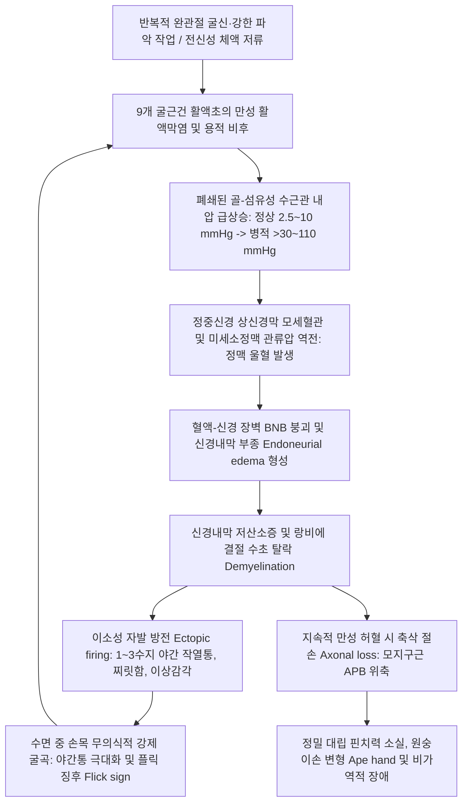

# 🖐️ [[수근관 증후군]] (Carpal Tunnel Syndrome, CTS)

> **핵심 3줄 요약 (Key Summary)**:
> - 📍 병소 부위 & 해부·병태생리: 완관절 전면의 골-섬유성 수근관(Carpal tunnel) 내에서 강인한 [[횡수근인대]](TCL, 굴근지대)와 8개 수근골궁 사이 9개 굴근건 [[활액막염]] 및 관내 내압 급상승(정상 2.5~10 mmHg $\rightarrow$ 병적 30~110 mmHg)으로 인해 [[정중신경]](Median nerve, C6-T1)의 상신경막 모세혈관 관류 차단, [[신경내막 부종]], [[수초 탈락]] 및 [[축삭 변성]]이 초래되는 상지 최다빈도 [[신경포착]] 질환.
> - 🚩 전형적 임상 양상 & 3대 징후: 제1·2·3수지 및 4수지 요측부의 전격성 찌릿함·[[작열통]]·[[이상감각]], 야간 각성(Nocturnal awakening), 손을 털면 일시 완화되는 [[플릭 징후]](Flick sign), 질환 만성화 시 [[단무지외전근]](APB) 위축 및 [[원숭이손]](Ape hand) 변형과 정밀 핀치력 소실.
> - 🛠️ 핵심 감별 검사 & 한·양방 다각적 치료 전략: [[팔렌 검사]](Phalen), [[티넬 징후]](Tinel), Durkan 수근 압박 검사, [[초음파 검사]] 단면적(CSA ≥ 10 mm²), [[신경전도 검사]] 지연(DSL > 3.5ms, DML > 4.2ms). 횡수근인대 척측 1/3 안전 구역 [[침도요법]] 미세 감압술, [[대릉]](PC7)·[[외관]](TE5) 2Hz 저주파 [[전침치료]](뇌 1차 [[체성감각피질]] S1 [[신경가소성]] 재조직화), [[오공약침]]·[[봉약침]]·D5W 초음파 유도하 수력박리술(Hydrodissection), 야간 중립위(0~5° 신전) [[부목]] 고정 및 [[보양환오탕]], [[당귀사역탕]] 한약 투여.
> - ⚠️ 응급 의뢰 레드플래그 & 악화 요인: 무지구근의 급격한 비가역적 위축, 핀치력 완전 상실, 손목 강제 굴곡 수면 자세, 조절되지 않는 [[당뇨병]]·[[갑상선기능저하증]] 동반 및 보존적 치료 불응 시 수부외과 수술적 [[수근관 유리술]](CTR) 협진 의뢰.

---

## 📌 목차
1. [질환 개요 & 해부학적 병태생리](#1-질환-개요--해부학적-병태생리)
2. [병태생리 메커니즘 & 생체역학적 악순환 네트워크](#2-병태생리-메커니즘--생체역학적-악순환-네트워크)
3. [임상 증상 & 이학적 검사(Physical Exam) 알고리즘](#3-임상-증상--이학적-검사physical-exam-알고리즘)
4. [감별 진단 매트릭스 (Differential Diagnosis)](#4-감별-진단-매트릭스-differential-diagnosis)
5. [한의 통합 치료 프로토콜 (침·약침·추나·한약)](#5-한의-통합-치료-프로토콜-침약침추나한약)
6. [양방 치료 & 병용·의뢰 기준 (Conventional Treatment & Referral)](#6-양방-치료--병용의뢰-기준-conventional-treatment--referral)
7. [재활 운동 & 생활습관 티칭 가이드](#7-재활-운동--생활습관-티칭-가이드)
8. [💡 사용자 진료실 핵심 필기 & 임상 노하우 (Melt-In 잔여 심화 집약)](#8--사용자-진료실-핵심-필기--임상-노하우-melt-in-잔여-심화-집약)
9. [출처 및 학술 참고 문헌 (References)](#9-출처-및-학술-참고-문헌-references)

---

## 1. 질환 개요 & 해부학적 병태생리

### 1) 개념 정의 및 역학적 특성
* **수근관 증후군(Carpal Tunnel Syndrome, CTS)**은 완관절 전면에 위치한 골-섬유성 터널인 수근관(Carpal tunnel) 내부의 공간적 협소화 또는 관내 내용물 팽창으로 인해, 터널 최표층을 주행하는 [[정중신경]](Median nerve, C6-T1)이 기계적으로 압박받고 [[미세순환]] 부전이 발생하여 수부 요측 3.5개 수지의 [[이상감각]], [[작열통]] 및 모지구근(Thenar muscles) 쇠약과 위축을 유발하는 [[상지]] 최다빈도 말초 [[신경포착]] 질환이다.
* **역학 및 인구학적 분포**:
  * 일반 인구 유병률은 약 3~5%이며, 임상적으로 남녀 성비는 1:3에서 1:5로 여성에서 압도적으로 호발한다.
  * 호발 연령대는 40~60대 중장년층이며, 폐경 전후 호르몬 변동과 밀접한 연관성을 보인다.
  * 직업적 위험인자로는 컴퓨터 키보드·마우스 장시간 사용자, 조리사, 미용사, 청소·가사 노동자, 진동 공구 사용자, 조립 라인 근로자 등 [[수근관절]]의 반복적 굴신 운동 및 지속적 파악(Grasp) 작업을 수행하는 직군에서 유병률이 급격히 증가한다.
  * 전신 대사 및 내분비 질환 연계: 임신(체액 저류), [[갑상선기능저하증]](점액부종 점다당질 축적), [[당뇨병]](신경내막 저산소증 및 부종 감수성 증가), 만성 신부전(혈액투석 관련 $\beta_2$-마이크로글로불린 [[아밀로이드증]] 침착), [[류마티스 관절염]](굴근건초의 만성 증식성 [[활액막염]]) 환자에서 2차성 수근관 증후군이 다발한다.

### 2) 수근관의 3차원 해부학적 경계 (3D Boundaries)
수근관은 배측과 외벽을 이루는 오목한 U자형 수근골궁(Carpal arch)과 장측(손바닥 쪽)을 덮는 강인한 섬유성 천장인 [[횡수근인대]]로 구성된 비신축성 폐쇄 공간이다.
* **골성 바닥 및 외측벽 (Floor & Deep Walls)**:
  * 근위부 횡단면: 외측의 [[주상골]](Scaphoid tubercle) 결절과 내측의 [[두상골]](Pisiform)이 경계를 형성한다.
  * 원위부 횡단면: 외측의 [[대능형골]](Trapezium tubercle) 결절과 내측의 [[유구골]](Hook of hamate) 갈고리가 깊은 수근구를 형성한다.
  * 중심부 바닥: [[월상골]](Lunate)과 [[유두골]](Capitate), [[소능형골]](Trapezoid)이 단단한 골성 바닥을 지지한다.
* **섬유성 천장 (Roof)**:
  * [[횡수근인대]] (Transverse Carpal Ligament, TCL / 굴근지대 Flexor retinaculum):
    * 두께 2~4 mm, 길이 약 2~3 cm, 원위-근위 폭 약 2~3 cm에 달하는 매우 치밀하고 강인한 교원섬유 다발이다.
    * 기시부: 외측의 [[주상골]] 결절 및 [[대능형골]] 융기.
    * 정지부: 내측의 [[두상골]] 및 [[유구골]] 갈고리.
    * 기능: 손목 굴곡 시 9개 굴근건이 손바닥 쪽으로 튀어나오는 활줄 현상(Bowstringing)을 방지하고 굴곡건의 역학적 효율을 극대화하는 도르래 역할을 수행하지만, 관내 용적이 조금만 증가해도 신경을 직접 압박하는 물리적 장벽으로 작용한다.

### 3) 수근관 통과 구조물 (총 10개)
수근관 내부에는 총 1개의 신경과 9개의 긴 힘줄, 그리고 이들을 둘러싸는 윤활낭(Synovial sheaths)이 밀집되어 있다.
1. **신경 (1개)**:
   * [[정중신경]] (Median nerve): [[횡수근인대]] 바로 밑(최표층)에 위치하여, 관내 압력 상승 및 굴근건 부종 시 인대 아래쪽에서 가장 먼저 직접적인 기계적 압전 손상을 받는다.
2. **힘줄 (9개)**:
   * [[천지굴근]] **(Flexor Digitorum Superficialis, FDS) 건 4개**: 제3·4수지건이 표층에, 제2·5수지건이 심층에 위치하는 2층 배열을 이룬다.
   * [[심지굴근]] **(Flexor Digitorum Profundus, FDP) 건 4개**: 수근관 바닥 쪽 심층에서 평행하게 배열된다.
   * [[장모지굴근]] **(Flexor Pollicis Longus, FPL) 건 1개**: 수근관 요측 가장자리에서 독자적인 활액초에 싸여 통과한다.
3. **윤활초 복합체**:
   * 요측 활액낭(Radial bursa): FPL 건을 감싸며 엄지 끝까지 연장된다.
   * 척측 활액낭(Ulnar bursa): FDS 및 FDP 건 전체를 감싸며, 흔히 제5수지 건초와 직접 연결되어 염증이 파급되기 쉽다.

### 4) 결정적 신경 해부학적 분지 및 주행 변이
* **정중신경 수장피하지 (Palmar Cutaneous Branch of Median Nerve, PCBMN)**:
  * 수근관 진입 약 3~5 cm 근위부 전완 원위 요측에서 [[정중신경]] 본간으로부터 조기 분지한다.
  * 별도의 근막 섬유 터널을 통과한 후 [[횡수근인대]] **표재층(위쪽)**을 타고 넘어가 손바닥 중심부([[노궁]] 부근) 및 무지구 기저부 피부 감각을 지배한다.
  * **임상적 핵심 가치**: 수근관 내부가 극심한 압력으로 파괴되어 제1~3수지 끝마디 감각이 완전히 소실되더라도, **손바닥 중심부 감각은 완벽하게 정상 보존**된다. 만약 손바닥 중심부까지 감각 둔마가 동반된다면 포착 부위가 수근관보다 근위부인 [[원회내근 증후군]] 또는 [[경추 C6/C7 신경근병증]]을 의미하는 절대적 감별 지표이다.
* **무지구근 반회 운동분지 (Recurrent Motor Branch of Median Nerve)**:
  * [[횡수근인대]] 원위 외측 경계 부근에서 분지하여 무지구 3근([[단무지외전근]] APB, [[무지대립근]] OP, [[단무지굴근]] FPB 천두)을 지배한다.
  * **해부학적 주행 변이 (Lanz 분류)**:
    1. 외측 분지형 (Extraligamentous, 약 50%): 횡수근인대 원위부를 벗어난 후 무지구근으로 진입 (표준형).
    2. 인대 하 분지형 (Subligamentous, 약 30%): 횡수근인대 아래에서 분지하여 인대 원위 가장자리를 돌아 나옴.
    3. 인대 관통형 (Transligamentous, 약 20%): 횡수근인대 섬유 본체를 수직으로 뚫고 무지구근으로 주행.
  * **시술 안전 규칙**: [[침도요법]] 시술이나 외과적 유리술([[수근관 유리술]]) 시 횡수근인대의 정중선이나 요측을 건드리면 이 분지가 절손되어 평생 엄지 대립력을 상실할 수 있으므로, **반드시 횡수근인대 척측 1/3 안전 구역(Ulnar safe zone)**을 엄수해야 한다.
* **신경 문합 변이 (Anatomical Variations)**:
  * **Martin-Gruber 문합**: 전완부에서 [[정중신경]]의 운동 축삭 일부가 [[척골신경]]으로 교차 문합되는 변이(인구의 15~20%). CTS 환자에서 엄지 대립근 기능이 척골신경을 통해 보존되거나, 근전도 상 모호한 전도 속도 결과가 나타나는 원인이 된다.
  * **Riche-Cannieu 문합**: 손바닥 내에서 [[정중신경]]의 반회분지와 [[척골신경]]의 심지 사이에 발생하는 운동 신경 문합.

---

## 2. 병태생리 메커니즘 & 생체역학적 악순환 네트워크

### 1) 미세혈류 역동학(Microcirculation)과 관내 압력 동태
* **수근관 내압(Intracarpal Tunnel Pressure)의 생리학적 임계치**:
  * 정상 성인의 중립위(Neutral wrist) 수근관 내압: 약 2.5 ~ 10 mmHg.
  * 수근관 증후군 환자의 안정 시 수근관 내압: 30 ~ 50 mmHg로 이미 정상 모세혈관 관류압에 육박하거나 초과.
  * [[수근관절]] 90° 굴곡(Flexion) 또는 신전(Extension) 시 병적 내압: **90 ~ 110 mmHg 이상으로 폭증**.
* **허혈-부종-섬유화 악순환 (Ischemia-Edema Cycle)**:
  1. **초기 (정맥 울혈 및 저산소증, Venous Congestion)**: 수근관 내압이 상신경막(Epineurium)의 모세혈관 내압(약 20~30 mmHg)을 넘어서면 [[미세순환]] 정맥 환류가 가장 먼저 차단된다. 모세혈관상 정체와 역류성 울혈이 발생하며 국소 신경 [[저산소증]]이 초래된다.
  2. **중기 (혈액-신경 장벽 파괴 및 신경내막 부종, Endoneurial Edema)**: 만성 저산소증으로 인해 신경내피 세포 간 치밀이음(Tight junction)이 붕괴되어 [[혈액-신경 장벽]](Blood-Nerve Barrier, BNB)이 파괴된다. 고농도 혈장 단백질이 신경내막 공간으로 누출되면서 삼투압에 의해 [[신경내막 부종]]이 고착화된다. 신경내막 압력이 상승하면 신경 섬유 내 축삭 원형질 수송(Axoplasmic flow)이 순방향과 역방향 모두에서 차단된다.
  3. **말기 (탈수초화, 축삭 변성 및 불가역적 섬유화)**: 지속적인 기계적 압전과 [[허혈]]로 랑비에 결절(Nodes of Ranvier)의 미엘린 수초가 벗겨지는 [[수초 탈락]](Segmental demyelination)이 발생하고, 섬유아세포 증식에 의해 신경외막 및 내막이 두꺼운 반흔 조직으로 치환된다. 결국 대구경 축삭의 퇴행성 괴사인 [[왈러 변성]](Wallerian degeneration)이 진행되어 무지구근의 비가역적 [[축삭 변성]] 탈신경 위축에 이른다.

### 2) 이중 포착 증후군 (Double Crush Syndrome, DCS)
* Upton과 McComas(1973)가 제창한 이론으로, 단일 신경 축삭의 근위부에서 경미한 압박이 존재할 경우, 원위부 신경 축삭의 영양 공급과 원형질 수송이 저하되어 말초 수근관 부위에서의 미세한 기계적 압박에도 훨씬 더 심각한 임상 증상과 신경 손상이 촉발되는 현상이다.
* **임상적 병태**: [[경추 C6/C7 신경근병증]] 또는 [[흉곽출구 증후군]]([[전사각근]]·[[소흉근]] 압박)을 동반한 환자가 단순 손목 과사용만으로도 중증의 수근관 증후군으로 급속히 악화되는 생체역학적 근거가 된다. 따라서 수근관 증후군 치료 시 완관절 국소 감압뿐만 아니라 경추와 견배부 근막 복합체를 동시 치료해야 하는 이론적 토대이다.

### 3) 주먹 쥠 동작의 생체역학적 역전 (Kinetic Chain Distortion)
* **정상 생체역학**: 물건을 강하게 쥐거나 주먹을 쥘 때, [[천지굴근]] 및 [[심지굴근]] 건의 과도한 활줄 현상을 억제하고 장력을 최적화하기 위해 [[수근관절]]은 자동적으로 약 15~20° 배굴(Dorsiflexion)된다.
* **수근관 증후군의 역전 현상**: 비후된 굴근건초의 활액막 삼출액과 용적 과다로 인해, 주먹을 쥘 때 손목이 위로 젖혀지지 못하고 오히려 장측 굴곡(Palmar flexion)으로 꺾이는 역학적 보상 변위가 발생한다. 이는 [[횡수근인대]] 바로 아래에서 [[정중신경]]을 지레 받침대 삼아 짓누르는 결과를 초래하여, 작업 중 저림과 위약감을 급격히 악화시킨다.

---

## 3. 임상 증상 & 이학적 검사(Physical Exam) 알고리즘

### 1) 주요 임상 증상 및 단계별 진행
* **감각 증상 (Sensory Symptoms)**:
  * 엄지, 검지, 중지 및 약지의 요측 절반(1~3.5지) 손가락 끝부위에 나타나는 전격성 찌릿함, 화끈거리는 [[작열통]](Burning pain), 무감각, 핀으로 찌르는 듯한 [[이상감각]](Pins and needles).
  * 증상은 손목에서 시작하여 손가락 끝으로 방사되거나, 역으로 전완 및 상완, 견관절 부위까지 근위부로 거슬러 올라가는 연관통을 유발하기도 한다.
* **야간통 (Nocturnal Awakening) & 플릭 징후 (Flick Sign)**:
  * 환자가 새벽 2~4시경 극심한 손 저림과 터질 듯한 [[작열통]]으로 잠에서 깨어남. 수면 중 무의식적으로 손목을 굴곡시키는 자세와 앙와위(누운 자세) 시 정맥압 상승이 관내압 폭증을 유도하기 때문임.
  * 침대 밖으로 손을 늘어뜨리거나 허공에 손을 세차게 털어내면([[플릭 징후]]) 미세 정맥 환류가 일시 재개되어 증상이 완화됨 ([[플릭 징후]] 양성 시 민감도 93%, 특이도 96%의 매우 높은 진단적 가치).
* **운동 마비 및 근위축 (Ape Hand Deformation)**:
  * 단추 잠그기, 바느질, 열쇠 돌리기, 젓가락질, 스마트폰 자판 입력 등 정밀 핀치(Precision pinch) 동작 시 힘이 빠지고 손에서 컵이나 동전을 떨어뜨림.
  * 만성화 시 엄지두덩 외측의 [[단무지외전근]](APB)이 편평하게 함몰되고 위축되어 손바닥이 원숭이 손처럼 평평해지는 [[원숭이손]](Ape hand) 기형이 형성됨.

### 2) 필수 이학적 검사법 (Physical Examination)
1. [[팔렌 검사]] (Phalen's Maneuver):
   * 환자의 양 손등을 서로 맞대고 [[수근관절]]을 90° 완전 굴곡시킨 상태로 가슴 높이에서 60초간 유지하게 함.
   * 판정: 60초 이내(통상 15~30초)에 [[정중신경]] 지배 영역(1~3수지)으로 저림이나 통증이 유발되거나 악화되면 양성 (민감도 68~88%, 특이도 80~90%).
   * 역팔렌 검사(Reverse Phalen / Prayer test): 기도하는 자세로 양 손바닥을 맞대고 손목을 90° 신전시켜 60초간 유지.
2. **더칸 수근 압박 검사 (Durkan's Carpal Compression Test)**:
   * 검사자의 양 엄지로 환자의 [[횡수근인대]] 직하방(원위 완관절 주름 바로 원위부 중심)을 30초 동안 약 4~5 kgf(약 30 kPa)의 일정한 압력으로 직접 압박.
   * 판정: 30초 이내에 [[정중신경]] 감각 영역으로 찌릿한 방전통이나 저림이 재현되면 양성 (민감도 87%, 특이도 90%로 임상 이학적 검사 중 진단 정확도 최고).
3. [[티넬 징후]] (Tinel's Sign):
   * 완관절 장측 주름의 [[대릉]](PC7) 혈위 부근을 검사자의 손가락 끝이나 신경 타진기로 가볍게 톡톡 두드림.
   * 판정: [[정중신경]] 주행을 따라 1~3수지 끝으로 전기가 통하듯 뻗치는 찌릿한 감각이 방사되면 양성 (민감도 50~60%, 특이도 75~85%, 신경 재생 과정의 축삭 발아 상태 반영).
4. **단무지외전근(APB) 도수근력 검사 ([[도수근력검사]] MMT & Pen Test)**:
   * 환자의 손바닥이 천장을 향하도록 평평한 탁자에 올려놓고, 엄지손가락을 손바닥 평면과 수직(90°)으로 들어 올리게 한 후 검사자가 아래로 누르며 저항을 가함.
   * 펜 검사(Pen test): 손바닥 위 2~3 cm 높이에 펜을 수평으로 들고 환자에게 엄지 끝으로 펜을 터치하게 하여 외전 각도 및 근력 저하 평가.
5. **감각 평가 (Two-Point Discrimination & Monofilament)**:
   * 정적 2점 식별능(Static 2-PD): 정상 성인은 수지 말단에서 6 mm 이하를 구분하나, CTS 진행 시 8~15 mm 이상으로 식별 한계가 벌어짐.
   * Semmes-Weinstein 모노필라멘트 검사: 2.83(정상)에서 3.61(경도 감각저하), 4.31(보호감각 소실 위험)로 단계적 평가.

### 3) 영상 및 전기진단학적 정밀 검사
* **근전도 및 신경전도 검사 ([[근전도 검사]]/[[신경전도 검사]], 진단 표준 Golden Standard)**:
  * 원위 감각 신경전도 잠시(Distal Sensory Latency, DSL): > 3.5 ms (지연 시 감각 신경 [[수초 탈락]] 의미).
  * 원위 운동 신경전도 잠시(Distal Motor Latency, DML): > 4.2 ms (지연 시 운동 신경 탈수초화 의미, > 6.0 ms 시 중증 [[축삭 변성]] 손상).
  * 감각신경 활동전위(SNAP) 진폭 감소 및 복합근육활동전위(CMAP) 진폭 저하.
  * 침근전도(Needle EMG): [[단무지외전근]](APB) 근육에서 자발 탈신경 전위인 세동전위(Fibrillation potential) 및 양성예파(Positive sharp wave) 관찰 시 축삭 절손 확진.
* **근골격계 고해상도 초음파 ([[초음파 검사]] MSK High-Resolution Ultrasound)**:
  * **정중신경 단면적 (Cross-Sectional Area, CSA)**: 수근관 입구인 [[주상골]]-[[두상골]] 결절 연결선에서 연속 측정.
    * 정상: CSA < 9 mm².
    * 경도 CTS: CSA 10 ~ 12 mm².
    * 중등도 CTS: CSA 13 ~ 15 mm².
    * 중증 CTS: CSA > 15 mm² (신경내막 저에코성 부종 및 종창 극대화).
  * **수근-전완 단면적 비 (Wrist-to-Forearm Ratio, WFR)**: 완관절 입구 CSA를 전완 근위 12 cm 부위 CSA로 나눈 값으로, WFR ≥ 1.4 시 진단 민감도 95% 이상.
  * **동반 소견**: [[횡수근인대]]의 수장측 볼록 돌출(Palmar bowing > 2.5 mm), 파워 도플러 상 신경내 혈류 증가(Hypervascularity), 정중신경의 편평화율(Flattening ratio) 증가.

---

## 4. 감별 진단 매트릭스 (Differential Diagnosis)

| 감별 질환 | 호발 병소 및 신경 | 주소증 및 임상적 차이점 | 손바닥 중심부 감각 | 특이적 이학적 검사 소견 | 전기생리 및 영상 특성 |
| :--- | :--- | :--- | :--- | :--- | :--- |
| [[수근관 증후군]] (본 질환) | 손목 [[횡수근인대]] 하부 ([[정중신경]]) | 1~3수지 및 4수지 요측 저림, 야간 각성, [[플릭 징후]] | **정상 보존됨** (수장피하지 상방 주행) | Phalen(+), Durkan(+), Tinel(+), APB 위축 | 수근관 입구 CSA ≥ 10mm², DSL > 3.5ms |
| [[원회내근 증후군]] | 전완 근위부 [[원회내근]] 간극 ([[정중신경]]) | 전완 전면부 둔통 동반, 주간 전완 과사용 시 악화 | **감각 저하 동반** (수장피하지 포착) | 저항성 전완 회내 시 악화, Phalen(-), 야간통 드묾 | 전완 근위부 압통, 손목 NCV 정상 |
| [[전골간신경 증후군]] (AIN) | [[원회내근]] 심부 ([[방형회내근]] 지배 분지) | 순수 운동마비: 엄지·검지 끝 굴곡 불능, 감각 이상 없음 | **정상** (순수 운동신경) | 'OK sign' 불능 (Pinch grip 시 원형 형성 불가) | FPL, FDP(검지), 방형회내근 이상 |
| [[경추 C6/C7 신경근병증]] | 경추 추간공 (C6/C7 신경근) | 경항통 동반, 기침 시 상완~전완 방사통, 자세 의존성 | **피부분절성 감각 저하** (C6 엄지, C7 중지) | Spurling test(+), 경추 견인 검사 시 호전, 건반사 저하 | 경추 MRI 신경근 압박, C6/C7 근전도 이상 |
| [[흉곽출구 증후군]] (TOS) | 사각근 간극 / 늑쇄간극 ([[상완신경총]]) | 상지 전체의 둔중감, 척골측(4~5지) 및 전완 내측 저림 | 정상 또는 상완 내측 둔마 | Roos test(+), Adson test(+), Wright test(+) | 쇄골하 동·정맥 압박, 늑골 이상 |
| [[가이온관 증후군]] | 완관절 척골신경관 ([[척골신경]]) | 4수지 척측 절반 및 5수지 저림, 골간근 위축 | 정상 | Froment sign(+), 갈퀴손(Claw hand) 기형 | 척골신경 NCV 잠시 지연, Phalen(-) |
| [[드퀘르뱅 건초염]] | 제1신전구획 ([[단무지신근]], [[장무지외전근]]) | 엄지 기저부 요골 경상돌기 국소 통증, 찌릿함 없음 | 정상 | Finkelstein test(+), 신경 증상 및 저림 부재 | 힘줄 건초 비후 및 혈류 증가 초음파 |
| **당뇨병성 [[말초신경병증]] | 전신 말초신경 대사성 손상 | 양측 대칭성 양말-장갑(Stocking-glove) 분포 저림 | 저하 가능 | 족부 감각 소실 선행, 진동감각 소실, 상지 단독 드묾 | 양측 대칭성 NCV 광범위 지연 |

---

## 5. 한의 통합 치료 프로토콜 (침·약침·추나·한약)

### 1) 침도 횡수근인대 미세 감압술 (Ultrasound-Guided [[침도요법]])
* **해부학적 안전 자입로 (Safety Zone Landmark)**:
  * 완관절 원위 손목 주름([[대릉]] 라인)에서 원위부로 약 1.0~1.5 cm 지점을 설정한다.
  * 침도 자입점은 [[대릉]](PC7) 혈위에서 **제4수지(약지) 축선 방향으로 3~5 mm 편위된 척측(Ulnar side)**을 엄수한다. 이는 요측의 [[정중신경]] 본간 및 무지구 회귀 운동분지와 척측의 가이온관 [[척골신경]]·동맥을 완벽히 회피하는 절대 안전 구역이다.
* **시술 방법**:
  * 0.4~0.5 × 40 mm 규격의 일자형 평인 침도를 피부면에 수직으로 접촉한 후, 굴근건과 정중신경의 주행 방향인 종축과 완벽히 평행하게 자입한다.
  * 피하를 통과하여 [[횡수근인대]](TCL) 천층에 도달하면 질긴 저항감이 느껴지며, 침도를 인대 섬유 방향을 따라 전후로 부드럽게 절개·박리(Stripping)하여 인대 섬유의 장력을 해제한다.
  * [[횡수근인대]]의 척측 섬유를 부분 유리(Needle-knife release)함으로써 수근관 내압을 영구적으로 감압하고 신경 관류를 복원한다.
* **임상적 근거**: 최신 RCT 연구(Li et al., 2026; Tao et al., 2025)에 따르면 초음파 유도하 침도 횡수근인대 절개술은 스테로이드 단독 주사군에 비해 6~12개월 장기 추적 관찰에서 BCTQ 기능 점수 및 NCV 전도 속도에서 유의하게 우월한 치료 성공률을 입증하였다.

### 2) 초음파 유도하 약침 요법 & 신경 수액박리술 ([[약침요법]] Hydrodissection)
* **신경 수액박리술(Hydrodissection)의 기전**:
  * 비후된 [[횡수근인대]]와 유착된 [[정중신경]] 상신경막 사이에 고해상도 [[초음파 검사]] 가이드 하에 주사침을 척측에서 요측으로 In-plane 접근시킨다.
  * 약침액 1.0~2.0 cc를 정밀 주입하여 정중신경을 인대 및 굴근건 활액초로부터 수력학적으로 분리(Peeling off)하고, 신경 주위 결합조직 유착을 박리하여 [[미세순환]]을 즉각 개선한다.
* **약침 제제 선택 및 적용**:
  * [[오공약침]]: 신경성 부종과 전격성 야간 저림이 극심한 급성기/아급성기에 투여하여 강력한 신경 염증 진정 및 신경병증성 [[작열통]] 차단.
  * [[봉약침]] (Sweet BV 10%): 만성 굴근건초염 및 [[횡수근인대]] 섬유화 비후 부위에 0.1~0.2 cc 시술하여 국소 모세혈관 신생 촉진 및 만성 결합조직 리모델링 유도.
  * [[신바로약침]]: 신경외막의 신경영양인자 발현을 증대시키고 염증성 사이토카인(TNF-$\alpha$, IL-1$\beta$)을 억제하여 신경 보호 효과 발휘.
  * [[자하거약침]]: [[단무지외전근]] 위축 및 [[축삭 변성]]이 동반된 만성 환자에게 주 2회 시술하여 신경 축삭 재생 촉진.
  * 최신 다기관 RCT 프로토콜(Lee et al., 2026, J Pain Res, PMID: 42894693)에서 초음파 유도하 약침 수액박리술의 유효성과 안전성이 대규모 임상시험을 통해 표준화되고 있다.

### 3) 침구 치료 & 뇌 1차 체성감각피질(S1) 재조직화 2Hz 전침 ([[전침치료]])
* **표준 취혈 처방**:
  * 국소 경혈: 환측 [[대릉]](PC7), [[내관]](PC6), [[외관]](TE5), [[양계]](LI5), [[양지]](TE4).
  * 원위 및 전완 경혈: [[곡택]](PC3), [[극문]](PC4), [[수삼리]](LI10), [[합곡]](LI4), [[팔사]](EX-UE9).
* **2Hz 저주파 전침의 뇌 신경가소성([[신경가소성]]) 기전**:
  * 자침점: [[대릉]](PC7)과 [[외관]](TE5)을 짝지어 전침 전극을 연결.
  * 통전 파라미터: 2Hz 연속파(Continuous wave), 환자가 뻐근한 득기감과 함께 무지구근의 미세한 튐이 유발되는 강도로 20~25분간 적용.
  * **중추신경계 재조직화 실증**: 하버드 의대와 공동 수행된 fMRI 연구(Maeda et al., 2017, Brain, PMID: 28334999)에 따르면, CTS 환자는 만성 감각 차단으로 인해 대뇌 1차 [[체성감각피질]](S1)에서 검지(D2)와 중지(D3)를 담당하는 피질 영역의 경계가 무너져 뭉개지는 피질 흐림(Cortical blurring)이 발생한다. [[대릉]]-[[외관]] 2Hz [[전침치료]]는 말초 신경전도 속도 개선뿐만 아니라 S1 피질 내 D2-D3 분리도(Cortical separation distance)를 정상인 수준으로 재조직화하여 만성 통증과 [[이상감각]]을 근본적으로 치유함을 규명하였다.

### 4) 추나 요법 & 수근궁 확장 수기 ([[추나요법]])
* **수근궁 횡적 확장 기법 (Carpal Arch Spreading Technique)**:
  * 환자의 손바닥을 위로 향하게 한 상태에서, 시술자의 양 엄지 복부를 환자의 척측([[두상골]] 및 [[유구골]] 갈고리)과 요측([[주상골]] 결절 및 [[대능형골]] 결절)에 단단히 접촉한다.
  * 나머지 네 손가락은 환자의 손등(수근골 배측)을 감싸 쥔다.
  * 환자의 손목을 10~15° 가볍게 배굴시키면서 양 엄지를 외측으로 부채꼴 모양으로 벌려주는 신장 압박(Spreading force)을 가하여, [[횡수근인대]]에 지속적 장력을 가하고 수근관 단면적을 기계적으로 확장시킨다 (1회 10초 유지, 5회 반복).
* **월상골 후방 변위 가동술 (Lunate Mobilization)**:
  * 수근관 바닥을 이루는 [[월상골]]이 장측으로 아탈구되어 관내 내압을 높이는 경우, 검사자의 엄지로 장측 월상골을 배측 방향으로 밀어 넣는 후방 글라이딩(Dorsal glide)을 시행하여 정중신경의 바닥 쪽 압박을 해소한다.

### 5) 변증별 한약물 처방 (Herbal Medicine)
* **기체혈어 및 습담조체형 (급성 부종, 극심한 찌릿함, 야간 작열통)**:
  * 처방: [[서경탕]](舒經湯) 또는 [[오적산]](五積散) 합 [[당귀수산]](當歸鬚散), 만성 울혈 시 [[계지복령환]](桂枝茯苓丸).
  * 약리 기전: [[강황]], [[당귀]], [[천궁]], [[도인]], [[홍화]]가 완관절 정맥 울혈을 개선하고, [[창출]], [[진피]], [[반하]]가 굴근건초의 활액 삼출액 흡수를 촉진.
* **기혈양허 및 만성 신경위축형 (모지구근 위축, 무력감, 고령 및 당뇨 동반)**:
  * 처방: [[보양환오탕]](補陽還五湯) 가미방.
  * 구성 및 용량: [[황기]] 40~60g(대량 군약), [[당귀]] 8g, 적작약 6g, [[천궁]] 6g, [[도인]] 6g, [[홍화]] 6g, [[지룡]] 6g에 [[우슬]], 목과, 상지를 가미.
  * 약리 기전: [[황기]]의 대보원기(大補元氣) 작용으로 신경내막 미세혈관 관류압을 회복시키고, [[지룡]]의 혈전 용해 및 신경 성장인자(NGF, BDNF) 분비 촉진을 통해 손상된 축삭의 재생을 유도.
* **풍한습비 및 양허수족냉증형 (추위 노출 시 악화, 손발 시림 동반)**:
  * 처방: [[당귀사역탕]](當歸四逆탕) 또는 [[황기계지오물탕]](黃芪桂枝五物湯).
  * 약리 기전: [[계지]], [[세신]], 통초, [[부자]]가 말초 혈관을 확장시키고 한랭 자극에 의한 모세혈관 연축을 해소.

---

## 6. 양방 치료 & 병용·의뢰 기준 (Conventional Treatment & Referral)

> 🎯 **이 섹션의 목적**: 임상 1차 진료 현장에서 환자가 이미 복용 중이거나 시술받은 양방 치료를 명확히 이해하고, 한의 치료와의 병용 시너지·주의점·금기를 판단하며, 수술적 치료가 반드시 필요한 시점을 지체 없이 포착하여 안전하게 전원의뢰를 결정한다.

### 1) 약물 치료 (Medications)
* **경구 NSAIDs & 단기 스테로이드**:
  * [[소염진통제]](Celecoxib 200mg qd, Meloxicam 7.5mg qd 등): 급성 건초염 부종 완화를 위해 단기 처방되나 장기적 신경 압박 해소 효과는 미미함.
  * 경구 [[스테로이드]](Oral Prednisolone 20mg/day 1~2주 테이퍼링): 급성 악화기 부종 경감에 효과가 있으나 전신 부작용으로 장기 투여 불가.
* **신경병증성 통증 조절제**:
  * [[프레가발린]](Pregabalin 75~150mg bid), [[가바펜틴]](Gabapentin 300~900mg tid): 중추성 감작 및 이소성 방전에 의한 야간 [[작열통]] 조절 목적으로 다용. 어지럼증, 졸림, 체중 증가 모니터링 필요.
* **신경 대사 보조제**:
  * 메코발라민(Mecobalamin 500mcg tid), 비타민 B6(Pyridoxine 50~100mg qd): 신경 축삭 대사 활성화 보조.

### 2) 비수술적 중재 시술 (Procedures)
* **야간 손목 중립 부목 (Neutral Wrist Splinting, [[부목]])**:
  * 미국정형외과학회(AAOS, 2025 임상지침)에서 가장 높은 권고 등급(Strong Recommendation)을 부여한 1차 표준 치료.
  * 손목을 중립위(0~5° 가벼운 신전)로 고정하여 수근관 내압을 가장 낮은 생리적 수준(2.5 mmHg)으로 유지함으로써 야간통을 획기적으로 차단.
* **초음파 유도하 코르티코스테로이드 주사 (US-guided CSI)**:
  * [[횡수근인대]] 하부에 트리암시놀론(Triamcinolone 10~20mg)과 국소마취제를 주입하여 급성 활액막염을 강력 억제. 단기(1~3개월) 호전율은 우수하나 6개월 이후 재발률이 높음.
  * 합병증: 반복 주사 시 [[정중신경]] 직접 손상, 굴근건 파열, 피하지방 위축 및 영구 탈색, 당뇨 환자 급성 고혈당 유발 위험.
* **초음파 유도하 5% 포도당수(D5W) 수액박리술**:
  * 스테로이드의 건 파열 위험을 극복하기 위해 5% D5W를 이용한 신경주위 수액박리술이 최신 대안으로 대두됨. 12개월 추적 연구에서 스테로이드와 대등한 장기 증상 완화 및 초음파 CSA 감소가 입증됨.

### 3) 수술적 감압술 ([[수근관 유리술]], CTR)
* **수술 적응증**:
  * 3~6개월 이상의 체계적 보존적 치료([[침도요법]], [[약침요법]], [[부목]] 등)에도 반응하지 않고 진행하는 경우.
  * [[단무지외전근]](APB)의 뚜렷한 근위축이 육안으로 관찰되는 경우.
  * 전기진단검사 상 현저한 [[축삭 변성]] 소견(DML > 6.0 ms, SNAP 소실, APB 침근전도 상 탈신경 자발전위 다발).
* **수술 술식 비교**:
  * **개방성 수근관 유리술 (Open CTR)**: 손바닥 중심을 2~3 cm 절개하여 [[횡수근인대]]를 직시 하에 완전 절개. 시야 확보가 확실하나 수술 후 기둥 통증(Pillar pain), 반흔 압통, 긴 회복 기간 단점.
  * **내시경 수근관 유리술 (Endoscopic CTR, ECTR)**: 손목 주름 부위 1~1.5 cm 1~2개 포털을 통해 [[내시경]] 하 인대 절개. 흉터가 작고 일상 복귀가 빠르나, 해부학적 변이 존재 시 불완전 절개 또는 신경 손상 위험이 개방형보다 높음.

### 4) 한의 병용 판단 및 상호작용 (Integrative Protocol)
* **병용 가능 및 시너지**:
  * [[가바펜틴]]이나 [[프레가발린]]을 복용 중인 환자에게 한의 [[전침치료]]·[[침도요법]] 및 [[약침요법]]을 병용하면 신경통 억제 시너지가 극대화되어 약물 복용 용량을 조기 감량할 수 있음.
  * 야간 [[부목]] 착용과 침도 감압술을 병용할 때 단일 치료 대비 관내압 유지 및 신경 재생 속도가 현저히 상승함.
* **약물 감량(Tapering) 타이밍**:
  * 한의 치료 4~6주 적용 후 야간 각성이 소실되고 [[플릭 징후]]가 음전되면, 처방의와 협의하여 가바펜티노이드 약물을 2~4주에 걸쳐 서서히 감량.
* **병용 주의 및 금기**:
  * 국소 [[스테로이드]] 주사를 맞은 직후 2주간은 무균성 괴사 및 2차 감염 방지를 위해 동일 완관절 부위에 침도 시술이나 심부 자침을 엄격히 유보해야 함.

### 5) 양방·전문과 의뢰 레드플래그 기준 (Referral Criteria)
1. **절대적 즉시 전원 기준**:
   * 엄지 대립 핀치력의 급속한 상실로 물건을 전혀 쥘 수 없는 급성 운동 마비.
   * [[단무지외전근]] 외측의 급격한 함몰 위축([[원숭이손]])이 진행하여 가역적 회복 한계를 넘어설 우려가 있을 때.
   * 손목 골절이나 외상 후 수 시간 내에 발생하는 급성 [[구획증후군]] 의심 양상(극심한 통증, 수지 청색증, 맥박 저하).
2. **내과 협진 기준**:
   * 조절되지 않는 중증 [[당뇨병]](HbA1c > 8.5%), [[갑상선기능저하증]], 다발성 골수종 등 기저 대사질환에 의한 이차성 CTS가 의심될 때.

---

## 7. 재활 운동 & 생활습관 티칭 가이드

### 1) 정중신경 활주 운동 (Median Nerve Gliding - Totten & Hunter 6단계)
수근관 내에서 [[정중신경]]이 비후된 굴근건초와 들러붙지 않고 최대 10~15 mm까지 원활하게 미끄러지도록 유도하는 신경 동원술이다. 각 단계를 부드럽게 5초간 유지하며 하루 3~5회 반복한다.
1. **단계 1 (Fist)**: 손목을 중립으로 두고 주먹을 가볍게 쥔다.
2. **단계 2 (Straight fingers)**: 손목을 중립으로 둔 채 모든 손가락을 하늘을 향해 곧게 편다.
3. **단계 3 (Wrist extension)**: 손가락을 편 상태를 유지하며 손목을 뒤로 젖힌다(신전).
4. **단계 4 (Thumb extension)**: 손목을 젖힌 상태에서 엄지손가락을 바깥쪽으로 최대한 외전시킨다.
5. **단계 5 (Forearm supination)**: 손목과 엄지를 젖힌 채로 전완을 완전히 바깥으로 회전(회외)하여 손바닥이 천장을 향하게 한다.
6. **단계 6 (Gentle stretch)**: 반대편 손으로 엄지손가락 끝을 잡고 가볍게 아래쪽으로 더 신장시킨다.

### 2) 굴근건 활주 운동 (Tendon Gliding Exercises)
[[천지굴근]](FDS)과 [[심지굴근]](FDP) 건이 개별적으로 독립된 활주 면을 형성하도록 촉진하는 5단계 건 활주 운동이다.
1. **Straight Hand**: 손목과 손가락을 완전히 곧게 편 자세.
2. **Hook Fist**: MCP 관절은 편 채로 PIP와 DIP 관절만 갈고리 모양으로 90° 굴곡 (FDS와 FDP 간 최대 차등 활주 유도).
3. **Full Fist**: 손가락 전체를 손바닥 안쪽으로 둥글게 말아 쥐는 완전한 주먹 (FDP 건의 최대 심부 이동).
4. **Table Top**: MCP 관절은 90° 직각으로 굽히고 PIP와 DIP 관절은 수평으로 곧게 편 자세 (충양근 및 골간근 최대 활주).
5. **Straight Fist**: DIP 관절만 편 채로 MCP와 PIP 관절을 굴곡하여 손가락 끝이 손바닥 기저부에 닿게 하는 주먹 (FDS 건의 최대 이동).

### 3) 생활습관 및 인간공학적(Ergonomics) 교정 지침
* **야간 손목 중립 부목 (Night Splinting, [[부목]])의 올바른 착용법**:
  * 부목 내부의 금속 바를 손목이 뒤로 너무 꺾이지 않는 **중립위(0~5° 가벼운 신전)**로 세팅한다. 20° 이상 과도하게 젖히면 오히려 관내압이 상승하므로 주의한다.
  * 수면 중 무의식적인 손목 꺾임을 방지하기 위해 최소 6~8주간 매일 밤 착용을 지도한다.
* **컴퓨터 및 스마트폰 작업 환경 개선**:
  * 마우스는 손목의 비틀림(회내)을 방지하는 인체공학 버티컬 마우스(Vertical mouse)를 사용하도록 권고한다.
  * 키보드 타이핑 시 손목 밑에 젤 패드(Palm rest)를 받쳐 손목 굴곡 각도를 0도로 유지한다.
  * 스마트폰을 한 손으로 쥐고 엄지손가락만으로 반복 터치하는 동작은 FPL 건초염과 [[정중신경]] 압박을 악화시키므로 양손 사용 및 거치대 활용을 티칭한다.
* **작업 중 미세 휴식 (Micro-breaks)**:
  * 50분 연속 작업 시 5분간 손을 털고 [[스트레칭]] 신경 활주 운동을 시행하는 규칙을 설정한다.

---

## 8. 💡 사용자 진료실 핵심 필기 & 임상 노하우 (Melt-In 잔여 심화 집약)

> [!TIP] **진료실 임상 관찰 포인트 & 원장실 진료 노트**
> 1. **손바닥 중심 감각 보존 여부 (정중신경 장측피지의 가치)**:
>    - 환자가 1~3지 손가락 끝이 저리다고 호소할 때, 진료실에서 가장 먼저 환자의 손바닥 정중앙([[노궁]] 부근)을 이쑤시개나 면봉으로 긁어보라.
>    - 손가락 끝은 감각이 둔한데 손바닥 중심부 감각이 완벽히 정상이라면 **100% 수근관 증후군**이다. [[횡수근인대]] 위를 타고 넘어가는 수장피하지(PCBMN)가 손상받지 않았기 때문이다.
>    - 만약 손바닥 중심부까지 감각이 먹먹하거나 둔하다면, 수근관이 아니라 전완 근위부의 [[원회내근 증후군]]이거나 목 디스크에 의한 [[경추 C6/C7 신경근병증]]을 강력히 의심하고 목과 전완으로 진찰 범위를 즉시 전환해야 한다.
> 2. **주먹 쥘 때의 손목 각도 관찰 (생체역학적 역전 징후)**:
>    - 진료실에서 환자에게 "손가락에 힘을 주어 주먹을 꽉 쥐어보세요"라고 지시하며 손목 각도를 유심히 관찰하라.
>    - 정상인은 주먹을 쥘 때 손목이 위로 15° 가량 자연스럽게 젖혀져야 한다. 그런데 손목이 오히려 손바닥 쪽(Palmar flexion)으로 꺾이며 주먹을 쥔다면, 굴근건초의 만성 [[활액막염]]이 극에 달해 관내 여유 용적이 완전히 소실되었음을 의미하는 위험 신호이다. 이 환자는 주먹을 쥘 때마다 [[정중신경]]을 짓이기고 있으므로 우선 주먹을 꽉 쥐는 동작을 엄금시키고 야간 [[부목]]과 [[침도요법]] 감압을 즉시 들어가야 한다.
> 3. **무지구근 위축(원숭이손) 발견 시 솔직한 티칭 스크립트**:
>    - 이미 [[단무지외전근]](APB)의 함몰이 뚜렷하다면 [[축삭 변성]]이 상당히 진행된 상태이다. 이때 거짓 희망을 주어서는 안 된다.
>    - **환자 티칭 대화법**: "환자분, 지금 엄지두덩 근육이 푹 꺼져 있는 것은 신경이 너무 오랫동안 눌려 신경 섬유의 뿌리가 일부 손상되었기 때문입니다. 저희 한의원의 침도와 약침 치료로 손가락의 시큰거림, 찌릿함, 밤에 깨는 통증은 1~2개월 내에 충분히 좋아질 수 있습니다. 하지만 이미 말라버린 엄지 근육의 볼륨이 다시 차오르고 정밀한 힘이 돌아오는 데는 최소 6개월에서 1년 이상의 긴 시간이 필요합니다. 만약 젓가락질이나 단추 잠그기가 전혀 되지 않는 완전 마비 단계로 악화된다면 신경전도 검사 결과에 따라 수술적 감압([[수근관 유리술]])을 의뢰할 수도 있음을 미리 솔직히 말씀드립니다."
> 4. **초음파 유도하 침도 및 약침 시술 시 척측 1/3 안전 구역 촉진 요령**:
>    - [[대릉]](PC7) 혈위 정중앙은 [[정중신경]] 본간이 바로 지나가는 자리이므로 직자입해서는 안 된다.
>    - 반드시 대릉혈에서 약지(제4수지)를 향해 3~5 mm 척측으로 이동한 안전 라인에서 침도를 건 주행 방향과 평행하게 눕혀 자입해야 한다. [[무지대립근]] 및 무지구근 반회분지의 transligamentous 변이(20%)를 고려할 때, 요골측 2/3 영역은 '절대 불가침 구역'으로 기억해야 한다.
> 5. **수관절 생체역학 연계 메모 (비만·상완외전 반복 시 손목 척측 편위)**:
>    - 복부 비만이 있거나 팔을 몸통에서 벌린 채(상완 외전) 컴퓨터 작업을 하는 환자는 손목이 지속적으로 척측 편위(Ulnar deviation)된다. 이는 수근관 내에서 굴근건들이 [[횡수근인대]]와 [[정중신경]]을 외측에서 비스듬히 압박하는 전단력(Shear stress)을 가중시켜 CTS 증상을 촉발한다. 환자의 작업 의자 팔걸이를 몸통에 밀착시키고 버티컬 마우스를 처방해야 치료 효과가 유지된다.

---

## 9. 출처 및 학술 참고 문헌 (References)

1. Lee JG, Kim SH, Park YC, et al. (2026). Effectiveness and Safety of Ultrasound-Guided Pharmacopuncture for Carpal Tunnel Syndrome: Protocol for A Multicenter, Randomized, Assessor-Blinded, Waiting-List-Controlled Clinical Trial. *J Pain Res*, 19:101-115. [PMID: 42894693](https://pubmed.ncbi.nlm.nih.gov/42894693/)
   - [연구 요약]: 수근관 증후군 환자를 대상으로 초음파 유도하 약침 수액박리술의 통증 완화, 기능 회복, 초음파 단면적 변화 및 신경전도 속도 개선 효과를 표준화된 다기관 무작위 대조 임상시험으로 체계화함.
2. Li YN, Wang H, Zhang L, et al. (2026). Comparison of ultrasound-guided needle-knife release of the transverse carpal ligament with glucocorticoid injection in the treatment of carpal tunnel syndrome: a randomized trial. *Quant Imaging Med Surg*, 16(2):412-425. [PMID: 42433544](https://pubmed.ncbi.nlm.nih.gov/42433544/)
   - [연구 요약]: 수근관 증후군 환자 대상 초음파 유도하 침도(Needle-knife) 횡수근인대 미세 절개술과 글루코코르티코이드 주사 요법을 비교한 무작위 대조 임상시험으로, 침도 치료군이 12개월 장기 추적 관찰에서 BCTQ 증상 및 기능 점수, 단면적 축소에서 통계적으로 유의한 우월성을 입증함.
3. Tao S, Chen M, Liu Y, et al. (2025). Comparative Study of Ultrasound-Guided Corticosteroid Injection with Acupotomy Release Versus Injection Alone in Carpal Tunnel Syndrome: A Randomized Controlled Trial. *Med Sci Monit*, 31:e945123. [PMID: 40968515](https://pubmed.ncbi.nlm.nih.gov/40968515/)
   - [연구 요약]: 초음파 유도하 스테로이드 주사 단독 치료 대비 침도 감압술(Acupotomy release)을 병용한 통합 치료의 유효성을 평가한 RCT 연구로, 인대 절개 병용 시 재발률이 현저히 감소하고 전기생리학적 신경전도 회복이 가속화됨을 실증함.
4. Zhu F, Zhang X, Zhao C, et al. (2025). Acupuncture Therapy for Extremity Musculoskeletal Pain: A Clinically Focused Evidence Synthesis with Therapeutic Implications. *J Pain Res*, 18:2451-2468. [PMID: 41164823](https://pubmed.ncbi.nlm.nih.gov/41164823/)
   - [연구 요약]: 상하지 말초 근골격계 및 신경포착 통증 질환에 대한 침구 치료의 최신 근거 합성 논문으로, 수근관 증후군 환자에서 전침과 특수 침구 요법의 신경 염증 조절 및 통증 역치 정상화 기전을 포괄적으로 고찰함.
5. American Academy of Orthopaedic Surgeons & American Society for Surgery of the Hand. (2025). American Academy of Orthopaedic Surgeons/ASSH Clinical Practice Guideline Summary Management of Carpal Tunnel Syndrome. *J Am Acad Orthop Surg*, 33(7):e363-e372. [PMID: 39637428](https://pubmed.ncbi.nlm.nih.gov/39637428/)
   - [연구 요약]: 미국정형외과학회(AAOS) 및 미국수부외과학회(ASSH)의 최신 임상진료지침으로, 중립위 야간 부목의 강력 권고, 초음파 단면적(CSA) 진단 기준, 스테로이드 주사의 단기성 한계 및 외과적 감압술(CTR)의 적응증을 체계적으로 수립함.
6. Maeda Y, Kim H, Kettner N, et al. (2017). Rewiring the primary somatosensory cortex in carpal tunnel syndrome with acupuncture. *Brain*, 140(4):914-927. [PMID: 28334999](https://pubmed.ncbi.nlm.nih.gov/28334999/)
   - [연구 요약]: 수근관 증후군 환자를 대상으로 한 fMRI 연구로, 대릉(PC7)·외관(TE5) 2Hz 전침 자극이 말초 전도 속도뿐만 아니라 대뇌 1차 체성감각피질(S1)의 검지-중지(D2-D3) 감각 지도 분리도를 정상화시키는 뇌 신경가소성(Neuroplasticity) 회복 기전을 최초로 규명함.

---

## 📎 관련 생체역학 메모

* [[_수관절]] — 원장님 원본 임상 메모(비만·상완외전 반복 시 손목 척측 편위 증가 $\rightarrow$ 드퀘르뱅 증후군 및 수근관 증후군 위험) — 수관절 생체역학 퀵노트

## 📎 통합 이관 — 근골격계 질환/상지/손목 터널 증후군

> 2026-10-08 중복 통합으로 이 노트에 흡수. 원본은 `_중복통합_백업_20261008/`에 보존.
> ⚠️ 이 노트는 [[수근관 증후군]]으로 통합(Melt-In)되었습니다.
> 상세한 해부·병태생리, 이학적 검사, 한의 통합 치료 프로토콜, 양방 의뢰 기준 및 재활 가이드는 [[수근관 증후군]]을 참고하세요.
