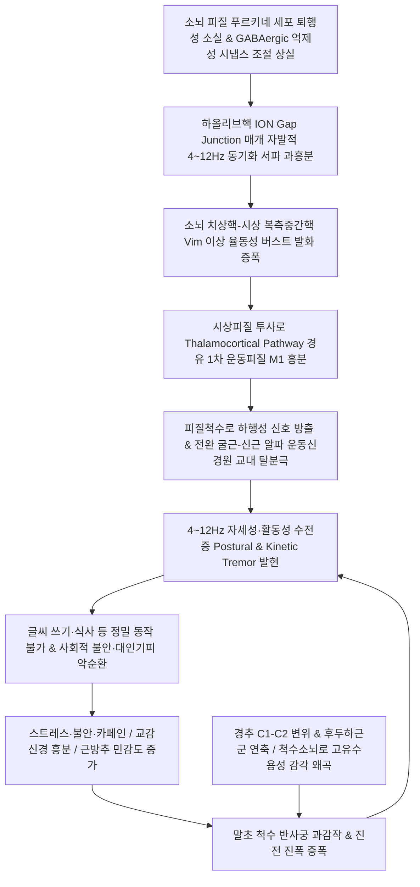
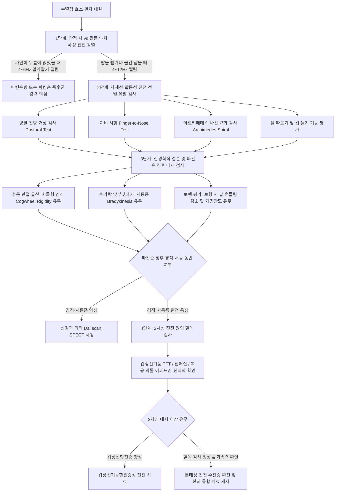

# 🩺 수전증 (Essential Tremor / 本態性 振顫, G25.0)

> **핵심 3줄 요약 (Key Summary)**:
> - 🌿 병소 부위 & 해부·병태생리: 주로 양측 상지에서 발현되는 가장 흔한 운동 장애 질환으로, [[소뇌]] 피질 푸르키네 세포(Purkinje cell)의 억제성 GABAergic 조절 상실 및 하올리브핵(Inferior olive)의 자발적 동기화 과흥분에 의한 소뇌-시상-피질(Cerebello-Thalamo-Cortical, CTC) 루프 이상 진동 메커니즘.
> - 🚩 전형적 임상 양상 & 3대 징후: 물건을 잡거나 자세를 유지할 때 악화되는 4~12Hz의 활동성·자세성 진전(Action/Postural tremor), 소량의 알코올 섭취 시 일시적 완화 반응, 머리(체머리) 및 음성 떨림의 동반 가능성.
> - 🛠️ 핵심 감별 검사 & 한·양방 다각적 치료 전략: [[파킨슨병]](흑질 도파민 소실, 4~6Hz 안정 시 진전, 서동증, 치륜형 경직) 및 [[갑상선기능항진증]] 감별, 침구([[두침]] 운동구, 두경부 풍지·백회 심자), 약침(신바로, 중성어혈, 황련해독탕, 자하거), 추나(후두하삼각 근막이완 및 상부 경추 교정), 한약([[천마구등음]], [[억간산]], [[진간식풍탕]])과 양방 약물([[프로프라놀롤]], [[프리미돈]]) 및 고집적초음파([[MRgFUS]]), 심부뇌자극술([[DBS]])의 다각적 접근.
> - ⚠️ 응급 의뢰 레드플래그 & 악화 요인: 급성 편측성 마비, 조화운동불능([[뇌경색]], 소뇌출혈), 안구진탕, 인지기능 급성 저하 등 중추신경계 적신호(Red Flags), 카페인·스트레스·수면 박탈에 의한 급격한 진폭 악화.

---

## 📌 목차
1. [질환 개요 & 해부학적 병태생리](#1-질환-개요--해부학적-병태생리)
2. [병태생리 메커니즘 & 생체역학적 악순환 네트워크](#2-병태생리-메커니즘--생체역학적-악순환-네트워크)
3. [임상 증상 & 이학적 검사(Physical Exam) 알고리즘](#3-임상-증상--이학적-검사physical-exam-알고리즘)
4. [감별 진단 매트릭스 (Differential Diagnosis)](#4-감별-진단-매트릭스-differential-diagnosis)
5. [한의 통합 치료 프로토콜 (침·약침·추나·한약)](#5-한의-통합-치료-프로토콜-침약침추나한약)
6. [양방 치료 & 병용·의뢰 기준 (Conventional Treatment & Referral)](#6-양방-치료--병용의뢰-기준-conventional-treatment--referral)
7. [재활 운동 & 생활습관 티칭 가이드](#7-재활-운동--생활습관-티칭-가이드)
8. [💡 사용자 진료실 핵심 필기 & 임상 노하우 (Melt-In 잔여 심화 집약)](#8--사용자-진료실-핵심-필기--임상-노하우-melt-in-잔여-심화-집약)
9. [출처 및 학술 참고 문헌 (References)](#9-출처-및-학술-참고-문헌-references)

---

## 1. 질환 개요 & 해부학적 병태생리

### 1) 개념 정의 및 임상적 의의
* **본태성 진전(Essential Tremor, ET / 수전증)**은 기저 신경학적 결손이나 다른 뚜렷한 원인 뇌질환 없이, 양측 상지(손과 전완)를 중심으로 일정한 주파수와 리듬을 가진 불수의적 진동 운동(Tremor)이 발생하는 중추 신경계 신경퇴행성 운동 장애(Movement disorder) 질환이다.
* 임상적으로 가만히 쉬고 있을 때(Resting)는 진전이 소실되거나 미미하지만, 팔을 허공에 뻗쳐 특정 자세를 유지할 때(자세성 진전, Postural tremor) 또는 물컵을 입으로 가져가거나 수저질을 하는 등 목표 지향적 수의 운동을 수행할 때(활동성·의도성 진전, Kinetic/Action tremor) 진폭이 현저하게 증가하는 병태를 보인다.
* 본 질환은 단순한 양성 노화 현상으로 치부되기 쉬우나, 중증화될 경우 글씨 쓰기, 식사, 음료 마시기, 단추 잠그기 등 정밀한 일상생활동작(ADL)을 심각하게 파괴하며, 대인기피증, 우울증, 사회적 위축을 초래하는 기능적 장애 질환이다.

### 2) 역학 및 유전학적 소인
* **유병률**: 전 세계 일반 인구의 약 0.9~1.0%에서 발병하며, 65세 이상 고령 인구에서는 4.0~5.0% 이상으로 급증하고, 80대 이상에서는 10%를 상회할 정도로 파킨슨병보다 10~20배 이상 흔하게 나타난다.
* **성별 차이**: 남성과 여성의 전체 유병률은 유사하나, 남성은 상지 진전의 진폭이 크고 두드러지는 경향이 있는 반면, 여성은 두부 진전(체머리, Head tremor)의 동반 비율이 상대적으로 높다.
* **양봉형(Bimodal) 발병 분포**: 발병 연령은 10대 후반에서 20대 초반에 호발하는 청년기 발병형(Early-onset type)과, 60대 전후에 발생하는 노년기 발병형(Late-onset type)의 뚜렷한 두 봉우리 분포를 보인다.
* **가족력 (Familial Tremor)**: 환자의 50~70% 이상에서 상염색체 우성(Autosomal dominant) 유전 경향을 나타낸다. LINGO1, FUS, SLC1A2, GABRA1 등 소뇌 시냅스 전달 및 신경세포 생존과 관련된 유전자 다형성이 질환 감수성과 밀접한 연관을 갖는다.

### 3) 관련 해부학적 구조물 네트워크
* **소뇌 피질(Cerebellar Cortex)**:
  * **푸르키네 세포층(Purkinje Cell Layer)**: 소뇌 피질의 유일한 원심성(Effoutput) 억제성 뉴런으로, 신경전달물질 GABA를 분비하여 소뇌 심부핵의 과흥분을 억제하는 핵심 브레이크 역할을 담당한다.
  * **과립세포(Granule Cell) 및 평행섬유(Parallel Fiber)**: 이끼섬유(Mossy fiber)로부터 감각 입력을 받아 푸르키네 세포의 수상돌기로 흥분성 신호를 전달한다.
  * **바스켓 세포(Basket Cell) 및 성상세포(Stellate Cell)**: 푸르키네 세포체와 수상돌기를 억제하는 국소 개재뉴런(Interneuron)이다.
* **소뇌 심부핵 (Deep Cerebellar Nuclei)**:
  * **치상핵(Dentate Nucleus)**: 소뇌 반구 신소뇌(Neocerebellum)의 출력을 집대성하는 최대 신경핵으로, 수의 운동의 개시, 타이밍 조절, 진동 주파수 억제에 핵심적인 역할을 수행한다. 본 질환에서는 푸르키네 세포의 억제성 GABAergic 통제가 상실되면서 치상핵 신경세포들이 병적인 리듬성 연쇄 발화(Rhythmic burst firing)를 생성한다.
  * **중간핵(Interposed Nucleus, 전상핵·구상핵)**: 사지 원위부 골격근의 정밀 굴신 운동 협응을 조율한다.
* **뇌간(Brainstem) 진동 생성 구조**:
  * **하올리브핵(Inferior Olivary Nucleus, ION)**: 연수(Medulla oblongata) 복측에 위치하며, 하올리브핵 신경원들은 특유의 수지상 돌기 간 간극결합(Gap junction, Connexin 36)과 저전압 활성화 T-형 칼슘 채널(Cav3.1)을 통해 자체적으로 4~12Hz의 자발적 서파 진동 리듬을 형성하는 생체 진동자(Pacemaker/Central Oscillator)이다.
  * **올리브소뇌로(Olivocerebellar Tract / 등정섬유 Climbing Fibers)**: 하올리브핵에서 기원하여 소뇌 푸르키네 세포의 수상돌기를 1:1로 강력하게 흥분시키는 전도로이다.
  * **적핵(Red Nucleus, RN)**: 중뇌에 위치하며 올리브핵-소뇌-적핵으로 이어지는 길랑-몰라레 삼각형(Guillain-Mollaret triangle)의 조절 회로를 형성한다.
* **시상(Thalamus) 및 대뇌 피질**:
  * **시상 복측중간핵(Ventral Intermediate Nucleus, Vim / VPLo)**: 상소뇌각(Superior cerebellar peduncle)을 거쳐 상행하는 치상시상로(Dentatothalamic tract) 섬유를 수신하여 대뇌 피질로 중계하는 핵심 관문이다. 본태성 진전의 외과적 수술(DBS, MRgFUS) 타겟 부위이다.
  * **1차 운동피질(Primary Motor Cortex, M1 / Brodmann Area 4)**: Vim으로부터 리듬성 진동 흥분파를 수신하여 추체로(Corticospinal tract)를 통해 척수 전각 알파 운동신경원으로 하행성 진전 신호를 방출한다.
* **척수 및 말초 운동 단위(Peripheral Motor Units)**:
  * **척수 전각 알파 운동신경원(Alpha Motor Neurons)**: 추체로의 하행성 리듬 자극을 받아 말초 골격근으로 4~12Hz 교대 흥분 신호를 전달한다.
  * **상지 주동근-길항근 근육군**: 전완의 [[요측수근굴근]], [[척측수근굴근]], [[천지굴근]], [[심지굴근]]과 대항근인 [[장요측수근신근]], [[단요측수근신근]], [[척측수근신근]], [[지신근]], 그리고 수부 내재근인 [[충양근]], [[골간근]], [[무지구근]]이 교대로 율동적 수축-이완을 반복하며 손떨림을 발현한다.
* **경추 및 후두하 생체역학 구조**:
  * 환축관절(C1-C2) 및 후두하삼각 근육군([[대후두직근]], [[소후두직근]], [[상두사근]], [[하두사근]]): 척수소뇌로(Spinocerebellar tract)를 통해 소뇌로 상행하는 고유수용성 감각 신호의 밀도가 가장 높은 부위로, 경추 정렬 불량과 후두하근 과긴장은 소뇌 피질의 감각 통합 오류를 가중시켜 말초 진전 진폭을 증폭시킨다.

---

## 2. 병태생리 메커니즘 & 생체역학적 악순환 네트워크

### 1) 소뇌-시상-피질(Cerebello-Thalamo-Cortical, CTC) 중심 진동 회로 병태생리
* **중심 진동자 모델(Central Oscillator Model)**:
  * 정상 상태에서 하올리브핵 신경원은 억제성 GABAergic 피드백 신호에 의해 개별 세포 간의 발화가 억제되거나 분산되어 있다.
  * 그러나 본태성 진전 환자에서는 소뇌 피질의 주된 억제성 뉴런인 푸르키네 세포(Purkinje cells)의 퇴행성 소실, 축삭류(Axonal swelling, Torpedoes formation), 수초 탈락, 수상돌기 분지 축소 현상이 발생한다.
  * 푸르키네 세포의 억제력이 상실되면, 하올리브핵의 신경원들은 세포막의 저전압 활성화 T-형 칼슘 채널(T-type Ca2+ channel, Cav3.1)과 덴드로-덴드리틱 간극결합(Gap junction)을 매개로 서로 강력하게 동기화(Synchronization)되어 자발적인 4~12Hz의 리듬성 박동을 형성한다.
* **치상핵 탈억제 및 시상 복측중간핵(Vim) 과흥분**:
  * 소뇌 피질로부터 억제성 신호를 받지 못한 소뇌 심부 치상핵(Dentate nucleus)은 상소뇌각(Superior cerebellar peduncle)을 거쳐 뇌간을 가로질러 반대측 시상 복측중간핵(Vim)으로 비정상적인 율동성 버스트 신호를 연속 송출한다.
  * Vim 신경세포는 이러한 상행성 박동 신호와 위상 결합(Phase-locking)을 일으켜 동기화된 리듬성 진동 신호를 1차 운동피질(M1, Area 4) 및 보조운동영역(SMA)으로 증폭 전달한다.
* **운동피질 및 척수로 하행 전파**:
  * 대뇌 1차 운동피질의 추체세포(Pyramidal cells)는 피질척수로(Corticospinal tract)를 통해 척수 전각 세포로 진동성 흥분 신호를 하향 방출한다.
  * 이 신호는 척수 분절에서 상지 말초 골격근의 주동근과 길항근(예: 요측수근굴근 vs 장요측수근신근)을 지배하는 알파 운동신경원을 180도 위상차 또는 동위상으로 번갈아 탈분극시킴으로써 4~12Hz의 규칙적인 자세성·활동성 떨림을 만들어낸다.

### 2) 분자생물학적 및 신경전달물질 이상 기전
* **GABA 수용체 기능 저하 및 서브유닛 이상**:
  * 사후 뇌 조직 병리 연구에 따르면, 본태성 진전 환자의 소뇌 피질 및 치상핵 부위에서 GABA_A 및 GABA_B 수용체 밀도가 현저하게 감소되어 있다.
  * 특히 소뇌 과립세포에 고농도로 발현되어 강장성 억제(Tonic inhibition)를 담당하는 알파6 서브유닛 함유 GABA_A 수용체(α6GABA_A receptor)의 발현 저하 및 탈감작이 하올리브핵-소뇌 루프의 과도한 리듬성 동기화를 억제하지 못하는 핵심 분자 표적으로 규명되었다.
* **알코올(에탄올)의 완화 및 리바운드 기전**:
  * 환자가 소량의 알코올(와인 한 잔 등)을 섭취했을 때 손떨림이 일시적으로 극적 호전되는 현상은, 에탄올 분자가 소뇌 피질의 α6GABA_A 수용체에 양성 알로스테릭 조절인자(Positive allosteric modulator)로 작용하여 염소 이온(Cl-) 유입을 촉진하고 하올리브핵의 율동성 진동을 강력히 억제하기 때문이다.
  * 그러나 혈중 알코올 농도가 감소하면 수용체의 급격한 탈감작과 함께 보상성 글루타메이트(Glutamate)성 흥분 신호가 폭발적으로 방출되어, 다음 날 아침 손떨림이 기저 상태보다 훨씬 악화되는 '반동성 진전(Rebound tremor)'이 발생한다.
* **베타-아드레날린성 수용체와 말초 증폭 기전**:
  * 긴장, 스트레스, 분노, 불안 상태에서 방출된 에피네프린과 노르에피네프린은 말초 골격근 근방추(Muscle spindle)의 베타-2 아드레날린성 수용체(β2-adrenergic receptor)를 자극하여 근방추 감도를 급격히 높인다.
  * 이는 1a 구심성 신경을 통한 척수 신장 반사(Stretch reflex)를 과감작시켜, 중추성 진동자에서 내려온 미세한 진폭의 떨림을 거대한 육안적 떨림으로 기계적 증폭시키는 촉매 역할을 한다.

### 3) 생체역학적 악순환 네트워크 및 경추성 연계
* **공명 현상 (Resonance Phenomenon)**:
  * 뇌간 및 소뇌에서 생성된 중추성 진동수(Central frequency)와 상지 관절(손목, 팔꿈치) 및 근육의 고유 기계적 공진 주파수(Mechanical resonant frequency)가 일치할 때 진폭이 기하급수적으로 폭발하는 현상이다.
* **상부 경추 정렬 변위와 척수소뇌로 왜곡**:
  * 만성적인 [[거북목 증후군]], 일자목, 상부 교차 증후군으로 인해 후두하삼각 근육군([[대후두직근]], [[상두사근]], [[하두사근]])이 지속적으로 단축 연축되면, 추골동맥(Vertebral artery)의 뇌간 및 소뇌 혈류 순환이 물리적으로 저하된다.
  * 동시에 후두하근 내 고밀도로 분포하는 근방추로부터 척수소뇌로(Spinocerebellar tract)를 거쳐 소뇌로 유입되는 고유수용성 감각 신호에 심각한 노이즈와 왜곡이 발생하여, 소뇌가 상지의 미세 궤적 오차를 수정하지 못하고 진전 진폭을 더욱 키우는 악순환이 완성된다.

---

## 3. 임상 증상 & 이학적 검사(Physical Exam) 알고리즘

### 1) 주요 임상 증상 및 특징
* **자세성 진전 (Postural Tremor)**:
  * 양팔을 지면과 수평으로 앞으로 나란히 뻗고 손가락을 가볍게 벌리고 있을 때 가장 뚜렷하게 관찰되는 4~12Hz의 율동적 손떨림.
  * 중력에 대항하여 상지 근육들이 일정한 관절 각도를 유지하려고 등척성 수축을 할 때 진폭이 커진다.
* **활동성 및 의도성 진전 (Kinetic & Intention Tremor)**:
  * 물이 가득 찬 컵을 입으로 가져갈 때, 숟가락으로 국물을 뜰 때, 젓가락으로 음식을 집을 때, 단추를 잠글 때 등 목표물을 향해 손을 뻗는 수의적 동작 전반에서 진전이 나타난다.
  * 목표물(예: 입술, 단추 구멍)에 근접할수록 소뇌의 목표 보정 메커니즘 장애로 인해 떨림의 진폭이 더욱 격렬해지는 의도성 진전(Intention tremor) 양상을 띤다.
* **침범 부위의 임상 분포**:
  * **상지 (Hands & Forearms)**: 환자의 95% 이상에서 가장 먼저 나타나며 가장 심각한 장애를 유발한다. 초기에는 한쪽 손에서 경미하게 시작될 수 있으나 결국 양측 대칭성 또는 약간의 비대칭성을 띠며 양손 모두 침범한다.
  * **두경부 진전 (Head Tremor / 체머리)**: 환자의 30~50%에서 발생하며, 고개를 좌우로 흔드는 'No-no' 형태나 위아래로 끄덕이는 'Yes-yes' 형태의 진동을 보인다. 고립성 두부 진전으로 시작되기도 한다.
  * **음성 진전 (Voice Tremor)**: 성대 근육 및 호흡근 침범으로 말을 할 때 목소리가 심하게 떨리고 갈라지는 현상(15~20%).
  * **턱, 혀, 안면 진전**: 턱이나 입술 주변 떨림이 동반될 수 있으나, 하지(Legs)의 침범은 매우 드물다.
* **알코올 반응성 (Alcohol Responsiveness)**:
  * 소량의 음주(맥주 반 잔 또는 와인 한 잔)로 30분~1시간 이내에 떨림의 진폭이 50% 이상 극적으로 줄어드는 현상은 본태성 진전의 매우 특징적인 임상 소견이다.
* **악화 및 완화 요인**:
  * **악화 요인**: 감정적 긴장, 여러 사람 앞에서의 발표나 식사, 분노, 육체적 피로, 수면 부족, 카페인 섭취, 추위 노출, 갑상선호르몬 과다, 기관지확장제 복용.
  * **완화 요인**: 심신 이완, 명상, 온욕, 충분한 수면, 소량의 음주.

### 2) 이학적 검사 및 신경학적 평가 알고리즘

#### 세부 검사 수행 프로토콜
1. **양팔 전방 거상 검사 (Postural Tremor Test)**:
   * 환자를 편안히 앉히고 양팔을 어깨높이로 앞으로 나란히 뻗게 한 후 손가락을 1cm 간격으로 가볍게 벌리게 한다.
   * 검사자는 10~20초간 손가락 끝의 떨림 주파수와 진폭을 관찰한다. 진폭이 유지되거나 점차 증가하면 자세성 진전 양성이다.
2. **지비 시험 (Finger-to-Nose Test)**:
   * 환자에게 검사자의 집게손가락 끝과 환자 자신의 코끝을 번갈아 가리키도록 반복 지시한다.
   * 손가락이 검사자의 손가락이나 코끝에 거의 도달했을 때(종말부) 떨림의 진폭이 급격히 커지는 의도성 진전(Intention tremor) 및 거리측정장애(Dysmetria) 여부를 평가한다.
3. **아르키메데스 나선 묘화 검사 (Archimedes Spiral Drawing)**:
   * 백지 위에 검사자가 기준 나선을 그리고, 환자에게 중심에서부터 바깥쪽으로 닿지 않게 나선을 따라 그리도록 한다.
   * 본태성 진전 환자는 특정 축 방향(대개 10시-4시 또는 2시-8시 축)으로 일정한 주파수의 지그재그 진동 흔적이 뚜렷하게 관찰된다.
4. **필기 검사 (Handwriting Examination)**:
   * 환자에게 긴 문장을 쓰게 한다.
   * 본태성 진전 환자는 글씨의 획이 심하게 떨려 지그재그 형태를 띠지만 글씨 크기는 정상적이거나 오히려 떨림을 보상하기 위해 커진다. (반면 파킨슨병 환자는 글씨가 뒤로 갈수록 좁쌀처럼 작아지는 소서증 Micrographia를 보인다.)
5. **물 따르기 및 컵 들기 기능 평가 (Water Pouring Test)**:
   * 종이컵 두 개를 준비하여 한쪽 컵에 물을 80% 채운 후, 다른 빈 컵으로 물을 흘리지 않고 붓게 한다. 일상 기능 훼손 정도를 0~4점으로 정량화한다.
6. **치륜형 경직(Cogwheel Rigidity) 배제 검사**:
   * 환자의 팔에 힘을 완전히 빼게 한 후, 검사자가 손목 관절과 주관절을 수동으로 천천히 굴곡·신전 및 회선시킨다.
   * 톱니바퀴가 덜컥거리며 걸리는 듯한 저항감이 느껴지면 기저핵 질환인 파킨슨병을 의심해야 하며, 저항감 없이 부드럽게 움직이면 본태성 진전에 부합한다.
7. **서동증(Bradykinesia) 배제 검사**:
   * 엄지와 검지를 최대한 크고 빠르게 맞부딪히는 핑거 태핑(Finger tapping)을 15초간 10회 이상 수행하게 한다.
   * 횟수가 반복될수록 동작의 크기(진폭)가 급격히 줄어들거나 멈추는 동결 현상(Hesitation/Freezing)이 나타나면 파킨슨병을 시사한다. 본태성 진전 환자는 속도가 빠르고 진폭의 감소가 없다.

---

## 4. 감별 진단 매트릭스 (Differential Diagnosis)

| 감별 항목 | 본태성 진전 (수전증, Essential Tremor) | [[파킨슨병]] (Parkinson's Disease) | 강화된 생리적 진전 (Enhanced Physiological) | [[근긴장이상]]성 진전 (Dystonic Tremor) | 소뇌성 진전 (Cerebellar Tremor) |
| :--- | :--- | :--- | :--- | :--- | :--- |
| **주 떨림 형태** | **활동성 진전 & 자세성 진전** | **안정 시 진전 (Resting Tremor)** | 자세성 진전 위주 | 활동성 및 특정 자세 유지 시 | **의도성 진전 (Intention Tremor)** |
| **진전 주파수** | **4 ~ 12 Hz** (중등도~고속) | **4 ~ 6 Hz** (저속, 알약말기 운동) | **8 ~ 12 Hz** (미세하고 매우 빠름) | 3 ~ 7 Hz (불규칙적, 가변적) | **3 ~ 5 Hz** (거칠고 느린 진폭) |
| **침범 대칭성** | **양측 대칭적** (경미한 비대칭 가능) | **뚜렷한 한쪽 시작 (비대칭성)** | 양측 대칭적 | 비대칭적, 국소 근육군 | 병변 동측 또는 양측 |
| **침범 신체 부위** | 양손, 머리(체머리), 목소리 | 한손 $\rightarrow$ 동측 다리 $\rightarrow$ 반대측, 턱 | 양손 손가락 전체 | 목, 손, 몸통의 특정 자세 | 사지 원위부 및 체간 실조 |
| **안정 시 떨림 유무** | **원칙적 없음** (중증기 일부 출현) | **안정 시 극대화** (활동 시 일시 감소) | 없음 | 없음 | 없음 |
| **동반 신경 증상** | **없음** (근력, 감각, 반사 100% 정상) | **서동증, 치륜형 경직, 가면안모, 보행동결** | 교감신경 흥분(빈맥, 발한, 불안) | **이상 자세(Dystonia), 통증성 경련** | **겨냥이상, 구음장애, 안구진탕, 실조증** |
| **알코올 반응성** | **소량 음주 시 50% 이상 극적 호전** | 반응 없음 | 반응 없음 또는 미미 | 일부 반응 가능 | 반응 없음 |
| **가족력** | **50~70% 이상 (상염색체 우성)** | 대부분 특발성 (가족력 10% 미만) | 가족력 없음 | 가족력 다양함 | 기저 질환에 따름 |
| **DaTscan 영상 소견** | **선조체 도파민 수송체 100% 정상** | **조개핵(Putamen) 비대칭적 섭취 결손** | 완전 정상 | 완전 정상 | 완전 정상 |
| **원인 병태** | 소뇌 피질-하올리브핵 루프 진동 | 중뇌 흑질 치밀부 도파민 신경세포 소실 | 카페인, 갑상선항진, 약물(천식약), 피로 | 기저핵-감각운동 피질 신호 왜곡 | 소뇌경색, 종양, [[다발성경화증]] |

---

## 5. 한의 통합 치료 프로토콜 (침·약침·추나·한약)

### 1) 한의학적 변증 체계 (TCM Syndromes)
* **간양상항(肝陽上亢) / 간풍내동(肝風內動)**:
  * 평소 성격이 조급하고 스트레스를 많이 받으며, 분노나 긴장 시 손떨림이 극도로 심해지는 유형.
  * 동반 증상: 두통, 어지럼증(현훈), 안면홍조, 눈의 충혈, 이명, 불면, 구고(입안이 씀). 설홍(舌紅) 태황(苔黃), 맥현삭(脈弦數).
* **음허생풍(陰虛生風) / 간신음허(肝腎陰虛)**:
  * 60대 이후 노년기 발병 환자에서 다발하며, 체형이 마르고 기력이 쇠약한 유형.
  * 동반 증상: 허리와 무릎의 시큰거림(요슬산연), 손발바닥의 열감(오심번열), 도한(도둑땀), 구갈, 이명. 설홍소태(舌紅少苔), 맥세삭(脈細數).
* **기혈양허(氣血兩虛) / 비허생풍(脾虛生風)**:
  * 만성적인 소화기 쇠약과 만성 피로를 호소하며, 과로하거나 굶었을 때 손떨림이 심해지는 유형.
  * 동반 증상: 안색 창백 또는 위황, 식욕 부진, 사지무력, 심계정충, 어지럼증. 설담태백(舌淡苔白), 맥세약(脈細弱).
* **담탁조락(痰濁阻絡)**:
  * 체형이 비만하고 평소 기름진 음식을 즐기며, 머리가 무겁고 사지가 찌뿌둥한 유형.
  * 동반 증상: 가래, 흉민(가슴 답답함), 오심, 몸의 무거움, 관절의 둔탁한 감각. 설태백니(舌苔白膩), 맥활(脈滑).

### 2) 침구 치료 (Acupuncture)
* **두침 요법 (Scalp Acupuncture)**:
  * **무도진전제어구(Chorea-Tremor Control Zone / 舞蹈震顫制御區)**: 운동구(Motor Area) 전방 1.5cm에 위치한 평행선으로, 불수의적 진전 및 이상 운동증을 조절하는 두침의 핵심 구역이다. 0.25×40mm 호침으로 두피 건막하 공간으로 1.5촌 수평 자입한 후 200회/분 이상의 고속 염전 또는 전침(2Hz)을 20분간 적용하여 대뇌 운동피질의 과흥분을 직접 제어한다.
  * **운동구 상지부(Motor Area Upper Limb Section)**: 상지 운동 피질의 투사 영역으로, 수부 및 전완부의 율동성 신경 신호를 진정시킨다.
* **체침 및 두경부 특수 자침 혈자리**:
  * **두경부 안정 및 소뇌 혈류 개선**:
    * 백회(百會), 사신총(四神聰): 대뇌 피질 흥분을 가라앉히고 진정(鎭靜), 안신(安神) 작용을 유도.
    * 풍지(風池), 천주(天柱), 완골(完骨): 추골뇌저동맥(Vertebrobasilar artery) 순환을 개선하여 뇌간 및 소뇌 피질로의 혈류 공급을 촉진하고 후두하근군 긴장을 해소.
    * 풍부(風府), 아문(啞門): 독맥 경혈로 뇌수(腦髓)를 보하고 중추성 풍증(風證)을 식풍(熄風)함.
  * **사관혈 및 평간식풍 혈자리**:
    * 합곡(合谷), 태충(太衝) (사관혈): 전신 기혈 순환을 소통시키고 평간잠양(平肝潛陽), 식풍진경(熄風鎭痙).
  * **심신 안정 및 자율신경 조절**:
    * 내관(內關), 신문(神門): 심포경과 심경의 원혈로 교감신경 긴장을 낮추고 스트레스성 진전 증폭 차단.
  * **상지 국소 및 주동근-길항근 조절 혈자리**:
    * 곡지(曲池), 수삼리(手三里), 외관(外關), 양계(陽谿): 전완 신근군([[장요측수근신근]], [[지신근]])의 과긴장 연축을 이완.
    * 척택(尺澤), 소해(少海), 열결(列缺): 전완 굴근군([[요측수근굴근]], [[천지굴근]])의 교대성 수축 조절.
    * 노궁(勞宮), 후계(後谿), 팔사(八邪): 수부 내재근([[충양근]], [[골간근]])의 미세 떨림 억제.
* **전침 요법 (Electroacupuncture)**:
  * 풍지-천주 및 합곡-곡지에 전침을 연결하여 2Hz 연속 저주파 또는 2/100Hz 소밀파(Dense-Disperse Wave)를 20분간 통전. 중추 엔도르핀 분비 및 소뇌 진동 회로의 율동적 버스트 신호를 억제한다.

### 3) 약침 치료 (Pharmacopuncture)
* **신바로약침 / 중성어혈약침**:
  * 상부 경추(C1-C4) 후관절낭 및 후두하삼각 근육군 부착부(풍지, 천주)에 포인트당 0.2~0.5cc씩 총 1.5~2.0cc 주입.
  * 경추 심부 근막의 무균성 염증을 제거하고 경추성 고유수용성 감각 신경의 과흥분을 차단.
* **황련해독탕 약침**:
  * 간양상항 및 교감신경 과흥분으로 가슴이 답답하고 스트레스 시 손떨림이 극대화되는 환자의 풍지, 견정, 심수, 간수에 주입하여 청열사화(淸熱瀉火) 및 신경 진정 유도.
* **자하거(태반) 약침**:
  * 노인성 본태성 진전 및 음허생풍 환자의 족삼리, 태계, 신수, 관원에 0.5cc씩 주입하여 정혈(精血)을 보충하고 신경세포의 퇴행성 변화를 억제.
* **봉약침 (Sweet Bee Venom)**:
  * 알레르기 피부 반응 검사(Skin Test) 음성 확인 후, 합곡, 곡지, 풍지혈에 0.1cc씩 극소량 피내 주입하여 말초 미세 혈류를 개선하고 신경 세포막 전위를 안정화.

### 4) 추나 요법 (Chuna Manipulation)
* **후두하삼각 근막 이완술 (Suboccipital Myofascial Release)**:
  * 환자를 앙와위로 눕히고, 시술자의 제2~4수지 끝을 후두골 하연 대후두직근, 상두사근, 하두사근 부착부에 접촉한 후 두부의 무게를 이용하여 3~5분간 지속적인 상방 견인 및 심부 허혈성 압박을 가함.
  * 후두하 근막의 유착을 해소하여 소뇌-뇌간으로 유입되는 혈류 저항을 즉각 개선.
* **상부 경추 관절가동술 (Upper Cervical Mobilization)**:
  * C1-C2 환축관절(Atlantoaxial Joint)의 회전 변위를 부드러운 가동 기법으로 교정하여 척수소뇌로의 신경학적 간섭을 배제.
* **상지 근막경선 이완 추나 (Upper Extremity Myofascial Unwinding)**:
  * 천층전완선(Superficial Front Arm Line) 및 심층후완선(Deep Back Arm Line)을 따라 상완이두근, 원회내근, 수근굴근 및 신근의 근막 유착을 롤링 및 압박 이완.

### 5) 한약 치료 (Herbal Medicine)
* [[천마구등음]] (天麻鉤藤飮):
  * 조성: [[천마]], [[구등]], [[석결명]], [[치자]], [[황금]], [[우슬]], [[두충]], [[익모초]], [[상기생]], [[야교등]], [[복신]].
  * 적응증: 간양상항형 본태성 진전의 대표 방제. 혈압 상승, 두통, 현훈, 불면을 동반하며 스트레스 시 손떨림이 심해지는 환자에게 평간잠양(平肝潛陽), 식풍지경(熄風止痙) 효과 발휘.
* [[억간산]] (抑肝散) 및 억간산가진피반하(抑肝散加陳皮半夏):
  * 조성: [[조구등]], [[시호]], [[백출]], [[복령]], [[당귀]], [[천궁]], [[감초]] (가 [[진피]], [[반하]]).
  * 적응증: 신경 과민, 불안, 짜증, 불면을 동반한 활동성 진전에 탁월함. 조구등의 린코필린(Rhynchophylline) 성분이 세로토닌 5-HT1A 수용체 및 GABA_A 수용체를 조절하여 중추성 진전 진폭을 현저히 감소시킴.
* [[진간식풍탕]] (鎭肝熄風湯):
  * 조성: [[회우슬]], [[대자석]], [[용골]], [[모려]], [[현삼]], [[천문동]], [[백작약]], [[맥아]], [[인진]], [[천련자]], [[감초]].
  * 적응증: 간풍내동형으로 맥이 현장유력(弦長有力)하고 두경부 체머리와 상지 진전이 격렬하게 동반되는 중증 노인성 진전에 진간식풍(鎭肝熄風), 자음잠양(滋陰潛陽).
* [[귀비탕]] (歸脾湯):
  * 조성: [[당귀]], [[용안육]], [[산조인]], [[원지]], [[인삼]], [[황기]], [[백출]], [[복신]], [[목향]], [[감초]], [[생강]], [[대추]].
  * 적응증: 사려과다, 심비양허형으로 만성 피로와 식욕 부진, 어지럼증을 겪으며 피로할수록 손이 떨리는 허증성 환자에게 보기양혈(補氣養血), 영심안신(寧心安神).

---

## 6. 양방 치료 & 병용·의뢰 기준 (Conventional Treatment & Referral)

### 1) 경구 약물 치료 (Medications)
* **1차 표준 치료제**:
  * [[프로프라놀롤]] (Propranolol):
    * 비선택적 베타-아드레날린성 수용체 차단제(Non-selective Beta-blocker).
    * **용량 및 용법**: 초기 40mg/day로 시작하여 임상 반응에 따라 80~240mg/day까지 단계적 증량 (서방형 제제 제형 가능).
    * **기전**: 말초 골격근 근방추의 β2 수용체를 차단하여 신장 반사 감도를 낮추고, 중추신경계로 이행하여 교감신경성 진전 촉진을 억제. 환자의 약 50~70%에서 진폭 30~50% 감소 효과.
    * **부작용 및 금기**: 서맥(심박수 55회/분 미만 시 감량), 저혈압, 피로, 어지럼증, 발기부전. **천식, 만성폐쇄성폐질환(COPD), 2~3도 방실차단 환자에게는 절대 금기**.
  * [[프리미돈]] (Primidone):
    * 항경련제(Anticonvulsant) 계열.
    * **용량 및 용법**: 초기 12.5~25mg 취침 전 복용으로 시작하여 매주 천천히 증량, 유지 용량 100~250mg tid (최대 750mg/day).
    * **기전**: 체내에서 페노바르비탈(Phenobarbital)과 페닐에틸말로네이트(PEMA)로 대사되어 중추 GABAergic 억제성 전도를 강화하고 전압의존성 나트륨/칼슘 채널을 억제. 프로프라놀롤과 동등한 수준의 진전 억제 효과.
    * **부작용**: 초기 급성 독성 반응(심한 어지럼증, 운동실조, 오심, 졸림, 구토)이 빈발하므로 극소량부터 점진적 증량 필수.
* **2차 치료 약물**:
  * [[토피라메이트]] (Topiramate): AMPA/Kainate 글루타메이트 수용체 억제 및 전압의존성 Na+ 채널 억제, GABA 증강. 100~400mg/day. (체중 감소, 인지기능 저하, 감각이상, 녹내장 주의).
  * [[가바펜틴]] (Gabapentin) & [[프레가발린]] (Pregabalin): 전압의존성 칼슘 채널의 α2-δ 서브유닛에 결합하여 흥분성 신경전달물질 방출 억제. (어지럼증, 부종, 졸림).
  * 벤조디아제핀계 ([[알프라졸람]], [[클로나제팜]]): 불안이 극심하게 동반된 경우 단기 보조 요법으로 사용하나, 내성과 의존성, 인지기능 저하 위험으로 장기 투여 주의.

### 2) 국소 주사 치료 (Botulinum Toxin)
* **보툴리눔 독소 국소 주입술 (Botox Injection)**:
  * 약물 불응성 두부 진전(체머리) 또는 성대 진전(음성 진전), 심한 수부 진전에 적용.
  * 전완 굴근 및 신근에 근전도(EMG) 또는 초음파 유도하에 정밀 주입.
  * 단점: 손가락 쥐는 힘이 약해지는 수부 근력 저하(Grip weakness, 30~50%)가 흔히 발생하여 미세 작업자에게는 적용이 제한됨.

### 3) 수술적 및 첨단 비침습 뇌시술 요법
* **자기공명영상유도 고집적초음파 집속수술 ([[MRgFUS]], Focused Ultrasound Thalamotomy)**:
  * 두개골을 절개하지 않고 1,000여 개의 초음파 트랜스듀서를 통해 시상 복측중간핵(Vim)에 고에너지 초음파를 집속시켜 55~60도의 열로 병소 부위를 정밀 응고 괴사시키는 첨단 비침습적 수술.
  * 침습도가 낮아 고령 환자에게도 적용 가능하며, 시술 즉시 반대측 상지 떨림이 70~80% 이상 영구적으로 소실됨. 현재 편측성 시술에 대해 FDA 승인됨.
* **심부뇌자극술 ([[DBS]], Deep Brain Stimulation)**:
  * 시상 Vim 부위에 뇌정위적으로 미세 전극을 삽입하고 쇄골하 피하에 신경자극기를 매립하여 130Hz 이상의 고주파 전기 자극을 가함으로써 병적인 소뇌-시상 진동을 전기적으로 차단.
  * 장점: 조절 가능하고 가역적이며 양측성 시술이 가능함.
  * 단점: 두개골 절개 수술에 따른 뇌출혈(1~2%), 감염, 구음장애, 보행 장애 부작용 위험 및 배터리 교체 필요.

### 4) 한의 병용 치료 및 약물 감량(Tapering) 가이드
* **병용 치료의 시너지**:
  * 양방 진전 치료제(프로프라놀롤, 프리미돈)를 복용 중인 환자가 약물 용량을 올려도 떨림이 완전히 조절되지 않거나, 약물 부작용(서맥, 극심한 피로, 무기력, 위장장애, 어지럼증)으로 고통받을 때 한의 침·한약 치료를 적극 병용한다.
  * 침구 및 추나 치료는 말초 교감신경 긴장을 낮추고 근막을 이완시키며, 한약([[억간산]], [[천마구등음]])은 중추 수용체를 다각적으로 조절하여 양방 약물의 요구량을 낮춘다.
* **임의 단약 절대 금기 및 테이퍼링 프로토콜**:
  * **리바운드 주의**: 프로프라놀롤을 복용하던 환자가 한의 치료를 시작했다고 갑자기 양약을 중단하면 심각한 반동성 빈맥, 혈압 급상승, 진전 폭발이 일어날 수 있다.
  * 한의 치료를 통해 임상 증상이 50% 이상 안정적으로 유지될 때, 담당 처방의와 협의하여 2~4주에 걸쳐 25%씩 단계적으로 서서히 감량(Tapering)하도록 지도한다.

### 5) 전문과 및 응급 의뢰 기준 (Referral Criteria)
* **응급 의뢰 기준 (Red Flags - 즉시 3차 신경과/응급실 전원)**:
  * 진전이 수 시간 또는 수일 내에 급격하게 발생한 경우.
  * 편측 안면 마비, 구음장애(말이 어눌해짐), 반신 부전마비가 동반되는 경우 ([[뇌졸중]] 의심).
  * 심한 보행 실조(술 취한 사람처럼 비틀거림), 지속적인 회전성 어지럼증, 자발 안구진탕이 동반되는 경우 ([[소뇌경색]] 또는 소뇌출혈 의심).
* **상급 병원 신경과 정밀 검사 의뢰 기준**:
  * 서동증, 치륜형 경직, 가면안모, 보행 장애가 의심되어 파킨슨병 감별을 위해 DaTscan SPECT가 필요한 경우.
  * 프로프라놀롤과 프리미돈의 충분한 용량 병용 투여에도 식사나 글씨 쓰기가 불가능할 정도로 일상생활이 파괴되어 MRgFUS 또는 DBS 수술 적응증 평가가 필요한 경우.
  * 인지기능 저하, 환각, 기립성 저혈압, 수면행동장애 등이 복합되어 비정형 파킨슨 증후군(진행성핵상마비, 다계통위축증 등)이 의심되는 경우.

---

## 7. 재활 운동 & 생활습관 티칭 가이드

### 1) 운동역학적 재활 및 보조 훈련
* **기계적 댐핑(Biomechanical Damping)을 활용한 가중 도구 훈련**:
  * **원리**: 상지 말초 관절에 적절한 물리적 질량 부하(Mass loading)를 가하면 기계적 공진 주파수가 이동하고 댐핑 계수가 증가하여 활동성 진전의 진폭이 30~50% 이상 즉각 감쇠된다.
  * **가중 식기(Weighted Utensils)**: 손잡이 내부에 150~300g의 무게추가 내장된 특수 숟가락과 젓가락을 사용하도록 지도.
  * **가중 손목 밴드(Weighted Wristbands)**: 식사나 글씨 쓰기 전 손목에 200~400g의 모래주머니 밴드를 착용하여 진동 감쇠 유도.
* **전완 및 수부 등척성 안정화 운동 (Isometric Wrist Co-contraction)**:
  * 전완의 주동근과 길항근을 동시에 수축시키는 동시 수축(Co-contraction) 능력을 강화하여 관절 강도(Joint stiffness)를 높임으로써 불수의적 교대 수축을 억제한다.
  * **테이블 프레스(Table Press)**: 책상 위에 손바닥을 얹고 통증이 없는 범위에서 10초간 아래로 지그시 누르는 등척성 수축 (10회 반복).
  * **주먹 쥐기 탄력 볼 운동**: 스트레스 볼을 70% 힘으로 5초간 쥐었다가 천천히 펴는 협응성 훈련.
* **상지 지렛대 단축 전략 (Lever Arm Shortening)**:
  * 컵을 들거나 수저질을 할 때 팔꿈치를 몸통에서 멀리 떨어뜨리면 어깨-팔꿈치-손목으로 이어지는 지렛대가 길어져 진폭이 증폭된다.
  * 팔꿈치를 옆구리 갈비뼈에 단단히 밀착시키고, 양손으로 컵을 감싸 쥐는 2점 지지 방식을 훈련시킨다.
* **자율신경 조절 이완 복식호흡**:
  * 교감신경 흥분이 근방추를 감작시키는 악순환을 끊기 위해 4초 흡기 - 7초 호흡 정지 - 8초 호기(4-7-8 호흡법)를 하루 3회, 회당 5분씩 수행하도록 티칭.

### 2) 일상생활 보조 기구 및 환경 수정 (Ergonomics)
* **그립 직경 확대 튜브(Foam Tubing)**: 펜, 칫솔, 포크의 손잡이에 폼 튜브를 덧씌워 손가락 굴곡 부담을 줄이고 안정적 파지를 유도.
* **음료 섭취 환경**: 머그잔 대신 뚜껑과 실리콘 빨대가 부착된 보온 텀블러 사용 권장.
* **의복 환경**: 단추 잠그기가 어려우므로 자석 단추(Magnetic buttons)나 벨크로 의류, 탄력 신발끈(No-tie elastic laces) 활용 지도.
* **디지털 기기**: 터치스크린 사용 시 손목 거치대(Wrist rest)를 바닥에 완전히 대고 사용하며, 음성 인식 입력 기능 적극 활용.

### 3) 생활습관 및 식이 티칭
* **카페인 및 각성 물질 완전 금기**:
  * 커피, 에너지 드링크, 녹차, 홍차, 초콜릿 등에 함유된 카페인은 아데노신 수용체를 차단하고 교감신경을 흥분시켜 진전 진폭을 극적으로 악화시키므로 전면 차단한다.
* **수면 위생의 철저한 관리**:
  * 만성적인 수면 박탈은 소뇌 푸르키네 세포의 GABA 합성 및 방출 능력을 저하시켜 다음 날 아침 손떨림을 폭발적으로 악화시킨다. 매일 밤 7~8시간의 규칙적인 숙면 환경을 유지한다.
* **알코올을 치료제로 오인하는 자가 치료(Self-Medication) 엄격 경고**:
  * "술을 마시면 손이 안 떨린다"고 하여 사회생활이나 대인 관계 시 음주를 습관화하는 환자가 많다.
  * 알코올은 일시적으로 GABA를 자극하지만, 대사 후 보상성 반동으로 다음 날 극심한 진전 악화와 만성 불안을 유발하며, 결국 알코올 의존증(Alcoholism)으로 파멸적 결과를 초래함을 엄중 경고한다.

---

## 8. 💡 사용자 진료실 핵심 필기 & 임상 노하우 (Melt-In 잔여 심화 집약)

### 1) 진료실 실전 감별 문진 공식 (Clinician's Diagnostic Pearls)
* **진전 감별의 황금 질문 3가지**:
  1. *"환자분, 손이 가만히 무릎 위에 힘을 빼고 얹어 놓았을 때 떨립니까, 아니면 국물을 뜨거나 컵을 입으로 가져갈 때 떨립니까?"*
     * 가만히 있을 때 떨린다 $\rightarrow$ **중뇌 흑질 질환인 [[파킨슨병]] 의심**.
     * 숟가락을 들거나 글씨를 쓸 때 떨린다 $\rightarrow$ **소뇌-시상 회로 질환인 수전증(본태성 진전) 확진**.
  2. *"손 말고 고개(체머리)나 목소리도 함께 떨립니까?"*
     * 파킨슨병은 초기에 머리 단독 떨림이 오는 경우가 극히 드물다. 머리를 좌우로 흔들거나(No-no) 목소리가 떨리는 증상이 동반되면 90% 이상 본태성 진전이다.
  3. *"술을 한두 잔 드셨을 때 손떨림이 눈에 띄게 가라앉는 것을 느껴보셨습니까?"*
     * "신기하게 술만 한잔 들어가면 손이 딱 멈춘다"고 답하면 본태성 진전의 결정적 단서이다.
* **젊은 환자 및 급성 악화 시 체크포인트**:
  * 20~30대 환자가 갑자기 손떨림을 호소하면 다이어트 보조제, 감기약(에페드린 성분), 천식 흡입제, 여드름약 복용 여부를 전수 조사하고, 갑상선 기능 검사를 반드시 안내하라.

### 2) 침구 시술 손맛 및 임상 테크닉 노하우
* **풍지혈 심자(深刺) 득기감 노하우**:
  * 풍지혈 자침 시 단순히 피하에 찌르면 효과가 없다. 환자의 반대쪽 눈동자(대측 안와) 방향을 향해 1.0~1.5촌 각도로 사자 심입하여 후두하삼각 근육군을 뚫고 들어갈 때 특유의 묵직한 득기감(得氣感)과 함께 후두부 전체로 퍼지는 저릿한 느낌을 유도해야 한다.
  * 이 자극이 들어가면 뇌저동맥 경련이 풀리면서 시술 직후 환자의 손떨림 진폭이 현장에서 즉각 30% 이상 잦아드는 것을 관찰할 수 있다.
* **두침 무도진전제어구 운침 노하우**:
  * 두침을 찌를 때는 두피 모상건막 하층(Subaponeurotic space)으로 바늘이 저항 없이 미끄러져 들어가야 한다.
  * 침병을 엄지와 검지로 잡고 1분에 200회 이상 손가락 끝으로 미세하고 빠르게 비비는 고속 염전법을 1~2분간 집중 시행할 때, 손끝으로 전해지는 진전 신호의 진폭이 차분하게 가라앉는다.
* **합곡-태충 사관혈 관통 및 수부 내재근 자침**:
  * 합곡혈 자침 시 단순히 직자하지 말고 제1골간근을 관통하여 장포(掌中) 방향으로 1.0촌 깊이 사자하고, 태충혈도 중족골 사이로 깊이 자입하여 강자극을 주면 간풍(肝風)을 가라앉히는 강력한 진경 효과가 나타난다.

### 3) 환자 상담 및 불안 해소 티칭 스크립트
* **파킨슨 공포증 안심 멘트**:
  * *"환자분, 손이 떨린다고 해서 인터넷 찾아보시고 '내가 벌써 파킨슨병인가, 뇌졸중(중풍)이 오는 것 아닌가' 하고 덜컥 겁부터 드셨지요? 안심하십시오. 환자분의 병은 뇌세포가 파괴되거나 뇌혈관이 막힌 파킨슨병이나 뇌졸중이 아닙니다. 소뇌에서 손으로 보내는 신경 박자의 메트로놈이 긴장과 피로 때문에 잠시 빨라진 '본태성 진전(수전증)'입니다."*
  * *"파킨슨병처럼 몸이 굳거나 행동이 느려지고 걷지 못하게 되는 병이 절대 아니며, 한의 치료를 통해 목과 어깨의 뭉친 근육을 풀고 뇌혈류를 편안하게 소통시켜 주면 얼마든지 일상생활에 지장 없도록 떨림을 조절할 수 있습니다."*
* **만성 질환 수용 및 완치 기대치 조율**:
  * *"이 병은 고혈압이나 당뇨처럼 조절하며 다스리는 질환입니다. '떨림을 0으로 만들어 완전히 없애겠다'고 조급해하면 마음의 긴장 때문에 오히려 손이 더 떨립니다. '글씨를 편하게 쓰고 식사를 남 눈치 보지 않고 할 수 있는 수준'을 목표로 잡고 치료받으시면 훨씬 빠르게 호전됩니다."*

---

## 9. 출처 및 학술 참고 문헌 (References)

1. Shi Q (2026). Comparative Efficacy of Acupuncture Therapy in Primary Essential Tremor: A Network Meta-Analysis and Systematic Review. *Healthcare (Basel)*, 14(3):321. [PMID: 41897256](https://pubmed.ncbi.nlm.nih.gov/41897256/)
   - [연구 요약]: 원발성 본태성 진전(Essential Tremor) 환자를 대상으로 침구 치료, 두침, 전침 및 약물 병용 요법의 임상적 유효성을 네트워크 메타분석으로 평가함. 두침과 체침을 병용한 한의 복합 중재가 Fahn-Tolosa-Marin 진전 평가 척도(FTMTRS) 및 일상생활 수행능력(ADL) 점수를 단독 약물 투여군 대비 유의하게 개선함을 입증함.
2. Huang YH (2025). Unravelling the role of cerebellar α6GABA(A) receptors in anti-tremor pharmacotherapies. *Biomed Pharmacother*, 182:117654. [PMID: 41130093](https://pubmed.ncbi.nlm.nih.gov/41130093/)
   - [연구 요약]: 소뇌 피질 내 α6 서브유닛 함유 GABA_A 수용체의 발현 및 알로스테릭 조절 기전을 분석하여 하올리브핵-소뇌-시상 회로의 이상 진동을 제어하는 분자 표적을 규명함. α6GABA_A 수용체 양성 조절제가 진전 진폭을 선택적으로 억제하는 신경약리학적 메커니즘을 제시함.
3. Huang YH (2023). Cerebellar α6GABA(A) Receptors as a Therapeutic Target for Essential Tremor: Proof-of-Concept Study with Ethanol and Pyrazoloquinolinones. *Neurotherapeutics*, 20(3):812-827. [PMID: 36696034](https://pubmed.ncbi.nlm.nih.gov/36696034/)
   - [연구 요약]: 본태성 진전 동물 모델 및 임상 연구에서 에탄올과 피라졸로퀴놀리논 화합물이 소뇌 α6GABA_A 수용체에 작용하여 하올리브핵 동기화 발화를 억제하는 개념 증명(Proof-of-concept)을 완성함. 알코올 반응성의 분자 기전 규명 및 비진정성 항진전 신약 개발 가능성을 보고함.
4. AlMojel M, Fasano A (2026). Non-surgical treatment of essential tremor: What's in store? *Parkinsonism Relat Disord*, 120:106002. [PMID: 42744684](https://pubmed.ncbi.nlm.nih.gov/42744684/)
   - [연구 요약]: 본태성 진전의 비수술적 보존 치료 최신 지침을 총괄 검토하고, 소뇌-시상-피질 진동 신경 회로를 표적하는 경구 약물 요법(프로프라놀롤, 프리미돈, 토피라메이트), 말초 신경조절술 및 생활 기능 보조 도구 활용 전략을 제시함.
5. Yao H, Wang W, Hu C et al. (2026). Diagnostic value of multi-regional multi-parameter transcranial sonography in differentiating Parkinson's disease from essential tremor. *Front Neurol*, 17:1512401. [PMID: 42666226](https://pubmed.ncbi.nlm.nih.gov/42666226/)
   - [연구 요약]: 다부위 경두개 초음파(Transcranial Sonography, TCS)를 활용하여 중뇌 흑질(Substantia nigra) 고에코 소견과 기저핵-소뇌 신호를 분석함으로써 파킨슨병과 본태성 진전 간의 비침습적 감별 진단 정확도(민감도 91.2%, 특이도 88.5%)를 입증함.
6. Montenegro P, Javier CH, Pereda D et al. (2026). Serotonin content and uptake in platelets can distinguish Parkinson's disease from control patients and essential tremor. *J Parkinsons Dis*, 16(1):89-98. [PMID: 42648890](https://pubmed.ncbi.nlm.nih.gov/42648890/)
   - [연구 요약]: 혈소판 내 세로토닌 농도 및 섭취능 분석을 통해 흑질-선조체 도파민-세로토닌 경로가 손상된 파킨슨병과 정상 수치를 유지하는 본태성 진전 환자 간의 생화학적 감별 지표를 확립함.
