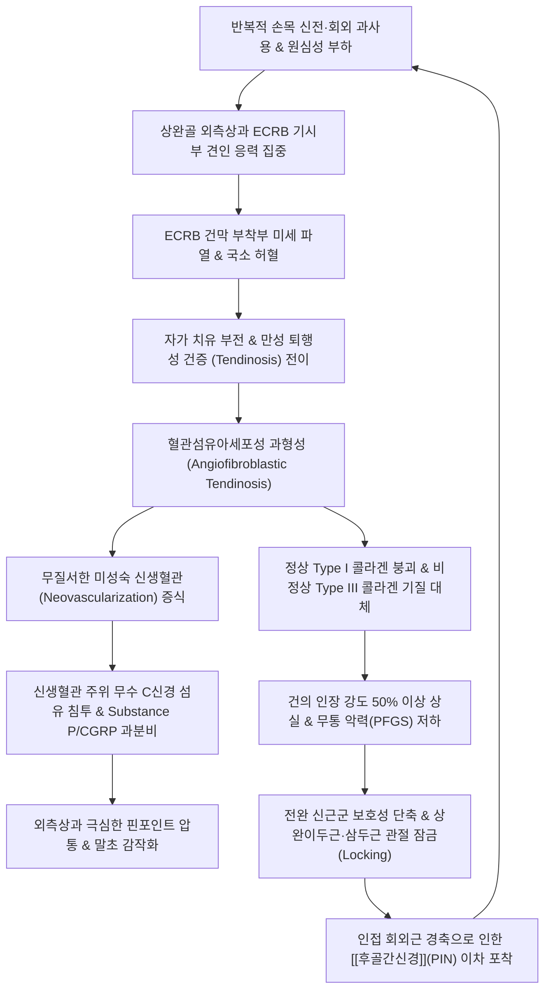

# 🎾 [[외측상과염]] (Lateral Epicondylitis / 테니스 엘보, M77.1)

> **핵심 3줄 요약 (Key Summary)**:
> - 📍 병소 부위 & 해부·병태생리: [[주관절]] [[상완골]] 외측상과(Lateral Epicondyle)에 부착하는 총신근건(Common Extensor Tendon, CET), 특히 **[[단요측수근신근]](Extensor Carpi Radialis Brevis, ECRB)** 기시부의 만성 미세파열 및 혈관섬유아세포성 과형성(Angiofibroblastic hyperplasia, Nirschl 1~4단계)을 본태로 하는 비염증성 건증(Tendinosis). [[요골두]] 외측면과의 마찰, 불완전 자가 치유 및 Type III 콜라겐 대체에 의한 구조적 취약성.
> - 🚩 전형적 임상 양상 & 3대 징후: [[상완골]] 외측상과 전하방 1~2cm 지점의 극심한 국소 핀포인트 압통(Pinpoint tenderness), 손목 신전 및 강력 파지(Grip) 시 외측 주관절 방사통, 무통 악력(Pain-free Grip Strength, PFGS)의 급격한 저하 및 찻잔·프라이팬을 들 때의 낙하 탈력감.
> - 🛠️ 핵심 감별 검사 & 한·양방 다각적 치료 전략: [[코젠 검사]](Cozen's test), [[밀 검사]](Mill's test), [[체어 검사]](Chair test), [[마우슬리 검사]](Maudsley's test) 양성. 초음파 유도하 심부 근막 침도([[도침]]) 미세 절개 박리술, 고농도 [[봉약침]] 및 [[신바로약침]], Mulligan MWM 도수 가동술, 원심성 타일러 트위스트(Tyler Twist with FlexBar), 체외충격파([[체외충격파]], ESWT) 및 [[서경탕]]·[[독활기생탕]].
> - <font color="#fa7e7e">⚠️ 응급 의뢰 레드플래그 & 악화 요인: ECRB 건의 50% 이상 부분 파열 및 전층 파열 결손, 외측상과 원위 4~5cm 회외근 부위의 [[요골관 증후군]](RTS) 및 [[후골간신경]](PIN) 포착 병발, 외측측부인대(LUCL) 복합체 손상에 따른 후외측 회전 불안정성(PLRI), [[상완골]] 소두 박리성 골연골염([[박리성 골연골염]], OCD)에 의한 관절 잠김(Locking).</font>

---

## 📌 목차
1. [질환 개요 & 해부학적 병태생리](#1-질환-개요--해부학적-병태생리)
2. [병태생리 메커니즘 & 생체역학적 악순환 네트워크](#2-병태생리-메커니즘--생체역학적-악순환-네트워크)
3. [임상 증상 & 이학적 검사(Physical Exam) 알고리즘](#3-임상-증상--이학적-검사physical-exam-알고리즘)
4. [감별 진단 매트릭스 (Differential Diagnosis)](#4-감별-진단-매트릭스-differential-diagnosis)
5. [한의 통합 치료 프로토콜 (침·약침·[[추나]]·한약)](#5-한의-통합-치료-프로토콜-침약침[[추나]]한약)
6. [양방 치료 & 병용·의뢰 기준 (Conventional Treatment & Referral)](#6-양방-치료--병용의뢰-기준-conventional-treatment--referral)
7. [재활 운동 & 생활습관 티칭 가이드](#7-재활-운동--생활습관-티칭-가이드)
8. [💡 사용자 진료실 핵심 필기 & 임상 노하우 (Melt-In 잔여 심화 집약)](#8--사용자-진료실-핵심-필기--임상-노하우-melt-in-잔여-심화-집약)
9. [출처 및 학술 참고 문헌 (References)](#9-출처-및-학술-참고-문헌-references)

---

## 1. 질환 개요 & 해부학적 병태생리

### 1) 질환의 정의 및 임상적 역학
* **정의**: 외측상과염(Lateral Epicondylitis / Lateral Elbow Tendinopathy), 통칭 **테니스 엘보(Tennis Elbow)**는 상완골 외측상과(Lateral Epicondyle)에 기시하는 전완 신근군-회외근 복합체의 공통 신근건(Common Extensor Tendon, CET), 특히 **[[단요측수근신근]](Extensor Carpi Radialis Brevis, ECRB)** 기시 건막의 반복적인 과사용(Overuse), 원심성 인장 과부하(Eccentric tensile overload), 미세 열상(Micro-tearing)으로 인해 발생하는 만성 퇴행성 건병증(Tendinosis)이다.
* **임상적 역학**:
  * 주관절에 발생하는 건병증 중 가장 흔한 질환으로, 전체 인구의 1~3%가 일생 중 경험하며 [[내측상과염]](골퍼 엘보)보다 약 5배에서 10배가량 호발한다.
  * **호발 연령 및 성별**: 40~50대(전체 환자의 75% 이상) 중장년층에서 호발하며, 남녀 간 발생 비율은 대등하다. 지배 손(우세측 상지)에서 75% 이상 발생한다.
  * **직업적 및 스포츠 호발 인자**:
    * 라켓 스포츠(테니스, 배드민턴, 스쿼시) 동호인의 30~50%가 경험하며, 특히 부적절한 백핸드 스트로크(Backhand stroke) 시 손목 신근에 가해지는 강한 충격이 유발 인자이다.
    * 비운동군 환자가 전체 환자의 90% 이상을 차지하며, 컴퓨터 키보드·마우스의 반복 타이핑, 요리사(칼질, 무거운 팬 들기), 목수 및 배관공(드라이버 돌리기, 렌치 조이기), 도축업자, 미용사, 가사노동자 등 전완을 회내·회외시키며 손목을 반복 신전하는 직업군에서 집중 발생한다.

### 2) 주관절 외측 총신근건 복합체의 해부학적 구조와 손상 취약성
* **상완골 외측상과 (Lateral Epicondyle)**:
  * 상완골 원위 외측에 위치한 골성 융기로, 내측상과에 비해 돌출도는 작으나 전완 신근군 전체가 수렴하는 기하학적 중심축이다.
  * 외측상과 전하방의 좁은 접촉면(Footprint)에 여러 건이 빽빽하게 부착하므로 단위 면적당 가해지는 인장 응력(Tensile stress)이 매우 높다.
* **외측 총신근건(CET)의 층별 구성과 관여 근육**:
  1. **[[단요측수근신근]](Extensor Carpi Radialis Brevis, ECRB)**:
     * **손상 관여율 90~95%의 압도적 핵심 병소**.
     * 기시부는 외측상과의 전하방 능선에 위치하며, 주관절 [[관절낭]](Joint capsule) 및 외측측부인대(LCL)와 심부에서 단단히 유착되어 있다.
     * 해부학적으로 [[요골두]](Radial head)의 외측 융기부를 활주하듯 덮고 지나가므로, 주관절 굴신 및 전완 회전 시 [[요골두]] 골표면과 지속적인 기계적 마찰(Frictional abrasion)과 전단력(Shear stress)에 노출된다.
     * 건-골 부착부(Enthesis)로부터 근위 1~2cm 부위는 혈관 분포가 희소한 **임계 저혈관 구역(Hypovascular watershed zone)**으로 확인되어 미세 손상 후 자가 치유 능력이 극히 결여되어 있다.
  2. **[[총지신근]](Extensor Digitorum Communis, EDC)**:
     * 전체 외측상과염의 약 30~40%에서 ECRB와 결합된 건막 형태로 동반 손상된다. 제2~5수지의 중수수지관절(MCP) 신전을 담당한다.
  3. **[[장요측수근신근]](Extensor Carpi Radialis Longus, ECRL)**:
     * 상완골 외측상과 상릉(Lateral supracondylar ridge)의 근위 1/3에서 기시하여 제2중수골 저부에 정지한다. 기시부가 상과 본체보다 근위에 넓게 퍼져 있어 ECRB에 비해 기계적 스트레스가 적게 집중된다.
  4. **[[척측수근신근]](Extensor Carpi Ulnaris, ECU)**:
     * 외측상과의 후하방에서 기시하여 손목의 신전 및 척측 편위를 담당하며, 외측상과염보다는 수근관절 척측 통증과 연관되는 경우가 많다.
  5. **[[상완요골근]](Brachioradialis)** 및 **[[회외근]](Supinator)**:
     * 상완요골근은 ECRL 근위부 상완골 외측 상릉에서 기시하여 요골 경상돌기에 부착하며 전완 중립위 굴곡을 담당한다.
     * 회외근은 외측상과, 외측측부인대, 척골 회외근릉에서 기시하여 요골 상부를 감싸며, 심부 근섬유 사이로 [[후골간신경]](PIN)이 관통한다.

```
[ 상완골 외측상과 총신근건(CET) 및 주변 관절 구조 ]

               ┌── 상완골 외측상과 (Lateral Epicondyle) ──┐
               │                                          │
       [표재층 건 복합체]                        [심층 관절 및 인대 구조]
       ├─ [[장요측수근신근]](ECRL) (상릉 기시)   ├─ 주관절 외측 [[관절낭]] (Joint capsule)
       ├─ [[총지신근]](EDC) (표재 중앙)          ├─ 요골측부인대 (RCL)
       ├─ [[단요측수근신근]](ECRB) (전하방 핵심) ├─ 외측척측측부인대 (LUCL - 회전안정자)
       └─ [[척측수근신근]](ECU) (후하방)         └─ 윤상인대 (Annular ligament)
               │                                          │
               └──────── [요골두(Radial head) 통과] ──────┘
                                  │
                      [원위 3~5cm 심부 주행]
                                  │
                  [[요골신경]](Radial n.) 심부지 -> [[후골간신경]](PIN)
                  (회외근 프로세 아케이드 Arcade of Frohse 통과)
```

### 3) 인접 신경·인대 구조물과의 해부학적 상호관계
* **외측 측부인대 복합체 (Lateral Collateral Ligament Complex, LCLC)**:
  * 요골측부인대(RCL), 윤상인대(Annular ligament), 부외측측부인대(ALCL), **외측척측측부인대(Lateral Ulnar Collateral Ligament, LUCL)**로 구성된다.
  * ECRB 기시 건막의 심층 섬유는 RCL 및 [[관절낭]]과 직접 융합되어 있으므로, 외측상과염의 만성 변성이 심층으로 침습할 경우 외측 관절낭 이완 및 미세 불안정성을 초래한다.
  * 특히 외측상과염 수술이나 과격한 침도 시술 시 LUCL이 손상되면 주관절의 후외측 회전 불안정성(Posterolateral Rotatory Instability, PLRI)이라는 치명적 합병증이 발생할 수 있다.
* **[[요골신경]](Radial Nerve) 및 [[후골간신경]](PIN)**:
  * 요골신경 본간은 상완골 나선고랑을 지나 외측 근간중격을 뚫고 전완 전외측으로 주행한 뒤, 상완골 소두 전방에서 천부 감각지(SBRN)와 심부 운동지([[후골간신경]], PIN)로 양분된다.
  * PIN은 요골두 전면을 활주하여 [[단요측수근신근]](ECRB)의 내측 연을 스치고 [[회외근]](Supinator) 상연의 섬유성 아치인 **프로세 아케이드(Arcade of Frohse)** 속으로 진입한다.
  * ECRB의 만성 염증, 비후, 단축성 긴장은 PIN을 직접 압박하거나 요골관(Radial tunnel)을 협착시켜 [[요골관 증후군]](RTS)을 병발시키는 주원인이 된다.

---

## 2. 병태생리 메커니즘 & 생체역학적 악순환 네트워크

### 1) ASCII 병태생리 다이어그램
```
+-------------------------------------------------------------------------+
|        반복적 손목 신전·회외 작업 / 라켓 백핸드 충격 / 불량한 파지 자세          |
+-------------------------------------------------------------------------+
                                     │
                                     ▼
+-------------------------------------------------------------------------+
|     상완골 외측상과 ECRB 부착부(Enthesis)에 원심성 인장 전단력(Shear) 집중        |
+-------------------------------------------------------------------------+
                                     │
                                     ▼
+-------------------------------------------------------------------------+
|          건 미세 섬유 단열 (Micro-tears) 및 국소 저혈관 부위 허혈 유발           |
+-------------------------------------------------------------------------+
                                     │
                                     ▼
+-------------------------------------------------------------------------+
|    불완전 치유의 악순환: 혈관섬유아세포성 과형성 (Angiofibroblastic Hyperplasia)  |
|  - 염증 세포(중성구/대식세포) 부재 -> 무균성 퇴행성 건병증(Tendinosis) 고착     |
|  - Type I 강인 콜라겐 소실 -> Type III 미성숙 콜라겐 및 점액성 기질 대체        |
|  - 구조적 결손을 메우기 위한 미성숙 신생 혈관망(Neovascularization) 무질서 증식   |
+-------------------------------------------------------------------------+
                                     │
                                     ▼
+-------------------------------------------------------------------------+
|    신생 혈관망을 따라 무수 C신경 섬유 & Substance P / CGRP 통각 수용체 동반 증식    |
|  - 미세한 기계적 인장 자극에도 극심한 통증 유발 (말초 감작화 Peripheral Sensitization)|
+-------------------------------------------------------------------------+
                                     │
                                     ▼
+-------------------------------------------------------------------------+
|   신전근군 보상적 반사성 경축 -> 주관절 잠금(Locking) -> 원심성 부하 폭증      |
|   회외근 과긴장으로 요골관 협착 -> [[후골간신경]](PIN) 신경포착성 통증 병발     |
+-------------------------------------------------------------------------+
                                     │
                                     └───────────► (악순환 네트워크 고착)
```

### 2) 생체역학적 악순환 네트워크 (Mermaid)


### 3) 만성 건병증(Tendinosis)의 병리조직학적 특징: Nirschl 병기 분류
* **염증(Itis)이 아닌 퇴행성 건증(Osis)**:
  * 전통적으로 '상과염'이라는 명칭이 사용되었으나, 조직생검 연구에 따르면 급성 염증의 전형적 소견인 중성구(Neutrophil), 림프구(Lymphocyte) 등의 염증 세포 침윤은 거의 관찰되지 않는다.
  * 본태는 세포외 기질(ECM)의 점액성 변성(Mucoid degeneration), 섬유아세포의 비정상적 과증식, 그리고 기능적 효율이 없는 미성숙 모세혈관의 무질서한 증식을 특징으로 하는 **혈관섬유아세포성 과형성(Angiofibroblastic hyperplasia)**이다 (Nirschl & Pettrone, 1979).
* **니어슐 4단계 병기 분류 (Nirschl Staging)**:
  * **1단계 (가역적 미세 염증기)**: 초기 과사용 후 가벼운 부종과 경미한 미세 파열이 발생하나, 적절한 휴식과 보존적 치료로 완전 가역적 회복이 가능한 상태. 활동 후 뻐근함 호소.
  * **2단계 (비가역적 혈관섬유아세포성 과형성기, 호발기)**: 미세 파열이 누적되어 정상 제1형 콜라겐이 파괴되고, 제3형 미성숙 콜라겐과 신생혈관이 기질을 채우는 비가역적 건증 단계. 휴식 시에도 통증이 지속되며 일상생활 장애 발생.
  * **3단계 (건 조직 부분/전층 파열기)**: 변성된 건 섬유의 인장 강도가 한계를 넘어 구조적 연속성이 단열되는 단계. ECRB 건 실질의 부분 파열 또는 전층 결손이 발생하며 근력 약화가 뚜렷함.
  * **4단계 (골극 및 석회화 동반기)**: 3단계 병변과 함께 건 부착부의 만성 견인성 골극(Traction spur), 골막 반응, 건 실질 내 이소성 석회화(Calcification)가 동반된 만성 불응성 단계.

### 4) 신생신경 침투와 통각 과민 기전 (Neurovascular Ingrowth)
* 정상적인 건 조직은 무혈관·무신경 구조에 가깝지만, 혈관섬유아세포성 과형성이 진행되면 VEGF(혈관내피성장인자)와 NGF(신경성장인자)가 대량 분비된다.
* 이에 반응하여 모세혈관과 함께 자율신경 및 무수 C신경 섬유가 건 실질 심부로 침투한다.
* 침투한 C신경 말단에서 통증 전달 신경전달물질인 **Substance P**와 **CGRP(Calcitonin Gene-Related Peptide)**가 지속 방출되어 기계적 자극 역치가 극도로 낮아지는 **말초 감작화(Peripheral sensitization)**가 완성된다. 환자가 가벼운 접촉이나 가벼운 컵 들기에도 깜짝 놀랄 만한 격통을 느끼는 생리학적 이유이다.

### 5) 초음파 해부학적 3대 병태 아형 분류 (진료실 맞춤형)
1. **혈관외형 (Extravascular / Peritendinous Type)**:
   * 병변이 ECRB 건막 표재층 및 외측상과 피질골 외측면에 국한된 형태로, 건 부착부 골막 비후와 표재성 신생혈관이 주소견. 침도 골막 박리술과 봉약침에 매우 빠른 반응을 보인다.
2. **관절내형 (Intra-articular / Deep Capsular Type)**:
   * 병변이 ECRB 심층 및 주관절 관절낭, 요골두 연골면 부근으로 침습된 형태. 관절 내 수종과 윤활막염이 동반되며 주관절 신전 시 깊은 둔통을 유발한다. 침도 관절낭 간극 감압술 및 심부 약침 주입이 요구된다.
3. **혼합형 (Mixed Type)**:
   * 표재성 건막 비후와 심부 관절낭 유착, ECRB 건 실질 내 부분 파열이 복합된 난치성 형태로 정밀한 층별 복합 중재가 필수적이다.

---

## 3. 임상 증상 & 이학적 검사(Physical Exam) 알고리즘

### 1) 주요 임상 증상
* **외측 주관절의 날카로운 통증**:
  * 상완골 외측상과 주변에 찌르는 듯하거나 타는 듯한 통증 발생.
  * 손목을 뒤로 젖히거나(신전), 물건을 강하게 움켜쥐거나(파지), 전완을 비트는(회내/회외) 동작 시 통증이 전완 배외측 신근군을 따라 손목 방향으로 방사된다.
* **특징적 일상생활 악화 동작**:
  * 아침에 무거운 냄비나 프라이팬을 한 손으로 들 때.
  * 커피잔이나 물컵을 집어 올릴 때 갑자기 팔꿈치에 전기가 통하듯 힘이 빠지며 컵을 떨어뜨림.
  * 문손잡이를 바깥쪽으로 돌리거나 열쇠를 돌릴 때, 젖은 행주나 걸레를 비틀어 짤 때.
  * 다른 사람과 악수할 때, 컴퓨터 마우스를 클릭하거나 드래그할 때.
* **국소 압통 (Pinpoint Tenderness)**:
  * 외측상과 골성 정점에서 전하방으로 약 1~2cm 떨어진 ECRB 건 기시부를 손가락 끝으로 압박하면 환자가 펄쩍 뛸 정도의 극심한 국소 압통이 확인된다.
* **무통 악력 (Pain-Free Grip Strength, PFGS) 저하**:
  * 환자는 통증으로 인해 주먹을 꽉 쥐지 못하며, 건측 대비 환측 악력이 30~50% 이상 감소한다.

### 2) 특이적 이학적 유발 검사 (Physical Examination)
1. **[[코젠 검사]](Cozen's Test - 능동 수축 유발 검사)**:
   * **수기법**: 환자는 주관절을 90° 굴곡하고 전완을 회내(Pronation)시킨 상태에서 가볍게 주먹을 쥔다. 검사자는 한 손으로 환자의 상완골 외측상과를 촉진하여 고정하고, 다른 손으로 환자의 손등을 아래로 누른다. 이때 환자에게 검사자의 저항에 맞서 **손목을 위로 강하게 젖히도록(저항성 손목 신전)** 지시한다.
   * **양성 판정**: 외측상과 ECRB 부착부에 즉각적인 날카로운 격통 발생 (민감도 84~91%, ECRB 능동 수축 부하 검사).
2. **[[밀 검사]](Mill's Test - 수동 신장 유발 검사)**:
   * **수기법**: 검사자가 환자의 주관절을 완전히 신전(Full Extension)시키고, 전완을 최대로 회내(Pronation)시킨 상태에서, 환자의 손목과 손가락을 손바닥 방향으로 끝까지 수동 굴곡(Passive Wrist Flexion)시킨다.
   * **양성 판정**: ECRB를 포함한 신근건 복합체가 최대로 신장되면서 외측상과 부착부에 극심한 당김 통증 발생 (특이도 88~93%).
3. **[[체어 검사]](Chair Test / Chair Lift Test)**:
   * **수기법**: 환자에게 의자 등받이 뒤에 서서 팔꿈치를 곧게 펴고 손바닥이 아래를 향하도록(전완 회내위) 한 상태에서 손가락과 손목의 힘만으로 가벼운 의자를 들어 올리도록 한다.
   * **양성 판정**: 들어 올리는 순간 외측상과에 찌릿한 격통이 발생하며 의자를 떨어뜨림.
4. **[[마우슬리 검사]](Maudsley's Test / 제3수지 저항 신전 검사)**:
   * **수기법**: 환자의 팔꿈치를 편 상태에서 검사자가 세 번째 손가락(중지, Middle finger)의 근위지절간관절 배측을 누르고, 환자에게 중지를 위로 들어 올리도록 저항을 가한다.
   * **양성 판정 및 의의**: 중지 신전 시 외측상과에 통증이 유발되면 양성. 중지 신전은 ECRB와 EDC에 직접적인 부하를 가하므로, 양성일 경우 ECRB 건병증 또는 인접 요골관의 [[후골간신경]](PIN) 압박을 강력히 시사한다.

```
[ 외측상과염 진단 및 감별 진단 흐름도 ]

                 주관절 외측 통증 환자 내원
                            │
                            ▼
           외측상과 전하방 1~2cm 국소 압통 검사
             ┌──────────────┴──────────────┐
           [양성]                        [음성]
             │                             │
    [[코젠 검사]] / [[밀 검사]]           외측 관절선 압통 및 방사통 평가
             │                             │
     ┌───────┴───────┐             ┌───────┴───────┐
   [양성]          [음성]         [관절선 압통]    [전완 방사통]
     │               │             │               │
  외측상과염 확진  비전형 건증     외측측부인대(LUCL) [[경추]] C6 신경근증
     │            추가 평가        박리성 골연골염  (스펄링 검사)
     │
     ▼
외측상과 원위 4~5cm 압통 확인 (요골관 감별)
     │
     ├─ [양성]: [[요골관 증후군]](RTS) 복합 이환 감별 (중지 저항 신전 방사통)
     └─ [음성]: 순수 [[외측상과염]] (단요측수근신근 건증)
```

### 3) 영상의학적 평가 기준
* **단순 방사선 검사 (X-ray, AP/Lateral/Oblique)**:
  * 대개 정상 소견을 보이나, 만성 환자의 20~25%에서 외측상과 견인성 골극(Traction osteophyte), 피질골 경화, 건 부착부 석회 침착이 관찰된다. 관절 내 유리체, 퇴행성 골관절염, 박리성 골연골염 배제에 필수적이다.
* **근골격계 초음파 (Musculoskeletal Ultrasound)**:
  * 외측상과염의 1차 표준 영상 진단 도구.
  * **주요 소견**:
    1. ECRB 건 기시부의 비후 (건 두께 > 4.5mm).
    2. 정상적인 섬유상 음영(Fibrillar pattern) 소실 및 국소 저에코성 병변(Hypoechogenicity).
    3. 건 실질 내 부분 파열(Anechoic cleft / Tear defect) 및 피질골 표면의 불규칙성(Cortical irregularity).
    4. 파워 도플러(Power Doppler) 상 신생혈관 증식(Neovascularity) 확인.
* **자기공명영상 (MRI)**:
  * T1 강조 영상에서 건 비후 및 저신호, T2 및 지방억제 조영증강 영상에서 ECRB 기시부의 뚜렷한 고신호강도(High signal intensity)를 나타내며, 관절낭 파열, LUCL 손상, 관절 연골 결손 유무를 가장 정확히 감별한다.

---

## 4. 감별 진단 매트릭스 (Differential Diagnosis)

| 감별 질환 | 호발 병소 및 병태생리 | 주소증 및 통증 양상 | 특이적 이학적 검사 | 결정적 감별 포인트 |
| :--- | :--- | :--- | :--- | :--- |
| **[[외측상과염]]** (본 질환) | 상완골 외측상과 공통신근건([[단요측수근신근]]) 기시부 건증 | 외측상과 전하방 1~2cm 핀포인트 압통, 손목 신전·파지 시 통증 | [[코젠 검사]](+), [[밀 검사]](+), [[체어 검사]](+) | 뼈 부착부의 극심한 국소 압통, 초음파상 ECRB 비후 및 신생혈관 |
| **[[요골관 증후군]]** (RTS) | 외측상과 원위 3~5cm 요골관 내 [[후골간신경]](PIN) 압박 | 전완 배외측 심부 둔통, 야간통, 손목 배측 방사통 | 원위 4~5cm 압통, 중지 저항 신전 시 통증, 회외 저항통 | 외측상과 자체 압통 없음, 신경병증성 방사통, 운동 마비 없음 |
| **[[후골간신경 증후군]]** (PINS) | 회외근 프로세 아케이드 통과부 PIN 축삭 마비 | 통증은 경미하거나 무통, 손가락 펴기 불능(Finger drop) | MP 관절 신전력 소실, 손목 요측 편위 신전(ECRL 보존) | 순수 운동 신경 마비, 근전도상 탈신경 전위(Denervation) |
| **[[상완요골근 증후군]]** | 상완골 외측 상릉 및 상완요골근 근복 TrP | 전완 외측 근복부 당김통, 요골 경상돌기 견인통 | 중립위 주관절 굴곡 저항 검사(+), 상완요골근 파지통 | 손목 신전통 없음, 전완 중립 굴곡 시 통증 발현 |
| **[[경추]] C6 신경근병증** | [[경추]] C5-C6 추간판 탈출 또는 추간공 협착 | 목·어깨 통증과 함께 상완 외측, 전완, 엄지·검지 방사통 | [[스펄링 검사]](Spurling)(+), 상완이두근 건반사(BDR) 저하 | 경추 움직임에 따른 통증 유발, 감각 둔마 및 피부분절 이상 |
| **주관절 외측 불안정성** (PLRI / LUCL 파열) | 외측척측측부인대(LUCL) 손상 및 관절낭 파열 | 바닥을 짚고 일어설 때 팔꿈치 빠지는 느낌, 덜컹거림 | 외측 피벗 시프트(Lateral pivot-shift test)(+), 의자 밀기 검사(+) | 외반·회외 복합 부하 시 관절 아탈구 재현, 초음파상 인대 결손 |
| **박리성 골연골염** ([[박리성 골연골염]], OCD) | 상완골 소두(Capitellum) 골연골층 무혈관성 괴사 | 청소년 야구 투수/체조 선수, 주관절 신전 제한, 관절 잠김(Locking) | 관절선 압통, 관절 가동 시 마찰음(Crepitus), 굴신 제한 | X-ray/MRI상 소두 연골 결손 및 관절 내 유리체 확인 |

---

## 5. 한의 통합 치료 프로토콜 (침·약침·[[추나]]·한약)

### 1) 한의학적 병인 및 변증 체계
* **기체어혈(氣滯瘀血)**:
  * 급격한 원심성 충격이나 반복 과부하로 인해 경맥이 파열되고 어혈이 맺힌 상태. 외측상과 국소가 찌르듯 아프고(자통, 刺痛), 통증 부위가 고정되어 있으며 야간에 악화(거안, 拒按).
* **근맥노손(筋脈勞損)**:
  * 장기간의 과사용으로 인해 수양명경근(手陽明經筋)이 지속적으로 견인 피로를 겪어 근맥이 유양을 잃고 굳어진 상태. 팔을 쓰면 아프고 쉬면 덜하나 점차 만성화됨.
* **풍한습비(風寒濕痺)**:
  * 외측상과 손상 부위에 찬 기운과 습기가 침습하여 기혈 순환이 장애된 상태. 궂은날이나 찬바람을 쐬면 팔꿈치가 시리고 쑤시며 따뜻하게 찜질하면 완화.
* **간신부족(肝腎不足) / 기혈양허(氣血兩虛)**:
  * 40대 이후 간주근(肝主筋), 신주골(腎主骨) 기능 감퇴로 건과 인대의 교원질 합성이 저하된 퇴행성 건병증. 사소한 일상 동작에도 쉽게 재발하며 전신 피로 동반.

### 2) 침구 치료 (Acupuncture & Electroacupuncture)
* **주요 혈위 구성**:
  * **[[곡지]](LI11)**: 수양명대장경의 합혈. 주관절 외측 횡문두에 위치하여 외측상과 주변의 풍열과 어혈을 제거하고 국소 미세 혈류를 개선하는 요혈.
  * **[[수삼리]](LI10)**: 곡지 하방 2촌. ECRB 및 총지신근 근복부의 핵심 [[트리거포인트]]로, 신근군의 과긴장을 해소하여 기시부 인장력을 직접 감압.
  * **[[주료]](LI12)**: 상완골 외측상과 상연. 상완삼두근 외측두 및 ECRL 기시부 장력을 이완.
  * **[[수오리]](LI13)**: 곡지 상방 3촌. 요골신경 주행로 상의 경결을 해소하여 상지 전체의 신경-근육 활주 촉진.
  * **[[외관]](TE5)** 및 **[[양지]](TE4)**: 수소양삼초경의 낙혈 및 원혈. 손목 신전건의 종지부 긴장을 풀어 상하 균형 조율.
  * **[[척택]](LU5)**: 수태음폐경 합혈. 상완요골근과 회내근의 길항적 텐션을 해소하여 주관절 밸런스 확보.
* **[[전침]] 요법 (Electroacupuncture)**:
  * 곡지(LI11)와 수삼리(LI10) 또는 ECRB 건-근 접합부에 자침 후 [[전침]] 통전.
  * **파형 세팅**: 2Hz 저주파는 내인성 오피오이드(β-endorphin, Enkephalin) 분비를 유도하여 장기적 진통 및 조직 회복을 유도하고, 100Hz 고주파는 척수 후각 통증 관문을 차단한다. 2/100Hz 혼합파(Dense-Disperse Wave)를 15~20분간 적용하여 통증 역치를 신속히 개선한다.

### 3) 초음파 유도하 미세침도 요법 (Acupotomy)
* **임상적 의의 및 적응증**:
  * 3개월 이상의 보존적 요법에도 호전되지 않는 만성 섬유화 유착성 외측상과염, Nirschl 2~3단계 건증.
  * **최신 RCT 근거 (Zhang et al., 2026)**: 근골격계 초음파 유도하에 외측상과염 환자를 대상으로 심부 근막층(Deep Fascial Layer, ECRB 기시 건막 및 관절낭 유착 부위) 침도 절개군과 천부 근막층 절개군을 비교한 결과, 심부 근막 절개군이 12개월 장기 추적에서 VAS 통증 점수 감소, PRTEE 기능 점수 개선, 파워 도플러 신생혈관 소실률에서 통계적으로 현저한 우월성을 입증함.
* **해부학적 시술 술식**:
  * 환자의 주관절을 90° 굴곡하고 전완을 회내시켜 외측상과를 전상방으로 노출한다.
  * 초음파 종축 스캔으로 ECRB 건의 저에코성 변성 부위 및 요골두 관절면, LUCL의 위치를 명확히 식별한다.
  * 0.35×40mm 또는 0.40×40mm 소평인 침도를 외측상과 ECRB 부착부 골막면을 향해 수직 자입한다.
  * **혈관외형 술식**: 뼈에 침 끝이 닿는 골성 저항감(Bone touch)을 확인한 뒤, 건 섬유 주행 방향과 평행하게 종축으로 2~3회 미세 절개 및 골막 박리(Peeling)를 시행하여 내부 장력을 분산한다.
  * **관절내형 술식**: ECRB 심층과 관절낭 사이의 유착 간극으로 진입하여 미세 횡진동 박리를 가해 관절낭 유착을 해소한다.
  * ⚠️ **주의사항**: 침도 날을 횡방향으로 크게 휘두르면 건 섬유의 횡단 파열이나 LUCL 손상을 초래하므로 절대 금기이며, 반드시 종축 미세 절개 원칙을 준수한다.

### 4) 경피적 건침 요법 (Dry Needling) & 다기관 임상 근거
* **최신 다기관 RCT 근거 (Dunning et al., 2024, Clin Rehabil)**:
  * 외측상과염 환자 143명을 대상으로 ECRB 기시부 경피적 건침(Dry Needling) 및 흉추/주관절 도수 조작술을 다중모달 물리치료와 병용한 대규모 다기관 임상시험.
  * **주요 임상 지표**:
    * 3개월 시점 진통제 완전 중단율: **72.6% vs 38.6%** (건침군이 대조군 대비 약 2배 우수).
    * 환자 전체 호전율 (GRC ≥ +5): **78% vs 36%**.
    * 치료 필요 환자 수 (NNT): PRTEE 50% 개선 기준 **1.9 (95% CI 1.5~2.5)**, GRC 기준 **2.4 (1.8~3.6)**로 근골격계 중재술 중 극히 드문 강력한 치료 효과 입증.
    * 이상반응: 경미한 국소 근육통(43.8%), 일시적 피하 멍(17.8%) 외 중대 이상반응 전무.

### 5) 약침 및 봉약침 치료 (Pharmacopuncture)
* **봉약침 (Sweet Bee Venom, BV)**:
  * **약리 기전**: 멜리틴(Melittin)과 아파민(Apamin) 성분이 강력한 항염증 작용을 발휘하며, 변성 건 조직 주위에 무질서하게 증식한 무수 C신경 섬유의 통각 과민 전달을 차단한다.
  * **시술법**: 1:10,000~1:30,000 정제 봉약침을 외측상과 ECRB 기시부 주변 결합조직과 곡지, 수삼리에 포인트당 0.05~0.1cc씩 분할 주입 (총 0.3~0.5cc). 건 실질 내 직접 고압 주입은 피하고 건초 주위(Peritendinous) 침윤을 시행한다.
* **신바로약침 / 중성어혈약침**:
  * GCSB-5 성분의 신바로약침은 염증성 사이토카인(TNF-α, IL-1β)을 억제하고 연골 및 콜라겐 기질을 보호한다.
  * 급성기 열감 및 부종에는 신바로약침을, 만성 난치성 섬유화 단계에는 중성어혈약침을 초음파 유도하에 ECRB 건 주위로 0.5~1.0cc 주입하여 국소 미세 순환을 복원한다 (Ahn et al., 2025).

### 6) 추나 요법 및 관절 가동술 (Chuna & Manipulation)
* **상완이두근·삼두근 외측두 근막 이완술 (Myofascial Release)**:
  * 만성 테니스 엘보 환자는 주관절을 굴신시키는 [[상완이두근]] 외측연과 [[상완삼두근]] 외측두가 단축되어 주관절의 미세 가동성이 잠기게(Locking) 된다.
  * 시술자가 주관절 상부의 이두근-삼두근 근간중격을 심부 압박 이완하여 주관절 락킹을 선제적으로 해제하면, ECRB 기시부에 가해지는 지레대 인장 응력이 즉각 감소한다.
* **밀 조작술 (Mill's Manipulation)**:
  * 환자의 팔꿈치를 신전하고 전완을 회내, 손목을 최대로 굴곡시킨 상태에서 손목 신근건의 섬유성 반흔을 향해 순간적인 고속-저진폭(HVLA) 신장 조작을 가하여 유착된 콜라겐 교차결합을 미세 분리한다.
* **멀리건 관절 가동술 (Mulligan Mobilization with Movement, MWM)**:
  * 시술자가 한 손으로 상완골 원위부를 고정하고 다른 손으로 전완 근위부를 외측 또는 내측으로 활주(Lateral/Medial Glide)시킨 상태를 유지하면서, 환자에게 통증이 발생하던 손목 신전 또는 악력 동작을 능동적으로 수행하도록 한다.
  * 즉각적인 무통 악력(PFGS) 증가를 유도하며 주요 관절 정렬 이상을 교정한다.

### 7) 변증별 맞춤 한약 처방 (Herbal Medicine)
* **기체어혈 (氣滯瘀血)**:
  * 급성 손상, 야간 자통, 통처 고정.
  * **[[서경탕]](舒經湯)** 가감: 강황, 당귀, 적작약, 백출, 해동피, 계지 등으로 구성되어 상지 경락의 어혈과 경련을 풀고 국소 순환을 촉진.
  * **[[당귀수산]](當歸鬚散)**: 타박 미세 손상 및 급성 부종 해소.
* **근맥노손 & 간신부족 (筋脈勞損 & 肝腎不足)**:
  * 3개월 이상 지속된 만성 퇴행성 테니스 엘보, 중장년층 건증.
  * **[[독활기생탕]](獨活寄生湯)**: 두충, 속단, 우슬, 상기생, 당귀, 백작약 등을 증량하여 손상된 건 조직의 교원질 합성을 촉진하고 간신 음혈을 보강.
  * **보혈영근탕(補血榮筋湯)**: 혈허로 인한 완고한 근육 위축 및 파지 탈력감 치료.
* **풍한습비 (風寒濕痺)**:
  * 한냉 자극 시 통증 악화, 궂은날 쑤심.
  * **[[오적산]](五積散)**: 한습 기운을 몰아내고 기혈을 조화롭게 순환시킴.

---

## 6. 양방 치료 & 병용·의뢰 기준 (Conventional Treatment & Referral)

### 1) 약물 치료 (Medication)
* **경구 NSAIDs (비스테로이드성 소염진통제)**:
  * **국내 다빈도 처방**: Aceclofenac 100mg bid, Celecoxib 200mg qd, Pelubiprofen 30mg tid, Meloxicam 7.5~15mg qd 등을 1~2주간 단기 투여.
  * **임상적 한계**: 외측상과염의 본태는 비염증성 건증(Tendinosis)이므로 장기적인 NSAIDs 복용은 통증 완화 효과가 미미하며, 오히려 건 세포의 콜라겐 합성 및 조직 리모델링을 저해할 수 있다. 한의 치료 진입 시 1~2주 내로 점진적 복용 중단을 유도한다.
* **진통제 및 근이완제**:
  * Tramadol/Acetaminophen 복합제(울트라셋 등) 단기 처방, Eperisone HCl 50mg tid로 전완 근육 경축 완화.

### 2) 비약물 시술 및 물리치료 (Procedures & Modalities)
* **전완 대항력 보조기 (Counterforce Brace / Elbow Strap)**:
  * 외측상과 정점으로부터 **원위부 2~3cm 지점**의 전완 신근군 근복에 비탄력성 스트랩을 단단히 착용.
  * **작용 기전**: 근육 수축 시 새로운 가상의 기시부(Pseudo-origin)를 형성하여 손목 신전 시 발생하는 인장력이 외측상과 뼈 부착부로 직접 전달되는 것을 30~40% 분산 및 차단.
* **체외충격파 치료 ([[체외충격파]], ESWT)**:
  * 초점형(Focused) 충격파(1,500~2,000타, 0.10~0.25 mJ/mm²)를 ECRB 부착부에 적용하여 미세 기계적 손상을 통한 신생혈관 형성 촉진, 무수 C신경 섬유 탈감작, 정상 콜라겐 재생 유도. 주 1회 간격으로 총 3~5회 시행.

### 3) 주사 요법의 명암과 최신 지견 (Injections)
* **국소 스테로이드 주사의 역설 (Corticosteroid Injection)**:
  * Triamcinolone acetonide 10~20mg을 국소 주입 시, 4~6주 단기 통증 완화는 우수하나, **1년 추적 관찰 시 재발률이 54%**(대기 관찰군 12% 대비)에 달하며 장기적 결과는 위약보다 불량하다 (Coombes et al., 2013, JAMA).
  * 반복 주사 시 건 실질의 괴사, 전층 파열, 피하지방 위축, 피부 영구 탈색(Hypopigmentation)을 유발하므로 2회 이상의 반복 주사는 강력히 금기된다.
* **PRP (Platelet-Rich Plasma, 자가 혈소판 풍부 혈장) 및 프롤로 주사**:
  * 농축된 혈소판 내 성장인자(PDGF, TGF-β, VEGF, IGF-1)를 초음파 유도하에 ECRB 병변 내에 주입하여 건 기질의 생물학적 재생을 촉진. 6개월~1년 이상 장기 추적에서 스테로이드 대비 통증 감소 및 건 구조 회복이 월등히 우수함이 입증됨.

### 4) 수술적 치료 적응증 (Surgical Indication)
* **적응증**:
  * 6~12개월 이상의 적극적인 보존적 치료(한의 치료, 체외충격파, 주사, 운동)에도 불구하고 극심한 통증으로 일상생활 및 직업 수행이 불가능한 경우.
  * 초음파 또는 MRI상 ECRB 건의 50% 이상 부분 파열 또는 전층 결손이 확인된 경우.
* **대표적 술식 (Nirschl Surgical Technique)**:
  * 외측상과 절개를 통해 ECRB 기시부를 노출하고, 회색빛의 퇴행성 혈관섬유아세포성 과형성 조직(건병증 병변)을 완전히 절제한다.
  * 상완골 외측상과 피질골에 미세 천공(Decortication / Drilling)을 가해 골수 내 줄기세포 유출을 유도한 뒤 건을 재건 봉합한다. 최근에는 관절경하 ECRB 유리술(Arthroscopic release)도 다용된다.

### 5) 한의 병용 판단 및 상호작용 (Combination Therapy)
* **병용 가능 및 시너지**:
  * 경구 소염진통제 복용 중인 환자에게 침, 뜸, [[부항]], 추나, 한약([[서경탕]]) 병용은 안전하며 약물 의존도를 신속히 낮추는 이점이 있다.
* **병용 주의 및 시술 대기 기간 (Critical)**:
  * **스테로이드 주사 직후 환자**: 국소 스테로이드 주사를 맞은 지 최소 **4~6주** 이내에는 건 조직의 인장 강도가 극도로 취약해져 있으므로, 외측상과에 대한 강한 침도 시술은 건 파열을 유발할 위험이 있다. 이 시기에는 침도 시술을 엄격히 유예하고 원위부 자침, [[전침]], 가벼운 물리요법만 적용한다.
  * 항응고제 복용 환자는 침도 시술 시 국소 혈종 위험이 있으므로 호침 위주로 치료한다.

### 6) 양방·전문과 의뢰 기준 (Referral Criteria / Red Flags)
* **즉각적인 정형외과 의뢰 트리거**:
  * 1. **건 전층 파열 결손**: 초음파/MRI상 ECRB 건의 완전 파열로 인한 수지 및 수근 신전 근력의 심각한 탈력.
  * 2. **주관절 외측 불안정성 (PLRI)**: 관절이 덜컹거리며 빠지는 느낌, 외측 피벗 시프트 검사 양성.
  * 3. **급성 감염 의심 징후**: 외측 주관절의 급격한 발적, 종창, 국소 열감, 오한 및 발열 (화농성 활액낭염, 봉와직염).
  * 4. **골연골 결손 및 유리체**: 관절 가동 중 딱딱 걸리며 움직이지 않는 관절 잠김(Locking) 현상 (박리성 골연골염 의심).

---

## 7. 재활 운동 & 생활습관 티칭 가이드

### 1) 4단계 기능적 재활 로드맵
```
[ 외측상과염 4단계 기능적 재활 로드맵 ]

  1단계 (급성기: 1~2주)      2단계 (회복기: 3~6주)       3단계 (강화기: 7~10주)      4단계 (복귀기: 11주~)
┌─────────────────────┐   ┌─────────────────────┐   ┌─────────────────────┐   ┌─────────────────────┐
│ • 상대적 안정/보호대│   │ • 수동 신근 스트레칭│   │ • 타일러 트위스트   │   │ • 스포츠 특이적 훈련│
│ • 무통 등척성 수축  │──►│ • 저항 밴드 등척성  │──►│   (원심성 FlexBar)  │──►│ • 작업장 인체공학   │
│   (Isometric)       │   │ • 요골신경 신경활주 │   │ • 덤벨 편심성 운동  │   │   환경 개선         │
│ • 인접 관절 가동성  │   │   (Nerve Flossing)  │   │ • 회외근 근력 강화  │   │ • 재발 방지 루틴    │
└─────────────────────┘   └─────────────────────┘   └─────────────────────┘   └─────────────────────┘
```

* **1단계: 급성기 통증 조절 및 등척성 운동 (1~2주차)**:
  * 통증을 악화시키는 모든 반복적 비틀기 및 무거운 물건 파지 동작을 일시 중단한다.
  * **손목 신근 등척성 수축 (Isometric Wrist Extension)**:
    * 책상에 전완을 얹고 손목을 중립위(0~15° 신전)에 둔다. 반대 손으로 아픈 쪽 손등을 지그시 누르며, 아픈 쪽 손목은 위로 젖히는 힘을 준다. 관절 움직임 없이 10초간 힘을 유지한 뒤 5초간 휴식 (10회씩 3세트). 통증 점수 3점(VAS) 이하 유지.
* **2단계: 수동 신장 및 신경 활주 운동 (3~6주차)**:
  * **전완 신근군 수동 스트레칭**:
    * 아픈 쪽 팔꿈치를 완전히 펴고 손바닥이 아래를 향하도록(회내) 한다.
    * 반대 손으로 아픈 쪽 손등을 잡고 부드럽게 아래쪽으로 꺾으며 안쪽으로 살짝 비틀어 신근건을 길게 늘려준다. 15~30초간 유지, 3~5회 반복.
  * **요골신경 신경가동술 (Radial Nerve Gliding / Flossing)**:
    * 팔을 옆으로 내리고 어깨를 안쪽으로 회전(내회전)한 뒤 손목을 안으로 강하게 꺾고 엄지를 감싸 쥔다.
    * 팔을 뒤로 뻗으며 고개를 반대쪽으로 기울여 신경을 부드럽게 신장시킨 후 원위치하는 동작을 10회 반복하여 요골관 내 신경 유착을 해소한다.
* **3단계: 원심성 근력 강화 (Eccentric Strengthening, 7~10주차 - 핵심)**:
  * **타일러 트위스트 (Tyler Twist with TheraBand FlexBar - 건 재생의 핵심)**:
    1. 아픈 손으로 플렉스바의 아래쪽을 잡고 손목을 최대로 신전(위로 젖힘) 상태로 유지한다.
    2. 건강한 반대 손으로 플렉스바의 위쪽을 잡고, 전방으로 바를 비틀어 비틀림 장력을 가한다.
    3. 양팔을 앞으로 곧게 뻗는다.
    4. 건강한 손은 고정한 채, 아픈 쪽 손목의 저항력을 이용해 손목이 천천히 굴곡되도록 3~5초에 걸쳐 제어하며 풀어준다 (ECRB의 순수 원심성 수축).
    * 매일 15회씩 3세트 시행. 건 세포의 콜라겐 리모델링을 유도하는 가장 검증된 재활 기법.
  * **덤벨 편심성 손목 신전 운동**:
    * 0.5~1kg의 덤벨을 쥐고 전완을 지지한 뒤, 건강한 손으로 손목을 들어 올려 신전시키고, 아픈 손만으로 3~5초에 걸쳐 천천히 내린다.
* **4단계: 플라이오메트릭 및 스포츠 복귀 (11주차 이후)**:
  * 라켓 스윙 궤도 수정, 하프 스윙에서 풀 스윙으로 점진적 복귀.

### 2) 일상생활 및 작업장 인체공학적 티칭
* **대항력 보조기(테니스 엘보 밴드)의 정확한 착용 위치**:
  * ⚠️ **환자들이 흔히 범하는 치명적 오류**: 통증이 있는 외측상과 뼈 바로 위에 밴드를 감는 경우가 많다. 이는 오히려 뼈를 압박하여 염증을 악화시킨다.
  * **올바른 착용법**: 외측상과 뼈 정점으로부터 **손가락 두 마디(약 2~3cm) 아래쪽**, 전완 신근의 가장 불룩한 근복 부위에 밴드를 감아야 새로운 가상 부착부가 형성되어 건 기시부가 보호된다.
* **물건 들기 자세 수정**:
  * 손바닥이 아래를 향한 상태(회내위)로 물건을 들어 올리면 ECRB에 인장 하중이 100% 집중된다.
  * 반드시 손바닥이 위를 향하도록(회외위) 하거나 전완을 몸통에 붙여 이두근과 체간 근육의 힘으로 물건을 안아 들어야 한다.
* **키보드 및 마우스 사용 환경 개선**:
  * 손목이 위로 과도하게 젖혀진 상태로 장시간 타건하지 않도록 젤 손목 받침대를 사용하고, 버티컬 마우스(Vertical Mouse)를 도입하여 전완을 중립위로 유지한다.

---

## 8. 💡 사용자 진료실 핵심 필기 & 임상 노하우 (Melt-In 잔여 심화 집약)

### 1) 진료실 핵심 문진 & 감별 진단 비결
* **수근신근(ECRB) vs 수지신근(EDC) 순수 분별법**:
  * 환자에게 손가락을 완전히 구부려 **주먹을 꽉 쥐게 한 상태**에서 검사자의 저항에 맞서 손목 신전을 시켜본다.
  * 손가락을 완전히 쥐면 총지신근(EDC)의 능동 장력이 대부분 배제되므로, 이 상태에서도 외측상과에 동일한 격통이 재현된다면 **[[단요측수근신근]](ECRB)의 순수 손상**으로 확진할 수 있다.
* **외측상과염 vs 요골관 증후군 원포인트 감별**:
  * 외측상과 뼈 자체를 누르면 별로 안 아픈데, 상과에서 손가락 두 마디 아래 근육([[수삼리]] 부근)을 누르면 기절하듯 극심한 둔통과 손목 방사통을 호소하는 환자는 외측상과염이 아니라 100% **[[회외근]] 부위의 [[요골관 증후군]](RTS)**이다.

### 2) 최근 스테로이드 주사력 확인 및 침도 안전 관리 (Critical Safety)
* **3개월 이내 뼈주사 문진 필수**:
  * 초진 시 "최근 3개월 이내에 정형외과나 통증의학과에서 팔꿈치에 주사를 맞은 적이 있습니까?"를 반드시 문진한다.
  * 스테로이드 주사를 맞은 지 4주 이내의 건 조직은 매우 연약해져 있어 가벼운 외력에도 파열될 수 있다.
  * 이 시기에는 외측상과 건 부착부에 직접적인 침도 박리나 강자극 전침을 절대 금기하며, 곡지-수삼리 원위부 자침과 상완이두근/삼두근 근막 이완 위주로 치료하며 건 파열을 예방해야 한다.

### 3) 경추(C5-C6) 사정의 중요성 (Double Crush Syndrome 배제)
* 팔꿈치 외측 치료를 수없이 받아도 호전이 없는 난치성 환자는 반드시 경추를 사정해야 한다.
* 경추 굴신 및 회전 시 통증, 경추 협척혈 압통, Spurling 검사 양성, 상완요골근 건반사 이상이 동반된다면 경추 C6 신경근병증에 의한 이중 포착(Double crush) 상태이다.
* 이때는 팔꿈치만 치료해서는 절대 완치되지 않으며, 경추 5-6번 분절 추나 교정과 경추 협척혈·[[사각근]] 약침 치료를 병행해야 비로소 팔꿈치 통증이 잡힌다.

### 4) 외측상과 침도 골막 접촉(Bone Touch) 손맛 노하우
* 자입 시 침도 끝이 연부조직에 머무른 채 박리하면 건 섬유만 불필요하게 찢어지게 된다.
* 침도 자입 후 상완골 외측상과 피질골에 침 끝이 닿는 특유의 **단단한 골성 저항감(Hard end-feel / Bone touch)**을 손끝으로 반드시 확인해야 한다.
* 골막에 접촉한 상태에서 건의 주행 방향과 평행하게 종축으로 살짝 1~2회 긁어주듯 박리(Peeling)할 때 비정상적인 반흔 장력이 '톡' 하고 풀리는 해소감을 느낄 수 있다.

### 5) 환자 티칭 스크립트 (진료실 소통 노하우)
* *"환자분, 테니스 엘보는 단순히 팔꿈치에 염증이 생긴 것이 아닙니다. 낡은 빨랫줄이 닳아서 올이 풀리듯, 손목을 젖히는 힘줄이 팔꿈치 뼈에 붙는 자리가 닳고 미세하게 찢어져 굳은살(흉터)이 엉겨 붙은 상태입니다."*
* *"염증약이나 소염진통제를 먹어도 계속 재발하는 이유는 흉터 조직에 피가 통하지 않아서 스스로 아물지 못하기 때문입니다. 저희 한의원에서는 침도로 유착된 흉터 조직의 비정상적인 압력을 낮춰주고, 봉약침과 한약으로 새로운 혈관과 정상 힘줄이 자라나도록 재생을 돕습니다."*
* *"단, 치료받으시는 동안 물건을 손바닥이 아래로 가게 쥐거나, 냄비를 들거나 걸레를 비틀어 짜는 동작은 힘줄이 붙을 때까지 절대 피하셔야 합니다. 밴드는 반드시 팔꿈치 뼈 아래 근육에 차셔야 보호가 됩니다."*

---

## 9. 출처 및 학술 참고 문헌 (References)

1. Zhang W (2026). Musculoskeletal Ultrasound-Guided Micro-Needle-Knife Intervention at the Deep Fascial versus Superficial Fascial Layers in Lateral Epicondylitis Patients: A Randomized Controlled Trial. *J Pain Res*. [PMID 42311471](https://pubmed.ncbi.nlm.nih.gov/42311471/)
   - 초음파 유도하에 외측상과염 환자에서 심부 근막층 대 천부 근막층 침도 절개 중재술의 임상 효과를 비교한 최신 무작위 대조군 임상시험. ECRB 기시 건막 및 관절낭 유착을 해소하는 심부 근막 침도술이 12개월 장기 통증 완화, PRTEE 기능 점수 개선, 신생혈관 소실에서 유의하게 우수함을 입증함.

2. Ahn T (2025). Ultrasound-Guided Pharmacopuncture for Lateral Epicondylitis Initially Misdiagnosed Due to Incomplete Common Extensor Tendon Evaluation: a case report. *J Pharmacopuncture*. [PMID 41018875](https://pubmed.ncbi.nlm.nih.gov/41018875/)
   - 총신근건의 불완전한 평가로 인해 오진되었던 난치성 외측상과염 환자에서 고해상도 초음파 유도하 정밀 약침 치료를 적용하여 ECRB 병변부의 구조적 회복과 통증 소실을 이끌어낸 치험 증례 보고.

3. Young I (2025). Clinimetric analysis of the numeric pain rating scale, patient-rated tennis elbow evaluation, and tennis elbow function scale in patients with lateral elbow tendinopathy. *Physiother Theory Pract*. [PMID 39793982](https://pubmed.ncbi.nlm.nih.gov/39793982/)
   - 외측 주관절 건병증 환자를 대상으로 통증 척도(NPRS), 환자 평가 테니스 엘보 평가도구(PRTEE), 테니스 엘보 기능 척도(TEFS)의 임상계측학적 타당도, 신뢰도 및 반응도를 정밀 분석한 평가 기준 연구.

4. Dunning J (2024). Percutaneous tendon dry needling and thrust manipulation as an adjunct to multimodal physical therapy in patients with lateral elbow tendinopathy: A multicenter randomized clinical trial. *Clin Rehabil*. [PMID 38676324](https://pubmed.ncbi.nlm.nih.gov/38676324/)
   - 외측 주관절 건병증 환자 143명을 대상으로 ECRB 건침(Dry Needling) 및 척추/관절 도수 조작술의 병용 효과를 검증한 대규모 다기관 무작위 임상시험. 3개월 진통제 완전 중단율 72.6% 대 38.6%, 전반적 호전율 78% 대 36%, NNT 1.9의 현저한 임상적 우월성을 규명함.

5. Coombes BK, et al. (2013). Effect of corticosteroid injection, physiotherapy, or both on clinical outcomes in patients with unilateral lateral epicondylalgia: a randomized controlled trial. *JAMA*. [PMID: 23385272](https://pubmed.ncbi.nlm.nih.gov/23385272/)
   - 외측상과염 환자에서 국소 스테로이드 주사와 물리치료, 복합 요법을 1년간 추적 비교한 대규모 무작위 대조군 연구. 스테로이드 주사는 4주 단기 통증 완화는 우수하나 1년 재발률이 54%(위약/물리치료군 12% 대비)로 급증함을 규명하여 반복 스테로이드 주사의 위험성을 경고함.

6. Nirschl RP, Pettrone FA. (1979). Tennis elbow. The surgical treatment of lateral epicondylitis. *J Bone Joint Surg Am*. [PMID: 479229](https://pubmed.ncbi.nlm.nih.gov/479229/)
   - 테니스 엘보의 본태가 단순 염증이 아니라 ECRB 기시부의 혈관섬유아세포성 과형성(Angiofibroblastic hyperplasia) 및 콜라겐 기질 퇴행임을 최초로 규명하고 병기 분류 및 수술적 절제술식을 정립한 고전 랜드마크 논문.
