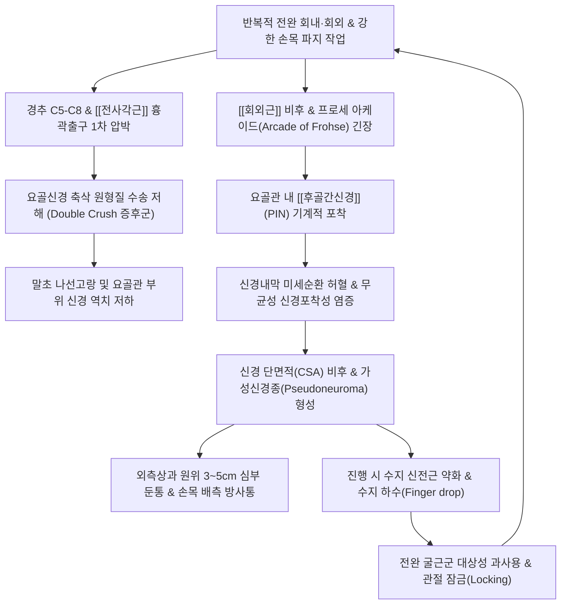

# ⚡ [[요골신경 포착]] (Radial Nerve Entrapment / 요골관 증후군, G56.3)

> **핵심 3줄 요약 (Key Summary)**:
> - 📍 병소 부위 & 해부·병태생리: 상완신경총 후속(Posterior cord, C5~T1)에서 분지한 **[[요골신경]](Radial nerve)**의 주행 경로 중 4대 주요 병목 지점([[전사각근]]·늑쇄간극의 1차 이중 포착, [[상완골]] 나선고랑/[[상완삼두근]] 외측두, 회외근 프로세 아케이드/요골관의 [[후골간신경]], 상완요골근-ECRL 간극의 천요골신경)의 기계적 압박, 허혈 및 신경병증. 회외근 섬유성 아케이드(Arcade of Frohse)와 헨레 동맥망(Leash of Henry)에 의한 요골관 협착 및 만성 신경 부종.
> - 🚩 전형적 임상 양상 & 3대 징후: 상완골 외측상과 원위 3~5cm 회외근 복부의 심부 둔통 및 전완 배측 방사통, 제3수지(중지) 저항 신전통, 고위 손상 시 완전 수하수(Wrist drop) 및 후골간신경(PIN) 포착 시 손가락 신전 불능에 따른 수지 하수(Finger drop). 난치성 [[외측상과염]](테니스 엘보) 환자의 5~10%에서 동반 또는 오진.
> - 🛠️ 핵심 감별 검사 & 한·양방 다각적 치료 전략: 중지 저항 신전 검사(Resisted middle finger extension), 전완 회외 저항 검사, 요골관 직접 압박 검사, [[티넬 징후]], 초음파상 PIN 단면적(CSA > 2.5mm²) 비후 및 가성신경종 확인. 3단계 근막 감압 침구([[천정]], [[수오리]], [[수삼리]]), 초음파 유도하 약침 신경 수액박리술(Hydrodissection), 신경 활주 추나([[추나]], Neurodynamic sliding) 및 [[서경탕]]·[[독활기생탕]].
> - <font color="#fa7e7e">⚠️ 응급 의뢰 레드플래그 & 악화 요인: 급성 완전 수하수(상완골 간부 골절 또는 완전 신경 단열 의심), 급격히 진행하는 신전근군 근위축 및 비가역적 탈신경 전위(Denervation), 신경초종·지방종 등 악성/양성 종양성 병변에 의한 종괴성 압박.</font>

---

## 📌 목차
1. [질환 개요 & 해부학적 병태생리](#1-질환-개요--해부학적-병태생리)
2. [병태생리 메커니즘 & 생체역학적 악순환 네트워크](#2-병태생리-메커니즘--생체역학적-악순환-네트워크)
3. [임상 증상 & 이학적 검사(Physical Exam) 알고리즘](#3-임상-증상--이학적-검사physical-exam-알고리즘)
4. [감별 진단 매트릭스 (Differential Diagnosis)](#4-감별-진단-매트릭스-differential-diagnosis)
5. [한의 통합 치료 프로토콜 (침·약침·추나·한약)](#5-한의-통합-치료-프로토콜-침약침추나한약)
6. [양방 치료 & 병용·의뢰 기준 (Conventional Treatment & Referral)](#6-양방-치료--병용의뢰-기준-conventional-treatment--referral)
7. [재활 운동 & 생활습관 티칭 가이드](#7-재활-운동--생활습관-티칭-가이드)
8. [💡 사용자 진료실 핵심 필기 & 임상 노하우 (Melt-In 잔여 심화 집약)](#8--사용자-진료실-핵심-필기--임상-노하우-melt-in-잔여-심화-집약)
9. [출처 및 학술 참고 문헌 (References)](#9-출처-및-학술-참고-문헌-references)

---

## 1. 질환 개요 & 해부학적 병태생리

### 1) 질환의 정의 및 임상적 역학
* **정의**: 요골신경 포착(Radial Nerve Entrapment)은 상완신경총의 후속(Posterior cord, C5~T1)에서 기원하여 상완 후면의 나선고랑(Spiral groove)을 거쳐 전완 외측 및 수지 신전근군으로 주행하는 **[[요골신경]](Radial nerve)**이 주행 경로상의 근육 간극, 섬유성 터널, 건성 아케이드, 혈관 복합체에 의해 기계적으로 압박(Compression), 견인(Traction), 또는 마찰(Friction)을 받아 발생하는 말초 신경병증(Peripheral neuropathy)이다.
* **임상적 역학**:
  * 상지 말초신경 압박 질환 중 [[수근관 증후군]](정중신경), [[주관 증후군]](척골신경)에 이어 세 번째로 흔하게 발생한다.
  * 포착되는 해부학적 위치와 침범 분지에 따라 **고위 요골신경 마비**, **요골관 증후군(RTS)**, **후골간신경 증후군(PINS)**, **천요골신경 포착(바르텐베르크 증후군)**의 4대 임상 아형으로 분류된다.
  * **호발 대상**: 테니스·배드민턴 등 라켓 스포츠 선수, 수영 선수, 조리사, 목수, 기계 조립 노동자 등 전완의 회내·회외 및 손목 신전을 반복하는 직업군에서 집중 발생한다.
  * **난치성 테니스 엘보와의 밀접한 연관성**: 3개월 이상 지속되는 불응성 [[외측상과염]] 환자의 약 5~10%에서 요골관 증후군이 단독으로 존재하거나 동반 병변으로 중첩되어 있음이 확인된다 (Keles et al., 2026; Cilingiroglu et al., 2026).

### 2) 요골신경의 기원과 전체 주행 경로
* **신경 기원**: 상완신경총 후속(Posterior cord)의 주 가지로 경추 C5, C6, C7, C8 및 흉추 T1 신경근의 섬유를 모두 수용한다. 상지의 모든 신전근군([[상완삼두근]], [[상완요골근]], [[장요측수근신근]], [[단요측수근신근]], [[총지신근]], [[척측수근신근]], [[회외근]], 무지 신전근군)을 지배하며 전완 배면과 손등 요측의 감각을 담당한다.
* **상완부 주행 (나선고랑 레벨)**:
  * 액와(Axilla)에서 상완동맥 후방을 지나 [[상완삼두근]] 장두와 내측두 사이를 통과한 후, 상완골 후면의 나선고랑(Spiral groove / Radial groove)을 따라 비스듬히 외하방으로 선회 주행한다.
  * 나선고랑에서 요골신경은 골막에 직접 맞닿아 주행하며, 상완삼두근 외측두의 섬유성 기원부 바로 아래를 통과한다.
  * 상완골 하부 1/3 지점에서 외측 근간중격(Lateral intermuscular septum)을 후방에서 전방으로 관통하여 주관절 전외측 구역으로 진입한다.
* **주관절 및 전완부 주행 (요골관 레벨)**:
  * 상완골 소두(Capitellum) 전방에서 [[상완근]](Brachialis)과 [[상완요골근]](Brachioradialis) 사이의 깊은 고랑을 통과한다.
  * 주관절 관절선 부근에서 두 개의 종말 분지로 갈라진다:
    1. **천요골신경 (Superficial Branch of Radial Nerve, SBRN)**: 순수 감각 신경으로 상완요골근 심부를 따라 전완 원위부로 주행.
    2. **심부 분지(Deep branch) 및 [[후골간신경]](Posterior Interosseous Nerve, PIN)**: 순수 운동 신경으로 요골두 전면을 지나 회외근 속으로 진입.

```
[ 요골신경(Radial Nerve) 해부학적 주행 및 4대 포착 병목 ]

  상완신경총 후속 (Posterior cord, C5~T1)
               │
               ▼  [1차 포착] 흉곽출구: [[전사각근]]·늑쇄간극 (Double Crush 기원)
  상완골 후면 나선고랑 (Spiral Groove)
               │
               ▼  [2차 포착] 상완삼두근 외측두 하부 (Saturday Night Palsy / 골절)
  외측 근간중격 (Lateral Intermuscular Septum) 관통
               │
               ▼
  주관절 전외측 요골관 (Radial Tunnel) 진입
               │
       ┌───────┴────────────────────────┐
       ▼                                ▼
 [천요골신경 (SBRN)]            [심부 분지 -> [[후골간신경]](PIN)]
       │                                │
       ▼  [4차 포착]                    ▼  [3차 포착]
 상완요골근-ECRL 간극              회외근 프로세 아케이드 (Arcade of Frohse)
 (바르텐베르크 증후군 / 손목시계)  (요골관 증후군 RTS / 후골간신경 증후군 PINS)
       │                                │
       ▼                                ▼
 손등 요측 감각 지배             전완 수지 신전근군 운동 지배 (Finger drop)
```

### 3) 요골관(Radial Tunnel)의 해부학적 경계와 5대 압박 구조물
* **요골관의 해부학적 정의**: 상완골 소두(Capitellum) 및 요골두 관절면으로부터 회외근 원위 하연까지 이어지는 약 5cm 길이의 근막성 터널.
* **요골관 내 PIN을 압박하는 5대 해부학적 병목 구조물 (Raveendranath et al., 2026)**:
  1. **프로세 아케이드 (Arcade of Frohse - 압도적 최다 원인)**:
     * [[회외근]](Supinator) 천부두의 근위부 상연에 형성된 섬유성 반월형 아치(Fibrous crescentic arch).
     * 성인의 60~70%에서 선천적 또는 후천적 마찰로 인해 두껍고 질긴 건성 밴드(Tendinous band)로 변성되어 있어, 전완 회내 시 PIN을 요골두 목(Neck)에 강하게 압박한다.
  2. **헨레 혈관망 (Leash of Henry)**:
     * 요골재귀동맥(Radial recurrent artery)에서 분지되어 전완 신근군으로 향하는 다수의 부속 혈관 다발. PIN의 표면을 가로지르며 주행하여 혈관성 압박을 가한다.
  3. **[[단요측수근신근]](ECRB)의 건성 내측연 (Medial Tendinous Margin)**:
     * ECRB 근복의 내측 경계가 두꺼운 건성 섬유로 형성되어 주관절 신전 및 중지 신전 시 PIN을 직접 누른다.
  4. **상완요골관절(Radiocapitellar joint) 전방 섬유성 밴드**:
     * 주관절 외측 관절낭 전면을 덮는 섬유성 결합조직 띠.
  5. **회외근 원위 하연 (Distal Edge of Supinator)**:
     * PIN이 회외근을 빠져나와 후방 골간막으로 진입하는 부위의 섬유성 경계.

---

## 2. 병태생리 메커니즘 & 생체역학적 악순환 네트워크

### 1) ASCII 병태생리 다이어그램
```
+-------------------------------------------------------------------------+
|     반복적 전완 회내·회외 / 강한 파지 작업 / 상지 외상 및 압박성 수면      |
+-------------------------------------------------------------------------+
                                     │
                                     ▼
+-------------------------------------------------------------------------+
|  [이중 압박 (Double Crush)] 전사각근 단축으로 상완신경총 원형질 수송 저해 |
+-------------------------------------------------------------------------+
                                     │
                                     ▼
+-------------------------------------------------------------------------+
|     상완삼두근 외측두 나선고랑 허혈 또는 요골관(프로세 아케이드) 기계적 압박    |
+-------------------------------------------------------------------------+
                                     │
                                     ▼
+-------------------------------------------------------------------------+
|     신경외막 정맥 울혈 -> 신경내막 부종(Endoneurial Edema) -> 허혈 악순환 |
|   - 30~50 mmHg 이상 압박 시 모세혈관 순환 차단 및 축삭 저산소증 발생    |
|   - 슈반세포 수초 붕괴 (탈수초화 Neurapraxia) -> 진행 시 축삭 단열       |
+-------------------------------------------------------------------------+
                                     │
                                     ▼
+-------------------------------------------------------------------------+
|  만성 마찰에 의한 신경 비후 및 가성신경종(Pseudoneuroma) 형성 (초음파 소견) |
+-------------------------------------------------------------------------+
                                     │
                                     ▼
+-------------------------------------------------------------------------+
|  외측상과 원위부 심부 둔통, 손목 배측 방사통, 수지 신전 탈력감 (Finger drop)|
+-------------------------------------------------------------------------+
                                     │
                                     └───────────► (악순환 고착)
```

### 2) 생체역학적 악순환 네트워크 (Mermaid)


### 3) 이중 압박 증후군 (Double Crush Syndrome)의 핵심 병태생리
* **개념**: Upton과 McComas(1973)가 제창한 이론으로, 하나의 신경 섬유 축삭(Axon)에서 근위부의 경미한 1차 압박이 존재하면, 정상 상태에서는 문제를 일으키지 않을 정도의 원위부 경미한 기계적 자극에도 심각한 신경병증이 발현되는 현상이다.
* **요골신경 포착에서의 임상적 적용**:
  * 경추 C5~C8 추간판 탈출이나 흉곽출구의 **[[전사각근]](Anterior Scalene)** 단축으로 인해 상완신경총 후속이 미세하게 압박되면, 신경 세포체에서 말초로 향하는 단백질, 신경전달물질 및 신경영양인자(NGF)의 순행성 축삭 원형질 수송(Anterograde axoplasmic transport)이 차단된다.
  * 영양 공급을 받지 못해 대사적으로 취약해진 요골신경은 상완골 나선고랑(삼두근 외측두)이나 요골관(회외근 프로세 아케이드)을 통과할 때 정상인보다 훨씬 낮은 압력에도 심각한 허혈과 신경내막 부종을 일으킨다.
  * 따라서 요골관 국소만 치료해서는 재발하기 쉬우며, 반드시 경추와 사각근을 동시에 치료해야 완치에 도달한다.

### 4) 신경 압박의 미세혈류 역학 및 병리조직학적 단계
1. **생리적 차단 (Neurapraxia)**:
   * 국소 압박력이 20~30 mmHg에 도달하면 신경외막 모세정맥의 역류가 차단되어 모세혈관 울혈(Stasis)이 발생한다.
   * 압력이 50 mmHg를 초과하면 혈액-신경 장벽(Blood-nerve barrier)이 붕괴되어 단백질이 풍부한 혈장이 신경내막 공간으로 누출되어 **신경내막 부종(Endoneurial edema)**을 형성한다.
   * 지속적인 부종은 신경 섬유 내부 압력을 상승시켜 림프 배액을 차단하고, 슈반세포를 손상시켜 국소 탈수초화(Demyelination)를 유발한다. 이 단계는 축삭 자체의 구조적 단열이 없으므로 감압 시 신속히 회복된다.
2. **축삭 단열 (Axonotmesis)**:
   * 압박이 고도화되거나 장기화되면 신경내막 모세혈관이 완전히 폐쇄되어 비가역적 축삭 괴사가 발생한다.
   * 압박 부위 원위부 축삭은 대식세포에 의해 탐식 파괴되는 **왈러 변성(Wallerian degeneration)**을 겪으며, 지배 근육의 탈신경 전위 및 근위축(Atrophy)이 초래된다. 하루 약 1mm 속도로 서서히 신경 재생이 일어난다.
3. **가성신경종 (Pseudoneuroma)**:
   * 회외근 프로세 아케이드나 나선고랑에서 만성적인 반복 마찰을 받으면 신경 섬유 주위 결합조직이 증식하여 방추형으로 비후되는 가성신경종이 형성된다 (Smock et al., 2025).

---

## 3. 임상 증상 & 이학적 검사(Physical Exam) 알고리즘

### 1) 4대 임상 아형별 특징적 증상 비교

```
[ 요골신경 포착 4대 아형별 임상 스펙트럼 ]

┌─────────────────────────┬─────────────────────────┬─────────────────────────┬─────────────────────────┐
│  고위 요골신경 마비     │   요골관 증후군 (RTS)   │ 후골간신경 증후군 (PINS)│ 바르텐베르크 증후군     │
├─────────────────────────┼─────────────────────────┼─────────────────────────┼─────────────────────────┤
│• 포착: 상완골 나선고랑  │• 포착: 프로세 아케이드  │• 포착: 프로세 아케이드  │• 포착: 상완요골근 간극  │
│• 손목 신전 불능         │• 순수 통증 증후군       │• 순수 운동 신경 마비    │• 순수 감각 신경 포착    │
│  (완전 수하수 Wrist drop│  (심부 둔통, 야간통)    │• 수지 신전 불능         │• 손등 요측 저림·화끈거림│
│• 수지 신전 불능         │• 근력 마비 없음         │  (수지 하수 Finger drop)│• 이상감각 (Cheiralgia)  │
│• 손등 요측 감각 마비    │• 근전도 대개 정상       │• 손목 요측 신전 가능    │• 운동 마비 전혀 없음    │
│• 주관절 신전 약화       │• 외측상과염과 혼동 호발 │• 감각 장애 전혀 없음    │• 꽉 조이는 시계·수갑   │
└─────────────────────────┴─────────────────────────┴─────────────────────────┴─────────────────────────┘
```

1. **고위 요골신경 마비 (High Radial Nerve Palsy / 토요일 밤의 마비)**:
   * **주소증**: 아침에 일어났을 때 손목이 아래로 덜렁거리며 위로 젖혀지지 않는 **수하수(Wrist drop)** 발생.
   * 손가락 MP 관절을 펴지 못하며, 상완골 나선고랑 병변 시 [[상완삼두근]] 근력은 보존되거나 경미하게 저하되나 전완 신근군 전체가 마비된다.
   * 제1수간(엄지와 검지 사이 손등 배측)의 뚜렷한 감각 마비 또는 둔마 동반.
2. **요골관 증후군 (Radial Tunnel Syndrome, RTS)**:
   * **주소증**: 상완골 외측상과로부터 **원위부 3~5cm 지점(회외근 근복)**의 뻐근하고 터질 듯한 깊은 심부 둔통.
   * 통증이 전완 배외측을 따라 손목 배측 중앙으로 뻗쳐 내려가며, 야간에 통증으로 잠을 깨기도 함.
   * 아침에 손가락 마디마디가 굳고 펴기 힘든 조조강직을 호소하여 류마티스 관절염으로 오인되기도 함.
   * **핵심 특징**: 명백한 운동 마비나 감각 소실이 없으며, 근전도 검사도 정상으로 나타나는 신경병증성 '통증 증후군'이다.
3. **후골간신경 증후군 (Posterior Interosseous Nerve Syndrome, PINS)**:
   * **주소증**: 통증은 거의 없거나 경미한 반면, 손가락을 펴지 못하는 **수지 하수(Finger drop)**가 주증상.
   * 제2~5수지의 중수수지관절(MCP) 신전이 불가능해져 손가락 끝이 아래로 처진다.
   * 엄지손가락을 밖으로 벌리거나 펴지 못함([[장모지외전근]], [[단모지신근]], [[장모지신근]] 마비).
   * **결정적 소견**: 손목을 뒤로 젖히라고 하면 손목이 완전히 처지지 않고 **요측으로 비스듬히 젖혀진다(Radial deviation extension)**. 이는 ECRL(상완요골부에서 이미 요골신경 본간으로부터 분지)은 정상이지만, ECU(PIN 지배)가 마비되어 척측 편위 신전력이 상실되었기 때문이다.
   * 감각 신경 분지가 없으므로 감각 소실은 전혀 없다.
4. **천요골신경 포착 (Wartenberg's Syndrome / 수포통 Cheiralgia Paresthetica)**:
   * 손목 배측 요측부 및 엄지손가락, 검지손가락 손등 부위의 찌릿찌릿한 저림, 타는 듯한 작열통(Burning pain), 감각 과민.
   * 운동 마비는 전혀 없으며 손목 시계나 팔찌를 차면 통증이 극심해짐.

### 2) 특이적 이학적 유발 검사 (Physical Examination)
1. **중지 신전 저항 검사 (Resisted Middle Finger Extension Test - RTS 확진 검사)**:
   * **수기법**: 환자의 주관절을 완전히 신전시킨 상태에서 검사자가 환자의 세 번째 손가락(중지) 근위지절간관절 배측을 강하게 아래로 누르며, 환자에게 버티도록 저항을 가한다.
   * **양성 판정**: 외측상과 원위 3~5cm 요골관 부위에 깊고 날카로운 격통 발생.
   * **기전**: 중지 신전 시 [[단요측수근신근]](ECRB) 근복 내측 건성 테두리가 강하게 긴장하며 요골관을 관통하는 PIN을 압박함.
2. **전완 회외 저항 검사 (Resisted Supination Test)**:
   * **수기법**: 주관절을 완전 신전시킨 상태에서 환자에게 전완을 바깥으로 돌리도록(회외) 하고 검사자가 강하게 저항을 가한다.
   * **양성 판정**: 회외근이 강하게 수축하면서 프로세 아케이드의 섬유성 아치가 팽팽해져 PIN을 조임으로써 전완 심부 통증 유발.
3. **요골관 직접 압박 검사 (Radial Tunnel Compression Test)**:
   * 상완골 외측상과 골성 정점에서 전외측 원위 3~5cm 지점(요골두 전하방)을 검사자의 엄지손가락으로 30초 이상 강하게 압박할 때, 국소 통증과 함께 손목 배측으로 방사통이 재현되면 양성.
4. **티넬 징후 ([[티넬 징후]], Tinel's Sign)**:
   * **나선고랑 티넬**: 상완골 외측 하부 1/3 나선고랑 부위를 타진하여 전완 배측으로 찌릿한 전격통 발생 확인.
   * **요골관 티넬**: 회외근 프로세 아케이드 부위를 타진하여 양성 반응 확인.
   * **바르텐베르크 티넬**: 전완 원위 요측 1/3 부위(상완요골근 건 외측)를 가볍게 톡톡 칠 때 엄지손등으로 전기가 통함.

```
[ 요골신경 포착 진단 및 아형 감별 흐름도 ]

            상지 신전 부전 및 전완/손등 통증 환자
                            │
                            ▼
           손목 및 수지 신전력 도수 검사 (MMT)
             ┌──────────────┴──────────────┐
     [완전 수하수]                  [손목 신전 가능]
     (Wrist drop)                          │
           │                               ▼
  [[상완골]] 나선고랑 타진          수지 신전력(Finger extension) 평가
  [[상완삼두근]] 외측두 압통         ┌──────────────┴──────────────┐
           │                      [수지 하수]                 [수지 신전 정상]
  고위 요골신경 마비 확진         (Finger drop)                     │
  (토요일 밤의 마비/골절)                  │                         ▼
                               손목 요측 편위 신전?          외측상과 원위 4~5cm 압통?
                                ┌──────┴──────┐             ┌──────┴──────┐
                              [양성]        [음성]         [양성]        [음성]
                                │             │              │             │
                             [[후골간신경]]  경추 C7       [[요골관]]     손등 저림?
                             증후군(PINS)   신경근증       증후군(RTS)     (바르텐베르크)
```

### 3) 전기생리학적 및 영상의학적 검사 기준
* **근전도 및 신경전도 검사 (EMG / NCV)**:
  * **요골관 증후군 (RTS)**: PIN의 운동 분지가 완전히 차단된 것이 아니라 기계적 자극에 의한 통증이 본태이므로, 전기생리 검사상 80~90%에서 **정상 소견**을 보인다. 따라서 근전도 정상이라고 해서 RTS를 배제할 수 없다 (Keles et al., 2026).
  * **후골간신경 증후군 (PINS)**: 지신근(EDC), 척측수근신근(ECU), 장모지신근(EPL)에서 뚜렷한 탈신경 자발 전위(Fibrillation potential, Positive sharp wave) 및 운동 단위 전위(MUP) 감소가 관찰된다. ECRL은 정상을 유지한다.
  * **고위 마비**: 상완삼두근, 상완요골근을 포함한 전완 신전근 전체에서 탈신경 전위 확인.
* **근골격계 고해상도 초음파 (Neuromuscular Ultrasound)**:
  * 요골신경 포착의 형태학적 확진 도구.
  * **정상 vs 병변 기준**: 회외근 프로세 아케이드 진입부에서 정상 PIN의 단면적(Cross-Sectional Area, CSA)은 **1.5 mm² 이하**이나, 포착 시 **2.5 mm² 이상으로 비후**되며 저에코성(Hypoechoic) 신경 부종 소견을 보인다.
  * 만성 마찰 부위에서 방추형의 **가성신경종(Pseudoneuroma)** 및 신경 주위 섬유성 띠 유착을 실시간으로 확인한다 (Smock et al., 2025).

---

## 4. 감별 진단 매트릭스 (Differential Diagnosis)

| 감별 질환 | 호발 병소 및 병태생리 | 주요 증상 및 기능 장애 | 특이적 이학적 검사 소견 | 신경학적 및 영상 소견 |
| :--- | :--- | :--- | :--- | :--- |
| **[[요골관 증후군]]** (RTS) | 외측상과 원위 3~5cm 프로세 아케이드 내 PIN 압박 | 회외근 부위 심부 둔통, 야간통, 손목 배측 방사통 | 중지 신전 저항통(+), 회외 저항통(+), 요골관 압박통(+) | 운동 마비 없음, 근전도 대개 정상, 초음파상 PIN 부종 |
| **[[외측상과염]]** (테니스 엘보) | 상완골 외측상과 공통신근건([[단요측수근신근]]) 기시부 건증 | 외측상과 뼈 자체의 핀포인트 압통, 파지 시 통증 | [[코젠 검사]](+), [[밀 검사]](+), [[체어 검사]](+) | 신경 방사통 없음, 초음파상 ECRB 건 비후 및 파열 소견 |
| **[[후골간신경 증후군]]** (PINS) | 회외근 프로세 아케이드 통과부 PIN 축삭 차단 | 통증 미약 또는 무통, 손가락 펴기 불능(Finger drop) | MP 관절 신전 마비, 손목 요측 편위 신전(ECRL 보존) | 순수 운동 마비, 감각 정상, 근전도상 탈신경 전위 |
| **고위 요골신경 마비** (토요일 밤 마비) | 상완골 나선고랑 내 요골신경 본간 압박 허혈 | 손목과 손가락이 완전히 처지는 완전 수하수(Wrist drop) | 손목/수지 신전력 완전 소실, 상완삼두근 반사 저하 | 손등 요측 감각 탈락 동반, 전완 신전근 전체 탈신경 전위 |
| **바르텐베르크 증후군** (천요골신경 포착) | 전완 원위 1/3 상완요골근-ECRL 간극 SBRN 압박 | 손등 요측(제1~3지 배측)의 찌릿한 저림 및 작열통 | 전완 원위 외측 [[티넬 징후]](+), 핀켈스타인 유사 검사(+) | 순수 감각 장애, 운동 마비 전혀 없음 |
| **경추 C7 신경근병증** | 경추 C6-C7 추간판 탈출 또는 신경근 압박 | 경항통과 함께 상완 후면, 전완 배측, 중지 방사통 | [[스펄링 검사]](Spurling)(+), 삼두근 건반사(TJR) 저하 | 상완삼두근 및 손목 굴근 약화 동반, 경추 MRI 병변 |
| **[[주관 증후군]]** | 상완골 내측상과 후방 주관 내 [[척골신경]] 압박 | 팔꿈치 내측 통증, 넷째·새끼손가락 마목감 및 저림 | 주관 [[티넬 징후]](+), 주관절 굴곡 검사(+), [[프로망 징후]](+) | 척골신경 분포 감각 저하, 골간근 위축 |

---

## 5. 한의 통합 치료 프로토콜 (침·약침·추나·한약)

### 1) 한의학적 병인 및 변증 체계
* **기체어혈(氣滯瘀血)**:
  * 외상, 압박성 수면, 급격한 과부하로 인해 경맥이 막히고 어혈이 신경초를 압박한 상태. 전완 심부가 욱신거리고 찌르듯 아프며 야간에 통증이 극심함.
* **경근연축(經筋攣縮) 및 비증(痺證)**:
  * 반복적인 전완 작업으로 인해 수양명경근과 수소양경근이 지속적으로 단축·경련하여 경락을 통과하는 기혈 운행이 차단된 상태. 팔꿈치 아래 근육이 뭉치고 펴기 힘듦.
* **기혈양허(氣血兩虛) 및 간신부족(肝腎不足)**:
  * 신경 손상이 수개월 이상 지속되어 축삭 재생이 지연되고, 근육이 마르고 힘이 빠지는 만성 마비(위증, 痿證) 단계. 손가락 신전 무력감과 조조강직 동반.

### 2) 3단계 해부학적 감압 침구 치료 (Triple Tunnel Decompression Protocol)
* **1단계: 흉곽출구 및 경추 상완신경총 기원부 감압 (Double Crush 차단)**:
  * **[[천정]](LI17)**, **[[결분]](ST12)**: [[전사각근]](Anterior Scalene)과 [[중사각근]]의 근복 발통점에 직자하여 상완신경총 후속의 1차 압박을 해소하고 원형질 수송을 촉진.
  * **경추 협척혈(C5~C7)**: 신경근 분절의 흥분을 안정화.
* **2단계: 상완골 나선고랑 요골신경 본간 감압**:
  * **[[수오리]](LI13)**, **청랭연(TE11)**, **소락(TE12)**: 상완골 후외측 나선고랑 부위로, [[상완삼두근]] 외측두와 장두 사이의 간극에 자침하여 나선고랑 내부의 허혈성 울혈을 개선.
* **3단계: 요골관 및 회외근 직접 자침 (프로세 아케이드 표적)**:
  * **[[수삼리]](LI10)**: 요골두 전하방 3~4cm 지점으로, 요골신경이 회외근 프로세 아케이드를 관통하는 핵심 표적 혈위. 침첨을 요골 경부 외측 골막 방향으로 15~20° 사자하여 회외근 섬유성 긴장을 직접 해소.
  * **[[곡지]](LI11)**: 상완골 외측상과 전방 간극을 통해 주관절 외측 관절낭과 요골신경 분지 부위를 소통.
  * **[[외관]](TE5)**, **[[양지]](TE4)**: 후골간신경 말초 순환을 촉진하고 손목 배측 방사통 완화.
  * **[[열결]](LU7)**, **[[편력]](LI6)**: 바르텐베르크 증후군(천요골신경 포착) 시 상완요골근 건 간극을 이완.
* **전침 요법 (Electroacupuncture)**:
  * 수오리(LI13) - 수삼리(LI10) 또는 수삼리(LI10) - 외관(TE5)에 연결.
  * **주파수 세팅**: PINS나 수하수 마비 환자에게는 2Hz 저주파 단속파를 20분간 적용하여 탈신경 근육의 수축을 유도하고 신경 영양 인자 분비를 촉진한다. RTS 통증 환자에게는 2/100Hz 혼합파를 적용하여 통증 관문을 차단한다.

### 3) 초음파 유도하 약침 및 신경 수액박리술 (Hydrodissection)
* **임상적 기전**:
  * 회외근 프로세 아케이드 주변의 섬유성 유착으로 인해 신경의 생리적 활주(Nerve excursion)가 차단된 상태에서, 고해상도 초음파 유도하에 약침액을 신경외막초 주위로 주입하여 신경과 주변 결합조직을 물리적으로 박리(Hydrodissection)하고 미세 순환을 복원한다 (Ahn et al., 2025; Smock et al., 2025).
* **약침 제제 선택 및 용법**:
  * **[[신바로약침]] / 황련해독탕 약침**:
    * 급성 신경포착성 염증 및 신경내막 부종 해소에 탁월. 초음파 단축 스캔으로 PIN을 확인한 후 인-플레인(In-plane) 기법으로 신경 상하부 간극에 각각 0.3~0.5cc씩 총 1.0cc 주입.
  * **고농도 [[봉약침]](Sweet BV 1:10,000~1:30,000)**:
    * 만성 불응성 요골관 증후군에서 멜리틴 성분의 신경 통각 과민 억제 및 혈류 촉진 효과를 활용. 수삼리 및 프로세 아케이드 부착부에 0.1~0.2cc 분할 주입.
  * **중성어혈약침**:
    * 상완골 나선고랑 및 삼두근 외측두 부위의 만성 어혈성 경결 완화.

### 4) 미세침도 요법 (Acupotomy)
* **적응증**: 보존적 치료에 반응하지 않는 난치성 요골관 증후군(RTS) 및 회외근 비후성 포착.
* **해부학적 안전 시술 가이드**:
  * ⚠️ **신경 손상 절대 방지**: PIN 본간을 침도로 직접 건드리면 영구적 수지 마비(Finger drop)를 초래하므로 절대적 주의가 필요하다.
  * 반드시 초음파 유도하에 PIN의 주행 위치를 육안으로 확인한 상태에서, 침도 날을 신경 본간으로부터 2~3mm 외측으로 안전 거리를 두고 회외근 천부두의 섬유성 밴드(Arcade of Frohse) 표재층만을 선택적으로 1~2회 미세 절개 박리한다.

### 5) 추나 요법 및 신경 활주 가동술 (Chuna & Neurodynamics)
* **요골두 전후방 관절가동술 (Radial Head Mobilization)**:
  * 환자의 주관절을 90° 굴곡하고 전완을 중립위에 둔 상태에서, 술자의 한 손 엄지로 요골두 후면을 지지하고 전방 및 후방으로 부드럽게 글라이딩(Gliding)을 가하여 상완요골관절의 가동성을 회복하고 요골관 내부 체적을 넓힌다.
* **전완 회내근-회외근 상호 억제 이완 수기**:
  * 회외근의 단축을 풀기 위해 대항근인 [[원회내근]](Pronator Teres)과 [[상완이두근]] 건을 동시 이완하여 전완 회선 밸런스를 바로잡는다.
* **경추 및 상완신경총 이완 추나**:
  * 경추 5-6-7번 분절의 후관절 가동술 및 전사각근 JS 근막 이완을 적용하여 이중 포착의 근위부를 선제적으로 감압한다.

### 6) 변증별 맞춤 한약 처방 (Herbal Medicine)
* **기체어혈 (氣滯瘀血)**:
  * 급성 나선고랑 압박, 타박상, 야간 둔통.
  * **[[서경탕]](舒經湯)**: 강황, 당귀, 적작약, 백출, 해동피, 계지 등으로 구성되어 상지 경락의 어혈과 경련을 풀고 신경초 부종을 신속히 제거.
  * **[[당귀수산]](當歸鬚散)**: 외상성 신경 압박 후 어혈 제거.
* **풍한습비 (風寒濕痺)**:
  * 찬바람을 쐬면 전완이 시리고 굳어지는 요골관 증후군.
  * **[[오적산]](五積散)**: 한습의 응결을 몰아내고 기혈을 조화롭게 소통.
* **경맥실양 & 신경마비 (經脈失養 & 痿證)**:
  * 만성 수하수(Wrist drop) 및 PINS 수지 마비 환자.
  * **[[활락탕]](活絡湯)** 또는 **소풍활혈탕(疎風活血湯)**: 경락의 만성 유착을 뚫고 신경 재생을 자극.
  * **[[독활기생탕]](獨活寄生湯)**: 간신 음혈을 보강하고 축삭 재생과 근위축을 방지.

---

## 6. 양방 치료 & 병용·의뢰 기준 (Conventional Treatment & Referral)

### 1) 약물 치료 (Medication)
* **신경병증성 통증 조절제 (Neuropathic Pain Agents)**:
  * **가바펜티노이드 (Gabapentinoids)**:
    * Pregabalin 75~150mg bid 또는 Gabapentin 300~600mg tid. 전압 개폐성 칼슘 채널의 α2-δ 소단위에 결합하여 신경 흥분성 전달물질 분비를 억제, RTS의 심부 작열통 및 야간통 조절.
  * **SNRI (세로토닌-노르에피네프린 재흡수 억제제)**:
    * Duloxetine 30~60mg qd 처방으로 하행성 통증 억제 경로를 강화.
* **신경 비타민 및 대사 개선제**:
  * 활성형 비타민 B12 (Cobamamide 또는 Mecobalamin 500mcg tid): 손상된 말초신경의 수초 합성 및 축삭 재생 촉진.
* **소염진통제 (NSAIDs)**:
  * 급성기 주변 근육 연축 완화를 위해 1~2주간 단기 병용.

### 2) 비약물 시술 및 보조기 요법 (Procedures & Splinting)
* **손목 코크업 부목 (Cock-up Splint)**:
  * **수하수(Wrist drop) 환자의 필수 처치**: 손목이 아래로 처진 상태가 지속되면 신전근이 과도하게 신장되어 회복 후에도 영구적 근력 저하가 남게 된다. 손목을 15~30° 신전 상태로 지지하는 코크업 부목을 24시간 착용시켜 신전건의 과신장을 방지한다.
* **동적 신전 스프링 보조기 (Dynamic Radial Nerve Splint)**:
  * 고무줄이나 스프링을 이용해 손가락과 손목의 신전을 보조하여 환자가 일상적인 파지 동작을 수행할 수 있도록 돕는다.
* **초음파 유도하 국소마취제/스테로이드 신경 차단술**:
  * Triamcinolone 10mg + 0.5% Lidocaine 혼합액을 프로세 아케이드 주변에 주사하여 통증 악순환을 차단하고 진단적 가치를 확인.

### 3) 수술적 감압술 적응증 (Surgical Indication)
* **수술 적응증**:
  * 1. 3~6개월 이상의 적극적 한의 보존 치료에도 불구하고 일상생활이 불가능한 난치성 요골관 증후군(RTS).
  * 2. 후골간신경 증후군(PINS) 환자에서 전기생리학적 검사상 탈신경 전위가 악화되거나 3개월 내 근력 호전이 없는 경우.
  * 3. 상완골 간부 골절(Holstein-Lewis 골절 등) 후 도수 정복에 실패하거나, 골편 사이에 요골신경이 감돈(Incarceration)된 경우 (Suer et al., 2026; Ibounig et al., 2026).
  * 4. 초음파/MRI상 신경초종, 신경섬유종, 결절종, 지방종 등 명백한 종괴성 병변이 확인된 경우.
* **대표적 수술 술식**:
  * **요골관 감압술 (Radial Tunnel Release)**:
    * 상완요골근과 ECRL 사이 전외측 접근법을 통해 요골관을 노출.
    * 프로세 아케이드(Arcade of Frohse) 완전 절개, 헨레 동맥망(Leash of Henry) 결찰, ECRB 건성 내측연 절제 및 회외근 원위 하연 감압을 일괄 시행.
  * **건 이전술 (Tendon Transfer)**:
    * 1년 이상 경과하여 신경 회복이 불가능한 영구적 요골신경 마비 환자에게 시행.
    * [[원회내근]](PT)을 ECRB로 이전하여 손목 신전 복원, [[요측수근굴근]](FCR) 또는 [[척측수근굴근]](FCU)을 지신근(EDC)으로 이전하여 손가락 신전 복원, [[장장근]](PL)을 장모지신근(EPL)으로 이전하여 엄지 신전 복원.

### 4) 한의 병용 판단 및 상호작용 (Combination Therapy)
* **병용 가능 및 시너지**:
  * Pregabalin, Gabapentin 등 신경병증 약물을 복용 중인 환자에게 침, 약침, 전침, 한약([[서경탕]]) 병용 시 약물 부작용(어지럼증, 졸림)을 줄이고 점진적 약물 감량을 달성할 수 있다.
* **병용 주의 및 금기**:
  * 요골관 부위 침도 시술 시 신경 손상 방지를 위해 초음파 가이드 없이 맹검으로 깊게 자입하는 행위는 엄격히 금기된다.

### 5) 양방·전문과 의뢰 기준 (Referral Criteria / Red Flags)
* **즉각적인 정형외과/신경외과 의뢰 트리거**:
  * 1. **급성 외상성 완전 수하수**: 상완골 간부 타박 또는 골절 후 즉각 발생한 완전 수하수 (신경 완전 단열 가능성).
  * 2. **비가역적 근위축 진행**: 3개월 이상의 치료에도 손가락 신전 마비가 지속되고 골간근 및 신전근 위축이 가속되는 경우.
  * 3. **종괴성 병변 확인**: 초음파상 신경 주위 낭종, 신경종, 혈종에 의한 기계적 압박.

---

## 7. 재활 운동 & 생활습관 티칭 가이드

### 1) 단계별 신경 재활 프로그램
```
[ 요골신경 포착 단계별 재활 로드맵 ]

  1단계 (급성기/마비기)        2단계 (신경 활주기)         3단계 (근력 재교육기)       4단계 (기능 복귀기)
┌─────────────────────┐   ┌─────────────────────┐   ┌─────────────────────┐   ┌─────────────────────┐
│ • 코크업 부목 착용  │   │ • 요골신경 슬라이딩 │   │ • 신전근 등척성 훈련│   │ • 복합 협응 운동    │
│ • 수동 관절 가동    │──►│   (Nerve Gliding)   │──►│ • 저항 밴드 신전    │──►│ • 일상 및 작업장   │
│   (구축 방지)       │   │ • 회외근 스트레칭   │   │ • 수지 외전 강화    │   │   에체공학 개선     │
│ • 전기 자극 요법    │   │ • 주관절 가동성 회복│   │ • 악력 협응 훈련    │   │ • 재발 방지 루틴    │
└─────────────────────┘   └─────────────────────┘   └─────────────────────┘   └─────────────────────┘
```

* **1단계: 급성기 보호 및 관절 구축 방지**:
  * 수하수 환자는 손목 코크업 부목을 착용하여 신전건이 늘어나는 것을 방지한다.
  * 하루 3~4회 부목을 풀고 반대 손으로 손목과 손가락 관절을 끝까지 굽혔다 펴주는 수동 관절 운동(PROM)을 시행하여 관절낭 구축을 예방한다.
* **2단계: 요골신경 신경가동술 (Radial Nerve Gliding / Flossing - 핵심)**:
  * **동작 순서 (4단계 슬라이딩 기법)**:
    1. 선 자세에서 아픈 쪽 팔을 몸통 옆으로 내리고 어깨를 안쪽으로 최대로 회전(내회전)한다.
    2. 손목을 안쪽으로 강하게 꺾고(굴곡), 손가락과 엄지를 안으로 말아 쥔다.
    3. 팔을 뒤쪽으로 약 30° 뻗으면서 고개를 아픈 쪽 팔의 반대쪽으로 갸우뚱 기울여 신경을 전체적으로 신장(Tensioning)한다.
    4. 이어서 고개를 아픈 쪽 어깨 쪽으로 기울이면서 동시에 손목을 가볍게 펴주어 요골관 내에서 신경이 부드럽게 미끄러지도록(Sliding) 유도한다.
    * 하루 10회씩 3세트 부드럽게 반복. 저림이 유발되지 않는 무통 범위에서 시행.
* **3단계: 신전근군 근력 재교육 (Strengthening)**:
  * **수지 신전 등척성 운동**: 손바닥을 책상에 대고 손가락 끝으로 책상 바닥을 지그시 누르며 손가락을 들어 올리려는 힘을 준다 (10초 유지, 10회).
  * **고무줄 수지 외전 운동**: 손가락에 고무줄을 감고 손가락을 바깥쪽으로 부채꼴 모양으로 벌리는 훈련.
* **4단계: 회외근 자가 스트레칭**:
  * 팔꿈치를 곧게 펴고 반대 손으로 아픈 손의 손등을 잡아 안쪽으로 회내(Pronation)시키며 손목을 굴곡시켜 회외근을 15초간 스트레칭.

### 2) 일상생활 및 인체공학적 티칭
* **작업 동작 수정**:
  * 수동 드라이버 돌리기, 렌치 조이기, 무거운 프라이팬 한 손으로 털기 등 전완의 급격한 회내·회외가 요구되는 동작을 중단하고 전동 공구를 적극 활용한다.
* **수면 자세 교정**:
  * ⚠️ 술에 취한 상태에서 팔을 베고 자거나, 소파 팔걸이에 팔을 걸치고 자는 행위(Saturday night palsy), 연인에게 팔베개를 해주는 행위(Honeymoon palsy)는 신경 허혈을 촉발하므로 절대 금기이다.
* **손목 압박 요인 제거**:
  * 바르텐베르크 증후군 환자는 금속 시계줄, 꽉 조이는 스마트워치, 조이는 가죽 팔찌 착용을 즉시 중단하고 헐렁한 밴드로 교체한다.

---

## 8. 💡 사용자 진료실 핵심 필기 & 임상 노하우 (Melt-In 잔여 심화 집약)

### 1) 진료실 실전 문진 & 감별 비결 (Clinical Pearls)
* **"엘보 치료 수십 번 받아도 안 낫는 환자는 100% 요골관 증후군이다"**:
  * 한의원이나 정형외과에서 테니스 엘보 진단 하에 물리치료, 주사, 충격파를 수개월간 받아도 호전이 없다는 환자가 오면 외측상과 뼈를 누르지 말고, 상과에서 **손가락 두 마디 아래 근육([[수삼리]] 부근)**을 꾹 눌러보라.
  * 외측상과 뼈는 전혀 안 아픈데, 그 아래 근육을 누르면 환자가 비명을 지르며 손목까지 찌릿하다고 한다면 그것은 100% 회외근의 [[요골관 증후군]](RTS)이다.
* **"손가락 마디마디가 쑤시고 뻣뻣해요" 환자의 함정**:
  * 아침에 손가락 마디마디가 붓고 굳는 조조강직을 호소하여 류마티스 내과나 정형외과에서 관절염 약만 먹던 환자가 많다.
  * 손가락 관절 자체의 압통(Squeeze test)이 음성이고, 외측상과 하방 4cm 요골관 압통과 중지 신전 저항통이 양성이라면 이는 관절염이 아니라 요골신경 포착에 의한 신경성 연관통이다. 요골관만 치료하면 손가락 강직이 씻은 듯이 사라진다.

### 2) 3대 포착 터널 순차 확인 및 동시 치료 불변 원칙
* 요골신경 포착 환자를 진찰할 때는 반드시 다음 3군데 터널을 아래에서 위로 거슬러 올라가며 촉진해야 한다:
  1. **제3터널 (전완)**: [[회외근]] 프로세 아케이드 ([[수삼리]] 부위)
  2. **제2터널 (상완)**: [[상완삼두근]] 외측두 나선고랑 ([[수오리]] 부위)
  3. **제1터널 (목/어깨)**: [[전사각근]] 및 [[쇄골하근]] ([[천정]], [[결분]] 부위)
* 이 3곳 중 최소 2곳 이상에서 심한 압통이 동시에 발견된다(Double crush syndrome).
* 치료 시에도 팔꿈치 아래만 치료하지 말고, **사각근 직자 -> 삼두근 외측두 사자 -> 수삼리 회외근 사자**의 3단계로 동시에 침과 약침을 시술해야만 재발 없는 근본 치료가 완성된다.

### 3) 회외근 프로세 아케이드 타겟팅 자침 및 약침 테크닉 노하우
* **환자 체위**: 환자의 팔꿈치를 90° 굽히고 전완을 가볍게 회내(손바닥이 바닥을 향함)시켜 전완 신전근군을 안정시킨다.
* **자입 랜드마크**: 상완골 외측상과 정점과 요골 경상돌기를 잇는 가상의 선 상에서, 요골두 전하방 약 3~4cm 지점([[수삼리]] 혈위)의 회외근 경결점을 촉지한다.
* **자침 각도 및 깊이**:
  * 0.30×40mm 호침을 피부에 직자하지 말고, 요골 경부 외측연을 향해 비스듬히 15~20° 각도로 사자하여 1.0~1.5촌 심자한다.
  * 침 끝이 단단한 근막(Arcade of Frohse)을 뚫고 지나갈 때 특유의 '사각'하는 저항감이 느껴지며, 환자가 전완 심부로 뻐근하게 퍼지는 득기감(De-qi)을 호소한다. 이 득기 반응이 확인되어야 신경 포착이 감압된다.
* **약침 수액박리 노하우**: 신바로약침 0.5cc를 이 깊이에 주입하면 약액이 회외근과 신경 사이로 퍼지며 시술 직후 중지 신전 저항통이 50% 이상 즉각 소실되는 임상적 쾌거를 볼 수 있다.

### 4) 환자 티칭 스크립트 (진료실 소통 노하우)
* *"환자분, 팔꿈치 바깥쪽이 아파서 그동안 '테니스 엘보'라고 생각하고 힘줄 치료만 받으셨겠지만, 실제로는 힘줄 병이 아닙니다. 팔꿈치 근육 속을 뚫고 지나가는 **'요골신경'이라는 신경 전깃줄이 근육 터널에 꽉 끼어서 생기는 신경통**입니다."*
* *"목덜미 사각근과 팔뚝 삼두근, 그리고 팔꿈치 아래 회외근이라는 세 군데 터널에서 전깃줄이 꽉 조여져 있기 때문에 손가락이 굳고 손목까지 찌릿찌릿 아팠던 것입니다."*
* *"저희 한의원에서는 침과 약침으로 신경을 조이고 있는 세 군데 근육 터널을 부드럽게 넓혀주고, 신경에 피가 통하도록 수액박리를 해드립니다. 며칠 치료받으시면 굳었던 손가락과 팔꿈치 둔통이 시원하게 풀릴 것입니다. 단, 치료받으시는 동안에는 손을 비틀거나 꽉 쥐는 동작, 팔베개는 절대 피하셔야 합니다."*

---

## 9. 출처 및 학술 참고 문헌 (References)

1. Raveendranath V (2026). Surgical anatomy of deep branch of the radial nerve at the Arcade of Frohse: geometric relationships relevant to posterior interosseous nerve entrapment. *Surg Radiol Anat*. [PMID 42771016](https://pubmed.ncbi.nlm.nih.gov/42771016/)
   - 회외근 프로세 아케이드(Arcade of Frohse)에서 요골신경 심부 분지의 수술 해부학적 기하학적 관계를 정밀 규명한 최신 사체 연구. 프로세 아케이드의 섬유성 비후 비율, 각도 및 요골두와의 거리를 측정하여 후골간신경(PIN) 포착 기전과 안전한 외과적·침도 감압 가이드라인을 제시함.

2. Fajardo JE (2026). Multiparametric Quantitative MRI of Peripheral Nerves to Differentiate Demyelinating From Axonal Polyneuropathies. *J Magn Reson Imaging*. [PMID 42348395](https://pubmed.ncbi.nlm.nih.gov/42348395/)
   - 말초신경의 다중 매개변수 정량적 MRI 평가를 통해 탈수초성 신경병증과 축삭성 신경병증을 고해상도로 감별 진단하는 영상의학적 기준을 정립한 최신 연구.

3. Suer O (2026). InSafeLOCK intramedullary nailing versus plate fixation for humeral diaphyseal fractures: a retrospective cohort study with 24-month outcomes. *BMC Surg*. [PMID 42001085](https://pubmed.ncbi.nlm.nih.gov/42001085/)
   - 상완골 간부 골절 환자에서 골수내정 고정술과 금속판 고정술 후 동반된 요골신경 마비의 발생 빈도, 회복 기간 및 24개월 장기 임상 경과를 비교 분석한 후향적 코호트 임상시험.

4. Ibounig T (2026). An Acta Orthopaedica educational article: Treatment of adult patients with a humeral shaft fracture. *Acta Orthop*. [PMID 41842657](https://pubmed.ncbi.nlm.nih.gov/41842657/)
   - 성인 상완골 간부 골절의 최신 치료 가이드라인 및 동반되는 1차성·2차성 요골신경 손상의 보존적 관찰 기준과 수술적 탐색술 적응증을 집대성한 교육적 종설.

5. Keles A (2026). Ultrasonographic and Electrophysiologic Assessment of Radial Tunnel Syndrome in Patients With Treatment-Resistant Lateral Epicondylitis: Insights into Diagnostic Utility and Clinical Implications. *Am J Phys Med Rehabil*. [PMID 41082715](https://pubmed.ncbi.nlm.nih.gov/41082715/)
   - 치료 불응성 외측상과염 환자에서 요골관 증후군(RTS)의 동반율을 고해상도 초음파 및 근전도로 전향적 평가한 임상 연구. 요골관 내 PIN 단면적(CSA) 비후 및 저에코성 부종을 입증하고 외측상과염과의 결정적 감별 진단 알고리즘을 규명함.

6. Cilingiroglu C (2026). Frequency of posterior interosseous nerve syndrome and its impact on clinical outcomes in patients with lateral epicondylitis: A prospective, controlled, electrophysiological study. *Acta Neurol Belg*. [PMID 40853587](https://pubmed.ncbi.nlm.nih.gov/40853587/)
   - 외측상과염 환자 코호트에서 후골간신경 증후군(PINS)의 동반 빈도와 임상 예후에 미치는 영향을 전기생리학적으로 규명한 전향적 대조 연구.

7. Smock CS (2025). Diagnostic neuromuscular ultrasound of radial tunnel syndrome with the presence of a distal pseudoneuroma. *Clin Neurophysiol*. [PMID 40602304](https://pubmed.ncbi.nlm.nih.gov/40602304/)
   - 요골관 증후군 환자에서 만성 기계적 마찰로 형성된 원위부 가성신경종(Pseudoneuroma)을 고해상도 신경근 초음파로 포착하고 정밀 타겟 주입 및 감압술의 영상학적 근거를 제시한 임상 증례 보고.
