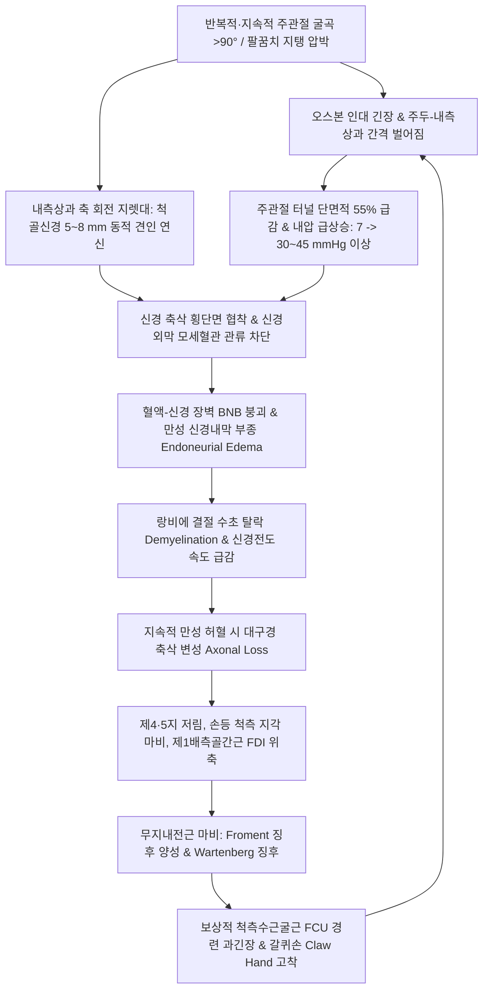

# ⚡ [[주관절 터널 증후군]] (Cubital Tunnel Syndrome, CuTS)

> **상위 분류**: [[근골격계 질환]] > [[상지 질환]] > [[주관절 질환]] > [[말초신경포착]]
> **핵심 3줄 요약 (Key Summary)**:
> - 📍 병소 부위 & 해부·병태생리: 상완골 내측상과 후방 척골신경구(Retrocondylar groove)와 척골 주두(Olecranon) 사이 [[오스본 인대]](Osborne's ligament, Arcuate ligament) 및 [[척측수근굴근]](FCU) 상완두-척골두 건궁으로 형성된 섬유골성 터널에서 [[척골신경]](Ulnar nerve, C8~T1)이 주관절 굴곡에 따른 동적 견인(Tension), 터널 내압 상승(정상 7 mmHg $\rightarrow$ 굴곡 시 30~45 mmHg 이상), 기계적 압박 및 마찰성 아탈구로 인해 상신경막 모세혈관 관류 차단, [[신경내막 부종]], [[수초 탈락]] 및 [[축삭 변성]]이 초래되는 상지 2위의 빈발 [[신경포착]] 질환.
> - 🚩 전형적 임상 양상 & 3대 징후: 제4수지 척측 1/2 및 제5수지, 손바닥 척측, 그리고 **손등 척측(Dorsal cutaneous branch 지배 구역)**의 전격성 저림·[[이상감각]]·[[작열통]], 야간 굴곡 자세 수면 시 통증 악화, 만성화 시 제1배측골간근(FDI) 위축으로 인한 모지-인지 간 함몰, [[프로망 징후]](Froment's sign), [[와텐버그 징후]](Wartenberg's sign), [[갈퀴손]](Claw hand, D4-D5) 변형 및 정밀 파지력 소실.
> - 🛠️ 핵심 감별 검사 & 한·양방 다각적 치료 전략: [[주관절 굴곡 검사]](Elbow flexion test), 주관절 [[티넬 징후]](Tinel sign), 스크래치 허탈 검사(Scratch collapse test), [[신경전도 검사]](NCV across elbow < 50 m/s), [[초음파 검사]] 신경 단면적(CSA ≥ 10 mm²). [[오스본 인대]] 및 FCU 건궁 [[침도요법]] 미세 절개 감압술, [[소해]](SI8)·[[소해]](HT3)·[[곡택]](PC3) 2Hz 저주파 [[전침치료]], [[신바로약침]]·[[봉약침]](1:30,000) 초음파 유도하 수력박리술(Hydrodissection), 야간 30~45° 신전 [[부목]] 고정 및 [[보양환오탕]], [[서경탕]] 한약 투여.
> - ⚠️ 응급 의뢰 레드플래그 & 악화 요인: 소해혈(SI8) 수직 직자 시 척골신경 본간 관통(Drop out/Causalgia) 절대 주의(반드시 내측상과 골면 완만 사자), 급격한 FDI 골간근 함몰 및 갈퀴손 진행, 90° 이상 주관절 굴곡·턱 괴기·팔베개 수면 금기, 보존적 치료 불응 시 감압술(In situ decompression) 또는 척골신경 전방 전위술(Anterior transposition) 수부외과 협진 의뢰.

---

## 📌 목차
1. [질환 개요 & 해부학적 병태생리](#1-질환-개요--해부학적-병태생리)
2. [병태생리 메커니즘 & 생체역학적 악순환 네트워크](#2-병태생리-메커니즘--생체역학적-악순환-네트워크)
3. [임상 증상 & 이학적 검사(Physical Exam) 알고리즘](#3-임상-증상--이학적-검사physical-exam-알고리즘)
4. [감별 진단 매트릭스 (Differential Diagnosis)](#4-감별-진단-매트릭스-differential-diagnosis)
5. [한의 통합 치료 프로토콜 (침·약침·추나·한약)](#5-한의-통합-치료-프로토콜-침약침추나한약)
6. [양방 치료 & 병용·의뢰 기준 (Conventional Treatment & Referral)](#6-양방-치료--병용의뢰-기준-conventional-treatment--referral)
7. [재활 운동 & 생활습관 티칭 가이드](#7-재활-운동--생활습관-티칭-가이드)
8. [💡 사용자 진료실 핵심 필기 & 임상 노하우 (Melt-In 잔여 심화 집약)](#8--사용자-진료실-핵심-필기--임상-노하우-melt-in-잔여-심화-집약)
9. [출처 및 학술 참고 문헌 (References)](#9-출처-및-학술-참고-문헌-references)

---

## 1. 질환 개요 & 해부학적 병태생리

### 1) 개념 정의 및 역학적 특성
* **주관절 터널 증후군(Cubital Tunnel Syndrome, CuTS)**은 주관절 내측의 섬유골성 터널인 주관(Cubital tunnel) 내부를 통과하는 [[척골신경]](Ulnar nerve, C8~T1)이 해부학적 협착, 반복적인 주관절 굴곡에 따른 장력(Tension) 증가, 터널 내압 상승, 마찰(Friction) 및 동적 아탈구(Subluxation)로 인해 기계적 압박과 미세혈류 허혈 손상을 입어 발생하는 대표적인 상지 압박성 말초 [[신경포착]] 질환이다.
* **역학 및 인구학적 특성**:
  * 상지 말초신경 포착 증후군 중 [[수근관 증후군]](CTS)에 이어 **두 번째로 높은 발생 빈도**를 차지한다.
  * [[수근관 증후군]]이 여성에서 3~5배 호발하는 것과 달리, 주관절 터널 증후군은 **남성에서 여성보다 약 2배 더 호발**한다. 이는 남성의 상완골 운반각(Carrying angle) 특성, 외측 삼두근 발달, 직업적 육체 노동 빈도 및 직업적 주관절 지지 부하의 차이에 기인한다.
  * 호발 연령대는 30~60대이며, 주관절을 90° 이상 지속적으로 구부리는 직업군(컴퓨터 프로그래머, 콜센터 상담원, 트럭 및 택시 운전기사, 현악기 및 관악기 연주자, 목수, 배관공)과 야구 투수 등 투구 동작을 반복하는 운동선수에서 다발한다.
  * 이차성 유발 요인으로는 주관절 내측 측부인대(MCL) 파열 후 불안정성, 소아기 주관절 외상 후 발생한 지연성 척골신경 마비(Tardy ulnar nerve palsy, 주관절 외반 변형 Cubitus valgus), 골관절염으로 인한 골극(Osteophyte), 활액막 증식 및 류마티스 관절염 등이 있다.

### 2) 주관절 터널의 3차원 해부학적 경계 구조 (3D Boundaries)
주관절 터널은 상완골과 척골 사이의 복잡한 관절낭 및 인대 복합체로 구성된 단단한 폐쇄성 섬유골성 터널이다.
* **전내측벽 (Anteromedial Wall)**:
  * [[상완골]] 내측상과(Medial epicondyle)의 단단한 골성 융기.
* **외측벽 (Lateral Wall)**:
  * [[척골]] 주두(Olecranon process)의 내측면.
* **바닥 (Floor & Deep Bed)**:
  * 주관절 내측 측부인대의 후방 섬유 다발(Posterior bundle of the Medial Collateral Ligament, Cooper's ligament) 및 주관절 후내측 관절낭(Joint capsule).
  * 주관절 굴곡 시 후방 MCL이 팽팽해지며 터널 바닥을 위로 밀어 올려 터널 내부 용적을 직접 축소시키는 역할을 한다.
* **지붕 (Roof & Superficial Cover)**:
  * [[오스본 인대]](Osborne's ligament, Arcuate ligament of Osborne / Osborne's band): 내측상과와 주두 첨부를 직접 연결하는 치밀 섬유성 띠.
  * [[척측수근굴근]](Flexor Carpi Ulnaris, FCU)의 상완두(Humeral head)와 척골두(Ulnar head) 사이를 잇는 건궁(Aponeurotic arch / Fibrous band of FCU).
  * 심부 주관절 근막(Deep investing fascia)과 주관절 원위부 전완 근막.

### 3) 척골신경의 주관절 주행과 5대 잠재적 포착 관문 (5 Entrapment Sites)
임상적으로 척골신경은 주관절 터널 내부뿐만 아니라 주관절 근위부와 원위부에 걸쳐 총 5개 영역에서 압박될 수 있다.
1. **스트루더스 아케이드 (Arcade of Struthers)**:
   * 내측상과 상방 약 8~10 cm 지점에 위치하는 섬유성 건막 아치.
   * 내측 근간중격(Medial intermuscular septum)의 비후된 섬유, 상완삼두근(Triceps brachii) 내측두의 심부 근막 섬유가 척골신경을 덮어 포착을 유발한다 (약 70~80%의 인구에서 실재).
2. **내측 근간중격 (Medial Intermuscular Septum, MIS)**:
   * 상완 전방 구획을 주행하던 척골신경이 삼두근이 위치한 후방 구획으로 관통해 들어가는 부위.
   * 척골신경 전방 전위 수술 시 근간중격을 충분히 절제하지 않으면 수술 후 이차성 의인성 포착이 가장 흔히 발생하는 부위이다.
3. **내측상과 후구 (Retrocondylar Groove)**:
   * 내측상과 바로 뒤편의 골성 고랑.
   * 뼈의 골극, 활액낭염, 외상성 반흔 조직, 얕은 상과간구로 인한 신경 아탈구 마찰이 일어나는 해부학적 병소.
4. **주관절 터널 본체 및 오스본 인대 (Cubital Tunnel Proper & Osborne's Ligament)**:
   * 가장 흔하고 전형적인 원발성 포착 부위.
   * 주관절 굴곡 시 오스본 인대가 긴장하며 신경을 직접 압전한다.
5. **척측수근굴근(FCU) 두 머리 사이 건궁 및 심부 원회내근-굴근 건막 (Deep Flexor-Pronator Aponeurosis)**:
   * 내측상과 원위부 3~5 cm 지점에서 척측수근굴근의 상완두와 척골두가 만나는 건성 아치(Aponeurotic band).
   * FCU 근육이 과긴장하거나 비후될 때, 또는 심부 굴근건막에 의해 전완으로 진입하는 척골신경이 강력하게 압박된다.

### 4) 미세 신경 해부학 및 분지 양상
* **신경 속 배열 (Fascicular Topography)**:
  * 주관절 후구에서 척골신경 내부의 신경 다발 배열을 보면, 제4·5지 감각 신경 섬유와 수부 내재근 운동 신경 섬유가 상과 표면에 가장 가깝게 천층에 배치되어 있어 외부 압박과 굴곡 시 견인력에 가장 취약하다.
* **주관절 주위 분지**:
  * 관절지(Articular branches): 주관절 후내측 관절낭으로 분지.
  * 근육지(Muscular branches): [[척측수근굴근]](FCU) 근지와 [[심지굴근]](FDP)의 제4·5수지 척측두 근지가 주관절 바로 원위부에서 분지한다.
* **수배피지 (Dorsal Cutaneous Branch of Ulnar Nerve, DCBN)**:
  * 완관절 상방 약 5~8 cm 지점에서 척골신경 본간으로부터 조기 분지하여 전완 척측 피하를 통과, 손등으로 돌아 들어간다.
  * 지배 구역: 손등(Dorsum) 척측 1.5~2.5개 수지 및 수배부 척측 절반의 피부 감각.
  * **절대적 감별 가치**: 손목 부위 가이온관([[가이온관 증후군]]) 포착 시에는 DCBN이 가이온관보다 훨씬 근위부에서 분지하여 손등으로 가므로 **손등 감각이 완전히 정상 보존**된다. 반면 주관절 터널 증후군(CuTS)은 이 분지보다 상위 레벨에서 신경이 압박되므로, **손바닥뿐만 아니라 손등 척측의 감각 저하가 100% 동반**된다.

---

## 2. 병태생리 메커니즘 & 생체역학적 악순환 네트워크

### 1) 3대 동적 생체역학 손상 기전 (Tension, Compression, Friction)
주관절 터널 증후군은 정적인 압박뿐만 아니라 팔꿈치 관절의 가동에 따른 격렬한 생체역학적 변화에 의해 유발된다.
1. **동적 견인 및 연신 (Traction & Elongation)**:
   * 주관절이 완전 신전(0°) 상태에서 90° 이상 굴곡될 때, 척골신경은 내측상과 후면을 회전 지렛대 축으로 삼아 바깥쪽으로 둘러 돌아가야 하므로 신경 길이가 **약 5~8 mm(최대 10 mm 이상) 동적으로 늘어난다**.
   * 신경 섬유가 세로 방향으로 강하게 견인되면 신경 다발의 횡단면 직경이 좁아지며 신경내막 모세혈관의 혈류량이 기계적으로 감소한다.
2. **단면적 감소 및 관내 압력 급상승 (Dynamic Compression)**:
   * 주관절 신전 시 주관절 터널의 지붕인 [[오스본 인대]]는 느슨하고 편평한 상태를 유지한다.
   * 주관절이 굴곡되면 상완골 내측상과와 척골 주두 사이의 거리가 약 5 mm 벌어지며 오스본 인대가 팽팽하게 당겨지고, 바닥의 내측 측부인대(MCL) 후방 다발이 불룩하게 솟아오른다.
   * 이로 인해 **터널 단면적이 평균 55% 감소**하며, 터널 내압은 정상 중립위 7 mmHg에서 **90° 굴곡 시 30~45 mmHg 이상**, 삼두근 및 척측수근굴근이 동시 수축할 경우 **최대 200 mmHg 이상으로 폭증**한다.
   * 30 mmHg는 모세혈관 관류압의 생리학적 한계치이므로, 굴곡 시 즉각적인 미세순환 허혈이 발생한다.
3. **마찰 및 재발성 아탈구 (Friction & Dynamic Subluxation)**:
   * 정상 인구의 약 10~15%에서는 상완골 내측상과 후구의 골성 깊이가 얕거나 오스본 인대의 선천적 이완이 존재한다.
   * 이 경우 주관절 굴곡 시 척골신경이 내측상과 골성 융기를 타고 넘어 앞쪽으로 덜컥거리며 튕겨 나가는 **전방 아탈구(Subluxation/Dislocation)**가 발생한다.
   * 아탈구와 정복이 반복되면서 신경이 뼈 모서리에 마찰되어 만성적인 신경외막 비후, 외상성 신경종(Neuroma-in-continuity) 및 염증성 반흔 조직이 형성된다.

### 2) 미세순환 허혈-탈수초-축삭변성 악순환 캐스케이드
* **정맥 울혈 및 저산소증 (Stage 1)**:
  * 터널 내압이 20~30 mmHg에 도달하면 신경외막의 미세 소정맥 환류가 가장 먼저 차단되어 역류성 울혈과 조직 저산소증이 초래된다.
* **혈액-신경 장벽(BNB) 파괴 및 신경내막 부종 (Stage 2)**:
  * 지속적인 허혈로 인해 신경내피 세포 간 치밀이음이 붕괴되어 혈장 단백질이 신경내막 공간으로 삼출된다.
  * 단백질 삼출로 인한 삼투압 상승으로 [[신경내막 부종]](Endoneurial edema)이 형성되며, 신경내막 압력이 상승하여 신경 축삭의 양방향 원형질 수송(Axoplasmic transport)이 전면 차단된다.
* **수초 탈락 및 비가역적 축삭 변성 (Stage 3)**:
  * 랑비에 결절의 말이집이 파괴되는 [[수초 탈락]](Demyelination)이 진행되어 신경전도 속도가 급격히 지연되고 전도 차단(Conduction block)이 발생한다.
  * 허혈이 장기화되면 대구경 운동 및 감각 축삭 자체가 사멸하는 [[왈러 변성]](Wallerian degeneration)이 일어나며, 수부 내재근의 불가역적인 탈신경 근위축으로 이어진다.

### 3) 이중 포착 증후군 (Double Crush Syndrome, DCS) 네트워크
* 척골신경은 경추 C8 및 T1 신경근에서 기원하여 완신경총 내측속(Medial cord)을 거쳐 주관절로 이어진다.
* 경추 추간공 부위에서 경미한 디스크 탈출([[경추 추간판 탈출증]])이나 흉곽출구 증후군([[TOS]])으로 인해 전사각근, 소흉근 부위에서 1차적인 신경 압박이 존재하면, 축삭 원형질 수송이 이미 저하되어 원위부인 주관절 터널 부위에서의 가벼운 압박이나 굴곡 스트레스에도 신경 파괴가 비약적으로 가속화된다.

---

## 3. 임상 증상 & 이학적 검사(Physical Exam) 알고리즘

### 1) 주요 임상 증상 및 단계별 진행
* **감각 장애 (Sensory Dysfunction)**:
  * 초기에는 제4수지의 척측 절반, 제5수지 전체, 소지구 손바닥 및 **손등(Dorsum) 척측부**에 걸쳐 간헐적인 저림, 찌릿함, 개미가 기어가는 듯한 이상감각, 화끈거림([[작열통]])이 나타난다.
  * **야간 악화 (Nocturnal Exacerbation)**: 수면 중 팔꿈치를 90° 이상 구부리고 자거나 팔베개를 하는 자세로 인해 새벽에 극심한 통증과 저림으로 잠에서 깨어난다.
  * 질환이 진행되면 지속적인 무감각(Numbness) 및 2점 식별능(2-point discrimination > 6 mm) 저하로 발전한다.
* **운동 마비 및 근력 약화 (Motor Weakness)**:
  * 수부 내재근인 [[골간근]](Interossei), [[소지구근]](Hypothenar muscles), [[무지내전근]](Adductor pollicis), 제3·4충양근(Lumbricals)의 약화가 발생한다.
  * 열쇠 돌리기, 병뚜껑 따기, 단추 채우기, 젓가락질 등 엄지와 검지를 이용한 정밀 핀치력(Key pinch & Tip pinch)이 현저히 약화된다.
* **특징적 기형 및 임상 징후**:
  1. **제1배측골간근(FDI) 위축**: 손등의 엄지와 검지 사이 근육(합곡혈 부위)이 깊게 함몰되어 뼈가 앙상하게 드러남.
  2. **[[와텐버그 징후]](Wartenberg's Sign)**: 제3수장골간근 마비로 인해 새끼손가락을 네 번째 손가락 쪽으로 모으지 못하고(내전 불능), 요골신경 지배를 받는 소지신근(EDM)의 외전 장력이 우세해져 새끼손가락이 바깥쪽으로 벌어진 채 고정됨. 환자는 "바지 주머니에 손을 넣을 때 새끼손가락이 주머니 입구에 자꾸 걸린다"고 호소함.
  3. **[[갈퀴손]](Claw Hand / Duchenne's Sign)**: 제4·5수지의 중수지관절(MCP)은 과신전되고 지간관절(PIP, DIP)은 굴곡되는 갈퀴 모양의 변형. 내재근(충양근·골간근) 마비로 인해 장지신근의 과도한 신전력과 심지굴근의 굴곡력이 균형을 잃고 비정상적으로 작용하기 때문임.
  4. **[[프로망 징후]](Froment's Sign)**: 엄지와 검지 사이에 종이를 끼우고 당길 때 척골신경 지배의 [[무지내전근]]이 마비되어, 정중신경 지배의 [[장모지굴근]](FPL)을 과도하게 수축시켜 엄지 끝마디(IP)를 직각으로 구부리는 보상 징후.

### 2) McGowan 및 Dellon 임상 중증도 분류 (Staging)
* **McGowan Grade I (경증)**:
  * 간헐적 저림 및 이상감각, 진동감각 저하. 운동 마비나 객관적인 근위축은 없음.
* **McGowan Grade II (중등도)**:
  * 지속적인 지각 둔마, 수부 내재근의 경미한 근력 약화 및 미세한 FDI 근위축 시작.
* **McGowan Grade III (중증)**:
  * 심각한 감각 소실, 명확한 제1배측골간근 및 소지구 위축, 뚜렷한 갈퀴손(Claw hand) 기형, 악력 및 핀치력의 비가역적 상실.

### 3) 특이적 이학적 검사 7대 알고리즘 (Physical Examination)
1. **주관절 굴곡 검사 (Elbow Flexion Test)**:
   * 환자의 주관절을 최대로 굴곡하고 손목을 완전 신전한 상태로 60초간 유지시킨다.
   * 제4수지 척측 및 제5수지에 저림이나 통증이 재현되면 양성 (민감도 75%, 특이도 99%).
2. **주관절 압박-굴곡 복합 검사 (Flexion-Compression Test)**:
   * 주관절을 90° 굴곡한 상태에서 검사자의 엄지손가락으로 내측상과 후구의 척골신경을 직접 30초간 압박한다.
   * 신경포착 진단 검사 중 **가장 높은 민감도(98%)와 특이도(95%)**를 나타내는 표준 검사이다.
3. **주관절 티넬 징후 (Tinel's Sign at Cubital Tunnel)**:
   * 내측상과와 주두 사이 척골신경구를 검사자의 손가락 끝이나 타진기로 가볍게 4~6회 두드린다.
   * 전완 척측을 타고 제4·5수지 끝으로 찌릿한 전격통이 방사되면 양성 (신경 재생이나 과감작 상태를 반영).
4. **[[프로망 징후]](Froment's Sign)**:
   * 얇은 종이나 단단한 명함을 환자의 엄지와 검지 측면 사이에 끼우고 검사자가 빼앗으려 당긴다.
   * 정상인은 엄지를 편평하게 편 채 쥐지만, 환자는 무지내전근 마비로 인해 엄지 지간관절(IP)을 90° 가까이 갈고리처럼 굽힌다.
5. **잔 징후 (Jeanne's Sign)**:
   * 프로망 검사를 수행할 때 엄지 지간관절(IP) 굴곡과 함께 엄지 중수지관절(MCP)이 비정상적으로 과신전(Hyperextension)되는 현상 (무지내전근의 관절 안정화 기능 상실 반영).
6. **스크래치 허탈 검사 (Scratch Collapse Test)**:
   * 환자의 양 주관절을 90° 굽히고 어깨 외회전에 저항하게 하여 기준 근력을 평가한다.
   * 내측상과 후구 척골신경 부위를 검사자의 손가락으로 가볍게 긁은(Scratch) 직후 즉시 어깨 외회전 저항을 다시 가할 때, 통증 유발로 인해 순간적으로 외회전 근력이 툭 풀리며 무너지면 양성.
7. **상지 신경긴장검사 3형 (Upper Limb Tension Test 3, ULTT 3 / Elvey Test)**:
   * 환자의 견갑골을 하강·고정하고, 어깨를 90° 외전, 손목과 손가락을 완전 신전, 전완을 회외시킨 상태에서 주관절을 완전히 굴곡시켜 귀 옆으로 손바닥을 가져가 안경을 씌우는 자세를 취한다.
   * 척골신경 전체 주행로가 최대로 신장되며 척측 수지에 극심한 방사통이 유발되면 양성.

### 4) 영상 및 전기진단학적 정밀 평가
* **신경전도 검사 (NCV) 및 근전도 검사 (EMG)**:
  * **주관절 통과 전도 속도(Across-elbow Motor NCV)**: 전완부 전도 속도에 비해 주관절 횡단 구간(내측상과 상하 10 cm)의 전도 속도가 **10 m/s 이상 저하**되거나, 절대 전도 속도가 **50 m/s 미만**으로 지연될 때 확진.
  * **전도 차단 (Conduction Block)**: 주관절 상부 자극 시 CMAP 진폭이 주관절 하부 자극에 비해 20% 이상 현저히 감소.
  * **침근전도 (Needle EMG)**: 제1배측골간근(FDI), 소지외전근(ADM), 척측수근굴근(FCU)에서 안정 시 탈신경 자발전위(Fibrillation potential, Positive sharp wave) 및 최대 수축 시 다상성 운동단위전위(Polyphasic MUAP) 출현 여부 확인.
* **고해상도 초음파 검사 (High-Resolution Ultrasound, HRUS)**:
  * 척골신경 단면적(Cross-Sectional Area, CSA) 측정: 상완골 내측상과 레벨에서 **CSA ≥ 10 mm²**일 경우 주관절 터널 증후군 진단(정상 성인 평균 6~8 mm²).
  * 주관절 CSA와 상완 중앙부 CSA 비율이 1.4 이상일 때 유의미한 신경 비대로 판정.
  * 신경내부 저에코성(Hypoechoic) 부종, 신경 섬유 다발 구조 소실, 동적 굴곡 시 신경의 내측상과 전방 아탈구 여부를 실시간으로 감별.
* **단순 방사선 검사 (X-ray)**:
  * 주관절 AP, Lateral 및 Cubital Tunnel View를 촬영하여 내측상과 골극, 골절 후 부정유합, 주관절 외반각 변형, 주두 석회화 유무를 확인.

---

## 4. 감별 진단 매트릭스 (Differential Diagnosis)

| 감별 항목 | 주관절 터널 증후군 (CuTS) | 가이온관 증후군 ([[가이온관 증후군]]) | 경추 C8 신경근병증 ([[경추 추간판 탈출증]]) | 흉곽출구 증후군 ([[TOS]]) | 내측상과염 ([[내측상과염]]) | 내측전완피신경 포착 (MABC) |
| :--- | :--- | :--- | :--- | :--- | :--- | :--- |
| **주 포착 병소** | 상완골 내측상과 후구 & [[오스본 인대]] | 수근부 두상골-유구골 구 ([[가이온관]]) | 경추 C7-T1 추간공 | 사각근삼각 / 늑쇄공간 / 소흉근 | 내측상과 공통 굴근건 기시부 | 상완 내측 근간중격 관통부 |
| **손등 척측 감각** | **감각 저하 100% 동반 (DCBN 침범)** | **완전 정상 보존 (DCBN 근위 분지)** | 감각 저하 동반 가능 | 감각 저하 동반 가능 | **완전 정상 (신경 무관)** | **완전 정상 (전완에 국한)** |
| **전완 내측 감각** | **완전 정상 (MABC 비침범)** | **완전 정상** | **전완 내측 피부 감각 저하 동반** | **전완 내측 피하 감각 저하 동반** | 완전 정상 | **전완 내측 피부에만 감각 이상 국한** |
| **척측수근굴근 (FCU)** | 근력 약화 동반 가능 (고위부 손상 시) | **완전 정상 (주관절 하방 분지)** | 정상 또는 경미한 약화 | 정상 | 저항성 손목 굴곡 시 통증 (마비 없음) | **완전 정상 (순수 감각신경)** |
| **수부 내재근 (FDI)** | **위축 및 위약 빈발** | 위축 빈발 (Zone 1, 2) | 광범위 약화 동반 가능 | 약화 동반 가능 | 완전 정상 | 완전 정상 |
| **결정적 유발 검사** | 주관절 굴곡-압박 검사(+), Froment(+) | Guyon관 Tinel(+), 두상골 압통 | [[스펄링 검사]](+), 목 신전 시 방사 | Roos 검사(+), Adson(+), 팔 거상 악화 | 골퍼 엘보 검사(+), 저항성 회내 통증 | Tinel sign at medial forearm |
| **전기진단 핵심** | Across-elbow NCV 지연 (<50 m/s) | 손목-수부 운동/감각 잠시 지연 | C8 분절 Paraspinal 탈신경 전위 | Medial antebrachial SNAP 저하 | **정상 NCV / EMG** | **MABC SNAP 단독 소실** |

### 감별 진단의 3대 임상적 분수령
1. **손등(Dorsum) 척측 감각 검사가 CuTS와 가이온관을 가르는 절대 지표**:
   * 제4·5지 손가락 끝이 저릴 때, 손등 척측(새끼손가락 쪽 손등)을 핀이나 손톱으로 긁어보아 **손등 감각까지 무디다면 100% 주관절 이상 레벨(CuTS)**이다. 가이온관 포착은 손목 위 5cm에서 분지한 수배피지(DCBN)가 정상 작동하므로 손등 감각이 절대 손상되지 않는다.
2. **전완 안쪽(내측) 감각 이상 동반 시 상부 병변(경추/TOS) 의심**:
   * 환자가 4·5지 저림과 함께 **팔뚝 안쪽(전완 내측) 피부까지 저리다고 호소한다면**, 이는 순수 척골신경이 아니라 상완신경총 내측속에서 직접 분지하는 내측전완피신경(MABC)이 함께 침범된 것이다. 즉 주관절 단독 문제가 아니라 흉곽출구 증후군([[TOS]])이나 [[경추 C8 신경근병증]]이 병발한 Double crush 상태임을 확정할 수 있다.
3. **내측상과염([[내측상과염]])과의 혼동 주의**:
   * 골퍼 엘보(골프 엘보) 환자는 내측상과 자체의 골막 압통과 저항성 손목 굴곡 시 통증을 호소하지만, 저림이나 감각 저하, 수부 근위축 등 신경학적 결손은 전혀 발생하지 않는다. 단, 만성 내측상과염의 염증성 부종이 인접한 주관절 터널로 파급되어 CuTS를 2차 합병하는 경우가 흔하므로 병행 감별이 필수적이다.

---

## 5. 한의 통합 치료 프로토콜 (침·약침·추나·한약)

### 1) 초음파 유도하 침도 2-포인트 미세 감압술 (Ultrasound-Guided Acupotomy)
주관절 터널의 섬유골성 협착과 비후된 결합조직 장력을 비수술적으로 영구 감압하는 핵심 술기이다.
* **해부학적 2-포인트 감압 프로그램 (Two-Point Acupotomy Program)**:
  * **Point 1 (오스본 인대 부착부 감압점)**: 상완골 내측상과 후면과 척골 주두 첨부 사이의 오스본 인대(Osborne's ligament) 비후 부위.
  * **Point 2 (척측수근굴근 건궁 감압점)**: 내측상과 원위부 2~3 cm 지점에서 척측수근굴근(FCU)의 상완두와 척골두가 만나 형성하는 건성 아치(Aponeurotic band) 입구.
* **자입 방법 및 안전 수칙**:
  * 환자를 앙와위 또는 측와위로 눕히고 주관절을 약 **30~45° 가벼운 반굴곡 상태**로 고정한다 (과도한 굴곡은 신경을 팽팽하게 긴장시켜 손상 위험을 높이고, 완전 신전은 터널을 이완시켜 절개 목표를 놓치게 함).
  * 0.40 × 40 mm 멸균 평인 침도를 사용하여 내측상과의 골면을 초음파로 명확히 확인한 후, **척골신경의 종축 주행선과 완벽히 평행하게** 침도날을 위치시킨다.
  * 침도를 피하에 진입시켜 내측상과 골막면에 부드럽게 접촉한 후, 뼈를 안전 방패막이로 삼아 오스본 인대 및 FCU 건궁의 섬유성 띠를 종축으로 1~2회 미세 절개(Needle-knife release) 및 박리(Stripping)한다.
  * **절대 금기**: 척골신경 주행선에 직각(횡방향)으로 침도를 움직이거나, 뼈의 가이드 없이 신경 본간을 향해 블라인드로 깊숙이 찔러 넣는 행위는 비가역적 신경 절단 손상을 초래하므로 절대 엄금한다.
* **최신 학술 근거**: Wang & Liu(2014)의 임상 연구에 따르면, 오스본 인대와 FCU 건궁을 대상으로 한 2포인트 침도 감압술은 보존적 약물 치료군에 비해 신경전도 속도(NCV) 회복과 임상 유효율에서 통계적으로 유의한 우월성을 입증하였다 (§9 참고).

### 2) 침구 치료 & 저주파 전침 (Acupuncture & Electroacupuncture)
* **표준 취혈 처방**:
  * **국소 주관절 경혈**: [[소해]](SI8, 소장경 주관절 터널 정중), [[소해]](HT3, 심경 주관절 내측 횡문두), [[곡택]](PC3), 천정(SI16).
  * **전완 및 원위부 경혈**: 지정(SI7), 양로(SI6), 양곡(SI5), 완골(SI4), 신문(HT7), 후계(SI3), [[합곡]](LI4), [[팔사]](EX-UE9).
  * **상부 연계 경혈**: C7-T1 화타협척혈, 견정(GB21), 중부(LU1), 천종(SI11).
* **소해혈(SI8) 특수 자침 기법**:
  * 0.25 × 40 mm 호침을 사용하여 내측상과 후구의 신경 본간을 직접 찌르지 않도록, **내측상과 골면을 향해 15~30° 완만하게 사자(斜刺) 또는 평자(平刺)**로 10~15 mm 자입한다.
  * 침끝이 상과 골막에 닿을 때 묵직한 득기감(得氣)을 유도하며, 환자가 4·5지 끝으로 찌릿한 전격을 느끼면 즉시 침을 1~2 mm 후퇴시켜 신경 손상을 방지한다.
* **2Hz 저주파 전침의 신경가소성([[신경가소성]]) 및 축삭 재생 기전**:
  * 전극 연결: [[소해]](SI8)와 지정(SI7) 또는 [[소해]](SI8)와 후계(SI3)를 음극/양극으로 연결.
  * 통전 조건: 2Hz 연속파(Continuous wave), 환자가 참을 수 있는 뻐근한 강도로 20~25분간 유침.
  * 기전: 2Hz 전침 자극은 척수 후각에서 내인성 엔도르핀과 다이노르핀 분비를 촉진하여 신경병증성 작열통을 차단하고, 말초 신경외막의 CGRP(Calcitonin Gene-Related Peptide) 및 VEGF 발현을 증가시켜 미세 모세혈관 관류를 재개통하며 손상된 척골신경 축삭의 재수초화를 촉진한다.
  * 최신 RCT 연구(Ding et al., 2026; §9 참고)에 따르면, 중증 CuTS 수술 후 표준 재활에 경락 기반 침치료를 병용한 군이 단순 재활군에 비해 감각 및 운동 신경전도 속도와 수부 악력 회복에서 유의한 기능 향상을 나타냈다.

### 3) 초음파 유도하 약침 & 신경 수력박리술 (Pharmacopuncture Hydrodissection)
* **신경 수력박리술(Hydrodissection) 테크닉**:
  * 고해상도 초음파 단축 뷰(Short-axis view)로 내측상과 후구에서 비후된 척골신경을 묘출한다.
  * 25~27G 1.5인치 주사침을 척골신경의 외측에서 내측 방향으로 In-plane 접근시킨다.
  * 척골신경의 상신경막(Epineurium)과 주변 오스본 인대 및 FCU 근막 사이의 유착 부위에 약침액 1.5~2.0 cc를 정밀 주입하여, 신경이 주변 결합조직으로부터 360° 도넛 모양으로 완전히 분리(Peeling off)되도록 유도한다.
* **약침 제제별 선택 및 임상 적응**:
  * [[신바로약침]]: 0.5~1.0 cc. 신경외막 염증성 사이토카인(TNF-$\alpha$, IL-1$\beta$, COX-2) 발현을 강력 억제하고 신경성장인자(NGF, BDNF)를 자극하여 탈수초화된 신경 세포를 보호.
  * [[봉약침]] (Sweet BV 1:30,000 희석액): 0.1~0.2 cc 분할 주입. 만성적으로 두꺼워진 오스본 인대 섬유화 부위에 투여하여 국소 모세혈관 신생을 유도하고 섬유성 유착을 연화·리모델링 (시술 전 알레르기 스킨테스트 필수).
  * [[중성어혈약침]]: 급성 부종성 신경 압박기에 국소 미세혈관 울혈을 개선하고 신경내막 부종을 신속 배출.
  * [[자하거약침]]: 제1배측골간근(FDI) 위축 및 만성 축삭 소실 환자에게 합곡(LI4), 후계(SI3), 소해(SI8)에 주 2회 주입하여 수부 내재근의 퇴행성 섬유화를 억제하고 신경 재생 촉진.

### 4) 추나 요법 & 관절 가동술 (Chuna & Manipulation)
* **척골신경 신경가동술 (Ulnar Nerve Neurodynamic Flossing & Sliding)**:
  * **Slider 기법 (급성/아급성기)**: 한쪽 끝을 늘릴 때 다른 쪽 끝을 늦추어 신경 내 장력을 유발하지 않고 터널 내 활주만을 유도하는 기법.
    * 주관절 신전 + 전완 회외 + 손목 굴곡(근위부 활주) $\leftrightarrow$ 주관절 굴곡 + 전완 회내 + 손목 신전(원위부 활주)을 1회 3초씩 10~15회 부드럽게 반복.
  * **Tensioner 기법 (만성 안정기)**: 신경의 탄성과 신장성을 회복하기 위해 양측을 동시에 신장.
    * 견갑골 하강 + 주관절 완전 굴곡 + 전완 회외 + 손목 배굴 상태에서 목을 반대쪽으로 측굴.
* **상완척골관절 가동술 (Humeroulnar Joint Mobilization)**:
  * 환자의 주관절을 60° 굴곡한 상태에서 시술자가 전완 근위부를 파지하고 주두를 후하방(Distal-posterior)으로 부드럽게 당겨주는 활주 수기를 적용. 내측 관절낭의 구축을 풀고 터널 바닥의 압박 장력을 완화.
* **경추 및 상부 흉추 JS 신연 교정**:
  * C8-T1 경추 분절 및 제1늑골-흉추 관절의 아탈구를 교정하여 상완신경총 내측속으로 이어지는 신경근의 물리적 긴장도를 원천 차단.

### 5) 변증별 한약 처방 (Herbal Medicine)
* **기체어혈 및 경락조체형 (급성기, 야간 찌릿함, 극심한 작열통, 국소 부종)**:
  * 처방: [[서경탕]](舒經湯) 또는 [[도홍사물탕]](桃紅四物湯) 가미방.
  * 구성 약물: [[당귀]], [[천궁]], 적작약, [[도인]], [[홍화]], [[강황]], [[목과]], [[계지]], [[지롱]](地龍).
  * 약리 기전: 주관절 터널 내 정맥 울혈을 개선하고, 신경내막 삼출액을 흡수시켜 관내 내압을 하강시킴.
* **기혈양허 및 근맥실양형 (만성기, FDI 근위축, 갈퀴손 기형, 악력 소실, 노인·당뇨 동반)**:
  * 처방: [[보양환오탕]](補陽還五湯) 가미방.
  * 구성 약물: [[황기]](40~60g 대량 군약), [[당귀]](8g), 적작약(6g), [[천궁]](6g), [[도인]](6g), [[홍화]](6g), [[지룡]](6g)에 [[우슬]], [[상지]](桑枝), [[계혈등]](鷄血藤), [[오가피]] 가미.
  * 약리 기전: 대보원기(大補元氣)하여 신경내막 모세혈관 관류를 재개통하고, 지룡과 계혈등이 신경 재생 인자를 자극하여 손상된 축삭의 수초화를 촉진하며 골간근의 추가적인 탈신경 위축을 방지.
* **풍한습비 및 양허한체형 (추위나 에어컨 노출 시 4·5지 저림과 시림 악화)**:
  * 처방: [[황기계지오물탕]](黃芪桂枝五物湯) 합 [[당귀사역탕]](當歸四逆탕).
  * 약리 기전: 말초 세동맥을 확장시켜 한랭 자극으로 인한 혈관 연축을 해소하고 신경 조직에 온기를 공급.

---

## 6. 양방 치료 & 병용·의뢰 기준 (Conventional Treatment & Referral)

> 🎯 **이 섹션의 목적**: 환자가 이미 양방 약물(진통소염제, 신경통약)을 복용 중이거나 주사 시술을 받고 내원하는 경우가 대다수이다. 1차 진료 현장에서 양방 치료의 기전과 부작용을 정확히 파악하고, 한의 치료와의 병용 시너지를 도모하며, 수술적 치료가 불가피한 골든타임을 놓치지 않고 협진·전원 의뢰를 결정하기 위함이다.

### 1) 약물 치료 (Medications)
* **경구 비스테로이드성 소염진통제 (NSAIDs)**:
  * [[소염진통제]](Celecoxib 200mg qd, Meloxicam 7.5mg qd, Aceclofenac 100mg bid 등): 급성 건막염 부종 완화를 위해 단기 처방되나, 물리적으로 좁아진 섬유골성 터널의 신경 압박 자체를 해소하지는 못함.
* **신경병증성 통증 조절제 (Neuropathic Pain Agents)**:
  * [[프레가발린]](Pregabalin 75~150mg bid), [[가바펜틴]](Gabapentin 300~900mg tid): 전압 개폐성 칼슘 채널의 $\alpha_2\delta$ 소단위에 결합하여 이소성 방전과 중추 감작을 억제. 야간 작열통 조절에 다용되나 졸림, 어지럼증, 부종, 인지기능 둔화 부작용 모니터링 필요.
* **신경 대사 영양제**:
  * 메코발라민(Mecobalamin 500mcg tid): 활성형 비타민 B12 제제로 신경 축삭 원형질 대사 및 수초 재생 보조.

### 2) 비수술적 중재 시술 (Procedures)
* **야간 신전 부목 (Night Extension Splinting, [[부목]])**:
  * 주관절 터널 증후군의 1차 보존적 표준 치료.
  * 주관절을 **30~45° 약한 신전 상태(반굴곡)**로 고정하는 패드나 플라스틱 부목을 착용하고 수면. 터널 내압을 가장 낮은 생리적 수준(7 mmHg)으로 유지하여 야간 각성을 획기적으로 차단. (완전 신전은 터널을 과도하게 이완시켜 오히려 불안정성을 유발하므로 30~45° 유지가 핵심).
* **초음파 유도하 코르티코스테로이드 주사 (US-guided CSI)**:
  * 내측상과 후구에 트리암시놀론(Triamcinolone 10~20mg)과 국소마취제를 주입하여 급성 활액막염 및 신경외막 부종을 억제.
  * **위험성 및 한계**: 척골신경은 수근관 정중신경에 비해 천층에 노출되어 있어 신경 내 주사(Intraneural injection) 시 **비가역적 신경 괴사 및 영구 마비** 위험이 극히 높음. 또한 반복 주사 시 내측 측부인대(MCL) 파열과 신경 아탈구를 조장할 수 있어 1~2회 이상 반복 주사는 강력히 지양됨.
* **초음파 유도하 5% 포도당수(D5W) 수액박리술**:
  * 스테로이드의 조직 괴사 위험을 극복하기 위해 신경 주위 결합조직 유착을 5% D5W로 박리하는 대안 치료로 임상 적용 확대 추세.

### 3) 외과적 수술 술식 (Surgical Interventions)
보존적 치료에 반응하지 않거나 중증 운동 마비로 진행할 때 시행된다.
* **수술의 절대적 적응증**:
  * 3~6개월 이상의 적극적 한·양방 보존 치료에도 저림과 통증이 지속·악화되는 경우.
  * 제1배측골간근(FDI) 또는 소지구근의 명확한 근위축이 육안으로 관찰되는 경우.
  * 근전도 상 지속적인 탈신경 자발전위(Fibrillation) 및 주관절 횡단 NCV < 40 m/s 소실.
  * 갈퀴손(Claw hand) 기형의 진행 및 정밀 집기력 소실.
* **주요 수술 술식 비교**:
  1. **단순 감압술 (In Situ Decompression)**:
     * 개방성 또는 내시경 하에 오스본 인대와 FCU 건궁만을 절개하여 신경을 제자리에서 감압.
     * 장점: 신경의 영양 혈관(Vasa nervorum) 손상이 적고, 수술 침습도가 낮으며 회복이 빠름.
     * 적응증: 수술 중 주관절 굴곡 시 척골신경의 아탈구가 관찰되지 않는 환자.
     * 최신 근거(Rinfret et al., 2026; §9 참고): 단순 감압술은 전방 전위술과 비교하여 조기 PROMIS 환자 보고 결과(통증 및 상지 기능)에서 대등하거나 오히려 우수한 초기 회복 속도를 보임.
  2. **척골신경 전방 전위술 (Anterior Transposition)**:
     * 척골신경을 주관절 굴곡 시 지렛대 축인 내측상과의 앞쪽으로 옮겨 묻어주는 술식. 주관절 굴곡 시 신경이 늘어나는 견인력 자체를 원천 차단.
     * 적응증: 주관절 굴곡 시 신경이 앞으로 아탈구되는 경우, 심한 외반 주관절각(Cubitus valgus), 골절 후 골극 형성 환자.
     * 종류:
       * 피하 전위술(Subcutaneous transposition): 피하 지방층에 안치. 비교적 간단하나 마른 환자에서 타박에 취약.
       * 피하 근막간 전위술(Subcutaneous interfascial transposition): Ataizi et al.(2026; §9 참고)에서 제안된 신기술로, 근막 피판을 활용하여 신경의 영구적이고 안전한 재배치를 달성.
       * 근육하 전위술(Submuscular transposition / Learmonth 술식): 굴근-회내근군을 절개하고 그 아래 깊숙이 신경을 묻은 후 근육을 재봉합. 보호는 확실하나 수술 침습도가 큼.
  3. **내측상과 절제술 (Medial Epicondylectomy)**:
     * 내측상과 뼈 자체를 부분 절제하여 척골신경의 활주로를 평평하게 만들어 줌.
  4. **슈퍼차지 전골간신경 이전술 (Supercharged End-to-Side AIN Transfer, SETS)**:
     * McGowan III기 중증 환자에서 주관절 감압술과 동시에 정중신경의 순수 운동 분지인 전골간신경(AIN)의 방형회내근지를 척골신경의 심부 운동 신경 다발에 단측(End-to-side) 문합해 주는 첨단 신경 이전술.
     * 최신 연구(Si et al., 2026; §9 참고): 단순 피하 전위술 대비 SETS 신경 이전술은 만성 중증 환자에서 수부 내재근 재지배 및 FDI 근력 회복률을 유의미하게 향상시킴.

### 4) 한의 병용 판단 및 상호작용 (Integrative Protocol)
* **병용 가능 및 시너지**:
  * 가바펜티노이드(프레가발린 등)를 복용 중인 환자에게 [[전침치료]] 및 [[약침요법]]을 병용하면 신경통 억제 시너지가 극대화되어 약물 복용량을 조기에 감량할 수 있음.
  * 야간 [[부목]] 착용과 한의 [[침도요법]]을 병용할 때 단일 치료 대비 관내압 하강 및 신경 회복 속도가 현저히 상승함.
* **수술 후 한의 통합 재활**:
  * 단순 감압술이나 전방 전위술을 받은 환자에게 수술 2~3주 후부터 흉터 조직 연화를 위한 소해혈 침치료와 저주파 전침을 병용하면 수술 후 잔여 이상감각과 핀치력 회복 기간을 대폭 단축시킴 (Ding et al., 2026; §9 참고).
* **약물 감량(Tapering) 타이밍**:
  * 한의 치료 4~6주 적용 후 야간 통증으로 인한 수면 각성이 사라지고 이학적 굴곡 검사 양성 반응이 소실되면, 처방의와 협의하여 신경통 약물을 2~4주에 걸쳐 점진적으로 감량.
* **병용 주의 및 금기**:
  * 국소 스테로이드 주사를 맞은 직후 2주간은 감염 및 조직 괴사 방지를 위해 주관절 터널 부위에 침도 시술이나 심부 침치료를 엄격히 유보해야 함.

### 5) 양방·전문과 의뢰 레드플래그 기준 (Referral Criteria)
1. **절대적 즉시 전원 기준**:
   * 제1배측골간근(FDI) 및 소지구의 급속한 함몰 근위축이 진행될 때.
   * 엄지와 검지의 핀치력 완전 상실로 물건을 전혀 쥘 수 없는 급성 운동 마비.
   * 주관절 외상이나 골절 후 수일 내에 발생한 급성 마비 증상.
2. **신경과/정형외과 정밀 의뢰**:
   * 8주간의 적극적인 한의 보존 치료에도 증상 호전이 전혀 없고 NCV 상 전도 차단이 지속되는 경우.

---

## 7. 재활 운동 & 생활습관 티칭 가이드

### 1) 척골신경 자가 글라이딩 운동 (Ulnar Nerve Gliding - OK 안경 운동 5단계)
주관절 터널 내부에서 척골신경이 유착되지 않고 원활하게 활주하도록 유도하는 신경 동역학 재활 운동이다. 매일 아침·저녁 10회씩 3세트 시행한다. 통증이 없는 범위에서 부드럽게 진행한다.
1. **1단계 (시작 자세)**: 몸 옆에서 팔꿈치를 90° 구부리고, 손바닥이 앞을 향하게 세운다.
2. **2단계 (OK 사인 만들기)**: 엄지와 검지 끝을 맞대어 둥근 'OK' 모양을 만들고, 나머지 세 손가락은 위로 곧게 편다.
3. **3단계 (손목 신전 및 전완 회외)**: 손목을 뒤로 젖히면서(신전), 손바닥이 천장을 향하도록 전완을 바깥으로 회전(회외)시킨다.
4. **4단계 (안경 쓰기 동작 - 최대 활주)**: 팔꿈치를 더 구부리면서 손목을 귀 옆으로 가져가, OK 사인을 만든 엄지와 검지 링으로 자신의 눈 주위를 감싸며 '안경'을 쓰듯 안쪽으로 돌려 올린다. (이때 척골신경이 최대로 활주됨).
5. **5단계 (복귀)**: 5초간 유지한 후 천천히 역순으로 시작 자세로 돌아온다.

### 2) 척측수근굴근(FCU) 및 주관절 굴근 자가 신장법
* 팔꿈치를 몸 앞쪽으로 곧게 편다.
* 반대편 손으로 스트레칭할 손의 손가락과 손목을 잡고 뒤로 젖힌다(완관절 신전).
* 동시에 손목을 엄지손가락 쪽으로 살짝 비틀어(요측 편위, Radial deviation) 전완 척측 안쪽 근육([[척측수근굴근]])이 기분 좋게 팽팽해지도록 20초간 유지한다 (3회 반복).

### 3) 수부 내재근 근력 강화 운동
* **고무줄 손가락 벌리기 (골간근 강화)**:
  * 두꺼운 고무줄을 네 손가락 바깥쪽에 두르고, 손가락을 부채꼴 모양으로 힘껏 벌려 5초간 유지한 후 천천히 모은다 (15회 3세트).
* **종이 집기 등척성 운동 (무지내전근 강화)**:
  * 책이나 두꺼운 종이를 엄지와 검지 옆면 사이에 끼우고, 엄지 끝마디를 구부리지 않고 곧게 편 상태에서 꽉 쥐는 힘을 10초간 유지한다.

### 4) 생활습관 및 인간공학적(Ergonomics) 지침
* **야간 신전 부목 (Night Extension Splinting, [[부목]]) 착용 지도**:
  * 수면 시 무의식적으로 팔을 90° 이상 구부리는 것을 막기 위해, 팔꿈치 안쪽에 **수건을 도톰하게 감싸 테이프로 고정하거나 시판 팔꿈치 보호 패드**를 착용하고 취침하도록 교육한다. (야간 저림 환자의 70% 이상이 부목 착용만으로 2주 내 호전됨).
* **진료실 생활 금기 수칙**:
  * 책상이나 테이블에 팔꿈치 안쪽 뼈를 대고 턱을 괴는 행위 절대 금지.
  * 운전 시 창틀에 팔꿈치를 올리고 체중을 싣는 습관 교정.
  * 컴퓨터 작업 시 팔꿈치가 90° 이상 예각으로 꺾이지 않도록 의자 높이를 조절하고, 책상 모서리에 부드러운 패드 설치.
  * 스마트폰 통화 시 팔꿈치를 구부린 채 장시간 통화하지 말고, 이어폰이나 핸즈프리 사용 권고.

---

## 8. 💡 사용자 진료실 핵심 필기 & 임상 노하우 (Melt-In 잔여 심화 집약)

> [!TIP] **진료실 임상 관찰 포인트 & 원장실 진료 노트**
> 1. **손등(Dorsum) 척측 감각 검사가 결정적 분수령**:
>    - 제4·5수지 저림을 호소하는 환자가 내원했을 때, 진료실에서 가장 먼저 환자의 **손등 척측(제5수지 손등 부위)을 손톱이나 면봉으로 긁어보라**.
>    - 손바닥만 저리고 손등 감각이 완벽히 정상이라면 손목의 [[가이온관 증후군]]이지만, **손등까지 감각이 먹먹하고 둔하다면 100% 주관절 이상 레벨의 주관절 터널 증후군**이다. 척골신경 수배피지(DCBN)는 가이온관 위 5cm에서 분지하여 손등으로 가기 때문이다.
> 2. **안전 시술 가이드라인 (소해혈 SI8 수직 직자 절대 금기)**:
>    - 주관절 터널 부위([[소해]] SI8)는 척골신경 본간이 상완골 내측상과 뼈 바로 위 천층에 적나라하게 노출되어 있다.
>    - **수직으로 깊숙이 침을 직자(Perpendicular insertion)하면 척골신경 본간을 정통으로 관통하여 영구적인 신경 마비(Drop out)나 극심한 작열통(Causalgia)을 유발할 수 있다**.
>    - 반드시 **내측상과의 단단한 골면을 방패막이 삼아 뼈를 스치듯 15~30° 완만하게 사자(斜刺) 또는 평자**해야 하며, 시술 중 환자가 4·5지 끝으로 번개 치듯 전기가 통한다고 호소하면 즉시 침을 1~2 mm 뒤로 빼야 한다.
> 3. **Wartenberg 징후의 임상적 문진 직관성**:
>    - 환자에게 "평소 바지 주머니에 손을 쑥 넣을 때 새끼손가락만 밖으로 삐져나와 주머니 모서리에 걸린 적이 있습니까?"라고 문진하라. 환자가 무릎을 치며 공감하는 경우가 많으며, 이는 척골신경 마비의 매우 조기이고 신뢰도 높은 특징적 징후이다.
> 4. **신경 아탈구(Subluxation) 환자의 촉진 요령**:
>    - 진료실에서 검사자의 엄지를 내측상과 후구에 가볍게 대고 환자에게 팔꿈치를 천천히 굽혔다 펴보라고 지시하라.
>    - 굴곡 시 굵은 전선 같은 신경 다발이 '덜컥'하며 상과를 넘어 앞쪽으로 튕겨 나가는 것이 손끝에 촉진된다면, 이 환자는 '아탈구성 CuTS'이다. 이 환자는 주관절을 굽힐 때마다 마찰성 신경염이 생기므로 반드시 야간 신전 부목을 철저히 채우고, 침도 시술 시 신경이 전방으로 이동하는 경로를 면밀히 피해야 한다.
> 5. **제1배측골간근(FDI) 위축 발견 시 정직한 환자 티칭 스크립트**:
>    - 환자의 손등 엄지-검지 사이 근육이 이미 푹 꺼져 있다면 축삭 손상이 오래 지속된 상태이다.
>    - **환자 대화법**: "환자분, 지금 손등의 엄지와 검지 사이 근육이 푹 꺼져 있는 것은 신경이 팔꿈치에서 너무 오랫동안 강하게 눌려 뿌리 세포의 일부가 말라버렸기 때문입니다. 저희 한의원의 침도와 신바로약침, 전침 치료로 손가락의 찌릿함, 시림, 밤에 잠을 깨는 통증은 1~2개월 내에 충분히 가라앉힐 수 있습니다. 하지만 이미 말라버린 손등 근육이 다시 차오르고 정밀한 집는 힘이 복원되는 데는 최소 6개월에서 1년 이상의 긴 신경 재생 시간이 필요합니다. 만약 숟가락질이나 단추 잠그기가 전혀 되지 않는 완전 마비 단계로 악화된다면 수부외과 수술적 감압([[수근관 유리술]]) 협진을 의뢰할 수도 있음을 미리 솔직히 말씀드립니다."
> 6. **주관절 생체역학 연계 메모 (원장님 원본 임상 메모 Melt-In)**:
>    - 상완골 병증과 반대측 대퇴부·복사근·복횡근 약화의 교차 연계: 주관절 터널 증후군 환자 다수에서 반대측 골반 안정근 약화로 인한 보상적 상체 편향 회전이 관찰됨. 체간 안정성을 함께 확보해야 주관절에 가해지는 편향된 외반 부하가 근본적으로 소퇴됨.

---

## 9. 출처 및 학술 참고 문헌 (References)

1. Rinfret D, Kakar S, Shin AY, et al. (2026). Early PROMIS Outcomes After Cubital Tunnel Release With and Without Anterior Transposition. *Hand (N Y)*. [PMID: 42885853](https://pubmed.ncbi.nlm.nih.gov/42885853/)
   - [연구 요약] 주관절 터널 증후군 환자 대상 전방 전위술을 동반하거나 동반하지 않은 주관절 터널 감압술 후 조기 PROMIS 환자 보고 결과(통증 및 상지 기능)를 전향적으로 비교 분석하여, 단순 감압술이 적응증에 부합할 경우 조기 기능 회복과 통증 완화에서 전방 전위술과 대등 이상의 우수한 성적을 거둠을 입증.
2. Ding L, Wang C, Liu J, et al. (2026). Sequential Meridian Based Acupuncture Combined With Standard Rehabilitation After Surgery for Severe Cubital Tunnel Syndrome: A Randomized Controlled Trial. *Ann Plast Surg*. [PMID: 42862932](https://pubmed.ncbi.nlm.nih.gov/42862932/)
   - [연구 요약] 중증 주관절 터널 증후군 수술 환자를 대상으로 순차적 경락 기반 침치료와 표준 재활을 병용한 무작위 대조 임상시험(RCT). 병용 치료군이 단순 재활군 대비 운동 및 감각 신경전도 속도, 수부 핀치력 및 근전도 회복 지표에서 통계적으로 유의한 우월성을 나타냄.
3. Si Y, Zhang Y, Chen X, et al. (2026). Supercharged End-to-Side Anterior Interosseous Nerve Transfer Versus Subcutaneous Ulnar Nerve Transposition for Severe Cubital Tunnel Syndrome: A Comparative Clinical Study. *Ann Plast Surg*. [PMID: 42842816](https://pubmed.ncbi.nlm.nih.gov/42842816/)
   - [연구 요약] 중증 주관절 터널 증후군(McGowan III기) 환자에서 전골간신경(AIN)을 이용한 슈퍼차지 단측 신경 이전술과 피하 전방 전위술의 임상 결과를 비교한 임상 연구로, 신경 이전술이 제1배측골간근(FDI) 재지배와 수부 내재근 근력 회복을 극대화함을 규명.
4. Ataizi ZS, et al. (2026). Comfortable, Permanent, and Safe Relocation of the Ulnar Nerve via Subcutaneous Interfascial Anterior Transposition: A Novel Technique. *World Neurosurg*. [PMID: 42772628](https://pubmed.ncbi.nlm.nih.gov/42772628/)
   - [연구 요약] 척골신경의 피하 근막간 전방 전위술이라는 신기술을 소개하며, 신경의 허혈성 혈관 손상을 방지하고 영구적이고 안전한 활주로를 확보하여 수술 후 반흔 유착 및 재발률을 최소화하는 외과적 기법을 제시.
5. Palmer BA, Hughes TB. (2010). Cubital tunnel syndrome. *J Hand Surg Am*, 35(1):153-163. [PMID: 20117320](https://pubmed.ncbi.nlm.nih.gov/20117320/)
   - [연구 요약] 주관절 터널 증후군의 해부학적 구조, 생체역학적 굴곡 내압 상승 기전, 이학적 유발 검사의 민감도 및 야간 신전 부목을 포함한 단계별 보존적·수술적 치료 가이드라인을 포괄적으로 집대성한 종설.
6. Wang Y, Liu X. (2014). Anatomical basis and clinical application of "two points" acupotomology surgery program in treating cubital tunnel syndrome. *Zhongguo Zhen Jiu*, 34(12):1195-1198. [PMID: 25509753](https://pubmed.ncbi.nlm.nih.gov/25509753/)
   - [연구 요약] 오스본 인대 및 척측수근굴근 건궁을 목표로 하는 2포인트 침도(Acupotomy) 비절개 감압술의 해부학적 안전성 기준과 신경전도 속도 개선 효과를 규명한 임상 연구.
7. Gelberman RH, Yamaguchi K, Dobyns JH, Bachetti C. (1998). The carpal tunnel syndrome: a study of carpal canal pressures. / Cubital tunnel syndrome pathophysiology. *Clin Orthop Relat Res*, (351):57-61. [PMID: 9646751](https://pubmed.ncbi.nlm.nih.gov/9646751/)
   - [연구 요약] 주관절 굴곡 각도와 삼두근 수축에 따른 주관절 터널 내압의 동적 변화를 카테터로 실측하여, 90° 이상 굴곡 시 신경내압이 모세혈관 관류 임계치(30 mmHg)를 초과함을 증명한 기념비적 생체역학 연구.

---

## 📎 관련 생체역학 메모

* [[_주관절]] — 원장님 원본 임상 메모(상완골 병증과 반대측 대퇴부·복사근·복횡근 약화의 교차 연계) — 주관절 생체역학 퀵노트
