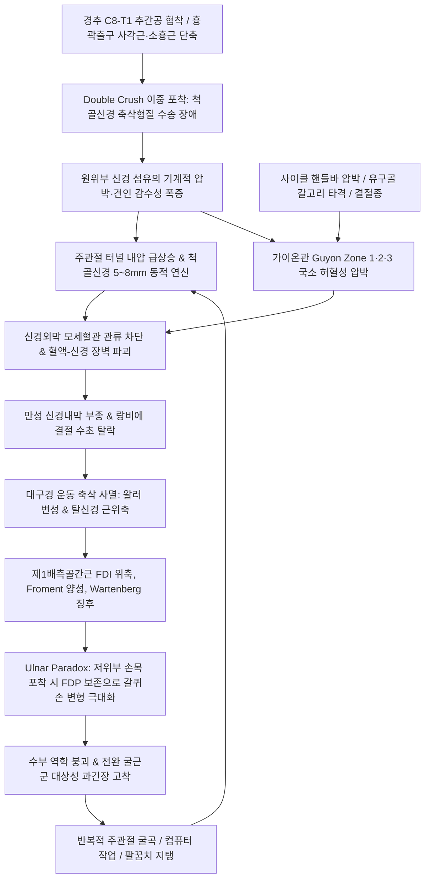

# ⚡ [[척골신경 포착]] (Ulnar Nerve Entrapment)

> **상위 분류**: [[근골격계 질환]] > [[상지 질환]] > [[말초신경포착]]
> **핵심 3줄 요약 (Key Summary)**:
> - 📍 병소 부위 & 해부·병태생리: 상완신경총 내측속(Medial cord, C8~T1)에서 기원한 [[척골신경]](Ulnar nerve)이 경추 C8-T1 추간공, 흉곽출구(사각근간극·늑쇄공간·소흉근하공간), 상완 내측근간중격 및 스트루더스 아케이드(Arcade of Struthers), 주관절 터널([[주관절 터널 증후군]], 오스본 인대), 전완 [[척측수근굴근]](FCU) 두 머리, 그리고 완관절 수근부의 가이온관([[가이온관 증후군]], Guyon's canal Zone 1·2·3)에 이르는 전 주행 경로에서 기계적 압박·만성 견인·마찰 및 미세혈관 허혈로 인해 신경 탈수초와 축삭 변성이 초래되는 상지 대표 [[신경포착]] 질환군.
> - 🚩 전형적 임상 양상 & 3대 징후: 손바닥 척측 1.5개 수지 및 손등 척측 2.5개 수지 저림(주관절 레벨) vs 손등 감각 정상 보존(수근부 가이온관 레벨), 수부 제1배측골간근(FDI) 및 소지구근 위축, [[프로망 징후]](Froment's sign), [[와텐버그 징후]](Wartenberg's sign), [[갈퀴손]](Claw hand) 변형 및 척골신경 역설(Ulnar paradox: 저위부 손목 포착에서 갈퀴손이 훨씬 심하게 나타남).
> - 🛠️ 핵심 감별 검사 & 한·양방 다각적 치료 전략: 경추 C7-T1 화타협척혈·[[전사각근]]·[[소흉근]] 선행 감압, 주관절 [[오스본 인대]]([[소해]] SI8) 및 수근부 가이온관(두상골-유구골 간극) 초음파 유도하 [[침도요법]] 미세 감압술, [[신바로약침]]·[[봉약침]](1:30,000) 신경 수력박리술(Hydrodissection), 두상골 요장측 관절 가동술 추나 및 [[오적산]], [[소경활혈탕]], [[보양환오탕]] 한약 투여.
> - ⚠️ 응급 의뢰 레드플래그 & 악화 요인: 주관절 소해혈 수직 직자 시 비가역적 신경 관통(Drop out) 및 가이온관 자침 시 척골동맥 천자 절대 주의(외측 박동 확인 후 보호), 급격한 FDI 골간근 함몰 및 핀치력 완전 상실, 보존적 치료 불응 시 감압술·전방 전위술 또는 슈퍼차지 전골간신경 이전술(SETS AIN transfer) 수부외과 협진 의뢰.

---

## 📌 목차
1. [질환 개요 & 해부학적 병태생리](#1-질환-개요--해부학적-병태생리)
2. [병태생리 메커니즘 & 생체역학적 악순환 네트워크](#2-병태생리-메커니즘--생체역학적-악순환-네트워크)
3. [임상 증상 & 이학적 검사(Physical Exam) 알고리즘](#3-임상-증상--이학적-검사physical-exam-알고리즘)
4. [감별 진단 매트릭스 (Differential Diagnosis)](#4-감별-진단-매트릭스-differential-diagnosis)
5. [한의 통합 치료 프로토콜 (침·약침·추나·한약)](#5-한의-통합-치료-프로토콜-침약침추나한약)
6. [양방 치료 & 병용·의뢰 기준 (Conventional Treatment & Referral)](#6-양방-치료--병용의뢰-기준-conventional-treatment--referral)
7. [재활 운동 & 생활습관 티칭 가이드](#7-재활-운동--생활습관-티칭-가이드)
8. [💡 사용자 진료실 핵심 필기 & 임상 노하우 (Melt-In 잔여 심화 집약)](#8--사용자-진료실-핵심-필기--임상-노하우-melt-in-잔여-심화-집약)
9. [출처 및 학술 참고 문헌 (References)](#9-출처-및-학술-참고-문헌-references)

---

## 1. 질환 개요 & 해부학적 병태생리

### 1) 개념 정의 및 척골신경의 기원
* **척골신경 포착(Ulnar Nerve Entrapment)**은 상완신경총 내측속(Medial cord)에서 분지하는 [[척골신경]](Ulnar nerve, C8~T1)이 경흉추 출구부터 액와, 상완, 주관절, 전완, 완관절(가이온관) 및 수부에 이르는 긴 주행 경로 상의 해부학적 협소 공간에서 기계적 압박, 과도한 견인(Traction), 마찰 및 미세혈류 허혈을 받아 발생하는 말초 [[신경포착]] 질환군을 총칭한다.
* 상지 말초신경 압박 증후군 중 [[수근관 증후군]](정중신경)에 이어 **두 번째로 높은 유병률**을 보이며, 가장 빈발하는 부위는 팔꿈치의 [[주관절 터널 증후군]](Cubital Tunnel Syndrome, CuTS)이고, 그 다음은 손목의 [[가이온관 증후군]](Guyon's Canal Syndrome / Ulnar Tunnel Syndrome)이다.
* 척골신경은 수부의 정밀한 운동을 관장하는 '손의 음악가 신경(Musician's nerve)'으로, 손바닥과 손등 척측의 감각뿐만 아니라 수부 내재근(Intrinsic muscles of the hand)의 대부분을 지배하여 젓가락질, 단추 채우기, 핀치력 및 악력 형성에 결정적인 역할을 수행한다.

### 2) 척골신경의 전 주행 경로와 6대 포착 호발 관문 (6 Entrapment Portals)
척골신경은 상지 전반에 걸쳐 총 6개의 좁은 해부학적 병목 구간을 통과하므로, 임상 진찰 시 단일 부위뿐만 아니라 전체 신경 경로를 계통적으로 추적해야 한다.
1. **경추 C8-T1 추간공 및 경추 심부 다열근 (Cervical Exit & Multifidus)**:
   * C8, T1 신경근이 척추간공을 빠져나오는 부위.
   * 경추 디스크 탈출([[경추 추간판 탈출증]])이나 척추증, 심부 경추 [[다열근]]의 경결로 인해 신경근 기시부가 1차 압박을 받는다.
2. **흉곽출구 복합체 (Thoracic Outlet Complex, [[TOS]])**:
   * 상완신경총의 하신경간(Lower trunk)과 내측속(Medial cord)이 통과하는 세 관문:
     * 사각근삼각(Scalene triangle): [[전사각근]]과 중사각근 사이.
     * 늑쇄공간(Costoclavicular space): 쇄골과 제1늑골 사이([[쇄골하근]]).
     * 소흉근하공간(Subpectoral tunnel): 오훼돌기 하부와 [[소흉근]] 사이.
   * 거북목, 라운드 숄더 및 흉식 호흡 패턴에서 척골신경 근위부 압박이 호발한다.
3. **상완 중앙부 내측 근간중격 & 스트루더스 아케이드 (Arcade of Struthers)**:
   * 상완 전방 구획에서 상완삼두근 내측두가 위치한 후방 구획으로 넘어가는 부위.
   * 내측상과 상방 약 8 cm 지점의 내측 근간중격(Medial intermuscular septum)과 삼두근 근막 섬유 띠인 스트루더스 아케이드(Arcade of Struthers)에 의해 신경이 눌릴 수 있다.
4. **주관절 터널 및 척측수근굴근 건궁 (Cubital Tunnel & Osborne's Ligament)**:
   * 척골신경 포착의 가장 흔한 원발 병소([[주관절 터널 증후군]]).
   * 상완골 내측상과 후구, 주관절 내측 측부인대(MCL) 후방 다발, [[오스본 인대]](Osborne's ligament), 그리고 [[척측수근굴근]](FCU) 상완두-척골두 사이 건궁(Aponeurotic band)에 의해 형성된 터널.
5. **전완 원위부 분지 구역 (Distal Forearm Branching Zone)**:
   * 완관절 상방 약 5~8 cm 지점에서 척골신경 **수배피지(Dorsal Cutaneous Branch of Ulnar Nerve, DCBN)**가 전완 척측으로 분지한다.
   * 이 분지는 가이온관을 경유하지 않고 곧바로 손등으로 가므로, 고위부(주관절)와 저위부(손목) 포착을 감별하는 결정적인 기준선이 된다.
6. **완관절 수근부 가이온관 (Guyon's Canal / Ulnar Tunnel)**:
   * 수근부 척측에 위치한 섬유골성 터널로, 손목을 꺾거나 손바닥으로 체중을 지탱할 때 척골신경 본간 및 그 분지가 기계적으로 압박받는다.

### 3) 가이온관(Guyon's Canal)의 3차원 해부학과 3대 임상 구역 (Zones of Gross & Gelberman)
가이온관은 완관절 전면 척측에 위치하는 길이 약 4 cm의 섬유골성 공간이다.
* **해부학적 경계 (Boundaries)**:
  * **내측벽 (Medial Wall)**: [[두상골]](Pisiform) 및 소지외전근(ADM) 기시부.
  * **외측벽 (Lateral Wall)**: [[유구골]](Hook of hamate) 갈고리.
  * **바닥 (Floor)**: 횡수근인대(TCL) 척측부 및 두유인대(Pisohamate ligament), 두척인대(Pisometacarpal ligament).
  * **지붕 (Roof)**: 장측 수근인대(Volar carpal ligament), 장장근(Palmaris longus) 근막 연장부 및 단장근(Palmaris brevis).
* **3대 임상 구역 (Zones 1, 2, 3 of Guyon's Canal)**:
  1. **Zone 1 (근위부 혼합 구역, Proximal to Bifurcation)**:
     * 두상골 기저부부터 척골신경이 운동지와 감각지로 분지하기 직전까지의 구간.
     * 신경 본간(운동 섬유 + 감각 섬유 혼재)과 척골동맥이 함께 주행.
     * **임상 양상**: 수부 내재근 마비(골간근, 소지구근 위축)와 제4·5지 장측(손바닥) 감각 저하가 **동시에 발생**함. 단, 손등 감각은 정상 보존됨.
     * **호발 원인**: 유구골 갈고리 골절, 주상골-두상골 관절염, 거대 결절종(Ganglion cyst).
  2. **Zone 2 (심부 원위부 운동 구역, Deep Motor Branch)**:
     * 척골신경 심부 운동지(Deep motor branch)가 유구골 갈고리 아래를 감아 돌아 손바닥 깊은 층으로 들어가는 경로.
     * **임상 양상**: **순수 운동 마비(Pure Motor Deficit)**. 제1배측골간근(FDI), 골간근 전반, 무지내전근, 제3·4충양근 위축 및 약화 발생. **감각 저하는 전혀 없음(감각 완전 정상)**.
     * **호발 원인**: 유구골 갈고리 골절(야구 배트, 골프채 그립 타격), 반복적 수장부 타박(목수, 기계공, 사이클 핸들바 압박).
  3. **Zone 3 (천부 원위부 감각 구역, Superficial Sensory Branch)**:
     * 척골신경 천부 감각지(Superficial branch)가 소지구 표면을 지나 제4·5수지 장측으로 가는 경로.
     * **임상 양상**: **순수 감각 이상(Pure Sensory Deficit)**. 제4수지 척측 1/2 및 제5수지 손바닥 쪽 저림과 작열통 발생. **근력 약화나 근위축은 전혀 없음(운동 완전 정상)**.
     * **호발 원인**: 척골동맥류(Ulnar artery aneurysm), 척골동맥 혈전증(Hypothenar Hammer Syndrome), 천층 표재 결절종.

### 5) 척골신경 주행 경로 상 6대 포착 호발 관문 비교 매트릭스
| 포착 관문 (Portals) | 해부학적 협착 구조물 | 주요 유발 요인 및 생체역학 | 특징적 임상 증상 및 지각 이상 구역 | 감별 및 특이 진찰 검사 |
| :--- | :--- | :--- | :--- | :--- |
| **Port 1: 경추 C8-T1 추간공** | C7-T1 추간판, 구추관절 골극, 경추 심부 [[다열근]] | 경추 퇴행성 협착, 거북목, 채찍질 손상 | 목-견배부 통증, 4·5지 저림, **전완 내측 피부 감각 저하 동반** | [[스펄링 검사]](+), 경추 신경근 차단술 반응 |
| **Port 2: 흉곽출구 ([[TOS]])** | [[전사각근]]-중사각근 간극, 늑쇄공간([[쇄골하근]]), [[소흉근]] | 라운드 숄더, 무거운 백팩, 흉식 호흡 | 액와-상지 내측 방사통, 팔 거상 시 저림 폭증, 맥박 감약 | Roos 검사(+), Adson 검사(+), Wright 검사(+) |
| **Port 3: 상완 내측 근간중격** | 내측 근간중격 관통부, 스트루더스 아케이드(Arcade of Struthers) | 삼두근 내측두 비후, 외상 후 반흔 조직 | 상완 내측부 뻐근함, 팔꿈치 굴곡 시 견인성 저림 | 내측 근간중격 압통, 상과 상방 8cm 타진통 |
| **Port 4: 주관절 터널 ([[주관절 터널 증후군]])** | 내측상과 후구, [[오스본 인대]], [[척측수근굴근]](FCU) 건궁 | 반복적 주관절 굴곡 >90°, 팔꿈치 지탱, 척골신경 아탈구 | 제4·5수지 저림, **손등 척측 감각 저하 100% 동반**, FDI 위축 | [[주관절 굴곡 검사]](+), 내측상과 후구 Tinel(+) |
| **Port 5: 전완 원위부 분지대** | 전완 심부 근막, 수배피지(DCBN) 분지부(완관절 상방 5~8cm) | 전완 척측 외상, 열상, 전완 굴근군 만성 구획 증후군 | 손등 척측 단독 이상감각 또는 손바닥 보존형 손등 저림 | 전완 척측 원위부 타진통, 국소 반흔 압통 |
| **Port 6: 수근부 가이온관 ([[가이온관 증후군]])** | [[두상골]]-유구골 구, 장측 수근인대, 두유인대 | 자전거 핸들바 압박(사이클), 망치질 타격, 결절종, 유구골 골절 | 제4·5수지 손바닥 저림, **손등 감각 완전 정상**, 갈퀴손 심화 | Guyon관 압박 검사(+), 두상골 외측 Tinel(+) |

### 4) 신경 문합 변이 및 해부학적 변이 근육
* **신경 문합 변이 (Neural Anastomoses)**:
  * **Martin-Gruber 문합 (MGM)**: 전완부에서 정중신경의 운동 축삭 일부가 척골신경으로 교차 문합되는 변이(인구의 15~20%). 주관절 레벨에서 척골신경이 심하게 손상되었음에도 불구하고 수부 내재근 기능이 보존되거나, 근전도 상 모호한 전도 속도를 나타내는 원인이 됨.
  * **Riche-Cannieu 문합 (RCM)**: 손바닥 내부에서 정중신경 무지구 반회분지와 척골신경 심지 사이에 발생하는 운동 문합.
  * **Marinacci 문합**: 전완부에서 척골신경 축삭이 정중신경으로 넘어가는 역행성 문합.
  * **Berrettini 문합**: 수장부에서 제3수지 정중신경 디지털 분지와 제4수지 척골신경 디지털 분지 간의 감각 문합(인구의 60~80%).
* **해부학적 변이 근육 (Anomalous Muscles)**:
  * 최신 방사선 및 수부외과 연구(Stadelmeier et al., 2026; Bouredoucen et al., 2026; §9 참고)에 따르면, 부척측수근굴근(Accessory FCU)이나 부소지외전근(Abductor digiti minimi accessorius)과 같은 비정상적인 근육 융기가 가이온관 내부나 주관절 터널에 존재할 경우, 운동 시 척골신경을 동적으로 압박하는 희귀한 원발 원인이 된다.

---

## 2. 병태생리 메커니즘 & 생체역학적 악순환 네트워크

### 1) 다단계 압박 증후군 (Double Crush Syndrome, DCS) 메커니즘
* 척골신경 축삭은 길이가 1미터에 달하는 단일 신경세포의 연장체이다.
* 경추 C8-T1 신경근이나 흉곽출구([[TOS]]) 등 근위부에서 미세한 물리적 압박이 발생하면, 신경 세포체에서 말초 종판으로 단백질, 신경전달물질 및 미토콘드리아를 공급하는 **순방향 축삭 원형질 수송(Anterograde axoplasmic transport)**이 저하된다.
* 그 결과 원위부 신경 축삭의 막 전위 유지능과 완충 용량이 고갈되어, 주관절 터널이나 가이온관 부위의 가벼운 외력이나 자세성 굴곡 스트레스에도 신경세포가 버티지 못하고 조기에 탈수초화 및 축삭 절손으로 직행하게 된다.

### 2) 주관절(고위부) vs 가이온관(저위부) 포착의 생체역학적 특성 비교
* **주관절 터널 (CuTS)**:
  * **동적 스트레스(Dynamic Stress) 중심**: 관절 굴곡 시 신경이 늘어나는 견인력(Tension), 오스본 인대 긴장에 따른 터널 내압 급상승(Compression), 내측상과 뼈 모서리를 타고 넘는 아탈구 마찰(Friction)이 복합 작용.
  * 감각 저하 구역: 수배피지(DCBN)가 포함되어 **손등과 손바닥 척측 모두** 저림.
* **가이온관 증후군 (Guyon's Canal)**:
  * **정적 압박 및 외상성 전단력(Direct Compression & Shear) 중심**: 자전거 핸들바를 누르는 체중 부하(Cyclist's palsy), 망치질 등 진동 공구 타격, 유구골 골절 편, 결절종에 의한 물리적 점유성 압박.
  * 감각 저하 구역: DCBN 분지 하부이므로 **손등 감각은 완벽히 정상이고, 손바닥 척측에만 국한**됨.

### 3) 척골신경 역설 (Ulnar Paradox)의 생체역학적 원리
임상에서 관찰되는 매우 흥미롭고 역설적인 신경학적 현상이다.
* **정의**: 척골신경 손상 부위가 팔꿈치처럼 **근위부(고위부)일 때보다 손목처럼 원위부(저위부)일 때 갈퀴손(Claw hand) 기형이 훨씬 더 심하고 흉측하게 나타나는 현상**.
* **기전 분석**:
  * **고위부(팔꿈치 CuTS) 손상 시**:
    * 척골신경이 전완 근위부에서 분지하는 [[심지굴근]](Flexor Digitorum Profundus, FDP)의 제4·5수지 척측두 근육까지 함께 마비된다.
    * 따라서 손가락 끝마디(DIP 관절)를 강력하게 굽혀주는 힘줄의 장력이 상실되므로, 수부 내재근이 마비되었음에도 불구하고 손가락 끝이 심하게 구부러지지 않아 갈퀴손 변형이 비교적 경미하게 보인다.
  * **저위부(손목 가이온관) 손상 시**:
    * 손목보다 훨씬 위에서 이미 분지를 마친 [[심지굴근]](FDP) 척측두의 근력은 **100% 정상으로 보존**된다.
    * 반면 수부의 [[골간근]]과 제3·4충양근(MCP를 굽히고 IP를 펴는 근육)만 선택적으로 마비된다.
    * 그 결과 정상적인 FDP 힘줄이 제4·5수지 지간관절(PIP, DIP)을 강력한 힘으로 손바닥 쪽으로 끝까지 끌어당겨 굴곡시키고, 대항마를 잃은 장지신근(EDC)은 MCP 관절을 뒤로 과신전시켜 **극단적이고 전형적인 갈퀴손(Claw hand) 기형이 고착**된다.

### 4) 말초신경 미세혈류 역동학(Microcirculation)과 허혈 임계치
* **정상 신경외막 혈류망 구조**:
  * 척골신경은 외부에서 들어오는 분절성 영양 동맥(Arteria nervorum)이 상신경막(Epineurium) 표면에서 풍부한 모세혈관 망을 형성하고, 신경주막(Perineurium)을 관통하여 신경내막(Endoneurium) 모세혈관으로 연속되는 치밀한 미세혈관 신경망을 갖추고 있다.
* **신경내 혈류 차단의 생리학적 임계치**:
  * 정상 상태의 신경내 모세혈관 관류압은 약 20~30 mmHg이다.
  * 조직 내압이 20~30 mmHg에 도달하면 신경내 미세 소정맥이 가장 먼저 허탈되어 정맥 울혈과 저산소증이 촉발된다.
  * 관내 압력이 **30~45 mmHg를 초과하면 모세혈관 관류가 전면 차단**되어 급성 신경 허혈이 발생한다.
  * 신경 견인(Tension) 역학: 신경 길이가 정상 대비 **8% 신장되면 신경내 정맥 혈류가 50% 차단**되고, **15% 이상 신장되면 모세혈관 관류가 100% 전면 중단**된다. 주관절 완전 굴곡 시 척골신경이 5~8mm(약 5~10%) 연신되므로, 굴곡 자세 자체가 신경 허혈을 직접 유발하는 생체역학적 원인이 된다.

---

## 3. 임상 증상 & 이학적 검사(Physical Exam) 알고리즘

### 1) 주요 임상 증상 및 감각 분포의 해부학적 한계
* **감각 장애의 분포**:
  * 손바닥: 제5수지 전체, 제4수지 척측 1/2 및 소지구 피부의 저림, 둔감, 찌릿함, 개미 기어감.
  * 손등: 고위부(주관절) 손상 시 손등 척측 1.5~2.5수지 감각 저하 동반 vs 저위부(가이온관) 손상 시 손등 감각 완전 정상.
  * ⚠️ **전완 내측 피부 감각**: 전완 내측 피부는 척골신경이 아니라 상완신경총 내측속에서 직접 나오는 **내측전완피신경(MABC)**이 지배하므로, 순수 척골신경 포착 환자는 팔뚝 안쪽 피부 감각이 완전히 정상이어야 한다.
* **운동 마비 및 수부 기능 저하**:
  * 수부 내재근 마비로 인해 열쇠 돌리기, 젓가락질, 단추 채우기, 타자 치기 등 정밀 핀치력과 파지력이 급격히 감퇴한다.
* **특징적 4대 임상 기형 및 징후**:
  1. **제1배측골간근(FDI) 위축**: 엄지와 검지 사이 손등 근육(합곡혈 부위)이 푹 꺼져 함몰됨.
  2. **[[와텐버그 징후]](Wartenberg's Sign)**: 제3수장골간근 마비로 인해 제5지 내전이 불가능해져, 새끼손가락이 네 번째 손가락에서 바깥쪽으로 벌어진 채 주머니 입구에 걸림.
  3. **[[갈퀴손]](Claw Hand / Duchenne Sign)**: D4, D5의 중수지관절 과신전 및 지간관절 굴곡 변형.
  4. **[[프로망 징후]](Froment's Sign)**: 무지내전근 마비로 인해 엄지와 검지로 종이를 쥘 때 FPL을 과보상하여 엄지 지간관절(IP)을 90° 꺾음.

### 2) 특이적 이학적 유발 검사 알고리즘
1. **주관절 굴곡-압박 검사 (Flexion-Compression Test)**: 주관절 90° 굴곡 상태에서 척골신경구를 30초간 압박하여 척측 수지 저림 유발 시 주관절 터널 병변 진단.
2. **티넬 징후 (Tinel's Sign at Elbow & Wrist)**:
   * 주관절 내측상과 후구 타진 $\rightarrow$ 주관절 포착 확인.
   * 손목 두상골 외측 가이온관 타진 $\rightarrow$ 가이온관 포착 확인.
3. **가이온관 압박 검사 (Guyon's Canal Compression Test)**:
   * 검사자의 양 엄지로 두상골과 유구골 갈고리 사이 가이온관을 30~60초간 직접 강하게 압박할 때 제4·5수지 저림이나 통증이 재현되면 양성.
4. **상지 신경긴장검사 3형 (ULTT 3형 / Elvey Test)**:
   * 어깨 외전 90°, 손목 신전, 전완 회외, 주관절 완전 굴곡(안경 쓰기 자세) 시 방사통 유발.
5. **알렌 검사 (Allen's Test)**:
   * 가이온관 증후군 환자에서 동반될 수 있는 척골동맥류나 척골동맥 혈전증(가소지구 망치 증후군, Hypothenar Hammer Syndrome)을 감별하기 위해 요골동맥과 척골동맥을 동시 압박 후 척골동맥 개통 시 수부 모세혈관 재충혈 시간을 측정.

### 3) 전기진단학(EMG/NCV) 및 영상의학 정밀 평가
* **신경전도 검사 (NCV)**:
  * **병변 국소화(Localization)**: 주관절 횡단 구간(Across-elbow) 전도 속도 저하(<50 m/s) 유무를 측정하여 주관절(CuTS)인지 손목(Guyon)인지 명확히 판별.
  * 가이온관 포착 시: 손목-소지외전근(ADM) 및 손목-제1배측골간근(FDI) 원위부 운동 잠시(Distal Motor Latency, DML) 지연 측정.
* **침근전도 (Needle EMG)**:
  * 척측수근굴근(FCU), 심지굴근 척측두(FDP), 소지외전근(ADM), 제1배측골간근(FDI)을 동시 검사.
  * FCU/FDP에서 탈신경 전위가 나오면 병변은 주관절 이상 레벨임. FCU/FDP는 정상이고 ADM/FDI에서만 탈신경 전위가 나오면 병변은 가이온관 레벨임.
* **고해상도 초음파 검사 (HRUS)**:
  * 주관절 내측상과 레벨: 척골신경 단면적(CSA ≥ 10 mm²) 측정.
  * 수근부 가이온관 레벨: 결절종(Ganglion cyst), 척골동맥류, 유구골 골절 편 및 해부학적 변이 근육(부척측수근굴근 등) 유무를 실시간 감별 (§9 참고).

### 4) 척골신경 전기진단학적(NCV/EMG) 감별 기준 매트릭스
| 검사 항목 | 정상 기준치 | 주관절 터널 증후군 (CuTS) | 가이온관 증후군 (Zone 1) | 가이온관 증후군 (Zone 2) | 가이온관 증후군 (Zone 3) | 경추 C8 신경근병증 |
| :--- | :--- | :--- | :--- | :--- | :--- | :--- |
| **주관절 횡단 NCV** | > 50 m/s | **< 50 m/s 또는 전완 대비 10 m/s 이상 저하** | 정상 (> 50 m/s) | 정상 (> 50 m/s) | 정상 (> 50 m/s) | 정상 |
| **손목-수부 운동 잠시 (DML)** | < 3.5 ms | 정상 또는 2차성 지연 | **> 3.8 ms (ADM/FDI 지연)** | **> 3.8 ms (FDI 단독 지연)** | **완전 정상** | 정상 또는 경미 지연 |
| **제5수지 감각 SNAP** | > 15 uV, < 3.2 ms | **진폭 저하 또는 소실** | **진폭 저하 또는 소실** | **완전 정상** | **진폭 저하 또는 소실** | **정상 (추간공 후방 병변)** |
| **수배피지(DCBN) SNAP** | > 15 uV | **진폭 저하 또는 소실** | **완전 정상** | **완전 정상** | **완전 정상** | 정상 또는 저하 |
| **침근전도: FCU / FDP** | 자발전위 없음 | **탈신경 자발전위 관찰 가능** | **완전 정상** | **완전 정상** | **완전 정상** | 정상 또는 약화 |
| **침근전도: FDI / ADM** | 자발전위 없음 | **탈신경 자발전위 출현** | **탈신경 자발전위 출현** | **탈신경 자발전위 출현** | **완전 정상** | 탈신경 전위 다발 |
| **침근전도: C8 경추 척추주위근** | 자발전위 없음 | **완전 정상** | **완전 정상** | **완전 정상** | **완전 정상** | **탈신경 자발전위 출현** |

---

## 4. 감별 진단 매트릭스 (Differential Diagnosis)

| 감별 항목 | 주관절 터널 증후군 (CuTS) | 가이온관 Zone 1 (혼합) | 가이온관 Zone 2 (순수운동) | 가이온관 Zone 3 (순수감각) | 경추 C8 신경근병증 ([[경추 추간판 탈출증]]) | 흉곽출구 증후군 ([[TOS]]) | 내측전완피신경 (MABC) | 루게릭병 (ALS 초기) |
| :--- | :--- | :--- | :--- | :--- | :--- | :--- | :--- | :--- |
| **주 포착 병소** | 내측상과 후구 & 오스본 인대 | 가이온관 근위부 본간 | 유구골 갈고리 심부 | 가이온관 천부 감각지 | C7-T1 추간공 | 사각근 / 늑쇄공간 | 상완 내측 근간중격 | 척수 전각 운동신경원 |
| **손바닥 4·5지 감각** | **저림·감각 저하** | **저림·감각 저하** | **완전 정상** | **저림·감각 저하** | 저림 동반 | 저림 동반 | **완전 정상** | **완전 정상 (감각 침범 없음)** |
| **손등 척측 감각** | **감각 저하 동반 (DCBN)** | **완전 정상 (DCBN 보존)** | **완전 정상** | **완전 정상** | 감각 저하 동반 가능 | 감각 저하 동반 가능 | 완전 정상 | **완전 정상** |
| **전완 내측 감각** | 완전 정상 | 완전 정상 | 완전 정상 | 완전 정상 | **전완 내측 감각 저하** | **전완 내측 피하 저하** | **전완 내측에만 국한** | 완전 정상 |
| **수부 내재근 (FDI)** | **위축 및 위약** | **위축 및 위약** | **위축 및 위약** | **완전 정상 (운동 보존)** | 위약 동반 가능 | 위약 동반 가능 | 완전 정상 | **극심한 위축 및 속박수축** |
| **FCU 근력** | 위약 가능 | **완전 정상** | **완전 정상** | **완전 정상** | 정상 또는 경미 약화 | 정상 | 완전 정상 | 정상 또는 동반 약화 |
| **갈퀴손 변형** | 경미~중등도 | **극심 (Ulnar Paradox)** | **극심 (Ulnar Paradox)** | **없음** | 드묾 | 드묾 | 없음 | 손가락 처짐 (Drop finger) |
| **결정적 진단점** | 주관절 굴곡 검사(+), CSA>10 | Guyon Tinel(+), 유구골 압통 | 순수 운동 마비, 감각 정상 | 순수 감각 이상, 운동 정상 | [[스펄링 검사]](+), 목 신전 방사 | Roos(+), Adson(+), 맥박 감약 | Tinel at medial forearm | 광범위 다분절 Fasciculation |

### 감별 진단의 핵심 4대 원칙
1. **손등(Dorsum) 감각 확인으로 주관절과 가이온관을 즉각 분리**:
   * 손바닥 4·5지는 저린데 **손등 감각이 완벽히 정상이라면 100% 가이온관 증후군**이다. 손등까지 먹먹하다면 주관절 터널 증후군이다.
2. **가이온관 증후군의 Zone 1, 2, 3 분리 감별**:
   * 감각과 운동이 모두 마비되면 Zone 1.
   * 감각은 완벽히 정상인데 FDI 근육만 마르고 젓가락질이 안 되면 Zone 2 (유구골 골절 의심).
   * 근력은 짱짱한데 손바닥 4·5지 끝만 찌릿하면 Zone 3 (척골동맥류, 결절종 의심).
3. **전완 안쪽(내측) 감각 이상 동반 시 상부 병변(경추 C8/TOS) 확정**:
   * 4·5지 저림과 함께 팔뚝 안쪽 피부가 저리면 척골신경 단독 병변이 아니라 내측전완피신경(MABC)을 공유하는 상완신경총 내측속 또는 경추 신경근 병증이다.
4. **루게릭병(ALS) 초기 수부 골간근 단독 위축과의 치명적 감별**:
   * 환자가 찌릿함이나 저림 등 **감각 이상을 전혀 호소하지 않으면서**, 손등 제1배측골간근(FDI)이 심하게 말라 들어가고 근육이 실룩거리는 속박수축(Fasciculation)이 관찰된다면 운동신경원 질환(ALS)을 강력히 의심해야 한다. NCV 상 감각 SNAP는 완벽히 정상인데 다분절 침근전도 상 광범위 탈신경 전위가 확인된다.

---

## 5. 한의 통합 치료 프로토콜 (침·약침·추나·한약)

### 1) 초음파 유도하 침도 다단계 신경 감압술 (Ultrasound-Guided Acupotomy)
이중 포착(Double crush) 병태를 해소하기 위해 상부 경추부터 주관절, 수근부까지 3단계로 침도 감압을 적용한다.
* **Level 1 (경흉추 신경근 출구 감압)**:
  * C7-T1 화타협척혈 심부 자입으로 척골신경 기시부 다열근 및 회선근의 섬유성 경결을 박리하여 축삭 원형질 수송을 회복.
* **Level 2 (주관절 터널 감압점)**:
  * 상완골 내측상과 후면 [[오스본 인대]] 부착부 및 [[척측수근굴근]](FCU) 두 머리 사이 건궁.
  * 내측상과 골면에 연접하여 종축으로 침도날을 진입, 인대 섬유 띠를 1~2회 미세 절개하여 터널 내압을 즉각 감압.
* **Level 3 (수근부 가이온관 감압점)**:
  * 두상골과 유구골 갈고리 사이 장측 수근인대(Volar carpal ligament) 천층.
  * **절대적 혈관 보호 수칙**: 가이온관 내부에는 척골신경 바로 외측에 **척골동맥(Ulnar artery)**이 동행하므로, 시술 전 반드시 초음파 도플러 또는 손가락 촉진으로 척골동맥 박동을 확인한 후 동맥을 외측으로 견인·보호하면서 두상골 내측 골면에 붙여 안전하게 미세 감압한다.

### 2) 침구 치료 & 저주파 전침 (Acupuncture & Electroacupuncture)
* **표준 혈위 처방**:
  * **주관절 및 전완부**: [[소해]](SI8), [[소해]](HT3), 지정(SI7), 양로(SI6), [[곡택]](PC3).
  * **수근부 및 수부**: 양곡(SI5), 완골(SI4), 신문(HT7), 후계(SI3), [[합곡]](LI4), [[팔사]](EX-UE9).
  * **상부 연계혈**: C7-T1 화타협척혈, 견정(GB21), 천정(SI16), 중부(LU1).
* **2Hz 저주파 전침의 신경 재생 기전**:
  * 전극 연결: [[소해]](SI8)와 후계(SI3)를 음극/양극으로 연결하여 척골신경 주행로를 따라 전류가 통전되도록 세팅.
  * 통전 파라미터: 2Hz 연속파(Continuous wave), 20~25분간 유침.
  * 효과: 축삭 내 미토콘드리아 활성화, 역치 정상화, 수부 내재근의 탈신경 위축 억제.

### 3) 초음파 유도하 약침 & 신경 수력박리술 (Pharmacopuncture Hydrodissection)
* **신경 수력박리술(Hydrodissection) 프로토콜**:
  * 고해상도 초음파 단축 뷰 하에서 척골신경 상신경막 주변에 주사침을 위치시키고, 약침액 1.5~2.0 cc를 주입하여 유착된 오스본 인대나 가이온관 장측 인대로부터 신경을 수력학적으로 360° 박리(Peeling off).
* **약침 제제 선택**:
  * [[신바로약침]]: 신경외막의 무균성 염증 억제 및 신경성장인자(NGF, BDNF) 촉진.
  * [[봉약침]] (Sweet BV 1:30,000): 만성 섬유화된 인대 결합조직 리모델링.
  * [[중성어혈약침]]: 급성 부종성 신경 압박기 정맥 울혈 해소.
  * [[자하거약침]]: 제1배측골간근(FDI) 함몰 및 소지구 위축 부위에 주 2회 시술하여 근육 퇴행성 괴사 억제.

### 4) 추나 요법 & 관절 가동술 (Chuna & Manipulation)
* **두상골 요장측 관절 가동술 (Pisiform Mobilization)**:
  * 환자의 손바닥을 위로 향하게 한 후, 시술자의 엄지로 [[두상골]](Pisiform)을 파지한다.
  * 두상골을 **요측(Radial) 및 장측(Palmar) 방향으로 부드럽게 글라이딩(Gliding)**시켜 가이온관의 단면적을 물리적으로 확장시킴 (1회 10초 유지, 5회 반복).
* **상완척골관절 가동술**:
  * 주두를 후하방으로 당겨 주관절 내측 관절낭의 긴장을 해소.
* **척골신경 동적 활주 운동 (OK 안경 글라이딩)**:
  * 팔꿈치를 굽히며 손목을 젖히고 귀 옆으로 가져가 안경을 쓰는 신경 활주 수기 적용.

### 5) 변증별 한약 처방 (Herbal Medicine)
* **급성 신경 부종 및 경락 어혈형 (야간 작열통, 찌릿함, 국소 압통)**:
  * 처방: [[오적산]](五積散) 합 [[당귀수산]](當歸鬚散) 가미방.
  * 구성: [[당귀]], [[천궁]], 적작약, [[도인]], [[홍화]], [[창출]], [[후박]], [[진피]], [[지롱]](地龍), [[우슬]].
  * 기전: 신경외막 미세혈관 울혈을 뚫고 신경내막 삼출액을 흡수 배출.
* **만성 경락 어체 및 마목형 (수부 이상감각, 만성 통증, 손 시림)**:
  * 처방: [[소경활혈탕]](疎經活血湯) 또는 [[서경탕]](舒經湯).
  * 약리 기전: [[강활]], [[독활]], 천궁, 당귀가 전완 척측과 수지 말초 혈류를 복원.
* **기혈양허 및 만성 근위축형 (FDI 근위축, 갈퀴손 기형, 악력 소실)**:
  * 처방: [[보양환오탕]](補陽還五湯) 가미방.
  * 구성: [[황기]](40~60g 대량 군약), [[당귀]](8g), 적작약(6g), [[천궁]](6g), [[도인]](6g), [[홍화]](6g), [[지룡]](6g)에 [[계혈등]](鷄血藤), [[상지]](桑枝), [[오가피]] 가미.
  * 약리 기전: 대보원기(大補元氣)하여 신경 세포체로부터의 축삭 원형질 수송을 가속화하고 손상된 미엘린 수초의 재수초화를 유도.

---

## 6. 양방 치료 & 병용·의뢰 기준 (Conventional Treatment & Referral)

> 🎯 **이 섹션의 목적**: 척골신경 포착 환자의 다수가 정형외과나 신경과에서 약물 복용이나 주사 치료를 경험하고 내원한다. 1차 진료 현장에서 양방 약제와 시술의 특성을 명확히 파악하고, 한의 치료와의 병용 시너지를 극대화하며, 외과적 감압술이나 신경 이전술이 반드시 필요한 골든타임을 정확히 포착하여 전원 의뢰를 결정하기 위함이다.

### 1) 약물 치료 (Medications)
* **경구 NSAIDs & 단기 스테로이드**:
  * [[소염진통제]](Celecoxib 200mg qd, Meloxicam 7.5mg qd): 건막염 및 활액막염 부종 완화를 위해 투여되나 구조적 신경 압박 해소에는 한계.
* **신경병증성 통증 조절제**:
  * [[프레가발린]](Pregabalin 75~150mg bid), [[가바펜틴]](Gabapentin 300~900mg tid): 중추 감작 및 이소성 자발 방전을 억제하여 야간 작열통 조절. 어지럼증, 졸림, 체중 증가 모니터링 필수.
* **신경 대사 보조제**:
  * 메코발라민(Mecobalamin 500mcg tid): 활성 비타민 B12 제제로 축삭 대사 활성화.

### 2) 비수술적 중재 시술 (Procedures)
* **야간 신전 부목 (Night Extension Splinting, [[부목]])**:
  * 주관절 레벨 포착 환자에서 주관절을 30~45° 약한 신전 상태로 고정하여 야간 관내압 상승을 차단.
* **사이클리스트 패딩 장갑 및 핸들바 젤 패드**:
  * 가이온관 증후군 환자에서 수장부 척측에 가해지는 체중 부하를 분산.
* **초음파 유도하 코르티코스테로이드 주사 (CSI)**:
  * 주관절 터널 또는 가이온관 내부에 트리암시놀론 10~20mg 주입.
  * **위험성**: 척골신경은 천층에 위치하여 신경 내 직접 주사 시 비가역적 괴사 및 영구 마비 위험이 높음. 가이온관 주사 시 척골동맥 천자 위험이 있으므로 초음파 가이드가 필수적임.

### 3) 외과적 수술 술식 (Surgical Interventions)
* **수술의 절대적 적응증**:
  * 3~6개월 이상의 적극적 보존 치료에도 지속되는 심각한 감각 소실.
  * 제1배측골간근(FDI) 또는 소지구근의 명확한 근위축 및 악력 상실.
  * 갈퀴손(Claw hand) 기형의 고착 진행.
  * 유구골 골절 편이나 결절종 등 명확한 종괴성 병변이 확인된 경우.
* **주요 수술 술식 비교**:
  1. **주관절 수술 (CuTS)**:
     * 단순 감압술(In situ decompression) vs 척골신경 전방 전위술(피하, 근막간, 근육하).
     * 아탈구가 없는 경우 단순 감압술이 조기 회복에 우수함.
  2. **가이온관 수술 (Guyon's Canal Release)**:
     * 완관절 척측을 절개하고 장측 수근인대(Volar carpal ligament)를 절개하여 Zone 1, 2, 3를 완전 감압. 결절종이 있을 경우 완전 적출.
     * 최신 임상 연구(Tong et al., 2026; §9 참고): 갈퀴손 변형을 동반한 제1형 가이온관 증후군 환자 11례 분석 결과, 수술적 감압술 후 90.9%에서 갈퀴손 기형의 완전 교정과 현저한 수부 악력 회복을 달성함.
  3. **슈퍼차지 전골간신경 이전술 (Supercharged End-to-Side AIN Transfer, SETS)**:
     * 고위부 만성 척골신경 손상 환자에서 전골간신경(AIN)의 방형회내근 운동 분지를 척골신경 심부 운동 신경 다발에 단측 문합하여 손목 근처에서 수부 내재근을 조기 재지배시킴.
     * 최신 신경해부학 연구(Cha et al., 2025; §9 참고): SETS 신경 이전술 시 척골신경 내 최적의 수용 신경 다발(Golden recipient fascicles)을 전기 자극으로 식별하여 문합 성공률을 극대화함.

### 4) 한의 병용 판단 및 상호작용 (Integrative Protocol)
* **병용 가능 및 시너지**:
  * 가바펜티노이드 복용 환자에게 한의 [[전침치료]] 및 [[약침요법]]을 병용하면 진통 시너지가 극대화되어 약물 복용량을 조기 감량할 수 있음.
  * 수술 후 환자에게 침구 치료와 저주파 전침을 적용하면 수술 후 반흔 유착을 방지하고 신경 재생 속도를 현저히 가속화함.
* **약물 감량(Tapering) 타이밍**:
  * 한의 치료 4~6주 후 야간 저림이 소실되고 일상생활 통증이 안정되면 2~4주에 걸쳐 서서히 약물을 감량.
* **병용 금기**:
  * 국소 스테로이드 주사 후 2주간은 동일 부위 침도 및 심부 자침 엄격 금기.

### 5) 양방·전문과 의뢰 레드플래그 기준 (Referral Criteria)
1. **즉시 외과 전원 기준**:
   * 제1배측골간근(FDI)의 급격한 위축 진행 및 정밀 핀치력 완전 소실.
   * 유구골 갈고리 골절 의심 소견(외상 후 극심한 가이온관 압통).
   * 척골동맥류 의심 소견(소지구 부위 박동성 종괴, 수지 허혈성 청색증).
2. **신경과 정밀 의뢰 기준**:
   * 감각 이상 없이 양측 수부 내재근의 대칭적 위축과 근육 속박수축이 동반될 때 (ALS 감별).

---

## 7. 재활 운동 & 생활습관 티칭 가이드

### 1) 척골신경 자가 신경 활주 운동 (Ulnar Nerve Neurodynamic Flossing)
주관절과 손목 터널 내부에서 척골신경의 원활한 글라이딩을 유도하는 5단계 운동이다. 매일 10회씩 3세트 시행한다.
1. **준비 자세**: 팔꿈치를 90° 굽히고 손바닥을 앞을 향하게 세운다.
2. **OK 사인**: 엄지와 검지로 원을 만들고 나머지 세 손가락은 편다.
3. **손목 신전 및 회외**: 손목을 뒤로 젖히며 손바닥이 위를 향하게 전완을 돌린다.
4. **안경 쓰기 동작**: 손을 귀 옆으로 가져가 OK 사인을 눈 주위에 대며 안경을 쓰듯 돌려 5초간 유지한다.
5. **원위치**: 부드럽게 시작 자세로 복귀한다.

### 2) 수부 내재근 등척성 강화 운동
* **고무줄 손가락 벌리기 (골간근 강화)**:
  * 손가락 외측에 고무줄을 끼우고 손가락을 부채꼴로 최대한 벌려 5초 유지 후 천천히 모은다.
* **종이 집기 등척성 운동 (무지내전근 강화)**:
  * 명함이나 종이를 엄지와 검지 옆면 사이에 끼우고 엄지 끝마디를 곧게 편 상태에서 10초간 힘껏 쥔다.

### 3) 생활습관 및 인간공학적(Ergonomics) 지침
* **사이클리스트 티칭**:
  * 젤 패드가 장착된 사이클 전용 패딩 장갑을 반드시 착용한다.
  * 라이딩 중 드롭바, 후드, 탑 등 손의 파지 위치를 수시로 변경하여 가이온관에 지속적인 체중이 실리는 것을 방지한다.
* **컴퓨터 작업자 티칭**:
  * 버티컬 마우스를 사용하여 손목의 과도한 회내와 척측 편위를 방지한다.
  * 키보드 타이핑 시 손목 아래에 부드러운 팜레스트를 받친다.
* **수면 습관 교정**:
  * 수면 시 팔을 90° 이상 구부리지 않도록 팔꿈치에 수건이나 야간 신전 부목을 착용하고 취침한다.
  * 팔베개를 하거나 엎드려 자는 자세를 엄격히 금지한다.

---

## 8. 💡 사용자 진료실 핵심 필기 & 임상 노하우 (Melt-In 잔여 심화 집약)

> [!TIP] **진료실 임상 관찰 포인트 & 원장실 진료 노트**
> 1. **손등(Dorsal) 감각 확인을 통한 병변 위치 감별**:
>    - 환자가 4·5지 저림을 호소할 때 가장 먼저 **새끼손가락 손등 부위를 면봉이나 손톱으로 긁어보라**.
>    - 손바닥뿐만 아니라 **손등까지 저리고 둔하다면** $\rightarrow$ **주관절 터널 증후군(CuTS)** 또는 상부 경추/흉곽출구 병변이다.
>    - 손바닥 4·5지는 저린데 **손등 감각은 완전히 정상이라면** $\rightarrow$ **가이온관 증후군(Guyon's canal syndrome)**이다 (수배피지는 손목 위 5cm에서 분지하므로).
> 2. **전완 안쪽(내측) 감각 이상 동반 시의 경고**:
>    - 환자가 4·5지 저림과 함께 **팔뚝 안쪽(전완 내측) 피부까지 저리거나 감각이 둔하다고 호소한다면**, 이는 척골신경 단독 병변이 아니라 상완신경총 내측속에서 직접 분지하는 **내측전완피신경(MABC) 침범이거나 흉곽출구 증후군(TOS), 경추 C8 신경근증이 병발**한 Double crush 상태이다. 즉각 경추부와 흉곽출구로 진찰 및 치료 범위를 넓혀야 한다.
> 3. **Wartenberg 징후의 임상적 직관성**:
>    - 환자에게 "평소 바지 주머니에 손을 넣을 때 새끼손가락만 밖으로 삐져나와 주머니 입구에 걸린 적이 있습니까?"라고 문진하라. 환자가 매우 공감하는 경우가 많으며, 이는 척골신경 마비의 대단히 신뢰도 높은 조기 징후이다.
> 4. **자침 및 침도 시술 시 절대 안전 수칙**:
>    - 주관절 터널 부위([[소해]] SI8)에서 수직으로 깊숙이 직자하면 척골신경 본간을 관통할 수 있으므로, 반드시 내측상과 골면을 방패막이 삼아 15~30° 완만하게 사자해야 한다.
>    - 가이온관 시술 시에는 두상골 외측의 척골동맥 박동을 손가락으로 먼저 확인한 후, 동맥을 외측으로 견인 보호하면서 두상골 내측 골면에 밀착하여 자침해야 한다.
> 5. **사이클리스트 핸들바 마비(Cyclist's palsy) 문진 팁**:
>    - 주말에 장거리 로드 자전거 라이딩 후 손바닥이 먹먹해져 내원한 환자라면 가이온관 Zone 1 또는 Zone 3 포착이다. 패딩 장갑 착용과 핸들 바 높이 조절(안장 대비 핸들 높이 거상으로 수부 하중 경감)을 즉시 티칭해야 재발을 막을 수 있다.
> 6. **두상골(Pisiform) 촉진 및 가이온관 도수 팁**:
>    - 두상골은 척측수근굴근 건 내부의 종자골(Sesamoid bone)이다. 이 뼈가 외측으로 굳어 있으면 가이온관이 좁아진다. 두상골을 요측과 장측으로 부드럽게 밀어주는 관절 가동술을 침치료 전에 선행하면 관내 압력이 즉각 감압되어 침치료 효과가 배가된다.

---

## 9. 출처 및 학술 참고 문헌 (References)

1. Tong J, Xu B, Zhang C, et al. (2026). Surgical outcome for type I Guyon's canal syndrome with claw hand deformity: a review of 11 patients. *Acta Neurochir (Wien)*, 168(5):135-142. [PMID: 42065727](https://pubmed.ncbi.nlm.nih.gov/42065727/)
   - [연구 요약] 갈퀴손 변형을 동반한 제1형 가이온관 증후군(Type I Guyon's canal syndrome) 환자 11례를 대상으로 수술적 감압술 후 수부 내재근 근력 회복, 갈퀴손 기형의 완전 교정률 및 전기생리학적 신경전도 예후를 체계적으로 분석한 핵심 임상 연구.
2. Stadelmeier LF, et al. (2026). Ulnar tunnel syndrome caused by two anomalous muscle bellies: a rare etiology of dynamic ulnar nerve compression. *Hand Surg Rehabil*. [PMID: 42031112](https://pubmed.ncbi.nlm.nih.gov/42031112/)
   - [연구 요약] 가이온관 내부에 존재하는 2개의 비정상적인 해부학적 변이 근복(Anomalous muscle bellies)에 의해 유발된 동적 척골신경 포착 증후군 증례를 보고하며, 고해상도 영상 진단과 외과적 절제 감압술의 임상적 중요성을 제시.
3. Bouredoucen H, et al. (2026). Imaging of the intrinsic muscles of the hand - part I: high-resolution ultrasound and 3T MRI appearance of symptomatic anatomical variants. *Rofo*. [PMID: 41506640](https://pubmed.ncbi.nlm.nih.gov/41506640/)
   - [연구 요약] 수부 내재근 및 척골신경 주행 경로 상의 증상성 해부학적 변이(부소지외전근, 부척측수근굴근 등)를 고해상도 초음파와 3T MRI로 정밀 진단하는 최신 영상의학적 영상 기준과 감별 진단 지표를 정립.
4. Cha SM, et al. (2025). Comparison of hand responses to recipient nerve stimulation in sequential variations of supercharged anterior interosseous nerve transfer to the ulnar nerve - Identifying the golden recipient fascicles. *J Plast Reconstr Aesthet Surg*. [PMID: 40998664](https://pubmed.ncbi.nlm.nih.gov/40998664/)
   - [연구 요약] 척골신경 마비 환자 대상 전골간신경(AIN)을 이용한 슈퍼차지 신경 이전술 시, 수용 척골신경 다발을 전기 자극하여 수부 내재근 운동 반응을 평가함으로써 기능 회복률을 극대화하는 '골든 수용 신경 다발'을 동정하고 임상 프로토콜을 수립.
5. Hu T, Zhou H. (2026). Geometric and biomechanical perspectives on ulnar nerve compression in cubital tunnel syndrome: pathomechanics and surgical strategies. *Ann Med Surg (Lond)*, 88(1):142-151. [PMID: 41496932](https://pubmed.ncbi.nlm.nih.gov/41496932/)
   - [연구 요약] 주관절 터널 증후군에서 주관절 굴곡 시 척골신경의 동적 연신, 오스본 인대 긴장에 따른 관내압 급상승 및 마찰성 아탈구 기전을 기하학적·생체역학적 관점에서 상세히 규명.
6. Dua A, Cable B. (2026). Guyon Canal Syndrome. *StatPearls*. [PMID: 28613717](https://pubmed.ncbi.nlm.nih.gov/28613717/)
   - [연구 요약] 두상골과 유구골 갈고리 사이 가이온관(Guyon's canal)의 3개 구역(Zone 1: 혼합, Zone 2: 심부 운동지, Zone 3: 천부 감각지)별 포착 증상, 직업적 원인 및 보존적·외과적 치료 알고리즘을 총망라한 표준 의학 종설.
7. Cosentino A, Carlier Y, Rennie WJ, et al. (2026). Ultrasound evaluation of the ulnar nerve in cubital tunnel syndrome: anatomy, normal and abnormal findings, and postoperative aspects. *J Ultrason*, 26(104):e51-e60. [PMID: 41924321](https://pubmed.ncbi.nlm.nih.gov/41924321/)
   - [연구 요약] 척골신경 포착 질환에서 척골신경의 단면적(CSA > 10 mm²) 비대, 신경내 저에코성 부종 및 동적 굴곡 시 아탈구 현상을 평가하는 고해상도 초음파 표준 프로토콜을 제시.

---

## 📎 관련 생체역학 메모

* [[_주관절]] — 원장님 원본 임상 메모(상완골 병증과 반대측 대퇴부·복사근·복횡근 약화의 교차 연계) — 주관절 생체역학 퀵노트
* [[_수관절]] — 원장님 원본 임상 메모(수근관절 과사용 및 척측 편위 부하 연계) — 수관절 생체역학 퀵노트
