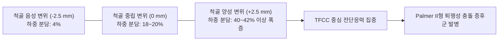
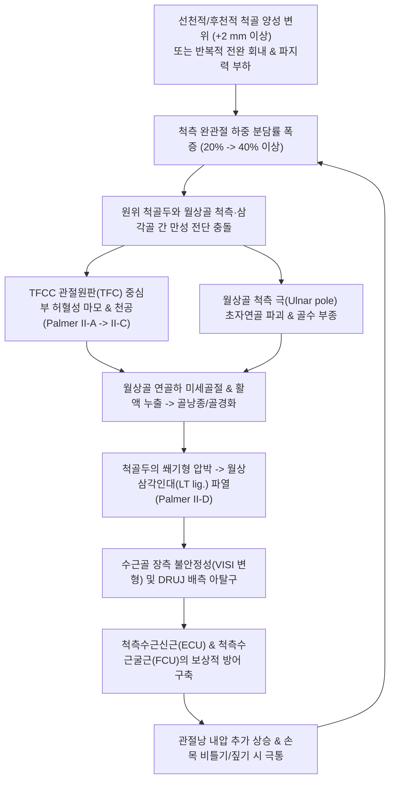
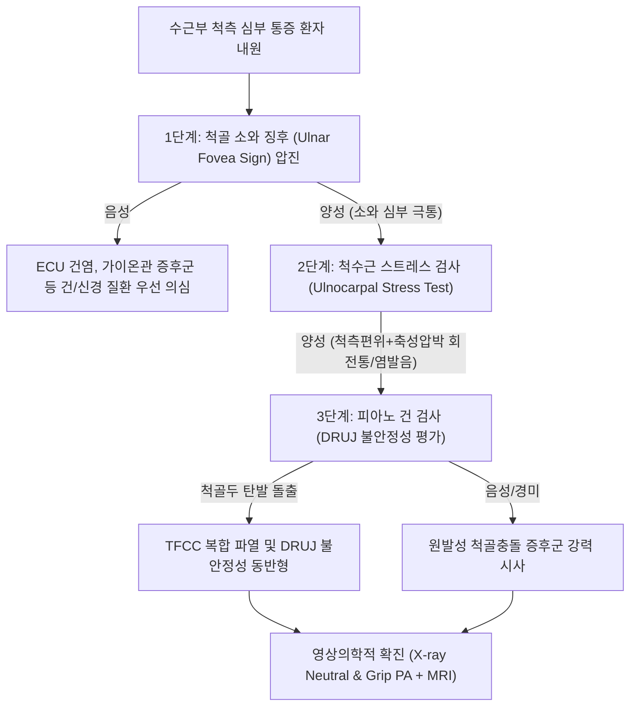
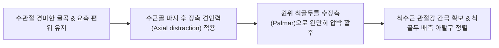
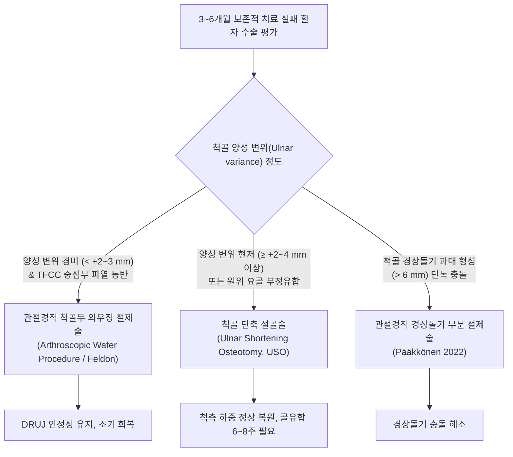
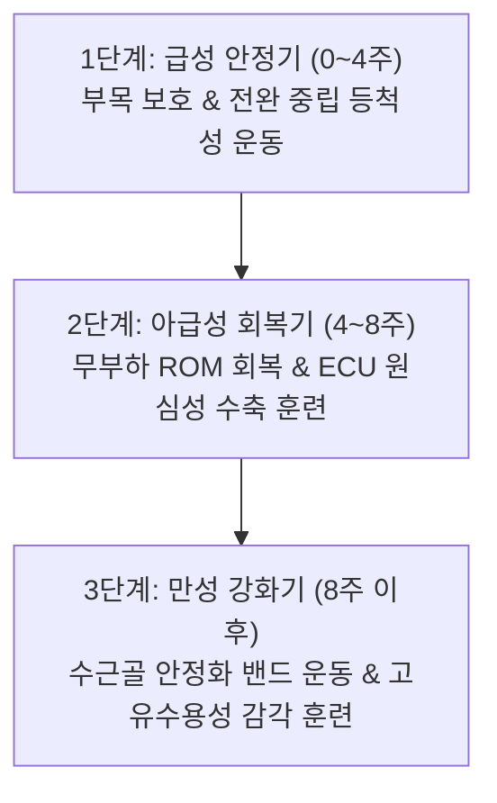

# ⚡ [[척골충돌 증후군]] (Ulnar Impaction Syndrome, UIS / Ulnocarpal Abutment)

> **상위 분류**: [[근골격계 질환]] > [[상지 질환]] > [[수부 질환]] > [[수관절 질환]]
> **핵심 3줄 요약 (Key Summary)**:
> - 📍 병소 부위 & 해부·병태생리: 척골이 요골에 비해 상대적으로 길어지는 척골 양성 변위(Positive Ulnar Variance, +2 mm 이상) 또는 반복적인 전완 회내·강력 파지로 인한 동적 양성 변위로 인해, 원위 [[척골두]](Ulnar head)가 [[삼각섬유연골복합체]](TFCC) 관절원판(TFC proper), [[월상골]](Lunate) 근위 척측면, [[삼각골]](Triquetrum)에 만성적인 전단 충돌 압박을 가하여 Palmer Class II 퇴행성 마모·천공, 연골하 [[골경화]] 및 [[골낭종]]을 일으키는 진행성 관절 질환.
> - 🚩 전형적 임상 양상 & 3대 징후: 손목 관절 척골 쪽 심부의 묵직하고 쑤시는 만성 통증, 문손잡이 돌리기·걸레 비틀기·바닥 짚기 등 손목 [[척측 편위]] 및 회전 부하 시 극심한 통증과 [[염발음]](Clicking), 척골 소와(Ulnar fovea) 심부 압통 및 척수근 스트레스 검사(Ulnocarpal stress test) 양성.
> - 🛠️ 핵심 감별 검사 & 한·양방 다각적 치료 전략: X-ray 정립 PA 뷰(Neutral & Pronated grip view) 및 수근부 MRI를 통한 Palmer II 병기 확진. [[양곡]](SI5) 척수근 관절낭 및 척골 소와 함요부 [[침도요법]]·[[화침]](온침)·[[신바로약침]]·[[봉약침]](1:30,000) 관절강 감압술, [[원위 요척관절]](DRUJ) 수장측 활주 교정 [[추나요법]], 수근부 중립 보조기 지도 및 [[오적산]], [[대호경간탕]], [[독활기생탕]] 투여.
> - ⚠️ 응급 의뢰 레드플래그 & 악화 요인: 양곡혈 자침 시 [[척골신경]] 수배피지(Dorsal branch) 관통 방전통 주의, 3~6개월 보존적 치료 불응, [[월상골]] 광범위 [[골낭종]]/괴사 진행 또는 월상삼각인대 파열로 인한 VISI 수근골 불안정성 동반 시 척골 단축 절골술(Ulnar Shortening Osteotomy, USO) 또는 관절경적 와우징(Wafer procedure) 정형외과 협진 의뢰.

---

## 📌 목차
1. [질환 개요 & 해부학적 병태생리](#1-질환-개요--해부학적-병태생리)
2. [병태생리 메커니즘 & 생체역학적 악순환 네트워크](#2-병태생리-메커니즘--생체역학적-악순환-네트워크)
3. [임상 증상 & 이학적 검사(Physical Exam) 알고리즘](#3-임상-증상--이학적-검사physical-exam-알고리즘)
4. [감별 진단 매트릭스 (Differential Diagnosis)](#4-감별-진단-매트릭스-differential-diagnosis)
5. [한의 통합 치료 프로토콜 (침·약침·추나·한약)](#5-한의-통합-치료-프로토콜-침약침추나한약)
6. [양방 치료 & 병용·의뢰 기준 (Conventional Treatment & Referral)](#6-양방-치료--병용의뢰-기준-conventional-treatment--referral)
7. [재활 운동 & 생활습관 티칭 가이드](#7-재활-운동--생활습관-티칭-가이드)
8. [💡 사용자 진료실 핵심 필기 & 임상 노하우 (Melt-In 잔여 심화 집약)](#8--사용자-진료실-핵심-필기--임상-노하우-melt-in-잔여-심화-집약)
9. [출처 및 학술 참고 문헌 (References)](#9-출처-및-학술-참고-문헌-references)

---

## 1. 질환 개요 & 해부학적 병태생리

### 1) 개념 정의 및 임상적 중요성
* **[[척골충돌 증후군]](Ulnar Impaction Syndrome, UIS)**은 수근부 척측(Ulnar side)에서 원위 [[척골두]](Distal ulnar head)와 척수근 관절면을 이루는 [[월상골]](Lunate) 및 [[삼각골]](Triquetrum) 사이에 과도한 축성 부하(Axial load)와 전단력(Shear stress)이 만성적으로 집중되면서 발생하는 퇴행성 복합 관절 질환이다.
* [[척골두]]와 수근골 사이에 완충 패드 역할을 수행하는 [[삼각섬유연골복합체]](Triangular Fibrocartilage Complex, TFCC)의 관절원판(TFC proper)이 점진적으로 마모·천공되고, 이어 [[월상골]]과 [[삼각골]]의 관절 연골 마모, 연골하 [[골경화]](Subchondral sclerosis), [[골낭종]](Subchondral cysts) 형성, 그리고 수근간 인대인 [[월상삼각인대]](Lunotriquetral ligament, LT ligament)의 이차적 파열로 이어지는 연속적인 관절 붕괴 과정을 밟는다.
* 수근부 척측 통증(Ulnar-sided wrist pain)을 유발하는 단일 질환 중 가장 흔하며, 손목의 회전 운동(회내·회외) 및 [[척측 편위]](Ulnar deviation)가 동반되는 일상 작업(문손잡이 돌리기, 수건 짜기, 컴퓨터 마우스 조작)과 운동(골프 임팩트, 테니스 백핸드, 중량 리프팅)에서 기능적 파탄을 초래한다.

### 2) 수근부 척측의 3차원 해부학적 구조와 TFCC 복합체
척측 완관절은 [[원위 요골]] 관절면에 비해 골성 지지가 부족하고 섬유연골 및 인대 복합체에 의해 동적·정적 안정성이 유지되는 섬세한 구조를 지닌다.
* **원위 [[척골두]](Ulnar Head)와 척골 소와(Fovea)**:
  * 원위 [[척골두]]는 [[원위 요골]]의 척골 절흔(Sigmoid notch)과 관절하여 [[원위 요척관절]](DRUJ)을 형성하며, 원위 관절면은 돔(Dome) 형태의 관절 연골로 덮여 TFCC 관절원판의 기저부를 받친다.
  * 척골 경상돌기(Ulnar styloid process) 기저부와 관절면 연골 경계면 사이에는 오목한 함요부인 **척골 소와(Ulnar fovea)**가 존재한다.
  * 이 소와 부위는 TFCC의 근위 삼각인대(Ligamentum subcruentum)가 강력하게 골 부착하는 핵심 앵커 포인트로서, 혈관망이 풍부하여 이학적 검사 시 압통(Ulnar fovea sign)의 주된 발현지가 된다.
* **[[삼각섬유연골복합체]](TFCC)의 구성 요소**:
  * **중심 관절원판(Triangular Fibrocartilage proper, TFC)**: 요골의 척골 절흔 하연에서 기시하여 척골 소와 및 경상돌기에 부착하는 양면 오목(Biconcave) 섬유연골 디스크. 중심부 80%는 무혈관·무신경 구역으로 영양 공급을 활액 확산에만 의존하므로 마모 시 자연 치유가 불가능하다. 반면 변연부 20%는 [[척골동맥]] 분지의 모세혈관망이 유입되어 치유 잠재력을 가진다.
  * **수근 척측 인대군(Ulnocarpal Ligaments)**: 장측 [[척골두]]에서 기시하는 척월상인대(Ulnolunate ligament, UL)와 척삼각인대(Ulnotriquetral ligament, UT)로 구성되어 척수근 관절의 장측 탈구를 방지한다.
  * **원위 요척인대(Radioulnar Ligaments)**: 배측 요척인대(Dorsal RUL)와 장측 요척인대(Palmar RUL)가 [[원위 요척관절]](DRUJ)의 회전 안정성을 담보한다.
  * **척측수근신근 하건초(Subsheath of Extensor Carpi Ulnaris, ECU)**: 제6신전구획 건초가 TFCC 배척측 섬유막과 일체화되어 동적 안정화 작용을 보조한다.
  * **반월상판 유사체(Meniscus homologue)**: [[삼각골]]과 [[척골두]] 사이의 간극을 메우는 섬유지방 조직.
* **수근골(Carpal Bones)과의 접촉 양상**:
  * [[척골두]]의 충돌 압력은 TFCC 관절원판을 매개로 [[월상골]](Lunate)의 근위 척측 반절과 [[삼각골]](Triquetrum)의 근위 요측 관절면에 집중된다.

| 해부학적 구조물 | 구성 조직 및 특성 | 척골충돌 증후군 발생 시 병리적 변화 |
| :--- | :--- | :--- |
| **TFCC 중심 관절원판** | 무혈관성 섬유연골판 (Biconcave disc) | 만성 기계적 전단력으로 인한 마모, 얇아짐, Palmer II-C 전층 천공 |
| **척골 소와 (Ulnar Fovea)** | 경상돌기 기저부 함요 골면, 혈관 풍부 | TFCC 부착부 견인 손상, 활액막염, 극심한 국소 압통 발생 |
| **[[월상골]] 근위 척측면** | 초자연골(Hyaline cartilage) 및 연골하 골판 | [[연골연화증]], 연골 결손, 연골하 [[골경화]]증 및 퇴행성 [[골낭종]] |
| **[[삼각골]] 근위 요측면** | 초자연골 및 관절면 | [[월상골]]과 인접한 부위의 이차적 연골 마모 및 [[골극]] 형성 |
| **[[월상삼각인대]](LT lig.)** | 수근골간 골간인대 (Interosseous lig.) | [[척골두]]의 쐐기형 압박으로 인한 신장, 부분 파열 및 완전 해리(VISI) |
| **[[원위 요척관절]] (DRUJ)** | [[척골두]]-요골 절흔 관절낭 복합체 | 관절합치성 상실, 배측 아탈구, 전완 회전 시 [[염발음]] 유발 |

### 3) 척골 변위(Ulnar Variance)의 해부학적 스펙트럼과 역학
* **정의 및 정상 생체역학 (Neutral Variance)**:
  * 척골 변위는 손목 표준 후전방(PA) [[방사선 검사]] 영상에서 요골 관절면 원위 골단선과 [[척골두]] 원위 관절면 골단선 사이의 상대적 높이 차이를 밀리미터(mm) 단위로 계측한 지표이다.
  * **중립 변위(Neutral, 0 ± 1 mm)**: 손목 관절을 통해 전달되는 축성 하중(Axial force)의 약 **80~82%는 [[원위 요골]]**이 지탱하고, **18~20%만이 [[척골두]]와 TFCC**를 통해 전달된다.
* **척골 양성 변위(Positive Ulnar Variance, Ulnar Plus)**:
  * 척골이 요골보다 2.0 mm 이상 길게 돌출된 상태를 의미한다.
  * 생체역학적 사체 연구에 따르면, [[척골두]]가 요골 대비 **2.5 mm 길어질 경우 [[척골두]] 및 TFCC가 부담하는 축성 하중 분담률은 약 40~42%로 2배 이상 급증**한다. 반대로 척골이 2.5 mm 짧아지면(Negative variance) 하중 분담률은 4%대로 감소한다.
  * 하중 집중 부위인 [[월상골]] 척측면과 [[삼각골]]에 가해지는 접촉 압력(Contact pressure)이 단위 면적당 역치를 초과하여 연골 세포 사멸과 기질 붕괴가 가속된다.

* **원인 분류: 선천성 vs 후천성**:
  * **선천성 양성 변위**: 유전적 골격 성장 특성으로 양측성에 흔하며, 선천적으로 요골에 비해 척골의 종적 성장이 과도한 경우.
  * **후천성 양성 변위**:
    1. **[[원위 요골]] 골절(Colles fracture, Smith fracture) 후 부정유합**: 골절 치유 과정에서 요골 원위 골편이 단축(Shortening), 배측 경사(Dorsal tilt), 요측 경사 소실로 유합되면서 척골이 상대적으로 길어지는 가장 빈발하는 후천적 원인.
    2. **소아 [[원위 요골]] 성장판 손상**: 성장판 조기 폐쇄(Madelung 기형 등)로 요골 성장이 멈추고 척골만 과성장한 경우.
    3. **요골두 절제술 후 합병증(Essex-Lopresti 골절-탈구)**: 근위 요골두 절제 후 요골 전체가 근위부로 이동하여 원위부에서 척골이 심각하게 돌출되는 경우.
* **정적 변위(Static) vs 동적 변위(Dynamic Ulnar Variance)**:
  * 단순 [[방사선 검사]] 상 정적 양성 변위가 뚜렷하지 않은 환자에서도 증상이 발생할 수 있다.
  * **전완의 회내(Pronation)** 동작 시 요골은 척골 주위를 회전하면서 해부학적으로 근위부로 활주하며, 상대적으로 [[척골두]]는 원위부로 전위(Dynamic positive displacement)된다.
  * 여기에 **강력한 주먹 쥐기(Power grip)** 부하가 더해지면 수근 굴근·신근의 수축력에 의해 척골은 추가로 **1.5~2.0 mm 이상 상대적으로 원위 돌출**된다. 이로 인해 일상 회전 및 파지 작업 시 급격한 '동적 충돌'이 완성된다.

---

## 2. 병태생리 메커니즘 & 생체역학적 악순환 네트워크

### 1) Palmer Class II 퇴행성 병기 분류 체계
TFCC의 손상은 외상성 파열인 Palmer Class I형과, 만성 척골충돌 증후군에 의해 발생하는 퇴행성 마모인 **Palmer Class II형**으로 양분된다. 척골충돌 증후군은 Class II의 진행성 스펙트럼이다.

| Palmer Class II 병기 | 조직병리학적 손상 범위 | 연골 및 수근골 침범 소견 | 임상 및 관절경적 특징 |
| :--- | :--- | :--- | :--- |
| **Class II-A** | TFCC 관절원판(TFC) 중심부 천층 마모 | 수근골 연골 침범 없음 (정상 연골) | TFC 중심부의 보풀 일어남(Fraying), 천공 없음, 경미한 회전통 |
| **Class II-B** | TFC 중심부 마모 및 얇아짐 | [[월상골]]/[[삼각골]] [[연골연화증]] (Chondromalacia) | 관절 연골의 균열(Fissuring) 및 연화, 골성 변화는 아직 미발현 |
| **Class II-C** | **TFC 관절원판 중심부 전층 천공** | [[월상골]]/[[삼각골]] 관절연골 전층 결손 | TFC에 구멍 발생, 관절경하 [[척골두]] 연골 노출 관찰, [[염발음]] 뚜렷 |
| **Class II-D** | TFC 전층 천공 + 연골 결손 | **[[월상삼각인대]](LT lig.) 부분/완전 파열** | [[척골두]]가 [[월상골]]과 [[삼각골]] 사이를 쐐기처럼 벌려 수근골 해리(VISI) 유발 |
| **Class II-E** | TFC 완전 소실, 광범위 활액막염 | **척수근 관절 전반의 진행성 [[골관절염]]** | [[척골두]]-[[월상골]]-[[삼각골]] 간 관절강 소실, [[골경화]], 거대 낭종, 심한 [[골극]] |

### 2) 생체역학적 악순환 네트워크 (Biomechanical Vicious Cycle)
척골충돌 증후군은 단순한 연골 마모에 그치지 않고, 수근골 불안정성과 주위 근건 복합체의 기능 부전으로 이어지는 전방위적 생체역학 악순환 고리를 형성한다.

### 3) 연골하 골수 부종 및 연골하 낭종(Subchondral Cysts)의 형성 기전
* **활액 누출 이론(Synovial Intrusion Hypothesis)**:
  * TFCC 관절원판이 천공(Palmer II-C)되고 [[월상골]]의 초자연골이 닳아 없어지면 연골하 골판(Subchondral bone plate)이 직접 [[척골두]]와 마찰한다.
  * 연골하 골판에 미세 골절(Microfracture)이 발생하면서 고압의 관절 활액(Synovial fluid)이 골수강 내로 강제 압입된다. 이로 인해 섬유성 육아조직 증식과 함께 골 흡수가 일어나 경계가 뚜렷한 **연골하 낭종(Subchondral cyst)**이 형성된다.
* **골 타박 및 허혈성 골괴사 이론(Bone Contusion & Necrosis)**:
  * [[척골두]]의 반복 충돌은 [[월상골]] 척측 골소주(Trabeculae)의 지속적인 미세 골절을 유발하여 골수 내 출혈과 부종(Bone marrow edema)을 일으킨다.
  * 국소 정맥 울혈과 골내압 상승은 미세 관류를 차단하여 불완전 골괴사(Avascular necrosis-like changes)를 동반하며, 이는 X-ray 및 CT상 뚜렷한 백색의 **연골하 [[골경화]](Subchondral sclerosis)**로 관찰된다.

---

## 3. 임상 증상 & 이학적 검사(Physical Exam) 알고리즘

### 1) 주요 임상 증상 및 병력 청취
* **수근부 척측 심부 통증 (Ulnar-Sided Deep Wrist Pain)**:
  * 손목의 등쪽이나 바닥쪽 표층이 아닌, [[척골두]]와 [[월상골]]·[[삼각골]] 사이의 깊숙한 관절 심부에서 묵직하게 쑤시고 조이는 통증을 호소한다.
  * 초기에는 과도한 작업 후에만 뻐근하게 나타나다가, 질환이 진행되면 가벼운 일상 동작에서도 날카로운 통증이 유발되고 휴식 시에도 둔통이 지속된다.
* **회전 및 축성 부하 동작 시 통증 악화**:
  * **문손잡이 돌리기(Door knob turning)**: 문을 열기 위해 손잡이를 잡고 바깥쪽 또는 안쪽으로 비틀 때 전완 회내·회외와 [[척측 편위]]가 결합되어 극심한 통증 발생.
  * **수건·걸레 비틀어 짜기(Wringing a towel)**: 양손으로 걸레를 쥐고 강하게 비틀 때 [[척골두]]가 [[월상골]]을 직접 압전하면서 통증 격발.
  * **바닥 짚고 일어나기(Push-off from a chair/floor)**: 손바닥을 바닥에 대고 체중을 실을 때 손목이 과신전(Hyperextension)되고 척측으로 꺾이면서 체중의 수 배에 달하는 충돌력 전달.
* **기계적 [[염발음]](Clicking/Snapping)과 불안정감**:
  * 손목을 돌릴 때 "딱딱", "우두둑"하는 기계적 마찰음과 함께 무언가 걸리는 느낌(Catching sensation)이 발생한다.
  * 환자들은 흔히 "손목 뼈가 어긋나는 것 같다", "손목에 힘이 빠져 컵을 떨어뜨릴 것 같다"고 호소한다.
* **파지력 약화 (Loss of Grip Strength)**:
  * [[척골두]] 불안정성과 통증으로 인한 반사적 근 억제(Arthrogenic muscle inhibition)로 인해 건측 대비 악력이 30~50% 이상 감소한다.

### 2) 특수 이학적 유발 검사 (Provocative Physical Tests)

1. **척수근 스트레스 검사 (Ulnocarpal Stress Test / Ulnocarpal Abutment Test)**:
   * **시술 방법**: 환자의 주관절을 90° 굴곡하고 검사자는 한 손으로 환자의 전완 원위부를 단단히 고정한다. 다른 손으로 환자의 손바닥을 잡고 손목을 **최대로 [[척측 편위]](Maximal ulnar deviation)**시킨 후, 수근골을 [[척골두]] 방향으로 강력하게 **축성 압박(Axial compression)**하면서 전완을 수동으로 **회내(Pronation) 및 회외(Supination)**시킨다.
   * **양성 판정**: [[척골두]]와 [[월상골]] 사이에서 익숙한 통증이 재현되거나 [[염발음]](Crepitus/Clicking)이 명확히 촉지되면 양성. 척골충돌 증후군을 진단하는 가장 핵심적인 기계적 유발 검사이다.
2. **척골 소와 징후 (Ulnar Fovea Sign)**:
   * **시술 방법**: 척골 경상돌기(Ulnar styloid), [[척측수근굴근]](FCU) 건, [[삼각골]] 사이의 부드러운 연부조직 함요부(Fovea)에 검사자의 엄지손가락을 대고 [[척골두]] 기저부를 향해 수직 깊숙이 압박한다.
   * **양성 판정**: 날카로운 압통과 함께 환자가 비명을 지르거나 반사적으로 손을 뺄 때 양성. TFCC 척골 부착부 손상 및 척골충돌 시 민감도 95%, 특이도 86%를 보고하는 필수 검사이다.
3. **척수근 연마 검사 (Ulnocarpal Grind Test)**:
   * **시술 방법**: 전완을 중립위에 두고 환자의 중수골을 쥐어 손목 관절면에 축성 하중을 가한 채 원형으로 회전(Grinding)을 유도한다.
   * **양성 판정**: 연골 마모면에 의한 거친 마찰음과 심부 통증이 나타나면 양성.
4. **피아노 건 검사 (Piano Key Test / DRUJ Ballottement Test)**:
   * **시술 방법**: 양 손목을 책상에 올리고 전완을 회내시킨 상태에서 [[척골두]]의 돌출 정도를 건측과 비교한다. 돌출된 [[척골두]]를 피아노 건반을 누르듯 아래쪽(장측)으로 눌렀다 뗀다.
   * **양성 판정**: [[척골두]]가 통증과 함께 밑으로 쑥 들어갔다가 손을 떼면 스프링처럼 튀어 오르는 탄발 현상이 있으면 DRUJ 인대 복합체 파열 및 수근부 관절 불안정성을 의미한다.
5. **월상삼각 발로트망 검사 (Reagan's Lunotriquetral Ballottement Test)**:
   * **시술 방법**: 검사자의 한 손 엄지와 검지로 [[월상골]]을 고정하고, 다른 손으로 [[삼각골]]을 쥔 채 전후(장배측) 방향으로 강하게 엇갈려 흔든다.
   * **양성 판정**: 관절면의 이상 가동성과 통증, 마찰음이 발생하면 Palmer II-D 병기인 월상삼각인대 파열을 시사한다.

### 3) 영상의학적 정밀 진단 기준
* **단순 [[방사선 검사]] 검사 (X-ray)**:
  * **표준 정립 PA 뷰(Neutral Zero PA View)**: 견관절 90° 외전, 주관절 90° 굴곡, 손바닥을 카세트에 밀착시킨 전완 중립 상태에서 촬영해야 정확한 Ulnar variance를 측정할 수 있다.
  * **전완 회내 주먹 쥐기 뷰(Pronated Grip PA View)**: 주먹을 꽉 쥔 채 전완을 회내시켜 촬영하면 동적 척골 양성 변위(Dynamic positive variance)를 확인할 수 있어 잠재적 충돌을 진단하는 데 결정적이다.
  * **Gelberman 계측법**: 요골 관절면의 최하단 피질골선에 직각인 선을 긋고, [[척골두]] 관절면의 가장 원위부 골단선과의 거리 차이를 측정한다 (+2 mm 이상 시 양성 변위 확진).
  * **특징적 3대 [[방사선 검사]] 징후**:
    1. [[월상골]] 근위 척측 극의 경화(Sclerosis).
    2. [[월상골]] 또는 [[척골두]] 내의 [[방사선 검사]] 투과성 연골하 [[골낭종]](Subchondral cyst).
    3. [[척골두]] 및 [[삼각골]]의 관절면 불규칙성과 [[골극]](Osteophytes).
* **근골격계 [[초음파 검사]] (MSK Ultrasound)**:
  * TFCC 관절원판의 연속성 소실 및 얇아짐, 척골 소와 부위의 활액막 삼출액 저류, [[원위 요척관절]] 배측 인대의 비후 및 파열을 실시간 동적 검사로 확인.
* **[[자기공명영상]] (MRI / MR Arthrography)**:
  * TFCC Palmer Class II 병기 구분의 골드 스탠다드.
  * T1 강조 영상에서 [[월상골]] 및 [[척골두]]의 저신호 [[골경화]] 관찰.
  * T2/FS(Fat-suppressed) 또는 PD 강조 영상에서 뚜렷한 고신호의 **연골하 [[골수부종]](Bone marrow edema)** 확인.
  * 관절조영 MRI(MRA)를 통해 TFC 중심부 천공 및 조영제의 DRUJ 유출, 월상삼각인대 파열 유무를 95% 이상의 정확도로 진단.

---

## 4. 감별 진단 매트릭스 (Differential Diagnosis)

수근부 척측은 좁은 해부학적 공간에 뼈, 관절, 인대, 섬유연골, 건, 신경이 밀집되어 있어 정밀한 감별 진단이 필수적이다.

| 질환명 | 주 통증 부위 | 호발 기전 및 환자 특징 | 핵심 이학적 검사 소견 | 영상의학적 감별 포인트 |
| :--- | :--- | :--- | :--- | :--- |
| **[[척골충돌 증후군]]** | [[척골두]]-[[월상골]] 사이 척측 관절 심부 | 척골 양성 변위, 만성 퇴행성, 회전·비틀기 악화 | Ulnocarpal stress test (+), Ulnar fovea sign (+) | X-ray 척골 양성 변위, [[월상골]] 척측 [[골경화]]/낭종, MRI 골수부종 |
| **급성 외상성 [[TFCC 손상]] (Palmer I)** | 척골 소와 및 척수근 관절낭 | 손 짚고 넘어짐(FOOSH 손상), 젊은 외상 환자 | Ulnar fovea sign (+), Piano key test 양성 가능 | X-ray 변위 정상(0 mm) 다수, MRI상 외상성 급성 파열(변연부 등) |
| **척골 경상돌기 충돌** (Pääkkönen 2022) | 척골 경상돌기 첨부 및 [[삼각골]] 배측 | 경상돌기 과대 형성(>6 mm) 또는 불유합 골편 | 경상돌기 직상방 국소 압통, 수근 척측 신전통 | X-ray상 장대형 경상돌기 및 [[삼각골]] 배측 피질골 충돌 마모 관찰 |
| **[[척측수근신근]](ECU) 건초염/탈구** | 제6신전구획([[척골두]] 등쪽 고랑) | 손목 과다 신전·척측편위 반복, 테니스/골프 | 저항성 신전-척측편위 시 통증, 회내-회외 시 건 탈구 | [[초음파 검사]]상 제6구획 건초 삼출액, 도플러 혈류 증가, 건 아탈구 |
| **[[척측수근굴근]](FCU) 건염** | 손목 안쪽 [[두상골]] 부착부 | 손목 굴곡 과사용, 골프 임팩트 뒤땅 타격 | [[두상골]] 직상방 압통, 저항성 손목 굴곡 시 통증 | X-ray상 [[두상골]] 주위 석회화 관찰 가능, 관절 심부 병변 없음 |
| **월상삼각 해리(LT Dissociation)** | [[월상골]]-[[삼각골]] 사이 배측 관절면 | 외상성 염좌 또는 만성 퇴행성, 수근골 불안정 | Reagan's ballottement test (+), Kleinman shear (+) | X-ray상 LT 관절 간격 증대, 측면상 VISI 변형 (수평화된 월상골) |
| **[[원위 요척관절]](DRUJ) 관절염** | [[원위 요척관절]]면 ([[척골두]] 요측) | 전완 골절 후유증, 노인성 퇴행성 관절염 | 전완 능동 회내-회외 시 [[염발음]], DRUJ 압박통 | X-ray상 요골 척골 절흔과 [[척골두]] 사이 관절강 협착 및 [[골극]] |
| **[[가이온관 증후군]]** | 손목 척측 손바닥, 제4·5수지 | [[척골신경]] 포착, 자전거 라이더, 결절종 압박 | 제4·5지 저림, Froment sign (+), 감각 저하 | 손등 감각은 정상 보존(DCBN 정상), 신경전도 검사상 잠시 연장 |
| **[[키엔벡병]](Kienböck's disease)** | [[월상골]] 중심부 배측 손목 | 척골 **음성** 변위(Ulnar minus) 호발, 20~40대 | 손목 중앙 배측 압통, 악력 급감, 굴신 제한 | X-ray/MRI상 [[월상골]] 전반의 무혈성 괴사, 경화, 붕괴, 편평화 |

---

## 5. 한의 통합 치료 프로토콜 (침·약침·추나·한약)

한의학에서 척골충돌 증후군은 완통(腕痛), 비증(痺證), 근상(筋傷), 골비(骨痺)의 범주에 속한다. 기체어혈(氣滯瘀血)로 시작되어 만성화되면서 간신휴허(肝腎虧虛), 어혈조체(瘀血阻滯)로 골관절이 마모되는 병기로 파악하여 단계별 복합 치료를 적용한다.

### 1) 침구 치료 & 온침·화침 요법
* **국소 취혈 원칙**:
  * [[양곡]](SI5): 척골 경상돌기와 [[삼각골]] 사이 함요부. 척수근 관절낭 직상방에 위치하여 TFCC 및 척수근 관절의 울혈과 염증을 해소하는 제1 표적 혈위.
  * [[양지]](TE4), [[외관]](TE5): 완관절 배측 지대를 안정화하고 삼초경락의 순환을 도와 관절강 내 활액 정체를 소퇴.
  * [[양노]](SI6): [[척골두]] 후면 고랑에 위치하며 소장경의 극혈(郄穴)로서 수관절 급만성 동통 제어의 특효혈.
  * [[완골]](SI4), [[후계]](SI3): 소장경의 원혈과 목혈로서 척측 완관절 건막과 수근골의 이상 장력을 완화.
* **원위 및 근육학적 자침**:
  * [[척측수근신근]](ECU) 근복 및 [[척측수근굴근]](FCU) 발통점(Trigger point)에 직자하여 [[척골두]]를 원위부로 견인하는 비정상적 근막 텐션을 해제.
  * [[소해]](SI8), [[소해]](HT3): 주관절 주위 척측 경근 긴장을 선행 해소.
* **[[온침]](Warm needle) 및 [[화침]](Fire needle) 특수 요법**:
  * 만성 [[골경화]] 및 [[연골연화증]] 단계(Palmer II-B 이상)에서는 침체에 쑥뜸을 얹는 [[온침]]술 또는 특수 합금 침을 가열하여 자침하는 [[화침]] 요법을 양곡 및 척골 소와 함요부에 주 2회 적용한다.
  * 온열 자극이 심부 척수근 관절낭과 골막으로 전달되어 국소 미세혈관을 확장시키고, 한습(寒濕)의 응결을 풀어주어 연골하 골내압을 감압시킨다.

### 2) 침도요법 (Acupotomy) 관절낭 감압술
* **적응증**: 3개월 이상 지속된 만성 척골충돌 증후군으로 척수근 관절낭의 섬유화 비후 및 배측 수근지대의 구축이 고착되어 가동역 제한과 극심한 회전통이 동반된 경우.
* **해부학적 안전 자침 가이드라인**:
  * [[척골두]] 후외측을 주행하는 **[[척골신경]] 수배피지(Dorsal cutaneous branch of ulnar nerve)**의 주행 경로를 손끝으로 정밀 촉진하여 표시하고 이를 반드시 회피한다.
* **시술 방법**:
  * 0.35 × 40 mm 1회용 멸균 플랫 침도를 사용하여 양곡(SI5) 혈위에서 피부와 직각으로 진입.
  * 피하를 통과한 후 척수근 관절낭 섬유막에 도달하면, 침도 날을 수근부 종축(전완 주행 방향)과 평행하게 유지하면서 1~2회 미세 절개·박리(Incision & Peeling)하여 팽창된 관절낭 내압을 감압.
  * 척골 경상돌기 기저부의 비후된 유착대를 가볍게 긁어 박리한 후 즉시 발침하고 3분간 압박 지혈한다.

### 3) 약침 및 봉약침 치료 (Pharmacopuncture)
* **급성기 염증 및 활액막염 (Acute Synovitis)**:
  * **[[황련해독탕 약침]] / 중성어혈약침**: 양곡혈 및 척골 소와 함요부 관절강 내로 0.5~1.0 cc 주입. 관절강 내 염증성 사이토카인(IL-1β, TNF-α) 분비를 억제하고 혈종 및 부종을 신속 흡수.
* **만성 퇴행성 마모기 (Degenerative Cartilage Wear, Palmer II-B~II-C)**:
  * **[[신바로약침]] (GCSB-5)**: 방풍, [[우슬]], 오가피, 구척 등으로 구성된 관절 재생 생약 복합체로, 척수근 관절낭 주위 및 인대 부착부에 1.0 cc 주입. 연골 파괴 효소인 MMP-3 및 MMP-13의 발현을 억제하고 관절 연골 기질(Proteoglycan) 합성을 촉진.
  * **정제 [[봉약침]] (Sweet Bee Venom, 1:30,000 ~ 1:10,000)**: 멜리틴(Melittin)과 아파민(Apamin) 성분이 신경성 염증을 억제하고 강력한 관절 혈류 증진 효과를 유도. 주 2회 양곡, 양노 혈위에 0.3~0.5 cc 시술.
* **만성 [[골수부종]] 및 허혈성 골괴사 소견 시**:
  * **[[자하거 약침]](Hominis Placenta) / 녹용약침**: 인태반 및 녹용 가수분해 추출물 약침을 [[척골두]] 골막 주변에 0.5~1.0 cc 주입하여 조골세포 분화 촉진 및 골재형성 유도.

### 4) 추나요법 & 수근골 가동술 (Chuna Manual Medicine)
* **[[원위 요척관절]](DRUJ) 수장측 활주 교정술 (Palmar Glide of Distal Ulna)**:
  * **목적**: [[척골두]]의 배측 아탈구를 정복하고 요척관절의 일치성을 복원.
  * **방법**: 환자의 손목을 가볍게 견인한 상태에서 검사자의 한 손 엄지로 돌출된 [[척골두]]를 손바닥 방향(Palmar)으로 지속 압박하고, 다른 손으로는 [[원위 요골]]을 배측(Dorsal)으로 상대 활주시킨다. 전완을 중립위에서 서서히 회외시키며 관절낭 유착을 이완한다.
* **척수근 관절 축성 견인 추나 (Ulnocarpal Axial Distraction)**:
  * 환자의 전완을 고정하고 검사자의 양손으로 환자의 수근골([[삼각골]] 및 [[월상골]] 부위)을 감싸 쥔 후, 완관절을 살짝 굴곡 및 요측 편위시킨 상태에서 완만한 지속적 장축 견인력을 가한다. [[척골두]]와 수근골 사이의 관절 간격을 기계적으로 벌려 활액 순환을 돕고 관절 연골의 마찰을 해소한다.

### 5) 한약 처방 (Herbal Medicine)
환자의 병기 및 전신 변증에 따라 단계별 맞춤 처방을 원칙으로 한다.

* **1단계: 급성 어혈종통기 (기체어혈, 타박어혈)**:
  * **[[당귀수산]](當歸鬚散)** 또는 **[[오적산]](五積散)** 가미방: [[당귀]], 적작약, 도인, 홍화, 소목, 유향, 몰약 등을 가미하여 척측 관절 내 활액막염과 미세 출혈을 흡수하고 통증을 제어.
* **2단계: 아급성 및 만성 근건 연축기 (풍한습비, 경락어조)**:
  * **[[서경탕]](舒經湯)**: [[강황]], [[당귀]], 백출, 적작약, 해동피, 강활, 방풍 등으로 구성되어 상지 척측 경락의 순환을 통하게 하고 척수근 신근·굴근막의 강직을 해소.
* **3단계: 만성 퇴행성 골비기 (간신휴허, 골비골축, Palmer II-C~II-E)**:
  * **[[독활기생탕]](獨活寄生湯)** 또는 **[[대호경간탕]](大護經肝湯)**: [[독활]], 상기생, [[두충]], [[우슬]], 세신, 진교, 복령, [[숙지황]], [[백작약]], [[천궁]], [[당귀]]에 [[속단]](續斷), [[골쇄보]](骨碎補), 보골지(補骨脂)를 대량 가미. 간신을 보하여 연골하 골기질을 강화하고 연골 붕괴를 지연.

---

## 6. 양방 치료 & 병용·의뢰 기준 (Conventional Treatment & Referral)

> 🎯 **이 섹션의 목적**: 척골충돌 증후군 환자는 정형외과에서 소염진통제 복용, 깁스 보조기 착용, 관절강 내 주사 처치를 받고 내원하는 경우가 대단히 많다. 한의 1차 진료 현장에서 양방 치료의 기전과 한계를 정확히 파악하여, 병용 시너지 요법을 구사하고 명확한 수술 의뢰 기준을 적용해야 한다.

### 1) 약물 치료 (Conventional Medication)
* **경구 비스테로이드성 소염진통제 (Oral NSAIDs)**:
  * **처방 관행**: Celecoxib 200 mg qd, Meloxicam 7.5~15 mg qd, 또는 Aceclofenac 100 mg bid.
  * **임상적 한계**: 관절강 내 활액막염으로 인한 통증을 단기적으로 경감시키나, 골성 척골 양성 변위라는 근본적 역학 문제를 해결할 수 없으므로 투약 중단 시 통증이 재발한다.
* **진통 보조제**: 신경병증성 양상이 의심되거나 만성 야간통이 심한 경우 Acetaminophen/Tramadol 복합제(울트라셋정)를 병용 투여한다.

### 2) 비약물 보존적 시술 (Procedures & Splinting)
* **수근부 중립 보조기 및 깁스 고정 (Splint / Cast)**:
  * 전완 회전을 제한하는 뮌스터 부목(Muenster splint) 또는 단하지 수근 부목(Short arm wrist splint)을 4~6주간 착용.
  * 전완 회내 및 손목 [[척측 편위]]를 차단하여 [[척골두]]와 TFCC 간의 접촉 압력을 물리적으로 차단한다.
* **관절강 내 코르티코스테로이드 주사 (Intra-articular Corticosteroid Injection, CSI)**:
  * **시술 방법**: Triamcinolone acetonide 20 mg + 1% Lidocaine 0.5 cc를 척수근 관절강 또는 척골 소와 내로 투여.
  * **주의사항 및 위험성**: 급성 활액막염에 강력한 소염 효과를 나타내지만, 빈번한 반복 주사(연 3회 이상)는 TFCC 섬유연골의 조기 변성과 연골하 골괴사를 촉진하여 오히려 Palmer 병기 진행을 가속할 수 있으므로 극히 제한적으로 사용해야 한다.
* **체외충격파 치료 (Extracorporeal Shock Wave Therapy, ESWT)**:
  * [[월상골]] 및 [[척골두]]의 연골하 [[골수부종]] 부위에 집중형(Focused) 충격파를 저에너지(0.08~0.15 mJ/mm²)로 적용하여 골 침착 및 신생혈관 형성을 도모.

### 3) 수술적 치료 (Surgical Management)
보존적 치료에 실패한 경우 골성 척골 변위의 정도와 관절 연골의 침범 상태에 따라 수술식을 결정한다.

1. **관절경적 [[척골두]] 와우징 절제술 (Arthroscopic Wafer Procedure / Feldon's Technique)**:
   * **적응증**: 척골 양성 변위가 2~3 mm 이하로 경미하며, 이미 TFCC 관절원판 중심부 천공(Palmer II-C)이 존재하고 DRUJ 관절염이 없는 증례.
   * **수술 기전**: 관절경을 통해 TFCC의 천공 부위를 관통하여 고속 버(Burr)를 이용해 [[척골두]]의 원위 관절면 연골과 연골하 골을 **2~3 mm 두께로 평평하게 깎아내는(Wafering)** 술식.
   * **장점**: 척골 간부를 절골하지 않으므로 골유합 지연의 위험이 없고, [[원위 요척관절]]의 인대 부착부를 온전히 보존하여 회복이 빠르다.
2. **척골 단축 절골술 (Ulnar Shortening Osteotomy, USO)**:
   * **적응증**: 척골 양성 변위가 +2 mm 이상으로 현저하거나, [[원위 요골]] 골절 후 부정유합으로 척골이 돌출된 전형적 척골충돌 증후군의 **골드 스탠다드 수술식**.
   * **수술 기전**: 척골 골간부(Diaphysis) 또는 골간단(Metaphysis, Kubo 2019)에서 2.0~4.0 mm 두께의 골편을 횡상 또는 사상으로 절제한 후, 전용 압박 금속판(AO Dynamic Compression Plate)과 나사못으로 견고하게 고정(Tatebe 2014, Hassan 2019).
   * **역학적 효과**: [[척골두]]를 근위부로 끌어내려 척측 관절면의 하중을 정상(20% 이하)으로 복원시키고, 느슨해진 척수근 인대와 장측·배측 요척인대의 긴장도(Tension)를 타이트하게 회복시켜 DRUJ 안정성을 획기적으로 개선한다.
   * **단점 및 합병증**: 골유합까지 6~12주의 시간이 소요되며, 불유합(Nonunion, 약 1~3%), 금속판 자극 증상으로 인한 2차 금속 제거술 필요성.
3. **관절경하 척골 경상돌기 사상 부분 절제술 (Pääkkönen 2022)**:
   * 척골 경상돌기 충돌 증후군(Ulnar Styloid Impaction Syndrome)이 동반된 경우 관절경을 통해 경상돌기의 외측 사상 절제를 시행하여 [[삼각골]]과의 충돌을 해소.
4. **구원 술식 (Salvage Procedures - DRUJ 관절염 동반 시)**:
   * **소베-카판지 술식 (Sauvé-Kapandji procedure)**: [[원위 요척관절]]을 유합시키고 유합부 근위 척골을 1.5 cm 절제하여 가관절을 형성, 전완 회전을 보존.
   * **다라흐 술식 (Darrach procedure)**: 노인 환자에서 원위 [[척골두]]를 통째로 절제.

### 4) 한의 병용 판단 및 약물 감량 (Combination Therapy)
* **진통제 복용 중 한의 병용 시너지**:
  * 양방 NSAIDs 복용 중인 환자에게 [[신바로약침]] 및 봉약침, 한약(오적산, [[당귀]]수산)을 병용 투여할 경우, 진통 소염 효과의 상승작용으로 인해 NSAIDs의 복용량을 조기에 50% 이상 감량할 수 있으며 위장관 궤양 및 신장 독성 부작용을 방지할 수 있다.
* **수술 후 한의 재활 프로토콜**:
  * 척골 단축술(USO) 후 깁스 제거 시기(수술 후 4~6주)부터 침, 뜸, 자하거 약침, 관절 가동 추나를 적용하여 절골 부위의 골유합을 촉진하고 수근부 구축을 방지.

### 5) 양방·전문과 의뢰 기준 (Referral Criteria)
* **정형외과 수부외과 즉시 의뢰 기준**:
  1. **골괴사 진행**: 단순 [[방사선 검사]] 또는 MRI상 [[월상골]] 근위부의 광범위한 낭종성 골괴사 소견이 뚜렷하거나 골 붕괴 위험이 있는 경우.
  2. **수근골 불안정성(VISI) 진행**: Reagan 검사 양성 및 [[방사선 검사]] 측면상 [[월상골]] 장측 굴곡 변형(VISI)이 심각하여 수근골 전체의 정렬 붕괴가 우려되는 경우 (Palmer II-D).
  3. **보존적 치료 실패**: 3~6개월 이상의 적극적인 한의 복합 보존 치료(침도, 약침, 추나, 부목)에도 불구하고 파지력이 지속 저하되고 일상생활이 불가능한 통증이 지속되는 경우.
  4. **신경 마비 동반**: 수배피지 또는 [[가이온관]] 내 [[척골신경]] 포착으로 인한 영구적 감각 소실이나 수부 내재근 마비가 진행될 때.

---

## 7. 재활 운동 & 생활습관 티칭 가이드

### 1) 단계별 재활 운동 프로그램

* **1단계: 급성 통증 조절 및 등척성 안정화 (Phase 1, 0~4주)**:
  * **전완 회내·회외 중립 등척성 운동(Isometric Pronation-Supination)**:
    * 팔꿈치를 90° 구부려 몸통에 붙이고 전완을 중립위(엄지가 위를 향함)로 둔다.
    * 반대쪽 손으로 환측 손목을 가볍게 잡고, 환자는 안쪽 및 바깥쪽으로 회전하려는 힘을 30%의 강도로 5초간 가하며 반대 손으로 이를 버틴다 (10회씩 3세트). 통증 없는 관절 억제 이완 유도.
* **2단계: 가동역 회복 및 원심성 근력 강화 (Phase 2, 4~8주)**:
  * **척측수근신근(ECU) 원심성 강화 운동 (Eccentric Wrist Extension/Ulnar Deviation)**:
    * 가벼운 덤벨(0.5 kg) 또는 탄력 밴드를 쥐고 손목을 신전 및 [[척측 편위]]시킨 상태에서, 3~5초에 걸쳐 천천히 저항을 느끼며 중립위로 내려놓는 원심성 수축을 반복한다 (15회씩 3세트). 힘줄과 관절낭의 기계적 탄성을 복원.
  * **기도하는 손(Praying stretch) 변형 스트레칭**:
    * 손바닥을 마주 대지 않고, 주먹을 마주 댄 상태에서 손목 신전 가동역을 통증이 발생하지 않는 한도 내에서 점진적 회복.
* **3단계: 기능적 수근 안정화 및 동적 파지 훈련 (Phase 3, 8주 이후)**:
  * **망치 회전 운동(Hammer Pronation-Supination Exercise)**:
    * 가벼운 고무망치나 막대의 손잡이 끝을 잡고 천천히 45°씩 회내·회외시키며 전완 회전의 동적 편심성 제어 능력을 극대화.
  * **고유수용성 감각 볼 트레이닝**: 손바닥 위에 작은 공을 올리고 떨어뜨리지 않으며 원을 그리는 훈련.

### 2) 생활습관 및 작업 인체공학 지도 (Ergonomics Teaching)
* **바닥 짚기 금지 (Knuckle Push Teaching)**:
  * 침대나 방바닥에서 일어날 때 손바닥을 펴고 짚는 동작은 손목이 90° 과신전되고 [[척측 편위]]되어 [[척골두]]에 체중의 최대 300%에 달하는 충돌 하중을 가한다.
  * **지도 지침**: 반드시 주먹을 쥐고 너클(Knuckle) 부위로 체중을 지탱하거나, 의자 팔걸이를 양손으로 잡고 일어서도록 엄격히 교육한다.
* **비틀기 동작의 기계화/도구화**:
  * 걸레나 젖은 수건을 양손으로 비틀어 짜는 행위를 전면 금지하고 탈수기나 롤러형 청소 도구를 사용하게 한다.
  * 병뚜껑이나 문손잡이를 돌릴 때 미끄럼 방지 고무 패드를 사용하거나 레버형 문손잡이로 교체 권고.
* **컴퓨터 마우스 인체공학적 개선 (Vertical Mouse)**:
  * 일반 마우스 사용 시 전완이 90° 완전 회내(Full pronation)되어 동적 척골 양성 변위가 고착된다.
  * **버티컬 마우스(Vertical mouse)**를 도입하여 전완이 45~60° 반중립(Semi-supinated) 상태를 유지하도록 지도하면 충돌 압력이 50% 이상 감소한다.
* **스포츠 활동 시 티칭**:
  * **골프**: 임팩트 시 뒤땅을 치는 충격이 왼손(오른손잡이 기준) [[척골두]]로 고스란히 전달되므로, 그라파이트 샤프트(Graphite shaft)를 사용하여 진동을 흡수하고 임팩트 시 과도한 손목 코킹 유지를 피하도록 지도.
  * **테니스/배드민턴**: 라켓 그립이 너무 가늘면 파지력을 과도하게 주어 충돌이 심해지므로, 그립 굵기를 손에 맞게 증대시키고 진동 댐퍼를 장착.

---

## 8. 💡 사용자 진료실 핵심 필기 & 임상 노하우 (Melt-In 잔여 심화 집약)

### 1) 진료실 진단 핵심 관찰 포인트
* **문손잡이 회전통(Twisting Pain)의 진단적 절대 가치**:
  * 환자가 진료실 문을 열고 들어오며 "손잡이를 비틀거나 차 핸들을 돌릴 때 새끼손가락 쪽 손목 안쪽이 시큰하고 빠개지듯 아프다"고 호소하면 90% 이상 척골충돌 증후군과 TFCC 손상을 강력 의심한다. 단순 건염은 직선 운동에서 아프지만, 충돌 증후군은 '회전 부하'에서 통증이 폭발한다.
* **단순 X-ray의 척골 변위 육안 확인법**:
  * 정규 X-ray 판독지가 없더라도 진료실 모니터에서 손목 PA 뷰를 띄워놓고 요골 원위 관절면 선과 [[척골두]] 관절면 끝에 가로 수평선을 그어본다. [[척골두]]가 요골보다 눈으로 보아도 2 mm 이상 위로 불쑥 튀어나와 있다면 구조적 척골충돌 증후군을 95% 확진할 수 있다.
  * 만약 정적 뷰에서 변위가 애매하다면 반드시 **환자에게 주먹을 꽉 쥐게 한 상태의 회내 뷰(Pronated grip view)**를 추가 촬영하여 동적 돌출을 확인해야 한다.

### 2) 안전 시술 가이드라인: 양곡(SI5) 자침 시 신경 손상 방지
* **[[척골신경]] 수배피지(Dorsal Cutaneous Branch of Ulnar Nerve) 주의**:
  * 양곡(SI5) 혈위는 척골 경상돌기 바로 앞 함요부에 위치하는데, 이 부위 표층 피하로는 [[척골신경]] 본간에서 분지한 수배피지가 손등 척측을 향해 비스듬히 횡단 주행한다.
  * 자침 시 환자가 "제4·5수지 손등 쪽으로 찌릿한 전기가 통한다"고 호소하면 신경 외막을 자극한 것이므로, **침을 절대로 더 밀어 넣지 말고 즉시 1~2 mm 후퇴시켜 자침 각도를 관절강 쪽으로 완만하게 변경**해야 의인성 신경염(Causalgia)을 예방할 수 있다.

### 3) 골든타임 판단과 수술 전원 기준
* **3개월 보존 치료의 한계선**:
  * 침, 침도, 한약, 부목 등 한의 통합 치료를 주 2~3회씩 8~12주간 집중 시행했음에도 불구하고, 파지력 저하가 지속되고 계측 악력이 20 kg 이하로 떨어지며 수면 중 야간통이 멈추지 않는 환자는 단순 연골 마모를 넘어 [[월상골]]의 낭종성 붕괴 또는 LT 인대 파열이 급속 진행되고 있을 가능성이 높다.
  * 이 시기를 놓치면 관절을 살릴 수 있는 척골 단축 절골술(USO)의 시기를 지나 관절 유합술(Sauvé-Kapandji)로 넘어가게 되므로, MRI 정밀 검사 후 수부외과로의 전원을 지체 없이 권고해야 한다.

### 4) 환자 티칭 스크립트 (진료실 소통 노하우)
* **"시소와 문틀" 비유 설명법**:
  * *"환자분, 손목 관절은 원래 요골이라는 굵은 뼈가 80%의 무게를 지탱하고 척골이라는 뼈는 20%만 받쳐주는 완벽한 시소 균형을 이루고 있습니다. 그런데 환자분은 선천적이든 과거 손목을 다쳐서든 척골이라는 뼈가 요골보다 2~3 mm 더 길어져 있습니다. 마치 문틀보다 문짝이 더 길어서 문을 열고 닫을 때마다 문짝 모서리가 문틀을 쾅쾅 찧고 있는 상태입니다. 문손잡이를 돌리거나 수건을 짤 때마다 뼈가 연골을 찧어서 구멍이 뚫리고 뼈에 멍이 들고 있는 것이 '척골충돌 증후군'입니다. 저희 한의원에서는 비뚤어진 관절 틈새를 추나요법으로 벌려주고, 침도와 약침으로 붓고 굳은 관절 주머니를 감압하여 문이 부드럽게 돌아가도록 치료할 것입니다. 환자분께서는 절대로 바닥을 짚지 마시고 주먹을 쥐고 일어나셔야 합니다."*

---

## 9. 출처 및 학술 참고 문헌 (References)

1. Pääkkönen M (2022). Arthroscopic Oblique Partial Ulnar Styloid Resection for Ulnar Styloid Impaction Syndrome. *J Wrist Surg*. 11(4):331-337. [PMID: 35837587](https://pubmed.ncbi.nlm.nih.gov/35837587/)
   - [연구 요약]: 척골 경상돌기 과대 형성 또는 충돌 증후군 환자를 대상으로 관절경적 사상 부분 절제술의 기법과 임상적 효용성을 입증. 수근부 척측 통증 환자에서 TFCC 본체 손상 외에 경상돌기 골성 충돌의 감별 및 최소 침습 수술의 유효성을 규명함.
2. Kubo N (2019). Distal Ulnar Metaphyseal Wedge Osteotomy for Ulnar Abutment Syndrome. *J Wrist Surg*. 8(6):467-473. [PMID: 31579542](https://pubmed.ncbi.nlm.nih.gov/31579542/)
   - [연구 요약]: 척골충돌 증후군 환자에서 원위 척골 골간단 쐐기형 절골술(Metaphyseal wedge osteotomy)의 장기 임상 결과와 골유합률을 분석. 전통적 간부 절골술 대비 신속한 골유합 및 합병증 저감 효과를 증명함.
3. Hassan S (2019). Solitary ulnar shortening osteotomy for malunion of distal radius fractures: experience of a centre in the UK and review of the literature. *Ann R Coll Surg Engl*. 101(4):279-286. [PMID: 30698462](https://pubmed.ncbi.nlm.nih.gov/30698462/)
   - [연구 요약]: 원위 요골 골절 후 부정유합으로 인해 이차적으로 발생한 척골 양성 변위 및 척골충돌 증후군 환자에서 단독 척골 단축 절골술(Solitary USO)의 기능 회복률, 통증 감소 및 문헌적 고찰을 체계적으로 제시함.
4. Tatebe M (2014). Ulnar shortening osteotomy for ulnar-sided wrist pain. *J Wrist Surg*. 3(2):77-84. [PMID: 25077045](https://pubmed.ncbi.nlm.nih.gov/25077045/)
   - [연구 요약]: 척골 단축 절골술(USO)의 생체역학적 하중 분담 조절 기전, 적응증, 수술 테크닉 및 수근부 척측 통증의 호전 양상을 종합적으로 정리한 핵심 임상 가이드라인.
