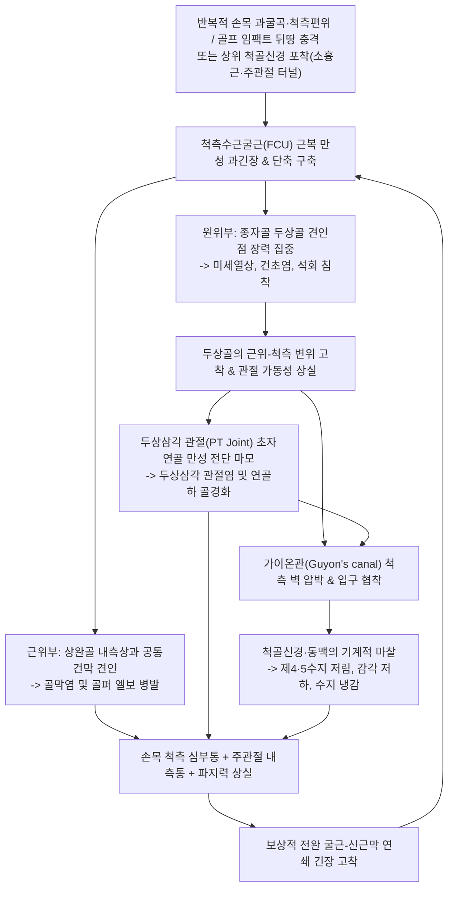
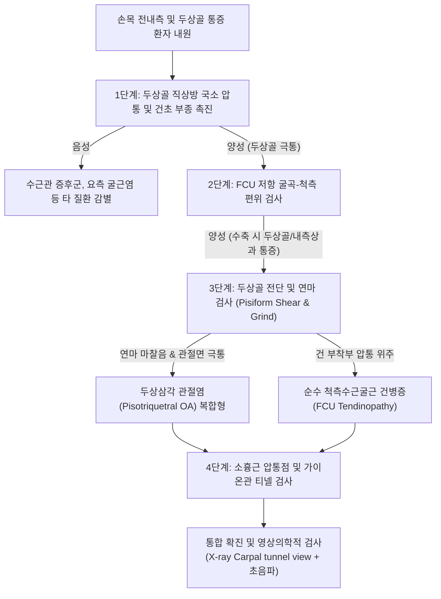

# ⚡ [[척측수근굴근 증후군]] (Flexor Carpi Ulnaris Syndrome, FCU Tendinopathy)

> **상위 분류**: [[근골격계 질환]] > [[상지 질환]] > [[수부 질환]] > [[전완 및 수관절 질환]]
> **핵심 3줄 요약 (Key Summary)**:
> - 📍 병소 부위 & 해부·병태생리: [[척측수근굴근]](Flexor Carpi Ulnaris, FCU)의 만성 과부하 및 단축으로 인해 근위부 [[상완골]] 내측상과 기시부([[골퍼 엘보]])와 원위부 종지부인 [[두상골]](Pisiform) 건골접합부(Enthesis)에 견인성 건병증·골막염이 발생하고, 인접한 [[두상삼각관절]](Pisotriquetral joint) 연골 마모 및 [[가이온관]](Guyon's canal) 입구 협착으로 [[척골신경]] 기계적 마찰이 병발하는 복합 증후군.
> - 🚩 전형적 임상 양상 & 3대 징후: 손목 전내측 [[두상골]] 직상방의 극심한 국소 압통 및 건초 부종, 주관절 내측상과 방사통, 저항성 손목 [[굴곡]](Flexion) 및 [[척측 편위]](Ulnar deviation) 시 통증 격발, [[두상골]] 전단 검사(Pisiform shear test) 양성 및 제4·5수지 이상감각 동반 가능.
> - 🛠️ 핵심 감별 검사 & 한·양방 다각적 치료 전략: X-ray Carpal tunnel view(석회화 및 [[두상골]] 관절염) 및 [[초음파 검사]](FCU 건 비후 및 혈류 증가). [[신문]](HT7)·[[소해]](HT3)·[[음극]](HT6) 자침, [[두상골]] 골막 부착부 및 건궁 [[침도요법]] 미세 박리술, [[신바로약침]]·[[봉약침]](1:30,000) 주입, 상위 [[소흉근]] 포착 해소 [[추나요법]], 수근부 10~15° 굴곡 중립 [[부목]] 고정 및 [[소경활혈탕]], [[오적산]], [[당귀수산]] 투여.
> - ⚠️ 응급 의뢰 레드플래그 & 악화 요인: [[두상골]] 바로 외측 주행하는 [[척골동맥]] 박동 확인 필수(자침 시 동맥 손상 절대 주의), 급성 석회성 건초염(극심한 발적·열감으로 봉와직염·통풍 오인 주의), [[가이온관]] 내 [[척골신경]] 마비 진행으로 인한 제4·5지 갈퀴손(Claw hand) 변형 및 감각 소실 시 신경외과/정형외과 즉각 협진 의뢰.

---

## 📌 목차
1. [질환 개요 & 해부학적 병태생리](#1-질환-개요--해부학적-병태생리)
2. [병태생리 메커니즘 & 생체역학적 악순환 네트워크](#2-병태생리-메커니즘--생체역학적-악순환-네트워크)
3. [임상 증상 & 이학적 검사(Physical Exam) 알고리즘](#3-임상-증상--이학적-검사physical-exam-알고리즘)
4. [감별 진단 매트릭스 (Differential Diagnosis)](#4-감별-진단-매트릭스-differential-diagnosis)
5. [한의 통합 치료 프로토콜 (침·약침·추나·한약)](#5-한의-통합-치료-프로토콜-침약침추나한약)
6. [양방 치료 & 병용·의뢰 기준 (Conventional Treatment & Referral)](#6-양방-치료--병용의뢰-기준-conventional-treatment--referral)
7. [재활 운동 & 생활습관 티칭 가이드](#7-재활-운동--생활습관-티칭-가이드)
8. [💡 사용자 진료실 핵심 필기 & 임상 노하우 (Melt-In 잔여 심화 집약)](#8--사용자-진료실-핵심-필기--임상-노하우-melt-in-잔여-심화-집약)
9. [출처 및 학술 참고 문헌 (References)](#9-출처-및-학술-참고-문헌-references)

---

## 1. 질환 개요 & 해부학적 병태생리

### 1) 개념 정의 및 임상적 중요성
* **[[척측수근굴근 증후군]](Flexor Carpi Ulnaris Syndrome, FCU Syndrome)**은 전완 전면 척측의 천층을 주행하는 강력한 완관절 굴곡 및 [[척측 편위]] 근육인 [[척측수근굴근]](Flexor Carpi Ulnaris, FCU)의 과도한 사용, 급격한 견인력, 또는 반복적인 미세 손상으로 인해 발생하는 복합 근건 건병증(Tendinopathy) 및 건막염이다.
* 근위부로는 [[상완골]] 내측상과(Medial epicondyle)의 공통 굴근건 기시부에 골막 자극성 건염을 일으켜 내측상과염([[골퍼 엘보]])의 핵심 구성 요소가 되며, 원위부로는 종자골(Sesamoid bone)인 [[두상골]](Pisiform) 골막 및 건 부착부에 견인성 건골접합부병증(Insertional enthesopathy)을 형성한다.
* 더 나아가 [[두상골]]과 [[삼각골]](Triquetrum) 사이의 관절면 마모인 **[[두상삼각관절염]](Pisotriquetral osteoarthritis)**, 급성 히드록시아파타이트 결정 침착으로 인한 **급성 석회성 건초염(Acute calcific tendinitis of FCU)**, 그리고 [[두상골]] 바로 외측을 통과하는 [[가이온관]](Guyon's canal) 내부의 [[척골신경]](Ulnar nerve) 및 [[척골동맥]](Ulnar artery) 자극 증상을 포괄하는 임상적 스펙트럼이다.

### 2) 척측수근굴근의 3차원 정밀 해부학 (Origin, Insertion, Boundaries)
* **이두 기시 구조 (Two Heads of Origin)**:
  * **상완두(Humeral head)**: [[상완골]] 내측상과의 공통 굴근건(Common flexor tendon)에서 기시한다.
  * **[[척골두]](Ulnar head)**: [[척골]] 주두(Olecranon)의 내측면 및 척골 후면 경계 근막(Dorsal border of ulna)의 근위 2/3 지점에서 넓은 건막 형태로 기시한다.
  * **오스본 건궁(Osborne's ligament / Arcuate ligament)**: 상완두와 [[척골두]]가 만나는 지점 상부에 섬유성 아치(Aponeurotic band)를 형성하며, 그 직하방으로 [[척골신경]]이 통과하여 주관절 터널(Cubital tunnel)로 진입한다.
* **종지부(Insertion)와 종자골 [[두상골]]의 역학적 지렛대**:
  * FCU 건은 손목 수근골 중 유일한 종자골인 **[[두상골]](Pisiform)**에 1차적으로 단단히 정지한다.
  * [[두상골]]은 FCU 힘줄의 주행 방향을 손목 관절 회전축으로부터 멀어지게 띄워주는 도르래(Pulley) 역할을 수행하여, 손목 굴곡 시 생체역학적 모멘트 팔(Moment arm)을 극대화한다.
  * [[두상골]]에 정지한 건 섬유는 여기서 끝나지 않고, **두상유구인대(Pisohamate ligament)**를 통해 [[유구골]](Hamate) 갈고리로, **두상중수인대(Pisometacarpal ligament)**를 통해 제5중수골 기저부로 강력한 섬유띠를 연장하여 악력 및 굴곡력을 수지 골격으로 전달한다.
* **[[가이온관]](Guyon's Canal)과의 인접 경계 관계**:
  * [[가이온관]](Ulnar tunnel)의 척측(내측) 벽은 바로 [[두상골]]과 FCU 건의 원위 외측 섬유에 의해 형성된다.
  * FCU 건의 부종, 석회 침착, 또는 [[두상골]]의 비후성 [[골극]]은 [[가이온관]] 내부의 유효 단면적을 직접적으로 압박하여 [[척골신경]]의 심부 운동지 및 천층 감각지를 자극한다.

| 해부학적 구조물 | 연결 부위 및 역학적 기능 | 병태생리학적 손상 및 증상 연계 |
| :--- | :--- | :--- |
| **상완골 내측상과 기시부** | 상완두 기시, 전완 굴근군 공통 건막 | 골막 견인 손상, [[골퍼 엘보]], 주관절 내측 둔통 및 압통 |
| **상완-[[척골두]] 사이 건궁** | 오스본 인대 하방 주관절 터널 입구 | FCU 과긴장 시 [[척골신경]] 1차 압박, 팔꿈치 굴곡 시 신경 마찰 |
| **[[두상골]](Pisiform)** | FCU의 주 정지 종자골, 지렛대 모멘트 암 증대 | 견인성 골막염, 건초염, [[두상골]] 고착 및 심한 국소 압통 |
| **두상삼각 관절(PT Joint)** | [[두상골]] 후면과 [[삼각골]] 전면의 활액관절 | [[두상골]] 미끄럼 장애, 초자연골 마모, [[두상삼각관절염]] |
| **두상유구/두상중수인대** | [[유구골]] 갈고리 및 제5중수골 저부 연결 | 굴곡력 전달 시 인대 견인통, 소지구(Hypothenar) 심부 뻐근함 |
| **[[가이온관]](Guyon's canal)** | [[두상골]] 외측 [[척골신경]]·동맥 통과 터널 | 건 비후 및 [[골극]]으로 인한 제4·5수지 저림, 감각 저하 병발 |

### 3) 신경 지배와 혈관 공급의 독특성
* **신경 지배 (Innervation)**:
  * 전완 전방의 천층 및 심부 굴근군(총 8개 근육) 중 원회내근, 요측수근굴근, 장장근, 천지굴근, 방형회내근 등 대다수는 [[정중신경]](Median nerve)의 지배를 받는다.
  * 오직 **[[척측수근굴근]](FCU)**과 [[심지굴근]](FDP)의 척측 1/2(제4·5수지 굴곡부)만이 **[[척골신경]](Ulnar nerve, C8~T1)**의 직접 지배를 받는다.
  * 따라서 상위 레벨(경추 8번 신경근, 사각근간극, [[소흉근]] 하방 흉곽출구, 주관절 터널)에서 [[척골신경]]이 자극받을 경우, FCU는 반사성 근경련(Spasm)과 과긴장 상태에 빠지게 되는 '이중 포착(Double crush)'의 표적 근육이 된다.
* **혈관 공급 (Arterial Supply)**:
  * [[척골동맥]](Ulnar artery)의 후척골재발동맥(Posterior ulnar recurrent artery) 및 전완 [[척골동맥]] 간지로부터 혈류를 공급받는다.
  * 원위부 [[두상골]] 부착부 건골접합부는 혈류 공급이 상대적으로 빈약한 저혈관대(Hypovascular zone)를 형성하여 만성 퇴행성 건병증 및 석회 침착에 취약하다.

### 4) 역학 및 호발 직업군·스포츠 요인
* **골프 (Golfers)**:
  * 오른손잡이 골퍼 기준:
    * **리딩 암(Leading arm, 왼팔)**: 다운스윙에서 임팩트 시 뒤땅(Fat shot)을 강하게 칠 때, 지면의 강력한 반발 충격이 왼손 [[두상골]]과 FCU 건으로 직접 전달되어 급성 견인 열상 및 [[두상골]] 골막염을 일으킨다.
    * **트레일링 암(Trailing arm, 오른팔)**: 임팩트 후 팔로스루(Follow-through) 및 릴리스 시 손목을 과도하게 안쪽으로 꺾으면서(강한 굴곡 및 척측 편위) FCU의 급격한 편심성·등장성 과부하가 발생한다.
* **라켓 스포츠 (테니스, 스쿼시, 배드민턴)**:
  * 테니스의 강력한 탑스핀 포핸드 및 서브 시 손목 스냅을 강하게 채는 동작에서 FCU에 강력한 장력이 부하된다.
* **웨이트 트레이닝 및 크로스핏**:
  * 벤치 프레스, 오버헤드 프레스, 클린 앤 저크(Clean and Jerk) 동작 시 무거운 바벨을 손바닥에 얹을 때 완관절이 과신전되면서 FCU 건이 극단적으로 신장 스트레스를 받는다.
* **직업적 수작업 노동자**:
  * 망치질(Carpenters), 타일 시공, 칼질을 반복하는 요리사, 무거운 쟁반을 한 손으로 받쳐 드는 홀 서빙 종사자, 타자 및 마우스 조작 시 손목을 안쪽으로 꺾고 있는 사무직 등에서 다발한다.

---

## 2. 병태생리 메커니즘 & 생체역학적 악순환 네트워크

### 1) FCU의 운동생체역학과 힘줄 견인점(Enthesis) 형성
* **주동근 및 감속기로서의 역학적 모순**:
  * FCU는 손목의 순수 굴곡(Flexion)과 [[척측 편위]](Ulnar deviation)를 동시에 발생시키는 가장 큰 횡단면적(Physiological Cross-Sectional Area, PCSA)을 지닌 전완 굴근이다.
  * 동시에 손목이 빠르게 신전되거나 요측으로 편위될 때 이를 제어하는 가장 중요한 **편심성 감속기(Eccentric decelerator)**로 작용한다.
* **종자골 활주 상실 및 관절 고착(Immobilization)**:
  * 정상 상태에서 [[두상골]]은 완관절 굴곡-신전 및 편위 운동 시 [[삼각골]] 관절면 위를 상하좌우로 2~4 mm 부드럽게 미끄러져야(Gliding) 한다.
  * 그러나 FCU 근복의 만성 과긴장과 경직이 고착되면 [[두상골]]이 근위부 및 척측 방향으로 강하게 견인되어 [[삼각골]] 관절면에 밀착된 채 **고착(Fixation)**된다.
  * 활주 능력을 상실한 [[두상골]]은 [[삼각골]] 초자연골에 비정상적인 전단 마찰을 가하여 연골 연화 및 마모를 초래하고, [[두상삼각관절염]]으로 이행된다.

### 2) 급성 석회성 건초염(Acute Calcific Tendinitis of FCU)의 특수 병태생리
* **발병 기전**:
  * FCU 원위부 건골접합부의 만성 허혈 및 미세 손상 부위에 염기성 인산칼슘(Basic calcium phosphate, 주로 히드록시아파타이트 Hydroxyapatite) 결정이 침착된다.
  * 결정이 건 실질 내에서 건초(Sheath) 및 주위 연부조직으로 파열·유출되는 흡수기(Resorptive phase)에 진입하면, 대식세포와 호중구가 결정을 탐식하면서 극심한 급성 화학적 염증 반응을 폭발시킨다.
* **임상적 위기 및 오진 위험**:
  * 수 시간 만에 [[두상골]] 부위가 벌겋게 부어오르고(Erythema), 극심한 국소 열감(Heat)과 팽윤(Swelling)이 발생하며, 살짝 스치기만 해도 비명을 지를 정도의 극통이 발생한다.
  * 이로 인해 임상 현장에서 흔히 **봉와직염(Cellulitis)**, **화농성 건초염(Septic tenosynovitis)**, 또는 **급성 통풍성 관절염(Gouty arthritis)**으로 잘못 진단되어 불필요한 항생제 투여나 절개 배농이 시도되는 대표적인 함정 질환이다.

### 3) 생체역학적 악순환 네트워크 (Biomechanical Vicious Cycle)

### 4) 이중 포착 증후군 (Double Crush Syndrome)과의 연계 메커니즘
* 경추 C8~T1 신경근 또는 흉곽출구의 [[소흉근]](Pectoralis minor) 하방에서 [[척골신경]]이 미세하게 눌리면, 신경 세포체로부터 말초 축삭으로 이동하는 신경영양물질의 순방향 축삭 수송(Anterograde axoplasmic transport)이 저하된다.
* 이로 인해 [[척골신경]] 본간뿐만 아니라 이 신경의 지배를 받는 [[척측수근굴근]] 및 원위부 [[두상골]] 부착부 건막이 외부의 가벼운 기계적 부하에도 훨씬 쉽게 염증과 퇴행성 손상을 입게 된다.
* 임상적으로 손목 [[두상골]] 통증만을 치료해서는 호전되지 않고, **반드시 [[소흉근]]과 주관절 터널의 상위 신경 포착을 함께 해소해야만 완치**되는 이유가 바로 이 생체역학적 기전에 기초한다.

---

## 3. 임상 증상 & 이학적 검사(Physical Exam) 알고리즘

### 1) 주요 임상 증상 및 병력 청취
* **손목 안쪽 [[두상골]] 부위의 국소 압통과 부종**:
  * 손목 손바닥 쪽 새끼손가락 기저부에 동그랗게 만져지는 [[두상골]](Pisiform) 직상방을 누르면 날카로운 압통이 나타난다.
  * 건초염이 동반된 경우 [[두상골]]을 따라 근위부 전완 척측으로 2~3 cm 가량 띠 모양의 부종과 열감이 관찰된다.
* **팔꿈치 내측상과 연계 통증 (Medial Elbow Pain)**:
  * FCU 상완두 기시부인 내측상과 부위에 묵직하고 쑤시는 둔통이 동반되며, 손목을 강하게 쥐거나 비틀 때 팔꿈치 안쪽으로 찌릿한 통증이 방사된다.
* **저항 운동 및 스트레칭 시 통증 격발**:
  * 손목을 안쪽으로 굽히면서 새끼손가락 쪽으로 꺾는 동작에 저항할 때(능동 수축) 통증이 발생한다.
  * 반대로 주관절을 편 채 손목을 뒤로 젖히고 엄지 쪽으로 편위시킬 때(수동 신전 스트레칭) [[두상골]] 부착부가 팽팽하게 당겨지며 찢어지는 듯한 통증을 호소한다.
* **제4·5수지 저림 및 이상감각 (Paresthesia in D4-D5)**:
  * [[두상골]] 외측 [[가이온관]] 압박으로 인해 약지의 척측 절반과 새끼손가락의 손바닥 면에 찌릿한 저림, 감각 둔화, 시림 증상이 간헐적으로 동반될 수 있다 (단, 손등 감각은 정상).

### 2) 특수 이학적 유발 검사 (Provocative Physical Tests)

1. **FCU 저항 굴곡-[[척측 편위]] 검사 (Resisted Wrist Flexion & Ulnar Deviation Test)**:
   * **시술 방법**: 환자의 주관절을 90° 굴곡하고 전완을 완전 회외(Supination)시킨다. 검사자는 한 손으로 환자의 손목을 받치고, 다른 손으로 환자의 제5중수골 수장면에 저항을 가한다. 환자에게 "손목을 안쪽으로 구부리면서 새끼손가락 쪽으로 힘껏 꺾으세요"라고 지시하며 이에 강력히 저항한다.
   * **양성 판정**: [[두상골]] 부착부 또는 팔꿈치 내측상과 기시부에 날카로운 통증이 유발되면 양성. FCU 건 실질의 수축성 병변을 확진하는 가장 특이적인 검사이다.
2. **[[두상골]] 전단 및 연마 검사 (Pisiform Shear & Grind Test / PT Compression Test)**:
   * **시술 방법**: 환자의 손목을 살짝 구부려 FCU 건을 느슨하게 이완시킨 상태에서, 검사자의 엄지와 검지로 [[두상골]]을 단단히 파지한다. [[두상골]]을 [[삼각골]] 관절면에 대고 깊숙이 압박한 채 상하, 좌우로 강하게 전단(Shearing) 및 회전 연마(Grinding)시킨다.
   * **양성 판정**: 관절면 사이에서 사각거리는 마찰음(Crepitus)과 함께 극심한 관절통이 유발되면 단순 건염이 아닌 **[[두상삼각관절염]](Pisotriquetral OA)**으로 확진한다.
3. **[[골퍼 엘보]] 검사 (Golfer's Elbow Test / Reverse Cozen's Test)**:
   * 주관절을 완전 신전하고 전완을 회외시킨 상태에서 검사자가 손목을 수동으로 과신전시킬 때 내측상과 및 FCU 기시부에 견인통이 유발되면 양성.
4. **[[가이온관]] 티넬 징후 (Tinel's Sign at Guyon's Canal)**:
   * [[두상골]] 바로 외측 함요부([[가이온관]] 주행부)를 검사자의 손가락 끝으로 가볍게 두드릴 때 제4·5수지 수장면으로 전격통이 방사되는지 확인.
5. **[[소흉근]] 압통점 촉진 (Pectoralis Minor Trigger Point Palpation)**:
   * 오훼돌기(Coracoid process) 내측 하방 2~3 cm 지점의 [[소흉근]] 근복을 깊숙이 압박했을 때 극심한 압통과 함께 상지 내측으로 연관통이 재현되는지 평가하여 상위 신경 포착 연계를 선별.

### 3) 영상의학적 정밀 진단 기준
* **단순 [[방사선 검사]] 검사 (X-ray)**:
  * **[[수근관]] 뷰(Carpal Tunnel View)**: 손목을 과신전시킨 상태에서 관절면을 축성 투사하여 [[두상골]]의 형태, 피질골 골절, [[두상골]] 주변의 석회 침착 유무를 가장 정확히 관찰.
  * **수근부 30° 반회외 사위 뷰(30° Semi-supinated Oblique View)**: [[두상골]]과 [[삼각골]] 사이의 관절강(PT joint space)을 겹침 없이 분리하여 관찰할 수 있는 필수 뷰. 관절강 협착, 연골하 [[골경화]], [[골극]]을 진단.
* **근골격계 [[초음파 검사]] (MSK Ultrasound)**:
  * 고해상도 선형 탐촉자(15~18 MHz)를 [[두상골]] 장축 및 단축에 위치시켜 검사.
  * **[[초음파 검사]] 4대 핵심 소견**:
    1. FCU 건의 원위 종지부 비후(Thickening) 및 건 섬유 주행의 불규칙성.
    2. 건 실질 내 저에코성(Hypoechoic) 미세 파열 및 결손.
    3. 건초 내 활액 저류(Fluid collection) 및 파워 도플러(Power Doppler)상 혈류 신호 증가.
    4. [[두상골]] 직상방 건 실질 내 후방 음영(Acoustic shadow)을 동반한 고에코성 석회 침착(Calcification).
* **[[자기공명영상]] (MRI)**:
  * [[두상골]]의 미세 피로 골절, 무혈성 괴사, 두상삼각 관절 내 결절종(Ganglion cyst), [[가이온관]] 내부의 [[척골신경]] 부종을 감별할 때 시행.

---

## 4. 감별 진단 매트릭스 (Differential Diagnosis)

손목 전내측 및 [[두상골]] 주위 통증은 다양한 관절, 인대, 건, 신경 질환과 겹치므로 정밀 감별이 요구된다.

| 질환명 | 주 통증 부위 | 호발 기전 및 특징 | 감별 핵심 이학적 검사 | 영상의학적 감별 소견 |
| :--- | :--- | :--- | :--- | :--- |
| **[[척측수근굴근 증후군]]** | 손목 안쪽 [[두상골]] 부착부 및 내측상과 | FCU 과긴장, 골프 임팩트 뒤땅, 반복 굴곡 | FCU 저항 굴곡/척측편위 검사 (+), [[두상골]] 골막 압통 | [[초음파 검사]]상 FCU 건 비후 및 건초염, X-ray 관절면 정상 또는 경미 |
| **[[두상삼각관절염]]** | [[두상골]] 후면과 [[삼각골]] 사이 관절강 | 퇴행성 관절염, 만성 마모, 노인 호발 | Pisiform grind/shear test (+), 건 수축통은 적음 | X-ray 30° 사위 뷰에서 PT 관절강 협착, [[골경화]], [[골극]] 형성 |
| **급성 석회성 건초염** | [[두상골]] 직상방 및 전완 척측 피하 | 급격한 히드록시아파타이트 결정 침착 | 극심한 자발통, 피부 발적, 열감, 스치기만 해도 극통 | X-ray 및 [[초음파 검사]]상 [[두상골]] 상방 구름 모양의 짙은 석회 음영 |
| **[[두상골]] 골절 (Fracture)** | [[두상골]] 국소 부위 | 손을 짚고 넘어진 외상(FOOSH) 또는 직접 타격 | 골 타격통, [[두상골]] 파지 시 극통, 피하 반출혈 | Carpal tunnel view 및 CT상 [[두상골]] 피질골 골절선 확인 |
| **[[가이온관 증후군]]** | 손목 척측 손바닥, 제4·5수지 | [[척골신경]] 포착, 결절종, 자전거 핸들 압박 | 제4·5수지 저림/감각 저하, Froment sign (+), 건통 없음 | 신경전도 검사(NCV)상 [[가이온관]] 잠시 연장, [[초음파 검사]]상 신경 부종 |
| **[[척골충돌 증후군]] / [[TFCC 손상]]** | 손목 등쪽-척측, 척골 소와 심부 | 척골 양성 변위, 손목 비틀기/걸레 짜기 악화 | Ulnocarpal stress test (+), Ulnar fovea sign (+) | X-ray 척골 양성 변위(+2 mm), MRI상 TFCC 파열 및 [[월상골]] 낭종 |
| **[[골퍼 엘보]](내측상과염)** | 팔꿈치 내측상과 직하방 공통건막 | 손목 굴근군 과사용, 골프/투구 동작 | 내측상과 국소 압통, 손목 신전 스트레칭통 | [[초음파 검사]]상 내측상과 공통건막 기시부 저에코성 건병증 |
| **통풍성 관절염 / 화농성 건염** | 수근부 전반 또는 [[두상골]] 주위 | 요산 결정 침착 또는 세균성 관절 감염 | 관절 종창, 전신 발열 가능, 관절 천자상 백혈구/요산 | 혈액 검사상 요산치 상승 또는 ESR/CRP 급상승, 천자액 편광현미경 검사 |

---

## 5. 한의 통합 치료 프로토콜 (침·약침·추나·한약)

한의학에서 척측수근굴근 증후군은 수소음심경(手少陰心經)과 수태양소장경(手太陽小腸經)의 경락이 지나는 부위에 발생하는 근상(筋傷), 비증(痺證), 완통(腕痛)에 속한다. 경근(經筋)의 과긴장으로 기혈이 응체(氣血凝滯)되고 어혈(瘀血)과 담음(痰飮)이 결합된 병기로 변증하여 국소와 상위 신경 포착점을 동시에 다스린다.

### 1) 침구 치료 & 경근 이완 전침술
* **국소 혈위 (Local Acupoints)**:
  * [[신문]](HT7): [[두상골]] 바로 요측 함요부로 심경의 원혈. [[두상골]] 주위 건초 부종을 해소하고 관절낭 내 활액 순환을 촉진하는 제1 요혈.
  * [[음극]](HT6), [[통리]](HT5), [[영도]](HT4): FCU 건의 요측 경계선을 따라 전완 근위부로 0.5촌, 1촌, 1.5촌 지점에 위치. FCU 건막과 전완 심부 근막 사이의 유착을 박리하기 위해 건과 평행하게 사자(Oblique insertion)한다.
  * [[소해]](HT3): 상완골 내측상과 전하방 함요부로 심경의 합혈. FCU 상완두 기시부의 긴장을 해소하고 주관절 내측 둔통을 제어.
* **원위 및 상위 신경 조절 혈위**:
  * [[중부]](LU1), [[운문]](LU2), [[기호]](ST13): [[소흉근]] 발통점에 자침하여 상완신경총 및 [[척골신경]]의 상위 긴장도를 선행 해소.
  * [[극문]](PC4), [[내관]](PC6): 전완 굴근막 전체의 근긴장 밸런스를 조절.
* **[[전침치료]] 요법 (Electroacupuncture)**:
  * 신문(HT7)과 음극(HT6), 또는 소해(HT3)와 통리(HT5)를 페어로 연결하여 2~4 Hz 저주파 혼합파를 15~20분간 통전. 근육의 율동적 수축-이완을 유도하여 허혈 상태의 근육에 혈류를 재관류시키고 엔도르핀 분비를 촉진.

### 2) 침도요법 (Acupotomy) 미세 박리술
* **적응증**: 3개월 이상 보존 치료에 반응하지 않는 만성 [[두상골]] 건골접합부염, [[두상골]] 주변 섬유성 경결, 두상삼각 관절막 구축 증례.
* **해부학적 안전 자침 가이드라인 ([[척골동맥]] 보호 원칙)**:
  * [[두상골]] 바로 외측 피하에는 **[[척골동맥]](Ulnar artery)**이 박동하고 있으며, 그 외측으로 [[척골신경]]이 주행한다.
  * 따라서 시술 전 반드시 검사자의 비시술측 손가락 끝으로 [[척골동맥]]의 박동을 확인하고, **손톱으로 동맥을 외측으로 단단히 밀어 제쳐 보호(Finger nail defense)**한 상태에서 [[두상골]] 내측 골면으로 안전하게 진입해야 한다.
* **시술 방법**:
  * 0.35 × 40 mm 또는 0.4 × 40 mm 멸균 플랫 침도를 사용하여, [[두상골]] 근위부 FCU 부착부 골막 경계면을 향해 45° 사자로 진입.
  * 침도 끝이 [[두상골]] 골면에 닿으면, 건 섬유 주행 방향(종축)과 평행하게 날을 맞추고 1~2회 미세 절개 및 골막 박리(Peeling)를 시행하여 힘줄 견인점(Traction point)의 과도한 장력을 물리적으로 차단.
  * 발침 후 즉시 멸균 거즈로 3~5분간 강하게 압박 지혈하여 혈종 형성을 예방한다.

### 3) 약침 및 봉약침 치료 (Pharmacopuncture)
* **급성기 염증 및 석회성 건초염 (Acute Phase & Calcific Tendinitis)**:
  * **[[황련해독탕 약침]] / 중성어혈약침**: [[두상골]] 주위 건초 및 활액낭 내로 0.5~1.0 cc 주입. 강력한 청열해독, 소염지통 작용으로 급성 활액막염과 화학적 염증 반응을 신속 억제.
* **만성 퇴행성 건병증 및 두상삼각 관절염 (Chronic Phase, Pisotriquetral OA)**:
  * **[[신바로약침]] (GCSB-5)**: [[두상골]] 골막 부착부 및 두상삼각 관절강 주위에 1.0 cc 주입. 건 세포(Tenocyte) 증식을 촉진하고 교원섬유(Type I Collagen) 합성을 유도하여 약해진 건골접합부를 재생.
  * **정제 [[봉약침]] (Sweet Bee Venom, 1:30,000)**: 멜리틴 성분의 항염 작용과 함께 모세혈관 생성을 자극하여 저혈관성 건병증 부위의 대사를 활성화. 주 2회 신문, 음극, [[두상골]] 외측에 0.3~0.5 cc 시술.

### 4) 추나요법 & 근막 이완술 (Chuna Manual Medicine & MFR)
* **[[두상골]] 가동 기법 (Pisiform Mobilization)**:
  * **목적**: FCU 단축으로 인해 근위-척측으로 당겨져 고착된 [[두상골]]의 미끄럼 활주 능력을 복원.
  * **방법**: 환자의 손목을 가볍게 굴곡시켜 FCU 건을 이완시킨 상태에서, 한의사의 양 손 엄지로 환자의 [[두상골]]을 감싸 쥔다. [[두상골]]을 **요측(Radial) 및 원위부(Distal)** 방향으로 부드럽게 글라이딩(Gliding)시키며 10~15회 율동적 가동을 유도한다.
* **FCU 근막 신장 이완술 (Myofascial Release, MFR)**:
  * 환자의 주관절을 신전하고 완관절을 과신전 및 요측 편위시켜 FCU를 최대 신장시킨 상태에서, 한의사의 수근부 또는 엄지로 FCU 근복을 근위부에서 원위부 방향으로 횡단 마사지 및 심부 마찰(Deep friction)을 가하여 근절(Sarcomere) 단축을 해소.
* **[[소흉근]] 근막 이완 추나**:
  * 환자를 앙와위로 눕히고 오훼돌기 하방 [[소흉근]]을 촉진하여 견관절 외전·외회전을 유도하며 흉곽출구를 개방시키는 상지 경근 추나를 병행.

### 5) 한약 처방 (Herbal Medicine)
* **1단계: 급성 어혈종통기 (기체어혈, 타박어혈, 급성 석회 건염)**:
  * **[[당귀수산]](當歸鬚散)** 또는 **[[오적산]](五積散)**: [[당귀]], 적작약, 오약, [[천궁]], 도인, 홍화, 소목에 [[강황]], 유향, 몰약을 가미하여 어혈을 삭이고 부종을 신속 소퇴.
* **2단계: 만성 근건 경결기 (풍한습비, 경락어조, FCU 만성 건병증)**:
  * **[[소경활혈탕]](疎經活血湯)** 또는 **[[갈근탕]](葛根湯)** 가미방: [[당귀]], [[천궁]], [[백작약]], 창출, 방풍, 강활, [[우슬]], 위령선 등으로 구성되어 상지 전완 굴근막의 혈류를 촉진하고 굳은 힘줄을 유연하게 이완.
* **3단계: 허증 및 퇴행성 관절염기 (간신휴허, 기혈양허, 두상삼각 관절염)**:
  * **[[대호경간탕]](大護經肝湯)** 또는 **삼기음(三痺飮)**: [[숙지황]], [[당귀]], [[백작약]], [[천궁]], [[두충]], [[속단]], [[우슬]], 구척, 황기를 배합하여 간신을 보하고 건골을 튼튼히 보강.

---

## 6. 양방 치료 & 병용·의뢰 기준 (Conventional Treatment & Referral)

> 🎯 **이 섹션의 목적**: [[두상골]] 부착부 건염 및 두상삼각 관절염은 진료실에서 흔히 소염진통제 복용이나 주사 치료 후 재발하여 내원한다. 양방의 보존적·침습적 술기를 정확히 이해하고, 한의 치료와의 병용 안전성 및 수술 의뢰 기준을 확립한다.

### 1) 약물 치료 (Conventional Medication)
* **경구 NSAIDs**:
  * Meloxicam 7.5~15 mg qd, Aceclofenac 100 mg bid, 또는 Celecoxib 200 mg qd를 2~4주간 투여하여 급성 건초염 및 관절 활액막염 억제.
* **중추성 근이완제**:
  * Eperisone hydrochloride 50 mg tid 또는 Afloqualone 20 mg tid를 병용하여 전완 굴근군의 과도한 긴장성 연축을 완화.

### 2) 비약물 보존적 시술 (Procedures & Splinting)
* **수근부 10~15° 굴곡 단하지 부목 (Short Arm Wrist Splint)**:
  * 손목을 완전 중립 또는 약 10~15° 가량 살짝 굴곡(Slight flexion)시킨 위치에서 부목을 2~3주간 착용.
  * FCU 힘줄의 긴장도를 완전히 떨어뜨려 힘줄 견인점이 안정적으로 치유될 수 있는 환경을 조성.
* **체외충격파 치료 (Extracorporeal Shock Wave Therapy, ESWT)**:
  * 만성 [[두상골]] 건병증 및 석회성 건초염에 대해 집중형(Focused) 충격파를 주 1회, 1,500~2,000타 적용하여 석회 분해 및 신생혈관 형성을 촉진.
* **경피적 경동맥 색전술 (Transarterial Embolization, TAE - Min 2026)**:
  * 3개월 이상 지속되는 만성 난치성 수근부 통증 환자에서 비정상적으로 증식된 신생 혈관망(Neovessels)을 미세 카테터로 색전하여 통증 신경 섬유의 과민화를 차단하는 최신 중재적 시술.
* **국소 코르티코스테로이드 주사 (CSI) 시술 원칙 및 위험성**:
  * **엄격한 [[초음파 검사]] 유도 필수**: [[두상골]] 바로 외측에 [[척골동맥]]과 [[척골신경]]이 인접해 있으므로 맹검(Blind) 주사는 절대 금기이며, 반드시 [[초음파 검사]]를 보며 건초(Sheath) 내 또는 두상삼각 관절강 내로 정확히 타겟팅해야 한다.
  * **건 실질 내 주입 금기**: 스테로이드가 FCU 건 실질(Substance) 내로 주입될 경우 교원섬유 괴사로 인한 **급성 건 파열(Tendon rupture)** 위험이 매우 높으므로 건초 주위 공간에만 소량(Triamcinolone 10~20 mg) 주입해야 한다.

### 3) 수술적 치료 (Surgical Management)
* **[[두상골]] 절제술 (Pisiformectomy)**:
  * **적응증**: 6개월 이상의 보존 치료(한·양방)에도 반응하지 않는 극심한 통증의 [[두상삼각관절염]](Pisotriquetral OA), [[두상골]]의 분쇄 골절 불유합, 또는 거대 석회 덩어리로 인한 신경 압박 증례.
  * **수술 기전**: [[두상골]]을 주위 FCU 건막 및 두상유구·두상중수인대로부터 박리하여 통째로 절제(Enucleation).
  * **예후**: [[두상골]]을 제거하더라도 FCU 건의 연속성을 단단히 봉합 재건하면 손목 굴곡력의 손실은 약 10~15% 내외로 미미하며, 관절 마찰통이 100% 소실되어 임상 만족도가 높다.
* **[[가이온관]] 감압술 (Guyon's Canal Decompression)**:
  * FCU 건 비후나 결절종으로 인해 [[척골신경]] 마비 증상(갈퀴손 변형, 골간근 위축)이 동반될 때 수근 장측 지대를 절개하여 신경을 감압.

### 4) 한의 병용 판단 (Combination Therapy)
* 양방 NSAIDs 복용 중인 환자에게 [[신바로약침]] 및 [[전침치료]], [[소경활혈탕]]을 병용하면 진통 효과가 배가되어 NSAIDs 투약 기간을 절반으로 단축할 수 있다.
* 스테로이드 주사 치료를 이미 받은 환자는 최소 2주간 주사 부위 침도 치료를 유예하고, 연부조직이 안정된 후 봉약침 및 침구 치료로 전환한다.

### 5) 전문과 의뢰 기준 (Referral Criteria)
* **응급 의뢰 트리거**:
  1. 낙상 후 [[두상골]] 부위에 극심한 타박통과 피하 출혈이 동반되어 [[두상골]] 골절이 의심되는 경우 (X-ray Carpal tunnel view 및 CT 의뢰).
  2. 제4·5수지의 급격한 감각 소실, 제1배측골간근(FDI) 함몰, Froment 징후 양성 등 [[가이온관]] 내 [[척골신경]] 마비가 진행되는 경우 (신경외과/수부외과 즉시 전원).
  3. 급성 석회 건염이 화농성 관절염 또는 봉와직염과 감별되지 않고 전신 발열(>38°C) 및 오한이 동반되는 경우.

---

## 7. 재활 운동 & 생활습관 티칭 가이드

### 1) 단계별 재활 운동 프로그램
* **1단계: 급성기 무부하 수동 스트레칭 (0~2주)**:
  * **FCU 부드러운 수동 신전 스트레칭 (Passive FCU Stretch)**:
    * 팔꿈치를 곧게 펴고 전완을 회외시킨 상태에서, 반대쪽 손으로 환측 손바닥을 잡고 손목을 천천히 뒤로 젖히면서(신전) 엄지손가락 쪽으로 살짝 비튼다(요측 편위).
    * 전완 안쪽 척측이 기분 좋게 당기는 느낌이 들 때 15초간 유지하며 5회 반복 (통증 유발 직전 각도까지만 시행).
* **2단계: 아급성기 등척성 및 가동성 회복 (2~4주)**:
  * **[[두상골]] 자가 수기 가동 운동 (Self Pisiform Gliding)**:
    * 환자가 책상 위에 손을 편안히 올려놓고 손목을 살짝 구부린다.
    * 반대쪽 엄지와 검지로 [[두상골]]을 잡고 안쪽과 바깥쪽, 위아래로 부드럽게 흔들어주어 건 부착부의 유착을 스스로 예방.
* **3단계: 만성기 편심성 근력 강화 훈련 (4주 이후)**:
  * **FCU 편심성 저항 훈련 (Eccentric Wrist Flexion/Ulnar Deviation)**:
    * 가벼운 아령(0.5~1 kg) 또는 생수병을 쥐고 전완을 책상에 지지한 채 손바닥이 위를 향하게 한다.
    * 반대 손을 이용해 아령을 들어 올려 손목을 굴곡시킨 후, 반대 손을 떼고 **환측 손만의 힘으로 4~5초에 걸쳐 아주 천천히 손목을 신전 위치로 내리며** 편심성 저항을 준다 (10회씩 3세트). 힘줄 콜라겐 재배열을 촉진.
  * **전완 신근 밸런스 트레이닝**: 수근 신근 및 회외근 강화 훈련 병행 (Manickaraj 2025).

### 2) 직업 및 스포츠 생활습관 티칭
* **골프 스윙 메커니즘 교정 (Grieß 2026 근거 반영)**:
  * **샤프트 교체 티칭**: 스틸 샤프트(Steel shaft)에 비해 **그라파이트 샤프트(Graphite shaft)**는 임팩트 시 발생하는 전완 근육의 근활성도(EMG activity)와 관절 진동 전달을 유의미하게 감소시킨다. 만성 FCU 건병증 골퍼는 그라파이트 샤프트로의 교체를 적극 권고한다.
  * **그립 압력 완화**: 그립을 쥐는 세기를 1~10 중 '3~4' 수준으로 부드럽게 유지하여 임팩트 충격이 손목으로 직접 전달되지 않도록 티칭.
  * **릴리스 시 과도한 손목 꺾기(Flipping) 교정**: 임팩트 구간에서 손목을 억지로 잡아채지 말고 몸통 회전으로 릴리스하도록 스윙 레슨 권고.
* **웨이트 트레이닝 시 손목 과신전 방지**:
  * 바벨 운동 시 바벨이 손가락 쪽으로 처지지 않도록 손바닥 힐(Heel of palm)에 정확히 밀착시키고, 단단한 손목 리스트 랩(Wrist wraps)을 착용하여 손목이 15° 이상 과신전되는 것을 물리적으로 방지.
* **사무직 작업 환경 개선**:
  * 키보드 및 마우스 사용 시 손목이 꺾이지 않도록 젤 패드형 손목 받침대(Wrist rest)를 필히 설치.

---

## 8. 💡 사용자 진료실 핵심 필기 & 임상 노하우 (Melt-In 잔여 심화 집약)

### 1) 소흉근(Pectoralis Minor) 치료 필수 원칙
* **임상 핵심 진실**:
  * 척측수근굴근(FCU)은 상완신경총 내측신경속(Medial cord)에서 갈라져 나온 **[[척골신경]](C8~T1)**의 강력한 지배를 받는다.
  * 진료실에서 손목 [[두상골]] 부착부나 팔꿈치 내측상과에만 침·약침을 시술하여 잘 낫지 않는 난치성 만성 환자의 90% 이상은, 라운드 숄더(Round shoulder)로 인해 **오훼돌기 하방 [[소흉근]] 밑에서 [[척골신경]]이 1차 포착**되어 FCU 근육 전체가 반사성 과긴장(Tonic spasm)을 유지하고 있는 상태이다.
  * 따라서 [[두상골]] 치료 전 반드시 환자의 쇄골 하방 오훼돌기 내측의 [[소흉근]] 압통점을 확인하고, 이곳에 침·약침 및 근막 이완술을 선행하여 상위 신경 포착을 풀어주어야만 손목 건병증이 재발 없이 근본 치유된다.

### 2) 두상골 외측 척골동맥 박동 확인 및 안전 시술 요령
* **의인성 혈관 손상 절대 방지 노하우**:
  * [[두상골]] 바로 외측에는 [[척골동맥]]이 주행하고 있으며, 건초염으로 부어오른 환자는 해부학적 경계가 모호해질 수 있다.
  * 신문(HT7) 혈위 자침이나 [[두상골]] 골막 침도 시술 시, **반드시 왼손 검지와 중지로 [[척골동맥]]의 박동을 짚어 위치를 확인**한다.
  * 그 후 왼손 엄지손톱으로 동맥을 외측으로 2~3 mm 지그시 밀어 젖힌 상태에서, 침도를 [[두상골]]의 내측 뼈 표면에 직각으로 부딪히듯이 닿게 자침해야 혈관 천공으로 인한 거대 피하 혈종(Hematoma)을 100% 예방할 수 있다.

### 3) 급성 석회성 건초염의 오진 주의 (감염 및 통풍과의 감별)
* **임상 위기 대응법**:
  * 환자가 손목 안쪽이 빨갛게 부어오르고 극심한 열감과 통증으로 잠을 한숨도 못 잤다며 내원할 때, 섣불리 봉와직염이나 화농성 관절염으로 예단하여 상급병원 응급실로 보내기 전에 반드시 **X-ray Carpal tunnel view**를 확인한다.
  * [[두상골]] 바로 위에 솜사탕이나 구름 모양의 둥근 석회 음영이 보인다면 이는 100% 급성 석회성 건초염이다.
  * 이 경우 항생제가 아닌 [[황련해독탕 약침]]과 부목 고정, 한약([[당귀]]수산) 투여만으로 3~5일 이내에 극적인 호전을 이끌어낼 수 있다.

### 4) 골프 스윙 및 웨이트 트레이닝 티칭 디테일
* **리딩 암(왼손) vs 트레일링 암(오른손)의 손상 기전 차이**:
  * 환자가 골퍼인 경우 어느 손이 아픈지 즉시 확인한다.
  * **왼손(리딩 암)** 통증은 100% 뒤땅 충격이 원인이므로 스윙 궤도 점검과 함께 매트 연습을 일시 중단시킨다.
  * **오른손(트레일링 암)** 통증은 임팩트 후 오른손으로 공을 걷어 올리려는 스쿠핑(Scooping) 동작이 원인이므로 손목을 꺾지 않는 바디턴 스윙을 지도한다.
  * 두 경우 모두 진동 흡수율이 탁월한 그라파이트 샤프트로의 교체 티칭을 병행하면 환자의 신뢰도가 극대화된다.

---

## 9. 출처 및 학술 참고 문헌 (References)

1. Lung BE, Siwiec RM (2024). Anatomy, Shoulder and Upper Limb, Forearm Flexor Carpi Ulnaris Muscle. *StatPearls*, Treasure Island (FL): StatPearls Publishing. [PMID: 30252307](https://pubmed.ncbi.nlm.nih.gov/30252307/)
   - [연구 요약]: 척측수근굴근(FCU)의 기시·정지부 해부학, 척골신경과의 터널 형성 관계, 종자골 두상골의 생체역학적 기능 및 임상적 건병증 병태생리를 체계적으로 집대성한 표준 교과서적 종설.
2. Becciolini M, Pivec C, Riegler G (2024). Ultrasonography of the ulnar nerve loop in relation to the flexor carpi ulnaris tendon. *J Ultrason*, 24(99):e185-e192. [PMID: 39619260](https://pubmed.ncbi.nlm.nih.gov/39619260/)
   - [연구 요약]: 고해상도 초음파를 통해 원위부 FCU 건과 척골신경 루프 사이의 해부학적 상관관계를 규명하고, FCU 건초염 및 건 비후 시 인접 척골신경에 가해지는 기계적 압박 기전을 입증함.
3. Borthakur D, Ganapathy A, Ansari MA et al. (2024). Accessory Flexor Carpi Ulnaris Muscle in Humans: A Rare Anatomical Case with Clinical Considerations. *Prague Med Rep*, 125(2):145-152. [PMID: 38761050](https://pubmed.ncbi.nlm.nih.gov/38761050/)
   - [연구 요약]: 부가적 척측수근굴근(Accessory FCU)의 해부학적 변이가 가이온관 및 주관절 터널 내압 상승과 만성 전완 척측 통증에 미치는 임상적 영향과 수술적 감별점을 제시함.
4. Min J (2026). Transarterial embolization for chronic wrist pain: a preliminary study of feasibility, safety, and pain reduction. *CVIR Endovasc*. 9(1):15. [PMID: 42159855](https://pubmed.ncbi.nlm.nih.gov/42159855/)
   - [연구 요약]: 만성 난치성 수근부 통증 환자에서 경동맥 색전술(TAE)을 적용하여 비정상 혈관망을 차단함으로써 통증 감소 및 기능 개선 효과를 입증한 최신 중재 연구.
5. Grieß D (2026). Graphite shafts reduce forearm muscle activity in golf - a prospective case series of 40 right-handed amateur and professional golfers. *BMC Musculoskelet Disord*. 27(1):102. [PMID: 41673660](https://pubmed.ncbi.nlm.nih.gov/41673660/)
   - [연구 요약]: 골프 스윙 시 그라파이트 샤프트 사용이 스틸 샤프트 대비 전완 굴근군(FCU 등)의 근활성도와 충격 진동을 현저히 줄여준다는 사실을 40명의 골퍼 대상 전향적 연구로 증명함.
6. Manickaraj N (2025). Altered anconeus muscle activation characteristics during isometric gripping in individuals with lateral elbow tendinopathy compared with age- and sex-matched control. *J Shoulder Elbow Surg*. 34(3):612-620. [PMID: 39742949](https://pubmed.ncbi.nlm.nih.gov/39742949/)
   - [연구 요약]: 주관절 및 전완 건병증 환자에서 등척성 파지 시 주위 근육 활성도의 보상적 불균형 메커니즘을 분석하고 전완 근막 안정화 재활의 중요성을 제시함.
7. Abdelghani KB (2023). Value of Hands Ultrasonography in the Differential Diagnosis Between Psoriatic Arthritis and Rheumatoid Arthritis. *J Ultrasound Med*. 42(8):1753-1763. [PMID: 36880692](https://pubmed.ncbi.nlm.nih.gov/36880692/)
   - [연구 요약]: 수부 초음파 검사를 통해 수근골 관절염, 건초염, 골막염 및 염증성 관절 질환 간의 영상 감별 기준과 건골접합부병증(Enthesitis)의 정량 평가법을 규명함.
