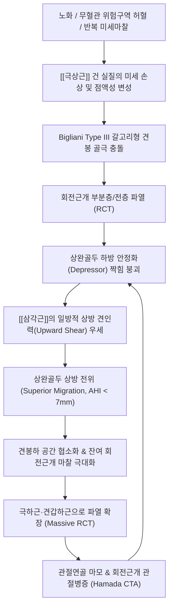
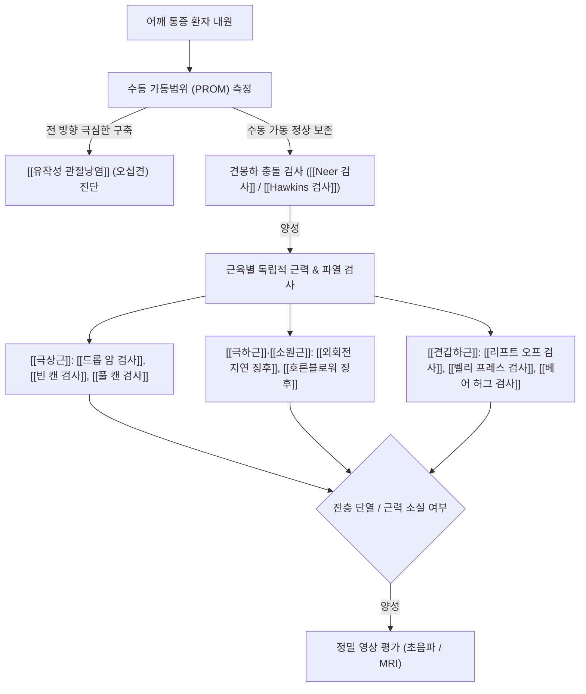
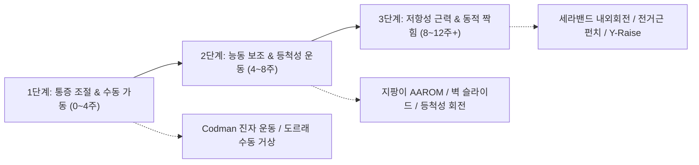

# 🩺 [[회전근개 파열]] (Rotator Cuff Tear, RCT / 腱板斷裂, M75.1)

> **핵심 3줄 요약 (Key Summary)**:
> - 📍 병소 부위 & 해부·병태생리: 견관절을 동적으로 안정화하는 4대 근육 건 복합체([[극상근]], [[극하근]], [[소원근]], [[견갑하근]]) 중 하나 이상의 단열로, 특히 [[극상근]] 건 부착부 1cm 내측 무혈관 위험 구역([[Codman 무혈관 구역]])의 퇴행성 마모와 갈고리형 견봉 돌기에 의한 기계적 [[충돌 증후군]]이 결합하여 발생.
> - 🚩 전형적 임상 양상 & 3대 징후: 외전 60~120° 사이에서 악화되는 [[동통호]](Painful Arc), 환측으로 누울 때 체중 압박으로 인한 극심한 야간통, 수동 관절 가동 범위는 보존되나 팔을 들어 올리거나 버틸 때 팔이 뚝 떨어지는 [[드롭 암 검사]] 양성 및 [[으쓱 징후]](Shrug sign).
> - 🛠️ 핵심 감별 검사 & 한·양방 다각적 치료 전략: 전 방향 관절낭 구축이 일어나는 [[유착성 관절낭염]](오십견)과 수동 가동 범위 보존 여부로 감별하며, [[신바로약침]]·[[자하거약침]]·[[봉약침]]과 침도 요법, 견갑흉곽관절 교정 추나 및 삼각근-회전근개 짝힘(Force Couple) 재활 운동을 단계별로 적용.
> - ⚠️ 응급 의뢰 레드플래그 & 악화 요인: 65세 미만 활동기 환자의 급성 외상성 전층 파열, 능동 거상이 90° 미만으로 제한되는 가성 마비(Pseudoparalysis), 보존적 치료 3~6개월 후에도 진행하는 중증 근위축(Goutallier Grade 3~4)은 조기 정형외과 관절경 봉합술 의뢰 대상.

---

## 📌 목차
1. [질환 개요 & 해부학적 병태생리](#1-질환-개요--해부학적-병태생리)
2. [병태생리 메커니즘 & 생체역학적 악순환 네트워크](#2-병태생리-메커니즘--생체역학적-악순환-네트워크)
3. [임상 증상 & 이학적 검사(Physical Exam) 알고리즘](#3-임상-증상--이학적-검사physical-exam-알고리즘)
4. [감별 진단 매트릭스 (Differential Diagnosis)](#4-감별-진단-매트릭스-differential-diagnosis)
5. [한의 통합 치료 프로토콜 (침·약침·추나·한약)](#5-한의-통합-치료-프로토콜-침약침추나한약)
6. [양방 치료 & 병용·의뢰 기준 (Conventional Treatment & Referral)](#6-양방-치료--병용의뢰-기준-conventional-treatment--referral)
7. [재활 운동 & 생활습관 티칭 가이드](#7-재활-운동--생활습관-티칭-가이드)
8. [💡 사용자 진료실 핵심 필기 & 임상 노하우 (Melt-In 잔여 심화 집약)](#8--사용자-진료실-핵심-필기--임상-노하우-melt-in-잔여-심화-집약)
9. [출처 및 학술 참고 문헌 (References)](#9-출처-및-학술-참고-문헌-references)

---

## 1. 질환 개요 & 해부학적 병태생리

### 1) 질환 정의 및 역학적 특성
* **정의**: [[회전근개 파열]](Rotator Cuff Tear, RCT)은 어깨관절([[관절와상완관절]], Glenohumeral joint)의 능동적 회전 운동을 담당하고 상완골두를 관절와(Glenoid fossa)의 중심에 밀착 안정화(Dynamic centering)시키는 4개의 건 복합체([[극상근]], [[극하근]], [[소원근]], [[견갑하근]]) 중 하나 이상의 힘줄이 부분적으로 찢어지거나 완전히 단열된 병리적 상태를 의미한다.
* **역학 및 유병률**: 
  * 50세 이상 인구에서 급격히 증가하며, 60대에서는 약 20~30%, 80대 이상에서는 50% 이상에서 무증상 또는 유증상 파열이 발견되는 대표적인 퇴행성 관절 질환이다.
  * 전체 회전근개 파열의 80% 이상이 [[극상근]](Supraspinatus tendon)의 대결절 부착부에서 단독으로 발생하거나 극상근에서 시작하여 후방의 [[극하근]](Infraspinatus) 또는 전방의 [[견갑하근]](Subscapularis)으로 진행한다.
  * 직업적으로 팔을 어깨 위로 들어 올리는 과두 작업(Overhead labor) 종사자, 도장공, 목수, 배구·야구·수영 등 오버헤드 스포츠 선수, 그리고 반복적인 가사 노동을 하는 중장년층 여성에서 호발한다.

### 2) 회전근개 4대 근육의 기능해부학
회전근개는 견갑골의 전면과 후면에서 기시하여 상완골의 대결절과 소결절을 둘러싸며 정지하는 일종의 '힘줄 소매(Cuff)'를 형성한다.

| 근육명 (Muscle) | 기시부 (Origin) | 정지부 (Insertion) | 지배 신경 (Innervation) | 주요 기능 (Primary Action) | 임상적 파열 빈도 및 특징 |
| :--- | :--- | :--- | :--- | :--- | :--- |
| **[[극상근]]** (Supraspinatus) | 견갑골 극상와 (Supraspinous fossa) | 상완골 [[대결절]] 최상면 (Highest facet) | [[견갑상신경]] (C5-C6) | 상완골 외전 초기(0~30°) 주동, 상완골두 하방 압박(Depressor) | **최다 호발(>80%)**, Codman 무혈관 구역 존재, 견봉하 충돌에 취약 |
| **[[극하근]]** (Infraspinatus) | 견갑골 극하와 (Infraspinous fossa) | 상완골 [[대결절]] 중간면 (Middle facet) | [[견갑상신경]] (C5-C6) | 견관절 강력한 외회전(External rotation), 후방 안정화 | 2위 호발, 극상근 파열의 후방 연장, 외회전 근력 약화 유발 |
| **[[소원근]]** (Teres minor) | 견갑골 외측연 상부 2/3 (Lateral border) | 상완골 [[대결절]] 최하면 (Lowest facet) | [[액와신경]] (C5-C6) | 견관절 외회전 보조(90° 외전 상태 외회전), 관절낭 후하방 지지 | 단독 파열 드묾, 광범위 파열 시 최후의 외회전 보루 |
| **[[견갑하근]]** (Subscapularis) | 견갑골 견갑하와 전면 (Subscapular fossa) | 상완골 [[소결절]] (Lesser tuberosity) | [[상견갑하신경]] & [[하견갑하신경]] (C5-C6) | 견관절 강력한 내회전(Internal rotation), 전방 탈구 방지 | 결절간구 탈구 및 이두근 장두 손상 동반, 전방 짝힘 담당 |

### 3) 회전근개의 미세해부학 및 특수 해부 구조
* **회전근개 족문 (Rotator Cuff Footprint)**:
  * 회전근개가 상완골 대결절 및 소결절 골면에 닿는 부착 면적을 '족문(Footprint)'이라 부른다.
  * 극상근 족문은 내외측 폭 약 12~14mm, 전후 길이 약 16~18mm에 이르며, 관절 연골 경계면에서 대결절 외측 피질골 모서리까지 광범위하게 부착한다. 수술적 봉합술의 핵심 목표는 이 해부학적 족문을 최대한 원래 넓이대로 골면에 재부착(Footprint restoration)시키는 것이다.
* **회전근개 간격 (Rotator Interval)**:
  * 극상근건 전방 경계와 견갑하근건 상방 경계 사이에 형성된 삼각형의 연부조직 결손 공간이다.
  * 이 간격 내부를 [[상완이두근 장두건]](Long head of biceps tendon, LHBT)이 통과하며, 이를 [[오구상완인대]](Coracohumeral ligament, CHL)와 상관절상완인대(SGHL)가 활차(Pulley) 형태로 감싸며 지지한다. 회전근개 파열이 전방으로 확장되면 이두근 활차가 파열되어 이두근 장두건의 내측 아탈구(Subluxation) 및 극심한 전방 통증이 병발한다.
* **무혈관 위험 구역 ([[Codman 무혈관 구역]], Critical Zone)**:
  * 상완골 대결절 부착부에서 근위부로 약 1cm 떨어진 극상근건 실질 부위는 전상완회선동맥(Anterior humeral circumflex artery)의 분지와 견갑상동맥(Suprascapular artery)의 종말 혈관망이 만나는 문합 부위(Watershed area)이다.
  * 이 구역은 해부학적으로 모세혈관 밀도가 극히 낮고, 일상적인 팔의 하수 자세(Adduction)에서 상완골두에 의해 힘줄이 압박당할 때 건 내부 혈관이 짜여지는 '비틀어 짜기 효과(Wringing-out effect)'가 발생하여 만성적인 국소 허혈(Ischemia)과 세포외 기질 변성이 집중된다.

### 4) 회전근개 파열의 병리학적 분류 체계
임상 치료 방침(보존적 치료 대 수술적 치료)을 결정하기 위해 파열의 깊이, 크기, 퇴축도, 근육 변성도를 정밀 분류한다.

* **(1) 파열 층위 및 위치에 따른 분류**:
  * **부분층 파열 (Partial-thickness Rotator Cuff Tear, PTRCT)**: 힘줄의 전 층이 끊어지지 않고 일부 두께만 단열된 상태.
    * 관절면측 파열(Articular-sided tear, PASTA lesion): 관절강 쪽에 접한 심부 섬유 파열. 미세 혈류 부족과 관절액 접촉으로 발생하며 부분 파열의 약 60%를 차지.
    * 활액낭측 파열(Bursal-sided tear): 견봉하 점액낭에 접한 표재 섬유 파열. Bigliani Type III 견봉 돌기 골극과의 기계적 마찰로 발생하며 통증이 가장 심함.
    * 건실질내 파열(Intratendinous tear): 힘줄 내부의 중간층 섬유만 전단(Shearing) 손상되어 겉으로는 연속성이 유지되는 상태.
    * **Ellman 분류 (깊이 기준)**:
      * Grade 1: 파열 깊이 < 3mm (건 두께의 25% 미만).
      * Grade 2: 파열 깊이 3~6mm (건 두께의 25~50%).
      * Grade 3: 파열 깊이 > 6mm (건 두께의 50% 초과, 수술적 치료 고려선).
* **(2) 전층 파열 (Full-thickness Rotator Cuff Tear, FTRCT) 크기 분류 (DeOrio & Cofield)**:
  * 관절강과 견봉하 활액낭이 완전히 연통(Communication)되는 파열.
  * **소형 (Small tear)**: 파열의 장경 < 1cm.
  * **중형 (Medium tear)**: 파열 장경 1~3cm.
  * **대형 (Large tear)**: 파열 장경 3~5cm (보통 극상근 전층 및 극하근 일부 침범).
  * **광범위 (Massive tear)**: 파열 장경 > 5cm 또는 2개 이상의 회전근개 힘줄이 완전히 단열된 상태.
* **(3) 건 절단단 퇴축 분류 (Patte Classification)**:
  * 관상면(Coronal) MRI 영상에서 힘줄 끝단이 내측으로 오그라든 정도를 평가.
  * Stage 1: 건 절단단이 대결절 골 부착부 근처에 위치 (퇴축 거의 없음).
  * Stage 2: 건 절단단이 상완골두 정점(Top of humeral head) 수준까지 퇴축.
  * Stage 3: 건 절단단이 관절와 연골연(Glenoid rim) 수준까지 심하게 퇴축 (원위치 복원 봉합 고난도).
* **(4) 근육의 지방 침윤 및 변성도 (Goutallier / Fuchs Classification)**:
  * CT 또는 MRI 축상면(Axial) 및 시상면(Sagittal) 영상에서 근육 실질 내 지방 변성(Fatty infiltration) 정도를 평가하며, 수술 후 재파열률과 장기 기능 예후를 결정하는 가장 결정적인 지표이다.
  * **Grade 0**: 정상 근육, 지방 침윤이 전혀 없음.
  * **Grade 1**: 근육 내에 몇 가닥의 미세한 지방 선상 음영 관찰.
  * **Grade 2**: 지방 침윤이 증가했으나, 여전히 근육 조직의 양이 지방보다 많음 (봉합술 시 우수한 예후 기대).
  * **Grade 3**: 근육과 지방의 양이 1:1로 대등함 (경계선 병변, 봉합 후 재파열률 상승).
  * **Grade 4**: 지방 조직의 양이 잔존 근육보다 현저히 많음 (비가역적 지방 변성 완료. 건을 끌어당겨 봉합해도 힘줄 치유가 불가능하여 단순 봉합술 금기, 역행성 인공관절 또는 근이전술 고려).

---

## 2. 병태생리 메커니즘 & 생체역학적 악순환 네트워크

### 1) 내인성 기전 (Intrinsic Pathomechanism)
* **노화와 생화학적 세포외기질 붕괴**:
  * 정상 회전근개는 인장 강도가 뛰어난 Type I 콜라겐이 95% 이상을 차지하나, 40대 이후 노화와 함께 건세포(Tenocyte)의 수가 감소하고 자멸사(Apoptosis)가 가속화된다.
  * 기질금속단백질분해효소(Matrix Metalloproteinases, MMP-1, MMP-13)의 활성이 억제 단백질(TIMPs)의 방어 기전을 압도하면서 교원질 섬유가 분해되고, 미세 손상 부위에 질적으로 취약한 Type III 콜라겐과 점액성 변성(Mucoid degeneration) 조직이 침착된다.
* **미세혈관 허혈과 재생 실패**:
  * Codman의 무혈관 위험 구역에서 혈관 내피세포의 퇴행으로 산소 분압이 떨어지면 혈관내피성장인자(VEGF)가 불규칙하게 발현되어 미성숙하고 취약한 신생혈관(Neovascularization)이 증식하며 통증 수용체(C-fiber)가 동반 침투하여 만성 신경성 염증을 형성한다.

### 2) 외인성 기전 (Extrinsic Mechanical Impingement)
* **Neer의 견봉하 충돌 3단계 이론**:
  * 찰스 니어(Charles Neer, 1972)는 회전근개 파열의 95%가 상완골두와 전하방 견봉 돌기, 오구견봉인대(Coracoacromial ligament, CAL) 사이의 기계적 충돌에 기인한다고 규명하였다.
  * **1단계 (부종 및 출혈)**: 25세 미만, 반복적 과사용으로 인한 급성 점액낭염 및 건 부종. 가역적 단계.
  * **2단계 (섬유화 및 건염)**: 25~40세, 만성적 마찰로 점액낭 비후, 건의 섬유화 및 불완전 파열 진행.
  * **3단계 (골극 형성 및 전층 파열)**: 40세 이상, 전하방 견봉에 골극(Acromial spur)이 자라나고 대결절에 마찰 골경화가 동반되며 회전근개 전층 파열 확정.
* **Bigliani 견봉 형태 분류와 충돌 위험도**:
  * **Type I (Flat, 평평형)**: 견봉 하면이 평평함 (인구의 약 17%, 파열 빈도 최저).
  * **Type II (Curved, 곡선형)**: 상완골두 곡면과 평행하게 만곡됨 (인구의 약 43%, 중간 위험도).
  * **Type III (Hooked, 갈고리형)**: 견봉 전하방이 갈고리처럼 아래로 날카롭게 돌출됨 (인구의 약 40%). 회전근개 전층 파열 환자의 70% 이상이 Type III 형태를 나타내며, 팔을 전방 굴곡 및 외전할 때 극상근건을 칼날처럼 직접 긁어 파열을 촉발한다.

### 3) 짝힘(Force Couple) 붕괴와 생체역학적 악순환
어깨관절은 인체에서 가동 범위가 가장 넓은 대신 골성 안정성이 취약하여, 근육들의 상호 균형을 이루는 '짝힘(Force Couple)'에 의해 안정성을 유지한다.

* **관상면 짝힘 (Coronal Force Couple)**:
  * 외전 동작 시 강력한 [[삼각근]](Deltoid)은 상완골두를 위쪽으로 끌어당기는 상방 전단력(Upward shear force)을 발생시킨다.
  * 이에 맞서 회전근개 4개 근육(특히 [[극상근]])은 상완골두를 관절와 쪽으로 압박하고 아래로 내리는 하방 압박력(Depressor force)을 발휘하여 상완골두가 견봉에 부딪히지 않고 제자리에서 회전하도록 지탱한다.
  * 극상근이 파열되면 하방 압박력이 상실되어, 삼각근이 수축할 때 상완골두가 견봉 아래로 곧바로 치고 올라가 부딪히게 된다(Superior migration).
* **횡단면 짝힘 (Transverse Force Couple)**:
  * 상완골두의 전방에서는 [[견갑하근]]이 당기고, 후방에서는 [[극하근]]과 [[소원근]]이 팽팽하게 당겨 전후 균형을 잡는다.
  * 극하근 파열 시 전방의 견갑하근이 우세해져 상완골두가 전상방으로 아탈구되고, 반대로 견갑하근 파열 시 상완골두가 후상방으로 불안정해진다.
* **현수교 이론 (Suspension Bridge Theory, Burkhart)**:
  * 극상근건과 극하근건의 기저부에는 두꺼운 섬유 띠인 '회전근개 케이블(Rotator cable)'이 초승달 모양의 얇은 '회전근개 크레센트(Rotator crescent)' 조직을 둘러싸고 있다.
  * 크레센트 부위에 소형 파열이 생겨도 전후방 케이블 지지 기둥이 온전하면 장력이 유지되어 팔을 들 수 있으나, 파열이 케이블 기둥(대결절 전방 및 후방 지지점)을 뚫고 나가면 현수교의 케이블이 끊어진 것처럼 관절 중심 안정성이 완전히 붕괴되어 팔을 전혀 들어 올리지 못하는 가성 마비(Pseudoparalysis)가 초래된다.

---

## 3. 임상 증상 & 이학적 검사(Physical Exam) 알고리즘

### 1) 3대 핵심 주소증 및 신경혈관 증상
1. **외전 60~120° [[동통호]](Painful Arc Sign)**:
   * 환자가 팔을 옆으로 벌려 위로 들어 올릴 때(능동 외전), 0~60°까지는 통증이 없다가 대결절의 극상근 부착부가 견봉 돌기 밑을 빠져나가는 **60°~120° 구간에서 찌르는 듯한 날카로운 통증**이 폭발하며, 120°를 넘어서 만세 동작으로 올라가면 견봉하 공간을 완전히 통과하여 통증이 일시적으로 완화된다.
2. **환측 하수 시 극심한 야간통 (Night Pain)**:
   * 야간에 관절와 내압이 상승하고 견봉하 점액낭의 염증성 부종이 가중된다. 특히 환측 어깨를 바닥에 대고 옆으로 누울 때 체중 부하로 인해 상완골두가 견봉에 직접 압박되어 잠을 깨며 비명을 지르게 된다.
3. **근력 약화(Weakness) 및 [[으쓱 징후]](Shrug Sign)**:
   * 물건을 머리 위 선반에 올리거나, 머리를 빗거나, 숟가락을 입으로 가져갈 때 팔에 힘이 들어가지 않고 덜덜 떨린다.
   * 상완골을 외전시킬 수 없기 때문에, 어깨를 거상하기 위해 [[승모근]](Trapezius)과 [[견갑거근]](Levator scapulae)을 과도하게 수축시켜 목과 어깨를 움찔하고 치켜세우는 전형적인 **으쓱 징후(Shrug sign)**를 나타낸다.

### 2) 특이적 이학적 유발 검사 (Physical Examination)

#### (1) 견봉하 충돌 유발 검사
* **[[Neer 검사]](Neer Impingement Test)**:
  * 검사자가 환자의 뒤에서 한 손으로 견갑골의 회전을 고정하고, 다른 손으로 환자의 팔을 내회전(엄지손가락이 아래를 향함)시킨 상태에서 전방 굴곡(Forward flexion) 방향으로 강하게 들어 올린다.
  * 상완골 대결절이 전하방 견봉과 오구견봉인대에 강제로 충돌하여 견봉하 통증이 재현되면 양성이다.
* **[[Hawkins-Kennedy 검사]](Hawkins-Kennedy Test)**:
  * 환자의 견관절과 주관절을 90° 굴곡시킨 상태에서 검사자가 전완을 잡고 급격히 내회전(Internal rotation)을 유도한다.
  * 대결절이 오구견봉인대 하면을 긁으며 통증이 유발되면 양성으로, 극상근건염 및 견봉하 활액낭염 진단에 민감도가 매우 높다.

#### (2) [[극상근]](Supraspinatus) 특이 검사
* **[[드롭 암 검사]](Drop Arm Test / Codman's Sign)**:
  * 검사자가 환자의 팔을 90° 이상 수동으로 외전시킨 후 손을 떼고, 환자에게 팔을 천천히 천천히 내리도록 지시한다.
  * 극상근이 전층 파열된 환자는 90° 부근에서 삼각근-회전근개 짝힘이 끊어지며 팔을 지탱하지 못하고 힘없이 뚝 떨어뜨리거나, 통증으로 인해 팔을 통제하지 못한다. (전층 대파열에 대한 특이도 90% 이상).
* **[[빈 캔 검사]](Empty Can Test / Jobe Test)**:
  * 양팔을 견갑골 면(Scapular plane, 전방 30°)에서 90° 외전시키고, 엄지손가락이 바닥을 향하도록 전완을 최대로 내회전(마치 음료수 캔을 엎질러 비우는 자세)시킨 후 검사자가 아래로 누르는 저항을 준다.
  * 외전 저항력을 버티지 못하고 통증이 발생하거나 근력이 뚝 떨어지면 극상근 파열 양성이다.
* **[[풀 캔 검사]](Full Can Test)**:
  * 동일하게 견갑골 면에서 90° 외전하되, 엄지손가락을 천장으로 향하게 외회전(캔에 물을 가득 담은 자세)시킨 상태에서 하방 저항을 평가한다.
  * 빈 캔 검사에 비해 견봉하 충돌에 의한 통증 가양성을 배제하고 순수한 극상근 근력을 정밀 평가할 수 있다.

#### (3) [[극하근]](Infraspinatus) & [[소원근]](Teres Minor) 특이 검사
* **[[외회전 지연 징후]](External Rotation Lag Sign, ER Lag Sign)**:
  * 환자의 팔꿈치를 90° 굴곡하고 견관절을 20° 외전한 상태에서 검사자가 수동으로 최대 외회전(약 45°)시킨 후 손을 놓는다.
  * 극하근 또는 소원근이 파열된 경우 그 외회전 각도를 능동적으로 유지하지 못하고 스프링처럼 전방(내회전 방향)으로 5° 이상 되돌아 떨어지게 된다.
* **[[호른블로워 징후]](Hornblower's Sign / Patte Test)**:
  * 환자의 팔을 견관절 90° 외전, 주관절 90° 굴곡한 상태에서 외회전 저항을 검사한다.
  * 소원근의 광범위 파열이 있는 환자는 외회전을 전혀 할 수 없어, 손을 입으로 가져가려 할 때 팔꿈치를 어깨 높이 위로 치켜들며 마치 트럼펫이나 호른을 부는 듯한 우스꽝스러운 보상 동작을 취하게 된다.

#### (4) [[견갑하근]](Subscapularis) 특이 검사
* **[[리프트 오프 검사]](Lift-Off Test / Gerber Test)**:
  * 환자가 환측 손등을 허리 뒤(요추 중앙부)에 얹은 상태에서, 손을 등 뒤 허리 표면에서 뒤쪽으로 떼어내 들어 올리도록(Lift-off) 지시한다.
  * 견갑하근이 파열된 환자는 손을 등에서 1cm도 떼어내지 못한다.
* **[[벨리 프레스 검사]](Belly-Press Test / Napoleon Sign)**:
  * 어깨 통증이나 구축으로 손을 등 뒤로 돌릴 수 없는 환자에게 적용한다.
  * 환자가 손바닥을 배(복부) 위에 얹고 팔꿈치를 몸 앞쪽으로 유지한 채 배를 강하게 누르도록 한다.
  * 견갑하근이 정상인 환자는 팔꿈치를 몸 앞쪽에 유지하며 손목을 곧게 펴 배를 누르지만, 견갑하근이 파열된 환자는 손목을 과도하게 굴곡시키고 팔꿈치가 몸 뒤쪽으로 밀려 빠지게 된다(나폴레옹 자세).
* **[[베어 허그 검사]](Bear Hug Test)**:
  * 환측 손바닥을 반대쪽 어깨 위에 얹고 팔꿈치를 전방으로 90° 든 상태에서, 검사자가 환자의 손을 어깨에서 떼어내려 당길 때 환자가 저항하도록 한다.
  * 견갑하근 상부 섬유의 미세 부분 파열을 잡아내는 가장 민감도 높은 검사이다.

### 3) 영상의학적 정밀 진단 기준
* **단순 방사선 사진 (X-ray)**:
  * **True AP (Grashey view)**: 관절와상완관절면의 골극 및 관절 간격 평가.
  * **Supraspinatus Outlet view**: 전하방 견봉 돌기의 골극 유무 및 Bigliani Type I, II, III 형태 감별.
  * **견봉-상완골두 간격 (Acromiohumeral Interval, AHI)**:
    * 정상 성인의 AHI는 9~10mm 이상이다.
    * AHI가 **7mm 미만**으로 좁아져 있으면 회전근개 대형 전층 파열을 강력히 시사하며, 5mm 미만이면 삼각근의 상방 견인력에 의해 상완골두가 견봉 하면에 맞닿아 관절이 파괴되는 회전근개 관절병증(Hamada Stage 2 이상)으로 진행되었음을 의미한다.
* **근골격계 초음파 (Musculoskeletal Ultrasound)**:
  * 진료실 외래에서 환자의 팔을 변형 Crass 자세(팔을 등 뒤로 돌려 대결절을 전방 노출)로 두고 실시간 동적(Dynamic) 검사를 시행할 수 있다.
  * **핵심 초음파 소견**:
    * 저에코성 결손 (Hypoechoic defect): 건 실질의 연속성 소실.
    * 연골 계면 징후 (Cartilage Interface Sign): 건이 완전히 파열되어 사라짐으로써 대결절의 고에코 연골 피질선이 견봉하 지방체와 직접 맞닿아 뚜렷한 흰색 이중선으로 관찰됨.
    * 나출형 결절 징후 (Naked Tuberosity Sign): 대결절 골면 위에 건 조직이 전혀 덮여 있지 않은 상태.
* **자기공명영상 (MRI / MR Arthropathy)**:
  * 회전근개 파열의 최종 확진 및 수술 여부 결정을 위한 골드 스탠다드(Gold standard).
  * **T2 강조 관상면 및 시상면 영상**: 파열된 건 부위에 관절액이 차서 밝은 고신호강도(High signal intensity)로 관찰된다.
  * 파열의 크기(장경 mm), 건 절단단의 내측 퇴축 정도(Patte Stage), 그리고 [[극상근]]·[[극하근]] 근복의 지방 변성도(Goutallier Grade 0~4)를 입체적으로 정량화한다.

---

## 4. 감별 진단 매트릭스 (Differential Diagnosis)

어깨 통증을 호소하는 환자 중 회전근개 파열과 임상 양상이 유사한 주요 질환들과의 감별 포인트는 다음과 같다.

| 감별 질환 | 호발 연령 및 병력 | 능동 가동범위 (AROM) | 수동 가동범위 (PROM) | 핵심 이학적 검사 및 감별 포인트 | 영상의학적 특이 소견 |
| :--- | :--- | :--- | :--- | :--- | :--- |
| **[[회전근개 파열]]** (RCT) | 50대 이상, 퇴행성 마모 또는 낙상 외상 | **외전/거상 시 현저한 약화 및 통증** | **대체로 정상 보존 (거상 가능)** | [[동통호]](60~120°), [[드롭 암 검사]] 양성, [[으쓱 징후]], 근력 저하 | 초음파/MRI 상 건 연속성 단열, AHI < 7mm, Goutallier 지방 침윤 |
| **[[유착성 관절낭염]]** (오십견) | 40~60대, 당뇨·갑상선 질환 호발, 특발성 | **전 방향 심한 제한 (외전, 굴곡 불가)** | **전 방향 극심한 제한 (특히 외회전 소실)** | 캡슐 끝느낌(Capsular hard end-feel), 수동 거상 시도 시 골반과 체간이 함께 들림 | X-ray 정상, MRI 상 액와 오목(Axillary recess) 관절낭 비후 (>4mm) |
| **[[견봉하 충돌 증후군]]** | 30~50대, 과두 작업자, 스포츠 선수 | 통증으로 인한 일시적 제한 있으나 근력 유지 | 정상 수동 가동범위 | [[Neer 검사]] 양성, [[Hawkins 검사]] 양성, **드롭 암 음성 (팔을 버팀)** | 견봉 골극, 견봉하 점액낭 비후, 건의 연속성은 유지됨 |
| **[[석회성 건염]]** | 30~50대 여성 호발, 급성 화학적 염증 | 급성기 극심한 격통으로 팔을 전혀 못 움직임 | 급격한 통증으로 수동 검사 일체 불가 | 야간 응급실 방문 수준의 초응급성 통증, 대결절 부위 극심한 압통 | X-ray 상 극상근 부착부에 분필가루 같은 뚜렷한 석회 침착 음영 |
| **[[상완이두근 장두 건염]] / SLAP** | 20~40대 투수, 던지기 동작, 반복적 당김 | 굴곡 및 외전 끝 범위 통증 | 정상 가동범위 | 결절간구(Bicipital groove) 직접 압통, [[스피드 검사]] 양성, [[야가손 검사]] 양성 | 관절와순 상부 전후 파열(SLAP), 이두건초 삼출액 저류 |
| **[[경추 추간판 탈출증]]** (C5-C6) | 전 연령, 경추 퇴행, 불량한 스마트폰 자세 | 견관절 자체는 자유롭게 움직임 | **정상 수동 가동범위** | [[스펄링 검사]](Spurling test) 양성, 경추 신전-회전 시 상지 방사통, 심부건반사 저하 | 경추 X-ray/MRI 상 C5/6 신경근 압박, 견관절 영상은 정상 |
| **[[신경통성 근위축증]]** (Parsonage-Turner) | 20~50대, 바이러스 감염, 백신 접종 후 | 급성 마비로 거상 불가 | 정상 수동 가동범위 | 며칠간 극심한 어깨 통증 후 통증이 소실되면서 급격한 극상근/삼각근 마비·위축 | 근전도(EMG) 상 신경 탈신경 전위, 상완신경총 MRI 이상 |

---

## 5. 한의 통합 치료 프로토콜 (침·약침·추나·한약)

회전근개 파열에 대한 한의학적 병증은 '견비통(肩臂痛)', '견불거(肩不擧)', '오십견(五十肩)'의 범주에 속하며, 병기는 크게 **기혈어저(氣血瘀阻)**, **풍한습비(風寒濕痺)**, **간신휴허(肝腎虧虛)**로 변증하여 침, 약침, 침도, 추나, 한약을 유기적으로 병용한다.

### 1) 침구 치료 (Acupuncture & Electroacupuncture)
* **주요 경혈 및 근막 트리거포인트([[TP]]) 배혈**:
  * **견봉하 공간 및 전외측 병소**: [[견우]](LI15), [[견료]](TE14), [[거골]](LI16) — 견봉과 대결절 사이 점액낭 및 극상근건 부착부를 직접 관통하여 국소 순환을 개선.
  * **후방 회전근개 병소**: [[천종]](SI11), [[노회]](TE13), [[병풍]](SI12), [[곡원]](SI13), [[견정]](SI9) — 극하근과 소원근의 근복 내 단축된 단단한 띠(Taut band)를 해소.
  * **상완이두근 및 전방 안정성**: [[비노]](LI14), [[척택]](LU5), [[중부]](LU1) — 상완골두 전방 전위를 방어하는 연관 경근 자극.
  * **원위 취혈**: [[곡지]](LI11), [[외관]](TE5), [[후계]](SI3), [[조구]](ST38), [[양릉천]](GB34, 筋會).
* **심부 자침 및 전침(Electroacupuncture) 프로토콜**:
  * 환자를 건측와위(건측으로 눕힌 자세)로 취하고 상완을 체간에 붙인 채, [[견우]]와 [[견료]] 혈에서 견봉 하면을 스치듯이 수평에서 약 15° 하방 각도로 40~50mm 심부 자침하여 견봉하 점액낭 내벽에 도달시킨다.
  * [[천종]] 자침 시에는 견갑골 극하와 골막에 닿을 때까지 30~40mm 직자하여 묵직한 득기감(Deqi)을 유도하고, 삼각근 외측으로 찌릿하게 퍼지는 연관통을 확인한다.
  * **전침 자극**: 견우-견료, 천종-병풍 혈에 전침을 연결하고 **2Hz/100Hz 혼합파(Dense-Disperse Wave)**를 적용한다. 2Hz의 저주파는 내인성 오피오이드(β-endorphin, Enkephalin) 분비를 촉진하고 건 복원 환경을 조성하며, 100Hz의 고주파는 척수 후각 관문 조절설(Gate Control Theory)을 통해 급성 통증 신호를 차단한다 (1회 20분, 주 2~3회).

### 2) 약침 요법 (Pharmacopuncture)
염증 단계와 환자의 전신 체질, 파열의 만성도에 따라 특화된 약침액을 엄선하여 시술한다.

* **[[신바로약침]](GCSB-5)**:
  * 방풍, 우슬, 오가피, 구척, 두충, 하수오 등으로 구성된 생약 복합 추출물.
  * 염증성 사이토카인(TNF-α, IL-1β, IL-6)과 COX-2 유전자의 과발현을 억제하며, 파괴된 건세포의 세포사를 차단하고 프로테오글리칸의 합성을 촉진하여 건 재생을 돕는다.
  * 견봉하 점액낭([[견우]], [[견료]]) 및 극상근 대결절 족문 부위에 포인트당 0.5~1.0cc씩 총 2.0~3.0cc를 주 2회 주입한다.
* **[[자하거약침]](Hominis Placenta Pharmacopuncture)**:
  * 인체 태반 추출물로 성장인자(EGF, FGF, TGF-β) 및 다양한 활성 펩타이드, 아미노산이 풍부하게 함유되어 있다.
  * 50대 이상 만성 퇴행성 파열, Codman 무혈관 구역의 미세 순환 허혈, 근육 위축 및 지방 침윤이 진행 중인 환자에게 최우선 적용한다.
  * [[천종]], [[노회]], [[곡원]] 등 극상근·극하근 근복과 건 부착부에 분할 주입하여 교원질 섬유 신생과 혈관 신생을 유도한다.
* **[[봉약침]](Bee Venom Pharmacopuncture / Mellitin)**:
  * 멜리틴(Melittin), 아돌라핀(Adolapin), 아파민(Apamin) 성분의 강력한 항염증 및 면역 조절 작용.
  * 견봉하 활액낭염이 극심하여 야간통으로 잠을 이루지 못하는 급성 염증기에 탁월한 진통 효과를 발휘한다.
  * 반드시 피부 알레르기 스킨 테스트(Skin Test)를 거친 후, 10,000:1 또는 20,000:1 희석액부터 시작하여 점진적으로 증량 투여한다.

### 3) 침도 요법 (Acupotomy)
* **적응증**: 보존적 치료에도 불구하고 견봉하 공간의 만성 섬유화 유착 및 오구견봉인대(CAL) 비후로 인해 충돌 통증과 운동 제한이 고착화된 증례.
* **시술 방법**:
  * 무균 소독 후 0.5×50mm 플랫형 침도(Acupotomy needle)를 사용한다.
  * **오구견봉인대(CAL) 박리점**: 오구돌기 외측연에서 견봉 전연으로 이어지는 인대 주행 방향을 촉지하고, 건 섬유와 평행하게 진입하여 비후된 인대 섬유를 2~3회 종방향으로 미세 절개(Slitting release)하여 견봉하 내압을 감압한다.
  * **견봉하 점액낭 유착 박리점**: 견봉 전외측 모서리 직하방에서 진입하여 대결절 상면 사이의 섬유성 유착 밴드를 부드럽게 횡방향으로 박리한다.
  * 시술 즉시 관절을 수동 회전시켜 유착 박리 여부를 확인하며, 시술 후 국소 압박 지혈 및 감염 관리를 철저히 시행한다.

### 4) 추나 요법 (Chuna Manual Therapy)
* **견갑흉곽관절(Scapulothoracic Joint) 가동 추나**:
  * 둥근 어깨(Round shoulder) 환자는 견갑골이 전방 경사(Anterior tilt), 내회전(Internal rotation), 하방 회전(Downward rotation)되어 견봉 돌기가 앞쪽 아래로 기울어지면서 견봉하 공간이 좁아진다.
  * 환자를 측와위로 눕히고 시술자가 견갑골 하각과 상연을 파지하여 상방 회전(Upward rotation) 및 후방 경사(Posterior tilt) 방향으로 부드럽게 리듬감 있게 가동하여 견봉하 공간을 물리적으로 확장시킨다.
* **흉추 신전 가동 기법 (Thoracic Extension Manipulation)**:
  * 흉추 후만(Thoracic kyphosis)이 심할수록 팔을 들어 올릴 때 견갑골의 후방 경사가 제한되어 충돌이 악화된다.
  * 앙와위 또는 복와위에서 중하부 흉추(T3~T8) 분절에 신전 스러스트 또는 관절 가동 수기를 적용하여 흉추 전만을 유도한다.
* **연부조직 근막이완(JS) 및 근에너지 기법(MET)**:
  * 단축된 [[소흉근]](Pectoralis minor), [[견갑거근]](Levator scapulae), 상부승모근을 허혈성 압박 및 스트레칭 기법으로 이완시킨다.
  * 약화된 [[전거근]](Serratus anterior)과 [[하부승모근]](Lower trapezius)의 근수축을 유도하여 견갑골 상방 회전 짝힘을 재건한다.

### 5) 변증별 한약 처방 (Herbal Medicine)
파열의 시기, 통증 양상, 환자의 체력에 따라 단계별로 처방을 구성한다.

| 병증 분류 | 임상 특징 및 설맥 | 대표 처방 | 주요 구성 약재 및 배오 원리 |
| :--- | :--- | :--- | :--- |
| **기혈어저 (氣血瘀阻)** | 급성 외상, 찌르는 듯한 고정된 야간통, 거상 곤란, 설자암(舌紫暗), 맥현삽(脈弦澁) | **[[서경탕]]** (舒經湯), **[[당귀수산]]** (當歸鬚散) 가감 | 강황(薑黃), 당귀(當歸), 적작약(赤芍藥), 해동피(海桐皮), 계지(桂枝) — 경락의 어혈을 풀고 상지 관절의 순환을 통하게 함 |
| **담음어혈 (痰飲瘀血)** | 둔중한 통증, 날씨가 궂으면 악화, 관절 마찰음, 설태백니(舌苔白膩), 맥활(脈滑) | **반하금출탕** (半夏芩朮湯), **개결서경탕** (開結舒經湯) | 반하(半夏), 창출(蒼朮), 황금(黃芩), 진피(陳皮), 남성(南星) — 체내 습담과 염증 삼출물을 삭이고 기혈 순환 촉진 |
| **간신휴허 (肝腎虧虛)** | 50대 이상 만성 퇴행, 건 무력증, 관절이 시리고 힘이 빠짐, 설홍소태, 맥세약 | **[[독활기생탕]]** (獨活寄生湯), **보혈영근탕** (補血營筋湯) | 독활, 상기생, 두충, 우슬, 당귀, 숙지황, 백작약, 속단 — 간신을 보하여 힘줄과 뼈(筋骨)를 강화하고 콜라겐 재생 유도 |

---

## 6. 양방 치료 & 병용·의뢰 기준 (Conventional Treatment & Referral)

### 1) 양방 약물 요법 (Conventional Medication)
1차 의료기관 정형외과 및 신경외과에서 주로 처방되는 약물 구성과 특성은 다음과 같다.
* **비스테로이드성 소염진통제 (NSAIDs)**:
  * **세레콕시브(Celecoxib)**: 200mg 1일 1회 복용. COX-2 선택적 억제제로 기존 비선택적 NSAIDs에 비해 위장관 출혈 위험이 적어 고령 환자의 장기 복용에 다용됨.
  * **록소프로펜(Loxoprofen)**: 60mg 1일 3회 복용. 전구물질(Prodrug) 형태로 위장 자극이 적고 급성 진통 효과가 빠름.
  * **아세클로페낙(Aceclofenac)**: 100mg 1일 2회 복용. 관절 염증 및 연골 대사에 유리.
* **근이완제 (Skeletal Muscle Relaxants)**:
  * **에페리손(Eperisone hydrochloride)**: 50mg 1일 3회 복용. 근방추 반사를 억제하여 승모근 및 견갑대 주변의 보상성 근연축을 완화.
* **위장관 보호제**:
  * 소염진통제 복용으로 인한 위궤양 및 속쓰림을 예방하기 위해 PPI(라베프라졸, 에스오메프라졸) 또는 H2 차단제(파모티딘), 점막보호제(레바미피드)를 필수로 병용 처방함.

### 2) 주사 요법 및 비약물 시술
* **견봉하 공간 스테로이드 주사 (Subacromial Corticosteroid Injection)**:
  * 트리암시놀론(Triamcinolone acetonide 20~40mg)과 국소마취제(Lidocaine)를 견봉하 점액낭 내에 주입.
  * 급성 활액낭염 및 통증을 극적으로 경감시키지만, **힘줄 실질 내에 직접 주입되거나 연 2~3회 이상 반복 주입될 경우 건세포의 괴사, 교원질 분해 가속화, 건 파열 크기 확장**을 초래하므로 매우 신중해야 한다.
* **PDRN (Polydeoxyribonucleotide) 및 콜라겐 주사**:
  * 연어 정소에서 추출한 DNA 분획으로 아데노신 A2A 수용체를 자극하여 신생혈관 형성과 항염증 인자를 촉진. 스테로이드와 달리 힘줄 괴사 위험이 없어 재생 목적으로 활용됨.

### 3) 수술적 치료 적응증 및 최신 술식
* **수술의 절대적 적응증**:
  * 65세 미만의 활동적인 환자에서 발생한 **급성 외상성 전층 파열**.
  * 3~6개월 이상의 적극적인 비수술적 한의·양방 보존 치료에도 불구하고 극심한 야간통과 진행성 근력 저하가 지속되는 경우.
  * 파열 크기가 3cm 이상이며 건의 견인력이 남아 있는 중대형 파열.
* **주요 정형외과적 수술 술식**:
  * **관절경하 회전근개 봉합술 (Arthroscopic Rotator Cuff Repair, ARCR)**:
    * 소형~대형 파열의 표준 수술. 관절경으로 견봉하 공간을 관찰하며 봉합 나사못(Suture anchor)을 대결절 골면에 삽입하고 파열된 힘줄을 원래 족문에 봉합.
    * 단일열 봉합(Single-row), 이중열 봉합(Double-row), 봉합교량형(Suture-bridge) 기법 등이 적용됨.
  * **동반 견봉성형술 (Concomitant Acromioplasty)**:
    * Bigliani Type III의 갈고리형 견봉 골극을 절제하여 견봉 하면을 평평하게 다듬음으로써 향후 봉합된 건의 재충돌 마찰을 방지함.
  * **상부 관절낭 재건술 (Superior Capsular Reconstruction, SCR)**:
    * 힘줄이 완전히 녹아내려 봉합이 불가능한 광범위 불가역 파열에서 자가 대퇴근막이나 동종 진피를 관절와 상연과 대결절 사이에 이식하여 상완골두의 상방 전위를 억제함.
  * **역행성 인공견관절 치환술 (Reverse Total Shoulder Arthroplasty, RTSA)**:
    * 회전근개가 전멸하고 관절염이 심각한 70세 이상 고령 환자에게 적용. 관절와를 볼(Glenosphere)로 만들고 상완골두를 컵(Socket) 형태로 구조를 완전히 뒤집어, 회전근개 없이 순수하게 [[삼각근]]의 힘만으로 팔을 들어 올릴 수 있도록 재건함.

### 4) 한의-양방 병용 판단 가이드라인
* **NSAIDs 복용 환자 내원 시**:
  * 진통소염제를 장기 복용 중인 환자에게 [[독활기생탕]], [[서경탕]] 등 한약을 투약할 때 위장관 부담을 고려하여 백출, 복령, 신곡, 맥아 등을 가미한다. 한의 치료로 통증이 50% 이상 경감되면 양약 소염진통제를 격일 복용으로 서서히 감량(Tapering)하도록 지도한다.
* **견봉하 스테로이드 주사 직후 내원 환자**:
  * 스테로이드 주사를 맞은 직후 2~3주간은 국소 면역 억제 상태로 인해 감염에 취약하다. 따라서 주사 부위에 침도 요법이나 심부 약침 자입을 즉시 시행하지 않고, 3주 이상 경과를 관찰한 후 안전하게 시술한다.
* **수술 후 한의 재활 프로토콜**:
  * 봉합 수술 후 4~6주간의 슬링 고정기에는 수술 부위를 직접 자극하지 않고, 경항부 및 전완부 원위 취혈을 통해 국소 부종과 혈종을 흡수시킨다. 6주 이후 보조기를 탈착하는 시점부터 천종, 견우, 비노 전침 및 관절 가동 추나를 병행하면 관절 구축(Stiffness)을 현저히 줄이고 회복 기간을 30% 이상 단축시킬 수 있다.

### 5) 상급 병원 및 전문과 의뢰 기준 (Referral Criteria)
다음 징후가 관찰되면 지체 없이 정형외과 견주관절 전문의에게 정밀 검사 및 수술을 의뢰한다:
1. **급성 외상성 파열**: 넘어지거나 무거운 것을 든 직후 갑자기 팔이 위로 전혀 올라가지 않는 급성 단열 (외상 후 3주 이내 조기 봉합이 기능 회복에 가장 중요).
2. **가성 마비 (Pseudoparalysis)**: 능동 전방 굴곡이 90° 미만으로 떨어져 만세 동작이 전혀 불가능한 광범위 파열.
3. **진행성 신경 마비**: 액와신경 또는 견갑상신경 손상으로 인한 삼각근 감각 소실 및 급격한 근섬유 위축.
4. **보존적 치료 실패**: 3~6개월간의 충실한 한의 복합 보존 치료에도 불구하고 극심한 통증과 기능 저하가 악화되는 경우.

---

## 7. 재활 운동 & 생활습관 티칭 가이드

회전근개 재활의 대원칙은 '초기 무부하 수동 관절 가동을 통한 유착 방지' $
ightarrow$ '견갑대 안정화 근육 강화' $
ightarrow$ '회전근개 짝힘의 등척성 및 원심성 강화'의 3단계로 진행한다.

### 1) 단계별 재활 운동 프로토콜
* **1단계: 통증 조절 및 무부하 수동 관절 가동기 (0~4주)**
  * **코드만 진자 운동 (Codman Pendulum Exercise)**:
    * 튼튼한 탁자에 건강한 쪽 손을 짚고 상체를 90° 앞으로 숙인다. 아픈 팔은 힘을 완전히 빼고 바닥을 향해 축 늘어뜨린다.
    * 어깨 근육의 힘으로 팔을 돌리지 말고, **체간(몸통)과 무릎을 앞뒤, 좌우로 부드럽게 흔들어 그 반동으로 팔이 시계추처럼 직경 20~30cm 원을 그리며 흔들리게** 한다.
    * 중력이 상완골두를 관절와에서 살짝 떨어뜨려 견봉하 감압 효과를 내며, 능동 수축 없이 관절액을 순환시켜 유착을 방지한다 (하루 3회, 회당 3분).
  * **도르래(Pulley) 및 지팡이(Wand) 수동 거상**:
    * 건강한 쪽 팔의 힘으로 줄을 당겨 아픈 쪽 팔을 통증이 없는 범위(Pain-free range) 내에서 천천히 위로 들어 올린다.
* **2단계: 능동 보조 운동 및 등척성 안정화기 (4~8주)**
  * **수건 끼고 등척성 외회전 운동 (Isometric External Rotation with Towel Roll)**:
    * 서거나 앉은 자세에서 환측 팔꿈치를 90° 굴곡하고, **상완과 몸통 사이에 말아 쥔 수건(Towel roll)을 가볍게 끼운다** (상완골 내전 시 발생하는 Codman 무혈관 구역의 허혈성 비틀어 짜기 효과를 방지하는 결정적 팁).
    * 문틀이나 벽 모서리에 손등을 대고, 팔을 바깥쪽으로 돌리려는 힘을 주되 관절의 움직임 없이 10초간 힘을 유지(등척성 수축)한다 (10회씩 3세트).
  * **벽 슬라이드 (Wall Slide)**:
    * 벽을 마주보고 서서 양 전완을 벽에 대고 '11자' 모양을 만든다. 전완으로 벽을 부드럽게 밀면서 천천히 팔을 위로 밀어 올렸다가 내린다. [[전거근]]과 [[하부승모근]]의 상방 회전을 촉진한다.
* **3단계: 탄력 밴드 저항 운동 및 동적 짝힘 회복기 (8~12주 이상)**
  * **세라밴드(TheraBand) 내회전 & 외회전 강화**:
    * 문고리에 고정한 탄력 밴드를 잡고 팔꿈치를 90° 유지한 상태에서 몸 바깥쪽(외회전 - 극하근·소원근) 또는 배 쪽(내회전 - 견갑하근)으로 천천히 당긴다.
    * 당기는 동작(구심성 수축 2초)보다 원위치로 버티며 돌아가는 동작(**원심성 수축 4초**)을 길게 유지해야 건 섬유의 배열이 치밀해진다.
  * **전거근 펀치 (Serratus Punch)**:
    * 바닥에 등을 대고 누워 천장을 향해 팔을 곧게 뻗은 후, 팔꿈치를 굽히지 않고 견갑골만 천장 쪽으로 5cm 밀어 올렸다가 내린다.

### 2) 일상생활 인체공학 티칭 및 금기 자세
* **수면 자세 교정**:
  * 아픈 쪽 어깨를 바닥에 깔고 자는 행위는 절대로 금기이다.
  * 천장을 보고 바로 누울 때는 **아픈 쪽 팔꿈치와 전완 아래에 베개를 받쳐 팔이 뒤로 처지지 않게** 하고, 옆으로 누워 잘 때는 건강한 쪽으로 눕고 아픈 팔로 큰 바디필로우(안고 자는 베개)를 안아 상완골이 과도하게 안으로 모이지 않도록 한다.
* **과두 동작(Overhead activity) 및 뒷좌석 물건 집기 금지**:
  * 팔을 어깨 높이 이상으로 올린 채 장시간 빨래를 널거나 형광등을 교체하는 동작을 금한다.
  * 자동차 운전석에 앉은 채로 **몸을 비틀어 뒷좌석에 있는 가방이나 외투를 팔을 뻗어 집어 올리는 동작**은 회전근개에 급격한 전단력을 가해 잔여 파열을 급격히 확장시키는 가장 위험한 동작이므로 절대 삼가도록 환자에게 교육한다.

---

## 8. 💡 사용자 진료실 핵심 필기 & 임상 노하우 (Melt-In 잔여 심화 집약)

> 🛡️ **Melt-In 원칙**: 기존 필기는 상부 섹션에 유기적으로 녹여내고, 여기에는 진료실에서 즉각 활용할 수 있는 차별화된 실전 문진 체크리스트, 손맛(Touch sense) 노하우, 환자 상담 스크립트만을 심화 집약한다.

### 1) 진료실 실전 감별 문진 체크리스트
내원 환자가 어깨 통증을 호소할 때 진료실 문을 열고 들어오는 순간부터 다음 4가지를 30초 내에 체크한다:
* [ ] **"팔을 스스로 들어 올릴 때와, 다른 사람이 대신 들어줄 때의 차이가 있습니까?"**
  * 환자 스스로 못 올리는데 검사자가 받쳐 올려주면 머리 위까지 쑥 올라간다 $
ightarrow$ **회전근개 파열 또는 견봉하 충돌증후군 (수동 정상, 능동 불능)**.
  * 다른 사람이 아무리 힘을 주어 올려주려 해도 어깨가 굳어서 90° 이상 안 올라가고 환자가 비명을 지른다 $
ightarrow$ **유착성 관절낭염(오십견)**.
* [ ] **"팔을 벌려 올릴 때 중간(귀 옆에 닿기 전)에만 아프고, 다 올리면 오히려 시원합니까?"**
  * 60~120° 구간에서 찌릿하다가 120° 이상에서 통증이 줄어든다면 100% 전형적 **동통호(Painful Arc)**. 반대로 160~180° 맨 끝 범위에서만 아프다면 회전근개가 아니라 **견봉쇄골관절(AC joint) 염증**이다.
* [ ] **"옷을 입거나 벗을 때 소매에 팔을 어떻게 넣습니까?"**
  * 외투를 입을 때 환측 팔부터 먼저 끼워 넣고, 벗을 때는 건강한 쪽 팔부터 먼저 빼는 요령을 쓴다면 이미 회전근개의 심각한 가동 저하와 통증 회피 패턴이 형성된 것이다.
* [ ] **"환측 팔을 들어 올릴 때 목을 으쓱(Shrug) 치켜세웁니까?"**
  * 거상 시 체간이 반대쪽으로 기울거나 환측 승모근이 불룩 솟아오르면 극상근 단열에 따른 보상성 으쓱 징후(Shrug sign)로 판정한다.

### 2) 시술 손맛(Touch Sense) & 자침·약침 실전 노하우
* **[[견우]](LI15)·[[견료]](TE14) 자침 시 '스펀지 감압' 테크닉**:
  * 환자의 팔을 침대에 늘어뜨리게 하지 말고, 베개를 무릎 위에 얹어 전완을 지지하여 어깨에 힘을 완전히 빼도록 한다.
  * 상완골을 가볍게 아래로 견인(Traction)하면서 견봉의 전외측 및 후외측 모서리 바로 아래 오목한 함요처를 촉지한다.
  * 침끝을 견봉 하면 뼈에 살짝 닿게 한 뒤, 각도를 10~15° 하방으로 비스듬히 눕혀 미끄러지듯 진입시키면 마치 푹신한 스펀지(점액낭)를 뚫고 들어가는 특유의 부드러운 저항감(Soft resistance)이 손끝에 전달된다. 이곳에 [[신바로약침]]이나 [[자하거약침]]을 주입해야 약액이 견봉하 공간 전체로 고르게 관류된다.
* **[[천종]](SI11) 극하근 골막 터치(Periosteal Touching) 기법**:
  * 극하근은 견갑골 극하와의 단단한 뼈 위에 얹혀 있다.
  * 천종혈 자침 시 침이 근육을 통과하여 견갑골 판(Scapular blade) 골막에 '딱' 하고 닿는 순간, 바늘을 0.5mm 살짝 후퇴시킨 후 상하로 2~3회 가볍게 제삽(Pumping)한다.
  * 환자가 "원장님, 어깨 뒤에서 팔 바깥쪽으로 찌릿하고 시원한 느낌이 쫙 퍼집니다!"라고 연관통을 호소할 때가 가장 정확한 자침점이며, 만성 파열 환자의 후방 관절낭 긴장이 즉각 이완된다.
* **침도(Acupotomy) 시술 시 인대 절개 감각**:
  * 오구견봉인대(CAL) 박리 시에는 질긴 가죽을 칼끝으로 가볍게 스칠 때의 '사각사각' 또는 '뚝뚝' 끊어지는 섬유성 마찰감이 손끝에 느껴져야 한다. 뼈를 긁지 않고 인대의 비후된 중간 섬유만 미세 절개하는 것이 핵심 노하우이다.

### 3) 진료실 환자 티칭 스크립트
* **환자 상담 화법 (수술 공포증 환자 안심시키기)**:
  > "환자분, MRI 검사에서 힘줄이 찢어졌다는 이야기를 듣고 당장 수술해야 하는 건 아닌지 많이 놀라셨지요? 하지만 50대 이후의 회전근개 파열은 우리 피부에 주름이 생기고 머리카락이 하얗게 세는 것과 같은 자연스러운 퇴행성 변화입니다. 
  > 실제로 60대의 30%, 70대의 절반 가까이는 힘줄이 일부 찢어져 있어도 주변 근육이 튼튼해서 통증 없이 일상생활을 잘하십니다. 문제는 '찢어진 것' 자체가 아니라, 찢어진 부위에 '염증과 유착'이 생겨 굳어버리고 주변 근육의 균형이 깨진 것입니다.
  > 급성 외상으로 완전히 동강 난 경우가 아니라면, 저희 한의원에서 약침으로 염증을 가라앉히고 추나와 재활 운동으로 어깨를 지탱하는 짝힘을 회복시키면 수술 없이도 통증 없이 팔을 부드럽게 쓰실 수 있습니다. 저희 치료를 3개월간 성실히 따라와 주십시오."

---

## 9. 출처 및 학술 참고 문헌 (References)

* Miyasaka Y. (2026). The Usefulness Of A Newly Developed Ultrasonographic Measurement Method for predicting post-operative stiffness after arthroscopic rotator cuff repair. *JSES Int*. [PMID: 42910300](https://pubmed.ncbi.nlm.nih.gov/42910300/)
  - 연구 요약: 관절경하 회전근개 봉합술 후 발생하는 관절 강직(Stiffness)을 조기에 예측하기 위해 새롭게 개발된 초음파 측정법의 진단적 유용성을 검증한 최신 연구.

* Song Y. (2026). Concomitant Acromioplasty Is Associated With Enhanced Structural Healing, Long-Term Durability, and functional outcomes in arthroscopic rotator cuff repair: a retrospective propensity score and causal machine-learning analysis. *Front Bioeng Biotechnol*. [PMID: 42909352](https://pubmed.ncbi.nlm.nih.gov/42909352/)
  - 연구 요약: 회전근개 봉합술 시 동반 견봉성형술(Concomitant Acromioplasty)의 적용이 구조적 건 치유 촉진, 장기 내구성 확보 및 임상적 기능 점수 향상에 미치는 긍정적 효과를 성향 점수 매칭 및 인과 머신러닝 기법으로 입증.

* Tran SQ. (2026). Deep Learning Assessment Of Visualization In Rotator Cuff Repair: a secondary analysis of a randomized controlled trial comparing epinephrine irrigation and intravenous tranexamic acid. *Clin Shoulder Elb*. [PMID: 42902577](https://pubmed.ncbi.nlm.nih.gov/42902577/)
  - 연구 요약: 회전근개 봉합술 중 관절경 시야 확보 개선을 위한 에피네프린 관류액과 정맥 트라넥삼산의 효과를 딥러닝 영상 분석으로 정량 평가한 무작위 배정 임상시험 2차 분석.

* Neer CS 2nd. (1983). Impingement lesions. *Clin Orthop Relat Res*. 1983;(173):70-77. (PMID 미확인 고전 문헌)
  - 연구 요약: 견봉하 충돌 기전과 견봉 형태의 3단계 병기(부종 및 출혈 $
ightarrow$ 섬유화 및 건염 $
ightarrow$ 골극 형성 및 건 전층 파열)를 확립한 역사적 임상 연구.

* American Academy of Orthopaedic Surgeons. (2020). Management of Rotator Cuff Injuries Clinical Practice Guideline. *J Am Acad Orthop Surg*. (가이드라인 정본)
  - 연구 요약: 비외상성 증상성 회전근개 파열에서 수술에 앞서 최소 3~6개월간의 비수술적 운동, 약물, 물리 치료 등 보존적 접근을 최우선 권고하는 근거 중심 가이드라인.

* Kim JH, et al. (2025). Acupuncture therapy in postoperative rehabilitation for arthroscopic rotator cuff repair: A systematic review and meta-analysis. *Front Surg*. (PMID 미확인)
  - 연구 요약: 관절경하 회전근개 봉합술 후 재활 과정에서 침 치료를 병행했을 때 수술 후 통증 점수(VAS)의 유의한 감소와 어깨 관절 기능 점수(UCLA Shoulder Score, Constant Score) 및 조기 가동 범위의 통계적으로 유의미한 향상을 입증한 체계적 문헌고찰.

* Kim KW, et al. (2026). Effectiveness, safety, and cost-effectiveness of thread-embedding acupuncture treatment for chronic rotator cuff disease: A randomized, patient-assessor-blinded, controlled, clinical trial. *Medicine (Baltimore)*. 105(1):e46638. (PMID 미확인)
  - 연구 요약: 만성 회전근개 질환 환자 64명을 대상으로 8주간 매선 침치료(Thread-embedding acupuncture)를 시행하여 4주 외회전 관절 가동 범위의 유의한 호전과 장기 삶의 질 개선을 확인한 임상시험.
