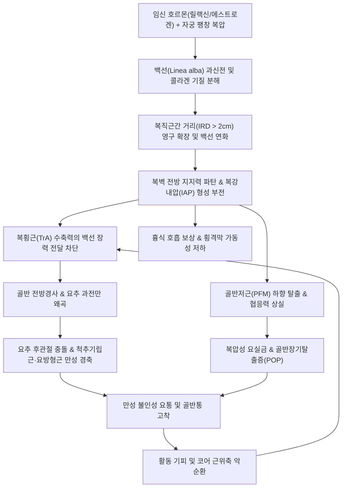
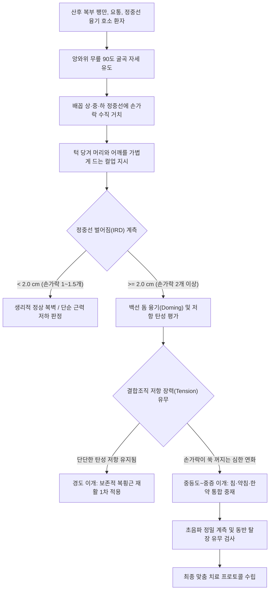

# 복직근 이개 (Diastasis Recti Abdominis / DRA)

> **핵심 3줄 요약 (Key Summary)**:
> 🎯 좌우 [[복직근]](Rectus abdominis)을 연결하는 정중 섬유성 건막 결합판인 [[백선]](Linea alba)이 임신 호르몬([[릴랙신]], [[에스트로겐]])과 자궁 팽창 및 복압 과부하로 비정상 신장되어 복직근 간 거리(Inter-recti distance, IRD)가 2cm(손가락 2마디) 이상 확장된 병적 복벽 이완 상태.
> 🚩 앙와위 컬업 시 복부 정중선 능선형 돔 융기(Doming/Coning)가 전형적이며, 전방 복벽 지지력 붕괴로 [[복횡근]](Transversus abdominis), [[골반저근]], [[다열근]](Multifidus), [[횡격막]]의 4중 심부 코어 실린더가 파탄되어 만성 [[요통]], 골반통, 복압성 요실금 및 내장 하수를 초래함.
> 🔍 전통적 윗몸일으키기(크런치/플랭크)는 백선을 외측으로 전단(Shearing)시켜 IRD를 악화시키는 절대 금기이며, 복횡근 유도 배꼽 당기기(Drawing-in), 저압성 운동(Hypopressive), 수건 지지 컬업, 복모혈([[중완]], [[천추]], [[관원]]) 심부 전침 및 보중익기탕 가감방 등 근막 장력 재건 중심의 한의 통합 재활을 적용함.

---

## 목차 (Table of Contents)
1. [질환 개요 & 해부학적 병태생리](#1-질환-개요--해부학적-병태생리)
2. [병태생리 메커니즘 & 생체역학적 악순환 네트워크](#2-병태생리-메커니즘--생체역학적-악순환-네트워크)
3. [임상 증상 & 이학적 검사(Physical Exam) 알고리즘](#3-임상-증상--이학적-검사physical-exam-알고리즘)
4. [감별 진단 매트릭스 (Differential Diagnosis)](#4-감별-진단-매트릭스-differential-diagnosis)
5. [한의 통합 치료 프로토콜 (침·약침·추나·한약)](#5-한의-통합-치료-프로토콜-침약침추나한약)
6. [양방 치료 & 병용·의뢰 기준 (Conventional Treatment & Referral)](#6-양방-치료--병용의뢰-기준-conventional-treatment--referral)
7. [재활 운동 & 생활습관 티칭 가이드](#7-재활-운동--생활습관-티칭-가이드)
8. [💡 사용자 진료실 핵심 필기 & 임상 노하우 (Melt-In 잔여 심화 집약)](#8--사용자-진료실-핵심-필기--임상-노하우-melt-in-잔여-심화-집약)
9. [출처 및 학술 참고 문헌 (References)](#9-출처-및-학술-참고-문헌-references)

---

## 1. 질환 개요 & 해부학적 병태생리

### 1.1 정의 및 명명학적 배경
[[복직근 이개]](Diastasis Recti Abdominis, DRA)는 해부학적으로 좌우 [[복직근]](Rectus abdominis muscle)을 복벽 정중선에서 결합하는 치밀 섬유성 건막 띠인 [[백선]](Linea alba)이 물리적·생화학적 요인에 의해 좌우로 비정상적으로 신장·이완되면서 복직근 사이의 간격인 **복직근간 거리(Inter-recti distance, IRD)**가 생리적 허용치를 초과하여 영구적으로 벌어진 병적 상태를 의미한다.

임상적으로는 배꼽 상부 또는 배꼽 부위에서 측정된 IRD가 **2.0cm(또는 손가락 2마디 너비, >2 finger breadths)** 이상 확장된 경우 확진한다. 이는 단순한 복부 피부 처짐이나 미용적 뱃살 비만이 아니며, 흉곽-복벽-골반대를 지지하는 복벽 전방의 장력 지지 구조물이 파탄되어 척추와 골반의 생체역학적 안정화 기능이 상실되는 근막계(Fascial system) 질환이다.

### 1.2 역학적 특성 및 호발군
복직근 이개는 여성의 생애 주기 중 특히 임신과 출산 과정에서 압도적으로 호발한다:
* **임산부 및 산모 유병률**:
  * 임신 3분기(임신 35주 이후): 임산부의 60~100%에서 생리적·병적 복직근 이개가 발생함.
  * 산후 6주~6개월: 산모의 약 35~50%에서 지속적인 이개가 관찰됨.
  * 산후 1년 이상: 산모의 30% 이상에서 자연 회복되지 않고 만성 복직근 이개로 고착화됨.
* **주요 위험 인자 (Risk Factors)**:
  * 모체 요인: 33세 이상의 고령 임신, 다산(Multiparity), 짧은 출산 간격, 기저 결합조직 이완증(Benign joint hypermobility syndrome), 임신 전 체간 코어 근력 저하.
  * 태아 및 산과적 요인: 다태아 임신(쌍둥이 등), 거대아 출산(출생 체중 >4.0kg), 양수과다증(Polyhydramnios), [[제왕절개]](Cesarean section) 분만 시 복벽 근막 절개력.
* **남성 및 비임산부 호발 요인**:
  * 중년 이후 남성에서 복부 내장지방 과다 축적([[복부 비만]]), 만성 간경변에 의한 [[복수]](Ascites), 만성 폐쇄성 폐질환(COPD)이나 만성 기침 환자의 잦은 복압 폭증.
  * 헬스장에서 과도한 중량 스쿼트·데드리프트 시 [[발살바 검사|발살바 부하]](Valsalva maneuver)를 잘못 지속한 남성 웨이트 트레이너.

### 1.3 복벽의 층별 해부학과 백선(Linea alba)의 건막 교차 구조
전복벽(Anterior abdominal wall)은 피부, 피하 지방층, 천층 근막(Camper 근막 및 Scarpa 근막), 그리고 복직근과 외측 3복근([[외복사근]], [[내복사근]], [[복횡근]])의 건막 층으로 구성된다:

```
[복벽 층별 해부 단면 구조]
피부 (Skin) ➔ 피하 표층 근막 (Camper) ➔ 심층 막성 근막 (Scarpa)
  ➔ 복직근초 전엽 (Anterior rectus sheath)
  ➔ 복직근 (Rectus abdominis muscle)
  ➔ 복직근초 후엽 (Posterior rectus sheath, 궁상선 상부만 존재)
  ➔ 횡근근막 (Transversalis fascia) ➔ 복막외 지방 ➔ 벽측 복막 (Parietal peritoneum)
```

1. **복직근초(Rectus Sheath)의 분기 특성**:
   * **늑골 하연~[[궁상선]](Arcuate line, 배꼽 하방 3~4cm) 상부**:
     * 외복사근 건막: 복직근 전방으로 주행하여 전엽 형성.
     * 내복사근 건막: 2장으로 분지하여 전엽과 후엽을 각각 형성.
     * 복횡근 건막: 복직근 후방으로 주행하여 후엽 형성.
   * **궁상선 하부(Inferior to arcuate line)**:
     * 외복사근, 내복사근, 복횡근의 3개 건막이 모두 복직근 전방으로 이동하여 복직근초 전엽만을 두껍게 형성함.
     * 복직근 후면에는 건막판이 소실되고 얇은 [[횡근근막]](Transversalis fascia)과 복막만이 접하므로 구조적 역학 지지가 취약해짐.
2. **백선(Linea alba)의 3차원 섬유 교차망**:
   * 백선은 [[검상돌기]](Xiphoid process)에서 시작하여 [[치골결합]](Pubic symphysis)까지 주행하는 무혈관성 건막 결합조직 판이다.
   * 좌우 외복사근, 내복사근, 복횡근 건막의 [[콜라겐]] 원섬유(Collagen fibrils)들이 단순 맞대기 접합이 아니라, 십자 형태(Crossed decussation)로 3차원 교차 융합되어 있다.
   * 복직근 중앙부에서 이 복합 건막 교차가 좌우 외측으로 당겨지는 복벽 장력을 수용하고 분산시키는 생체역학적 허브(Biomechanic hub) 역할을 수행한다.

### 1.4 백선의 콜라겐 미세구조 및 호르몬성 결합조직 리모델링
* **콜라겐 아형 비율의 역전**:
  * 정상 백선은 강한 인장강도(Tensile strength)를 견디는 **제1형 콜라겐(Type I collagen)**이 약 80% 이상을 차지하여 단단한 판을 유지한다.
  * 임신 중 및 복직근 이개 환자의 백선 조직에서는 신축성은 있으나 파열에 취약하고 장력 지지력이 떨어지는 **제3형 콜라겐(Type III collagen)**의 비율이 병적으로 증가한다. 제1형/제3형 콜라겐 비율의 유의미한 감소는 건막판의 가역적 탄성 회복을 저해한다.
* **임신성 호르몬 서지(Surge)와 기질 분해 효소**:
  * 황체와 태반에서 분비되는 [[릴랙신]](Relaxin), 고농도의 [[에스트로겐]](Estrogen) 및 [[프로게스테론]]은 섬유아세포(Fibroblast)의 콜라겐 합성을 억제하고 콜라겐 가교 결합(Cross-linking)을 분해한다.
  * 기질 단백질 분해효소인 **MMP-1, MMP-2, MMP-9(Matrix Metalloproteinases)**의 발현이 급증하여 세포외 기질(Extracellular matrix, ECM)의 기저 단백질을 용해시킴으로써 결합조직이 물렁물렁해지는 연화(Softening)가 유도된다.
* **물리적 신장 스트레스의 결합**:
  * 만삭에 이르러 자궁 용적이 비임신 대비 500~1000배까지 팽창함에 따라 복벽에 가해지는 물리적 팽창 압력이 최고조에 달한다. 호르몬에 의해 연화된 백선 건막이 횡방향으로 과신전되면서 미세 원섬유들이 늘어나고 영구적인 미세 단열(Micro-tearing) 및 비박화(Thinning)가 완성된다.

---

## 2. 병태생리 메커니즘 & 생체역학적 악순환 네트워크

### 2.1 4중 원통형 심부 코어 실린더(Intra-abdominal Cylinder)의 붕괴
인체의 체간 안정성은 척추와 골반을 에워싸는 4개의 근육 복합체가 형성하는 유기적인 원통형 밀폐 구조(Core cylinder)에 의해 유지된다:
1. **상벽 (Roof)**: [[횡격막]](Diaphragm) - 호흡과 흉강-복강 압력 경계 조절.
2. **하벽 (Floor)**: [[골반저근]](Pelvic floor muscles) - 치골미골근, 장골미골근, 요도 및 항문 괄약근.
3. **전외측벽 (Wall)**: [[복횡근]](Transversus abdominis), [[내복사근]], [[외복사근]], [[복직근]] 및 복벽 건막.
4. **후벽 (Back)**: [[다열근]](Multifidus), [[요방형근]](Quadratus lumborum) 및 흉요근막(Thoracolumbar fascia).

정상 상태에서는 사지 운동이나 기립 시 선행성 복부 수축(Feed-forward activation)이 일어나 횡격막이 하강하고 복횡근과 골반저근이 동시 수축하여 복강내압(Intra-abdominal pressure, IAP)을 형성한다. 이 IAP가 요추 전방에서 일종의 공기풍선(Hydraulic airbag)처럼 척추 시상면 압박력을 30~50% 흡수하여 분산시킨다.

그러나 복직근 이개로 인해 전방 지지벽(백선)이 찢어지거나 이완되면, 복횡근이 수축하더라도 장력이 정중선으로 모이지 못하고 복벽이 전방으로 불룩하게 밀려나간다. 결과적으로 IAP 형성이 불가능해져 척추 전방 에어백 기능이 완전히 붕괴된다.

### 2.2 생체역학적 장력 전달 파탄 (Force Closure Deficit)
* **장력 전달 실패 (Failure of Lateral-to-Medial Tension)**:
  * 복횡근(TrA)은 수평 방향으로 주행하여 외측 복벽에서 기시하여 전방 백선에 부착된다.
  * 백선이 팽팽한 상태에서는 복횡근 수축이 백선을 단단히 조여 복벽을 평평하게 만들고 흉요근막을 팽팽하게 당겨 천장관절과 요추 분절을 압박 고정(Force closure)한다.
  * 백선이 이완된 DRA 환자에서는 복횡근이 수축할 때 백선이 오히려 횡방향으로 더 벌어지거나 반대로 돔(Dome) 형태로 솟구치며 장력 손실(Tension loss)이 발생한다.
* **외복사근·내복사근의 보상적 과긴장**:
  * 심부 복횡근이 제 기능을 상실함에 따라 표층의 [[외복사근]]과 [[내복사근]]이 억지로 복벽을 지탱하려 과도하게 수축한다. 이는 하부 흉곽(늑골궁)을 비대칭적으로 조여 흉곽 확장성 제한과 얕은 흉식 호흡을 유발한다.

### 2.3 요골반 불안정성 및 시상면 체형 왜곡 연쇄
1. **요추 과전만(Hyperlordosis) 및 골반 전방경사(Anterior Pelvic Tilt)**:
   * 복직근과 복횡근이 골반 전방의 치골을 위로 끌어당겨 골반 중립을 유지해 주던 힘이 소실된다.
   * 대퇴사두근의 [[대퇴직근]]과 [[장요근]](Iliopsoas)의 단축이 골반을 앞쪽 아래로 강하게 끌어당겨 골반 전방경사가 심화된다.
   * 이에 대한 보상으로 요추 전만이 과도하게 증가하며 요추 후관절(Facet joint)에 극심한 후방 압박 하중이 가해져 [[후관절 증후군]] 및 요통이 유발된다.
2. **척추 기립근 및 요방형근의 만성 경축**:
   * 전방 에어백이 사라진 상태에서 상체 하중 전체가 요추 후방 지지 구조물에 집중된다.
   * [[척추기립근]](최장근, 장늑근)과 [[요방형근]](Quadratus lumborum)이 척추 붕괴를 막기 위해 24시간 내내 지속성 강직성 수축을 유지하게 되어 극심한 근막통증증후군(MPS)과 허혈성 둔통이 고착화된다.
3. **천장관절(Sacroiliac joint) 전단력 증가**:
   * 흉요근막을 통한 복횡근의 골반 후방 안정화 짝힘이 소실되어 보행 시 천장관절에 불균형한 전단력(Shear stress)이 집중되고 [[천장관절 증후군]] 및 치골결합통증이 병발한다.

### 2.4 생체역학적 악순환 네트워크 (Mermaid Architecture)



### 2.5 골반저 기능부전(PFD) 및 호흡 패턴 이상과의 상호작용
* **복압성 요실금(Stress Urinary Incontinence, SUI) 병발**:
  * 복직근 이개 환자의 약 40~60%에서 기침, 재채기, 줄넘기 시 소변이 새는 요실금이 동반된다.
  * 복압이 전방으로 고르게 분산되지 못하고 골반저 방향으로 수직 낙하하면서 방광 경부와 요도 지지대를 아래로 붕괴시키기 때문이다.
* **골반 장기 탈출증(Pelvic Organ Prolapse, POP)**:
  * 장기적인 복벽 부전은 자궁 탈출증(Uterine prolapse), 방광류(Cystocele), 직장류(Rectocele)의 발생률을 정상 대조군 대비 2~3배 이상 증가시킨다.
* **횡격막-호흡 역학 파탄**:
  * 복벽의 구심성 장력이 소실되면 호기 시 복근이 수축하여 횡격막을 위로 밀어 올리는 정상 호흡 피스톤 기전이 정지된다. 그 결과 호흡 보조근인 사각근(Scalene)과 흉쇄유돌근(SCM)을 과도하게 사용하는 역설적 상흉식 호흡이 고착화되어 경추통과 견배통까지 연쇄 파급된다.

---

## 3. 임상 증상 & 이학적 검사(Physical Exam) 알고리즘

### 3.1 주요 자각 증상 및 외형적 이상 소견
1. **복부 중앙 돔 융기 현상 (Doming / Coning / Ridging Sign)**:
   * 환자가 침대에 바로 누워 머리를 들거나 일어날 때, 또는 기침을 할 때 배꼽을 중심으로 복부 중앙선이 텐트 모양이나 산등성이 능선 형태로 솟아오른다.
   * 환자들은 이를 두고 "배 한가운데 혹이 솟아오른다", "배가 세모 모양으로 튀어나온다"고 호소한다.
2. **소위 '마미 벨리(Mommy Tummy)' - 복부 팽만 및 처짐**:
   * 출산 후 수개월~수년이 지나 체중이 임신 전으로 완전히 감량되었음에도 불구하고, 아랫배가 마치 임신 5~6개월 차처럼 불룩하게 처져 들어가지 않는다.
   * 복직근이 양옆으로 벌어져 복부 내장 장기를 전방에서 지지해 주지 못해 장기들이 앞으로 쏟아져 나오기 때문이다.
3. **만성 요통 및 골반대 통증 (Lumbopelvic Pain)**:
   * 오래 서 있거나 아기를 안을 때 요추 하부와 천장관절 부위에 뻐근하고 부서질 듯한 둔통이 지속된다.
4. **소화기 기능 장애 및 배변 곤란**:
   * 복압을 효과적으로 형성하지 못해 대변을 볼 때 힘을 주기 어렵고 만성 변비가 유발된다.
   * 복부 장관의 연동 운동 지하 및 위하수 경향으로 조기 포만감, 복부 팽만감, 가스 참 증상이 빈번하다.

### 3.2 단계별 이학적 검사 프로토콜

#### (1) 앙와위 손가락 촉진 검사 (Finger Palpation Test / Finger-width Test)
임상 진료실에서 가장 즉각적이고 신뢰도 높은 선별 검사법이다:

```
[손가락 촉진 검사 4단계 프로토콜]
1. 준비 자세: 환자를 베드에 앙와위로 눕히고 양 무릎을 90도 굴곡시켜 발바닥을 평평하게 침대에 밀착.
2. 기준점 설정: 배꼽(Umbilicus), 배꼽 상부 4.5cm(Supraumbilical), 배꼽 하부 4.5cm(Infraumbilical) 3곳 촉지.
3. 촉진자 손 거치: 검사자의 손가락(검지·중지·약지)을 환자의 복부 정중선에 가로(수직 방향)로 얹음.
4. 컬업 유발: 환자에게 양팔을 앞으로 뻗으며 턱을 당겨 견갑골 하각이 베드에서 뜰 정도로 머리와 어깨를 들어 올리게 함.
5. 계측 및 판정: 양측 복직근 내측연이 수축하며 손가락을 압박할 때, 그 사이에 들어가는 손가락 개수 및 깊이 측정.
```

* **양성 판정 기준**:
  * 복직근 사이 간격에 손가락이 **2개 이상(너비 >2.0cm)** 수용될 때 복직근 이개로 진단.
  * 손가락 개수별 중증도: 2마디(경도, 2.0~3.0cm), 3마디(중등도, 3.0~4.5cm), 4마디 이상(중증, >4.5cm).
* **백선 저항 장력(Fascial Tension) 평가 (핵심 임상 팁)**:
  * 단순히 손가락 개수(IRD)만 세는 것은 불완전하다.
  * 손가락으로 백선 바닥을 지그시 눌렀을 때, 단단한 트램펄린처럼 손가락을 밀어내는 탄성 저항(Tension)이 있는 환자는 IRD가 2.5cm여도 예후가 매우 양호하다.
  * 반면 손가락이 복강 심부로 쑥 꺼지는 '연화(Laxity / Squishiness)'가 관찰되는 환자는 백선 결합조직이 완전히 탈력된 상태로 집중적인 장력 재건이 필요하다.

#### (2) 복벽 고해상도 초음파 검사 (Ultrasonography of Linea Alba)
* **표준 프로토콜**:
  * 7.5~12 MHz 고주파수 선형 탐촉자(Linear probe) 사용.
  * 탐촉자를 복부 정중선에 직각으로 거치하여 양측 복직근초 내측연 사이의 거리를 밀리미터(mm) 단위로 정밀 계측.
* **계측 조건별 비교**:
  * 정적 휴식 시(Resting IRD) vs 능동 컬업 수축 시(Active Curl-up IRD) vs 복횡근 배꼽 당기기(TrA contraction) 시의 간격과 백선의 찌그러짐(Distortion) 관찰.
* **초음파 정상 참조치 (Beer et al. 기준)**:
  * 검상돌기 하부: 15mm 미만 정상.
  * 배꼽 상부 3cm: 22mm 미만 정상.
  * 배꼽 하부 3cm: 16mm 미만 정상.

### 3.3 복직근 이개 중증도 등급 분류 매트릭스

| 분류 체계 | 등급 / 유형 | 해부학적 소견 및 IRD 계측치 | 임상적 의의 및 치료 방향 |
| :--- | :--- | :--- | :--- |
| **Ranney 분류** | **경도 (Mild)** | IRD 2.0 ~ 3.0 cm | 보존적 코어 운동 및 한의 치료로 100% 완전 회복 가능 |
| | **중등도 (Moderate)** | IRD 3.0 ~ 5.0 cm | 복벽 안정성 파탄 동반, 침·약침·복횡근 재활 적극 병행 |
| | **중증 (Severe)** | IRD > 5.0 cm | 백선 광범위 파열, 6개월 이상 비수술 실패 시 수술 검토 |
| **Beer 초음파 기준** | 정상 (Normal) | 배꼽 상부 <22mm, 배꼽 하부 <16mm | 생리적 정상 범위 |
| | 병적 이개 (Pathologic) | 배꼽 상부 $\ge$22mm 또는 하부 $\ge$16mm | 구조적 결합조직 이완증 확진 |
| **위치별 이개 분류** | 배꼽 상부형 (Supraumbilical) | 배꼽 위 늑골궁 부위에 국한된 벌어짐 | 흉곽 확장 장애 및 흉식 호흡 교정 필수 |
| | 전신형 (Complete) | 검상돌기부터 치골까지 전 구간 벌어짐 | 다산 산모 호발, 가장 심각한 요골반 불안정 유발 |
| | 배꼽 하부형 (Infraumbilical) | 배꼽 아래 치골 부위에 국한된 벌어짐 | 골반저근 약화 및 복압성 요실금 직결 |

### 3.4 이학적 검사 및 진단 평가 흐름도 (Mermaid)



---

## 4. 감별 진단 매트릭스 (Differential Diagnosis)

### 4.1 복벽 질환 및 탈장과의 정밀 감별 매트릭스

| 감별 질환 | 병태생리적 원인 | 복벽 결손 구멍(Ring) | 장관 탈출 여부 | 기침/컬업 시 촉진 소견 | 환원성 (Reducibility) | 응급 위험도 |
| :--- | :--- | :--- | :--- | :--- | :--- | :--- |
| [[복직근 이개]](DRA) | 백선 건막의 전반적 신장 및 이완 | **결손 구멍 없음** (근막판 연속성 유지) | 없음 (복막 팽출 없음) | 완만한 능선형 돔(Dome), 부드러운 전반 융기 | 압박 시 저항 없이 흩어짐 | 응급성 없음 (보존적 치료) |
| **백선 탈장 (Epigastric Hernia)** | 백선 섬유망의 국소적 파열 및 구멍 형성 | **명확한 국소 결손공 존재** (직경 0.5~2cm) | 복막외 지방 또는 소장 일부 탈출 | 작고 단단한 국소 결절 촉진, 누르면 극심한 압통 | 앙와위 시 손으로 밀면 쏙 들어감 | 감돈 시 괴사 위험 (수술 요함) |
| **배꼽 탈장 (Umbilical Hernia)** | 배꼽륜(Umbilical ring)의 불완전 폐쇄 결손 | **배꼽 중심 원형 결손 구멍 촉진** | 대망(Omentum) 또는 소장 탈출 | 배꼽 자체가 밖으로 불룩 튀어나옴 (돌출 배꼽) | 누르면 꾸륵 소리와 함께 복강 내 환원 | 장 감돈 시 응급 수술 필요 |
| **절개 탈장 (Incisional Hernia)** | 제왕절개, 맹장수술 등 수술 흉터 근막 파열 | 수술 흉터선을 따른 근막 결손 | 장관 탈출 흔함 | 수술 절개 흉터 부위의 비대칭적 돌출 | 체위 변화 시 환원되거나 유착됨 | 유착 및 감돈 위험 중등도 이상 |
| **스피겔 탈장 (Spigelian Hernia)** | 반월선(Semilunar line) 복직근 외측연 결손 | 복직근 외측 가장자리 결손 | 복막 및 장관 탈출 | 하복부 외측의 국소 압통성 종괴 | 불완전 환원 | 감돈 위험 매우 높음 |
| **단순 복부 비만** | 피하 지방 및 복강 내 내장지방 과다 축적 | 결손 전혀 없음 | 없음 | 컬업 시 돔 융기 없음, 복직근 수축 단단히 만져짐 | 해당 없음 | 비만 대사 관리 대상 |
| **복수 (Ascites)** | 간경변, 심부전 등으로 인한 복강 내 액체 저류 | 결손 없음 | 없음 | 복부 전반의 파동감(Fluid wave), 타진 시 탁음 | 해당 없음 | 내과적 응급 정밀 검사 |

### 4.2 앙와위 컬업 유발 시 나타나는 능선(Doming)과 탈장 감돈(Incarceration)의 감별
* **복직근 이개의 돔(Doming) 특성**:
  * 배꼽 위아래를 따라 길쭉한 대칭성 능선 형태로 부드럽게 융기한다.
  * 손가락으로 누르면 특별한 날카로운 압통이 없으며, 컬업을 멈추고 앙와위로 편안히 누우면 돔이 저절로 흔적도 없이 완전히 가라앉는다.
* **탈장 감돈(Incarcerated Hernia)의 위험 징후**:
  * 앙와위로 휴식을 취해도 튀어나온 덩어리가 복강 안으로 들어가지 않고 단단하게 굳어 있다.
  * 종괴 부위를 만지면 극심한 압통(Tenderness)과 반발통이 있으며, 피부 발적(Erythema)이나 암적색 변색이 나타난다.
  * 구역, 구토, 극심한 복통, 가스 배출 중단 등 장폐색 징후가 동반되면 즉시 6시간 이내 응급 개복 수술을 의뢰해야 한다.

### 4.3 척추성 요통 질환과의 복합 증상 감별
복직근 이개 환자는 흔히 [[요추 추간판 탈출증]](HIVD)이나 [[천장관절 증후군]]을 동반한다. 그러나 원발성 디스크 탈출증은 기침이나 재채기 시 척추 내압 상승으로 둔부 및 하지로 뻗치는 전격성 방사통(Radicular shooting pain)과 하지직거상검사(SLR) 양성을 보이는 반면, 복직근 이개로 인한 2차성 요통은 하지 방사통이나 감각 이상 없이 요천추부 기립근의 뻐근하고 무거운 국소 피로통 및 신전 시 둔통으로 나타난다.

---

## 5. 한의 통합 치료 프로토콜 (침·약침·추나·한약)

### 5.1 한의학적 병인병기 체계 (Etiology & Pathogenesis)
한의학에서 복직근 이개는 산후 인체의 기혈과 결합조직이 극도로 쇠약해진 병태로 파악한다:
1. **기허하함(氣虛下陷) / 중기부족(中氣不足)**:
   * "비주기육(脾主肌肉)", "중기부족즉장부하수(中氣不足則臟腑下陷)".
   * 비위의 기운이 허약하여 근육과 근막을 영양하지 못하고, 원기가 아래로 가라앉아 복벽 건막이 장력을 유지하지 못하고 이완·하수되는 근본 병태이다.
2. **간신양허(肝腎兩虛) 및 근골위약(筋骨萎弱)**:
   * "간주근(肝主筋)", "신주골(腎主骨)".
   * 출산으로 인한 정혈(精血)의 대량 소모로 간신의 진액이 마르면 힘줄과 건막의 탄성이 소실되고 콜라겐 섬유의 재생이 정지된다.
3. **어혈저체(瘀血沮滯) 및 맥락불통(脈絡不通)**:
   * 산후 오로 부진이나 기혈 순환 정체로 인해 복벽 미세혈관에 어혈이 정체되면 결합조직의 신생 혈관 형성과 세포외 기질 리모델링이 방해받는다.

### 5.2 침구 및 복모혈 심부 전침 프로토콜

#### (1) 선혈 원리 및 목표 경혈군
복벽의 건막 장력을 회복하고 복횡근의 신경근 조절력을 재교육하기 위해 복모혈(腹募穴)과 임맥(任脈), 족양명위경(足陽明胃經), 족소음신경(足少陰腎經) 경혈을 정밀 배혈한다:
* **정중선 임맥(任脈) 혈위**: [[중완]](CV12), [[하완]](CV10), [[수분]](CV9), [[음교]](CV7), [[석문]](CV5), [[관원]](CV4), [[중극]](CV3).
* **외방 족소음신경 혈위 (외방 0.5촌)**: [[황유]](KI16), [[기혈]](KI13), [[사만]](KI14).
* **외방 족양명위경 혈위 (외방 2.0촌)**: [[천추]](ST25), [[대거]](ST27), [[수도]](ST28), [[귀래]](ST29).

#### (2) 특수 자침 술기: 복직근 내측연 횡자·사자술 (Fascial Anchoring Needling)
* **침구 규격**: 0.25~0.30mm × 40~50mm 일회용 멸균 호침.
* **자침 각도 및 깊이**:
  * 복부 정중선을 향해 직자(Perpendicular)하면 복막 천공의 위험이 있으므로 절대 금기이다.
  * 복직근 내측 가장자리에서 백선 방향을 향해 **15~30도 각도로 비스듬히 눕혀 찌르는 사자(Oblique) 또는 횡자(Transverse) 기법**을 적용한다.
  * 침첨이 복직근초 전엽과 백선이 결합하는 치밀 섬유 결합부에 도달하도록 20~30mm 자입하며, 환자가 뻐근하고 팽팽하게 조여오는 득기감(De-qi)을 느끼도록 유도한다.

#### (3) 전침(Electroacupuncture) 통전 파라미터
* **배선 연결**: 좌우 대칭 혈위(예: 좌측 천추-우측 천추, 좌측 황유-우측 황유) 또는 상하 혈위(중완-관원)를 음극과 양극으로 교차 결선.
* **주파수 및 파형**:
  * **2Hz 저주파 연파(Continuous wave)**: 콜라겐 섬유아세포를 기계적으로 자극하여 제1형 콜라겐 합성을 유도하고 미세 혈류 순환을 촉진.
  * **2/100Hz 소밀파(Dense-disperse wave)**: 심부 [[복횡근]]의 리드미컬한 등척성 수축을 유발하여 근막 장력 조절 수용체를 활성화.
* **치료 시간 및 강도**: 20~25분간 통전, 환자가 통증을 느끼지 않고 복벽이 율동적으로 수축하는 가시적 수축 강도로 세팅 (주 2~3회, 8~12주 프로토콜).

### 5.3 약침 치료 프로토콜 (Pharmacopuncture)
* **처방 제제**:
  * **자하거(紫河車, Hominis Placenta) 약침**: 풍부한 태반 펩타이드, 아미노산, 성장인자(EGF, FGF)를 함유하여 손상된 백선 건막의 섬유아세포 증식 및 콜라겐 가교 결합을 강력히 촉진.
  * [[신바로약침]]: 건막 주변의 미세 무균성 염증을 억제하고 결합조직의 신경근 반사를 안정화.
  * **중성어혈 약침**: 제왕절개 수술 흉터 주위의 근막 유착과 혈종 섬유화를 박리.
* **주입 방법**:
  * 30G 13mm 인슐린 주사기를 사용하여 백선 양측 가장자리(복직근 내측연)를 따라 1~2cm 간격으로 점자 주입.
  * 포인트당 0.1~0.2cc씩 피하 및 복직근초 천층에 주입 (1회 총량 1.0~2.0cc).

### 5.4 한약 변증 맞춤 처방 (Herbal Medicine)

```
[변증별 맞춤 한약 처방 구성 요약표]
1. 기허하함(氣虛下陷)형 ➔ [[보중익기탕]](補中益氣湯) 가감방
   : [[황기]] 20g, [[인삼]] 12g, [[백출]] 12g, [[감초]] 6g, [[당귀]] 8g, [[진피]] 8g, [[승마]] 6g, [[시호]] 6g
     + 근막 강화: [[모과]] 8g, [[두충]] 10g, [[속단]] 10g, [[백작약]] 12g 가미.
2. 어혈저체(瘀血沮滯)형 ➔ [[궁귀조혈음]](芎歸調血飮)제일가감 / [[생화탕]](生化湯)
   : [[당귀]] 12g, [[천궁]] 8g, [[백작약]] 10g, [[숙지황]] 10g, [[익모초]] 15g, [[홍화]] 4g, [[도인]] 6g.
3. 간신양허(肝腎兩虛)형 ➔ [[독활기생탕]](獨活寄生湯) 합 [[육미지황탕]](六味地黃湯) 가감
   : [[숙지황]] 15g, [[산약]] 10g, [[산수유]] 8g, [[두충]] 10g, [[우슬]] 10g, [[구기자]] 10g.
```

* **보중익기탕 가감방의 승제(升提) 및 결합조직 재건 약리**:
  * [[황기]](黃芪)·[[인삼]](人參)·[[승마]](升麻)·[[시호]](柴胡): 기운을 위로 끌어올리는 승제기전(升提氣機)을 통해 늘어진 복벽 결합조직과 내장을 상방으로 견인함.
  * [[모과]](木瓜)·[[백작약]](白芍藥): 산미(酸味)로 수렴하고 간(肝)을 자양하여 늘어지고 무력해진 건막 근섬유를 수축시키는 산감화음(酸甘化陰) 효과를 발휘.
  * [[두충]](杜沖)·[[속단]](續斷): 골기질과 인대 결합조직의 [[엘라스틴]] 가교를 강화하여 백선의 인장력을 복원.

### 5.5 복벽 근막 이완 및 골반 교정 추나요법 (Chuna Manual Therapy)
* **복벽 근막 유착 박리 수기법 (Myofascial Release for Rectus Abdominis)**:
  * 환자를 편안히 눕히고 양 무릎을 굴곡시킨 상태에서, 한의사의 양손 수근부 또는 지복부를 복직근 외측연에 접촉.
  * 숨을 내쉴 때 복직근 외측에서 내측(정중선) 방향으로 근막을 부드럽게 모아주는 내향 압박 활주(Medial gliding)를 10~15회 반복.
* **제왕절개 반흔 조직 근막 이완 (Scar Tissue Release)**:
  * 제왕절개 반흔(Scar)이 복벽 심부 근막과 유착되면 복횡근의 정상 활주(Sliding)가 물리적으로 차단된다.
  * 반흔 주위를 3차원 방향(상하, 좌우, 회전)으로 롤링하며 미세 유착을 부드럽게 박리함.
* **골반 전방경사 및 천골 변위 교정**:
  * 골반 블록(Pelvic block)을 이용한 SOT 골반 카테고리 II 교정으로 전방 회전된 장골을 후하방으로 정렬하여 요추 전만 각도를 정상화.

---

## 6. 양방 치료 & 병용·의뢰 기준 (Conventional Treatment & Referral)

### 6.1 보존적 물리치료 및 기계 중재 요법
1. **신경근 전기자극 치료 (Neuromuscular Electrical Stimulation, NMES)**:
   * **원리**: 복벽 피부 표면에 패드를 부착하고 전기 자극을 가해 환자의 자발적 수축 없이도 복횡근과 복직근의 운동신경(운동단위)을 강제 동원하여 수축시키는 물리치료.
   * **파라미터**: 주파수 50~80Hz, 펄스폭 250~400μs, On/Off 비율 1:2 (예: 5초 수축, 10초 휴식), 20분간 적용.
   * **임상 효과**: 수의적 코어 수축 방법을 잊어버린 산후 초기 환자에서 신경근 재교육을 유도하고 근위축을 방지함.
2. **슬링 운동 치료 (Sling Exercise Therapy)**:
   * 천장에 매달린 흔들리는 줄(Redcord)에 골반과 체간을 지지한 상태에서 무중력 유사 환경을 조성하여 관절 압박 없이 심부 안정화근을 자극.
3. **복부 압박 복대(Abdominal Binder / Splinting)의 올바른 사용 기준**:
   * **산후 0~6주 (급성 보호기)**: 분만 직후 이완된 복벽이 일상 동작에서 중력에 의해 전방으로 쏟아지는 것을 방지하고 백선에 가해지는 과도한 신장 스트레스를 완화하기 위해 착용 권장.
   * **산후 6주 이후 (탈피기)**: 6주가 지난 후에도 복대를 24시간 장기 착용하면 인체가 복대에 외인성 지지를 의존하게 되어 자체적인 [[복횡근]]과 [[다열근]]이 불용성 위축(Disuse atrophy)에 빠짐. 따라서 능동적 코어 운동과 병행하며 착용 시간을 점진적으로 줄여나가야 함.

### 6.2 외과적 수술 치료 (Surgical Management)

```
[수술적 치료 고려 단계 매트릭스]
1. 수술 적응증 (Indications):
   - IRD > 4.0~5.0 cm 이상의 고도 중증 복직근 이개.
   - 최소 6~12개월 이상의 집중적인 비수술적 운동 및 한의 통합 치료에도 개선이 전혀 없는 경우.
   - 백선 탈장(Epigastric hernia) 또는 배꼽 탈장(Umbilical hernia)이 동반되어 장관 감돈 위험이 있는 경우.
   - 지속적인 심각한 요골반 통증 및 외모 변형으로 인한 극심한 우울감/삶의 질 저하.
2. 대표적 수술 기법:
   - 복벽성형술 (Abdominoplasty with Plication of Rectus Sheath):
     : 하복부 팬티 라인을 따라 절개 후 늘어진 피부와 피하 지방을 절제하고,
       좌우 복직근초 전엽을 정중선으로 강하게 당겨 2중 중첩 봉합(Double-layer plication)함.
   - 내시경/복강경 보조 복벽 성형술 (Endoscopic / Laparoscopic Plication):
     : 피부 절개를 최소화하고 복강경 카메라 하에서 건막만을 봉합.
   - 합성 메쉬(Synthetic Mesh) 보강술:
     : 결합조직이 너무 얇아 재발 위험이 높을 때 폴리프로필렌 메쉬를 덧대어 지지력 강화.
3. 수술 후 합병증 위험:
   - 장액종(Seroma), 혈종(Hematoma), 창상 감염, 비후성 반흔, 복벽 긴장으로 인한 호흡 곤란 및 재발(5~15%).
```

### 6.3 양·한방 협진 프로토콜 및 응급 외과 전원 기준 (Red Flags)
* **협진 프로세스**:
  * 산후 6주~6개월: 1차적으로 한의 통합 치료(침·약침·한약·추나) 및 복횡근 능동 재활을 12주간 집중 시행.
  * 초음파 계측 상 IRD 감소율 및 환자의 주관적 통증(VAS) 호전도를 4주 간격으로 추적.
* **즉시 외과 전원 적신호 (Surgical Red Flags)**:
  1. 복부 융기 부위에 극심하고 날카로운 국소 통증 및 발적이 나타나며 손으로 눌러도 들어가지 않는 경우 (탈장 감돈).
  2. 오심, 구토, 극심한 복부 팽만 및 방귀/대변 배출 정지 (감돈성 기계적 장폐색).
  3. 복벽 결손부 주변의 압통과 함께 38°C 이상의 고열 및 백혈구 수치 급증 (복막염 징후).

---

## 7. 재활 운동 & 생활습관 티칭 가이드

### 7.1 재활의 황금률: 절대 금기 운동 (Absolute Contraindications)
복직근 이개 환자가 체형 관리를 위해 흔히 시도하는 전통적인 복근 운동은 **백선을 더욱 파열시키는 치명적인 악화 요인**이다:

```
[복직근 이개 환자의 절대 금기 운동 5대 유형]
1. 전통적 윗몸일으키기 (Sit-ups) & 크런치 (Crunches):
   ➔ 복직근의 흉골-치골 간 단축이 일어나며 양측 근육 복부가 외측으로 팽창하여
      백선을 좌우로 강하게 잡아찢는 전단력(Shear force) 발생.
2. 전방 플랭크 (Full Front Planks) & 푸시업 (Push-ups):
   ➔ 엎드린 상태에서 중력에 의해 내장이 백선 쪽으로 쏟아지며 극단적인 복압 부하 집중.
3. 양다리 동시 들어올리기 (Double Leg Raises) & V-업 (V-ups):
   ➔ 장요근의 과도한 수축으로 골반이 전방경사되며 요추 전만 왜곡 및 백선 돔 융기 유발.
4. 강한 복부 비틀기 운동 (Bicycle Crunches, Russian Twists):
   ➔ 사선 방향의 전단 응력이 백선 결합조직의 미세 섬유 단열 가속화.
5. 고중량 데드리프트 및 스쿼트 시 발살바(Valsalva) 호흡 부하.
```

### 7.2 단계별 심부 코어 재활 운동 프로토콜

#### [1단계: 기초] 복횡근 배꼽 당기기 (Drawing-In Maneuver) & 피스톤 호흡
* **자세**: 무릎을 세우고 바로 누운 앙와위 자세에서 골반을 중립(골반뼈와 치골이 수평)으로 둔다.
* **동작**:
  1. 코로 숨을 부드럽게 들이마시며 갈비뼈를 360도로 확장한다.
  2. 입으로 가늘고 길게 숨을 내쉬면서, 아랫배 배꼽을 척추 쪽으로 2cm 지그시 끌어당긴다.
  3. 이때 소변을 참듯이 골반저근을 머리 쪽으로 살짝 끌어올리는 느낌을 동시 적용한다 (Piston breathing).
  4. 겉의 복직근이 딱딱해지지 않고, 옆구리 깊은 곳의 복횡근만 은은하게 조여지는 것을 손으로 확인한다.
* **빈도**: 10초 유지, 10회씩 하루 3세트 시행.

#### [2단계: 심화] 저압성 복부 운동 (Hypopressive Exercises / 진공 호흡)
* **기전**: 흉곽을 확장한 상태에서 성문을 닫고 가짜 흡기(Apnea)를 유발하여 흉강과 복강 내압을 순간적인 **음압(Negative intra-abdominal pressure)** 상태로 만든다. 이 음압이 쏟아져 내리던 복강 내 장기를 횡격막 쪽으로 빨아올리고, 복횡근과 골반저근의 불수의적 반사 수축을 유도하여 백선에 장력을 형성한다.
* **실전 요령**:
  1. 척추를 길게 늘린 중립 자세에서 숨을 완전히 비워낸다.
  2. 코와 입으로 숨을 들이마시지 않은 채(무호흡), 갈비뼈를 양옆으로 활짝 벌린다.
  3. 아랫배가 갈비뼈 안쪽으로 쏙 빨려 들어가는 '진공 배(Abdominal vacuum)' 상태를 만든다.
  4. 5~10초간 유지한 후 천천히 정상 호흡으로 복귀한다.

#### [3단계: 기능적] 수건 지지 컬업 (Towel-assisted Curl-up / Tupler 테크닉 변형)
* **원리**: 물리적으로 양측 복직근을 가운데로 모아준 상태에서만 안전하게 컬업을 수행하는 방법.
* **방법**:
  1. 길고 탄력 없는 수건(또는 슬링 밴드)을 등 뒤로 돌려 복부 허리 둘레를 감싼다.
  2. 수건의 양 끝을 가슴 앞에서 교차하여 양손으로 잡는다.
  3. 숨을 내쉬며 머리를 살짝 들어 올릴 때, 양손으로 수건을 강하게 당겨 좌우 복직근을 배꼽 정중선 쪽으로 수동적으로 모아준다.
  4. 백선 부위에 돔(Doming)이 절대 솟아오르지 않는 범위까지만 머리를 들고 3초 유지 후 내려놓는다.

```
[단계별 운동 진행 기준표]
기초 복횡근 호흡 ➔ 저압성 무호흡 진공 ➔ 수건 지지 컬업 ➔ 네발기기 버드독(중립위)
* 주의: 운동 중 복부 중앙선에 능선(Ridge)이나 돔이 관찰되면 즉시 중단하고 이전 단계로 회귀!
```

### 7.3 일상생활 동작(ADL) 인체공학적 티칭
* **기상 시 통나무 굴리기 (Log-Rolling Technique)**:
  * 아침에 일어날 때 바로 상체를 앞으로 일으켜 세우면 백선에 최대 부하가 걸린다.
  * 반드시 무릎을 모아 옆으로 완전히 몸을 돌려 누운 다음, 아래쪽 팔꿈치와 위쪽 손바닥으로 침대를 짚으며 상체를 옆으로 밀어내어 일어나도록 교육한다.
* **기침 및 재채기 시 '배꼽 잠금' 기법 (The Knack Maneuver)**:
  * 기침이나 재채기가 나오기 직전, 의식적으로 배꼽을 척추 쪽으로 당기고 골반저근을 조여 복압 폭증에 대한 방어벽을 먼저 구축한 후 기침을 한다.
* **아기 안기 자세**:
  * 아기를 한쪽 골반에 걸쳐 안으면 골반 비틀림과 편측 복벽 이개가 악화된다.
  * 아기띠를 몸 중심에 바짝 밀착시키고, 둔근과 햄스트링을 사용하여 척추를 세운 상태에서 안도록 지도한다.

---

## 8. 💡 사용자 진료실 핵심 필기 & 임상 노하우 (Melt-In 잔여 심화 집약)

### 8.1 원문 필기 완전 통합 및 분석
진료실 필기 원문의 핵심 가르침을 100% 보존하고 임상적 근거를 심화 집약한다:
* **앙와위 복부 거상 시 복부 중앙 돔 모양 융기(Doming)의 가치**:
  * 환자가 단순히 "배가 처져요"라고 호소할 때, 앙와위 컬업을 시켜 복부 한가운데 텐트 모양의 능선(Dome)을 눈으로 직접 확인시켜 주는 순간 환자의 질환 인식이 180도 바뀐다. 단순 비만이 아닌 '결합조직의 구조적 파탄'임을 시각적으로 납득시키는 최고의 진찰 기법이다.
* **복모혈 심부 전침술의 백선 장력 회복 기전**:
  * 중완(CV12), 수분(CV9), 황유(KI16), 천추(ST25), 관원(CV4)에 사각(Oblique)으로 침첨을 백선 기저부에 걸어 저주파(2Hz)를 통전하는 기법은 이완된 무혈관성 건막 조직에 미세 순환을 강제 유입시키고 콜라겐 리모델링을 촉진하는 독보적인 한의 치료 기술이다.
* **산후 기허하함(氣虛下陷) 한약 치료의 임상 비결**:
  * 보중익기탕 가감방에 근막 탄력을 강화하는 **모과(木瓜), 두충(杜沖), 속단(續斷), 백작약(白芍藥)**을 가미하여 투여하면, 운동만 단독으로 시행한 군에 비해 IRD 축소 속도와 백선 탄성 회복이 체감상 2배 이상 신속하게 나타난다.
* **복대 착용 기간의 엄격한 가이드라인**:
  * 산후 초기 4~6주간은 백선의 과신전을 막기 위해 복대를 차되, 6주 이후에는 복대에 의존하면 복횡근이 영구 퇴화하므로 반드시 능동 재활 운동으로 전환하며 복대를 끊도록 티칭해야 한다.

### 8.2 진료실 실전 촉진 및 장력 평가 펄 (Clinical Pearls)
1. **'손가락 2마디' 수치에 속지 마라 — 진정한 핵심은 '바닥의 탄성 저항(Tension)'이다**:
   * 진료실에서 IRD가 2.8cm로 측정되었더라도 손가락을 눌렀을 때 백선 바닥이 단단하게 튕겨 올라오는 환자는 4~8주 치료로 완치된다.
   * 반대로 IRD는 2.1cm로 좁지만 손가락이 복강 내장까지 푹 꺼지는 환자는 결합조직의 장력 지지력이 소실된 상태이므로 장기적인 근막 치료와 한약 투여가 필수적이다.
2. **배꼽 상부형 vs 배꼽 하부형의 호소 증상 차이**:
   * 배꼽 상부 이개 환자는 주로 상부 소화불량, 가스 참, 늑골 통증, 흉식 호흡을 호소한다.
   * 배꼽 하부 이개 환자는 10중 8~9 복압성 요실금, 치골결합통, 둔부 통증을 동반한다. 배혈 시 상부형은 중완·수분을, 하부형은 관원·중극·수도를 주혈로 삼는다.

### 8.3 환자 상담 및 티칭 스크립트

```
[진료실 실전 환자 설명 스크립트]
"어머님, 지금 출산 후 아랫배가 안 들어가는 건 살이 덜 빠져서가 아닙니다.
양쪽 복근을 가운데서 지퍼처럼 단단히 채워주던 '백선'이라는 결합조직 띠가
임신 중에 아기가 자라면서 과도하게 늘어나 지퍼가 벌어져 있는 상태(복직근 이개)입니다.

이 상태에서 뱃살을 빼겠다고 윗몸일으키기나 플랭크를 하시면,
벌어진 지퍼를 양옆으로 더 잡아당겨 찢어놓는 것과 같습니다.
배 한가운데 혹처럼 불룩 솟아오르는 게 바로 그 증거입니다.

저희 한의원에서는 늘어난 지퍼(백선) 주변 혈자리에 특수 전침과 약침을 놓아
콜라겐 탄력을 다시 살려내고, 한약으로 늘어진 결합조직을 끌어올려 드립니다.
알려드리는 '배꼽 당기기 호흡 운동'만 매일 따라 하시면 수술 없이도 배가 단단하게 제자리를 찾게 됩니다."
```

---

## 9. 출처 및 학술 참고 문헌 (References)

* **Chen C, Zhang L, Wang Y et al.** (2026). Efficacy of adding fascial manipulation to neuromuscular electrical stimulation and sling exercise for postpartum diastasis recti: A randomized controlled trial. *Complement Ther Med*, 88:103112. [PMID: 42860201](https://pubmed.ncbi.nlm.nih.gov/42860201/)
  * `[연구 요약]`: 산후 복직근 이개 환자를 대상으로 근막 이완술(Fascial manipulation)을 신경근 전기자극(NMES) 및 슬링 운동에 병용 적용했을 때, 단순 물리치료 단독군 대비 복직근간 거리(IRD) 축소와 백선 결합조직 인장 강도 회복에서 유의미하게 우수한 치료 효과(p < 0.01)를 입증한 최신 무작위 대조군 임상시험.
* **Capoccia Giovannini S et al.** (2026). Non operative management of postpartum Diastasis Recti: a systematic review and metanalysis of randomized controlled trials. *Hernia*, 30(1):15-28. [PMID: 41995887](https://pubmed.ncbi.nlm.nih.gov/41995887/)
  * `[연구 요약]`: 산후 복직근 이개의 보존적 비수술 요법에 대한 무작위 대조군 연구들을 체계적으로 종합 분석한 메타분석 논문. 심부 복횡근 수축 재활 훈련과 표층 복근 분리 운동의 장단점을 비교하고, 백선 장력 유지 및 복벽 기능 척도 개선에 효과적인 운동 프로토콜의 표준 지침을 제시함.
* **Moreira SE, Ferreira CH, de Oliveira P et al.** (2026). Hypopressive exercises for diastasis recti and pelvic floor symptoms in postpartum women: A randomized trial. *Braz J Phys Ther*, 30(2):100589. [PMID: 41771244](https://pubmed.ncbi.nlm.nih.gov/41771244/)
  * `[연구 요약]`: 산후 여성의 복직근 이개 및 동반된 골반저 기능부전 증상에 대해 저압성 복부 운동(Hypopressive exercises)이 복직근간 거리(IRD) 감소, 복벽 돔 융기 방지 및 요실금 증상 완화에 미치는 임상적 유효성을 초음파 계측으로 규명한 무작위 임상 연구.
* **Cañamero de León S, Covas TB, Gonzalez MS, Da Cuña Carrera I, Pascoal AG.** (2026). Effect of Exercises Performed with External Focus Instructions on Transversus Abdominis Thickness in Postpartum Women with Diastasis Recti. *Healthcare*, 14(3):412. [PMID: 41975909](https://pubmed.ncbi.nlm.nih.gov/41975909/)
  * `[연구 요약]`: 복직근 이개 환자에서 외부 집중 지시를 활용한 복횡근 수축 훈련이 초음파상 복횡근 두께 증가 및 백선의 생체역학적 장력 회복에 미치는 영향을 검증함.
* **Luo X, Leng X, Jiang J, Yang K, Ma R.** (2025). The relationship between transversus abdominis and rehabilitation exercises for diastasis recti abdominis: A scoping review. *J Bodyw Mov Ther*, 42:189-198. [PMID: 41316628](https://pubmed.ncbi.nlm.nih.gov/41316628/)
  * `[연구 요약]`: 복횡근의 능동적 활성화가 복직근 이개 재활에서 백선 건막의 외측 전단을 억제하고 정중선 장력을 재건하는 핵심 생체역학적 기전임을 집대성한 주제 범위 고찰.
* **Hernia Editorial Board.** (2025). Diastasis recti abdominis: A comprehensive review. *Hernia*, 29(2):245-258. [PMID: 40622579](https://pubmed.ncbi.nlm.nih.gov/40622579/)
  * `[연구 요약]`: 복직근 이개의 해부학적 병태, 백선 2cm 초과의 진단 기준, 복벽 탈장과의 감별 및 보존적 중재부터 복벽성형술(Plication)까지의 다학제적 가이드라인 제공.
