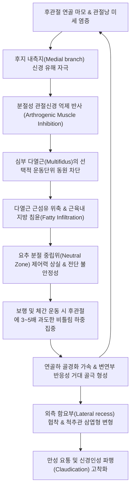
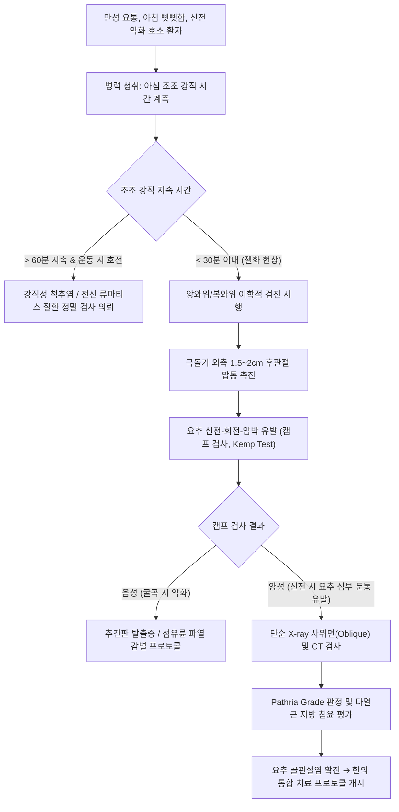

# 요추 골관절염 (Lumbar Osteoarthritis / Lumbar Spondylosis)

> **핵심 3줄 요약 (Key Summary)**:
> 🎯 요추 삼관절 복합체(Three-joint complex: 1개 [[추간판]] + 2개 [[후관절]]) 중 활액관절인 후관절(Facet/Zygapophysial joint)의 초자연골 마모, 연골하 골경화(Subchondral sclerosis), 골극(Osteophyte) 형성 및 추체 변연부 골증식을 특징으로 하는 만성 퇴행성 척추 관절 질환.
> 🚩 아침 기상 시나 장시간 부동 후 뻣뻣함이 극대화되는 젤화 현상(Gelling phenomenon, 30분 이내 활동 시 완화)과 요추 신전·회전 시 후관절 충돌로 악화되는 만성 둔통이 주소증이며, 심부 [[다열근]](Multifidus)의 지방 변성 및 삼엽형(Trefoil) [[척추관 협착증]]으로 진행 가능.
> 🔍 요추 후관절 압통 촉진 및 [[캠프 검사]](Kemp test), Pathria X-ray/CT 등급 판정으로 확진하며, 요추 협척혈 심부 [[전침]], [[신바로약침]]·[[봉약침]], 굴곡-신연(Cox) [[추나요법]], 보간신 강근골 명방인 [[독활기생탕]]·[[삼기음]]을 중심으로 보존적 한의 통합 관리를 시행함.

---

## 목차 (Table of Contents)
1. [질환 개요 & 해부학적 병태생리](#1-질환-개요--해부학적-병태생리)
2. [병태생리 메커니즘 & 생체역학적 악순환 네트워크](#2-병태생리-메커니즘--생체역학적-악순환-네트워크)
3. [임상 증상 & 이학적 검사(Physical Exam) 알고리즘](#3-임상-증상--이학적-검사physical-exam-알고리즘)
4. [감별 진단 매트릭스 (Differential Diagnosis)](#4-감별-진단-매트릭스-differential-diagnosis)
5. [한의 통합 치료 프로토콜 (침·약침·추나·한약)](#5-한의-통합-치료-프로토콜-침약침추나한약)
6. [양방 치료 & 병용·의뢰 기준 (Conventional Treatment & Referral)](#6-양방-치료--병용의뢰-기준-conventional-treatment--referral)
7. [재활 운동 & 생활습관 티칭 가이드](#7-재활-운동--생활습관-티칭-가이드)
8. [💡 사용자 진료실 핵심 필기 & 임상 노하우 (Melt-In 잔여 심화 집약)](#8--사용자-진료실-핵심-필기--임상-노하우-melt-in-잔여-심화-집약)
9. [출처 및 학술 참고 문헌 (References)](#9-출처-및-학술-참고-문헌-references)

---

## 1. 질환 개요 & 해부학적 병태생리

### 1.1 정의 및 임상적 스펙트럼
[[요추 골관절염]](Lumbar Osteoarthritis, Lumbar OA) 또는 **요추 척추증(Lumbar Spondylosis)**은 요추를 구성하는 기능적 분절 단위인 삼관절 복합체(Three-joint complex: 1개의 전방 [[추간판]]과 2개의 후방 [[후관절]]) 중, 특히 유일한 활액관절(Synovial joint)인 **후관절(Facet joint 또는 Zygapophysial joint, Z-joint)**의 초자연골(Hyaline cartilage)이 점진적으로 마모·소실되고, 관절낭 비후, 연골하 골경화(Subchondral sclerosis), 골극(Osteophyte) 형성 및 추체 변연부 골증식이 동반되는 만성 진행성 퇴행성 척추 질환이다.

과거에는 단순한 노화에 따른 '퇴행성 디스크 질환(Degenerative Disc Disease, DDD)'과 혼용되기도 하였으나, 현대 척추생체역학에서는 추간판의 퇴행과 후관절의 골관절염이 상호 인과적으로 맞물려 진행되는 복합 병태로 규정한다. 후관절의 골관절염은 국소적인 만성 [[요통]]뿐만 아니라, 척추 후방 지주(Posterior column)의 역학적 불안정성, 심부 [[다열근]]의 위축, 그리고 비후된 골극에 의한 외측 함요부(Lateral recess) 및 신경근관(Radicular canal) 협착을 유발하여 2차성 [[신경인성 파행]]을 초래하는 핵심 근골격계 병소이다.

### 1.2 역학적 특성 및 호발 인자
* **연령별 유병률**:
  * 40대 중반부터 조직학적 연골 마모가 시작되며, 60세 이상 인구의 60~80%에서 방사선학적 후관절 골관절염 소견이 관찰됨.
  * 75세 이상 고령자에서는 단순 X-ray 및 CT 검사상 89% 이상에서 중등도 이상의 골관절염 소견이 확인됨.
* **호발 분절 (Predilection Sites)**:
  * 요추 분절 중 체중 부하와 굴곡-신전 및 회전 전단력이 가장 극단적으로 집중되는 [[L4-L5]] 분절(약 45~50%) 및 [[L5-S1]] 분절(약 35~40%)에서 압도적으로 호발함. 상부 요추(L1-L2, L2-L3)는 상대적으로 호발 빈도가 낮음.
* **성별 및 직업적 위험 요인**:
  * 성별 차이: 50대 이전에는 남성에서 육체 노동과 스포츠 부하로 호발하나, 50대 폐경 이후에는 여성에서 [[에스트로겐]] 감소로 인한 관절 연골 기질 분해 가속화와 인대 이완으로 여성 환자의 비율이 급격히 역전됨.
  * 직업적 요인: 농업, 건축업 등 반복적인 중량물 인양 작업자, 장시간 전신 진동(Whole-body vibration)에 노출되는 대형 화물차·중장비 운전사, 좌식 생활로 척추 굴곡 부하가 장기화된 사무직.
  * 구조적 요인: 비만(고체중 부하), [[척추측만증]](Scoliosis), 골반 비대칭, [[척추전방전위증]] 환자에서 후관절의 비대칭적 편측 과부하 발생.

### 1.3 요추 후관절(Zygapophysial joint)의 정밀 기능 해부학
후관절은 상위 척추체의 [[하관절돌기]](Inferior articular process, IAP)와 하위 척추체의 [[상관절돌기]](Superior articular process, SAP)가 만나 형성되는 전형적인 활액관절이다:

```
[요추 삼관절 복합체 (Farfan & Kirkaldy-Willis 삼각대 모델)]
                  전방 지주 (Anterior Column)
               ┌───────────────────────────────┐
               │    추체 종판 (Endplate)       │
               │   + 추간판 (수핵 + 섬유륜)    │ ➔ 체중의 약 70~80% 완충 흡수
               └──────────────┬────────────────┘
                              │ 시상면 역학적 상호 보상
               ┌──────────────┴────────────────┐
               │   좌우 후관절 (Zygapophysial) │ ➔ 체중의 약 15~25% 지지
               │   (하관절돌기 + 상관절돌기)   │   (신전 시 최대 40~70%까지 급증)
               └───────────────────────────────┘
                  후방 지주 (Posterior Column)
```

1. **관절면의 공간적 방향(Spatial Orientation)과 생체역학**:
   * 요추 후관절면은 흉추나 경추와 달리 주로 **시상면(Sagittal plane)**에 가깝게 배열되어 있다 (정중 시상면 대비 약 45도 각도).
   * 이 해부학적 특성 덕분에 요추는 굴곡(Flexion)과 신전(Extension) 운동은 자유롭게 허용하지만, 축성 회전(Axial rotation) 운동은 후관절면끼리의 충돌을 통해 1개 분절당 1~2도 이내로 강력하게 억제한다.
   * 요천추 분절(L5-S1)로 내려갈수록 관절면이 점차 **관상면(Coronal plane)** 방향으로 전환되어 요추가 [[골반]] [[천골]] 상면에서 전방으로 미끄러져 떨어지는 전방 전단력(Anterior shear force)에 저항한다.
2. **관절낭(Joint Capsule)과 활액막추벽(Meniscoid / Synovial Plica)**:
   * 후관절은 후외측이 두껍고 질긴 섬유성 관절낭(Fibrous capsule)에 의해 밀폐되어 있으며, 내측 전방은 [[황색인대]](Ligamentum flavum)와 직접 맞닿아 있다.
   * 관절 내부에는 섬유지방성 활액추벽(Fibroadipose meniscoid fold)이 존재하여 관절 운동 시 관절 연골 사이의 마찰을 줄이고 활액을 분산시킨다. 퇴행성 변화 시 이 추벽이 관절면 사이에 끼이는 감돈(Entrapment)이 발생하여 급성 후관절성 요통을 유발한다.

### 1.4 후관절의 신경 지배와 이중 분절 차단 원리
* **척수신경 후지 내측지(Medial Branch of Dorsal Ramus)**:
  * 요추 [[척수신경]] 뿌리가 추간공을 빠져나온 직후 전지(Ventral ramus)와 후지(Dorsal ramus)로 분지한다.
  * 후지는 다시 외측지, 중간지, **내측지(Medial branch)**로 나뉜다.
  * 내측지는 횡돌기(Transverse process)와 상관절돌기(SAP) 사이의 골성 고랑(Groove)을 지나 횡돌기관절돌기간인대(Mammillo-accessory ligament) 하부를 통과한다.
* **이중 신경 지배 (Dual Innervation)**:
  * **후관절 1개는 반드시 상위 분절과 동위 분절의 2개 내측지로부터 동시에 신경 지배를 받는다.**
  * 예를 들어, [[L4-L5]] 후관절은 **L3 척수신경 후지 내측지**와 **L4 척수신경 후지 내측지**가 함께 신경 섬유를 보낸다.
  * 따라서 임상적으로 L4-L5 후관절 통증을 신경차단술(MBB)이나 전침으로 제어하기 위해서는 반드시 L3와 L4 두 지점을 동시에 목표로 삼아야 한다.
* **신경 수용기 분포**:
  * 관절낭 표면에는 기계적 고유수용기(Mechanoreceptor Type I, II)뿐만 아니라, 통증을 전달하는 비수초성 C-섬유와 유수초 A-델타 유해수용기(Type IV Free nerve endings)가 빽빽하게 분포한다.
  * Substance P, CGRP(Calcitonin gene-related peptide)와 같은 통증 신경전달물질이 풍부하여 미세한 역학적 신장이나 활액막 염증에도 극심한 통증 신호를 방사한다.

---

## 2. 병태생리 메커니즘 & 생체역학적 악순환 네트워크

### 2.1 커칼디-윌리스(Kirkaldy-Willis) 척추 퇴행 3단계 캐스케이드
척추 퇴행성 질환의 세계적 표준 모델인 Kirkaldy-Willis 캐스케이드는 요추 삼관절 복합체가 시간의 흐름에 따라 겪는 필연적인 역학적 변천 과정을 3단계로 명확히 설명한다:

```
[Kirkaldy-Willis 요추 삼관절 퇴행 3단계 캐스케이드]

1단계: 기능 부전기 (Dysfunction Phase)
  - 추간판: 수핵 탈수(Dehydration) 및 섬유륜 미세 균열.
  - 후관절: 활액막염(Synovitis), 활액추벽 감돈, 관절 연골 미세 세열화.
  - 임상상: 초기 국소 요통, 아침 뻣뻣함(조조 강직), 활동 후 피로감.
                     │
                     ▼
2단계: 불안정기 (Instability Phase)
  - 추간판: 디스크 높이 심각한 소실(Disc space narrowing), 파열.
  - 후관절: 관절낭 이완(Capsular laxity), 초자연골 광범위 마모, 연골 연화.
  - 임상상: 비정상적 분절 과가동성(Hypermobility), 허리가 삐끗하며 주저앉는 발작적 요통,
           퇴행성 척추전방전위증(Spondylolisthesis) 발생 위험 최고조.
                     │
                     ▼
3단계: 재안정기 (Restabilization Phase)
  - 추간판: 추간판 섬유화(Fibrosis), 추체 종판 골극(Osteophytes) 융합.
  - 후관절: 거대 골극 형성, 관절낭 골화, 연골하 골경화, 관절강 완전 소실.
  - 임상상: 척추 분절 강직(Stiffness), 분절 움직임 상실로 통증 빈도는 감소하나,
           비대해진 골극과 황색인대 비후로 척추관 협착증 및 신경인성 파행 발병.
```

### 2.2 연골 기질 파탄과 분자생물학적 염증 경로
1. **초자연골 기질(Extracellular Matrix, ECM)의 붕괴**:
   * 후관절 연골을 구성하는 핵심 성분인 **제2형 [[콜라겐]](Type II collagen)**과 친수성 프로테오글리칸인 **아그레칸(Aggrecan)**의 생성이 억제된다.
   * 연골 세포(Chondrocyte)의 세포사멸(Apoptosis)이 가속화되며, 연골 표면에 균열(Fissuring)과 궤양성 미란(Erosion)이 발생하여 뼈와 뼈가 직접 맞닿는 골성 노출(Bone-on-bone) 상태가 된다.
2. **염증성 사이토카인과 기질 분해 효소의 캐스케이드**:
   * 관절 활액막 세포와 손상된 연골 세포에서 **IL-1β, TNF-α, IL-6**와 같은 전염증성 사이토카인이 폭발적으로 분비된다.
   * 이 사이토카인들이 세포외 기질을 녹이는 효소인 **MMP-1, MMP-3, MMP-13(Collagenases)**과 **ADAMTS-4, ADAMTS-5(Aggrecanases)**를 활성화하여 연골을 급속히 녹여낸다.
3. **연골하 골(Subchondral Bone)의 구조적 변형**:
   * 연골의 완충벽이 사라지면서 연골하 골판에 미세 골절(Microfracture)과 비정상적인 골 재형성이 일어난다.
   * 골밀도가 비정상적으로 치밀해지는 **연골하 골경화(Subchondral sclerosis)**가 발생하고, 골수강 내로 활액이 누출되어 압력 괴사를 일으킴으로써 **연골하 낭종(Subchondral cyst / Geode)**이 형성된다.
   * 관절 변연부에서는 조골세포가 비정상 증식하여 입체적인 가시 모양의 **골극(Osteophyte)**이 돋아나 주변 신경과 근육을 자극한다.

### 2.3 젤화 현상(Gelling Phenomenon)의 유체역학적 기전
요추 골관절염 환자가 겪는 가장 고통스러운 임상 특징인 **'젤화 현상(Gelling phenomenon)'**은 관절 활액(Synovial fluid)의 유체역학적 이상에서 기인한다:
* **부동 상태에서의 점도 상승 (Thixotropic Stiffening)**:
  * 수면 중이나 의자에 40분 이상 가만히 앉아 있을 때 관절 운동이 멈춘다.
  * 이때 만성 염증으로 농축된 고분자 히알루론산과 활액 삼출액, 염증성 대사산물이 관절강 내에 침전되어 활액이 젤(Gel)처럼 뻑뻑하게 굳어진다.
  * 그 결과 아침에 눈을 뜨거나 의자에서 일어날 때 척추가 나무토막처럼 굳어 극심한 조조 강직과 통증을 유발한다.
* **활동 시의 일시적 완화 (Sol Transition)**:
  * 환자가 일어나 천천히 걷거나 가볍게 움직이기 시작하면, 관절 마찰열과 기계적 펌핑 작용에 의해 굳어 있던 활액이 묽은 액체(Sol) 상태로 전환된다.
  * 관절 내 대사 노폐물이 정맥과 림프로 배출되면서 기상 후 15~30분 이내에 허리가 일시적으로 부드러워진다.
* **과사용 시의 2차 파탄**:
  * 그러나 연골 완충층이 이미 소실되어 있으므로 1~2시간 이상 오래 걷거나 무거운 물건을 들면, 연골하 골판끼리의 직접 충돌과 관절낭 인대 견인으로 인해 오후가 될수록 다시 극심한 둔통이 폭발한다.

### 2.4 심부 다열근의 지방 변성(Fatty Infiltration)과 악순환 네트워크
후관절 골관절염의 가장 파괴적인 병태생리 중 하나는 척추 분절의 핵심 안정화근인 [[다열근]](Multifidus muscle)의 탈신경성 위축과 지방 침윤이다:



* **다열근 지방 침윤의 병태생리**:
  * 후관절에 만성 염증과 골극 자극이 가해지면, 후지 내측지를 통해 척수 후각으로 들어간 유해 감각 신호가 척수 반사(Reflex inhibition)를 일으켜 동위 분절 다열근의 운동신경 활성화를 차단한다.
  * 불용성 및 탈신경 상태에 놓인 다열근은 근원섬유(Myofibril)가 급격히 위축되고, 근막 사이 공간이 지방 조직(Intramuscular adipose tissue)으로 치환된다.
  * 다열근이 지방으로 변성되면 척추뼈를 뒤에서 단단히 잡아주지 못하므로, 환자가 움직일 때마다 요추 분절이 덜컹거리며 후관절 연골을 지속적으로 으깨는 영구적 악순환이 완성된다.

### 2.5 척추관 협착 연쇄 (삼엽형 Trefoil Canal 협착 기전)
* **상·하 관절돌기의 비대(Hypertrophy)**:
  * 만성 마찰을 견디기 위해 후관절의 상관절돌기와 하관절돌기가 버섯 모양(Mushroom-like)으로 거대하게 비대해진다.
* **황색인대(Ligamentum flavum)의 비후 및 주름 형성**:
  * 추간판 높이가 감소하면서 척추 분절 간격이 좁아지면, 척추 후궁판 사이를 팽팽하게 연결하던 황색인대가 탄성을 잃고 척추관 내부로 굵게 접혀 들어간다(Buckling).
* **삼엽형(Trefoil) 척추관 협착의 완성**:
  * 전방에서는 추간판의 팽륜과 골극, 후외측에서는 비대해진 후관절 골극, 후방에서는 두꺼워진 황색인대가 척추관을 전방위에서 압박한다.
  * 단면상 둥근 타원형이어야 할 척추강이 클로버 잎 모양의 **'삼엽형(Trefoil canal)'**으로 찌그러지며, 외측 함요부를 통과하는 주행 신경근(Traversing nerve root)을 올가미처럼 조여 간헐적 파행과 좌골신경통을 병발시킨다.

---

## 3. 임상 증상 & 이학적 검사(Physical Exam) 알고리즘

### 3.1 주요 자각 증상 및 전형적 통증 패턴
1. **조조 강직 및 젤화(Gelling) 통증**:
   * 아침 기상 시 허리가 뻣뻣하게 굳어 손으로 허리를 받치고 겨우 일어난다.
   * 통증 지속 시간은 **보통 30분 이내**이며, 따뜻한 물로 샤워를 하거나 가볍게 스트레칭을 하면 부드러워진다.
   * 낮 동안에도 소파나 운전석에 40분 이상 연속으로 앉아 있다가 일어설 때 허리가 즉각 펴지지 않고 반쯤 구부정한 자세로 멈칫거리게 된다.
2. **요추 신전(Extension) 및 회전(Rotation) 시 악화**:
   * 요추를 뒤로 젖히거나 옆으로 비틀 때 상하 관절돌기면이 강력하게 압착 충돌하므로 날카롭고 부서지는 듯한 국소 둔통이 폭발한다.
   * 반면 허리를 앞으로 숙이거나(Flexion), 쪼그려 앉거나, 쇼핑카트를 밀고 갈 때는 후관절 간격이 벌어지며 통증이 뚜렷하게 완화된다.
3. **후관절 연관통(Facet Referred Pain Pattern - 가성 좌골신경통)**:
   * 통증 부위는 요추 극돌기 외측 2cm 부위에 깊은 둔통으로 국한되기도 하지만, 흔히 연관통을 방사한다.
   * **주요 방사 영역**: 둔부(Gluteal region, 90%), 대전자(Greater trochanter, 60%), 서혜부(Groin, 30%), 대퇴 후외측(Thigh).
   * **임상적 핵심 감별**: 진성 디스크 탈출증과 달리 후관절 연관통은 **슬관절(Knee) 하방이나 발목, 발가락까지 내려가는 경우가 극히 드물며**, 감각 저하나 근력 약화 같은 신경학적 결손을 동반하지 않는다.

### 3.2 단계별 이학적 검사 프로토콜

#### (1) 후관절 압통 촉진 (Facet Palpation Test / 협척 압통 검사)
* **환자 자세**: 복와위(Prone position)로 눕히고 배 밑에 베개를 받쳐 요추 전만을 완만하게 감소시킨다.
* **촉진법**:
  1. 요추 극돌기(Spinous process)의 정중선을 찾는다.
  2. 극돌기에서 외측으로 **1.5~2.0cm 지점(화타협척혈 라인)**에 검사자의 엄지손가락 지복부를 거치한다.
  3. 후관절낭을 향해 전하방(Anterior-inferior)으로 강한 수직 압박을 가한다.
* **양성 소견**: 이환 분절 후관절 직상방에서 뚜렷하고 날카로운 국소 압통과 함께 척추 기립근 및 다열근의 반사적 근방어(Muscle guarding / Twitch)가 재현된다.

#### (2) 캠프 검사 (Kemp Test / Extension-Rotation Loading Test)
후관절 골관절염을 가장 높은 민감도로 잡아내는 대표적 도수 부하 검사이다:

```
[캠프 검사 (Kemp Test) 3단계 프로토콜]
1. 환자 준비: 환자를 진찰대 위에 편안히 앉히거나 똑바로 기립시킴 (기립위가 부하량이 더 큼).
2. 검사자 위치: 검사자는 환자의 뒤에 서서 한 손으로 환자의 반대측 장골능(골반)을 단단히 고정.
3. 3차원 유발 조작:
   - 다른 손으로 환자의 환측 어깨를 잡고 요추를 [1] 뒤로 젖히고(Extension),
     [2] 통증이 있는 쪽으로 기울이며(Lateral flexion), [3] 같은 쪽으로 비틀어줌(Rotation).
4. 축성 압박 부하: 신전-측굴-회전된 최종 각도에서 검사자가 어깨를 통해 아래쪽으로 축성 압박력(Axial compression)을 가함.
5. 판정: 환측 요추 심부에서 '악' 소리가 나는 국소 찌르는 통증이나 둔부 연관통이 유발되면 [양성].
```

#### (3) 척추 가동역(ROM) 및 신경학적 선별 검사
* **가동역 검사**: 신전(Extension) 각도가 현저히 감소(정상 25~30도 대비 10도 미만으로 제한). 측굴 시 환측 방향 제한.
* **하지직거상검사([[하지직거상검사]], SLR)**: 대개 70도 이상 음성(Negative). 만약 양성이더라도 둔부의 뻐근함일 뿐 발등이나 종아리로 뻗치는 전격통은 없음.
* **신경학적 검사**: 슬개건 반사(L4), 아킬레스건 반사(S1), 엄지발가락 배굴력(L5) 모두 정상 유지 (협착증 동반 시 약화 가능).

### 3.3 영상의학적 진단 및 등급 분류 매트릭스

```
[후관절 골관절염 Pathria CT/X-ray 등급 체계]
Grade 0 (정상): 관절 간격(2~4mm) 정상, 골극 및 골경화 전혀 없음.
Grade 1 (경도): 관절강의 경미한 협소화(<2mm), 아주 작은 미세 골극 형성.
Grade 2 (중등도): 관절강의 현저한 협소화, 연골하 골경화 뚜렷, 뚜렷한 골극 돌출.
Grade 3 (중증): 관절강 완전 소실(Bone-on-bone), 거대 골극, 연골하 낭종, 관절돌기 골변형.
```

| 영상 검사법 | 촬영 뷰 및 기법 | 주요 관찰 소견 및 진단적 가치 |
| :--- | :--- | :--- |
| **요추 단순 X-ray** | **AP (전후면)** | 추체 변연부 골극, 요추 측만 및 분절 회전 변위 관찰 |
| | **Lateral (측면)** | 추간판 높이 소실, 요추 전만각 이상, 척추전방전위증 유무 |
| | **Both Oblique (양측 사위면)** | **'스카티 독(Scottie Dog)' 징후** 관찰: 개의 귀(상관절돌기)와 앞다리(하관절돌기)가 만나는 후관절면의 골극 비대, 관절강 협소화 판정 |
| **요추 CT (전산화단층촬영)** | 횡단면(Axial) 골창(Bone window) | **후관절 골변형 평가의 골드 스탠다드**: 미세 골극, 연골하 경화, 연골하 낭종, 관절낭 진공 현상(Vacuum phenomenon) 정밀 진단 |
| **요추 MRI (자기공명영상)** | T2 강조 시상면 및 횡단면 | 후관절 활액낭종(Synovial cyst), 활액막 삼출액(Effusion), 황색인대 비후도, **다열근 지방 침윤율(Goutallier 등급)** 동시 판정 |

### 3.4 이학적 검사 및 진단 흐름도 (Mermaid)



---

## 4. 감별 진단 매트릭스 (Differential Diagnosis)

### 4.1 요천추부 통증 질환 감별 매트릭스

| 질환명 | 주 병변 부위 | 조조 강직 시간 | 굴곡 vs 신전 악화 | 하지 방사통 양상 | 신경학적 결손 | 단순 X-ray / CT 핵심 소견 |
| :--- | :--- | :--- | :--- | :--- | :--- | :--- |
| [[요추 골관절염]] | 요추 후관절, 추체 변연부 골극 | **< 30분 (젤화)** | **신전·회전 시 극심 악화** (굴곡 시 완화) | 둔부·대퇴 후면 둔통 (슬관절 상방 국한) | 없음 (DTR, 감각, 근력 정상) | 후관절 간격 협소, 연골하 골경화, 스카티 독 골극 |
| [[요추 추간판 탈출증]](HIVD) | 추간판 수핵 및 섬유륜 파열 | 거의 없음 (기상 직후 악화) | **굴곡 시 악화** (신전 시 완화 경향) | 슬관절 하방, 종아리·발등 전격통 (Dermatome) | 흔함 (족하수, 건반사 저하, 감각 둔마) | 디스크 높이 감소, MRI상 수핵 탈출 및 신경근 압박 |
| [[척추관 협착증]] | 중심 척추관, 외측 함요부, 추간공 | 가벼운 강직 | **보행 및 신전 시 악화** (굴곡 시 쇼핑카트 완화) | 양측 하지 전반의 저림, 터질 듯한 중압감 | 보행 시 간헐적 신경인성 파행 (Claudication) | 비대 골극, 황색인대 비후, 삼엽형 척추관 협착 |
| [[천장관절 증후군]] | 천장관절(SI joint) 활액막 및 인대 | 15~30분 | 체간 굴곡 및 비틀림 시 악화 | 둔부, 서혜부, 대퇴 외측 방사통 | 없음 (FABER/Patrick 양성, Gaenslen 양성) | 천장관절 간격 불규칙, 연골하 경화 소견 |
| [[강직성 척추염]](AS) | 천장관절 양측, 척추 인대 부착부 | **> 60분 (지속)** | **휴식 시 악화, 활동 시 호전** | 둔부 교대성 통증, 흉곽 확장 장애 | 없음 (말기 척추 강직) | 양측 천장관절염(Grade 2~4), 대나무 척추(Bamboo) |
| [[근막통증증후군]](MPS) | [[요방형근]], [[장요근]], [[둔근]] | 5~10분 | 특정 근육 신장 시 악화 | 연관통 패턴 (TrP 투사통) | 없음 (압통점 발통 및 국소 연축 반응) | 방사선학적 이상 소견 전혀 없음 |
| **척추 압박골절** | 척추체 해면골 골절 | 없음 (체위 변경 시 극심) | 모든 움직임 시 악화 | 골절 분절을 두드릴 때 극심한 타진통 | 드묾 (파열 골절 시 신경 압박) | 척추체 전방 쐐기형(Wedge) 붕괴, MRI상 골부종 |

### 4.2 강직성 척추염과의 조조 강직 결정적 감별 포인트
* **요추 골관절염**:
  * 호발 연령: 50~70대 고령.
  * 강직 양상: 기상 직후 15~20분간 허리가 굳어 있으나, 일어나서 밥을 먹거나 화장실을 다녀오는 등 **가벼운 동작을 시작하면 30분 이내에 완전히 풀림**.
  * 혈액 검사: ESR, CRP 염증 수치 완전 정상, HLA-B27 음성.
* **강직성 척추염**:
  * 호발 연령: 10~30대 젊은 남성.
  * 강직 양상: 아침 기상 시 허리가 통나무처럼 굳어 **최소 1시간 이상 뻣뻣함이 지속**되며, 누워서 쉬면 통증이 더 심해지고 격렬한 운동을 해야 비로소 풀림. 야간에 허리가 아파 잠에서 깸.
  * 혈액 검사: ESR, CRP 염증 수치 현저한 상승, HLA-B27 양성률 90% 이상.

### 4.3 신경근병증(Radiculopathy) vs 후관절성 가성 좌골신경통(Pseudosciatica)
* **진성 신경근병증(True Radiculopathy)**:
  * 탈출된 디스크나 척추관 협착이 척추신경 뿌리를 물리적으로 압박하여 발생함.
  * 전형적인 피부분절(Dermatome)을 따라 무릎 아래, 발목, 발바닥까지 찌릿찌릿 뻗치는 촛불 타는 듯한 방사통(Shooting/Electric pain).
  * 기침, 재채기 시 척수 내압 상승으로 통증 급증(발살바 양성), 하지직거상검사(SLR) 30~60도에서 양성.
* **가성 좌골신경통(Pseudosciatica - 후관절 연관통)**:
  * 후관절낭의 유해수용기 자극이 척수 반사궁을 통해 둔부와 대퇴부로 투사되는 연관통(Referred pain).
  * 통증 양상이 찌릿하기보다는 뻐근하고 무겁고 시린 둔통(Dull ache).
  * **통증이 절대로 무릎 아래(Below the knee)로 내려가지 않음.** SLR 검사 음성, 발살바 검사 음성.

---

## 5. 한의 통합 치료 프로토콜 (침·약침·추나·한약)

### 5.1 한의학적 변증 체계 (Etiology & Syndrome Differentiation)
1. **간신양허(肝腎兩虛) 및 골비(骨痺)**:
   * "신주골(腎主骨)", "간주근(肝主筋)".
   * 노화로 인해 신정(腎精)이 고갈되고 간혈(肝血)이 부족해지면 뼈와 관절 연골에 진액 공급이 끊겨 뼈마디가 마르고 연골이 닳아 골극이 돋아난다.
   * 은은하고 지속적인 요통, 아침에 허리가 굳어 펴지지 않음, 오래 서 있지 못하고 무릎과 다리에 힘이 빠지며 시린 증상이 동반된다.
2. **풍한습비(風寒濕痺)**:
   * 풍(風)·한(寒)·습(濕)의 외사가 쇠약해진 척추 관절 틈으로 침습하여 경락 기혈 순환을 차단한 병태.
   * 비가 오거나 날씨가 흐리고 차가워지면 관절이 쑤시고 굳어지며, 따뜻한 찜질을 하거나 온돌에 지지면 통증이 경감된다.
3. **어혈저락(瘀血沮絡)**:
   * 오랜 관절 마찰과 반복된 미세 손상으로 인해 관절낭 주위에 어혈(瘀血)이 정체된 상태.
   * 밤에 통증이 극심해지는 야간통(Nocturnal pain), 허리를 특정 각도로 움직일 때 칼로 찌르는 듯한 고정성 자통(Stabbing pain)이 특징이다.

### 5.2 침구 및 화타협척혈 심부 전침 프로토콜

#### (1) 주혈 및 배혈 원리
후관절을 지배하는 척수신경 후지 내측지와 심부 다열근의 운동점을 직접 자극하기 위해 분절별 화타협척혈(華佗夾脊穴)을 주혈로 삼는다:
* **주요 경혈군**:
  * **요추 [[화타협척혈]] (L3, L4, L5, S1)**: 후관절낭 및 내측지 타깃.
  * **방광경 배수혈**: [[신수]](BL23), [[기해수]](BL24), [[대장수]](BL25), [[관원수]](BL26).
  * **독맥 경혈**: [[요양관]](GV3), [[명문]](GV4).
  * **원위 원락 배혈**: [[위중]](BL40 - 요배위중구), [[곤륜]](BL60), [[양릉천]](GB34 - 근회), [[현종]](GB39 - 수회/골수), [[태계]](KI3).

#### (2) 특수 심부 자침 술기: 협척 후관절낭 접촉술 (Facet Lamina Needling)
* **침구 규격**: 0.30~0.40mm × 60~75mm 멸균 장호침 사용.
* **자입 방법**:
  1. 극돌기 하연 외측 1.5cm 지점에서 침첨을 척추 중심선 방향으로 75~85도 각도로 진침.
  2. 피부, 피하 지방, 흉요근막, 최장근을 통과하여 심부 [[다열근]]에 도달.
  3. 깊이 40~55mm 자입 시 침첨이 척추궁판(Lamina) 외측 또는 하관절돌기 골막(Periosteum)에 부드럽게 닿는 골성 저항감(Bony touch)을 확인.
  4. 침첨을 골막에서 1mm 살짝 후퇴시킨 후 제삽염전(提揷捻轉)하여 묵직하고 시원하게 퍼지는 득기(De-qi) 감각을 유도.

#### (3) 전침 통전 파라미터 및 신경생리학적 기전
* **결선**: 이환 분절 후관절 상하 협척혈(예: L4 협척 - L5 협척)을 전극으로 연결.
* **통전 파라미터**:
  * **2Hz 저주파 연파**: 내인성 오피오이드인 엔케팔린(Enkephalin)과 엔도르핀(Endorphin) 분비를 촉진하여 관절낭의 통증 전달 차단.
  * **2/100Hz 소밀파**: 척수 후각 교양질(Substantia gelatinosa)의 관문조절설을 활성화하고, 위축된 다열근을 리드미컬하게 수축시켜 근육 펌핑을 통한 국소 허혈 개선.
* **통전 시간**: 20~25분간 유지 (주 2~3회).

### 5.3 약침 치료 프로토콜 (Pharmacopuncture)
* [[신바로약침]](GCSB-5 추출물):
  * 조성: [[구척]], [[방풍]], [[우슬]], 제비쑥, [[두충]], 흑두 등 천연물 복합체.
  * 약리 기전: 관절낭 내 염증성 사이토카인(IL-1β, TNF-α) 생성을 억제하고, 연골 분해 효소인 MMP-3, MMP-13의 발현을 차단하여 초자연골 파괴를 방어함.
  * 주입 지점: 이환 후관절 협척혈 심부 35~45mm (포인트당 0.3~0.5cc, 분절당 1.0~2.0cc).
* [[봉약침]](Sweet Bee Venom / BV 10~50% 정제봉독):
  * 약리 기전: 멜리틴(Melittin)과 아파민(Apamin) 성분이 부신피질호르몬 분비를 촉진하여 강력한 천연 항염증 진통 작용을 발휘하며, 만성 퇴행으로 섬유화된 후관절낭 유착을 박리함.
  * 주입 지점: 후관절낭 주변 및 극간인대 부위 점자 (피내 및 피하 0.1~0.2cc).
* [[자하거약침]](Hominis Placenta):
  * 지방 침윤이 심한 다열근 부위에 주입하여 근섬유 재생과 신경 영양 인자 공급.

### 5.4 한약 변증 맞춤 처방 (Herbal Medicine)

```
[퇴행성 요추 골관절염 한약 처방 구성 요약표]
1. 간신양허·골비(骨痺)형 ➔ [[독활기생탕]](獨活寄生湯)
   : [[독활]] 12g, [[상기생]] 12g, [[두충]] 10g, [[우슬]] 10g, [[세신]] 4g, [[진범]] 8g,
     [[복령]] 10g, [[방풍]] 8g, [[천궁]] 8g, [[인삼]] 8g, [[숙지황]] 15g, [[백작약]] 12g,
     [[당귀]] 10g, [[육계]] 6g, [[감초]] 4g.
   ➔ 약리: 보간신(補肝腎), 강근골(强筋骨), 거풍습(祛風濕)의 명방. 연골 기질 보호 및 골극 염증 억제.

2. 풍한습비(風寒濕痺) 젤화 극심형 ➔ [[삼기음]](三氣飮) / [[대강활탕]](大羌活湯) / [[오적산]](五積散)
   : 삼기음 가감방에 [[모과]] 10g, [[위령선]] 10g, [[창출]] 8g, [[강활]] 8g 가미.
   ➔ 약리: 궂은 날씨나 찬 곳에 노출 시 허리가 시리고 뻣뻣한 조조 강직 신속 해소.

3. 연골하 골소실 동반 노인형 ➔ [[가미보골환]](加味補骨丸) / [[팔미지황탕]](八味地黃湯)
   : [[숙지황]] 15g, [[산약]] 10g, [[산수유]] 8g, [[복령]] 8g, [[택사]] 6g, [[목단피]] 6g, [[육계]] 4g, [[부자]] 4g + [[골쇄보]] 10g, [[구척]] 10g.
   ➔ 약리: 신양(腎陽)을 덥히고 골대사를 촉진하여 연골하 골경화 및 골다공증 방어.
```

### 5.5 추나요법 (Chuna Manual Therapy)

#### (1) 요추 굴곡-신연 기법 (Cox Flexion-Distraction Technique)
* **원리**: 콕스(Cox) 테이블의 가동성 후방 발판을 이용하여 환자의 골반을 아래로 견인(Traction)하면서 리드미컬하게 굴곡(Flexion)을 유도하는 감압 추나 기법.
* **생체역학적 효과**:
  * 굳어버린 후관절 간격을 미세하게 벌려(Facet gapping) 관절낭 내압을 음압으로 전환시킴.
  * 끈적해진 관절 활액의 순환과 확산을 촉진하여 연골 세포에 영양을 공급하고 노폐물을 배출함.
  * 후관절에 끼인 활액추벽 감돈을 해소하고 외측 함요부 직경을 15~25% 확장하여 신경근 압박을 감압함.

#### (2) 요골반 분절 가동화 및 회전 변위 교정 추나
* **주의사항**: 요추 골관절염 환자에게 과도한 회전 고속저진폭 쓰러스트(HVLA)를 가하면 비대해진 골극이 신경을 손상시키거나 관절낭이 파열될 위험이 있다.
* **적용법**: 부드러운 저속고진폭(Mobilization) 기법을 적용하여 굳어 있는 요추 분절의 굴곡-측굴 가동성을 점진적으로 확보하고, 골반 전방경사를 교정하여 요추 전만각을 중립으로 유도한다.

---

## 6. 양방 치료 & 병용·의뢰 기준 (Conventional Treatment & Referral)

### 6.1 보존적 약물 치료
* **1차 진통제**: 아세트아미노펜(Acetaminophen, 일일 최대 3,000mg) - 간독성 모니터링 하에 1차 적용.
* **2차 소염진통제 (NSAIDs)**:
  * [[세레콕시브]](Celecoxib 100~200mg/day) 등 COX-2 선택적 억제제: 고령 골관절염 환자의 위장관 궤양 및 출혈 위험을 줄이기 위해 우선 선택됨.
  * [[멜록시캄]](Meloxicam), 록소프로펜: 급성 염증 악화기에 단기간(2~4주) 병용. 장기 복용 시 신기능 저하 및 심혈관 부작용 주의.
* **보조제**: 중추성 근이완제(에페리손), 국소 캡사이신 크림, 관절강 히알루론산 제제.

### 6.2 중재적 시술 (Interventional Procedures)

```
[후관절 중재 시술 단계별 알고리즘]
1단계: 진단적/치료적 후지 내측지 차단술 (Medial Branch Block, MBB)
  - C-arm(X선 투시) 하에서 이환 관절을 지배하는 2개 내측지에 국소마취제(리도카인)+스테로이드 주입.
  - 시술 후 통증이 50~80% 이상 소실되면 후관절성 통증으로 확진함과 동시에 1~3개월 진통 효과.
                 │
                 ▼ (효과가 일시적이거나 반복 재발 시)
2단계: 고주파 열응고술 (Radiofrequency Ablation / RFA / Neurotomy)
  - 특수 고주파 바늘을 내측지에 거치하고 80°C의 고열로 90초간 신경 섬유를 열변성시킴.
  - 통증 감각 신경을 일시적으로 사멸시켜 6~12개월간 장기적인 진통 효과 유도 (신경 재생 시 재시술).
```

### 6.3 수술적 적응증 및 의뢰 기준 (Red Flags)
요추 골관절염 자체는 비수술적 질환이나, 후관절 비대로 인한 2차성 척추관 협착증이나 척추전방전위증이 동반된 경우 다음 기준에 해당하면 정형외과/신경외과로 즉시 의뢰한다:
1. **마미증후군([[마미 증후군]]) 징후**: 회음부 안장 마비(Saddle anesthesia), 급성 대소변 실금 또는 배뇨 곤란 $\rightarrow$ 24시간 이내 응급 감압술(Laminectomy) 필수.
2. **진행성 운동 마비**: 족하수(Foot drop), 하지 근력 등급(MMT) 3등급 이하로 급격한 저하.
3. **중증 신경인성 파행**: 50~100m만 걸어도 양다리가 저리고 마비되어 쪼그려 앉아야 하는 중증 척추관 협착증.
4. **불안정성 척추전방전위증**: 척추 미끄러짐이 진행하여 척추 유합술(PLIF / TLIF)이 불가피한 경우.

---

## 7. 재활 운동 & 생활습관 티칭 가이드

### 7.1 관절염 친화적 운동 vs 절대 금기 운동
후관절 골관절염 환자의 재활 운동은 **"후관절면의 마찰을 줄이고, 척추 전만을 완화하며, 다열근을 안전하게 활성화하는 것"**이 절대 원칙이다:

```
[요추 골관절염 운동 수칙 매트릭스]
❌ 절대 금기 운동 (Worsening Exercises):
   1. 과도한 요추 신전 운동: 맥켄지 신전 운동의 과신전 자세(코브라 자세, 엎드려 허리 꺾기).
      ➔ 후관절면의 골극 충돌을 극대화하여 연골 파괴 가속.
   2. 급격한 회전 및 비틀림 운동: 골프 풀스윙, 테니스 서브, 사이드 레그 트위스트.
   3. 고중량 축성 하중 운동: 바벨 백스쿼트, 오버헤드 숄더 프레스.

⭕ 권장 운동 (Therapeutic Exercises):
   1. 윌리엄스 굴곡 운동 (Williams Flexion Exercises): 후관절 감압 및 척추관 확장.
   2. 중립 척추 기반 심부 다열근 재교육: 네발기기 버드독 (다리만 살짝 들기).
   3. 수중 유산소 운동 (Hydrotherapy): 부력을 이용해 체중 부하를 80% 제거한 수중 걷기.
```

### 7.2 단계별 후관절 감압 및 다열근 재활 프로토콜

#### [1단계: 감압] 윌리엄스 무릎 당기기 (Knee-to-Chest Exercise)
* **자세**: 편안히 바로 누운 앙와위에서 양 무릎을 세운다.
* **동작**:
  1. 숨을 내쉬며 한쪽 무릎을 가슴 쪽으로 지그시 끌어당겨 양손으로 감싸 쥔다.
  2. 허리 뒤쪽이 바닥에 평평하게 밀착되는 느낌을 받으며 15~20초간 유지한다.
  3. 양다리를 번갈아 5회 반복한 후, 마지막에는 양 무릎을 동시에 가슴 쪽으로 끌어당겨 둥글게 굴곡 스트레칭을 20초간 시행한다.
* **효과**: 후관절 간격이 열리고 척추 기립근과 요방형근의 과긴장이 부드럽게 이완된다.

#### [2단계: 정렬] 골반 후방 틸팅 (Pelvic Tilt)
* **동작**:
  1. 무릎을 세우고 누운 상태에서 허리 밑에 손바닥 하나 들어갈 틈을 인지한다.
  2. 아랫배를 배꼽 쪽으로 당기며 꼬리뼈를 살짝 말아 올려 허리로 바닥을 꾹 누른다 (골반 후방경사).
  3. 엉덩이가 바닥에서 뜨지 않도록 주의하며 5초 유지 후 힘을 뺀다. 10회 반복.
* **효과**: 요추 과전만을 해소하여 일상생활 중 후관절에 집중되는 전단 부하를 분산시킨다.

#### [3단계: 강화] 중립 척추 버드독 (Neutral Bird-Dog for Multifidus)
* **동작**:
  1. 네발기기 자세(양손은 어깨 아래, 무릎은 골반 아래)를 취한다.
  2. 허리가 아래로 꺾이지 않도록 복부를 가볍게 조여 평평한 테이블탑(Table-top) 중립 척추를 만든다.
  3. 허리가 회전하거나 신전되지 않는 범위 내에서 한쪽 다리를 골반 높이까지만 뒤로 천천히 뻗는다 (허리를 젖히지 않는 것이 핵심!).
  4. 5초 유지 후 원위치, 좌우 8회 3세트 시행.
* **효과**: 후관절 충돌 없이 심부 [[다열근]]의 미세 근섬유를 선택적으로 자극하여 지방 침윤을 억제한다.

### 7.3 일상생활 자세 및 인체공학적 티칭
* **기상 시 '와위 골반 흔들기(Wiper Exercise)' 루틴**:
  * 아침에 눈을 뜨자마자 벌떡 일어나지 않는다.
  * 누운 상태에서 무릎을 세우고 양 무릎을 좌우로 20~30도씩 살살 흔들어주는 와이퍼 운동을 2~3분간 시행한다.
  * 굳어 있던 후관절 활액이 체온에 의해 묽어지고 관절면에 고르게 도포된 후 기상하도록 지도한다.
* **좌식 생활 45분 규칙 (The 45-Minute Sitting Rule)**:
  * 어떤 경우에도 의자에 45분 이상 연속으로 앉아 있지 않는다.
  * 40~45분마다 반드시 일어나 1~2분간 가볍게 제자리걸음을 하거나 골반을 돌려주어 젤화 현상을 방지한다.
* **수면 자세 인체공학**:
  * 바로 누워 잘 때는 무릎 밑에 베개를 받쳐 요추 전만을 완만하게 만들어 후관절 하중을 줄인다.
  * 옆으로 누워 잘 때는 양 무릎 사이에 베개를 끼워 골반 회전과 후관절 비틀림을 방지한다.

---

## 8. 💡 사용자 진료실 핵심 필기 & 임상 노하우 (Melt-In 잔여 심화 집약)

### 8.1 원문 필기 완전 통합 및 분석
진료실 필기 원문의 정수를 100% 보존하고 임상 경험을 체계화한다:
* **젤화 현상(Gelling) 환자 눈높이 설명 스크립트**:
  * "어르신, 허리 관절 속의 기름(활액)이 가만히 누워 계실 때는 식은 굳은 기름처럼 뻑뻑해져서 아침에 일어날 때 허리가 굳어 안 펴집니다. 하지만 일어나서 조금 움직이면 기름이 데워져서 부드러워지죠. 그렇다고 너무 무리하게 일하시면 이미 닳아 있는 뼈마디가 부딪쳐 다시 덧나게 됩니다."
  * 환자가 자신의 질환 기전을 '굳은 기름'으로 이해하는 순간, 아침 스트레칭의 필요성과 무리한 과사용 제한의 중요성을 완벽히 수용하게 된다.
* **실전 기상 프로토콜의 임상 적용**:
  * 눈뜨자마자 벌떡 일어나는 습관만 교정해도 아침 기상 시 허리가 삐끗하는 급성 후관절 염좌의 80% 이상을 예방할 수 있다. '와위 골반 흔들기' 2~3분 루틴을 처방전과 함께 인쇄물로 반드시 제공한다.
* **좌식 생활 제한 지도 노하우**:
  * "의자에 45분 앉으셨으면 2분은 허리 관절에 기름칠하는 시간입니다." 스마트폰 알람을 45분마다 맞추도록 티칭한다.
* **강직성 척추염과의 감별 팁**:
  * 아침 뻣뻣함이 1시간 이상 지속되고 활동할수록 허리가 완전히 펴지며 호전된다면 골관절염이 아닌 전신 염증성 척추염([[강직성 척추염]])을 강력히 의심하고 혈액 검사(ESR, CRP)를 즉시 의뢰해야 한다.

### 8.2 진료실 실전 촉진 및 침치료 테크닉 노하우 (Clinical Pearls)
1. **협척혈 자침 시 뼈를 느끼는 '골막 터치' 감각**:
   * 후관절 골관절염 치료의 성패는 침첨이 관절돌기 외측 골막에 정확히 도달하느냐에 달려 있다.
   * 너무 얕게 자침하면 기립근 천층만 자극하여 치료 효과가 반감된다. 침첨이 척추궁판(Lamina) 골막에 '툭' 하고 부드럽게 닿았을 때, 환자가 "허리 깊은 곳이 시원하게 뻐근하다"고 반응하는 깊이를 찾아야 한다.
2. **디스크 탈출증과 골관절염이 복합된 환자의 운동 처방 딜레마 해결법**:
   * 임상에서 60대 이상 환자는 디스크 퇴행(굴곡 시 악화)과 후관절염(신전 시 악화)을 동시에 가진 경우가 흔하다.
   * 이 환자에게 신전 운동을 시키면 후관절이 터질 듯 아프고, 굴곡 운동을 시키면 디스크가 튀어나온다.
   * **해결책**: 신전도 굴곡도 아닌 **'중립위 축성 견인(Axial Distraction)'**과 **'수중 걷기'**를 1차 처방으로 선택해야 한다. 콕스 테이블을 이용한 무중력 견인 추나가 이 딜레마를 해결하는 유일한 열쇠이다.

### 8.3 환자 상담 및 예후 설명 스크립트

```
[진료실 실전 환자 소통 스크립트]
"어르신, 관절염으로 닳아버린 뼈마디를 스무 살 때의 새 뼈로 완전히 되돌릴 수는 없습니다.
하지만 뼈마디에 돋아난 가시 때문에 생긴 염증을 약침과 한약으로 깨끗이 가라앉히고,
굳어 있는 관절을 추나요법으로 부드럽게 기름칠해 드리면 통증은 완전히 사라집니다.

특히 뼈를 뒤에서 잡아주는 '다열근'이라는 속근육을 다시 살려내면,
연골이 조금 닳아 있어도 평생 통증 없이 편안하게 농사짓고 등산 다니실 수 있습니다.
저를 믿고 8주간 꾸준히 치료받으시면서 기상 전 골반 흔들기 운동을 꼭 실천해 주십시오."
```

---

## 9. 출처 및 학술 참고 문헌 (References)

* **Wang S, Wu X, Ma H et al.** (2026). Relationship between facet joint osteoarthritis and multifidus fat infiltration in patients with lumbar spondylolisthesis. *Sci Rep*, 16(1):8942. [PMID: 41965923](https://pubmed.ncbi.nlm.nih.gov/41965923/)
  * `[연구 요약]`: 요추 후관절 골관절염의 중증도가 심화될수록 척추 심부 안정화근인 다열근의 지방 침윤(Fat infiltration) 비율이 비례하여 유의미하게 증가함을 정량적 MRI 분석으로 규명하고, 후관절 병변과 다열근 위축 간의 생체역학적 악순환 메커니즘을 입증한 최신 연구.
* **Margetis K, Roberts CC, Escobar E et al.** (2026). Spinal Osteoarthritis. *StatPearls Publishing*, Bookshelf ID: NBK553157.
  * [PubMed 링크 (PMID: 31985983)](https://pubmed.ncbi.nlm.nih.gov/31985983/)
  * `[연구 요약]`: 척추 골관절염의 병태생리, 영상의학적 분류 기준(Pathria grading), 젤화 현상(Gelling phenomenon)과 같은 임상적 특징 및 보존적 중재 프로토콜을 체계적으로 정리함.
* **Wang C, Qi H, Zhao Z et al.** (2025). An Examination of the Relationship Between Spinal-Pelvic Morphology and Lower Lumbar Facet Joint Remodeling in Individuals with Mild Degenerative Lumbar Spondylolisthesis. *World Neurosurg*, 198:e512-e521. [PMID: 40639757](https://pubmed.ncbi.nlm.nih.gov/40639757/)
  * `[연구 요약]`: 척추-골반 형태학적 이상(골반 입사각 및 시상면 불균형)이 하부 요추 후관절의 비정상적 리모델링과 퇴행성 골관절염을 가속화시키는 역학적 기전을 실증함.
