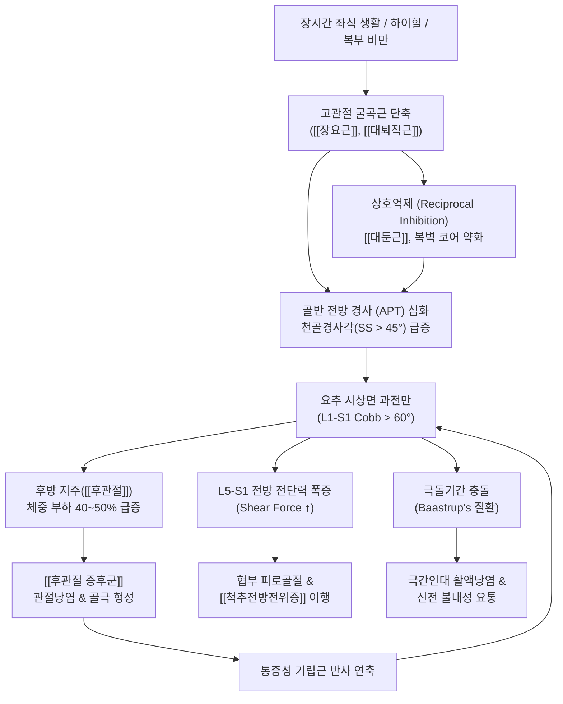
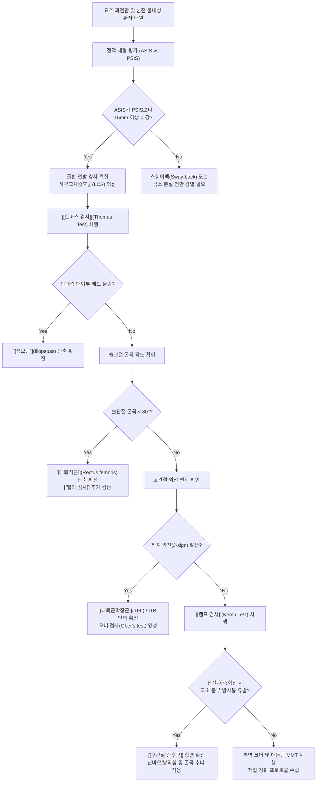

# 요추 전만 (Lumbar Lordosis / Hyperlordosis)

> **목차 (Table of Contents)**
> 1. [🩺 질환 개요 & 해부학적 병태생리](#1--질환-개요--해부학적-병태생리)
> 2. [⚡ 병태생리 메커니즘 & 생체역학적 악순환 네트워크](#2--병태생리-메커니즘--생체역학적-악순환-네트워크)
> 3. [🔍 임상 증상 & 이학적 검사 알고리즘](#3--임상-증상--이학적-검사-알고리즘)
> 4. [🔀 감별 진단 매트릭스](#4--감별-진단-매트릭스)
> 5. [🌿 한의 통합 치료 프로토콜](#5--한의-통합-치료-프로토콜)
> 6. [💊 양방 치료 & 병용·의뢰 기준](#6--양방-치료--병용의뢰-기준)
> 7. [🏃 재활 운동 & 생활습관 티칭 가이드](#7--재활-운동--생활습관-티칭-가이드)
> 8. [💡 사용자 진료실 핵심 필기 & 임상 노하우 (Melt-In)](#8--사용자-진료실-핵심-필기--임상-노하우-melt-in)
> 9. [📚 출처 및 현대 학술 연구 요약](#9--출처-및-현대-학술-연구-요약)

---

> **핵심 3줄 요약 (Key Summary)**:
> 🎯 **정의 & 역학**: 요추의 생리적 시상면 전방 전만곡(Lumbar Lordosis, 정상 L1-S1 Cobb 각도 40°~60°)이 비정상적으로 급증(Cobb > 60° 또는 $LL > PI + 10^\circ$)하여 무명골의 [[골반 전방 경사]](Anterior Pelvic Tilt) 및 천골경사각(SS > 40~45°) 증가를 동반하는 시상면 척추 정렬 변형 질환임. 하이힐 착용 여성, 복부 비만, 임산부, 체조·발레 등 과신전 반복 운동군에서 호발함.
> 🚩 **병태생리 & 주소증**: 블라디미르 얀다의 하부교차증후군(LCS) 및 셜리 사먼의 [[요추 신전 증후군]] 기전으로, 단축된 [[장요근]]·[[대퇴직근]]·[[척추기립근]]과 약화된 [[복직근]]·[[복횡근]]·[[대둔근]]의 불균형이 본질임. 기립 및 보행 시 후방 지주([[후관절]])로 체중의 40~50% 이상 과부하가 쏠려 신전 불내성 [[요통]], [[후관절 증후군]], [[척추전방전위증]], [[척추분리증]] 호발.
> 🔍 **치료 & 감별 주의**: 맥켄지 과신전 운동을 엄격히 금기하고, 윌리엄스 굴곡 운동, 골반 후방경사 복벽 강화, [[장요근]] 침도 및 [[신바로약침]] 이완, 요골반 굴곡 가동화 [[추나요법]]을 시행함. 겉보기에 배가 나와 유사해 보이나 실제 골반은 후방 경사된 [[스웨이백]](Sway-back) 자세와의 정밀 감별이 필수적임.

---

## 1. 🩺 질환 개요 & 해부학적 병태생리

### 1.1 개념 정의 및 인류 이족보행의 진화적 획득
[[요추 전만]](Lumbar Lordosis, LL)은 인류가 사족보행에서 직립 이족보행(Bipedalism)으로 진화하는 과정에서 두개골과 흉곽의 하중을 골반 위에 수직으로 위치시키기 위해 획득한 고유의 생리적 시상면 만곡(Sagittal spinal curvature)이다. 신생아의 척추는 전체가 뒤로 둥근 단일 후만(Primary kyphosis) 상태이나, 생후 3~4개월경 목을 가누며 경추 전만이 형성되고, 생후 10~12개월경 서서 걷기 시작하면서 [[장요근]]의 견인력과 체중 부하에 의해 L1-S1 분절에 2차 전만곡(Secondary lordosis)이 구축된다.

그러나 임상에서 병리적 범주로 다루어지는 **요추 과전만(Lumbar Hyperlordosis)**은 정상 성인의 생리적 만곡 범위(L1-S1 Cobb 각도 40°~60°)를 병적으로 초과(> 60°)하거나, 개인의 고유한 골반 형태학적 지표인 골반 입사각(Pelvic Incidence, PI)에 비해 전만이 과도하게 형성된 불일치 상태($LL > PI + 10^\circ$)를 의미한다.

```
[척추 시상면 만곡의 역학적 완충 공식 - 델마스 지수(Delmas Index)]
R = N² + 1 (R: 척추 저항력, N: 만곡의 수)
- 정상 척추 (만곡 3개: 경추전만, 흉추후만, 요추전만) : R = 3² + 1 = 10 (직선 척추 대비 10배 완충력)
- 요추 과전만 (Hyperlordosis) : 만곡 과다로 전단력(Shear force) 급증 및 후관절 집중 파괴
```

정상적인 요추 전만은 체간 하중을 추간판과 추체 전주(Anterior column)에 80%, [[후관절]]과 협부 등 후주(Posterior column)에 20%로 완충 분산시킨다. 하지만 요추 과전만 상태가 고착되면 척추의 시상면 충격 흡수 체계가 와해되어, 후방 관절돌기간 관절(Zygapophyseal joint)과 극돌기 간격이 비정상적으로 좁아지고 전방 전단 응력이 임계점을 넘어서게 된다.

### 1.2 시상면 척추-골반 지표 (Spinopelvic Parameters) 정밀 분석
현대 척추생체역학에서 요추 전만은 척추 자체의 단독 곡선이 아니라, [[천골]](Sacrum) 및 무명골([[골반]])과의 기하학적 연동계 안에서만 정확히 정의된다.

```
┌────────────────────────────────────────────────────────────────────────┐
│               골반 형태 및 정렬 지표의 기하학적 상관관계                │
│                                                                        │
│                      PI = PT + SS (Pelvic Incidence)                   │
├────────────────────────────────────────────────────────────────────────┤
│ 1. 골반 입사각 (Pelvic Incidence, PI) :                                │
│    - 대퇴골두 중심과 천골 상단 종판 중심을 잇는 선과, 천골 종판 수직선  │
│      이 이루는 각도. 골 성장이 완료되면 변하지 않는 해부학적 고유 불변값.  │
│    - 정상 한국인 성인 평균 : 약 47° ~ 52°                               │
├────────────────────────────────────────────────────────────────────────┤
│ 2. 천골 경사각 (Sacral Slope, SS) :                                    │
│    - 천골 상단 종판의 경사선과 수평선이 이루는 각도.                    │
│    - 요추 과전만 환자에서는 SS가 45° ~ 55° 이상으로 가파르게 치솟음.     │
├────────────────────────────────────────────────────────────────────────┤
│ 3. 골반 경사각 (Pelvic Tilt, PT) :                                     │
│    - 대퇴골두 중심과 천골 종판 중심을 잇는 선과 수직선이 이루는 각도.    │
│    - 골반의 공간적 회전을 반영하며, 전방 경사(APT) 시 PT는 감소함.       │
└────────────────────────────────────────────────────────────────────────┘
```

프랑스의 피에르 루술리(Pierre Roussouly) 교수는 정상 무증상 인구의 기립 시상면 방사선 프로파일을 4가지 기본 체형으로 체계화하였으며, 요추 과전만은 주로 **Roussouly Type 4 (고전만-고입사각 체형, High Lordosis Type)**에서 선천적 또는 구조적으로 호발한다:

| Roussouly 분류 | 골반 입사각 (PI) | 천골 경사각 (SS) | 요추 전만 아치 특성 | 변곡점 (Apex) 위치 | 퇴행성 호발 병리 경향 |
| :--- | :--- | :--- | :--- | :--- | :--- |
| **Type 1** | 저입사각 (PI < 45°) | 평탄함 (SS < 35°) | 짧고 편평한 하부 요추 전만 | L5 중심 국소 전만 | 흉요추 연접부 디스크 조기 퇴행 |
| **Type 2** | 저입사각 (PI < 45°) | 평탄함 (SS < 35°) | 전체적으로 편평한 전만 (Flat-back) | L4-L5 저전만 곡선 | 다분절 중심성 [[요추 추간판 탈출증]] |
| **Type 3** | 중등도 (45° ≤ PI ≤ 60°) | 정상 (35° ≤ SS ≤ 45°) | 조화로운 균형 전만 (표준 척추) | L4 척추체 중심 | 노화에 따른 균형적 퇴행 |
| **Type 4** | **고입사각 (PI > 60°)** | **가파름 (SS > 45°)** | **매우 길고 깊은 과전만 (T12까지 연장)** | **L3 추체 상방 위치** | [[후관절 증후군]], [[척추분리증]], [[척추전방전위증]] 호발 |

* **Roussouly Type 4의 역학적 취약성**:
  * 골반 입사각($PI > 60^\circ$)이 매우 크고 천골 경사각($SS > 45^\circ$)이 극도로 가파름.
  * 요추 전만이 흉요추 연접부(T12-L1)를 넘어 하부 흉추까지 길게 연장됨.
  * 추체 전방 경사도가 가팔라 L5-S1 분절에 중력성 전방 미끄러짐 전단력(Anterior shear stress)이 극대화되어 [[후관절 증후군]], [[척추분리증]], 협부 결손형 [[척추전방전위증]]의 발생률이 전 인구 중 가장 높음.

### 1.3 시상면 수직축 (SVA) 및 스피노펠빅 조화도 (Spinopelvic Harmony)
요추 전만의 임상적 평가는 전체 척추의 시상면 중력 균형선인 **시상면 수직축(Sagittal Vertical Axis, SVA)**과의 관계 속에서 해석되어야 한다:
* **정상 시상면 정렬 ($SVA < \pm 50mm$)**: 제7경추(C7) 척추체 중심에서 내린 가상의 수직 낙하선(Plumb line)이 천골 상후방 모서리(Posterior superior corner of S1)의 $\pm 50mm$ 이내(이상적으로는 $\pm 20mm$)에 위치한다.
* **과보상성 음성 SVA (Negative SVA)**: 요추 과전만이 극심한 초기 환자에서는 C7 plumb line이 천골 뒤쪽으로 떨어지는 음성 SVA($SVA < -30mm$)가 관찰되기도 하며, 이는 상체가 뒤로 젖혀져 후방 지주에 가해지는 압축 응력이 극대화된 상태를 의미한다.
* **스피노펠빅 불일치 ($PI - LL$ Mismatch)**:
  * 전통적인 Schwab 척추 변형 분류에서 정상 조화 기준은 $|PI - LL| \le 10^\circ$이다.
  * 그러나 요추 과전만 환자에서는 $LL$이 $PI$를 $10^\circ$ 이상 초과하여 $PI - LL < -10^\circ$ (심한 경우 $< -20^\circ$)의 음수 불일치를 나타낸다. 이는 척추의 앞쪽 아치가 비정상적으로 과팽창되어 후방 관절돌기간 관절의 접촉 면적이 비정상적으로 좁아지고 관절 연골에 가해지는 단위 면적당 압력이 3~4배 치솟음을 의미한다.

### 1.4 켄달(Kendall) 자세 분류 체계에서의 위치
플로렌스 켄달(Florence Kendall)의 시상면 체형 분류에서 요추 전만 이상은 명확히 구분된다:
1. **전만 자세 (Lordotic Posture)**: 요추 전만 증가, [[골반 전방 경사]](Anterior Pelvic Tilt), 고관절 굴곡, 슬관절 경미한 과신전(Genu recurvatum).
2. **굽은등-전만 자세 (Kypho-lordotic Posture)**: 흉추 후만 증가와 요추 전만 증가가 결합된 형태로, 머리가 앞으로 빠지는 [[거북목]](Forward head)과 [[굽은등]](Round shoulder)이 연쇄 동반됨.
3. **편평등 자세 (Flat-back Posture)**: 요추 전만 상실, 골반 후방 경사(PPT), [[요추 후만]]으로의 이행.
4. **스웨이백 자세 (Sway-back Posture)**: 골반이 전방으로 변위(Anterior displacement)되어 있으나 골반 자체는 후방 경사되어 있고, 요추 하부는 편평하며 흉요추 연접부만 국소 굴곡된 가성 전만 형태.

### 1.5 호발군 및 역학적 유병 특성
* **하이힐 착용 여성군**: 굽이 높은 신발은 족관절 족저굴곡(Plantarflexion)을 유발하여 체중심을 전방으로 이동시킨다. 지면으로 넘어지지 않기 위해 골반은 보상적으로 전방 경사되고 요추는 과신전되어 만성 과전만을 고착화한다.
* **복부 비만 환자군**: 내장 지방의 증가는 복벽 질량을 전방으로 이동시켜 요추 전방 지주에 모멘트 암(Moment arm)을 기하급수적으로 증가시킨다. 이 복부 하중을 지탱하기 위해 요추 기립근이 지속적으로 과수축하며 요추를 뒤로 꺾는다.
* **임산부(Pregnancy-related lordosis)**: 임신 중기 이후 태아와 양수의 무게로 체중심이 전방 전위되며, 릴랙신(Relaxin) 호르몬에 의한 천장인대 및 치골결합 이완이 결합되어 골반 전방 경사와 요추 과전만이 급격히 악화된다.
* **과신전 반복 운동선수군**: 체조, 발레, 피겨스케이팅, 다이빙, 수영(접영), 역도 등 요추 신전을 극단적으로 요구하는 종목 선수들에게서 직업적으로 다발한다.

---

## 2. ⚡ 병태생리 메커니즘 & 생체역학적 악순환 네트워크

### 2.1 얀다(Vladimir Janda)의 하부교차증후군 (Lower Crossed Syndrome, LCS)
요추 과전만의 가장 본질적인 신경근육계 병태생리는 체코의 신경학자 블라디미르 얀다가 정립한 하지-골반-척추 복합체의 교차성 불균형(Crossed Muscle Imbalance)이다:

```
                  [긴장·단축 / 과긴장군]                      [약화·신장 / 억제군]
                 흉요추 [[척추기립근]]                       [[복직근]], [[복횡근]],
                 [[요방형근]], [[광배근]]                      내·외복사근 (복벽 코어)
                            ╲                                  ╱
                             ╲                                ╱
                              ╲                              ╱
                               [요추 과전만 + 골반 전방 경사]
                              ╱                              ╲
                             ╱                                ╲
                            ╱                                  ╲
                  [긴장·단축 / 과긴장군]                      [약화·신장 / 억제군]
                   [[장요근]], [[대퇴직근]],                    [[대둔근]], [[중둔근]],
                   [[대퇴근막장근]](TFL)                        골반저근육군
```

#### 1) 긴장·단축군 (Hypertonic & Shortened Muscles)
* [[장요근]](Iliopsoas: 대요근 & 장골근): 요추 추체 외측(T12-L5)과 장골와에서 기시하여 대퇴골 소전자(Lesser trochanter)에 정지한다. 장시간의 좌식 생활로 구축된 장요근은 대퇴골에 대해 골반을 전하방으로 강하게 잡아당겨 골반 전방 회전(Anterior rotation)을 고착화하고, 요추 추체를 전하방으로 견인하여 전만을 심화시킨다.
* [[대퇴직근]](Rectus femoris): 하전장골극(AIIS)에서 기시하여 경골조면에 부착하는 2관절 근육으로, 단축 시 골반 전면부를 아래로 끌어내려 골반 전방 경사를 가속한다.
* [[척추기립근]](Erector spinae: 최장근, 장늑근) 및 [[요방형근]](Quadratus lumborum): 흉요근막 후방 지주를 압축하여 요추 후방 아치를 좁히며 척추를 활처럼 휘게 만든다.

#### 2) 약화·억제군 (Inhibited & Weakened Muscles) - 상호억제 기전
* 전방 복벽 근육군 ([[복직근]], [[복횡근]], [[외복사근]]): 치골 결합에서 늑골로 이어지는 전방 복벽 지주선이 약화되고 신장성 억제(Stretch weakness)를 겪는다. 복압(IAP) 형성 능력이 소실되면서 요추 전방 지지대가 붕괴된다.
* 후방 둔근군 ([[대둔근]], [[중둔근]]): 장요근의 만성 과긴장으로 인해 척수 반사 수준에서 길항근인 대둔근에 대한 **상호억제(Reciprocal Inhibition)**가 발생한다. 대둔근의 근원섬유 동원 지연은 골반의 후방 회전 복원력을 차단하여 골반 전방 경사를 비가역적으로 고착시킨다.

### 2.2 셜리 사먼(Shirley Sahrmann)의 요추 신전 운동손상 증후군 (MSI)
운동계 손상 증후군 관점에서 요추 과전만은 **'상대적 유연성(Relative Flexibility)의 결함'**으로 규정된다:
* 고관절 신전 가동역(정상 10°~15°)이 장요근 단축으로 차단되면, 보행 시 유각기 직전(Terminal stance) 단계에서 하지가 뒤로 빠지지 못한다.
* 신체는 전방 이동을 완수하기 위해 저항이 적고 유연한 요추 분절을 보상적으로 뒤로 과도하게 젖히게 된다.
* 결과적으로 모든 직립 보행 동작마다 요추 후방 분절이 '지렛대의 받침점'이 되어 미세 기계적 손상을 끊임없이 누적시킨다.

### 2.3 후방 지주(Posterior Column) 압박과 전단력 집중 손상
1. **후관절([[후관절]]) 충돌 및 연골 파괴**:
   * 전만이 과도해지면 추간판으로 분산되어야 할 체중 부하(정상 80%)가 후방 후관절로 40~50% 이상 집중 전이된다.
   * 상·하 관절돌기간의 비정상적 기계적 마찰로 관절 연골 마모, 관절낭 활액막염, 골극(Osteophyte) 형성이 촉발되어 [[후관절 증후군]]이 발생한다.
2. **L5-S1 전단력(Shear Stress) 급증과 척추전방전위증([[척추전방전위증]]) 연계**:
   * 천골경사각(SS)이 45도 이상 가파를 때, 중력 하중 벡터의 분력 중 추체 전방 미끄러짐 벡터($Shear\ Force = Weight \times \sin(SS)$)가 기하급수적으로 폭증한다.
   * 이는 상관절돌기와 하관절돌기 사이의 협부(Pars interarticularis)에 지속적인 피로 골절 응력을 가하여 청소년기 [[척추분리증]](Spondylolysis) 및 성인기 협부 결손형/퇴행성 [[척추전방전위증]](Spondylolisthesis)의 결정적 원인이 된다.
3. **바스트룹 병 (Baastrup's Disease / Kissing Spine)**:
   * 과전만으로 인접한 요추 극돌기(Spinous process) 간격이 좁아지며 서로 맞부딪쳐 극간인대(Interspinous ligament)의 만성 마찰, 활액낭염 형성, 골경화가 유발된다.
4. **동적 추간공 협소화(Dynamic Foraminal Stenosis)**:
   * 요추 신전 시 [[황색인대]](Ligamentum flavum)가 척추관 내부로 불룩하게 접혀 들어가고 후관절이 추간공 전하방으로 전위되어 추간공 단면적이 20~30% 감소하며 척추신경근의 허혈성 통증을 조장한다.

### 2.4 생체역학적 악순환 네트워크



---

## 3. 🔍 임상 증상 & 이학적 검사 알고리즘

### 3.1 주요 임상 증상
* **신전 불내성 요통 (Extension-Intolerant LBP)**:
  * 서 있거나 걸을 때, 허리를 뒤로 젖힐 때 요천추부 심부와 양측 후관절 라인을 따라 뻐근하고 찌르는 듯한 통증이 발생함.
  * 상체를 앞으로 숙이거나 의자에 앉으면 추간공이 열리고 후관절이 감압되어 통증이 즉각 경감됨.
* **복와위 수면 장애 (Prone Sleep Discomfort)**:
  * 엎드려 자는 자세에서 요추 전만이 더욱 심해져 요통이 격화됨.
  * 바로 누울 때 허리가 바닥에서 붕 떠 손이 쑥 들어가며, 무릎 밑에 베개를 받치거나 옆으로 누워 다리를 구부려야 편안함을 느낌.
* **체형 외형적 특징**:
  * 아랫배가 앞으로 불룩 튀어나오고 엉덩이가 뒤로 치켜올라간 전형적인 **'오리 궁둥이(Duck-butt)'** 체형.
  * 척추 기립근이 도드라지게 솟아있고 척추 중앙선에 깊은 고랑(Lordotic trench)이 관찰됨.
* **가성 방사통 (Pseudoradicular Pain)**:
  * 후관절 피막의 척추신경 후지 내측지(Medial branch) 감각 신경 매개로 둔부 및 대퇴 후외측으로 방사통이 나타나나, 무릎 아래(L4-L5-S1 진성 피부분절)로는 방사되지 않음.

### 3.2 이학적 검사 (Physical Examination) 알고리즘
요추 과전만 환자의 원인 근육과 구조적 손상을 진단하기 위한 단계별 검사 체계는 다음과 같다:

```
[환자 평가 단계]
1. 직립 자세 관찰 : ASIS-PSIS 경사각 측정 (정상 7~10° 초과 시 골반 전방 경사)
2. [[토마스 검사]] : 고관절 굴곡근 ([[장요근]], [[대퇴직근]], TFL) 단축 분별
3. [[엘리 검사]] : 복와위 대퇴직근 순수 구축 평가
4. [[캠프 검사]] : 요추 신전-측굴 결합을 통한 [[후관절 증후군]] 충돌 유발
5. 도수근력검사(MMT) : 복직근(Curl-up 유지력) 및 대둔근 분리 수축력 평가
```



#### 1) 변형 토마스 검사 (Modified Thomas Test) 정밀 판독법
환자를 검사대 모서리에 걸터앉힌 후 양 무릎을 가슴으로 끌어안으며 뒤로 눕힌다. 비검측 하지는 가슴에 밀착시키고 검측 하지를 아래로 자연스럽게 늘어뜨린다:
* **양성 1 ([[장요근]] 단축)**: 검측 대퇴 후면이 검사대 표면에 닿지 않고 위로 붕 뜸 (Hip extension < 0°).
* **양성 2 ([[대퇴직근]] 단축)**: 검측 무릎이 중력에 의해 80°~90° 이상 자연스럽게 굴곡되지 않고 하퇴가 전방으로 신전됨 (Knee flexion < 80°). 이때 고관절을 수동으로 신전시키면 슬관절 신전이 더 심해짐.
* **양성 3 ([[대퇴근막장근]]/장경골대 단축)**: 하지가 바깥쪽으로 벌어지는 외전(Abduction) 편위 또는 외회전(External rotation)이 나타남(J-sign).

#### 2) [[엘리 검사]] (Ely's Test)
환자를 복와위로 눕히고 검사자가 환자의 발목을 잡고 슬관절을 둔부 쪽으로 수동 굴곡시킨다:
* 슬관절 굴곡 각도가 90~100도에 도달하기 전에 동측 골반(ASIS)이 베드에서 번쩍 들려 올라가면 [[대퇴직근]]의 비가역적 구축 양성이다.

#### 3) [[캠프 검사]] (Kemp Test)
환자를 좌위 또는 입위에서 체간을 최대한 신전(Extension)시킨 후, 통증 발생 측으로 측굴(Lateral flexion) 및 회전(Rotation)을 동시에 가하며 하방으로 압박력을 가한다:
* 요천추 관절 분절에 찌르는 듯한 날카로운 국소 통증 또는 둔부로 뻗치는 연관통이 재현되면 후관절 관절낭염([[후관절 증후군]]) 양성이다.

#### 4) 크레이그 검사 (Craig's Test) - 대퇴골 염전각 감별
환자를 복와위로 눕히고 슬관절을 90도 굴곡시킨 후, 대전자(Greater trochanter)를 촉진하며 고관절을 내회전·외회전시킨다. 대전자가 외측으로 가장 돌출되는 순간의 하퇴와 수직선 사이의 각도를 측정한다:
* 정상 대퇴골 전염각(Anteversion angle)은 8°~15°이다.
* 과도한 대퇴골 전염(Anteversion > 15°~20°)이 존재하는 환자는 보행 시 안짱다리(Toeing-in)를 보상하기 위해 골반을 앞으로 기울이고 요추 과전만을 조장한다. 이를 감별하지 않고 단순 연부조직 단축으로만 접근하면 치료 한계에 부딪힌다.

#### 5) 베이튼 과가동성 점수 (Beighton Hypermobility Score)
선천적 인대 이완증(Ligamentous laxity)을 가진 환자는 척추를 지탱하는 수동적 결합조직 장력이 취약하여 중력에 저항하지 못하고 요추가 앞쪽으로 과도하게 무너져 내리는 특성을 보인다:
* 양측 소지 과신전(> 90°), 모지 전완 접촉, 주관절 과신전(> 10°), 슬관절 과신전(> 10°), 체간 전굴 손바닥 접촉 등 총 9점 중 5점 이상일 경우 양성으로 판정한다.
* 베이튼 점수가 높은 과가동성 환자에게는 강한 관절 조작 추나보다 심부 국소 분절 근육([[다열근]], [[복횡근]])의 신경근 조절 훈련과 [[자하거약침]] 등의 인대 보강 치료가 최우선된다.

---

## 4. 🔀 감별 진단 매트릭스

요추 과전만 환자를 진찰할 때 가장 치명적인 오류는 외형적 복부 돌출만 보고 [[스웨이백]]이나 [[요추 후만]]의 보상 형태를 요추 과전만으로 오진하는 것이다.

| 감별 항목 | 진성 [[요추 전만]] (Hyperlordosis) | [[스웨이백]] (Sway-back Posture) | [[요추 후만]] / 일자허리 (Flat-back) | [[척추전방전위증]] (Spondylolisthesis) | [[후관절 증후군]] (Facet Syndrome) |
| :--- | :--- | :--- | :--- | :--- | :--- |
| **골반 시상면 경사** | **전방 경사 (APT, ASIS 하강)** | **후방 경사 (PPT) + 골반 전방 편위** | 후방 경사 (PPT, ASIS 상승) | 전방 경사 동반 빈번 (천골경사↑) | 전방 경사 또는 정상 중립 |
| **요추 만곡 형태** | **L1-S1 전반의 과도한 C자 곡선** | 요천추 편평 + 흉요추 국소 전만 | **요추 전만 소실 (일자화~역후만)** | 특정 분절 추체 전방 전위 (계단변형) | 신전 시 후관절면 비정상적 충돌 |
| **체중심선 (Plumb Line)** | 복부 전방 쏠림, 전만 골짜기 심화 | **골반이 발목보다 전방 이동** | 체간 상체가 전방으로 고꾸라짐 | 요천추 연접부 압력 극대화 | 요추 후방 라인 체중 부하 집중 |
| **단축·구축 근육** | [[장요근]], [[대퇴직근]], [[척추기립근]] | [[햄스트링]], 상부 [[복직근]] | [[햄스트링]], [[대둔근]], [[복직근]] | [[장요근]] 구축, [[햄스트링]] 반사 경직 | 심부 [[다열근]], [[요방형근]], [[척추기립근]] |
| **약화·이완 근육** | [[복직근]], [[복횡근]], [[대둔근]] | [[장요근]], 하부 외복사근, 고관절 외전근 | [[척추기립근]], [[다열근]], [[장요근]] | 복벽 코어 근육군, 둔근군 | [[복횡근]], 복사근, 심부 안정화근 |
| **주요 악화 동작** | **허리 뒤로 젖히기 (신전), 기립** | 장시간 기립 (골반 기댄 자세) | **허리 앞으로 숙이기 (굴곡), 착석** | 보행, 요추 신전, 무거운 물건 들기 | **기립 시 신전 및 회전, 아침 기상** |
| **주요 완화 동작** | 허리 숙이기 (굴곡), 앉기, 웅크리기 | 골반 후방 회전 수정, 가슴 펴기 | 허리 뒤로 펴기 (신전), 앙와위 기립 | 복와위 굴곡 자세, 윌리엄스 굴곡 | 굴곡 가동, 온열 찜질, 관절 감압 |
| **X-ray 계측 지표** | $LL > 60^\circ$, $SS > 45^\circ$, $PI-LL < -10^\circ$ | $LL$ 감소, $SS < 30^\circ$, 골반 전방 변위 | $LL < 20^\circ$, $SS < 25^\circ$, $SVA > +50mm$ | 사위상 Scotty dog 목 골절선, 전위 | 후관절 비대, 연골하 골경화, 골극 |

---

## 5. 🌿 한의 통합 치료 프로토콜

요추 과전만증의 한의 치료는 전방에서 골반을 당기는 근육 사슬([[장요근]], [[대퇴직근]])을 이완하고, 후방에서 짓눌리는 후관절을 감압하며, 약화된 복벽과 둔근의 신경근 조절 능력을 재건하는 **3차원 복합 접근**을 원칙으로 한다.

### 5.1 한의학적 변증 체계
* **기체어혈(氣滯瘀血)**: 후관절과 극간인대에 기계적 과부하가 누적되어 국소 맥락이 조체되고 불통즉통(不通則痛)의 자통(刺痛) 및 야간통 발생.
* **간신휴손(肝腎虧損)**: 간주근(肝主筋), 신주골(腎主骨) 부전으로 관절 인대와 골조직의 퇴행이 가속화되어 척추 만곡 유지력 상실.
* **비허습곤(脾虛濕困)**: 비주육(脾主肉) 기능 저하로 복벽 근육이 탄력을 잃고 이완되며, 복부 중심성 비만과 습담이 정체되어 전만을 악화시킴.

### 5.2 침구 및 전침 치료 프로토콜
* **긴장·단축 근육군 억제 및 이완 (저주파 2Hz 지속파)**:
  * **요천추 배수혈 및 협척혈**: 대장수(BL25), 관원수(BL26), 신수(BL23), 요양관(GV3), 협척혈(L3-S1 심부 다열근). 침첨을 척추체 방향으로 1.5~2치 심부 자입하여 후관절낭 주위 근막 유착 박리.
  * **복측 고관절 굴곡근**: 충문(SP12), 비관(ST31), 거료(GB29). 대퇴동맥과 신경 주행을 피해 [[장요근]] 건막 및 [[대퇴직근]] 기시부 침첨 도달 유도.
  * **요배부 긴장근**: 지실(BL52), 요방형근(QL) 외측 압통점.
* **약화·억제 근육군 촉진 및 신경 재교육 (100Hz 또는 Burst 단속파)**:
  * **복벽 코어**: 천추(ST25), 대횡(SP15), 기해(CV6), 관원(CV4). 복횡근과 내외복사근 수축 유도.
  * **둔근군**: 환도(GB30), 승부(BL36), 질변(BL54). [[대둔근]]의 지연된 운동단위 동원율을 촉진.

### 5.3 약침 치료 (Pharmacopuncture) 프로토콜
* [[신바로약침]] (GCSB-5 추출물):
  * **적용 부위**: L4-L5, L5-S1 양측 후관절 관절낭 주위 및 극간인대.
  * **기전**: 침윤된 전염증성 사이토카인(TNF-α, IL-1β) 및 COX-2, PGE2를 강력히 억제하여 관절낭 부종을 제거하고 연골 파괴를 방어.
* [[봉약침]] (Sweet BV / 멜리틴 성분 정제):
  * 만성 요천추부 인대 이완증 및 후관절 골관절염 부위에 0.1~0.2cc씩 소량 분할 주입하여 국소 혈류를 300% 이상 증진시키고 자가면역성 소염 기전 가동.
* 황련해독탕 약침: 급성기 척추기립근과 요방형근의 열성 근막 발적 및 극심한 연축에 유효.
* [[자하거약침]]: 갱년기 여성 및 노인성 골다공증성 과전만 환자의 보간신(補肝腎), 인대 연골 조직 재생.

### 5.4 추나요법 (Chuna Manual Therapy) 기법
1. **요골반 굴곡 변위 가동화 기법 (Lumbar Flexion Mobilization)**:
   * 환자를 측와위로 눕히고 양 무릎을 가슴으로 최대한 굴곡시킨다.
   * 시술자는 환자의 골반을 복측으로 당기며 상위 및 하위 요추 극돌기 사이를 수기 접촉하여, 좁아진 후방 관절돌기간 간격을 단계적으로 벌려주는 굴곡 스프링 기법을 적용한다.
2. **골반 후방 회전 유도 기법 (Innominate Posterior Rotation Technique)**:
   * 환자의 ASIS를 후하방으로 견인하고, 좌골결절(Ischial tuberosity)을 전상방으로 회전시켜 전방 경사된 무명골을 정상 시상면 중립위로 정렬한다.
3. [[장요근]] 근에너지기법 (MET / Post-Isometric Relaxation):
   * 검사대 끝에서 하지를 신전시킨 상태에서 환자에게 약 20%의 약한 힘으로 고관절 굴곡 등척성 수축을 7초간 유도한 후, 호흡 날숨에 맞춰 고관절을 점진적으로 신전 신장시킨다.

### 5.5 한약 치료 (Herbal Medicine)
* [[독활기생탕]](獨活寄生湯):
  * 처방 구성: 독활, 상기생, 두충, 우슬, 세신, 진범, 복령, 백작약, 당귀, 천궁, 숙지황 등.
  * 적응증: 간신허약과 풍한습사가 결합되어 후관절 퇴행성 관절염, 협부 피로, 하지 무력증이 동반된 만성 과전만 요통 환자의 표준 처방.
* [[오적산]](五積散) 가감방:
  * 적응증: 한냉 및 습담으로 인해 요배부 근막이 판자처럼 굳어있고, 소화기 장애 및 복부 비만이 동반된 환자의 근막 연축 완화.
* [[방풍통성산]](防風通聖散):
  * 적응증: 복부 내장지방 과다형 비만으로 인해 물리적 하중이 골반을 앞으로 쏟아지게 만드는 실증(實證) 환자의 체중 감량 및 복압 개선.
* 작약감초탕(芍藥甘草湯):
  * 급성기 [[장요근]] 및 척추기립근의 격렬한 근경련(Spasm)을 신속히 진정시키는 근이완 대증 처방.

---

## 6. 💊 양방 치료 & 병용·의뢰 기준

### 6.1 보존적 양방 치료
* **약물 치료**: NSAIDs(Meloxicam, Celecoxib), 중추성 근이완제, 아세트아미노펜.
* **주사 요법**:
  * **후관절 내측지 차단술 (Medial Branch Block, MBB)**: 캠프 검사 양성 및 후관절성 통증 환자에게 진단 및 치료 목적으로 국소마취제와 스테로이드 혼합 주입. 통증이 50~80% 이상 소퇴되면 고주파 열응고술(RFA) 고려.
  * **경막외 스테로이드 주입술 (ESI)**: 동적 추간공 협착으로 신경근병증이 동반된 경우 적용.
* **물리치료**: 골반 견인 치료(Traction) 시 반드시 **고관절 90도 굴곡위 파울러 자세(Fowler's position)**에서 시행해야 하며, 신전위 견인은 절대 금기임.

### 6.2 보조기 요법
* **윌리엄스 굴곡 보조기 (Williams Flexion Brace)**: 복부를 압박하고 흉요추 신전을 제한하며 요추 굴곡을 강제 유지하는 흉요천추 보조기로, 급성기 후관절 통증 및 협부 피로골절 환자에게 4~6주간 한시적 적용.

### 6.3 수술적 고려 및 레드 플래그 (Red Flags) 긴급 의뢰 기준
* **마미증후군 (Cauda Equina Syndrome)**: 안장 마비(Saddle anesthesia), 배뇨 장애, 항문 괄약근 톤 소실 발생 시 48시간 이내 긴급 감압술 의뢰.
* **진행성 신경 마비**: 족하수(Foot drop), 대퇴사두근 근력 저하(Grade 3 이하)로 보행 붕괴 시.
* **중증 척추전방전위증([[척추전방전위증]])**: Meyerding 분류 Grade 3 이상(추체 50% 이상 전위) 또는 척추 불안정성(동적 굴곡-신전 X-ray 상 4mm 이상 전위 변화)으로 비수술 치료에 반응하지 않는 경우 후방 요추체간 유합술(TLIF/PLIF) 의뢰.

---

## 7. 🏃 재활 운동 & 생활습관 티칭 가이드

### 7.1 윌리엄스 굴곡 운동 (Williams Flexion Exercises) 표준 6단계
요추 과전만 환자의 척추관을 넓히고 후관절 압박을 제거하는 골든 스탠다드 프로토콜이다:

```
[윌리엄스 6대 굴곡 운동]
1단계: 골반 후방 경사 기울이기 (Pelvic Tilt)
2단계: 편측 무릎 가슴 닿기 (Single Knee-to-Chest)
3단계: 양측 무릎 가슴 닿기 (Double Knee-to-Chest)
4단계: 부분 윗몸 일으키기 (Partial Curl-up)
5단계: 햄스트링 스트레칭 (Hamstring Stretch)
6단계: 웅크려 쪼그려 앉기 (Full Squat)
```

1. **골반 후방 경사 (Pelvic Tilt)**: 바로 누워 무릎을 세우고, 복부 근육을 수축하여 요추부를 바닥에 빈틈없이 밀착시킨 상태로 10초간 유지 (10회 3세트).
2. **무릎 가슴 당기기 (Knee-to-Chest)**: 바로 누워 한쪽 또는 양쪽 무릎을 양손으로 감싸 가슴 쪽으로 천천히 당겨 요천추부 후방 근막과 둔근을 신장시킴.
3. **부분 윗몸 일으키기 (Partial Curl-up)**: 양손을 가슴에 얹고 견갑골 하각이 바닥에서 떨어질 정도까지만 상체를 들어 올려 복직근을 강화 (허리를 완전히 들어 올리는 풀 싯업은 장요근을 수축시키므로 절대 금지).

### 7.2 코어 안정화 및 둔근 강화 운동
* **데드버그 (Dead-Bug)**: 바로 누워 허리를 바닥에 밀착(Pelvic lock)한 상태에서 대각선 방향의 팔과 다리를 교대로 뻗는 훈련. 허리가 바닥에서 뜨지 않도록 제어하는 것이 핵심.
* **둔근 브릿지 (Glute Bridge)**: 앙와위에서 무릎을 세우고 발뒤꿈치로 지면을 밀며 엉덩이를 든다. 이때 **허리를 과신전하여 활처럼 꺾지 않고**, 오직 [[대둔근]] 수축으로 골반이 무릎-대퇴-체간과 일직선이 되는 중립위까지만 거상해야 함.

### 7.3 엄격한 금기 운동 (Strict Contraindications)
* **맥켄지 과신전 운동 (McKenzie Extension / Cobra Stretch) 절대 금기**: 디스크 수핵 탈출증에 쓰이는 신전 동작을 요추 과전만 환자가 수행하면 후관절이 파괴되고 협부 골절이 유발됨.
* **슈퍼맨 자세 (Superman Exercise) & 요가 활자세**: 복와위에서 상체와 하지를 동시에 들어 올리는 동작은 요추 후방 지주에 치명적인 압박 골절 응력을 가함.

### 7.4 일상생활 동작(ADL) 인체공학적 티칭

| 일상생활 환경 | ❌ 위험 동작 (Don't) | ⭕ 교정 동작 (Do) |
| :--- | :--- | :--- |
| **서서 일하기** | 배를 내밀고 허리를 꺾은 채 장시간 기립 | **15cm 높이 발받침대**에 한쪽 발을 교대로 올려놓아 골반 후방경사 유도 |
| **신발 선택** | 굽 높은 하이힐, 바닥이 딱딱한 플랫슈즈 | **2~3cm 굽의 충격 흡수 쿠션화** 착용 |
| **수면 자세** | **엎드려 자는 자세 (Prone lying) 절대 금기** | 바로 누울 때는 **무릎 아래 베개 받치기**, 옆으로 누워 새우잠 자기 |
| **물건 들기** | 허리를 젖히며 상체 힘으로만 들어 올리기 | 물건을 몸에 밀착시키고 고관절 힌지(Hip hinge)를 사용하여 들어 올리기 |

---

## 8. 💡 사용자 진료실 핵심 필기 & 임상 노하우 (Melt-In)

### 8.1 진성 과전만 vs 스웨이백(Sway-back)의 치명적 오진 방지 공식
진료실에서 배가 앞으로 볼록 나와 있는 환자를 보고 기계적으로 "허리가 앞으로 너무 꺾였네요, 골반 후방 경사 운동 하세요"라고 지도하면 절반의 환자는 증상이 급격히 악화된다. 그 환자가 진성 과전만이 아니라 **스웨이백(Sway-back)**일 가능성 때문이다.

```
[진성 과전만 vs 스웨이백 감별 공식]
1. 골반의 수직 위치를 보라:
   - 복사뼈(Lateral malleolus)에서 수직선을 올렸을 때, 대전자(Greater trochanter)가
     발목보다 앞으로 3~5cm 이상 밀려 나가 있다면 100% 스웨이백이다.
2. 골반의 전후방 경사를 보라:
   - 진성 과전만 : ASIS가 현저히 하강된 '전방 경사' (오리 엉덩이).
   - 스웨이백     : ASIS가 오히려 들려있는 '후방 경사' (처진 엉덩이).
3. 요천추 만곡을 보라:
   - 진성 과전만 : L1부터 S1까지 전체가 활처럼 휘어 있음.
   - 스웨이백     : 요천추는 편평하고 흉요추 연접부만 국소적으로 꺾여 있음.
```

* **치명적 임상 함정**: 스웨이백 환자는 이미 골반이 후방 경사되어 햄스트링이 팽팽하게 당겨져 있다. 여기에 골반 후방 경사 훈련이나 햄스트링 스트레칭을 시키면 골반 지지대가 완전히 붕괴되어 천장관절염과 흉요추 통증이 폭발한다.

### 8.2 맥켄지 신전 운동이 '독(Poison)'이 되는 임상 현장
* "원장님, 허리가 아파서 유튜브 보고 매일 뒤로 허리 젖히는 맥켄지 운동을 100번씩 했는데, 이제는 5분만 서 있어도 허리가 끊어질 것 같아서 못 걷겠어요."
* 디스크 수핵 탈출로 신경근이 눌린 급성기 환자(굴곡 불내성)에게 맥켄지는 명약이지만, **서 있을 때 아프고 허리를 뒤로 젖힐 때 아픈 요추 과전만·후관절 환자에게 맥켄지는 관절을 파쇄하는 독약**이다.
* 진료실 원칙: **"허리를 숙여서 편안해지는 환자에게는 어떠한 경우에도 허리를 뒤로 젖히는 운동을 시키지 말라."**

### 8.3 토마스 검사(Thomas Test)를 활용한 환자 티칭 노하우
환자에게 골반 전방 경사와 장요근 단축을 말로 백날 설명하는 것보다 베드에서 10초간 체감시키는 것이 치료 순응도를 극대화한다:
1. 환자를 베드에 앙와위로 편안히 눕힌다.
2. 원장의 손을 환자의 허리 밑으로 쑥 집어넣는다. 반대편까지 손이 쑥 통과된다.
3. 환자의 손을 직접 허리 밑에 넣어보게 한다: "환자분, 지금 바닥에 누워 계신데 허리가 바닥에 닿지 않고 공중에 붕 떠서 제 손이 그냥 지나가지요?"
4. 환자는 깜짝 놀란다.
5. "환자분 뱃속 깊은 곳에 있는 [[장요근]]이라는 강한 근육 밧줄이 허리뼈를 낚싯줄처럼 앞에서 팽팽하게 끌어당기고 있어서 허리가 활처럼 휘어 떠 있는 것입니다. 이 밧줄을 침과 약침으로 풀어주어야 허리가 비로소 바닥에 편안하게 내려앉습니다."

### 8.4 싱크대 발받침대 15cm의 기적
* "설거지하거나 서서 요리할 때 10분만 지나면 허리가 끊어질 듯 뻐근하다"는 주부 환자에게 가장 위대한 처방은 약이 아니라 **"싱크대 밑에 15cm짜리 나무 발받침대를 놓으라"**는 티칭이다.
* 서서 일할 때 한쪽 발을 발받침대에 올려놓으면, 해당 측 고관절이 자연스럽게 굴곡되면서 장요근 긴장이 풀리고 골반이 후방으로 회전하여 요추 전만이 즉시 편평화된다.
* 양발을 5~10분 간격으로 번갈아 올려놓는 습관 하나만으로 주방 일로 인한 기립 요통의 70%가 즉각 소퇴된다.

### 8.5 [[장요근]] 침도(도침) 시술 시의 해부학적 안전존
* 과전만을 유발하는 구축된 장요근을 이완하기 위해 복벽 전방 충문(SP12) 부위로 무리하게 심부 자입하면 외장골동맥(External iliac artery)이나 대퇴신경(Femoral nerve)을 손상시킬 치명적 위험이 있다.
* **임상 노하우**: 
  * 환자를 복와위로 눕히고, L2-L3-L4 극돌기 외측 3~3.5치 부위에서 늑골돌기(횡돌기) 기저부를 향해 침도를 직자 진입한다.
  * 횡돌기 배측 골면에 팁이 닿아 안전을 확보한 후, 횡돌기 전외측면에 부착하는 장요근 기시부 근막을 부드럽게 절개 박리한다.
  * 이 후방 경유 접근법(Posterior trans-transverse approach)을 사용하면 대혈관 손상 위험 0%로 심부 장요근을 완벽히 이완할 수 있다.

---

## 9. 📚 출처 및 현대 학술 연구 요약

* **PubMed (PMID: 42088996)**: Hassani M, Hosseinimehr SH. Which Exercise Protocol Is Optimal for Improving Lower Crossed Syndrome in Athletes? Core Stability or NASM. *Health Sci Rep*. 2026;9(5):e72471.
  * [URL](https://pubmed.ncbi.nlm.nih.gov/42088996/)
  * `[연구 요약]` 하부교차증후군(LCS)을 가진 운동선수들을 대상으로 코어 안정화 프로토콜과 NASM 교정 운동을 비교 평가함. 두 운동 프로토콜 모두 비정상적 요추 과전만 각도(Lumbar lordosis angle)와 골반 전방 경사(Anterior pelvic tilt)를 유의미하게 감소시키고 요통 장애 지수를 현저히 개선함을 무작위 대조 임상시험으로 입증함.
* **PubMed (PMID: 41057814)**: Sulaiman S, V AN, N SAJ, et al. Radiographic and surgical predictive factors for restoring segmental lumbar lordosis and normal spinopelvic balance following TLIF surgery in lumbar spondylolisthesis patients. *BMC Musculoskelet Disord*. 2025;26(1):926.
  * [URL](https://pubmed.ncbi.nlm.nih.gov/41057814/)
  * `[연구 요약]` 척추전방전위증 환자에서 경추간공 요추체간 유합술(TLIF) 후 분절 요추 전만각 및 전신 척추-골반 시상면 밸런스(PI-LL 매칭)의 정밀한 복원이 수술 후 인접 분절 질환 예방 및 장기 기능 회복을 결정짓는 핵심 방사선학적 지표임을 실증함.
* **PubMed (PMID: 40868371)**: Yoseph ET, Taiwo R, Kiapour A, et al. Pregnancy-Related Spinal Biomechanics: A Review of Low Back Pain and Degenerative Spine Disease. *Bioengineering (Basel)*. 2025;12(8):854.
  * [URL](https://pubmed.ncbi.nlm.nih.gov/40868371/)
  * `[연구 요약]` 임신 중 복부 무게중심 이동과 호르몬성 인대 이완에 따른 요추 과전만 발생 기전을 체계적으로 고찰함. 요추 시상면 만곡의 과도한 증가가 요천추 후방 지주 후관절 및 천장관절에 가하는 생체역학적 과부하와 임신성 만성 요통의 병태생리를 규명함.
* **PubMed (PMID: 42804484)**: Yahanda AT, Kelly MP, Daniels AH, et al. The Lower Lordotic Arch More Precisely Predicts Pelvic Positioning for Adult Spinal Deformity Patients with an Aligned T4-L1-Hip Axis. *Spine (Phila Pa 1976)*. 2026.
  * [URL](https://pubmed.ncbi.nlm.nih.gov/42804484/)
  * `[연구 요약]` 성인 척추 변형 및 시상면 정렬 환자에서 하부 요추 전만 아치(L4-S1)의 분절 각도가 전체 요추 전만보다 골반 경사 및 시상면 척추 정렬 회복에 훨씬 정밀한 예측력을 제공함을 방사선학적으로 규명함.
* **PubMed (PMID: 42297185)**: Younus I, Diebo BG, Lafage R, et al. Explaining Mechanical Failures in Adult Spinal Deformity Patients With Pelvic Incidence-Lumbar Lordosis Within 10°: Is the Roussouly Classification the Answer? *World Neurosurg*. 2026;212():125130.
  * [URL](https://pubmed.ncbi.nlm.nih.gov/42297185/)
  * `[연구 요약]` 성인 척추 변형 환자에서 PI-LL 불일치가 10도 이내로 교정되었음에도 발생하는 기계적 실패의 원인을 분석하고, 루술리(Roussouly) 형태학적 체형 분류에 부합하는 환자 맞춤형 요추 전만 만곡 아치 복원이 장기 합병증을 방지하는 결정적 열쇠임을 입증함.
