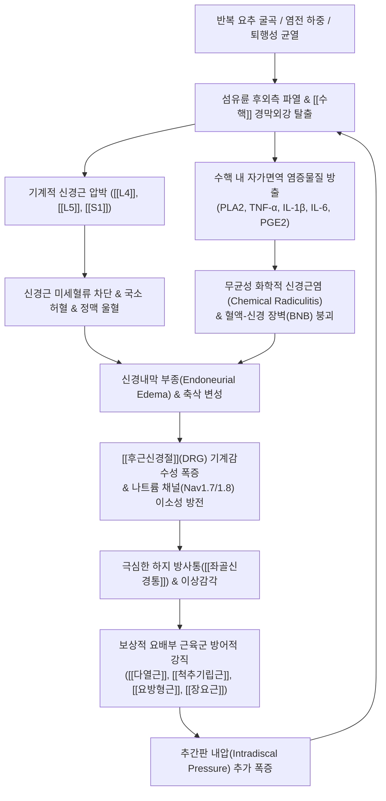
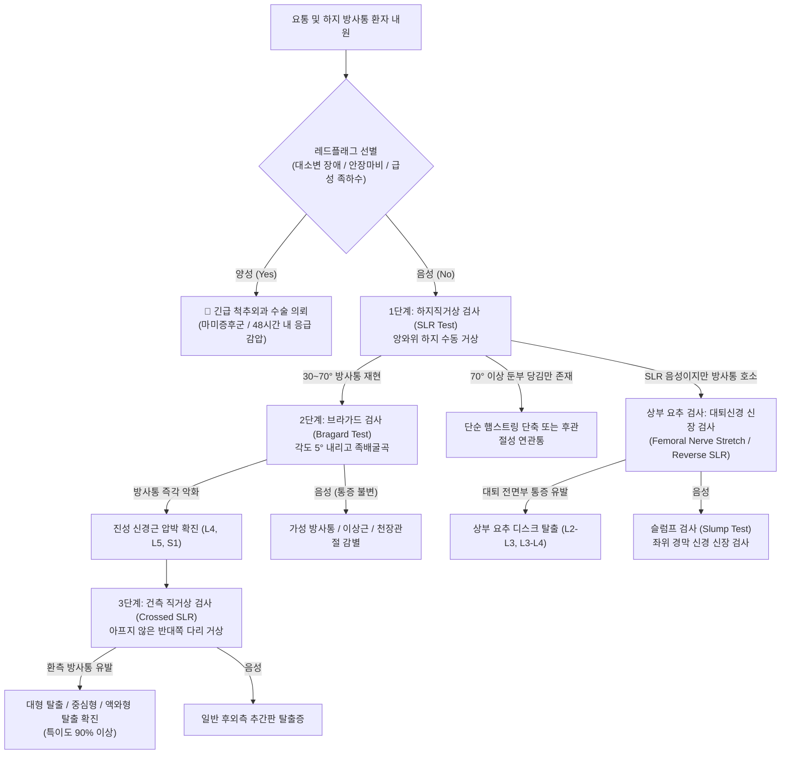
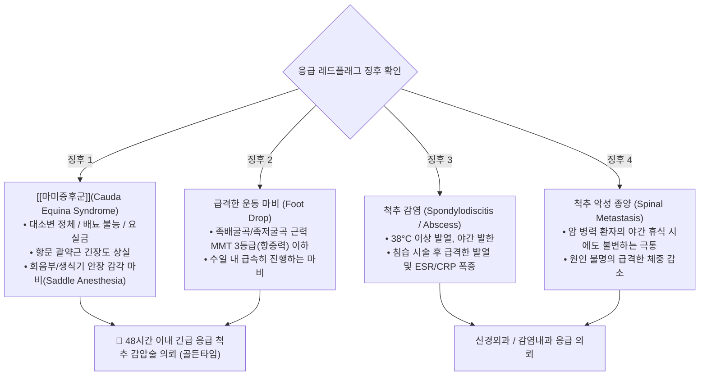

# 🩺 [[요추 추간판 탈출증]] (Lumbar Disc Herniation, M51.2 / M51.1)

> **핵심 3줄 요약 (Key Summary)**:
> - 📍 병소 부위 & 해부·병태생리: 요추 [[추간판]]의 [[섬유륜]](Annulus fibrosus) 파열 및 [[수핵]](Nucleus pulposus) 탈출로 인해 척추관 및 추간공을 통과하는 [[신경근]]([[L4]], [[L5]], [[S1]])과 [[후근신경절]]에 기계적 전단 압박과 면역 자가항원 유래 화학적 신경근염(Chemical Radiculitis: PLA2, TNF-α, IL-1β)이 동시 촉발되는 질환.
> - 🚩 전형적 임상 양상 & 3대 징후: 복압 상승(기침·배변·발살바) 시 격발되는 요통, 편측 둔부에서 하퇴 외측·후면 및 족부로 전기가 통하듯 방사되는 전격성 [[좌골신경통]], [[하지직거상 검사]](SLR) 30~70° 양성 및 분절성 운동신경 결손(족배굴곡·족저굴곡 약화).
> - 🛠️ 핵심 감별 검사 & 한·양방 다각적 치료 전략: [[하지직거상 검사]](SLR), [[Crossed Straight Leg Raise Test]](건측 직거상), [[브라가드 검사]], [[슬럼프 검사]]로 포착 분절 확진 후, [[신바로약침]]·[[봉약침]] 주입, 요추 [[화타협척혈]] 및 담경·방광경 원위 취혈 심자 전침(2/100Hz), 콕스 굴곡-신연 [[추나요법]](디스크 음압 유도), [[독활기생탕]]·청파전 투여 및 [[맥켄지 운동]] 중심화 티칭.
> - ⚠️ 응급 의뢰 레드플래그 & 악화 요인: [[마미증후군]](Cauda Equina Syndrome: 안장 감각 마비, 급성 대소변 정체/실금) 및 급격한 족하수(Foot drop, 근력 3등급 이하)는 영구 장애를 막기 위해 48시간 이내 응급 감압술 의뢰 필수; 급성기 척추 굴곡 스트레칭 및 강제 회전 교정은 절대 금기.

---

## 📌 목차
1. [질환 개요 & 해부학적 병태생리](#1-질환-개요--해부학적-병태생리)
2. [병태생리 메커니즘 & 생체역학적 악순환 네트워크](#2-병태생리-메커니즘--생체역학적-악순환-네트워크)
3. [임상 증상 & 이학적 검사(Physical Exam) 알고리즘](#3-임상-증상--이학적-검사physical-exam-알고리즘)
4. [감별 진단 매트릭스 (Differential Diagnosis)](#4-감별-진단-매트릭스-differential-diagnosis)
5. [한의 통합 치료 프로토콜 (침·약침·추나·한약)](#5-한의-통합-치료-프로토콜-침약침추나한약)
6. [양방 치료 & 병용·의뢰 기준 (Conventional Treatment & Referral)](#6-양방-치료--병용의뢰-기준-conventional-treatment--referral)
7. [재활 운동 & 생활습관 티칭 가이드](#7-재활-운동--생활습관-티칭-가이드)
8. [💡 사용자 진료실 핵심 필기 & 임상 노하우 (Melt-In 잔여 심화 집약)](#8--사용자-진료실-핵심-필기--임상-노하우-melt-in-잔여-심화-집약)
9. [출처 및 학술 참고 문헌 (References)](#9-출처-및-학술-참고-문헌-references)

---

## 1. 🩺 질환 개요 & 해부학적 병태생리

### 1) 질환 정의 및 역학적 특성
* **정의**: 요추 추간판 탈출증(Lumbar Disc Herniation, LDH)은 인접한 두 요추 추체 사이에 위치한 [[추간판]]의 퇴행성 변화, 미세 손상 또는 외력에 의해 외곽의 [[섬유륜]]이 파열되면서 중앙의 [[수핵]]이 척추관(Spinal canal)이나 추간공(Intervertebral foramen) 방향으로 탈출하여 주행하는 [[신경근]](Spinal nerve root)과 경막낭(Thecal sac)을 압박·자극함으로써 요통 및 편측 하지 방사통([[좌골신경통]])을 초래하는 대표적 척추 질환이다.
* **역학**:
  * 일반 인구집단에서 평생 유병률은 약 13~40%에 달하며, 증상성 요추 신경근병증의 연간 발생률은 성인 1,000명당 약 5~20명 수준이다.
  * 30~50대의 경제적 활동 연령층에서 호발하며, 남성이 여성에 비해 약 1.5~2배 호발한다.
  * **호발 분절 분포**:
    * **[[L4]]-[[L5]] 분절**: 약 45~50% (가장 높은 운동 가동성과 전단 하중이 집중되는 부위로, 주로 [[L5]] 신경근 포착 유발).
    * **[[L5]]-[[S1]] 분절**: 약 40~45% (요추의 전만 곡선이 천골의 후만 곡선으로 전환되는 생체역학적 전환점으로, 주로 [[S1]] 신경근 포착 유발).
    * **[[L3]]-[[L4]] 분절**: 약 5~8% (주로 고령층에서 발생하며 [[L4]] 신경근 포착 유발).
    * **[[L1]]-[[L2]], [[L2]]-[[L3]] 상부 요추 분절**: 2~3% 미만 (상부 요추 신경총 포착 및 대퇴부 신경통 양상 발현).

### 2) 추간판의 3대 기능적 해부 구조
* **[[수핵]] (Nucleus Pulposus)**:
  * 디스크 중앙에 위치하는 무혈관성(Avascular), 무신경성(Aneural) 젤라틴성 친수성 완충 복합체이다.
  * 주성분은 Type II 콜라겐(Collagen Type II) 네트워크와 다량의 음전하를 띤 프로테오글리칸(Proteoglycan, 특히 Aggrecan 및 Chondroitin sulfate)이다.
  * 신생아 시기에는 수분 함량이 88%에 달하나 노화와 퇴행에 따라 70% 이하로 급격히 감소하며, 친수성 기질의 소실로 인해 점탄성 완충 기능이 감퇴한다.
  * 유압 원리(Hydraulic mechanism)를 통해 상부에서 전달되는 축성 압축 하중을 3차원 전 방향(360°)으로 균등하게 분산시켜 섬유륜에 인장력(Hoop stress)으로 전달한다.
* **[[섬유륜]] (Annulus Fibrosus)**:
  * 수핵을 동심원상으로 15~25개 층의 팽팽한 판상 구조(Lamellae)로 감싸고 있는 치밀 교원 섬유 다발이다.
  * 주성분은 인장 강도가 극히 뛰어난 Type I 콜라겐(Collagen Type I)이다.
  * 각 층의 콜라겐 섬유는 수직축에 대해 약 30°(인접 층과는 서로 반대 방향인 60° 각도)로 사선 교차 배열되어 척추의 축성 회전(Torsion) 및 측굴, 전단력에 강력히 저항한다.
  * **해부학적 취약 지점**: 디스크의 후외측(Posterolateral aspect)은 전방에 비해 섬유륜의 두께가 현저히 얇고, 척추관 내부의 [[후종인대]](Posterior Longitudinal Ligament, PLL)가 중앙부에만 집중되고 양측 외측으로는 폭이 좁아져 구조적 지지가 결여되어 있다. 이로 인해 수핵 탈출의 90% 이상이 **후외측**으로 발생한다.
  * **신경 지배**: 정상 섬유륜의 내측 2/3는 신경이 존재하지 않으나, 외측 1/3 및 후종인대 표면은 동척추신경(Sinuvertebral nerve / Luschka nerve)의 자유 신경종말(Nociceptor)이 조밀하게 분포하여 섬유륜 파열 시 극심한 디스크성 축성 요통(Discogenic low back pain)을 감지한다.
* **[[연골종판]] (Cartilaginous Endplate)**:
  * 척추체의 골성 종판(Vertebral bony endplate)과 추간판 수핵·섬유륜 사이에 개재된 약 0.6~1.0mm 두께의 초자연골(Hyaline cartilage) 판이다.
  * 성인 추간판은 모세혈관이 직접 침투하지 않는 인체 최대의 무혈관 조직이므로, 디스크 세포의 생존에 필요한 포도당, 산소, 아미노산 등 영양분 공급과 젖산 등 대사산물 배출의 80% 이상이 척추체 골수강에서 연골종판의 미세 다공성 경로를 통한 **수동적 확산(Passive diffusion)**에 의존한다.
  * 연골종판의 미세 골절, 경화증(Sclerosis) 및 칼슘 침착은 추간판 내 영양 결핍을 초래하여 산성화를 유발하고 퇴행을 비가역적으로 가속한다.

### 3) 추간판 탈출의 병기 및 형태학적 분류

| 분류 체계 | 단계 / 병기 | 병태생리학적 특징 | 임상 및 영상학적 소견 |
| :--- | :--- | :--- | :--- |
| **탈출 형태학적 분류** (NASS / ASSR / ASNR 합의) | **팽륜 (Bulging)** | 섬유륜의 전층 파열 없이, 디스크 둘레의 25%(90도) 이상이 정상 추체 경계를 3mm 이상 전반적으로 넘어섬. | 추간판 내압 상승 및 경미한 척추관 단면 감소; 신경근의 진성 압박보다는 후관절 과부하 유발. |
| | **돌출 (Protrusion)** | 섬유륜의 내측 섬유가 파열되었으나 최외측 층은 유지됨; 탈출된 수핵의 기저부 폭(Base)이 탈출된 첨부의 길이(Apex)보다 넓음. | 신경근을 경막외강 쪽으로 밀어내나 수핵 물질의 직접 누출은 없음; 비수술 보존 치료 반응 양호. |
| | **탈출 (Extrusion)** | 섬유륜 전층이 완전히 파열되어 수핵 물질이 후종인대를 뚫거나 밀어내며 경막외강으로 돌출; 기저부 폭보다 첨부의 길이가 더 긺. | 자가면역 화학적 신경근염 격발; 극심한 좌골신경통 유발; 대식세포 침윤에 의한 자가 흡수율이 돌출보다 높음. |
| | **격리 / 부골화 (Sequestration)** | 파열된 섬유륜 틈으로 빠져나온 수핵 조각이 본체 디스크와 완전히 분리되어 유리체(Free fragment)를 형성하고 척추관 상하로 유주함. | 척추관 및 추간공 내부를 이동하며 신경근을 압박; 대식세포와 혈관 신생에 노출되어 1년 내 자가 흡수(Resorption) 확률이 최대 70~90%에 달함. |
| **해부학적 탈출 위치** | **중앙형 (Central)** | 척추관 정중앙으로 탈출하여 후종인대를 후방으로 팽륭시킴. | 편측 방사통보다는 양측성 둔통, 양측성 이상감각 유발; 대형 탈출 시 [[마미증후군]] 유발 위험. |
| | **부관절형 / 외측함요부 (Subarticular / Paracentral)** | 후종인대의 외측 가장자리, 즉 척추관 외측 함요부(Lateral recess)로 탈출 (최호발 85%). | **하위 주행 신경근(Traversing nerve root)** 압박 (예: L4-L5 디스크의 외측함요부 탈출은 L5 신경근 압박). |
| | **추간공형 (Foraminal)** | 신경근이 척추관을 빠져나가는 추간공 내부에서 수핵이 탈출함 (약 5~10%). | **해당 분절 출구 신경근(Exiting nerve root)** 및 민감한 [[후근신경절]](DRG) 직접 압박으로 극심한 통증. |
| | **추간공외측 / 극외측형 (Extraforaminal / Far-lateral)** | 횡돌기 사이, 추간공 바깥쪽에서 수핵이 외측으로 탈출함 (약 2~4%). | 통상적인 후방 감압술 시야에서 놓치기 쉬움; **해당 분절 출구 신경근(Exiting nerve root)** 포착 (예: L4-L5 극외측 탈출은 L4 신경근 압박). |
| **Pfirrmann MRI 등급** | **Grade I ~ V** | T2 시상면 MRI 상 수핵의 신호 강도, 수핵과 섬유륜의 경계, 디스크 높이를 기준으로 분류. | Grade I(균질한 고신호, 정상)에서 Grade V(신호 소실, 흑색 디스크, 디스크 공간 허탈)로 진행. |
| **Modic 변화** | **Type 1 / 2 / 3** | 연골종판 및 인접 척추체 골수의 염증·퇴행성 반응. | Type 1: 혈관 신생 및 골수 부종(급성 염증, T1 저/T2 고); Type 2: 지방 변성(T1 고/T2 등~고); Type 3: 골경화(T1 저/T2 저). |

### 4) 탈출 수핵의 자연 흡수(Spontaneous Resorption) 병태
* 디스크 수핵은 본래 배아기 척삭(Notochord)에서 기원하여 혈관이 없는 폐쇄 환경에서 격리되어 있던 조직으로, 면역계에 한 번도 노출된 적이 없는 **면역 특권(Immune privilege)** 조직이다.
* 섬유륜과 후종인대를 뚫고 경막외강으로 완전히 탈출(Extrusion)하거나 격리(Sequestration)되면, 풍부한 경막외 혈관망에 노출되면서 신체 면역계는 탈출 수핵을 비자기(Non-self) 항원으로 인식한다.
* **자가 흡수의 3단계 생화학적 연쇄**:
  1. **혈관 신생 (Angiogenesis)**: 탈출 수핵 주변으로 VEGF(Vascular Endothelial Growth Factor)와 염증성 사이토카인이 방출되어 모세혈관이 신생 침투한다.
  2. **대식세포 침윤 (Macrophage Infiltration)**: 혈류를 통해 단핵구와 CD68+ 대식세포가 수핵 조직으로 대거 유주하여 침윤한다.
  3. **효소적 분해 및 식세포 작용 (Enzymatic Degradation & Phagocytosis)**: 대식세포가 MMP-1, MMP-3, MMP-13(Matrix Metalloproteinases) 및 아그레카나제(ADAMTS-4, ADAMTS-5)를 분비하여 프로테오글리칸과 콜라겐 복합체를 효소 분해하고 식균 처리함으로써 탈출된 디스크 덩어리가 수개월에 걸쳐 점진적으로 축소·소멸된다.
* **임상적 역설(Clinical Paradox)**: 섬유륜이 온전한 팽륜(Bulging)이나 돌출(Protrusion) 환자는 수핵이 혈관에 노출되지 않아 자가 흡수가 거의 일어나지 않는 반면, 섬유륜 전층이 터진 중증 탈출(Extrusion)이나 격리(Sequestration) 환자일수록 6~12개월 추적 MRI 상 수핵이 완전히 흡수되어 사라지는 비율(최대 80~90%)이 월등히 높다.

---

## 2. ⚡ 병태생리 메커니즘 & 생체역학적 악순환 네트워크

### 1) 이중 병태 기전: 기계적 압박(Mechanical Compression) vs 화학적 신경근염(Chemical Radiculitis)
* 과거에는 디스크 탈출에 의한 좌골신경통이 순수한 물리적 신경 압박 때문이라고 여겨졌으나, 현대 신경생리학 연구는 **화학적 염증 반응이 통증 격발의 핵심 열쇠**임을 명백히 입증하였다.

* **화학적 신경근염 (Chemical Radiculitis)**:
  * 탈출된 수핵 기질에서 인지질가수분해효소 A2(Phospholipase A2, PLA2)가 방출되는데, 그 활성 농도는 정상 조직의 최대 10만 배에 이른다.
  * PLA2는 신경 세포막의 지질을 분해하여 아라키돈산(Arachidonic acid)을 생성하고, COX-2 및 5-LOX 경로를 통해 프로스타글란딘 E2(PGE2)와 류코트리엔(Leukotrienes)을 폭발적으로 생산한다.
  * 동시에 대식세포와 연골세포에서 분비된 TNF-α, IL-1β, IL-6, 산화질소(NO)가 신경근의 혈액-신경 장벽(Blood-nerve barrier, BNB)을 붕괴시켜 극심한 혈장 단백 누출과 신경내막 부종을 촉발한다.
  * 이러한 무균성 화학 염증은 신경 축삭의 통각 수용체(C-fiber, A-delta fiber)를 화학적으로 감작시켜, 가벼운 물리적 접촉이나 정상 척추 움직임에도 전기가 통하듯 극심한 전격성 통증을 유발한다.
* **기계적 압박 (Mechanical Compression)**:
  * 신경근 자체는 신경주막(Perineurium)이 얇고 결합조직 지지가 빈약하여 외부 압박에 매우 취약하다.
  * 탈출된 수핵이 신경근과 경막낭을 직접 압박하면, 모세정맥 폐쇄로 인한 역류성 정맥 울혈(Venous congestion)이 발생하고 동맥 혈류가 차단되어 국소 허혈성 저산소증이 초래된다.
  * 허혈 상태가 2주 이상 지속되면 신경 섬유의 탈수초화(Demyelination)와 축삭 변성(Axonal degeneration)이 진행되며, 이는 감각 마비, 심부건반사 저하, 근위축 등 비가역적 신경학적 결손으로 이어진다.
* **후근신경절(DRG)의 과흥분성**:
  * 척추 신경근의 감각신경 세포체가 모여 있는 [[후근신경절]](Dorsal Root Ganglion, DRG)은 특히 추간공 탈출 시 직접 압박을 받는다.
  * DRG는 일반 신경 섬유에 비해 기계적 자극에 대한 감수성이 수백 배 높으며, 압박과 화학 자극을 받으면 전압의존성 나트륨 채널(Nav 1.7, Nav 1.8)의 발현이 과도하게 증가하여 외부 자극이 없어도 스스로 활동전위를 뿜어내는 **이소성 발화(Ectopic discharge)**를 지속하여 만성 [[신경병증성 통증]]과 중추 감작(Central sensitization)을 완성한다.

### 2) 생체역학적 부하와 나케ム손(Nachemson) 내압 연구
* 스웨덴의 알프 나케ム손(Alf Nachemson) 박사의 고전적 생체 내(In-vivo) 디스크 내압 측정 연구는 자세와 동작에 따른 [[L3]]-[[L4]] 추간판 내 압력 변화를 정량적으로 증명하였다:
  * **앙와위 (누운 자세)**: 약 25 kg (기준 100% 대비 25%) — 중력이 배제되고 디스크가 수분을 재흡수하는 최저 압력 상태.
  * **측와위 (옆으로 누운 자세)**: 약 75 kg (75%).
  * **직립 기립 자세 (바르게 선 자세)**: 약 100 kg (100% 기준).
  * **선 자세에서 허리를 앞으로 숙임**: 약 150 kg (150%).
  * **선 자세에서 20kg 물건을 들고 허리를 숙임**: 약 220~340 kg (220~340%).
  * **등받이 없는 의자에 바르게 앉은 자세**: 약 140 kg (140%) — 고관절 굴곡으로 골반이 후방경사되면서 요추 전만이 소실되어 기립 시보다 디스크 내압 상승.
  * **의자에 구부정하게 허리를 숙이고 앉은 자세**: 약 185 kg (185%).
  * **의자에 앉아 20kg 물건을 들고 허리를 숙임**: **약 400 kg (400%)** — 인체 자세 중 디스크에 가장 치명적인 최대 부하 상태.
* **굴곡(Flexion) vs 신전(Extension)의 수핵 거동 역학**:
  * **요추 굴곡 (Flexion)**: 인접 추체 전방 간격이 좁아지고 후방 간격이 벌어지며, 디스크 내부에 강력한 전방 압박력이 형성되어 유압 원리에 의해 수핵을 가장 취약한 **후방 및 후외측 섬유륜 방향으로 밀어낸다(Posterior hydraulic thrust)**. 따라서 디스크 탈출 환자에게 허리를 앞으로 숙이는 스트레칭(상체 숙여 발끝 닿기, 윗몸 일으키기)은 찢어진 섬유륜을 맷돌처럼 갈아내는 자해 행위이다.
  * **요추 신전 (Extension)**: 추체 전방 간격이 벌어지고 후방 후관절이 맞물리며 디스크 전방 내부에 **음압(Negative suction pressure)**이 발생한다. 이 음압 흡인력에 의해 후방으로 탈출되었던 수핵 덩어리가 전방 중심부로 빨려 들어가는 **중심화(Centralization)** 기전이 유도된다. 이것이 [[맥켄지 운동]]과 콕스 굴곡-신연 추나의 이론적 근거이다.

---

## 3. 🔍 임상 증상 & 이학적 검사 알고리즘

### 1) 주소증 및 임상 발현 양상
* **요통 및 좌골신경통 (Low Back Pain & Sciatica)**:
  * 대개 초기에는 묵직한 허리 중앙부 요통으로 시작되다가, 수핵이 섬유륜 전층을 뚫고 신경근에 닿는 순간 엉덩이(둔부), 대퇴 후외측, 종아리, 발가락까지 칼로 베거나 전기가 통하듯 찌릿하게 뻗치는 편측성 방사통으로 극적으로 전이된다.
  * 통상 요통보다 하지 방사통이 훨씬 극심하여 환자는 "허리 아픈 건 참겠는데 다리가 저리고 찢어질 것 같아서 앉아 있지를 못하겠다"고 호소한다.
* **복압 상승 시 악화 징후 (Valsalva Phenomenon)**:
  * 기침, 재채기, 배변 시 힘주기 등 복압이 상승하면 척추 경막외 정맥총의 내압이 순간적으로 치솟아 이미 팽창된 신경근을 경막외강 벽에 강하게 밀착시키므로 방사통이 벼락치듯 폭발한다.
* **통증 회피 자세 (Sciatic Scoliosis & Antalgic List)**:
  * 환자는 척추를 의도적으로 한쪽으로 기울여 신경근 압박을 피하려는 기능적 측만 자세(Antalgic list)를 취한다:
    * **외측형 탈출 (Shoulder lesion)**: 수핵이 신경근의 외측(어깨 부위)에 위치할 때는, 상체를 **환측 반대 방향(건측)**으로 기울여야 신경근이 수핵에서 멀어져 통증이 감소한다 (건측 측와위 선호).
    * **내측/액와형 탈출 (Axillary lesion)**: 수핵이 신경근과 경막낭 사이 안쪽(겨드랑이 부위)에 위치할 때는, 상체를 건측으로 꺾으면 신경근이 수핵 위로 팽팽하게 당겨지므로 환자는 오히려 **환측 방향**으로 상체를 기울여 통증을 회피한다. 액와형 탈출은 수술적 접근 난이도가 높고 보존 치료 시 통증 강도가 훨씬 심하다.

### 2) 신경근(Nerve Root) 분절별 신경학적 감별 진단 매트릭스

| 신경근 (Nerve Root) | 최호발 원인 디스크 분절 | 감각 저하 피부분절 (Dermatome) | 특이 근력 저하 지표 (Myotome & MMT) | 보행 및 기능 검사 이상 | 심부건반사 (DTR) |
| :--- | :--- | :--- | :--- | :--- | :--- |
| **[[L1]] 신경근** | L1-L2 (외측함요부) T12-L1 (추간공) | 서혜부 주름, 치골 상부, 대퇴 근위부 전내측 | 고관절 굴곡력 약화 ([[장요근]]) | 보행 시 고관절 들기 불편 | 변화 없음 |
| **[[L2]] 신경근** | L2-L3 (외측함요부) L1-L2 (추간공) | 대퇴 전면 중간 부위 | 고관절 굴곡([[장요근]]) 및 고관절 내전([[내전근]]) 약화 | 계단 오르기 시 다리 들기 곤란 | 크레마스터 반사(남성) 이상 가능 |
| **[[L3]] 신경근** | L3-L4 (외측함요부) L2-L3 (추간공) | 대퇴 전하방, 슬관절 전내측 부위 | 슬관절 신전([[대퇴사두근]]) 및 내전 약화 | 보행 시 무릎이 덜컥 꺾이는 현상(Buckling knee) | 슬개건 반사(Patellar) 경미한 저하 |
| **[[L4]] 신경근** | L3-L4 (추간공외측) L4-L5 (추간공) L3-L4 (외측함요부) | 하퇴(종아리) 전내측면, 발목 내과(복사뼈) 부위 | **족관절 족배굴곡(Ankle dorsiflexion)** 약화 ([[전경골근]]), 슬관절 신전 약화 | **웅크려 앉았다 일어서기(Squat & Rise) 불능**, 발꿈치 보행 시 내측 처짐 | **슬개건 반사 (Patellar Tendon Reflex, L4) 현저한 소실 또는 저하** |
| **[[L5]] 신경근** (최호발 50%) | **L4-L5 (외측함요부)** L5-S1 (추간공) | **하퇴 외측면, 발등(Dorsum), 엄지발가락(제1지) 및 제1-2지 사이 족배부** | **엄지발가락 족배굴곡(Great toe dorsiflexion)** 약화 ([[장무지신근]]), 발목 족배굴곡 약화, 고관절 외전 약화 ([[중둔근]]) | **발뒤꿈치 보행(Heel Walking) 불능**, 중증 시 발목이 아래로 처지는 **족하수(Foot drop)** 발현 | 특이 건반사 없음 (반건양근 건반사 간혹 감퇴) |
| **[[S1]] 신경근** (호발 40%) | **L5-S1 (외측함요부)** | **종아리 후면(장딴지), 아킬레스건, 발 외측연, 발바닥, 새끼발가락(제5지)** | **족관절 족저굴곡(Ankle plantarflexion)** 약화 ([[비복근]], [[가자미근]]), 발 외번 약화 ([[장비골근]], [[단비골근]]) | **발끝 까치발 보행(Toe Walking) 불능**, 지면 박차기(Push-off) 곤란 | **아킬레스건 반사 (Achilles Tendon Reflex, S1) 현저한 소실 또는 저하** |
| **[[S2]]-[[S4]] 신경근** (마미신경총) | 거대 중앙형 디스크 탈출 (L4-L5, L5-S1) | **안장 부위(회음부, 항문 주위, 생식기, 둔부 내측: Saddle anesthesia)** | 항문 괄약근(Anal sphincter) 수축 부전, 방광 배뇨근 마비 | 대소변 조절 불능, 변실금, 요폐(Urinary retention) | **항문 반사(Anal reflex), 망울해면체 반사(Bulbocavernosus reflex) 소실** |

### 3) 필수 이학적 검사 알고리즘

* **[[하지직거상 검사]](Straight Leg Raise Test, SLR Test)**:
  * **검사법**: 환자를 편안히 눕히고 슬관절을 완전히 신전시킨 상태에서 검사자가 발뒤꿈치를 잡고 하지를 천천히 수동 거상한다.
  * **해부학적 판정 기준**:
    * **0°~30°**: 좌골신경이 아직 긴장되지 않는 구간으로, 이 각도에서 통증이 있다면 히스테리, 꾀병(Malingering) 또는 급성 천장관절염/경막 외 농양을 의심.
    * **30°~70°**: 좌골신경과 신경근이 추간공에서 미끄러지며 최대 장력(2~6mm 활주)을 받는 골든 존이다. 이 각도에서 종아리나 발등으로 뻗치는 진성 방사통이 재현되면 양성이다.
    * **70° 이상**: 신경근 긴장은 더 증가하지 않으며 [[햄스트링]] 근막 신장통이나 후관절 압박통이 발생하므로 신경근병증 진단 가치는 낮다.
  * **진단 정확도**: 민감도(Sensitivity)는 약 80~97%로 극히 높으나, 특이도(Specificity)는 약 40%로 다소 낮다 (음성 배제 검사로 탁월).
* **건측 하지직거상 검사 ([[Crossed Straight Leg Raise Test]] / Well-leg Raise Test)**:
  * **검사법**: 통증이 없는 정상 다리(건측)를 들어 올릴 때, 반대편 아픈 다리(환측)에 극심한 방사통이 유발되는 현상.
  * **기전**: 건측 다리를 들면 경막낭이 하방으로 당겨지면서 반대측 신경근이 탈출 수핵 쪽으로 더 세게 끌려가며 압박받는다. 대개 크기가 큰 디스크 탈출이나 액와부(Axilla) 탈출을 시사한다.
  * **진단 정확도**: 민감도는 25~40%로 낮지만, **특이도는 90~98%**에 달하여 확진 검사로 결정적 가치를 지닌다.
* **[[브라가드 검사]](Bragard Test)**:
  * **검사법**: SLR 양성 각도에서 다리를 통증이 소실될 때까지 살짝(약 5°) 내린 후, 발목을 급격히 수동 족배굴곡(Dorsiflexion)시킨다.
  * **판정**: 발목 족배굴곡 시 방사통이 번개처럼 다시 재현되면 신경근 견인에 의한 진성 디스크 탈출증 확진. 통증이 재현되지 않는다면 단순 햄스트링 근육 단축에 의한 가양성.
* **[[슬럼프 검사]](Slump Test)**:
  * **검사법**: 환자를 침대 모서리에 걸터앉히고, 흉요추를 구부리고(Slump), 턱을 가슴에 붙여 경추를 굴곡한 상태에서, 무릎을 신전시키고 발목을 족배굴곡시킨다.
  * **기전**: 중추신경계 경막부터 척수, 말초 좌골신경까지 전체 신경관을 최대로 신장시키는 검사로, 미세한 추간판 팽륜이나 경막 유착 환자에게서 SLR보다 높은 민감도를 나타낸다.
* **[[대퇴신경 신장 검사]](Femoral Nerve Stretch Test / Reverse SLR / Wassermann Test)**:
  * **검사법**: 환자를 복와위(엎드린 자세)로 눕히고 무릎을 90° 굴곡한 상태에서 대퇴부를 침대에서 후방으로 들어 올린다(고관절 신전).
  * **판정**: 대퇴 전면부 및 서혜부로 찌릿한 방사통이 발생하면 상부 요추 분절([[L2]], [[L3]], [[L4]]) 신경근 탈출증 확진.

---

## 4. 🔀 감별 진단 매트릭스

| 감별 질환 | 호발 연령 및 병력 | 통증 격발 / 완화 자세 패턴 | 핵심 신경학적 결손 및 이학적 검사 | 영상의학적 감별 특징 (X-ray / MRI) |
| :--- | :--- | :--- | :--- | :--- |
| **[[요추 추간판 탈출증]] (LDH)** | 20~50대 활동기; 갑작스러운 중량물 리프팅 또는 굴곡 염전 외상 | **허리 굴곡(Flexion), 의자 착석, 기침 시 악화**; 보행 또는 앙와위 휴식 시 완화 | **[[하지직거상 검사]](SLR) 양성**; 단일 분절성 운동/감각/건반사 저하; 발살바 징후 양성 | MRI 상 섬유륜 파열, 수핵 돌출 및 신경근 압박 소견 명확 |
| **[[척추관 협착증]] (LSS)** | 60대 이상 고령층; 수년에 걸친 만성적 보행 장애 | **허리 신전(Extension), 보행 시 악화**; **허리 굴곡(쇼핑카트 징후), 착석 시 완화** | **신경성 간헐적 파행(NIC)**; SLR 대부분 음성; 다분절성 감각 저하 | MRI 상 황색인대 비후, 후관절 비대, 중심 척추관 단면적 100mm² 이하 협소 |
| **[[척추전방전위증]] (Spondylolisthesis)** | 40~60대 여성 호발; 척추분리증 또는 관절 퇴행 | 오래 서 있거나 허리를 뒤로 젖힐 때 요천추부 전위통 발생 | 척추 극돌기 촉진 시 계단식 턱(Step-off deformity) 촉진; SLR 음성~경미 | 굴곡-신전 동적 방사선(X-ray) 상 상하 척추체의 시상면 전위 이동(3mm 이상 불안정성) |
| **[[이상근 증후군]] (Piriformis Syndrome)** | 30~50대 사무직, 운전기사; 지갑을 뒷주머니에 넣고 장시간 착석 | 장시간 의자 착석 시 둔부 통증 격발; 보행 시 오히려 다리 저림 완화 | **FAIR 검사(굴곡-내전-내회전) 양성**; 둔부 좌골절흔 심부 압통; **요추 검사(SLR 요추 방사통) 음성** | 요추 MRI 상 디스크 탈출 없음; 골반 MRI 또는 초음파 상 이상근 비대 및 좌골신경 압박 |
| **[[후관절 증후군]] (Facet Syndrome)** | 50대 이상 노년층; 과도한 척추 신전 작업자 | **허리 신전 및 회전 결합 시 악화 (Kemp's test)**; 허리 굴곡 시 후관절면이 벌어지며 완화 | **방사통이 슬관절(무릎) 이하로 내려가지 않음**; 하지 신경학적 결손(근력/건반사) 완전 정상 | 단순 방사선 및 CT/MRI 상 후관절 관절염, 연골하 골경화, 골극 형성 |
| **[[천장관절 증후군]] (SI Joint Dysfunction)** | 임산부, 골반 외상자, 비대칭 보행자 | 한쪽 다리로 체중 지지 시, 계단 오를 때, 침대에서 돌아누울 때 통증 | **패트릭 검사(FABER) 양성**, 가엔슬렌 검사 양성; 포틴 손가락 징후(Fortin finger sign, PSIS 하방 1cm 지목) | 골반 X-ray 상 관절면 불규칙, 골경화; 요추 신경근 압박 소견 음성 |
| **상둔피신경 포착 증후군 (SCN Entrapment)** | 반복적인 허리 회전 및 굴곡 작업자 | 허리 굴곡/회전 시 장골능 부위 격통 | **후상장골극(PSIS) 외측 약 7cm 장골능 부위 극심한 압통점** 촉지 및 티넬 징후 | 요추 MRI 정상; 장골능 압통점 국소 마취제 주입 시 통증 80% 이상 즉각 소실 |
| **혈관성 간헐적 파행 (Vascular Claudication)** | 60대 이상 흡연자, 당뇨병, 고지혈증 환자 | 일정 거리 보행 시 종아리 쥐남 및 경련; **서서 쉬기만 해도 수분 내 통증 소실** | **족배동맥(Dorsalis pedis) 맥박 촉지 감소 또는 소실**; 족부 피부 냉감, 창백증, 탈모 | 발목-상완 혈압 지수(ABI) 0.9 이하 저하; 하지 혈관 도플러 초음파 상 동맥 폐색 |

---

## 5. 🌿 한의 통합 치료 프로토콜

### 1) 한의 임상 병기별 치료 전략 요약
* **급성 염증 및 신경근 부종기 (0~4주)**:
  * 목표: 화학적 신경근염 소염, 신경내막 부종 배출, 극심한 방사통 완화.
  * 중재: 독맥 및 화타협척혈 심자 전침(2/100Hz), 신바로약침 및 봉약침 주입, 서경탕·당귀수산 투여. (HVLA 추나 절대 금기, 절대안정 지도).
* **아급성 회복 및 흡수 유도기 (4~12주)**:
  * 목표: 추간판 내 음압 형성으로 수핵 흡인 유도, 척추 분절 가동성 회복, 연골 기질 보강.
  * 중재: 콕스 굴곡-신연 추나요법, 둔근·장요근 MET 근에너지기법, 독활기생탕·청파전 투여, 맥켄지 신전 운동 시작.
* **만성 안정화 및 재발 방지기 (12주 이상)**:
  * 목표: 심부 코어 안정화 근육([[다열근]], [[복횡근]]) 강화, 매선요법을 통한 장기 지속 자극, 기능적 동작 재교육.
  * 중재: 협척혈 매선요법, 맥길 코어 3대 운동 티칭.

### 2) 침구 및 전침 치료 (Acupuncture & Electroacupuncture)
* **현대 학술 근거**:
  * 2024년 *JAMA Internal Medicine*에 발표된 다기관 대규모 무작위 대조 시험(RCT, Tang et al., [PMID: 39401008](https://pubmed.ncbi.nlm.nih.gov/39401008/))에 따르면, 요추 추간판 탈출증 유래 만성 좌골신경통 환자 220명에게 4주간 10회 침 치료를 시행한 결과, 가짜 침(Sham acupuncture) 대조군 대비 하지 통증 VAS가 유의하게 감소(-16.0mm, P<0.001)하였고, 요추 기능 장애 지수(ODI) 역시 -8.1점 개선되었으며, 이러한 치료 이득은 52주간 지속됨이 입증되었다.
  * 2026년 *Journal of Pain Research* 메타분석(Chen et al., [PMID: 41773272](https://pubmed.ncbi.nlm.nih.gov/41773272/))에서도 독맥(Governor Vessel) 및 화타협척혈 전침 치료가 급성 요추 추간판 탈출증의 진통 및 신경학적 회복을 통계적으로 유의하게 촉진함을 확인하였다.
* **주요 혈위 배혈 프로토콜**:
  * **척추 국소 중심 혈위 (신경근 출구부)**:
    * [[화타협척혈]](EX-B2, 이환 분절 및 상하 인접 분절): 0.30×60mm 호침을 사용하여 극돌기 하연 외측 0.5촌 지점에서 척추관 방향으로 40~50mm 직자하여 척추기립근과 [[다열근]] 심부를 통과시켜 후관절 관절낭 인근에 도달.
    * [[대장수]](BL25, L4 극돌기 하연 외측 1.5촌), [[관원수]](BL26, L5 극돌기 하연 외측 1.5촌), [[신수]](BL23, L2 하연), [[요양관]](GV3, L4-L5 극간).
  * **이환 신경근 주행 경로별 원위 취혈 (방사통 경로 분기)**:
    * **L5 신경근 이환 (외측 방사통형 — 담경 라인)**:
      * [[환도]](GB30): 대퇴골 대전자와 천골 열공을 잇는 선의 외측 1/3 지점으로, 좌골신경이 이상근 하공을 빠져나오는 핵심 문호. 75~90mm 장침으로 50~65mm 직침 심자하여 발끝까지 찌릿한 침감(득기) 유도.
      * [[풍시]](GB31), [[슬양관]](GB33), [[양릉천]](GB34, 근회혈), [[광명]](GB37), [[현종]](GB39, 수회혈), [[구허]](GB40).
    * **S1 신경근 이환 (후측 방사통형 — 방광경 라인)**:
      * [[질변]](BL54): 제4천골공 외측 3촌 지점으로 둔하신경 및 좌골신경 간선 자극. 60~75mm 심자.
      * [[승부]](BL36, 둔부 횡문 중앙), [[은문]](BL37), [[위중]](BL40, 합혈), [[승산]](BL57), [[곤륜]](BL60, 외과 후방 요함처).
* **전침(Electroacupuncture) 파형 설정**:
  * 이환 분절 협척혈-환도, 또는 협척혈-양릉천/위중 간에 전침 전극을 연결.
  * **2/100 Hz 혼합 밀보파(Dense-Disperse Wave)**를 20~30분간 통전.
  * **작용 기전**: 저주파(2Hz)는 뇌간 시상하부에서 엔돌핀(Endorphin) 및 엔케팔린(Enkephalin) 분비를 유도하여 전신적 하행 억제계를 활성화하고, 고주파(100Hz)는 척수 후각(Dorsal horn) 수준에서 다이노르핀(Dynorphin) 분비를 촉진하여 통각 시냅스 전달을 차단(Gate control theory)함으로써 복합 진통을 달성한다.

### 3) 약침 치료 (Pharmacopuncture)
* **신바로약침 (Shinbaro Pharmacopuncture)**:
  * 자생한방병원 고유 생약 복합체(GCSB-5: 오가피, 우슬, 방풍, 두충, 구척, 백굴채 등) 추출물.
  * **작용 기전**: 강력한 항염증 및 신경 보호 효과. 대식세포의 iNOS, COX-2, TNF-α, PGE2 생성을 억제하고, 신경성장인자(NGF, Neurotrophin-3)의 발현을 유도하여 손상된 신경근 축삭의 재생과 재수초화(Remyelination)를 촉진함이 분자생물학적으로 규명됨.
  * **시술법**: 이환 분절 화타협척혈 심부(추간공 인접부) 및 [[환도]](GB30)에 분절당 1.0~2.0cc를 26~30G 주사기로 심부 주입 (주 2~3회).
* **봉약침 (Bee Venom Pharmacopuncture)**:
  * 정제된 서양꿀벌(Apis mellifera) 독액 성분. 주성분인 멜리틴(Melittin, 50%), 아파민(Apamin), 아돌라핀(Adolapin) 함유.
  * **작용 기전**: 세포막의 NF-κB 염증 전사 신호 전달을 억제하고 내인성 코르티솔 분비를 촉진하여 강력한 무균성 소염 작용을 발휘, 신경근 부종을 신속히 소퇴시킴.
  * **주의사항**: 시술 전 반드시 전완부 내측에 **피내 알레르기 반응 검사(Skin Prick Test, 0.05cc 주입 후 15분 관찰)**를 시행하여 아나필락시스 쇼크(Anaphylaxis)를 원천 차단. 급성기에는 1:10,000 희석액부터 시작하여 점진적 증량.
* **중성어혈약침 (Neutral Herbal Blood-Stasis)**:
  * 단삼, 도인, 홍화, 작약 등으로 구성. 신경근 압박으로 인한 정맥 울혈과 허혈성 미세순환 부전을 해소하기 위해 화타협척혈 및 둔부 이상근 부착부에 시술.

### 4) 추나요법 (Chuna Manual Therapy)
* **콕스 굴곡-신연 기법 (Cox Flexion-Distraction Technique)**:
  * 특수 콕스 추나 테이블을 활용하여 요추 추간판 질환을 치료하는 대표적 정골 추나 기법.
  * **작용 기전**:
    1. 검사자가 환자의 요추 이환 극돌기를 수근부로 가볍게 전하방 지지(Contact)한 상태에서 테이블의 족부 패드를 부드럽게 굴곡(Flexion) 및 신연(Distraction)시킨다.
    2. 척추체 간격을 견인함으로써 후종인대를 팽팽하게 긴장(Tension)시키고, 추간판 내부에 **-100 mmHg 이상의 강력한 음압(Negative intradiscal pressure)**을 순간적으로 형성한다.
    3. 이 흡인력에 의해 튀어나온 수핵이 추간판 중심부로 재정복(Centripetal retraction)되도록 유도하며, 추간공 단면적을 최대 28%까지 개대하여 신경근 감압을 달성한다.
  * **시술 프로토콜**: 1초당 1회 주기로 5~6회 율동적 신연을 1세트로 하여, 환자 통증 반응을 살피며 3~5세트 반복 적용.
* **측와위 요천관절 가동술 (Side-Lying Lumbo-Pelvic Mobilization)**:
  * 환자를 측와위로 눕히고 상측 고관절을 가볍게 굴곡시킨 후 요천추 분절의 부수적 관절 활주(Joint play)를 회복시키고, 단축된 [[요방형근]]과 [[다열근]]의 심부 연축을 완화.
* **절대 금기 수기**:
  * 급성 추간판 탈출증 환자에게 순간적인 고속저진폭 회전 교정(Lumbar Roll HVLA Thrust)을 강하게 가하는 것은 이미 파열된 섬유륜을 완전히 찢어버려 수핵의 대량 격리 탈출이나 [[마미증후군]]을 유발할 수 있으므로 **절대 금기**이다.

### 5) 매선요법 (Thread Embedding Acupuncture) — 다기관 RCT 근거
* **임상 근거 (다기관 무작위 배정 샴 대조 임상시험, *Complement Ther Clin Pract* 2022; 상세 서지정보는 §9 출처 참고)**:
  * CT/MRI 상 디스크 팽륜 이상 소견과 하지 방사통을 동반한 요통 환자 70명을 대상으로 한 다기관 무작위 배정, 샴(Sham) 대조 임상시험 (Sung et al., 2022).
  * **핵심 결과**: 8주간 매주 1회 치료 종료 시점에는 샴 대조군과 유의차가 없었으나, 치료 종료 후 8주가 경과한 **16주 추적 시점에서 매선군이 요통 VAS에서 통계적으로 유의한 우월한 개선(P=0.038)**을 입증함.
  * **임상적 해석**: 매선의 효능은 즉각적인 급성 진통이 아니라, 체내에서 서서히 분해 흡수(Hydrolysis)되는 흡수성 봉합사(Polydioxanone, PDO)가 6~8주간 파라스파이널 조직에 머물며 형성하는 **장기적 지속 자극(Prolonged mechanical & bio-chemical stimulation)**에 기인함.
  * **적용 전략**: 급성기 신경 염증이 극심할 때는 침·약침·추나로 급한 불을 끄고, 잔여 통증이 지속되거나 잦은 내원이 어려운 직장인 환자의 아급성·만성 유지 치료에 협척혈([[기해수]], [[대장수]], [[관원수]], [[요안]]) 매선요법을 적극 결합한다.

### 6) 한약 치료 (Herbal Medicine)
* **급성기 (기체어혈 및 풍한습비)**:
  * [[서경탕]](舒經湯) 또는 [[당귀수산]](當歸鬚散) 가미: 당귀, 천궁, 적작약, 도인, 홍화, 오약, 향부자 등.
  * **효능**: 미세혈관 울혈을 개선하여 신경내막 부종을 신속히 흡수시키고 화학적 염증 인자를 배출.
* **만성·퇴행기 (간신휴손 및 기혈양허)**:
  * [[독활기생탕]](獨活寄生湯) 또는 청파전(신바로 처방): 독활, 상기생, 두충, 우슬, 세신, 진범, 방풍, 당귀, 백작약, 천궁, 숙지황, 인삼, 복령, 감초, 육계.
  * **효능**: 노화된 디스크 연골 기질 합성을 촉진하고, 척추 주위 건·인대를 강화하며, 신경 축삭의 재수초화 및 만성 신경병증성 저림을 치료.
* **급성 근경련 및 야간 하지 쥐남**:
  * [[작약감초탕]](芍藥甘草湯): 백작약 16~24g, 감초 8~12g.
  * **효능**: 골격근 세포막의 칼슘 이온 유입을 조절하여 비복근과 요배부 기립근의 급격한 방어적 연축을 신속 해제.

---

## 6. 💊 양방 치료 & 병용·의뢰 기준

### 1) 양방 약물 치료 체계
* **비스테로이드성 소염진통제 (NSAIDs) & COX-2 억제제**:
  * **1차 표준 처방**: Celecoxib 200mg qd~bid (위장관 부작용 위험이 적어 장기 복용에 유리), Meloxicam 7.5~15mg qd, Pelubiprofen 30mg tid, 또는 Aceclofenac 100mg bid.
  * **기전**: 화학적 신경근염을 유발하는 프로스타글란딘 합성을 억제하여 급성 통증과 부종을 완화.
* **신경병증성 통증 조절제 (α2δ 리간드)**:
  * **약물**: Pregabalin(초기 75mg qhs 시작 후 150~300mg/day로 적정), Gabapentin(초기 300mg qd 시작 후 900~1,800mg/day로 분복).
  * **미로가발린 병용 근거 (Efficacy and Safety of Mirogabalin as an Add-on to Nonsteroidal Anti-inflammatory Drugs for Neuropathic Pain Caused by Lumbar Disc Herniation, *Spine*, [PMID: 41102508](https://pubmed.ncbi.nlm.nih.gov/41102508/))**: NSAIDs 단독 투여에도 불구하고 하지 방사통(NRS ≥4)이 지속되는 요추 추간판 탈출증 환자 179명을 대상으로 한 RCT(Ohba et al., 2025)에서, 미로가발린(Mirogabalin)을 병용한 군이 NSAIDs 단독군 대비 8주 후 하지 통증 NRS를 유의하게 더 큰 폭으로 감소(-3.8 vs -2.2, 군간 차이 -1.6, P<0.001)시킴을 입증함.
  * **임상 의미**: NSAIDs는 조직의 침해성 통증(Nociceptive pain)에 작용하고, α2δ 리간드는 후근신경절 및 척수 후각의 전압의존성 칼슘 채널을 차단하여 신경병증성 방사통(Neuropathic pain)을 잡으므로 기전적 상호보완성이 높음.
* **단기 경구 스테로이드 (Oral Systemic Corticosteroids)**:
  * Methylprednisolone Medrol Dosepack (24mg/day에서 시작하여 6일간 단계적 감량 투여).
  * 극심한 급성 화학적 신경근염 시 맹렬한 염증 폭풍을 조기에 가라앉히기 위해 단기 적용.
* **중추성 근이완제**:
  * Eperisone HCl 50mg tid, Afloqualone 20mg tid. 척추 반사궁을 억제하여 통증-연축 악순환 차단.

### 2) 주사 및 중재적 시술
* **경막외 스테로이드 주입술 (Epidural Steroid Injection, ESI)**:
  * **접근법**: 추간공 접근법(Transforaminal ESI - 병소 신경근에 고농도 약제 도달, 최선호), 후궁간 접근법(Interlaminar ESI), 미골 접근법(Caudal ESI).
  * **약제**: 덱사메타손(Dexamethasone, 비입자성 스테로이드로 혈관 색전증 위험 배제) 또는 트리암시놀론(Triamcinolone) + 국소마취제(Lidocaine).
  * **제한**: 연간 3~4회 이내로 엄격히 제한 (반복 투여 시 골다공증, 시상하부-뇌하수체-부신축 억제, 내당능 장애 위험).
* **경막외 신경성형술 (Percutaneous Epidural Neuroplasty, PEN)**:
  * 꼬리뼈 천골열공을 통해 네비게이션 카테터(Racz Catheter)를 삽입하여 형광 투시(C-arm) 하에 디스크 탈출 부위까지 전진, 경막외강의 섬유성 유착을 물리적으로 박리하고 히알루로니다제와 소염제를 정밀 주입.

### 3) 수술적 치료 적응증 및 술식
* **수술 적응증**:
  * **절대적 적응증 (응급)**: [[마미증후군]] 발현, 급격히 진행하는 운동 신경 마비(족하수 등).
  * **상대적 적응증**: 6~8주 이상의 적극적인 보존적 치료(한의 치료, 약물, 주사)에도 불구하고 일상생활이 불가능할 정도의 극심한 통증이 지속되거나, 진행성 근위축이 동반되는 경우.
* **주요 수술 기법**:
  * **현미경하 추간판 절제술 (Microdiscectomy, MD)**: 최소 피부 절개 후 미세현미경 시야 하에서 탈출된 수핵 조각을 제거하는 표준 골드스탠다드 술식.
  * **양방향 내시경 척추 수술 (Biportal Endoscopic Spinal Surgery, BESS)**: 두 개의 미세 포털을 통해 내시경 카메라와 수술 기구를 독립적으로 조작하여 정상 근육과 후관절 손상을 최소화하며 수핵을 제거.

### 4) 한·양방 병용 치료 시 주의사항
* **소염진통제와 한약 병용**: NSAIDs를 장기 복용 중인 환자에게 활혈거어 계통 한약을 장기 병용할 경우 위점막 손상 및 소화관 출혈 위험이 증가할 수 있으므로, 소화기 증상을 모니터링하고 백출, 산약, 감초 등 건비화위(健脾和胃) 약재를 반드시 배오한다.
* **ESI 주사 시술 후 침구 치료 금기 시간**: C-arm 경막외 신경차단술을 받은 환자는 바늘 침습 부위의 감염(척추염, 경막외 농양)을 예방하기 위해 **시술 후 최소 48~72시간 동안** 해당 척추 분절에 대한 침, 약침, 도침, 부항 시술을 일체 유예한다 (원위부 취혈은 가능).

### 5) 🚨 응급 전원 및 상급병원 의뢰 레드플래그 (Red Flags)

* **마미증후군 (Cauda Equina Syndrome)**: 척추관을 가득 채운 대형 수핵 탈출로 마미신경총 전체가 압박받는 상태로, 배뇨 곤란이나 대변 실금, 안장 부위 감각 소실이 나타남. 신경의 영구적 괴사를 막기 위해 **증상 발생 48시간(이상적으로는 24시간) 이내에 외과적 응급 감압술**을 시행해야 함.
* **진행성 족하수 (Progressive Foot Drop)**: 발목을 위로 젖히지 못해 걸을 때 발끝이 바닥에 끌리는 족하수가 급격히 발생한 경우 48~72시간 내 수술적 감압을 고려하지 않으면 영구적인 파행 장애가 남을 수 있음.

---

## 7. 🏃 재활 운동 & 생활습관 티칭 가이드

### 1) 맥켄지(McKenzie) 신전 운동 프로토콜
* **중심화 현상 (Centralization Phenomenon)**:
  * 맥켄지 기법의 핵심 지표. 신전 운동을 수행할 때 종아리나 발가락 끝에 있던 방사통이 허벅지, 엉덩이, 허리 중앙 쪽으로 후퇴하여 모여드는 현상.
  * 통증의 범위가 척추 중심으로 좁혀지는 것은 탈출된 수핵이 전방 음압에 의해 중심부로 흡인되고 신경근 압박이 풀리고 있음을 의미하는 **가장 확실한 임상적 호전 징후**이다.
  * 반대로 운동 중 통증이 허리에서 다리 끝 쪽으로 뻗어나가는 외측화(Peripheralization)가 발생하면 즉각 동작을 중단해야 한다.
* **단계별 점진적 신전 루틴**:
  1. **1단계: 복와위 안정 (Prone Lying)**: 배를 깔고 엎드려 고개를 한쪽으로 돌린 채 2~3분간 온몸의 긴장을 풀고 심호흡. 요추 전만의 자연스러운 복원을 유도.
  2. **2단계: 엘보 지지 신전 (Prone on Elbows)**: 엎드린 상태에서 양 팔꿈치를 어깨 밑에 대고 상체를 반쯤 들어 올려 2~3분간 유지. 둔부와 허리 근육에 힘을 완전히 빼는 것이 핵심.
  3. **3단계: 엎드려 상체 밀어올리기 (Prone Press-up)**: 양손을 어깨 밑 바닥에 짚고 팔꿈치를 펴면서 상체를 밀어 올림. 골반은 반드시 침대 바닥에 완전히 붙어 있어야 함. 정점에서 1~2초 정지 후 내려오기를 10회씩 1세트, 하루 4~6세트 반복.
  4. **4단계: 선 자세 신전 (Standing Extension)**: 양손으로 골반 뒤쪽 요천추부를 받치고 서서 숨을 내쉬며 상체를 뒤로 젖힘. 장시간 앉아 있은 후 수시로 시행.

### 2) 맥길(McGill) 척추 안정화 빅 3 (Big 3) 운동
* 캐나다 워털루 대학의 스튜어트 맥길(Stuart McGill) 교수가 입증한, 요추 추간판에 압축력을 거의 주지 않으면서 심부 코어 근육군([[다열근]], [[복횡근]], [[복사근]], [[요방형근]])의 신경근 지구력을 극대화하는 표준 재활 프로토콜:
  1. **컬업 변형 (Modified Curl-Up)**:
     * 한쪽 무릎은 세우고 반대쪽 다리는 펴며, 양손을 허리 뒤 요추 전만 부위 아래에 넣어 받침대로 삼는다.
     * 허리가 바닥으로 눌려 요추가 굴곡되지 않도록 중립을 유지한 채, 머리와 어깨만 바닥에서 2~3cm 살짝 들어 올려 복직근을 등척성으로 수축 (7~8초 유지 후 휴식).
  2. **사이드 브릿지 (Side Bridge / Side Plank)**:
     * 옆으로 누워 팔꿈치로 바닥을 지지하고 골반을 들어 올려 체간을 일직선으로 유지.
     * [[요방형근]]과 외측 복사근을 디스크 압박 하중 없이 강화. (초심자는 무릎을 굽힌 상태로 시행).
  3. **버드독 (Bird-Dog)**:
     * 네발기기 자세에서 척추 중립을 완벽히 유지한 채, 대각선 방향의 팔과 다리(예: 오른팔과 왼다리)를 바닥과 수평이 되도록 뻗음.
     * 뻗은 상태에서 골반이 회전하거나 허리가 꺾이지 않도록 7~8초간 버팀. [[다열근]]과 둔근의 대각선 근막 사선을 동시 강화.

### 3) 좌골신경 활주 운동 (Sciatic Nerve Flossing / Sliding)
* 신경근 주위의 섬유성 유착을 박리하고 미세 혈류를 개선하는 신경가동술(Neurodynamics):
  * 의자에 걸터앉아 허리를 바로 세운다.
  * **슬라이더(Slider) 기법**: 고개를 뒤로 젖히며(경추 신전) 아픈 쪽 무릎을 펴고 발목을 족배굴곡한다. 이어서 고개를 앞으로 숙이며(경추 굴곡) 무릎을 다시 구부린다. 신경관 전체의 길이를 일정하게 유지하면서 신경이 신경초 내부에서 부드럽게 앞뒤로 미끄러지도록 유도 (10회씩 3세트). 통증이 유발되지 않는 무통 범위 내에서만 시행.

### 4) 일상생활 인체공학적 티칭 (Ergonomics)
* **기상 직후 1시간 주의 (Morning Spine Precautions)**:
  * 수면 중에는 중력이 작용하지 않아 디스크가 수분을 최대로 흡수하여 아침 기상 직후 추간판 내압과 팽창도가 하루 중 가장 높다. 이때 섬유륜에 걸리는 장력도 최대화되므로, **기상 후 1시간 이내에는 허리를 숙여 머리를 감거나 무거운 짐을 드는 행위를 엄격히 금지**한다. 세면 시에는 허리를 숙이지 말고 무릎을 굽히거나 샤워기를 이용한다.
* **착석 습관**:
  * 바닥에 양반다리로 앉는 좌식 생활은 골반을 후방경사시켜 요추 전만을 강제로 파괴하므로 완전히 퇴출하고 입식 생활로 전환한다.
  * 의자에 앉을 때는 엉덩이를 등받이 깊숙이 밀착시키고 요추 지지대(Lumbar roll)를 허리 뒤에 받쳐 전만을 유지한다. 45분 착석 후 5분 기립 스트레칭 필수.
* **물건 들기 (Hip Hinge 원칙)**:
  * 허리를 둥글게 굽혀 물건을 들어 올리는 행위(Stoop lift)는 절대 금기이다.
  * 물건을 몸에 최대한 밀착시킨 상태에서 고관절과 무릎을 접어 엉덩이를 뒤로 빼는 힙힌지(Hip hinge) 자세로 쪼그려 앉아, 하체 대퇴사두근과 둔근의 힘으로 기립한다.

---

## 8. 💡 사용자 진료실 핵심 필기 & 임상 노하우 (Melt-In 잔여 심화 집약)

### 1) 요추 신경총 분절 신경 포착 감별 요령 (원문 필기 100% 심화 융합)
* 임상에서 디스크 탈출증으로 오진되기 쉬운 상부 요추 신경총(Lumbar Plexus) 및 말초 피신경 포착성 질환을 진료실에서 즉각 감별하는 족집게 촉진 팁:
  * **[[상둔피신경]](Superior Cluneal Nerve) 포착**:
    * 요추 극돌기 부위 통증보다 **장골능(Iliac crest) 외측 7cm 지점**을 엄지손가락으로 압진했을 때 자지러지는 듯한 압통과 함께 둔부로 뻗치는 연관통이 촉지되면, 하부 디스크 탈출증보다는 T12-L3 흉요추 연접부의 기능부전 및 장골능 통과부 신경 포착을 강력 시사한다.
  * **서혜부 따끔거림 및 하복부 결림**:
    * [[장골하복신경]](Iliohypogastric nerve, T12-L1) 및 [[장골서혜신경]](Ilioinguinal nerve, L1) 포착을 감별하라. 서혜인대 내측 2~3cm 지점 압통 여부 확인.
  * **생식기, 고환 및 여성 성교통, 대퇴 상부 전면 통증**:
    * [[음부대퇴신경]](Genitofemoral nerve, L1-L2)의 음부가지 및 대퇴가지 포착을 확인. 장요근 전면을 관통하므로 만성 [[장요근]] 긴장 환자에게서 호발.
  * **허벅지 전외측 타는 듯한 작열통과 이상감각**:
    * [[외측대퇴피부신경]](Lateral Femoral Cutaneous Nerve, L2-L3)이 ASIS 바로 내측 1cm 서혜인대 아래를 통과할 때 포착되는 **[[이상감각성 대퇴신경통]](Meralgia Paresthetica)**을 감별하라. 운동 마비는 전혀 없고 순수한 외측 허벅지 감각 저하/작열통만 존재하는 것이 디스크와의 결정적 차이이다.
  * **보행 시 무릎 힘풀림(Buckling knee)과 고관절 내전 장애**:
    * [[대퇴신경]](Femoral nerve, L2-L4) 및 [[폐쇄신경]](Obturator nerve, L2-L4) 마비를 감별. 대퇴신경 손상 시 대퇴사두근 위축과 슬개건반사 소실이 나타남.
  * **무릎 안쪽 및 하퇴 내측면의 찌릿한 신경통**:
    * 대퇴신경의 종말 감각가지인 **[[복재신경]](Saphenous nerve)**이 내전근관(Adductor canal / Hunter's canal)에서 포착된 경우로, 무릎 내측 봉공근 하연 압통을 확인하라.

### 2) "MRI 판독지보다 환자의 실시간 방사통 손가락 궤적을 믿어라"
* 영상의학적 MRI 소견에서 L4-L5 디스크가 심하게 튀어나와 신경을 누르고 있는 것처럼 보이더라도, 환자가 실제로 진료실에서 손가락으로 가리키는 통증의 궤적이 정강이 외측(L5)이 아니라 **종아리 정중앙을 타고 내려가 아킬레스건과 발바닥/새끼발가락(S1)**으로 뻗친다면, 실제 환자를 괴롭히는 임상적 주범은 MRI 판독지에 경미하다고 적힌 L5-S1 디스크이거나 이상근 하부의 S1 신경근 포착이다.
* 진료실 침·약침 치료점을 결정할 때는 항상 종이 판독지에 의존하지 말고, **환자가 자신의 손가락 끝으로 직접 그어 보이는 방사통의 궤적(Dermatomal trajectory)**을 1순위 절대 기준으로 삼아야 오발탄 치료를 피할 수 있다.

### 3) 진료실 실전 촉진(Palpation) 손맛 노하우
* **극간인대(Interspinous Ligament) 팽만도 촉진**: 환자를 복와위로 눕히고 극돌기 사이를 깊게 눌렀을 때, 젤리처럼 물컹거리거나 팽팽하게 부어오른 부종감이 만져지는 분절이 바로 급성 수핵 탈출 및 후관절 염증이 진행 중인 병소 분절이다.
* **화타협척혈 심자 자침 깊이감**: 0.30×60mm 침을 사용할 때, 피하 지방을 지나 요배근막과 척추기립근을 뚫을 때는 부드러운 저항감이 느껴지다가, 약 40~45mm 깊이에서 [[다열근]] 심부와 횡돌기 사이 간극에 진입할 때 묵직하고 뻐근한 '전기 통하는 득기감'이 환자 하지로 전달된다. 이 득기감이 유발되는 지점에 침을 유침하고 약침을 주입해야 최고의 흡수율과 신경근 감압 효과를 거둘 수 있다.
* **좌골절흔(Sciatic Notch) 압통 확인**: 디스크 탈출 환자는 방어적 기전으로 인해 2차적으로 [[이상근]] 연축이 90% 이상 동반된다. PSIS와 대전자 중간 지점의 좌골절흔을 엄지 주두로 깊게 압박하여 국소 압통과 하지 방사통 재현 여부를 확인하고, 반드시 협척혈 치료와 함께 환도·질변의 이상근 이완을 병행해야 치료 기간을 절반으로 단축할 수 있다.

### 4) 환자 설득 및 진료실 티칭 스크립트
* **환자**: "원장님, 디스크가 완전히 터져서 흘러나왔다는데 수술 안 하고 한의원에서 치료받아도 되나요?"
* **원장 스크립트**:
  > "환자분, 많이 놀라셨겠지만 디스크는 터졌을 때가 오히려 기회입니다. 우리 몸의 면역세포들은 혈관이 없는 디스크 속 내용물을 한 번도 본 적이 없기 때문에, 디스크가 섬유륜을 뚫고 혈관이 많은 신경관 속으로 완전히 터져 나오면 면역세포(대식세포)들이 이를 '청소해야 할 이물질'로 인식하고 몰려들어 스스로 갉아먹어 녹여 없앱니다. 이를 의학적으로 '디스크 자연 흡수'라고 부르며, 껍질만 살짝 불룩 튀어나온 환자보다 완전히 터진 환자에서 1년 내 디스크가 흔적도 없이 사라질 확률이 80~90%로 훨씬 높습니다.
  > 지금 환자분이 겪으시는 극심한 다리 저림과 통증은 디스크가 뼈를 눌러서라기보다는, 밖으로 튀어나온 디스크 즙에서 뿜어져 나온 강력한 화학 염증 물질이 신경을 불로 지지듯 자극하고 있기 때문입니다. 저희 한의원의 신바로약침과 전침 치료는 신경 주위의 염증 불길을 끄고 부종을 신속히 가라앉히며, 콕스 추나요법으로 디스크에 음압을 걸어 더 이상 삐져나오지 않도록 안전한 환경을 만들어 드립니다. 대소변 조절이 안 되거나 발목이 덜렁거리는 마비 증상이 아니라면, 수술 없이도 몸의 자가 치유력으로 충분히 완치될 수 있으니 안심하시고 치료에 집중하십시오."

---

## 9. 📚 출처 및 현대 학술 연구 요약

* **Deyo RA, Mirza SK.** (2016). CLINICAL PRACTICE. Herniated Lumbar Intervertebral Disk. *N Engl J Med*, 374(18):1763-1772.
  * [PubMed 링크 (PMID: 27144851)](https://pubmed.ncbi.nlm.nih.gov/27144851/)
  * `[연구 요약]`: 요추 추간판 탈출증의 병태생리와 임상 진료 지침을 집대성한 리뷰로, 마미증후군이나 진행성 심각한 운동 마비가 동반되지 않은 신경근병증 환자의 대다수에서 탈출 수핵이 대식세포 침윤과 효소 분해를 통해 자가 흡수(Spontaneous resorption)되므로, 초기 6~8주간 보존적 보충대체요법과 비수술 치료가 최우선 표준 치료임을 규명함.
* **Tang L, et al.** (2024). Acupuncture for Chronic Sciatica From Herniated Disk: A Randomized Clinical Trial. *JAMA Intern Med*, 184(12):1417-1424.
  * [PubMed 링크 (PMID: 39401008)](https://pubmed.ncbi.nlm.nih.gov/39401008/)
  * `[연구 요약]`: 요추 추간판 탈출증 유래 만성 좌골신경통 환자 220명을 대상으로 4주간 10회 침 치료를 시행한 다기관 무작위 대조 임상시험(RCT)으로, 샴침 대조군 대비 하지 방사통 VAS(-16.0mm) 및 요추 기능 장애 지수(ODI, -8.1점)의 통계적·임상적 유의한 개선과 52주간 장기 지속 효과를 입증하여 침 치료의 최고 수준 근거를 확립함.
* **Kreiner DS, Hwang SW, Easa JE, et al.** (2014). An Evidence-Based Clinical Guideline for the Diagnosis and Treatment of Lumbar Disc Herniation With Radiculopathy. *Spine J*, 14(1):180-191.
  * [PubMed 링크 (PMID: 24239490)](https://pubmed.ncbi.nlm.nih.gov/24239490/)
  * `[연구 요약]`: 북미척추학회(NASS)의 근거 중심 요추 신경근병증 진료 지침으로, 하지직거상 검사(SLR)의 높은 민감도와 교차 하지직거상 검사(Crossed SLR)의 높은 특이도(>90%)를 공식 확립하고, 보존적 치료와 수술 적응증 간의 단계별 임상 결정 알고리즘을 제시함.
* **Chen Y, et al.** (2026). Efficacy of Governor Vessel-Based Acupuncture, Alone or in Combination with Other Therapies, for Acute Lumbar Disc Herniation: A Systematic Review and Meta-Analysis. *J Pain Res*, 19:341-356.
  * [PubMed 링크 (PMID: 41773272)](https://pubmed.ncbi.nlm.nih.gov/41773272/)
  * `[연구 요약]`: 급성 요추 추간판 탈출증 환자를 대상으로 독맥 및 화타협척혈 기반 침 치료를 단독 또는 양방 통상 치료와 병용했을 때 통증 강도(VAS) 및 요추 기능 장애 지수(ODI)를 유의하게 개선함을 입증한 최신 체계적 문헌고찰 및 메타분석.
* **Sung WS, et al.** (2022). Thread embedding acupuncture for herniated intervertebral disc of the lumbar spine: A multicenter, randomized, patient-assessor-blinded, controlled, parallel, clinical trial. *Complement Ther Clin Pract*, 46:101538.
  * [PubMed 링크 (PMID: 35101704)](https://pubmed.ncbi.nlm.nih.gov/35101704/)
  * `[연구 요약]`: 요추 추간판 탈출증 환자 70명을 대상으로 한 다기관 샴 대조 RCT로, 8주 매선 시술 후 16주 추적 시점에서 샴 대조군 대비 요통 VAS의 유의한 개선을 입증하여 매선요법의 장기적 지속 기계·생화학 자극 효과와 만성기 유지 요법으로서의 타당성을 규명함.
* **Ohba T, et al.** (2025). Efficacy and Safety of Mirogabalin as an Add-on to Nonsteroidal Anti-inflammatory Drugs for Neuropathic Pain Caused by Lumbar Disc Herniation: A Randomized Controlled Study (Miro-Hers). *Spine (Phila Pa 1976)*.
  * [PubMed 링크 (PMID: 41102508)](https://pubmed.ncbi.nlm.nih.gov/41102508/)
  * `[연구 요약]`: NSAIDs 투여에도 잔여 신경병증성 좌골통(NRS ≥4)이 지속되는 디스크 환자 179명을 대상으로 미로가발린(Mirogabalin) 병용 투여 시 8주 후 하지 통증 감소 폭(-3.8 vs -2.2)이 통계적으로 유의하게 우월함을 규명한 RCT로, 침해성 통증과 신경병증성 통증의 복합 치료 근거 제시.
* **Ha IH, et al.** (2016). Long-Term Course of Alternative and Integrative Therapy for Lumbar Disc Herniation and Risk Factors for Surgery: A Prospective Observational 5-Year Follow-Up Study. *Spine (Phila Pa 1976)*, 41(17):E1052-E1059.
  * [PubMed 링크 (PMID: 26882505)](https://pubmed.ncbi.nlm.nih.gov/26882505/)
  * `[연구 요약]`: 입원 치료를 받은 중증 요추 추간판 탈출증 환자를 대상으로 침, 추나, 신바로 한약 등 한의 통합 보존 치료를 시행하고 5년간 전향적 관찰 추적한 연구로, 치료 환자의 90% 이상에서 수술 없이도 통증과 기능 장애가 5년간 장기적으로 유지 및 개선됨을 입증함.
