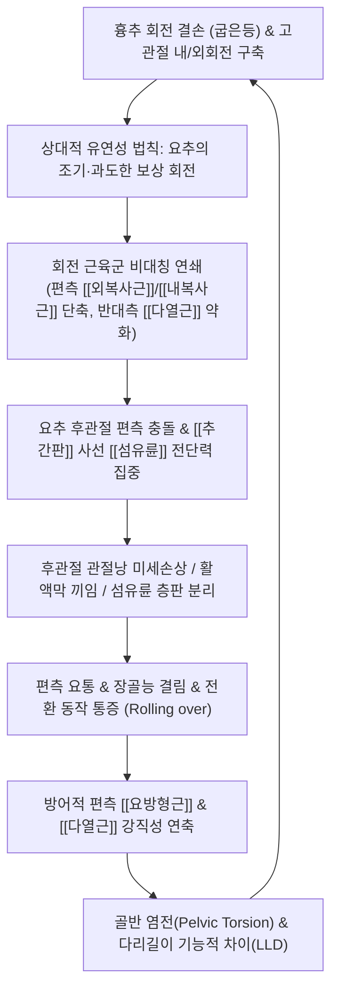
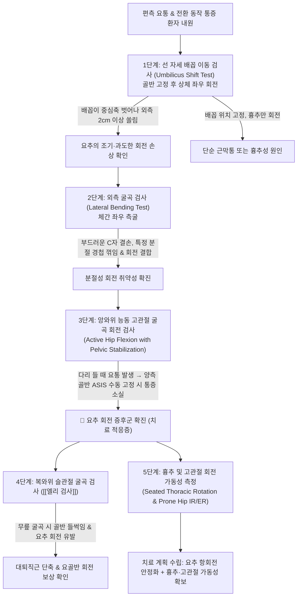
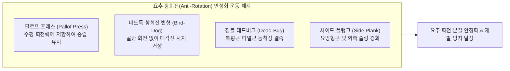

# 🩺 [[요추 회전 증후군]] (Lumbar Rotation Syndrome / Rotation-Extension / Rotation-Flexion Movement Impairment)

> **핵심 3줄 요약 (Key Summary)**:
> - 📍 병소 부위 & 해부·병태생리: 흉추(Thoracic spine)와 고관절(Hip joint)의 축성 회전 가동성 결손 및 편측 체간 회전근([[외복사근]], [[내복사근]], [[요방형근]], [[다열근]])의 비대칭적 긴장 불균형으로 인해, 구조적으로 축성 회전이 극히 제한된(분절당 1~2°, 총 5~10° 미만) 요추 후관절(Facet joint)과 [[추간판]] [[섬유륜]]에 과도하고 조기 회전 전단력(Rotational shear stress)이 집중되어 발생하는 대표적 운동계 손상 증후군(Movement System Impairment, MSI).
> - 🚩 전형적 임상 양상 & 3대 징후: 체간을 비틀거나 자세를 변경할 때(침대에서 뒤척여 돌아눕기, 의자에서 기립, 승하차) 유발되는 편측 요통 및 장골능 통증, 편측 골반의 불안정감(Giving way), 체간 회전 시 배꼽이 중심축을 벗어나 외측으로 크게 쏠리는 배꼽 이동 징후(Umbilicus Shift Sign).
> - 🛠️ 핵심 감별 검사 & 한·양방 다각적 치료 전략: 배꼽 이동 검사, 골반 수동 고정 하 회전 유발 검사, 능동 복와위 슬관절 굴곡 검사([[엘리 검사]]), 앙와위 능동 고관절 굴곡 회전 검사로 확진 후, 과회전된 요추의 직접 회전 수기(HVLA)를 엄금하고 편측 [[화타협척혈]]·[[요방형근]] 심자 전침 및 [[신바로약침]]·[[중성어혈약침]] 시술, 인접 흉추 및 고관절 가동성 [[추나요법]], 항회전(Anti-rotation: 팔로프 프레스, 버드독) 코어 안정화 지구력 운동 지도.
> - ⚠️ 응급 의뢰 레드플래그 & 악화 요인: 시원하다고 허리를 끝까지 비틀어 "두둑" 소리를 내는 회전 스트레칭은 섬유륜 파열과 후관절 충돌을 급격히 가속하므로 절대 금기; 편측 하지 마비나 감각 소실, 배뇨 장애 동반 시 급성 디스크 탈출증 및 신경근 압박 즉각 감별.

---

## 📌 목차
1. [질환 개요 & 해부학적 병태생리](#1-질환-개요--해부학적-병태생리)
2. [병태생리 메커니즘 & 생체역학적 악순환 네트워크](#2-병태생리-메커니즘--생체역학적-악순환-네트워크)
3. [임상 증상 & 이학적 검사(Physical Exam) 알고리즘](#3-임상-증상--이학적-검사physical-exam-알고리즘)
4. [감별 진단 매트릭스 (Differential Diagnosis)](#4-감별-진단-매트릭스-differential-diagnosis)
5. [한의 통합 치료 프로토콜 (침·약침·추나·한약)](#5-한의-통합-치료-프로토콜-침약침추나한약)
6. [양방 치료 & 병용·의뢰 기준 (Conventional Treatment & Referral)](#6-양방-치료--병용의뢰-기준-conventional-treatment--referral)
7. [재활 운동 & 생활습관 티칭 가이드](#7-재활-운동--생활습관-티칭-가이드)
8. [💡 사용자 진료실 핵심 필기 & 임상 노하우 (Melt-In 잔여 심화 집약)](#8--사용자-진료실-핵심-필기--임상-노하우-melt-in-잔여-심화-집약)
9. [출처 및 학술 참고 문헌 (References)](#9-출처-및-학술-참고-문헌-references)

---

## 1. 🩺 질환 개요 & 해부학적 병태생리

### 1) 질환 정의 및 임상적 의의
* **정의**: 요추 회전 증후군(Lumbar Rotation Syndrome / Rotation-Extension / Rotation-Flexion Movement Impairment)은 [[사하만]](Shirley Sahrmann) 교수가 정립한 [[운동계 손상 증후군]](Movement System Impairment, MSI) 분류 체계의 핵심 질환군이다. 인체 체간의 정상적인 축성 회전(Axial rotation)을 담당해야 할 흉추(Thoracic spine)와 고관절(Hip joint)의 가동성이 결손되거나 체간 회전근의 좌우 장력 비대칭이 존재할 때, 해부학적으로 회전에 매우 취약한 요추 분절(Lumbar spine)에서 보상적으로 과도하고 비정상적으로 이른 시점(Early onset)에 회전 전단 운동이 발생하는 만성 기능성 운동 손상 질환이다.
* **아형 분류**: 임상적으로 순수한 회전 단독형보다는 후관절 충돌이 결합된 **회전-신전 증후군(Lumbar Rotation-Extension Syndrome)**이 약 70% 이상으로 가장 흔하며, 디스크성 전단력이 결합된 **회전-굴곡 증후군(Lumbar Rotation-Flexion Syndrome)** 및 측굴 결합형(Rotation-Lateral Flexion)이 뒤를 잇는다.
* **호발 역학**: 골프, 테니스, 배드민턴, 야구, 투척 경기 등 한 방향으로의 폭발적인 체간 회전이 반복되는 편측성 스포츠 선수 및 동호인, 편측으로 몸을 비틀어 작업하는 치과의사, 물리치료사, 미용사, 한쪽 모니터를 장시간 응시하는 사무직군에서 극히 호발한다.

### 2) 인체 3대 체간 회전 분절의 해부학적 비교
* 척추와 골반의 운동학적 사슬(Kinetic chain)에서 각 관절은 고유한 해부학적 구조에 따라 기능적으로 분업화되어 있다:
  * **흉추 (Thoracic Spine)**:
    * 흉추 후관절의 관절면은 시상면에 대해 약 60°, 수평면에 대해 약 20° 경사진 관상면(Coronal plane) 배열을 취하고 있다.
    * 이러한 관절면의 기하학적 형태는 축성 회전에 가장 최적화되어 있어, 정상인의 경우 체간 전체 축성 회전 가동 범위의 약 75~80%(분절당 6~9°, 흉추 전체 35~40°)를 흉추에서 담당한다.
  * **고관절 (Hip Joint)**:
    * 전형적인 3축성 구관절(Ball-and-socket joint)로서, 정상 상태에서 내회전 35~45°, 외회전 45°의 방대한 회전 가동성을 제공하여 보행, 주행, 방향 전환 시 골반과 척추로 전달되는 지면 반발력과 회전 비틀림 하중을 완충·소산하는 회전의 중심축 역할을 수행한다.
  * **요추 (Lumbar Spine)**:
    * 요추 후관절(L1~L5)의 관절면은 시상면(Sagittal plane)에 거의 수직(약 90°)으로 서 있으며, 상관절돌기가 후내측을, 하관절돌기가 전외측을 향해 마주 보며 맞물려 있다.
    * 이 구조는 척추의 굴곡과 신전에는 매우 유리하지만, 축성 회전 운동 시 인접한 하관절돌기가 상관절돌기의 골성 관절면에 즉각 부딪히는 강력한 **골성 쐐기(Bony wedge stop)** 역할을 수행한다.
    * 따라서 요추 분절당 허용되는 순수 축성 회전 가동 범위는 단 **1~2°**에 불과하며, 요추 5개 분절 전체([[L1]]~[[L5]])를 다 합쳐도 회전 허용량은 **5~10° 미만**이다. [[L5]]-[[S1]] 분절만이 관상면 배열을 약간 띠어 약 2~3°의 회전이 가능할 뿐이다.

### 3) 운동 방향 감수성(DSM)과 상대적 유연성(Relative Flexibility)의 법칙
* 사하만(Sahrmann) 교수의 운동조절 이론에 따르면:
  * **상대적 유연성의 법칙 (Law of Relative Flexibility)**: 관절 복합체에서 움직임이 일어날 때, 인체는 저항이 크고 뻣뻣한 부위보다 **가장 저항이 적고 헐거운 부위(Path of least resistance)**에서 먼저 움직임을 시작한다.
  * **운동 방향 감수성 (Directional Susceptibility to Movement, DSM)**:
    * 현대인의 좌식 생활과 라운드 숄더로 인해 [[흉추 후만]](Thoracic kyphosis)이 고착되면 흉추의 신전과 회전 가동성이 완전히 상실된다.
    * 또한 대퇴골비구 충돌 증후군(FAI), 관절낭 구축, [[장요근]] 및 둔부 외회전근의 구축으로 고관절 내회전이 제한되면, 환자가 일상에서 뒤를 돌아보거나 골프 스윙을 할 때 정상적으로 돌아가야 할 흉추와 고관절이 굳어 있으므로, 상대적으로 불안정해진 **요추 분절이 먼저 과도하게 비틀리며(Early and excessive rotation) 모든 회전 전단력(Rotational shear force)을 전담**하게 된다.
    * 이것이 요추 회전 운동 손상 증후군의 근본적 병태생리이다.

### 4) 추간판 섬유륜의 사선 섬유 파열 역학
* 요추 추간판의 [[섬유륜]](Annulus fibrosus)은 동심원상의 판상 구조판(Lamellae)으로 이루어져 있으며, 각 층의 콜라겐 섬유는 수직축에 대해 약 30° 기울어져 인접 층과는 서로 반대 방향(60° 각도)으로 교차 배열되어 있다.
* 척추가 우측으로 비틀리면, 우측 방향으로 경사진 섬유륜 층(전체 섬유의 50%)만 인장력을 받아 팽팽해지고, 반대 방향으로 경사진 50%의 섬유는 완전히 이완된다.
* 따라서 척추가 회전하는 순간, 추간판이 견뎌낼 수 있는 **전단 인장 강도는 평상시의 50%로 급감**한다.
* 이 상태에서 요추의 굴곡이나 신전, 또는 축성 압박 부하가 결합되면, 섬유륜은 맷돌에 갈리듯 사선 방향으로 층판 분리(Delamination)와 파열이 발생하며 수핵 탈출증([[요추 추간판 탈출증]])으로 급격히 발전한다.

### 5) 후관절(Facet Joint)의 비대칭 충돌 및 활액막 끼임 병태
* 척추가 한쪽(예: 우측)으로 회전할 때:
  * **반대측 후관절 (좌측 후관절)**: 회전축의 지렛대 작용에 의해 상관절돌기와 하관절돌기가 강력하게 압박 충돌(Compression impingement)을 받는다. 이로 인해 관절 연골의 미세 마모, 연골하 골경화, 골극 형성이 가속화된다.
  * **동측 후관절 (우측 후관절)**: 관절면이 벌어지며 후방 관절낭과 극간인대가 과신장(Distraction tension)된다. 특히 후관절 내부의 활액막성 반월상 주름(Synovial meniscoid)이 관절면 틈새에 끼어들어 압박을 받으면, 급성 회전 시 숨을 쉴 수도 없을 만큼 찌릿한 편측성 후관절 연관통이 격발된다.

---

## 2. ⚡ 병태생리 메커니즘 & 생체역학적 악순환 네트워크

### 1) 체간 회전 근육군의 비대칭적 포스 커플(Force-Couple) 붕괴
* 인체의 체간 회전은 단일 근육이 아니라 전방과 후방의 대각선 근막 사슬(Oblique Slings)이 조화로운 우력(Force-couple)을 형성하여 달성된다:

* **전방 사선 슬링 (Anterior Oblique Sling, AOS)**:
  * 한쪽 [[외복사근]](External oblique)과 대각선 반대쪽 [[내복사근]](Internal oblique)이 복직근초와 백선(Linea alba)을 매개로 결합하여 체간 전방의 굴곡-회전 토크를 형성한다.
  * 예를 들어, 골프 스윙이나 반복적인 편측 비틀기 작업으로 우측 외복사근과 좌측 내복사근이 만성 단축되면, 체간은 지속적으로 좌측 회전 토크를 받게 되어 중립 기립 상태에서도 요추가 편측으로 비틀리는 회전 정렬 부전이 고착된다.
* **후방 사선 슬링 (Posterior Oblique Sling, POS)**:
  * [[광배근]](Latissimus dorsi)과 [[흉요근막]](Thoracolumbar fascia), 그리고 대각선 반대쪽 [[대둔근]](Gluteus maximus)이 교차 결합하여 천장관절을 안정화하고 보행 시 골반-요추의 회전을 제어한다.
  * 대둔근이 약화되면 [[광배근]]과 [[흉요근막]]의 장력이 불균형해져 보행 입각기마다 요추가 흔들리며 과도한 회전 전단력이 발생한다.
* **심부 회전 제어 브레이크: 다열근(Multifidus)과 회선근(Rotatores)**:
  * [[다열근]]은 척추 극돌기에서 사하방으로 주행하여 2~4개 분절 아래의 횡돌기와 유두돌기에 부착한다. 회선근은 1~2개 분절 사이를 연결한다.
  * 이들 심부 근육은 능동적인 큰 회전력을 만들어내기보다는, 척추 분절 사이의 원치 않는 미세 회전을 억제하는 **항회전 고유수용성 브레이크(Anti-rotational brake)** 역할을 담당한다.
  * 요추 회전 증후군 환자에서는 환측 다열근의 근단면적 위축과 지방 침윤(Fatty infiltration)이 유의하게 관찰되며, 이는 척추의 분절성 제어력을 상실시켜 미세한 외력에도 요추가 덜컥거리며 비틀리게 만든다.
* **측면 보상자: 요방형근(Quadratus Lumborum)의 편측 과긴장**:
  * 골반의 회전 변위가 발생하면 편측 [[요방형근]]이 골반을 위로 끌어올리는(Pelvic hiking) 보상적 단축을 일으켜 요추의 측굴과 회전 변위를 결합·고착화시킨다.

### 2) 편측 회전 스포츠와 X-Factor 증후군
* **골프 스윙의 키네마틱 시퀀스(Kinematic Sequence)**:
  * 이상적인 백스윙-다운스윙 연쇄는 **골반 회전 → 흉곽 회전 → 팔 → 클럽헤드** 순서로 에너지가 전달되어야 한다.
  * 골반 회전각과 흉곽 회전각의 차이를 **X-Factor**라고 부르며, 이 비틀림 각도가 클수록 폭발적인 비거리가 생성된다.
  * 그러나 고관절 내회전 가동성(특히 리드 골반인 좌측 고관절)이나 흉추 회전 가동성이 결손된 아마추어 골퍼는 골반과 흉곽 사이에서 회전할 수 없는 **요추를 강제로 쥐어짜서(Torquing the lumbar spine)** X-Factor를 만들어낸다.
  * 이때 요추 [[L4]]-[[L5]], [[L5]]-[[S1]] [[후관절]]에 분절당 허용 한계(1~2°)를 수배 초과하는 회전 토크가 집중되며, 팔로스루 시 상체가 뒤로 젖혀지는 '역C자(Reverse-C)' 피니시 동작과 결합되어 급성 후관절 충돌증과 섬유륜 파열, 나아가 척추경 협부의 피로 골절([[척추분리증]])을 초래한다.

---

## 3. 🔍 임상 증상 & 이학적 검사 알고리즘

### 1) 특징적 임상 증상
* **전환 동작 시의 통증 (Pain During Transitional Movements)**:
  * 가만히 서 있거나 앙와위로 누워 있을 때는 통증이 거의 없거나 둔통 수준이다.
  * **핵심 격발 상황**: 침대에서 반대편으로 뒤척이며 돌아누울 때(Rolling over in bed), 의자에서 일어설 때(Sit-to-stand transition), 자동차에 타고 내릴 때(Entering/exiting vehicle), 바닥의 물건을 옆으로 비틀며 집어 올릴 때 편측 요배부와 골반에서 칼로 찌르거나 삐걱거리는 결림통이 격발된다.
* **편측성 요통 및 장골능 통증**:
  * 통증이 요추 중앙부보다는 주로 회전 스트레스가 집중되는 한쪽 허리, [[후상장골극]](PSIS) 부위, 장골능 후방 능선에 국한된다.
* **측굴과 회전 결합 시 통증 악화**:
  * 단순 전방 굴곡보다 몸을 옆으로 구부리거나(Lateral bending) 상체를 비틀 때(Rotation) 통증이 현저히 악화된다.
* **기능적 불안정감 및 덜컥거림 (Giving Way / Catching Sensation)**:
  * 환자는 "허리에 힘이 제대로 실리지 않는다", "골반이 한쪽으로 덜컥 빠지는 느낌이 든다", "허리가 헐렁거려서 불안하다"고 호소한다.

### 2) 단계별 임상 평가 프로토콜 (Sahrmann MSI 검진)

1. **선 자세 체간 회전 및 배꼽 이동 검사 (Umbilicus Shift Test)**:
   * **검사법**: 환자에게 양발을 모으고 서서 골반은 정면을 향해 고정하도록 지시한 상태에서, 상체만 좌우로 천천히 회전하게 한다.
   * **양성 판정**: 정상인은 흉추가 부드럽게 회전하면서 배꼽(Umbilicus)의 수직 중심축 위치가 거의 변하지 않는다. 반면 요추 회전 증후군 환자는 흉추가 굳어 있어 요추 전체가 통째로 비틀리면서 **배꼽이 회전하는 방향 외측으로 2~3cm 이상 크게 쏠리거나 이동**한다.
2. **외측 굴곡 검사 (Lateral Bending Test)**:
   * **검사법**: 양손을 허벅지 옆에 붙이고 체간을 좌우로 측굴시킨다.
   * **양성 판정**: 척추 전체가 매끄러운 C자 곡선을 그리지 못하고, 회전 불안정성이 있는 특정 요추 분절(주로 [[L4]]-[[L5]])에서 마치 경첩이 꺾이듯 계단식 꺾임(Hinge sign)이 나타나며 늑골이 전방이나 후방으로 튀어나오는 회전 비틀림이 동반된다.
3. **앙와위 능동 고관절 굴곡 회전 검사 (Active Hip Flexion with Pelvic Stabilization Test)**:
   * **검사법**: 환자를 똑바로 눕히고 한쪽 다리를 무릎을 편 채 천천히 30~45° 들어 올리게 한다.
   * **양성 판정 및 확진**: 다리를 들어 올릴 때 복사근과 장요근의 비대칭 긴장으로 골반이 한쪽으로 기울어지며 평소 호소하던 편측 요통이 격발된다. 이때 **검사자가 양손으로 환자의 양측 [[전상장골극]](ASIS)을 단단히 움켜쥐어 골반이 회전하거나 기울어지지 않도록 고정한 상태에서 다시 다리를 들게 했을 때, 통증이 즉각 80~100% 소실되면 요추 회전 증후군으로 확진**한다.
4. **복와위 능동 슬관절 굴곡 검사 ([[엘리 검사]], Ely's Test 변형)**:
   * **검사법**: 환자를 복와위로 눕히고 능동적으로 한쪽 무릎을 90° 이상 굴곡시킨다.
   * **양성 판정**: 대퇴직근([[대퇴사두근]])이 단축되어 있으면 대퇴직근이 장골을 전하방으로 잡아당겨 골반이 전방경사될 뿐만 아니라, 편측 골반이 베드에서 들썩이며 요추의 보상적 회전 및 편측 요배부 결림통이 유발된다.
5. **[[켐프 검사]](Kemp's Test) 편측 회전 충돌 평가**:
   * 환자의 허리를 신전시킨 상태에서 환측으로 측굴 및 회전을 결합하여 후관절면의 편측성 압박 충돌 및 후방 신경근 자극을 유발하여 방사통 유무와 국소 관절낭 압통을 감별한다.

---

## 4. 🔀 감별 진단 매트릭스

| 감별 질환 | 호발 병인 및 병소 부위 | 전형적 통증 격발 / 완화 자세 | 핵심 이학적 검사 소견 | 영상 및 구조적 감별 특징 |
| :--- | :--- | :--- | :--- | :--- |
| **[[요추 회전 증후군]] (MSI)** | 편측 회전 스포츠, 편측 작업; 흉추/고관절 회전 결손 보상 | **체간 회전, 뒤척임, 전환 동작 시 악화**; **골반 외력 고정 시 통증 즉각 소실** | **배꼽 이동 검사(Umbilicus shift) 양성**; 능동 하지 거상 골반 고정 검사 양성; SLR 정상 | 요추 단순 X-ray 상 골반 염전 및 경미한 기능적 측만-회전 소견; 신경근 압박 없음 |
| **[[후관절 증후군]] (Facet Syndrome)** | 50대 이상 노년층, 척추 과신전 작업자; 후관절 연골 퇴행 및 관절염 | **단순 요추 신전(Extension) 및 신전-회전 시 악화**; 허리 굴곡 시 완화 | **[[켐프 검사]](Kemp's Test) 편측 양성**; 방사통이 무릎 이하로 내려가지 않음; 토마스 검사 음성 | 단순 방사선 및 CT/MRI 상 후관절 비후, 연골하 골경화, 관절강 협소 |
| **[[천장관절 증후군]] (SI Joint Dysfunction)** | 임산부(릴랙신), 낙상 외상자, 비대칭 보행자; 천장관절 인대 이완 및 염전 | 한쪽 다리로 체중 지지 시, 계단 승강 시, 둔부 체중 부하 시 통증 | **패트릭 검사(FABER) 양성**, 가엔슬렌 검사 양성; 포틴 손가락 징후(Fortin sign: PSIS 하방 1cm 지목) | 골반 X-ray 상 천장관절면 경화; 요추 회전 운동 제어 결손과는 별개로 천골-장골 관절면 부전 |
| **[[요방형근]] 증후군 (QL Myofascial Pain)** | 무거운 짐을 편측으로 들기, 불량한 수면 자세; 요방형근 근막 트리거포인트 | 기침, 호흡 시, 단순 체간 측굴 시 통증; 체간 회전보다 측굴 저항 시 격통 | **요방형근 심부 압통점(TP) 압박 시 장골능 및 둔부 외측 연관통 재현**; 골반 고정 회전 검사 음성 | 영상의학적 이상 소견 없음; 촉진 상 근육 내 단단한 띠(Taut band) 및 국소 연축 반응 |
| **[[요추 추간판 탈출증]] (LDH)** | 20~50대 활동기; 디스크 섬유륜 파열 및 수핵 탈출 | 허리 굴곡, 착석, 기침 시 악화; 하퇴 외측/후면으로 뻗치는 전격성 방사통 | **[[하지직거상 검사]](SLR) 30~70° 양성**; [[브라가드 검사]] 양성, 분절성 근력 약화, 건반사 저하 | MRI 상 디스크 탈출 및 신경근 기계적 압박 소견 명확 |
| **구조적 다리길이 차이 (Structural LLD)** | 소아기 골절, 고관절 질환, 선천적 비대칭 | 오래 서 있거나 장거리 보행 시 한쪽 허리 피로감 및 통증 | 기립 시 골반 경사계 측정 상 ASIS/PSIS 높이 비대칭; 하지 실측 길이(ASIS-내과) 차이 존재 | 하지 전장 엑스레이(Scanogram) 상 대퇴골 또는 경골의 진성 길이 차이 확인 |

---

## 5. 🌿 한의 통합 치료 프로토콜

### 1) 한의학적 변증 체계
* **기체어혈 (氣滯瘀血)**:
  * 반복적인 편측 회전 비틀림으로 인해 요추부 방광경(膀胱經)과 담경(膽經)의 기혈 순환이 차단되고 낙맥(絡脈)에 어혈이 정체된 병태.
  * 특징: 통증 부위가 한쪽 허리와 장골능에 고정되어 있고, 칼로 찌르거나 결리는 듯하며, 밤에 침대에서 돌아누울 때 통증이 더욱 심해짐.
* **근맥실조 (筋脈失調)**:
  * 좌우 회전 근육군의 장력 불균형으로 인해 한쪽 근맥은 과도하게 긴장·단축되고 반대측은 이완·약화되어 체간의 구조적 중심축이 비틀어진 병태.
* **신허요통 (腎虛腰痛)**:
  * [[신정]](腎精) 부족으로 골(骨)과 수(髓)가 쇠약해지고 요추를 단단히 결속하는 후관절 관절낭과 극간인대가 약화되어, 가벼운 회전 스트레스에도 관절이 삐걱거리고 불안정성을 드러내는 만성 병태.

### 2) 침구 및 전침 치료 (Acupuncture & Electroacupuncture)
* **요추 분절 심부 자침 (편측 협척혈 전침)**:
  * 회전 전단력이 집중되어 과긴장된 편측 [[화타협척혈]](EX-B2, L2~L5 분절):
    * 0.30×60mm 호침을 극돌기 외측 0.5촌 지점에서 [[척추관]] 방향으로 40~50mm 심자하여 척추기립근을 관통하고 심부 [[다열근]] 및 회선근 부착부에 도달시킨다.
    * 자침 시 국소 연축 반응(Local twitch response)을 유도하여 꼬여 있던 다열근 근섬유의 단축을 해제하고 분절성 회전 제어력을 회복시킨다.
  * **전침 통전**: 과긴장된 편측 협척혈-협척혈 간에 **2~100Hz 혼합파**를 20분간 통전하여 심부 근육의 허혈성 연축을 이완하고 통증 게이트를 차단.
* **편측 단축 근육군 타겟 자침**:
  * **[[요방형근]] (Quadratus Lumborum)**: 환자를 측와위로 눕히고 제12늑골 하연과 장골능 사이 요방형근 심부 압통점에 60mm 침으로 직자 및 사자하여 근막 유착 박리.
  * **복사근 복합체 ([[외복사근]], [[내복사근]])**: 늑골 하연 및 장골능 전방 부착부의 트리거포인트를 천자하여 전방 사선 슬링의 회전 장력을 정상화.
* **경혈 배혈 프로토콜**:
  * **국소 취혈**: [[신수]](BL23), [[지실]](BL52), [[대장수]](BL25), [[요양관]](GV3).
  * **원위 및 특효 취혈**:
    * [[양릉천]](GB34, 근회혈): 전신 근육과 건의 긴장 완화 및 담경 회전 사선 조절.
    * [[현종]](GB39, 수회혈): 골수와 관절낭의 지지력 강화.
    * [[환도]](GB30): 둔부 이상근 및 회전근 긴장 해제.
    * **팔맥교회혈(八脈交會穴) 배혈**: [[후계]](SI3, 독맥 통혈) + [[신맥]](BL62, 양교맥 통혈) — 척추의 중심 신전력을 세우고 외측 회전 편위를 바로잡는 데 특효.

### 3) 약침 치료 (Pharmacopuncture)
* **신바로약침 (Shinbaro Pharmacopuncture)**:
  * 회전 전단력으로 인해 무균성 염증과 미세 손상이 발생한 요추 후관절 관절낭, 극간인대, 그리고 척추와 골반을 연결하는 [[장요인대]](Iliolumbar ligament) 부착부에 주입.
  * 강력한 항염증 작용과 함께 인대 조직의 콜라겐 합성을 촉진하여 후관절의 생체역학적 결속력을 강화. 분절당 1.0~2.0cc 심부 주입 (주 2회).
* **중성어혈약침 (Neutral Herbal Blood-Stasis)**:
  * 기체어혈로 인해 편측 요배부 근막에 어혈이 뭉치고 자세 변경 시마다 바늘로 찌르듯 결리는 급성·아급성 병태에 적용.
  * 요방형근 및 흉요근막 통처에 격자형 피내/근막하 주입(Point injection)을 시행하여 미세혈관 순환을 개선하고 조직 산소화를 유도.
* **봉약침 (Bee Venom)**:
  * 만성 요추 불안정성으로 인해 헐거워진 후관절 관절낭과 장요인대 부착부에 시술하여 인대 증식([[프롤로테라피]] 효과)과 척추 안정성을 강화 (피부 알레르기 테스트 필수).

### 4) 추나의학적 중재 (Chuna Manual Therapy)
* **🚨 절대 금기 수기: 요추 회전 교정 (HVLA Lumbar Roll Thrust) 엄금**:
  * 요추 회전 증후군 환자에게 허리를 옆으로 비틀어 "두둑" 소리를 내는 고속저진폭 회전 교정 기법을 적용하는 것은, **이미 과회전되어 헐거워진 요추 분절의 불안정성을 파국적으로 악화시키고 섬유륜을 찢어버리는 최악의 의료 과오**이다. 따라서 요추 분절에 대한 직접적인 회전 스러스트는 절대 금기이다.
* **인접 관절의 간접 가동술 (Indirect Mobilization of Thoracic Spine & Hip)**:
  * 치료의 초점은 요추를 비트는 것이 아니라, 요추가 대신 움직이게 만들었던 **굳어 있는 흉추와 고관절의 회전 가동성을 열어주는 것**이다:
    * **흉추 신전-회전 관절가동술**: 복와위 또는 좌위에서 흉추 분절을 접촉하여 후관절 활주를 유도하고 흉곽의 가동성을 회복.
    * **고관절 장축 견인 및 관절낭 가동술(Hip Long-Axis Distraction & Capsule Mobilization)**: 앙와위에서 고관절 관절낭의 후하방 활주를 유도하여 내/외회전 가동 범위를 확보.
* **골반 염전 교정 추나 (Pelvic Torsion Correction)**:
  * 골반의 전후방 회전 변위를 평가하여, 전방 회전된 장골은 후방 회전 기법으로, 후방 회전된 장골은 전방 회전 기법으로 정렬.
* **근막이완술(MFR) 및 근에너지기법(MET)**:
  * 단축된 편측 [[요방형근]], [[대퇴근막장근]](TFL), [[장요근]], [[이상근]]에 대해 [[등척성 수축]] 후 이완(Post-Isometric Relaxation, PIR)을 적용하여 안전하게 근길이를 신장.

### 5) 대표 한약 처방 (Herbal Medicine)
* **[[서근활혈탕]](舒筋活血湯)**:
  * 당귀, 백작약, 천궁, 도인, 홍화, 창출, 백출, 복령, 진피, 위령선, 우슬, 방기, 방풍, 용담초, 강활, 백지, 감초.
  * **적응증**: 좌우 근육의 불균형과 편측 회전 비틀림으로 인해 척추 주위 근막이 굳고 어혈이 뭉쳐 자세를 바꿀 때마다 찌릿하게 결리는 기체어혈형 요통.
* **[[독활기생탕]](獨活寄生湯)**:
  * 독활, 상기생, 두충, 우슬, 세신, 진범, 방풍, 당귀, 백작약, 천궁, 숙지황, 인삼, 복령, 감초, 육계.
  * **적응증**: 만성적인 요추 회전 불안정성과 후관절 충돌증이 결합되어 허리가 삐걱거리고 힘이 빠지는 신허(腎虛) 및 간신휴손형 노인성 회전 요통.
* **[[작약감초탕]](芍藥甘草湯)**:
  * 백작약 16~24g, 감초 8~12g.
  * **적응증**: 침대에서 돌아눕거나 차에서 내릴 때 편측 요방형근과 기립근에 쥐가 나듯 발생하는 급성 발작성 근육 경련 해제.

---

## 6. 💊 양방 치료 & 병용·의뢰 기준

### 1) 양방 약물 치료 체계
* **비스테로이드성 소염진통제 (NSAIDs)**:
  * 후관절 충돌로 인한 관절낭염 및 활액막 부종 완화를 위해 Celecoxib 200mg qd, Meloxicam 7.5~15mg qd, Pelubiprofen 30mg tid 등을 단기 처방.
* **중추성 근이완제**:
  * 편측 복사근 및 요방형근 연축을 풀기 위해 Eperisone HCl 50mg tid, Afloqualone 20mg tid 병용.
* **보툴리눔 톡신 (Botulinum Toxin Type A) 국소 주사**:
  * 만성적으로 난치성 편측 요방형근 또는 척추 다열근의 극심한 강직이 지속되어 척추 회전 변위가 도수치료로 해소되지 않는 경우, 초음파 유도하에 해당 근육 내에 보톡스를 국소 주입하여 비정상적 신경근 접합부 전달을 일시 차단하는 중재를 고려할 수 있음.

### 2) 주사 및 중재적 시술
* **요추 후관절 내 차단술 (Intra-Articular Facet Joint Block)**:
  * 형광 투시(C-arm) 하에 충돌이 일어난 요추 후관절 강 내로 국소마취제와 트리암시놀론을 직접 주입하여 관절염성 통증을 차단.
* **척추신경 후지 내측지 차단술 (Medial Branch Block, MBB)**:
  * 후관절의 감각을 지배하는 [[척추신경]] 후지(Dorsal ramus)의 내측지(Medial branch) 신경 주행부에 국소마취제를 주입하여 진단적 및 치료적 진통을 달성.
* **고주파 열응고술 (Radiofrequency Neurotomy, RFN)**:
  * 내측지 차단술로 일시적 진통 효과가 확인된 만성 후관절성 회전 통증 환자에게 80°C 고주파 열로 내측지를 소작하여 6~12개월간 통각 전도를 장기 차단.

### 3) 한·양방 병용 시 주의사항
* 내측지 차단술이나 후관절 주사를 맞은 환자는 주사 바늘 경로의 감염을 예방하기 위해 시술 후 **최소 48시간 동안** 해당 요추 분절에 대한 침, 약침, 도침, 습식 부항 시술을 유예한다.
* 소염진통제 복용 중 한약 병용 시 위점막 자극을 완화하기 위해 건비화위(健脾和胃) 약재를 배오한다.

### 4) 🚨 양방 전문과 의뢰 기준 (Red Flags)
* **[[척추분리증]] 및 피로 골절 (Spondylolysis / Pars Interarticularis Stress Fracture)**:
  * 골프나 체조 등 회전-신전 운동을 과도하게 하는 청소년 및 젊은 성인이 편측 요천추부 격통을 호소하고 척추 신전 시 극심한 통증이 재현되면 피로 골절을 의심하여 즉각 정형외과/신경외과로 의뢰, 사위상(Oblique view) X-ray 및 SPECT/CT, MRI 정밀 진단을 받도록 한다 (Scotty dog 목 부위 골절 확인).
* **신경학적 결손 합병**:
  * 단순 회전 손상을 넘어 하지 방사통, 족배굴곡 약화([[요추 추간판 탈출증]] 합병), 또는 대소변 장애([[마미증후군]])가 동반되는 경우 즉각 상급병원 응급 감압 의뢰.

---

## 7. 🏃 재활 운동 & 생활습관 티칭 가이드

### 1) "허리 비틀기 스트레칭의 치명적 위험" (절대 금기 교육)
* **진료실 경고 멘트**:
  * "시원하다고 의자에 앉아 등받이를 잡고 허리를 끝까지 비틀어 '우두둑' 소리를 내는 스트레칭을 절대로 하지 마십시오."
  * 소리가 나는 것은 척추가 맞춰지는 것이 아니라, 요추 후관절이 한계 각도를 넘어 강제로 충돌하며 활액낭이 터지는 소리이자 섬유륜이 맷돌처럼 갈려나가는 위험 신호이다.
  * 요추는 회전 운동을 담당하는 관절이 아니며, 회전 스트레칭은 반드시 **흉추(가슴)와 고관절(골반)**에서만 일어나야 한다.

### 2) 흉추 및 고관절 회전 가동성 회복 운동
* **오픈북 운동 (Open Book Exercise)**:
  * 옆으로 누워 양 무릎을 90° 굽혀 가슴 쪽으로 끌어올려 골반과 요추를 완벽히 고정한다.
  * 양팔을 앞으로 나란히 뻗은 상태에서, 위쪽 팔을 반대편으로 천천히 넘기며 시선과 가슴을 열어준다.
  * 이때 **골반과 무릎은 바닥에서 절대 떨어지지 않고 고정**되어 있어야 하며, 오직 **흉추와 흉곽만 회전**하도록 집중한다 (좌우 10회씩 3세트).
* **90-90 고관절 회전 스트레칭 (90-90 Hip Mobility)**:
  * 바닥에 앉아 앞쪽 다리는 고관절 90° 굴곡 및 외회전, 뒤쪽 다리는 고관절 90° 굴곡 및 내회전 자세를 취한다.
  * 상체를 곧게 세우고 골반을 바닥에 밀착시켜 고관절 심부 관절낭의 회전 유연성을 회복한다.

### 3) 항회전(Anti-Rotation) 코어 안정화 트레이닝 (핵심 재활)
* 요추 회전 증후군 환자에게 필요한 것은 허리를 돌리는 운동이 아니라, 외부에서 가해지는 **회전 전단력에 대항하여 척추 중립을 단단히 유지하는 항회전 지구력(Anti-rotation endurance)**이다:

* **팔로프 프레스 (Pallof Press)**:
  * 탄성 밴드나 케이블 머신을 가슴 높이에 고정하고 측면으로 선다.
  * 양손으로 밴드 손잡이를 모아 가슴 앞에 두고 선 자세에서, 밴드가 몸을 회전시키려는 회전력에 온몸으로 저항하며 팔을 앞으로 천천히 뻗는다.
  * 팔을 뻗은 상태에서 몸통이 1mm도 돌아가지 않도록 단단히 버티며 5~10초간 유지 후 가슴으로 복귀 (10회씩 3세트, 양방향 수행).
* **버드독 항회전 변형 (Bird-Dog with Anti-Rotation Focus)**:
  * 네발기기 자세에서 대각선 팔다리를 들어 올릴 때, 골반 위에 물컵이 올려져 있다고 상상하며 골반이 한쪽으로 기울어지거나 비틀리지 않도록 완벽한 수평을 유지한다.
* **사이드 플랭크 (Side Plank)**:
  * 옆으로 누워 팔꿈치로 체간을 지지하고 골반을 들어 올려 [[요방형근]]과 복사근의 등척성 측면 안정성을 극대화한다 (20~30초 유지).

### 4) 일상생활 인체공학적 티칭 (Ergonomics)
* **통나무 굴리기 기법 (Log Roll Technique)**:
  * 아침에 침대에서 일어날 때 허리를 꽈배기처럼 비틀며 일어나지 말고, 머리-어깨-골반-무릎을 한 덩어리의 통나무처럼 일체화하여 옆으로 돌아누운 후, 다리를 침대 밖으로 먼저 내리면서 팔로 바닥을 짚고 일어난다.
* **의자 착석 중 뒤돌아보기 금지**:
  * 의자에 앉아 뒤쪽의 서류나 물건을 집으려고 상체만 뒤로 비틀지 말고, 반드시 회전의자 전체를 돌리거나 몸 전체를 회전시킨다.
* **승하차 동작 요령**:
  * 자동차에 탈 때는 한쪽 다리만 먼저 넣고 몸을 비틀지 말고, 엉덩이부터 시트에 먼저 앉은 후 양다리를 모아서 함께 차 안으로 돌려 넣는다. 내릴 때도 역순으로 양다리를 먼저 바깥으로 내놓고 엉덩이를 든다.

---

## 8. 💡 사용자 진료실 핵심 필기 & 임상 노하우 (Melt-In 잔여 심화 집약)

### 1) ATM (Awareness Through Movement) 자가 인지법 지도 (원문 필기 100% 심화 집약)
* 요추 회전 증후군 환자는 자신의 뇌 감각 피질(Sensory cortex)에서 척추와 골반이 비틀어져 있다는 사실 자체를 망각(Sensory-motor amnesia)하고 있는 경우가 대부분이다.
* **원장실 실전 유도 멘트**:
  * 환자를 베드에 앙와위로 편안히 눕힌 후 조용히 눈을 감게 하고 질문한다:
    > "환자분, 지금 바닥에 닿아 있는 양쪽 엉덩이의 무게감을 가만히 느껴보세요. 어느 쪽 엉덩이가 바닥을 더 무겁게 누르고 있나요? 어느 쪽 허리 뒤 공간이 바닥에서 더 붕 떠 있나요?"
  * 환자가 "아, 오른쪽 엉덩이가 바닥에 푹 가라앉아 있고 왼쪽 허리는 손이 쑥 들어갈 정도로 떠 있어요"라고 대답하는 순간, 환자의 뇌는 자신의 골반 회전 비대칭을 스스로 명확히 인지(Self-awareness)하게 된다.
* 이러한 고유수용성 감각의 뇌 피질 재통합 과정이 치료 초기에 선행되어야, 치료 후 일상생활로 복귀했을 때 스스로 비틀린 자세를 감지하고 중립으로 되돌리는 진정한 자기 조절(Self-regulation)이 가능해진다.

### 2) 골프·테니스 환자의 스윙 시 흉추·고관절 분산 원칙
* 골프나 테니스를 즐기는 환자에게 "허리 나을 때까지 운동하지 마세요"라고만 하면 환자는 치료를 중단하고 몰래 필드로 나간다. 대신 스윙 메커니즘을 수정해 주어야 한다:
  * **원장실 실전 티칭 팁**:
    > "골프 백스윙과 다운스윙 시 강력한 회전 에너지는 허리가 비틀려서 나오는 것이 아닙니다. 회전 에너지의 90% 이상은 **가슴(흉추 신전-회전)**과 **골반(리드 고관절 내회전)**에서 만들어져야 합니다. 허리는 에너지를 생산하는 엔진이 아니라, 엉덩이에서 만들어진 힘을 가슴과 팔로 흔들림 없이 전달해 주는 **'단단한 쇠파이프(원통)'**처럼 고정되어 있어야 합니다."
  * 백스윙 시 흉곽을 활짝 열어주는 흉추 가동성 훈련을 선행시키고, 다운스윙-임팩트 시 좌측 고관절이 부드럽게 내회전되며 골반이 회전할 수 있도록 좌측 이상근과 둔부 관절낭을 반드시 사전에 이완해 주어야 허리가 박살 나는 것을 막을 수 있다.

### 3) 복근 지구력 기반의 항회전(Anti-rotation) 트레이닝 강조
* 요추 회전 증후군 환자에게 복직근의 최대 근력(Maximal strength)을 키우는 싯업(윗몸일으키기)이나 크런치는 요추에 치명적인 전단 하중만 안겨줄 뿐이다.
* 환자에게 필요한 것은 무거운 무게를 드는 힘이 아니라, 걷거나 계단을 오르고 물건을 들 때 골반과 척추가 비틀리지 않도록 24시간 내내 미세하게 척추를 붙잡아주는 **심부 [[복횡근]]과 [[다열근]]의 지근(Slow-twitch, Type I fiber) 중심의 지구력(Endurance)**이다.
* 진료실에서는 항상 팔로프 프레스와 버드독을 지도할 때 "무겁게 하지 마시고, 10초에서 20초 동안 미세한 떨림을 버티는 지구력 위주로 매일 반복하십시오"라고 티칭한다.

### 4) 진료실 실전 촉진(Palpation) 손맛 팁
* **후관절 비대칭 돌출 촉진**: 환자를 복와위로 눕히고 양측 엄지 주두로 L4-L5, L5-S1 후관절면을 수직으로 지그시 압박해 보면, 회전 변위가 있는 쪽의 [[후관절]] 돌기가 반대측에 비해 후방으로 두드러지게 융기되어 있고 누르는 순간 환자가 "악!" 소리를 지르는 날카로운 압통이 감지된다.
* **장골능 부착부 요방형근 Taut Band**: 장골능 상연의 외측 1/3 지점에서 요방형근 건 부착부를 횡방향으로 문질러 촉진(Strumming palpation)하면, 바이올린 줄처럼 팽팽하게 굳어 있는 단단한 띠(Taut band)가 만져진다. 이 부위에 호침을 30~45° 사자하여 득기감을 얻고 중성어혈약침 1.0cc를 주입하면 당일 즉시 허리의 삐걱거림과 돌아누울 때의 통증이 획기적으로 완화된다.

---

## 9. 📚 출처 및 현대 학술 연구 요약

* **Szeligowski T, et al.** (2025). Evaluation of Motor Control Through Functional Movement Patterns of the Lumbar Spine Among Elite Special Forces Operators: A Pilot Study. *Healthcare (Basel)*, 13(16):2044.
  * [PubMed 링크 (PMID: 40868667)](https://pubmed.ncbi.nlm.nih.gov/40868667/)
  * `[연구 요약]`: 고강도 회전 및 신전 부하가 반복적으로 가해지는 특수부대 작전 요원들을 대상으로 기능적 움직임 패턴(FMS)을 통해 요추의 운동 조절 능력을 평가한 전향적 연구로, 흉추 가동성 결손과 편측 다열근·복사근의 회전 제어 모터 컨트롤 실패가 비특이적 편측 만성 요통의 핵심 독립 위험 인자임을 입증함.
* **Smith JA, et al.** (2025). Effect of marching band performance on the lumbo-pelvic kinematics: A cross-sectional study. *J Bodyw Mov Ther*, 40:312-320.
  * [PubMed 링크 (PMID: 40483160)](https://pubmed.ncbi.nlm.nih.gov/40483160/)
  * `[연구 요약]`: 편측으로 체간을 비틀며 악기를 연주하고 행진하는 마칭 밴드 단원들을 대상으로 3차원 동작 분석을 시행하여, 편측 회전 비대칭이 요추-골반 운동학(Lumbo-pelvic kinematics)에 미치는 영향을 분석함. 흉추의 보상적 회전 제한과 편측 요방형근·다열근의 과긴장이 요추 회전 운동 손상 증후군을 유발하는 생체역학적 기전을 정량적으로 규명함.
* **Martinez-Valle A, et al.** (2026). Differences in three-dimensional spinal kinematics between individuals with chronic non-specific low back pain and age- and sex-matched asymptomatic controls. *J Bodyw Mov Ther*, 42:156-165.
  * [PubMed 링크 (PMID: 42264858)](https://pubmed.ncbi.nlm.nih.gov/42264858/)
  * `[연구 요약]`: 만성 비특이적 요통 환자군과 정상 대조군 간의 3차원 척추 운동학을 정밀 비교 분석한 임상 연구로, 요통 환자군에서 체간 회전 동작 시 요추의 조기 및 과도한 회전(배꼽 이동 징후)과 후관절 편측 충돌 패턴이 통계적으로 유의하게 증가해 있음을 확인하여 사하만(Sahrmann)의 회전 운동 손상 모델을 3차원 운동학적으로 실증함.
* **Ha IH, et al.** (2016). Long-Term Course of Alternative and Integrative Therapy for Lumbar Disc Herniation and Risk Factors for Surgery: A Prospective Observational 5-Year Follow-Up Study. *Spine (Phila Pa 1976)*, 41(17):E1052-E1059.
  * [PubMed 링크 (PMID: 26882505)](https://pubmed.ncbi.nlm.nih.gov/26882505/)
  * `[연구 요약]`: 요추 추간판 및 회전 전단력 손상 환자를 대상으로 침, 추나요법, 한약 등 통합 한의 보존 치료를 시행하고 5년간 장기 추적한 전향적 연구로, 수술 없이도 통증 지수 및 기능 장애 지수(ODI)가 장기적으로 유지·개선됨을 입증함.
* **Shirley Sahrmann 교과서**: *Diagnosis and Treatment of Movement Impairment Syndromes (운동계 손상 증후군의 진단과 치료)*. Mosby, 2002.
  * `[임상 요약]`: 요추 회전 증후군(Lumbar Rotation Syndrome)의 운동 방향 감수성(DSM) 병태생리, 상대적 유연성의 법칙, 단계별 배꼽 이동 검사 및 ASIS 고정 검진 프로토콜, 항회전(Anti-rotation) 코어 안정화 재활 훈련의 이론적 체계를 집대성한 정본 교과서.
