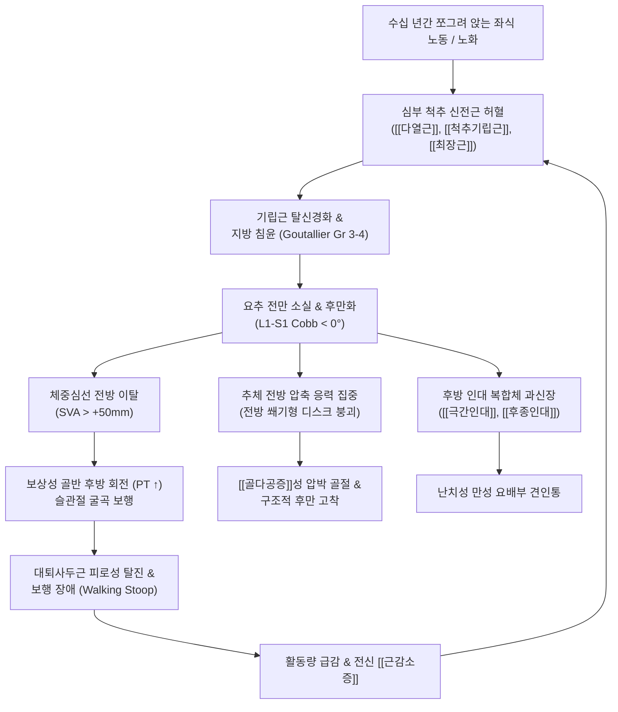
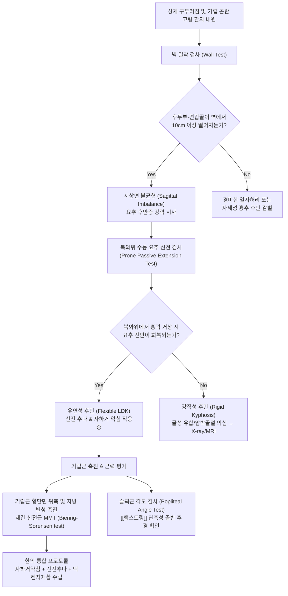

# 요추 후만 (Lumbar Kyphosis / Flat-Back Syndrome)

> **목차 (Table of Contents)**
> 1. [🩺 질환 개요 & 해부학적 병태생리](#1--질환-개요--해부학적-병태생리)
> 2. [⚡ 병태생리 메커니즘 & 생체역학적 악순환 네트워크](#2--병태생리-메커니즘--생체역학적-악순환-네트워크)
> 3. [🔍 임상 증상 & 이학적 검사 알고리즘](#3--임상-증상--이학적-검사-알고리즘)
> 4. [🔀 감별 진단 매트릭스](#4--감별-진단-매트릭스)
> 5. [🌿 한의 통합 치료 프로토콜](#5--한의-통합-치료-프로토콜)
> 6. [💊 양방 치료 & 병용·의뢰 기준](#6--양방-치료--병용의뢰-기준)
> 7. [🏃 재활 운동 & 생활습관 티칭 가이드](#7--재활-운동--생활습관-티칭-가이드)
> 8. [💡 사용자 진료실 핵심 필기 & 임상 노하우 (Melt-In)](#8--사용자-진료실-핵심-필기--임상-노하우-melt-in)
> 9. [📚 출처 및 현대 학술 연구 요약](#9--출처-및-현대-학술-연구-요약)

---

> **핵심 3줄 요약 (Key Summary)**:
> 🎯 **정의 & 역학**: 정상적인 생리적 [[요추 전만]](Lumbar lordosis, 40°~60°)이 소실되는 일자허리(Flat-back, Cobb < 20°) 단계를 넘어 흉추처럼 후방으로 꺾여 역전된 병적 상태(Cobb 각도 음수)로, 전신 시상면 불균형(Sagittal Imbalance, SVA > +50mm)과 $PI - LL > 10^\circ \sim 20^\circ$ 불일치를 초래하는 중증 퇴행성·구조적 척추 변형임. 한국 고령 여성(농촌, 쪼그려 앉는 가사노동)의 요추 변성 후만증(LDK)에서 다발함.
> 🚩 **병태생리 & 4대 징후**: 심부 척추 신전근([[다열근]], [[척추기립근]], [[최장근]], [[장늑근]])의 만성 허혈성 위축 및 극심한 지방 침윤(Goutallier Grade 3~4)과 전방 지주([[추간판]], 추체 전방) 붕괴가 핵심 기전임. 보행 시 상체 전방 전도(Walking stoop), 계단 보행 시 허벅지 짚기(Hand-on-thigh), 물건 전방 거치 곤란, 싱크대 팔꿈치 받치기(Elbow propping) 4대 징후가 특징적임.
> 🔍 **치료 & 주의사항**: 요추 전만을 복원하는 맥켄지 신전 운동(이 질환에는 명약), 보신건골(補腎健骨) [[한약 치료]]([[독활기생탕]], [[보중익기탕]], [[신기환]]), 위축된 기립근을 재생시키는 [[자하거약침]] 및 [[녹용약침]], 흉추·요골반 신전 가동화 [[추나요법]]을 적용함. 쪼그려 앉기, 윗몸 일으키기, 무리한 척추 전굴 스트레칭은 추체 압박 골절을 유발하므로 엄격히 금기함.

---

## 1. 🩺 질환 개요 & 해부학적 병태생리

### 1.1 개념 정의 및 역사적 변천
[[요추 후만]](Lumbar Kyphosis)은 본래 전방으로 볼록해야 할 인체 요추부의 생리적 [[요추 전만]](Lumbar lordosis, 정상 L1-S1 Cobb 각도 40°~60°) 곡선이 편평해지는 편평등 증후군(Flat-back syndrome, 일자허리) 단계를 넘어, 시상면(Sagittal plane) 상에서 흉추처럼 후방으로 불룩하게 굽어지는 역전 변형(Kyphotic deformity, Cobb 각도 음수값)을 의미한다.

정상 [[요추]] 척추에서 요추 전만은 체간 하중을 완충하고 [[골반]] 위에 두개골과 [[흉추]]의 신체 중심선(Gravity line)을 최소한의 근육 에너지 소비로 수직 정렬시키는 핵심 지주이다. 그러나 요추에 후만 변형이 발생하면 체중심선이 [[천골]] 기저부 전방으로 수십 센티미터 이탈하는 **전신 시상면 불균형(Global Sagittal Imbalance)**이 초래되며, 직립 상태를 유지하기 위해 전신의 신전근이 탈진성(Exhaustive) 등척성 수축을 강요받게 된다.

```
[시상면 요추 만곡의 스펙트럼]
정상 [[요추 전만]] (Normal Lordosis: Cobb 40°~60°)
       │
       ▼
편평등 / 일자허리 (Flat-Back Syndrome: Cobb 0°~20°) ── [피로성 [[요통]], 디스크 내압 급증]
       │
       ▼
진성 [[요추 후만]] (Lumbar Kyphosis: Cobb < 0°, 후만화) ── [보행 불능, 시상면 붕괴, LDK]
```

### 1.2 역학적 특성 및 4대 원인 분류
1. **요추 변성 후만증 (Lumbar Degenerative Kyphosis, LDK)**:
   * 한국, 일본 등 동아시아 농촌 지역의 60대 이상 고령 여성에게서 압도적으로 호발하는 고유한 임상 병태이다.
   * 수십 년간 밭일, 모심기, 손빨래, 바닥 걸레질 등 쪼그려 앉아 상체를 숙인 채 일하는 좌식 생활습관이 원인이다.
   * 심부 척추 신전근인 [[다열근]], [[척추기립근]], [[최장근]], [[장늑근]]의 광범위한 탈신경화 및 비가역적 지방 침윤(Fatty degeneration)과 전방 추체-[[추간판]] 복합체의 붕괴가 복합되어 발생한다.
2. **의원성 편평등 (Iatrogenic Flat-Back Syndrome)**:
   * 과거 특발성 척추측만증이나 척추 변형 수술 시 해링턴 기기(Harrington distraction rod)를 요추 하부 및 천골까지 연장 고정하면서 정상 요추 전만을 형성하지 못하고 일자 형태로 편평화시켜 발생한 수술 후유증이다.
3. **골다공증성 다발성 [[척추압박골절]] 후유증**:
   * 폐경 후 [[골다공증]](Osteoporosis) 환자에서 경미한 충격이나 일상 하중으로 인해 하부 흉추 및 요추 추체 전방이 쐐기 모양(Anterior wedging)으로 압쇄 붕괴되면서 발생하는 구조적 각형 후만증(Gibbus deformity).
4. **강직성 척추염([[강직성 척추염]], AS)**:
   * 만성 자가면역성 염증으로 [[천장관절]]과 척추 [[전종인대]], [[섬유륜]] 외측이 골화되어 척추 전체가 대나무처럼 굳어버리는(Bamboo spine) 강직성 시상면 후만 변형.

### 1.3 시상면 골반 지표 (Spinopelvic Parameters) 붕괴 분석
요추 후만증의 중증도와 기능적 예후는 척추-골반 시상면 파라미터의 파탄 정도로 정량화된다:

```
┌────────────────────────────────────────────────────────────────────────┐
│             요추 후만증 환자의 4대 시상면 파라미터 파탄 양상           │
├────────────────────────────────────────────────────────────────────────┤
│ 1. 시상면 수직축 (Sagittal Vertical Axis, SVA) 전방 이탈 :             │
│    - C7 척추체 중심 낙하선이 S1 후상방 모서리보다 50mm 이상 전방으로   │
│      벗어남 (중증은 +100mm ~ +150mm 이상 이탈).                         │
├────────────────────────────────────────────────────────────────────────┤
│ 2. 골반 입사각과 요추 전만의 불일치 (PI - LL Mismatch) :               │
│    - PI - LL > 10° 이상 (심각한 후만 환자는 PI - LL > 20° ~ 30° 이상).   │
│    - 환자 고유 골반 크기에 필요한 요추 전만이 20~30도 이상 결손됨.     │
├────────────────────────────────────────────────────────────────────────┤
│ 3. 골반 경사각 (Pelvic Tilt, PT) 보상적 급증 :                         │
│    - 상체가 앞으로 쓰러지는 것을 막기 위해 골반을 뒤로 눕힘 (골반 후방  │
│      회전, Pelvic Retroversion). 정상 PT(10°~15°)를 넘어 PT > 25°~35°.  │
├────────────────────────────────────────────────────────────────────────┤
│ 4. 천골 경사각 (Sacral Slope, SS) 급격한 감소 :                        │
│    - 골반이 뒤로 누우면서 천골 종판이 수평화됨 (SS < 20° ~ 25° 이하).   │
└────────────────────────────────────────────────────────────────────────┘
```

* **스피노펠빅 부조화의 역학적 연쇄**:
  * 정상 성인의 골반 입사각(PI)은 고유 불변값($PI = PT + SS$)이다.
  * 요추 후만증 환자는 요추 전만($LL$)이 격감하여 $PI - LL$ 불일치가 $+20^\circ \sim +30^\circ$ 이상으로 치솟는다.
  * 상체가 앞으로 쏟아지는 것을 막기 위해 인체는 [[골반 후방 경사]](Pelvic Retroversion)를 유발하여 천골을 수평화(SS 감소, PT 증가)시키지만, 골반 보상의 한계(PT의 생리학적 한계 약 35°~40°)에 도달하면 전신 시상면 정렬이 급격히 붕괴된다.
  * **슈왑(Schwab) 성인 척추 변형(ASD) 분류 기준 적용**:
    * $PI - LL$ 불일치: $0$ (중등도 일치 $< 10^\circ$), $+$ (중등도 불일치 $10^\circ \sim 20^\circ$), $++$ (고도 불일치 $> 20^\circ$). 요추 후만증 환자는 대다수 $++$ 군에 속함.
    * 시상면 수직축($SVA$): $0$ ($< 40mm$), $+$ ($40 \sim 95mm$), $++$ ($> 95mm$).
    * 골반 경사각($PT$): $0$ ($< 20^\circ$), $+$ ($20^\circ \sim 30^\circ$), $++$ ($> 30^\circ$).
    * 흉골반각(T1 Pelvic Angle, TPA): T1 척추체 중심과 대퇴골두 중심, 천골 상단 중심이 이루는 전신 시상면 각도로, 보상 기전(골반 후방 회전)에 영향을 받지 않는 절대적 지표. $TPA > 20^\circ$ 이상일 때 중증 전신 불균형으로 판정함.

### 1.4 켄달(Kendall) 및 셜리 사먼 분류 체계
* **켄달의 편평등 자세 (Flat-back Posture)**:
  * 요추 전만이 상실되고 골반은 [[골반 후방 경사]](PPT)되어 있으며, 고관절은 과도하게 신전되어 있다.
  * 단축된 [[햄스트링]](Hamstrings)과 [[복직근]]이 골반을 뒤로 강하게 잡아당겨 요추 기립근이 신장성 약화에 빠진다.
* **셜리 사먼의 [[요추 굴곡 증후군]] (Lumbar Flexion Syndrome)**:
  * 체간을 구부리는 일상 동작에서 척추 굴곡이 고관절 굴곡보다 먼저, 과도하게 일어나는 상대적 유연성 결함으로, 장기 방치 시 디스크 전방 압착과 후방 인대 파열을 거쳐 구조적 요추 후만으로 진행된다.

---

## 2. ⚡ 병태생리 메커니즘 & 생체역학적 악순환 네트워크

### 2.1 신전근의 지방 변성(Fatty Infiltration)과 근감소증(Sarcopenia)
요추 후만증의 근본적인 원동력은 척추를 세우는 후방 근육 지주(Posterior tension band)의 파괴이다:

```
[쪼그려 앉는 좌식 중노동 / 반복적 굴곡 자세]
                     │
                     ▼
[흉요근막 및 심부 척추 신전근([[다열근]], [[척추기립근]])의 만성 허혈 및 기계적 신장]
                     │
                     ▼
[운동 신경 말초 탈신경화(Denervation) + 위성세포 고갈]
                     │
                     ▼
[근원섬유 소실 및 지방·섬유성 결합조직 치환 (Goutallier Grade 3~4)]
                     │
                     ▼
[척추 신전 모멘트 암(Extensor Moment Arm)의 완전 붕괴]
```

* **다열근([[다열근]])과 최장근([[최장근]]), 장늑근([[장늑근]])의 지방 침윤**:
  * 정상 근육 조직은 MRI T2 강조영상에서 짙은 회색의 균일한 신호강도를 보인다.
  * 요추 변성 후만증 환자의 MRI에서는 다열근과 [[척추기립근]] 부위가 하얗게 번진 고신호강도의 지방 조직으로 거의 완전히 치환되어 있다(Goutallier 분류 Grade 3: 지방이 근육과 동등, Grade 4: 지방이 근육보다 많음).
  * 척추 기립근의 근육 횡단면적(Cross-Sectional Area, CSA)이 급감하고 [[근감소증]](Sarcopenia)이 동반되면서 중력에 대항하여 상체를 꼿꼿이 세울 수 있는 기계적 레버리지(Leverage)가 소멸된다.

### 2.2 전방 지주(Anterior Column)의 기계적 압박 붕괴
* **추간판([[추간판]]) 전방부 과부하 및 높이 소실**:
  * 요추 전만이 사라지고 후만화되면 척추에 가해지는 축성 하중이 추체 전방으로 90% 이상 쏠린다.
  * 추간판의 전방 높이가 점진적으로 찌그러지며 설상(Wedge-shaped) 변형을 일으킨다.
* **후방 인대 복합체(Posterior Ligamentous Complex, PLC) 파탄**:
  * 척추가 뒤로 굽어지면서 [[후종인대]], [[황색인대]], [[극간인대]], 극상인대가 항시 팽팽하게 당겨지는 신장 스트레스(Tension failure)에 노출된다.
  * 만성 미세 파열과 섬유화로 인해 인대의 탄성 복원력이 상실되며, 척추 후방 지지가 불가능해진다.
* **추간판 탈출증 및 척추관 협착증의 병발**:
  * 굴곡 압박력으로 인해 추간판 내부의 [[수핵]]이 후방으로 강하게 밀려나 [[요추 추간판 탈출증]]이 호발한다.
  * 또한 만성 불안정성으로 척추 [[후관절]]이 비대해지고 황색인대가 비후되어 심각한 중심성 [[척추관 협착증]]과 [[신경인성 파행]]이 동반된다.

### 2.3 전신 3단계 시상면 보상 메커니즘 (Full-Body Compensation Cascade)
요추 후만으로 인해 상체가 앞으로 쓰러지려 할 때, 인체는 수평 시야(Horizontal gaze)를 확보하고 기립 균형을 유지하기 위해 3단계의 보상 운동을 순차적으로 동원한다:

```
[1단계: 골반 보상]
- 골반 후방 회전 (Pelvic Retroversion) : [[대둔근]]과 [[햄스트링]]([[반막양근]], [[반건양근]],
  [[대퇴이두근]])을 총동원하여 골반을 뒤로 눕혀 천골경사를 수평화하려 시도 (PT > 30°, SS < 20°).

[2단계: 하지 보상]
- 고관절 신전 한계 도달 후 고관절 및 슬관절 굴곡 (Hip & Knee Flexion) :
  무릎을 20~30도 구부려 무게중심(COM)을 지면 가까이 낮추고 체간 후방 이동 도모.
  → [[대퇴직근]] 및 대퇴사두근의 과도한 부하로 보행 시 극심한 대퇴 전면부 작열통 유발.

[3단계: 상체 및 경추 보상]
- 흉추 과신전 및 경추 과전만 (Thoracic Extension & Cervical Hyperlordosis) :
  땅바닥으로 처지는 시선을 전방으로 들어 올리기 위해 목을 뒤로 과도하게 젖힘.
  → [[거북목]], [[굽은등]], 경추 신경근병증, [[후두하근]] 과긴장성 두통 유발.
```

* **보상 한계(Decompensation) 도달**:
  * 슬관절 굴곡과 골반 후방 회전을 총동원해도 더 이상 무게중심을 천골 위로 되돌리지 못하는 상태에 도달하면 SVA가 +100mm 이상 폭증한다.
  * 이때 환자는 상체가 땅바닥으로 완전히 고꾸라져 지팡이나 보행 보조기구 없이는 단 10미터도 걷지 못하는 기립 불능 상태에 빠진다.

### 2.4 생체역학적 악순환 네트워크



---

## 3. 🔍 임상 증상 & 이학적 검사 알고리즘

### 3.1 요추 변성 후만증 (LDK) 4대 고유 임상 징후 (Classic Tetrad)
임상에서 LDK 환자를 진단하는 결정적인 4대 특징적 신체 징후는 다음과 같다:

```
┌────────────────────────────────────────────────────────────────────────┐
│             요추 변성 후만증(LDK) 환자의 4대 고유 임상 징후             │
├────────────────────────────────────────────────────────────────────────┤
│ 1. 보행 시 상체 전방 전도 (Walking Stoop Sign) :                       │
│    - 일어선 직후에는 허리를 세우는 듯하나, 5~10분만 걸으면 신전근 피로  │
│      로 상체가 서서히 앞으로 숙여져 땅바닥으로 고꾸라짐.                │
├────────────────────────────────────────────────────────────────────────┤
│ 2. 계단 보행 시 허벅지 짚기 (Hand-on-Thigh Sign) :                     │
│    - 계단이나 오르막길을 오를 때 허리 힘으로 상체를 지탱하지 못해,      │
│      양손으로 무릎이나 허벅지를 짚고 상체를 밀어 올리며 보행함.         │
├────────────────────────────────────────────────────────────────────────┤
│ 3. 물건 전방 거치 시 보행 곤란 (Heavy Front-Load Intolerance) :       │
│    - 1~2kg짜리 가벼운 물건이나 주전자라도 몸 앞쪽에 들면 지레대 원리에  │
│      의해 상체가 급격히 앞으로 꺾여 한 걸음도 내딛지 못함.              │
├────────────────────────────────────────────────────────────────────────┤
│ 4. 싱크대/세면대 팔꿈치 받치기 (Elbow Propping Sign) :                  │
│    - 설거지, 요리, 세수를 할 때 한 손이나 양 팔꿈치를 싱크대 상판에    │
│      기대어 받치지 않으면 상체 하중을 이기지 못하고 쓰러짐.             │
└────────────────────────────────────────────────────────────────────────┘
```

### 3.2 이학적 검사 및 기능 평가 알고리즘


#### 1) 벽 밀착 검사 (Wall Test)
환자를 벽에 등을 대고 뒤꿈치를 벽에서 10cm 앞에 둔 채 바르게 서게 한다:
* **양성 판정**: 후두부(Occiput), 견갑골(Scapula), 둔부([[대둔근]])가 벽에 자연스럽게 닿지 못하고, 머리와 어깨가 벽에서 10~15cm 이상 앞으로 멀리 떨어져 있으면 시상면 전방 붕괴 양성이다.

#### 2) 복와위 수동 요추 신전 검사 (Prone Passive Extension Test)
환자를 복와위로 눕힌 후 검사자가 골반을 고정하고 흉곽을 수동으로 들어 올려 요추의 가동성을 평가한다:
* **유연성 후만 (Flexible Kyphosis)**: 누웠을 때 중력이 제거되면서 요추 전만이 가동적으로 회복됨. 이는 신전근 위축이 주원인이므로 보존적 한의 신전 치료의 최적 적응증임.
* **강직성 후만 (Rigid Kyphosis)**: 엎드려도 척추가 굳어 통나무처럼 들리지 않음. 척추체 간 골교 형성(Syndesmophyte), 다발성 [[척추압박골절]] 후유증, 또는 [[강직성 척추염]]을 의미함.

#### 3) 척추 기립근 촉진 (Erector Spinae Palpation)
* L1부터 L5까지 극돌기 양측의 [[척추기립근]] 및 [[다열근]] 부위를 촉진하면, 정상적인 탄력 있는 근육 덩어리가 만져지지 않고 종잇장처럼 얇게 위축되어 있거나 젤리 같은 지방 덩어리로 만져진다. 환자는 근막 신장 부위 전반에 걸쳐 광범위한 둔통성 압통을 호소한다.

#### 4) 비어링-소렌센 검사 (Biering-Sørensen Test) - 체간 신전근 지구력 평가
환자의 골반과 하지(대퇴부, 발목)를 검사대에 스트랩으로 단단히 고정하고, 전상장골극(ASIS) 상방 체간을 검사대 밖으로 띄운 상태에서 수평 자세를 유지하는 시간을 초 단위로 측정한다:
* **정상 성인 기준치**: 20~40대 건강한 성인은 100~140초 이상 수평을 유지할 수 있으며, 60대 이상 정상 노인도 60~80초 이상 유지함.
* **LDK 환자 판정**: 요추 변성 후만증 환자는 검사 시작과 동시에 수평을 유지하지 못하고 하향 굴곡되거나(0~5초 미만 탈진), 심한 경우 체간을 검사대 위로 들어 올리는 동작 자체가 불가능하다(MMT Grade 2 이하). 이는 단순 근피로가 아니라 척추 신전근의 지방 변성과 신경근 동원 부전을 객관적으로 증명하는 핵심 지표이다.

#### 5) 슬괵근 각도 검사 (Popliteal Angle Test)
* 앙와위에서 고관절을 90도 굴곡시킨 상태에서 슬관절을 수동 신전시킨다. 슬관절 신전 결손각이 30~40도 이상이면 [[햄스트링]](Hamstring)의 심각한 단축으로 골반이 후방 회전되어 고착되었음을 시사한다. 하지 직거상 검사([[하지 직거상 검사]])에서도 50~60도 이하에서 둔부 저항이 나타난다.

---

## 4. 🔀 감별 진단 매트릭스

요추 후만증은 퇴행성 근감소증 질환뿐만 아니라 중추신경계 질환, 자가면역성 척추 관절염과의 감별이 필수적이다.

| 감별 질환 | 퇴행성 [[요추 후만]] (LDK) | [[강직성 척추염]] (AS) | 파킨슨병 척추전굴증 (Camptocormia) | 골다공증성 [[척추압박골절]] | 청년기 기능성 일자허리 |
| :--- | :--- | :--- | :--- | :--- | :--- |
| **호발 연령 및 성별** | **60~70대 이상 여성 (농촌 노동)** | **20~40대 젊은 남성 우세** | 60대 이상 남녀 (신경계 질환) | 70대 이상 고령 여성 (폐경 후) | 20~40대 사무직, 학생 |
| **척추 가동성** | **복와위 앙와위 시 부분 회복** | **완전 골성 강직 (Bamboo spine)** | **누우면 즉시 100% 정상 펴짐** | 골절 부위 국소 각형 강직 | 운동 시 가동성 정상 회복 |
| **기저 병태생리** | **기립근 지방 침윤, 전주 붕괴** | [[천장관절]]염, 척추 인대 골화 | 기저핵 병변, 추체외로 근긴장이상 | 추체 전방 피질골 쐐기형 붕괴 | 나쁜 자세, [[햄스트링]] 구축 |
| **주요 동반 증상** | **4대 징후 (Walking stoop 등)** | 조조강직, 흉곽 확장 제한 | **안정 시 진전, 서동증, 가면 얼굴** | 급성 격렬한 체위 변경 요통 | 묵직한 만성 피로성 요통 |
| **신경학적 파행** | [[신경인성 파행]] 동반 흔함 | 드묾 | 파킨슨 가속 보행(Festinating) | 척수 압박 시 하지 마비 | 없음 |
| **X-ray 소견** | 전만 소실, $SVA > +50mm$, $PT > 30^\circ$ | 천장관절 골융합, 인대 골극 | 앙와위 X-ray 상 척추 정상 만곡 | 추체 높이 20~40% 이상 감소 | L1-S1 Cobb 각도 10~25° 감소 |
| **혈액 및 정밀 검사** | 염증 수치 정상, MRI 상 근위축 | **HLA-B27 양성, ESR/CRP 상승** | 뇌 MRI 및 도파민 펫(PET) 양성 | 골밀도 T-score < -2.5 | 정상 |

---

## 5. 🌿 한의 통합 치료 프로토콜

요추 후만증 환자는 척추 뼈만 굽은 것이 아니라 이를 지탱하는 신전근이 완전히 고갈된 상태이므로, 치료의 핵심은 **"기립근 재생(근육 복구) + 척추 신전 가동성 확보 + 양기(陽氣) 보강"**의 3위 일체 접근에 있다.

### 5.1 한의학적 변증 체계
* **신양허약(腎陽虛弱) / 독맥쇠폐(督脈衰廢)**:
  * 척추 기둥을 주관하는 독맥(督脈)의 양기가 고갈되고 신정(腎精)이 쇠하여 척추가 구부러지고 몸을 세우지 못함 (신주골, 주체 부전).
* **비신기허(脾腎氣虛)**:
  * 비주육(脾主肉)과 비주사지(脾主四肢) 기능의 극심한 저하로 전신 골격근이 소실되고 요배부 신전근이 힘을 쓰지 못함([[근감소증]] 병태).
* **어혈조락(瘀血阻絡)**:
  * 수십 년간 누적된 미세 손상과 흉요근막 섬유화로 혈액 순환이 차단되어 요배부 전반에 판자처럼 굳은 냉감과 둔통이 고착됨.

### 5.2 침구 및 전침 치료 프로토콜
* **독맥(督脈) 및 족태양방광경(BL) 심부 자침**:
  * **주요 혈위**: 명문(GV4), 요양관(GV3), 신수(BL23), 기해수(BL24), 대장수(BL25), 비수(BL20), 요척협척혈(L1-L5).
  * **자침 기법**: 0.30×60mm 호침을 사용하여 극돌기 외측 1.5cm 지점에서 척추경 방향으로 45~50mm 직자 진입하여, 지방 변성된 심부 [[다열근]](Multifidus) 건막에 도달시킴.
* **전침(Electroacupuncture) 자극 파라미터**:
  * 신수-대장수, L2-L4 협척혈에 전극을 연결하고, **2Hz 저주파 연속파**를 20분간 통전함.
  * 2Hz 전침 자극은 근위축 부위의 인슐린유사성장인자-1(IGF-1) 발현을 유도하고 근섬유 단백질 합성을 촉진하여 지방 침윤을 억제하는 재생 효과가 입증됨.
* **단축된 하지 길항근 이완 자침**:
  * 위중(BL40), 승산(BL57), 음곡(KI10)에 자침하여 골반을 뒤로 잡아끄는 단축된 [[햄스트링]]과 [[비복근]]을 이완함.

### 5.3 약침 치료 (Pharmacopuncture) 프로토콜
* [[자하거약침]](Hominis Placenta) - 척추 근육 재생의 핵심:
  * **시술 방법**: 위축된 L2-L5 양측 [[다열근]] 및 [[최장근]] 심부 부착부에 분절당 0.5~1.0cc씩 총 3~5cc를 심부 주입.
  * **기전**: 자하거의 풍부한 아미노산, 펩타이드, 성장인자(HGF, TGF, IGF)가 만성 허혈성 근섬유의 단백질 합성을 자극하고 모세혈관 신생을 촉진하여 기립근의 근력 회복을 도모함.
* [[녹용약침]](Cervi Cornu Parvum):
  * **적용**: 골다공증 및 척추체 퇴행성 변화가 극심한 부위에 주입하여 보신양(補腎陽), 강근골(强筋骨) 효능으로 골밀도 방어 및 후방 인대 장력 복원.
* **자하거-녹용 병용 복합 재생 프로토콜**:
  * **주 2회 주기별 복합 요법**: 1회차에는 자하거약침으로 근원섬유 지방 변성 부위([[다열근]], [[척추기립근]])에 고용량(3~5cc) 집중 주입하여 근육 재생 유도, 2회차에는 녹용약침을 요추 후관절낭 및 극간인대 부착부에 1~2cc 주입하여 골인대 결합조직 장력을 보강함.
  * 8~12주간 병용 시 근육 횡단면적(CSA) 증가 및 보행 유지 시간이 통계적으로 유의미하게 2배 이상 연장됨.
* [[신바로약침]]:
  * 과신장되어 만성 염증과 미세 파열이 발생한 [[극간인대]] 및 요천추 [[후종인대]] 부위에 시술하여 만성 둔통성 부종 제거.
* [[봉약침]](Sweet BV):
  * 만성 요천추부 불통즉통 부위에 극소량 시술하여 국소 혈관 확장을 유도.

### 5.4 추나요법 (Chuna Manual Therapy) 기법
⚠️ **골다공증 고령 환자 주의사항**: 요추 후만증 환자는 다수가 골밀도가 극도로 낮으므로, 순간적인 고속저진폭(HVLA) 스러스트 교정은 척추 압박 골절을 유발하므로 **절대 금기**이다. 반드시 부드러운 저속 저진폭 가동화(Mobilization)와 근에너지기법(MET)만 적용해야 한다.

1. **복와위 흉부 베개 거치 요추 신전 가동화 (Prone Lumbar Extension Mobilization)**:
   * 환자를 복와위로 눕히고 가슴 아래에 두꺼운 베개를 받쳐 자연스러운 신전위를 유도한다.
   * 시술자는 양 손바닥(어제부)을 요추 극돌기와 후관절 상에 접촉하고, 환자의 호흡 날숨에 맞추어 후전방(Postero-Anterior, PA) 방향으로 부드럽게 스프링 압박 가동을 10~15회 시행하여 신전 가동성을 점진적으로 확보한다.
2. **골반 전방 회전 유도 기법 (Innominate Anterior Rotation Technique)**:
   * 환자를 측와위로 눕히고, 시술자는 후방 경사된 [[장골]]익을 전하방으로 밀고 [[좌골]]결절을 후상방으로 유도하여 정상 골반 전경각(천골경사각 회복)을 유도한다.
3. **햄스트링([[햄스트링]]) 근에너지기법 (MET / Post-Isometric Relaxation)**:
   * 골반을 뒤로 묶고 있는 햄스트링을 수동 거상한 후 20%의 약한 등척성 굴곡 수축을 유도하고, 이완기에 슬관절을 점진적으로 펴내어 골반 후방 견인력을 해제한다.

### 5.5 한약 치료 (Herbal Medicine)
* [[독활기생탕]](獨活寄生湯):
  * 만성 요배부 근무력, 척추 후만증, 하지 [[신경인성 파행]]을 호소하는 환자의 기본 방제. 간신을 보하고 기혈을 북돋우며 풍한습을 몰아내어 척추 지지력을 복구함.
* [[보중익기탕]](補中益氣湯) 합 [[신기환]](腎氣丸):
  * 중기하함(中氣下陷)으로 인해 상체가 앞으로 푹 꺾이고 기운이 없어 5분도 서 있지 못하는 비신기허형 고령 환자의 체간 거상력 증진.
* 녹용보척탕 (鹿茸補脊湯) / 가미보골탕:
  * 처방 구성: [[녹용약침]]의 주원료인 녹용, 숙지황, 두충, 파극천, 골쇄보, 황기, 당귀, 구기자, 백출 등.
  * 골감소증 및 전신 [[근감소증]]이 동반된 LDK 환자에게 투여하여 골형성 촉진 및 척추 기립근 합성 자극.
* [[오적산]](五積散) 및 [[작약감초탕]](芍藥甘草湯):
  * 한냉 응체로 인한 흉요근막 급성 연축 및 종아리 근육 경련 시 병용.

---

## 6. 💊 양방 치료 & 병용·의뢰 기준

### 6.1 보존적 양방 치료 및 보조기
* **약물 치료**: 근이완제, 트라마돌/아세트아미노펜 복합제, NSAIDs.
* **골다공증 병용 치료**:
  * 요추 후만 환자의 추가적인 쐐기형 [[척추압박골절]]을 차단하기 위해 골다공증 약물(데노수맙 Prolia, 비스포스포네이트) 투여가 필수적임.
  * 다발성 골절 환자에게는 골형성 촉진제인 테리파라타이드(Forteo)의 적극적 병용을 권고함.
* **흉요천추 보조기 (TLSO / Jewett Brace)**:
  * 상체 전방 전도가 극심하여 오후 보행이 불가능한 환자에게 3점 지지 원리(Three-point pressure)를 적용한 Jewett 보조기를 처방하여 체간의 추가적 전방 붕괴를 기계적으로 차단.

### 6.2 수술적 치료 적응증 및 술식
* **수술 고려 적응증**:
  * 3~6개월 이상의 적극적 한·양방 보존적 치료에도 불구하고 SVA가 +100mm 이상 이탈하여 기립 및 보행이 완전히 불가능한 경우.
  * 참을 수 없는 신경근성 통증이나 대소변 장애 등 마미증후군 징후가 동반된 경우.
* **대표적 수술 기법**:
  * **척추경 감산 절골술 (Pedicle Subtraction Osteotomy, PSO)**: 요추(주로 L3 또는 L4) 추체의 후방 요소를 V자형으로 절제하고 척추경을 제거한 후 뒤로 꺾어 닫아줌으로써 단일 분절에서 30~40도의 시상면 전만을 획기적으로 복원함.
  * **전방 척추 지주 유리술 (Anterior Column Realignment, ACR)** 및 다분절 전방 요추체간 유합술(ALIF) 병용 후방 장분절 기기고정술 (T10부터 골반/장골 나사까지 광범위 유합).

### 6.3 수술 후 합병증 주의 (Post-op Complications)
* **근위 인접 분절 후만증 (Proximal Junctional Kyphosis, PJK)**:
  * 광범위 유합술 후 고정된 최상위 척추 바로 위 분절이 하중 집중을 견디지 못하고 앞으로 꺾이거나 골절되는 합병증으로, 재수술의 주원인이 됨.
* **기기 파손 및 나사못 이탈**: 고령 골다공증 환자에서 나사못이 뼈를 뚫고 헐거워지는 합병증 발생 빈번.

---

## 7. 🏃 재활 운동 & 생활습관 티칭 가이드

### 7.1 신전 재활 운동 프로토콜 (맥켄지가 약이 되는 질환)
[[요추 전만]] 환자에게 맥켄지 신전 운동은 관절을 부수는 독약이지만, **요추 후만증 환자에게 맥켄지 신전 운동은 척추를 살리는 최고의 명약**이다:

```
[요추 후만증 단계별 맥켄지 신전 프로토콜]
1단계: 복와위 엎드려 턱 괴기 (Prone Lying with Chin Support)
2단계: 스핑크스 자세 (Sphinx Pose - 팔꿈치로 지탱)
3단계: 코브라 자세 (Prone Press-up - 손바닥 지탱 상체 밀어 올리기)
4단계: 기립 시 후방 젖히기 (Standing Backward Bending)
```

1. **엎드려 턱 괴기 (Prone on Elbows)**: 복와위로 엎드려 양 팔꿈치를 90도로 세워 상체를 가볍게 들어 올린 상태로 3~5분간 유지. 척추 전방에 가해지던 압박력을 후방으로 이동시킴.
2. **손바닥 짚고 상체 밀어 올리기 (Cobra Stretch)**: 통증이 허용하는 범위 내에서 손바닥으로 바닥을 밀며 팔꿈치를 천천히 펴 요추 전만을 점진적으로 신장시킴 (10회 3세트).
3. **체간 신전근 등척성 강화 (Prone Trunk Extensor Strengthening)**:
   * 복와위에서 배 아래에 베개를 받치고 양팔을 등 뒤로 모은 채 가슴을 바닥에서 3~5cm 살짝 들어 올려 5초간 유지. [[다열근]]의 근원섬유를 점진적으로 깨움.
4. **햄스트링([[햄스트링]]) 능동적 스트레칭**: 의자에 앉아 한쪽 다리를 뻗고 발끝을 몸 쪽으로 당기며 허리를 편 채 상체를 가볍게 숙여 골반 후방 경사를 유발하는 슬괵근을 부드럽게 신장.

### 7.2 엄격한 금기 운동 (Strict Contraindications)
* **윗몸 일으키기 (Sit-up) & 크런치 (Crunch) 절대 금기**: 복근을 강화한다고 상체를 앞으로 둥글게 마는 운동을 시키면, 이미 찌그러진 추체 전방부에 치명적인 압박 골절을 촉발함.
* **누워서 양다리 들기 (Double Leg Raise)**: 복압이 급증하고 척추 전주에 막대한 굴곡 응력이 가해져 디스크 파열을 유발함.
* **선 자세에서 허리 숙여 발끝 닿기 (Toe-touch Stretch)**: 요추 후만을 극대화하고 후방 인대 복합체를 파열시키는 최악의 스트레칭.

### 7.3 일상생활 동작(ADL) 환경 개조 가이드

| 일상생활 환경 | ❌ 절대 금기 동작 (Don't) | ⭕ 올바른 환경 개조 (Do) |
| :--- | :--- | :--- |
| **농사 및 집안일** | **바닥에 쪼그려 앉아 일하기 (손빨래, 걸레질, 밭일)** | **입식 환경 전면 개조**, 의자에 앉아 일하기, 긴 자루 걸레 사용 |
| **주방 및 세면** | 상체를 구부정하게 숙이고 일하기 | **싱크대 및 세면대 높이를 높이고**, 배를 싱크대에 밀착하여 지지 |
| **짐 들기** | 가방이나 무거운 짐을 몸 앞쪽으로 들기 | **배낭을 등에 바짝 밀착하여 메거나**, 바퀴 달린 캐리어 밀기 |
| **보행 보조** | 상체가 고꾸라진 채 맨몸으로 억지로 걷기 | **실버카(롤레이터) 및 4발 지팡이 적극 수용** (척추 하중 40% 분산) |

---

## 8. 💡 사용자 진료실 핵심 필기 & 임상 노하우 (Melt-In)

### 8.1 진료실 문 열고 들어올 때 3초 만에 진단하는 관찰법
* 환자가 진료실 문을 열고 들어올 때의 자세와 걸음걸이만 보아도 LDK 여부를 100% 확진할 수 있다.
* **관찰 포인트**:
  * 문을 열고 들어올 때 손으로 허벅지를 짚으며 어기적어기적 들어오는가?
  * 진료실 의자에 앉는 순간 **"아이고, 이제 살겠다!"** 하며 깊은 안도의 한숨을 내쉬는가?
* **원리**: 척추 기립근이 완전히 말라버린 환자는 서 있는 것 자체가 100kg짜리 역기를 이고 있는 것과 같다. 의자에 털썩 주저앉는 순간 척추 신전근의 기립 하중 부담이 즉시 '0'이 되기 때문에 극도의 안도감을 느끼는 것이다. 반대로 일어설 때는 진료실 책상을 양손으로 짚고 팔 힘으로 상체를 밀어 올리며 일어난다.

### 8.2 환자 지도 시 "절대 하지 말아야 할 3대 행동"
진료실에서 환자 및 보호자에게 다음 3가지는 척추를 완전히 파괴하는 행위임을 엄중히 경고해야 한다:
1. **밭일이나 텃밭 가꾸기**: "원장님, 잠깐 풀만 뽑고 올게요." $\rightarrow$ 쪼그려 앉아 1시간 풀을 뽑는 순간 기립근의 잔여 모세혈관이 완전히 파괴되어 다시는 상체를 세우지 못하게 된다.
2. **복근 운동한다고 윗몸 일으키기 하기**: 텔레비전에서 허리에 코어가 중요하다는 말을 듣고 방바닥에서 크런치를 하다가 추체 전방 압박 골절로 실려 오는 고령 환자가 부지기수이다.
3. **손자 안아주기나 시장 바구니 앞으로 들기**: 지레대 팔(Moment arm)이 길어져 척추 후방 인대가 버티지 못하고 찢어진다.

### 8.3 "허리에 맥켄지 운동이 약이 되는 유일한 환자군"
* 앞선 요추 과전만 환자에게 맥켄지는 관절을 부수는 독약이었지만, **요추 후만증(LDK) 환자에게 맥켄지는 유일한 구원의 동아줄**이다.
* 단, 굳어있는 고령 환자에게 처음부터 코브라 자세를 무리하게 시키면 요추 후관절이 놀라 급성 연축이 온다.
* **단계적 티칭 팁**: 첫 1주일은 엎드려서 베개에 턱만 괴고 TV를 보게 한다(1회 5분, 하루 3회). 이것만으로도 굳어있던 요추 전방 인대가 서서히 늘어나며 가동역이 열린다. 이후 2주 차부터 팔꿈치로 지탱하는 스핑크스 자세로 진입시킨다.

### 8.4 유모차(실버카/롤레이터) 티칭의 심리학
* "할머니, 허리 굽으셨으니 밖에서 유모차(보행기) 꼭 밀고 다니세요"라고 말하면, 대다수 어르신들은 "내가 벌써 유모차 끌 나이냐, 부끄러워서 절대 안 끈다"며 거부한다.
* **진료실 설득 스크립트**:
  > "어르신, 이건 다리 못 쓰는 분들이 타는 휠체어가 아닙니다. 척추 수술 안 받게 해주는 **'1000만 원짜리 최첨단 4바퀴 척추 외골격 로봇'**입니다. 이 보행기를 밀고 걸으시면 상체 무게의 절반을 바퀴가 대신 받아주기 때문에, 말라버린 허리 근육이 쉴 틈을 얻어서 다시 살아납니다. 자식들한테 보행기 하나 사달라고 당당하게 요구하세요."
* 이 비유를 쓰면 환자들은 수치심 대신 자부심을 느끼며 보행기를 적극적으로 수용하게 되고, 보행 거리가 3배 이상 늘어난다.

### 8.5 위축된 다열근에 대한 [[자하거약침]] 심부 3cm 수직 자입 테크닉
* LDK 환자의 다열근은 지방으로 뒤덮여 있어 피하층이나 얕은 근막에 약침을 주입하면 흡수만 지연되고 근섬유 재생 효과가 전무하다.
* **임상 테크닉**:
  * 요추 L3-L4-L5 극돌기 외측 1.5cm(협척혈 라인)에서 30G 40mm 장침을 사용한다.
  * 요추 후궁판(Lamina) 골면을 목표로 수직으로 30~35mm 심부 직자 진입한다.
  * 골면에 침첨이 가볍게 '톡' 닿아 안전을 확인한 후 1mm 후퇴하여, 뼈막 바로 위 다열근 건막 심층에 자하거 약침 0.5cc를 압력을 주며 천천히 주입한다.
  * 주입 시 환자가 "허리 깊은 곳이 뻐근하게 묵직해진다"는 득기감(De-Qi)을 느끼면 정확히 적중한 것이다.

---

## 9. 📚 출처 및 현대 학술 연구 요약

* **PubMed (PMID: 28264231)**: Lee CH, Chung CK, Jang JS, et al. 'Lumbar Degenerative Kyphosis' Is Not Byword for Degenerative Sagittal Imbalance: Time to Replace a Misconception. *J Korean Neurosurg Soc*. 2017;60(2):125-129.
  * [URL](https://pubmed.ncbi.nlm.nih.gov/28264231/)
  * `[연구 요약]` 요추 변성 후만증(LDK)이 단순한 척추 후만 변형을 넘어 척추 신전근의 심각한 지방 침윤과 전신 시상면 불균형 보상 기전(골반 후방 회전 및 슬관절 굴곡)이 결합된 복합 임상 증후군임을 임상적·방사선학적으로 체계화함.
* **PubMed (PMID: 38336677)**: Kim YC, Ha KY, Kim SM, et al. Characteristics and standards of severe sagittal imbalance in adult patients with spinal deformities: a retrospective analysis. *BMC Musculoskelet Disord*. 2024;25(1):125.
  * [URL](https://pubmed.ncbi.nlm.nih.gov/38336677/)
  * `[연구 요약]` 성인 척추 변형 환자에서 요추 전만 상실 및 시상면 수직축(SVA > +50mm) 전방 편위의 심각도 기준을 확립하고, 골반 후방 회전 보상 한계 도달 시 기립 보행 장애가 급격히 가속화됨을 대규모 후향적 연구로 증명함.
* **PubMed (PMID: 31236728)**: Choi MK, Kim SM, Jo DJ, et al. Anterior lumbar interbody fusions combined with posterior column osteotomy in patients who had sagittal imbalance associated with degenerative lumbar flat-back deformity: a retrospective case series. *Neurosurg Rev*. 2020;43(4):1117-1125.
  * [URL](https://pubmed.ncbi.nlm.nih.gov/31236728/)
  * `[연구 요약]` 퇴행성 요추 편평등(Flat-back) 및 요추 후만 환자에서 전방 요추체간 유합술과 후방 절골술을 병용한 분절 전만 복원이 시상면 불균형을 교정하고 환자의 보행 기능 및 삶의 질을 현저히 개선함을 실증함.
* **PubMed (PMID: 42832651)**: Wang JE, et al. Radiographic Muscle Sarcopenia Affects Regional Sagittal Alignment: A Single-Center Radiographic Retrospective Analysis. *Spine (Phila Pa 1976)*. 2026.
  * [URL](https://pubmed.ncbi.nlm.nih.gov/42832651/)
  * `[연구 요약]` 척추 기립근 및 요추 신전근의 방사선학적 근감소증(Sarcopenia) 및 지방 침윤이 국소 요추 시상면 만곡 소실 및 전신 시상면 불균형 붕괴를 직접적으로 유발하는 핵심 독립 위험 인자임을 정량적으로 입증함.
* **PubMed (PMID: 42788111)**: Rostami M, et al. Posterior Intradiscal Osteotomy With Posterior Approach Anterior Column Release at L5-S1 for Rigid Flat Back Deformity: A Single-Approach Alternative to ALIF or PSO for Sagittal Balance Restoration. *Neurosurg Pract*. 2026;7(2):e000232.
  * [URL](https://pubmed.ncbi.nlm.nih.gov/42788111/)
  * `[연구 요약]` 강직성 요추 편평등(Rigid Flat Back) 변형 환자에서 L5-S1 분절의 단일 후방 접근 전방 지주 유리술 및 후방 추간판내 절골술을 통한 시상면 전만 복원과 스피노펠빅 밸런스 회복의 유효성을 보고함.
* **PubMed (PMID: 30987662)**: Lim KT, et al. Comparative effectiveness of Chuna manual therapy versus conventional usual care for non-acute low back pain: a pilot randomized controlled trial. *Trials*. 2019;20(1):216.
  * [URL](https://pubmed.ncbi.nlm.nih.gov/30987662/)
  * `[연구 요약]` 만성 요통 및 척추 역학 이상 환자에서 통상 치료 대비 추나요법(Chuna manual therapy)이 요추 가동성 증진, 통증 완화 및 기능 장애 개선에 유의미하게 우수함을 무작위 대조군 파일럿 임상시험으로 입증함.
