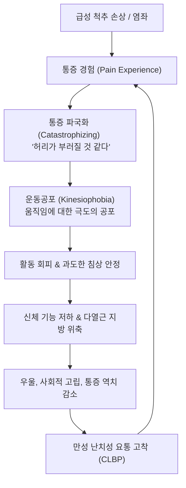
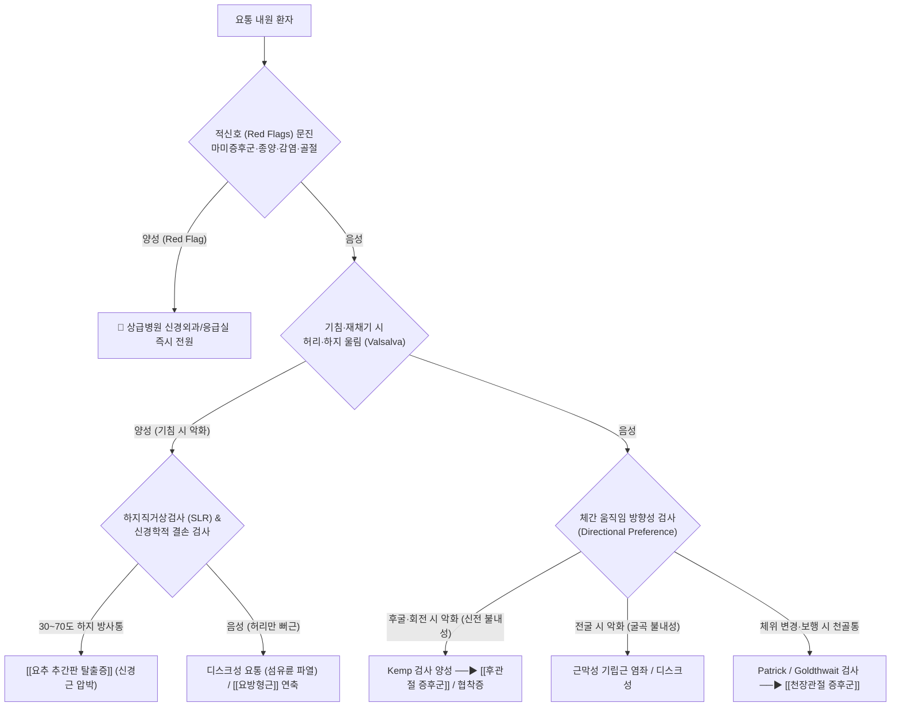

# 요통 (Low Back Pain / LBP)

> **핵심 3줄 요약 (Key Summary)**:
> 🎯 **개념 및 역학**: 제12늑골 하연에서 둔부 주름(Inferior gluteal fold) 상부 사이 요천추부 통증 증후군으로, 전 세계 성인의 80% 이상이 이환되는 비치명적 장애 원인 1위(GBD 2021). 전체의 85~90%는 특정 구조적 단일 병변을 단정할 수 없는 비특이적 요통(NSLBP)이며 10~15%가 특이적 요통에 해당함.
> 🚩 **병태생리 및 선별**: 단순한 역학적 손상을 넘어 심부 로컬 코어인 [[다열근]]의 지방 침윤 위축, [[흉요근막]]의 비후 및 전단 미끄러짐(Shear strain) 결손, 척수 후각 및 대뇌 피질의 [[중추 감작]](Central sensitization)과 심리사회적 [[두려움-회피 모델]](Yellow flags)이 융합된 복합 병태임. [[마미 증후군]], 악성 종양, 감염, 척추 골절 등 응급 적신호(Red flags)의 즉각적 배제가 필수적임.
> 🌿 **한의 통합 치료 및 재활**: 급·아급성기에는 요추 협척혈, [[신수]], [[대장수]] 심부 침 치료 및 [[신바로약침]], [[추나요법]](굴곡-신연 및 가동술), 변증별 한약([[독활기생탕]], [[오적산]], [[팔물군자탕]])을 병용하여 NSAIDs 진통제 의존성을 조기 탈피시키고, 회복기에는 WalkBack 점진적 걷기 처방과 [[인지기능치료]](CFT)를 결합하여 1년 재발률을 28% 이상 차단함.

---

## 1. 🩺 질환 개요 & 해부학적 병태생리

### 1.1 정의 및 임상적 범주
[[요통]](Low Back Pain, LBP)은 해부학적으로 제12늑골 하연(Lower rib margin)부터 둔부 주름(Inferior gluteal fold) 상부 사이의 요추 및 천골 영역에 국한되거나 하지로 방사되는 통증, 뻣뻣함(Stiffness), 근육 긴장 및 운동 가동 장애를 총칭하는 임상 증후군이다.

단순히 요추골 자체의 국소 손상에 그치지 않으며, 추간판(Intervertebral disc), 척추 후관절(Facet joint), 천장관절(Sacroiliac joint), 인대 복합체 및 이를 동적으로 지지하는 코어 근육군([[다열근]], [[복횡근]], [[골반저근]], [[요방형근]], [[장요근]], [[척추기립근]])의 유기적 협응 파탄과 신경생리학적 통증 조절계의 변성이 복합적으로 작용하여 발현된다.

```
[요통의 이환 기간 및 병인론적 분류]
┌────────────────────────────────────────────────────────┐
│                   전체 요통 환자군                     │
└──────────────────────────┬─────────────────────────────┘
                           │
             ┌─────────────┴─────────────┐
             ▼                           ▼
    [비특이적 요통 (85~90%)]     [특이적 요통 (10~15%)]
    - 명확한 단일 해부구조 불특정   - [[요추 추간판 탈출증]] (신경근병증)
    - 근막·인대·후관절 복합 기능부전 - [[척추관 협착증]] (신경인성 파행)
    - [[다열근]] 위축·[[흉요근막]] 비후   - 척추전방전위증, 척추분리증
    - [[중추 감작]] 및 심리사회적 요인   - 척추 압박골절, 감염, 악성종양
             │
   ┌─────────┼─────────┐
   ▼         ▼         ▼
[급성 요통] [아급성 요통] [만성 요통]
 (<6주)     (6~12주)    (≥12주 / 3개월 이상)
```

### 1.2 역학 및 질병 부담
* **유병률 및 세계적 부담 (GBD 2021)**: 글로벌 질병부담(Global Burden of Disease) 연구에 따르면 요통은 1990년 이래 전 세계 비치명적 장애로 인한 건강수명 손실(Years Lived with Disability, YLDs) 1위를 유지하고 있다. 전 세계 인구의 평생 유병률은 70~85%에 달하며, 45~65세 연령대에서 유병률과 진료비 지출이 정점에 도달한다.
* **자연 경과 및 만성화 위험도**:
  - 급성 요통(Acute LBP, 6주 미만): 환자의 약 70~80%는 4~6주 이내에 상당한 통증 경감과 기능 회복을 보인다.
  - 아급성 요통(Subacute LBP, 6~12주): 조직 치유 지연과 함께 활동 회피, 국소 안정화근 위축이 진행되는 만성화 전이의 결정적 분기점이다.
  - 만성 요통(Chronic LBP, 12주/3개월 이상): 전체 환자의 약 10~15%가 만성 요통으로 진행하지만, 이들이 전체 요통 관련 의료비 및 사회경제적 노동 손실 비용의 80% 이상을 유발한다.

### 1.3 요추-골반-하지 복합체(Lumbopelvic-Hip Complex) 해부학
척추 요천추부의 안정성과 하중 전달은 Manohar Panjabi가 제안한 3대 서브시스템(Three Subsystems of Spinal Stability)의 상호작용으로 유지된다.

```
                ┌──────────────────────────────────┐
                │   요추 안정성 3대 서브시스템     │
                │        (Panjabi 모델)            │
                └────────────────┬─────────────────┘
                                 │
         ┌───────────────────────┼───────────────────────┐
         ▼                       ▼                       ▼
  [수동적 지지계]          [능동적 근육계]         [신경 제어계]
(Passive Subsystem)      (Active Subsystem)      (Neural Subsystem)
 - 요추체 & 추간판        - 심부 로컬 코어        - 척수 고유수용성 반사
 - 전종·후종인대           ([[다열근]], [[복횡근]])   - 근방추 & 건기관
 - 황색인대, 극간인대     - 천층 글로벌 근육      - 감각운동피질 통합
 - 후관절낭 복합체        ([[요방형근]], [[장요근]]) - 전방 예측 제어(Feedforward)
```

#### ① 수동적 지지계 (Passive Subsystem)
* **요추체 및 추간판(Intervertebral Disc)**: L1~L5 척추체는 상부 체간 하중을 지탱하기 위해 미골 방향으로 갈수록 면적이 점진적으로 넓어진다. 수핵(Nucleus pulposus)의 친수성 프로테오글리칸(Proteoglycan)과 15~25겹의 빗살무늬 층판 구조를 가진 섬유륜(Annulus fibrosus)이 유체 정역학적 완충 작용을 수행한다.
* **후방 관절 지주 (Facet Joint / Zygapophysial Joint)**: 시상면(Sagittal plane)에 평행하게 90도로 배열되어 굴곡과 신전은 원활히 허용하지만, 회전(Axial rotation) 스트레스에는 강력한 골성 저항벽 역할을 한다.
* **인대 결합부**: 전종인대(ALL, 과신전 방지), 후종인대(PLL, 과굴곡 방지), 황색인대(Ligamentum flavum, 탄성 섬유로 척추관 후벽 지탱), 장요인대(Iliolumbar ligament, L5 횡돌기와 장골익을 결합하여 L5-S1 전방 전단력을 차단).

#### ② 능동적 근육계 (Active Subsystem)
* **심부 로컬 안정화근(Local Core Muscles)**:
  - [[다열근]](Multifidus): 극돌기와 하위 횡돌기를 1~3분절 단위로 연결하며 요추 전단력을 상쇄하고 분절 간 미세 동요(Micro-instability)를 1차적으로 억제한다.
  - [[복횡근]](Transversus abdominis) & [[골반저근]](Pelvic floor muscles): 복강 내압(IAP)을 선제적으로 상승시켜 요천추부를 유압성 실린더 형태로 강건화한다.
* **천층 글로벌 기동근(Global Mobilizers)**:
  - [[요방형근]](Quadratus Lumborum): 골반 장골능에서 제12늑골 및 L1~L4 횡돌기를 연결하며 측방 굴곡 안정화와 골반 수평을 제어한다.
  - [[장요근]](Iliopsoas): 요추체 및 횡돌기 전면에서 대퇴골 소전자로 주행하며 고관절 굴곡 및 요추 기립을 조절한다.
  - [[척추기립근]](최장근, 장늑근) 및 [[광배근]]: 체간 신전력과 광범위한 흉요근막 장력을 형성한다.

#### ③ 신경 제어계 (Neural Control Subsystem)
관절낭, 인대, 근막에 밀집된 루피니 소체(Ruffini corpuscle), 파치니 소체(Pacinian corpuscle), 골지건기관(GTO)이 척추의 3차원 위치 정보를 실시간으로 중추신경계에 전달하여 체간 움직임 직전 심부 코어를 선제적으로 수축(Feedforward activation)시키는 신경근 제어 체계이다.

---

## 2. ⚡ 병태생리 메커니즘 & 생체역학적 악순환 네트워크

### 2.1 생체역학적 부하 분산 부전 & 삼각 지지구조 파탄
정상 척추 분절에서 직립 시 체중 부하는 **전방 기둥(추간판-척추체)이 약 80%**, **후방 기둥(양측 후관절 복합체)이 약 20%**를 분담하는 안정적인 삼각 지지 구조(Tripod structure)를 이룬다.

```
[정상 체중 부하 분담]                 [퇴행 및 추간판 협착 시]
   전방 기둥 (추간판) 80%                 전방 기둥 (추간판) 50~60%
   후방 기둥 (후관절) 20%     ──▶         후방 기둥 (후관절) 40~50% (과부하!)
                                          - 후관절 연골 마모 및 관절염
                                          - 활액막 비후 및 신경공 협소
                                          - 기립근 보상적 강직
```

* **추간판 변성 및 후방 부하 전이**: 노화, 탈수, 미세 외상으로 수핵의 팽창압이 감소하고 디스크 높이가 낮아지면, 후방 후관절로 가해지는 압박 응력이 40~50% 이상으로 급증한다.
* **후관절 활액막염 및 관절증**: 과도한 전단 응력에 노출된 후관절 피막이 비후되고 활액막염이 발생하며, 후지 내측지(Medial branch)의 통각 수용기가 감작되어 요추 신전 시 심한 축성 요통을 초래한다.

### 2.2 심부 다열근의 지방 침윤(Fatty Infiltration) 및 억제성 위축
급성 요부 염좌나 디스크 손상이 발생하면 통증 회피 반사(Arthrogenic Muscle Inhibition)에 의해 환측 요추 분절의 [[다열근]]이 즉각적으로 반사적 억제 상태에 빠진다.

```
급성 요추 손상/염좌 발생
         │
         ▼
관절인대 수용기 과흥분 ──▶ 척수 반사성 억제(Arthrogenic Muscle Inhibition)
         │
         ▼
[[다열근]](Multifidus)의 급성 반사적 위축 (수일 내 발생)
         │
         ▼
통증 소실 후에도 자발적 회복 부전 (선택적 운동 재교육 부재 시)
         │
         ▼
근섬유 소실 및 비가역적 지방 변성 (Fatty Infiltration)
         │
         ▼
척추 분절 간 미세 불안정성(Micro-instability) 고착화
         │
         ▼
만성 요통 및 사소한 일상 동작에서의 잦은 재발(Recurrence)
```

만성화된 환자의 MRI 단면 촬영 시 요추 4-5번 및 5번-천골 1번 레벨에서 다열근 횡단면적이 30% 이상 감소하고 근조직이 백색의 지방 조직으로 치환된 소견이 뚜렷하게 관찰된다.

### 2.3 흉요근막(Thoracolumbar Fascia, TLF)의 비후 및 미끄러짐 소실
* **유압성 장력 전달막의 파탄**: 흉요근막은 광배근, 복횡근, 둔근을 기계적으로 결합하여 체간 비틀림 힘을 천골로 분산시키는 다층 섬유막이다.
* **전단 변형률(Shear strain) 저하**: 초음파 연구(Langevin et al., 2011)에 따르면 만성 요통 환자는 흉요근막의 결합조직 층간 전단 미끄러짐 능력이 정상 대조군 대비 **20% 이상 현저히 감소**되어 있으며, 만성 무균성 염증으로 인해 근막 전체 두께가 병적으로 비후되어 있다. 이는 허리를 구부리거나 펼 때 근막 간의 유연한 활주를 방해하여 심한 결림과 운동 제한을 유발한다.

### 2.4 신경생리학적 만성화 기전: 말초 감작에서 중추 감작(Central Sensitization)으로의 전이
* **척수 후각 신경원의 Wind-up 현상**: 추간판, 관절낭, 근막 손상부에서 지속적으로 유입되는 신경펩타이드(Substance P, CGRP)와 염증 사이토카인(TNF-α, IL-1β)은 척수 후각 2차 신경원의 NMDA 수용체를 지속 활성화시킨다. 이로 인해 통증 전달 역치가 영구적으로 낮아져 가벼운 체간 움직임에도 격렬한 통증을 인지하는 통각과민(Hyperalgesia)과 이질통(Allodynia)이 고착화된다.
* **대뇌 1차 체감각 피질(S1)의 재지도화(Cortical Smudging)**: 만성 요통 환자의 대뇌 피질에서는 요추부를 담당하는 신체 표현 지도의 경계가 흐려져, 환자는 허리의 정확한 분절 위치나 움직임을 뇌에서 인지하지 못하는 고유수용감각 장애를 겪게 된다.
* **두려움-회피 모델(Fear-Avoidance Beliefs)과 심리사회적 악순환**:



---

## 3. 🔍 임상 증상 & 이학적 검사 알고리즘

### 3.1 임상 증상군 및 신경학적 분류

| 분류 범주 | 병변 조직 및 병태생리 | 통증의 양상 및 주소 부위 | 악화 및 완화 조건 |
| :--- | :--- | :--- | :--- |
| **축성 요통 (Axial LBP)** | 추간판 외측 섬유륜, 후관절낭, 척추기립근, 흉요근막 | 요천추 중앙부, 장골능 주변의 둔탁하고 쑤시는 국소통 | 장시간 동일 자세 시 악화, 체위 변경 시 일시 완화 |
| **체성 연관통 (Referred Pain)** | 디스크 내부 파열(IDD), 천장관절, 둔근, 이상근 | 둔부, 서혜부, 대퇴부 후외측으로 방사 (무릎 이하 방사 드묾) | 특정 관절 부하 시 악화, 신경학적 결손 없음 |
| **신경근병성 요통 (Radicular Pain)** | 수핵 탈출, 황색인대 비후로 인한 L4, L5, S1 신경근 압박 | 무릎 아래 종아리, 발등, 발바닥으로 뻗치는 전격통, 저림 | 기침·배변 시 악화, [[하지직거상검사]] 양성, 감각 저하 |

### 3.2 응급 적신호 (Red Flags) 선별 기준
요통 환자 진찰 시 단순 근골격계 질환이 아닌 신경외과적·내과적 응급 질환을 감별하기 위해 다음 4대 적신호를 전수 문진한다.

1. **마미증후군 ([[마미 증후군]], Cauda Equina Syndrome)**:
   - 증상: 안장 부위(Saddle area, 회음부 및 항문 주위) 감각 소실, 급성 요실금 또는 배뇨 곤란(Urinary retention), 진행성 양측 하지 운동 마비.
   - 조치: **발병 24~48시간 이내 응급 감압 수술 필수** (골든타임 경과 시 영구적 대소변 장애 및 성기능 마비).
2. **척추 악성 종양 (Spinal Malignancy)**:
   - 증상: 암(유방암, 폐암, 전립선암, 신장암 등) 기왕력, 50세 이상 신규 요통, 원인 모를 체중 감소(최근 6개월간 10% 이상), 야간 수면 중에도 줄어들지 않고 악화되는 불변성 골통.
3. **척추 감염증 (척추염, 추간판염, 경막외 농양)**:
   - 증상: 발열(Fever), 오한, 최근 침습적 척추 시술/수술력, 면역 억제제 복용력, 정맥 약물 남용, 국소 척추 타진통.
4. **척추 압박 골절 (Vertebral Compression Fracture)**:
   - 증상: 골다공증 병력의 고령자, 장기 스테로이드 복용자, 사소한 엉덩방아 낙상 후 발생한 극심한 국소 극돌기 타진 압통.

### 3.3 핵심 이학적 검사 체계



#### ① 신경근 유발 검사
* **하지직거상검사 (SLR Test, Straight Leg Raise)**:
  - 환자를 앙와위로 눕히고 검사자가 한쪽 발뒤꿈치를 잡고 무릎을 편 채 천천히 거상.
  - 30~70도 사이에서 좌골신경 주행을 따라 종아리와 발등으로 뻗치는 방사통 재현 시 양성 (L4-S1 신경근 압박).
* **브라가드 검사 ([[브라가드 검사]], Bragard Test)**:
  - SLR 양성 각도에서 다리를 5도 정도 살짝 내린 후, 족관절을 급격히 배굴(Dorsiflexion)시켰을 때 방사통이 즉시 재현되면 진성 신경근 병변으로 확진.
* **대퇴신경 신장 검사 (Femoral Nerve Stretch Test / FNTT)**:
  - 환자를 복와위로 눕히고 무릎을 90도 굴곡시킨 뒤 고관절을 신전시킴.
  - 대퇴 전면부로 전격통 발생 시 상부 요추(L2~L4) 신경근 압박 시사.

#### ② 관절 및 기능 분절 검사
* **골드스웨이트 검사 ([[골드스웨이트 검사]], Goldthwait's Test)**:
  - 환자를 앙와위로 눕히고 검사자의 손바닥을 환자의 요추 극돌기 아래(L5-S1 및 천골 결합부)에 받친 상태에서 하지를 들어 올림.
  - **요천추 분절이 움직이기 전(30~40도 이하)**에 통증 발생 시 [[천장관절 증후군]].
  - **요추 극돌기가 실제로 움직이기 시작한 이후**에 통증 발생 시 요천추 디스크 또는 후관절 병변.
* **패트릭 검사 ([[패트릭 검사]], Patrick / FABER Test)**:
  - 환자의 환측 발목을 반대측 무릎 위에 올려 4자 형태를 만든 뒤 검사자가 무릎을 하방으로 가볍게 압박.
  - 서혜부 통증 시 고관절 질환, 반대측 둔부 및 천골 후면 통증 시 [[천장관절]] 병변.
* **켐프 검사 (Kemp's Test)**:
  - 환자를 기립 또는 좌위에서 체간을 신전시키면서 환측으로 외측 굴곡 및 회전을 가함.
  - 후관절에 부하가 집중되어 요천추 국소 압통 발생 시 [[후관절 증후군]] 양성.

---

## 4. 🔀 감별 진단 매트릭스

### 4.1 요통 원인 질환별 다각적 감별 진단 일람표

| 감별 질환 | 호발 연령 및 병리 | 주 통증 양상 | 체간 굴곡/신전 영향 | 기침 시 악화 | 핵심 이학적 검사 소견 |
| :--- | :--- | :--- | :--- | :--- | :--- |
| **비특이적 요통 (NSLBP)** | 20~60대 전 연령 / 다인자성 근막·인대 기능부전 | 요천추 중앙부 및 장골능 둔통, 피로 시 악화 | 굴곡 또는 신전 시 뻣뻣함, 특정 방향 불내성 | **음성** (울림 없음) | 신경학적 결손 없음, 다열근·기립근 압통 |
| [[요추 추간판 탈출증]] | 20~40대 활동기 / 수핵 탈출 및 신경근염 | 무릎 아래로 방사되는 날카로운 전격통, 저림 | **굴곡 시 격렬히 악화** (앉을 때 통증) | **강양성** (복압 상승 시 전기 통증) | SLR (30~70도) 양성, 피부분절 감각 저하 |
| [[척추관 협착증]] | 60대 이상 고령 / 황색인대 비후, 척추관 협소 | 보행 시 양측 하지 쥐어짜는 듯한 신경인성 파행 | **신전 시 악화**, 굴곡 시 호전 (유모차 보행) | 음성 | 보행 장애, 굴곡 시 파행 증상 즉시 해소 |
| [[후관절 증후군]] | 40대 이상 / 후관절 연골 마모 및 활액막염 | 요천추 심부 축성 통증, 둔부 상부 연관통 | **신전 및 환측 회전 시 극심한 악화** | 음성 | Kemp 검사 양성, 후관절 라인 압통 |
| [[천장관절 증후군]] | 가임기 여성, 산후, 외상 / 천장인대 이완·염좌 | PSIS(후상장골극) 부위 편측 통증, 서혜부 연관 | 앙와위에서 옆으로 돌아눕거나 일어날 때 악화 | 음성 | Patrick(FABER) 양성, Gaenslen 검사 양성 |
| **강직성 척추염 (AS)** | 20~30대 젊은 남성 / 전신 염증성 척추관절병증 | 아침 조조강직 1시간 이상, 둔부 교대성 통증 | **운동 시 호전**, 휴식·안정 시 악화 | 음성 | Schober 검사(요추 굴곡 제한) 양성, HLA-B27 |
| **척추 압박 골절** | 70대 이상 골다공증 고령 / 척추체 붕괴 | 사소한 낙상 후 허리를 전혀 꼼짝 못 하는 골통 | 체위 변경 시 극심한 통증 | 가침 시 체간 울림 | 극돌기 수근 타진 시 뼈 부위 극심한 압통 |

---

## 5. 🌿 한의 통합 치료 프로토콜

### 5.1 《동의보감(東醫寶鑑)》 10대 요통 변증 체계 및 임상 적용

```
                           [동의보감 10종 요통 체계]
                                      │
         ┌────────────────────────────┼────────────────────────────┐
         ▼                            ▼                            ▼
   [허증 (虛證)]                [외인·사기 (外因)]           [내인·기혈 (內因)]
   - 신허요통 ([[독활기생탕]])    - 풍요통 ([[소속명탕]])      - 어혈요통 ([[당귀수산]])
   - 기허요통 ([[보중익기탕]])    - 한요통 ([[마황부자세신탕]]) - 담음요통 ([[이진탕]])
   - 혈허요통 ([[팔물군자탕]])    - 습요통 ([[삼습탕]])        - 기요통 ([[침향강기탕]])
                                - 열요통 ([[가미이묘환]])    - 좌섬요통 ([[여신탕]])
                                                            - 식적요통 ([[평위산]])
```

1. **신허요통(腎虛腰痛)**:
   - 병리: 노화, 다산, 과로로 인한 신정(腎精) 고갈 및 요추 골격 지지력 약화.
   - 증상: 허리가 시리고 힘이 없으며 은은한 둔통이 지속됨. 오래 서 있지 못하고 무릎이 시림.
   - 처방: [[독활기생탕]](獨活寄生湯), [[육미지황탕]](六味地黃湯), 팔미지황탕.
2. **어혈요통(瘀血腰痛)**:
   - 병리: 타박, 낙상, 급성 염좌 후 미세 혈관 파열 및 혈액 순환 정체.
   - 증상: 통증 부위가 칼로 찌르듯 명확하고(자통 刺痛), 주야 불문 고정되어 있으며 야간에 극심해짐.
   - 처방: [[당귀수산]](當歸鬚散), 신통축어탕, 도홍사물탕.
3. **담음요통(痰飮腰痛)**:
   - 병리: 수습(水濕) 대사 장애로 체내 담음이 근육막 사이에 정체.
   - 증상: 통증 부위가 일정하지 않고 여기저기 쑤시며, 비만 환자에서 몸이 천근만근 무거움.
   - 처방: [[이진탕]](二陳湯) 가미방, 궁하탕.
4. **한요통(寒腰痛) & 습요통(濕腰痛)**:
   - 병리: 한랭 노출 및 습기 찬 환경 거주로 인한 혈관 수축과 흉요근막 팽창.
   - 증상: 허리가 얼음장처럼 차고 뻣뻣하며 온열 찜질 시 시원함을 느낌 (한요통). 허리에 무거운 진흙을 동여맨 듯 둔중함 (습요통).
   - 처방: [[마황부자세신탕]](麻黃附子細辛湯), [[오적산]](五積散), 삼습탕.
5. **좌섬요통(挫閃腰痛)**:
   - 병리: 무거운 물건을 들거나 헛디디며 발생한 급성 요추 염좌 및 천층 근육 경련.
   - 증상: 요추를 전후좌우로 전혀 움직이지 못하고 호흡 시에도 결림.
   - 처방: [[여신탕]](如神湯), 당귀점통탕.
6. **기요통(氣腰痛) & 식적요통(食積腰痛)**:
   - 병리: 정서적 울화(스트레스)로 인한 간기울결(기요통), 과식 후 복압 상승(식적요통).
   - 처방: 침향강기탕, [[오약순기산]], [[평위산]](平胃散).

### 5.2 침구 및 전침 치료 SOP (Standard Operating Procedure)

```
[표준 배혈도]
- 근위 배혈: 요추 협척혈(L1-S1) ──▶ 심부 [[다열근]] 및 후지 내측지 직접 자극
             [[신수]](BL23), [[대장수]](BL25), [[관원수]](BL26) ──▶ 기립근 이완
             [[지실]](BL52), [[요양관]](GV3), [[명문]](GV4) ──▶ 심부 근막 감압
- 원위 배혈: [[위중]](BL40) ──▶ "요배위중구(腰背委中求)" 전신 기립근 긴장 해소
             [[곤륜]](BL60), [[양릉천]](GB34, 근회), [[후계]](SI3, 독맥)
             [[환도]](GB30), [[승산]](BL57) ──▶ 좌골신경 주행로 감압
```

* **자침 기법 및 심도**:
  - 요추 협척혈(EX-B2): 극돌기 외측 0.5촌 부위에서 0.30×60mm 호침을 척추체 방향으로 약간 내측을 향해 40~50mm 심자하여 다열근 심부 건막을 자극.
  - [[대장수]](BL25) 및 [[신수]](BL23): 직자하여 흉요근막 전엽과 요방형근 부착부까지 도달시켜 연축 밴드를 해소.
* **전침 매개변수 (Electroacupuncture Parameters)**:
  - 급성 통증기: 100Hz 고주파 통전 (Gate Control Theory에 따른 A-beta 섬유 자극, 신속한 통각 차단).
  - 만성 요통기: 2~4Hz 저주파 통전 (뇌척수액 내 엔돌핀, 엔케팔린, 디노르핀 등 내인성 오피오이드 분비 유도).
  - 시술 시간: 15~20분간 연속 또는 믹스파(Dense-Disperse wave) 통전.

### 5.3 약침 및 침도 요법 (Pharmacopuncture & Acupotomy)
* **약침 프로토콜**:
  - 급성 염증 및 신경근 부종: [[신바로약침]](GCSB-5 성분) 1.0~2.0cc를 L4-L5, L5-S1 협척혈 및 후관절낭 주위에 주입하여 신경성 염증 및 사이토카인 분비를 차단.
  - 만성 조직 유착 및 신허형 요통: 자하거(인태반) 약침 또는 녹용 약침을 [[신수]], [[대장수]]에 주입하여 다열근의 지방 침윤을 억제하고 결합조직 단백질 합성을 촉진.
* **침도(Acupotomy) 감압술 프로토콜**:
  - 적응증: 3개월 이상 지속된 난치성 만성 요통, 흉요근막 유착, 장골능 능선 압통점.
  - 시술 부위: 제3요추 횡돌기 첨부(요방형근 부착부), 장골능 후방 결절, L4-L5 극간인대.
  - 술기: 0.8×50mm 평인 침도를 사용하여 골면에 칼날을 밀착시킨 뒤 척추 기립 방향과 평행하게 종방향 절개 및 횡방향 박리를 시행하여 섬유성 유착 감압.

### 5.4 추나요법 (Chuna Manual Therapy)
* **급성기 추나 SOP**:
  - 급격한 고속 저진폭 스러스트(HVLA)를 지양하고, 환자를 측와위로 눕혀 [[장요근]] 및 [[요방형근]]에 대한 부드러운 근막이완술(MFR) 적용.
  - 천골의 후방 변위를 교정하는 천골 가동 추나 및 무통 범위 내 중립위 요추 신장 견인.
* **만성기 굴곡-신연 기법 (Cox Flexion-Distraction)**:
  - 굴곡-신연 전용 테이블을 이용하여 복와위 환자의 요추 분절(L4-L5, L5-S1)을 파지한 상태에서 골반대를 하방으로 굴곡-신연.
  - 추간판 내압을 음압(Negative pressure, 최대 −100mmHg)으로 떨어뜨려 수핵 탈출을 중심화하고 후관절낭의 기계적 감압 달성.

---

## 6. 💊 양방 치료 & 병용·의뢰 기준

### 6.1 현대의학적 약물 치료 가이드라인 (ACP & Lancet 권고)
* **1차 보존 치료 원칙**: 약물 치료에 앞서 환자 교육(Reassurance), 일상 활동 유지(Bed rest 회피), 비약물적 치료(침술, 척추 도수치료, 운동치료)를 1차 치료로 권고함.
* **약물 치료의 단계별 적용**:
  - 아세트아미노펜(타이레놀): 급성 요통에 대한 단독 진통 효과는 플라세보와 차이가 없어 1차 단독 권고에서 제외됨.
  - 경구 NSAIDs([[이부프로펜]], [[나프록센]], 세레콕시브): 최소 유효 용량으로 1~2주간 단기 투여 권장 (위장관 출혈, 심혈관 및 신장 독성 주의).
  - 중추성 근이완제: 급성 근육 경련이 심한 경우 단기간 병용.
  - 마약성 진통제(Opioids): 중독, 내성, 만성화 위험으로 인해 일반적인 요통 치료에 원칙적으로 비권고.

### 6.2 주사 치료 및 중재술
* **후관절 내측지 차단술 (Medial Branch Block, MBB)**: 후관절성 통증으로 확진된 경우 국소마취제와 스테로이드 혼합액 주입, 반응 호전 시 고주파 열응고술(RF Neurotomy) 고려.
* **경막외 스테로이드 주사 (Epidural Steroid Injection, ESI)**: 추간판 탈출 또는 척추관 협착에 의한 급성 방사통에 대해 단기 신경근 부종 감소 목적으로 선택적 적용.

### 6.3 척추외과 의뢰 및 수술 적응증

```
[응급 수술 의뢰 기준 (절대적 적응증)]
1. [[마미 증후군]]: 안장 감각 마취, 급성 대소변 괄약근 기능 부전 ──▶ 24~48시간 내 응급 감압술
2. 진행성 운동 마비: 족하수(Foot drop, 발목 배굴 3등급 이하), 대퇴사두근 근력 급격 저하
3. 보존 치료 불응: 6~12주간의 체계적인 비수술 한양방 복합 치료에도 마약성 진통제를 요하는 극심한 방사통
```

---

## 7. 🏃 재활 운동 & 생활습관 티칭 가이드

### 7.1 단계별 척추 재활 운동 프로토콜

```
[단계별 운동 치료 사다리]
┌────────────────────────────────────────────────────────┐
│ 3단계: 기능적 과부하 & 재발 방지 (만성·회복기)         │
│ - WalkBack 점진적 걷기 (주 3~5회, 30~45분)             │
│ - [[수중운동]], [[태극권]], [[요가]], 파머스 워크     │
├────────────────────────────────────────────────────────┤
│ 2단계: 맥길 빅3 (McGill Big 3) 코어 안정화 (아급성기)   │
│ - 컬업 (Curl-up, 요추 전만 유지 복직근 활성화)         │
│ - 사이드 플랭크 (Side Plank, [[요방형근]] 지탱)         │
│ - 버드독 (Bird-Dog, [[다열근]] & 둔근 교차 강화)        │
├────────────────────────────────────────────────────────┤
│ 1단계: 통증 조절 및 관절 감압 (급성기)                 │
│ - 골반 경사 운동 (Pelvic Tilt)                         │
│ - 맥켄지 신전 프레스업 (신전 선호 시)                  │
└────────────────────────────────────────────────────────┘
```

#### ① 급성기 운동: 맥켄지 신전 운동 (McKenzie Extension)
* 적응증: 허리를 구부릴 때 통증이 심해지고 걸으면 편안한 굴곡 불내성 추간판성 요통.
* 방법: 복와위로 엎드려 턱을 괴고 2~3분간 심호흡을 한 뒤, 팔꿈치로 상체를 지지하는 프론 온 엘보우(Prone on elbows) 자세 유지. 통증이 중심화(Centralization)되면 점진적으로 팔을 펴는 신전 프레스업 시행. (후관절 증후군 환자에게는 금기).

#### ② 아급성·만성기 코어 운동: 맥길 빅 3 (McGill Big 3)
캐나다 워털루 대학의 Stuart McGill 교수가 요추 분절 부하를 최소화하면서 척추 안정성을 극대화하도록 고안한 표준 코어 운동:
1. **변형 컬업 (Modified Curl-Up)**:
   - 한쪽 다리는 펴고 다른 쪽 무릎은 세운 상태에서 양손을 요추 밑에 받쳐 정상 전만을 유지. 머리와 어깨만 바닥에서 2~3cm 들어 올려 8초 유지 (경추 과굴곡 금지).
2. **사이드 플랭크 (Side Plank)**:
   - 옆으로 누워 팔꿈치를 어깨 아래에 대고 골반을 들어 올려 체간을 일직선으로 유지. [[요방형근]]과 복사근의 지구력을 집중 강화.
3. **버드독 (Bird-Dog)**:
   - 네발기기 자세에서 척추 중립을 유지하며 대각선 방향의 팔과 다리를 바닥과 평행하게 천천히 뻗음. [[다열근]]과 대둔근의 협응력 재교육.

#### ③ 만성 회복기: 란셋(Lancet 2024) 입증 "WalkBack" 걷기 처방 프로토콜
* **임상 근거 (PMID: 38908392)**: 요통에서 회복된 성인 701명을 대상으로 6개월간 점진적 걷기 교육을 적용한 결과, **요통 재발 위험이 28% 억제(HR 0.72)되고 재발까지의 무병 생존 기간이 112일에서 208일로 2배 가까이 연장**됨.
* **진료실 실전 걷기 처방전**:
  - 1~2주차: 주 3회, 1회 20~25분 편안한 평지 보행.
  - 3~6주차: 주 5회, 1회 30분 보행으로 증량하며 보행 일기 작성.
  - 7주차 이후: 1회 40~45분, 완만한 경사로를 포함한 활기찬 걸음걸이 유지.

### 7.2 인지기능치료(CFT) 기반 생활습관 티칭
* **통증 신경과학 교육 (Pain Neuroscience Education, PNE)**:
  - 환자에게 "요통은 척추 뼈가 부러지거나 디스크가 영구히 손상된 결과가 아니라, 과도하게 예민해진 통증 경보 시스템(Alarm system)의 오작동"임을 논리적으로 설명하여 질병 공포를 완화시킴.
* **인체공학적 리프팅 및 착석 가이드**:
  - 리프팅(Lifting): 허리를 둥글게 숙여 들지 말고, 고관절 힌지(Hip hinge)를 접고 무릎을 굽혀 물건을 몸 중심선에 밀착시킨 후 하지 근력으로 기립.
  - 좌식 생활: 50분 연속 착석 시 반드시 알람을 맞추고 일어나 1분간 기립 요추 신전 스트레칭 수행.

---

## 8. 💡 사용자 진료실 핵심 필기 & 임상 노하우 (Melt-In)

### 8.1 진료실 실전 감별 노하우 (원장님 시크릿)
* **기침·재채기 시 요통 감별: 디스크 vs 요방형근(QL) 급성 연축**:
  - 환자가 "기침할 때 허리가 끊어질 듯 울린다"고 호소하면 무조건 추간판 탈출증으로 단정하기 쉽다.
  - 그러나 **[[요방형근]]의 급성 근막 연축**이 있어도 기침 시 늑골 하연이 격렬히 수축하며 극심한 통증을 유발한다.
  - 감별법: 앙와위에서 환자의 다리를 모아 잡고 골반을 고정한 채 체간을 반대측으로 측굴시켜 요방형근을 수동 신장시켰을 때 통증이 동일하게 유발되면 100% 근막성 요방형근 연축이다. 이 경우 협척혈 깊은 자침보다 제12늑골 하연 요방형근 기시부 자침으로 즉각 호전된다.
* **아침 첫 발 디딜 때 허리가 펴지지 않는 환자 (90% 이상 장요근 구축)**:
  - "아침에 침대에서 일어날 때 허리를 바로 펴지 못하고 구부정한 자세로 엉거주춤 걷다가 10~20분 지나야 겨우 펴진다"는 환자는 열에 아홉이 **[[장요근]] 구축**이다.
  - 복와위에서 대퇴골을 후방으로 신전시키면서 서혜인대 바로 아래 대요근 건부착부를 압박 이완하거나, 앙와위 토마스 검사(Thomas test) 자세에서 장요근 스트레칭을 3회 시행하면 즉시 허리가 꼿꼿이 펴진다.

### 8.2 고령 만성 요통 환자의 "진통제 디프레스크라이빙(Deprescribing)" 3단계 프로토콜
* 고령 환자들은 소염진통제(NSAIDs)와 마약성 진통제(트라마돌)를 장기 복용하여 신기능 저하, 소화성 궤양, 어지럼증 및 낙상 위험에 심각하게 노출되어 있다.
* 진통제를 일시에 중단시키면 반동성 통증으로 치료 순응도가 무너지므로 다음 3단계로 안전하게 감량한다:
  - 1단계 (치료 1~2주): 침·약침·추나 치료를 주 2~3회 집중 시행하며 기존 약물 복용량 유지.
  - 2단계 (치료 3~4주): 통증 NRS가 기저치 10에서 5~6으로 감소하면, "낮 복용 진통제를 반 알 줄이거나 필요시(PRN) 복용으로 전환"하도록 유도.
  - 3단계 (치료 5주 이후): 통증 3 이하 안정 시 주 1회 한의 치료로 유지하며 소염진통제를 완전 중단하고 걷기 운동으로 전환.

### 8.3 침도 시술 안전 가이드라인 (Safety Pearls)
* 요추 횡돌기 부위 침도 시술 시, **L1~L3 상부 요추 횡돌기 전방에는 신장(Kidney) 및 후복막강 대혈관**이 위치하므로 절대 횡돌기 골면을 벗어나 앞쪽 깊숙이 침도를 진입시키면 안 된다.
* 항상 횡돌기 골면(Bone landmark)에 칼날이 닿았음을 손끝의 저항감으로 명확히 확인한 후, 골막 위에서만 1~2mm 범위 내로 미세 박리를 수행해야 기흉 및 후복막강 혈종을 원천 차단할 수 있다.

### 8.4 임신 제3삼분기 요통 도수·추나 시술 원칙 (PMID: 19766977)
* 임신 28주 이후의 요통 환자는 릴랙신(Relaxin) 호르몬 분비로 골반 인대가 극도로 이완되어 있다.
* **시술 금기**: 과도한 회전 스러스트(HVLA) 절대 금지, 앙와위 저혈압 증후군을 피하기 위해 앙와위를 피하고 측와위(Left lateral decubitus) 또는 반좌위에서 시술.
* 목표: 통증을 완전히 없애는 것이 아니라, 흉곽출구·횡격막·골반환에 대한 부드러운 근막이완술(MFR)로 만삭까지 보행 기능을 유지시키는 데 집중한다.

### 8.5 부항 및 레이저침(ILA) 실전 코스 설계 노하우
* **부항 치료 (PMID: 29609566)**: 만성 요통에서 부항은 음압의 세기보다 **주 2회, 4주간 총 8회의 정규 코스를 완주하는 순응도**가 임상적 예후를 결정한다. 신수, 기해수, 대장수에 건식 부항을 8~10분간 유관한다.
* **레이저침 및 전침 (PMID: 40495966)**: 양측 신수·대장수·환도혈에 4주 8회 코스로 계획하고, 종료 시점에 VAS 및 기능(ODI)을 재평가하는 프로토콜화된 진료 구조 자체가 환자의 신뢰와 치료 반응률을 75% 이상 끌어올린다.

---

## 9. 📚 출처 및 현대 학술 연구 요약

* **Maher C, Underwood M, Buchbinder R.** (2017). Non-specific low back pain. *Lancet*, 389(10070):736-747. PMID: 27745712.
  * [PubMed 링크 (PMID: 27745712)](https://pubmed.ncbi.nlm.nih.gov/27745712/)
  * `[임상 연구 요약]`: 비특이적 요통의 역학, 복합 생체심리사회적 병인론 및 무분별한 조기 영상 진단 자제와 침술 등 비약물 보존적 1차 치료의 표준 가이드라인을 정립한 란셋 세미나 종설.
* **Foster NE, Anema JR, Cherkin D, et al.** (2018). Prevention and treatment of low back pain: evidence, challenges, and promising directions. *Lancet*, 391(10137):2368-2383. PMID: 29573872.
  * [PubMed 링크 (PMID: 29573872)](https://pubmed.ncbi.nlm.nih.gov/29573872/)
  * `[임상 연구 요약]`: 전 세계 1차 진료에서 요통 환자에게 불필요한 침상 안정, 오피오이드 처방, 조기 수술을 지양하고 활동 유지와 능동 재활을 우선시해야 함을 촉구한 란셋 요통 시리즈.
* **Hartvigsen J, Hancock MJ, Kongsted A, et al.** (2018). What low back pain is and why we need to pay attention. *Lancet*, 391(10137):2356-2367. PMID: 29573870.
  * [PubMed 링크 (PMID: 29573870)](https://pubmed.ncbi.nlm.nih.gov/29573870/)
  * `[임상 연구 요약]`: 요통의 전 세계적 질병 부담과 생체역학적·심리사회적 상호작용 메커니즘을 심층 분석한 역학 랜드마크 논문.
* **Qaseem A, et al.** (2017). Noninvasive Treatments for Acute, Subacute, and Chronic Low Back Pain: A Clinical Practice Guideline From the American College of Physicians. *Ann Intern Med*, 166(7):514-530. PMID: 28192789.
  * [PubMed 링크 (PMID: 28192789)](https://pubmed.ncbi.nlm.nih.gov/28192789/)
  * `[임상 연구 요약]`: 미국내과학회(ACP) 진료 지침으로, 급성 및 만성 요통의 1차 치료로 침술(Acupuncture), 척추 도수치료(Spinal manipulation), 운동치료 등 비약물 요법을 최고 등급으로 권고.
* **Chou R, et al.** (2007). Diagnosis and treatment of low back pain: a joint clinical practice guideline from the American College of Physicians and the American Pain Society. *Ann Intern Med*, 147(7):478-491. PMID: 17909209.
  * [PubMed 링크 (PMID: 17909209)](https://pubmed.ncbi.nlm.nih.gov/17909209/)
  * `[임상 연구 요약]`: 요통 환자 초기 문진 시 마미증후군 등 Red flags 스크리닝 체계를 확립하고 보존적 치료의 알고리즘을 제시한 지침.
* **Vickers AJ, et al.** (2018). Acupuncture for Chronic Pain: Update of an Individual Patient Data Meta-Analysis. *J Pain*, 19(5):455-474. PMID: 29198932.
  * [PubMed 링크 (PMID: 29198932)](https://pubmed.ncbi.nlm.nih.gov/29198932/)
  * `[임상 연구 요약]`: 만성 요통을 포함한 20,827명의 개별 환자 데이터를 메타분석하여 침 치료가 거짓침(Sham) 및 통상 치료 대비 유의미하고 지속적인 통증 감소 효과를 가짐을 증명.
* **Pocovi NC, et al.** (2024). Effectiveness and cost-effectiveness of an individualised, progressive walking and education intervention for the prevention of low back pain recurrence in Australia (WalkBack): a randomised controlled trial. *Lancet*, 404(10448):134-144. PMID: 38908392.
  * [PubMed 링크 (PMID: 38908392)](https://pubmed.ncbi.nlm.nih.gov/38908392/)
  * `[임상 연구 요약]`: 회복된 요통 환자 701명을 대상으로 6개월간 점진적 걷기 처방을 시행하여 요통 재발 위험을 28% 감소(HR 0.72)시키고 재발까지의 기간을 208일로 2배 연장함을 입증한 랜드마크 RCT.
* **Kent P, et al.** (2023). Cognitive functional therapy with or without movement sensor biofeedback versus usual care for chronic, disabling low back pain (RESTORE): a randomised, controlled, three-arm, parallel group, phase 3, clinical trial. *Lancet*, 401(10391):1866-1877. PMID: 37146623.
  * [PubMed 링크 (PMID: 37146623)](https://pubmed.ncbi.nlm.nih.gov/37146623/)
  * `[임상 연구 요약]`: 만성 장애성 요통 환자 492명을 대상으로 인지기능치료(CFT)를 적용하여 1년 추적 시 통증 공포 감소 및 롤랜드-모리스 장애 지수(RMDQ) 4.6점의 현저한 개선을 입증.
* **Hill JC, et al.** (2011). Comparison of stratified primary care management for low back pain with current best practice (STarT Back): a randomised controlled trial. *Lancet*, 378(9802):1560-1571. PMID: 21963002.
  * [PubMed 링크 (PMID: 21963002)](https://pubmed.ncbi.nlm.nih.gov/21963002/)
  * `[임상 연구 요약]`: STarT Back 선별 도구를 통해 요통 환자를 저위험, 중등도, 고위험군으로 층화 진료하여 치료 효율성을 극대화하고 의료비를 절감한 표준 연구.
* **Rubinstein SM, et al.** (2019). Benefits and harms of spinal manipulative therapy for the treatment of chronic low back pain: systematic review and meta-analysis of randomised controlled trials. *BMJ*, 364:l689. PMID: 30867144.
  * [PubMed 링크 (PMID: 30867144)](https://pubmed.ncbi.nlm.nih.gov/30867144/)
  * `[임상 연구 요약]`: 만성 요통 환자 대상 척추 수기요법(SMT)의 통증 완화 및 단기 기능 개선 효과를 입증한 대규모 체계적 문헌고찰.
* **Langevin HM, Stevens-Tudor S, Fox JR, et al.** (2011). Reduced thoracolumbar fascia shear strain in human chronic low back pain. *BMC Musculoskelet Disord*, 12:203. PMID: 21929806.
  * [PubMed 링크 (PMID: 21929806)](https://pubmed.ncbi.nlm.nih.gov/21929806/)
  * `[임상 연구 요약]`: 초음파 영상을 통해 만성 요통 환자의 흉요근막 두께 증가와 층간 전단 변형률 20% 감소를 실시간 정량적으로 규명한 병태생리 핵심 연구.
* **Finucane LM, Downie A, Mercer C, et al.** (2020). International Framework for Red Flags for Potential Serious Spinal Pathologies. *J Orthop Sports Phys Ther*, 50(7):350-372. PMID: 32438853.
  * [PubMed 링크 (PMID: 32438853)](https://pubmed.ncbi.nlm.nih.gov/32438853/)
  * `[임상 연구 요약]`: 마미증후군, 척추 종양, 감염, 골절 등 중증 척추 병변 선별을 위한 국제 레드플래그 임상 합의 프레임워크.
* **GBD 2021 Low Back Pain Collaborators.** (2023). Global, regional, and national burden of low back pain, 1990-2020, its attributable risk factors, and projections to 2050: a systematic analysis of the Global Burden of Disease Study 2021. *Lancet Rheumatol*, 5(6):e316-e329. PMID: 37273833.
  * [PubMed 링크 (PMID: 37273833)](https://pubmed.ncbi.nlm.nih.gov/37273833/)
  * `[임상 연구 요약]`: 전 세계 204개국의 요통 유병률, 질병 부담 추이 및 직업적 인체공학적 위험 요인을 분석한 최신 역학 분석.
* **Leininger B, Evans R, Bronfort G, et al.** (2026). Spinal Manipulation and Clinician-Supported Biopsychosocial Self-Management for Acute Back Pain: The PACBACK Randomized Clinical Trial. *JAMA*, 335(6):497-510. PMID: 41460638.
  * [PubMed 링크 (PMID: 41460638)](https://pubmed.ncbi.nlm.nih.gov/41460638/)
  * `[임상 연구 요약]`: 급·아급성 요통 환자 1,000명을 대상으로 생물심리사회적 자기관리(SSM)가 1년 장애 지수(RMDQ)를 유의하게 개선하여 만성화를 예방함을 입증한 2×2 요인설계 RCT.
* **Licciardone JC, Buchanan S, Hensel KL, et al.** (2010). Osteopathic manipulative treatment of back pain and related symptoms during pregnancy: a randomized controlled trial. *Am J Obstet Gynecol*, 202(1):43.e1-8. PMID: 19766977.
  * [PubMed 링크 (PMID: 19766977)](https://pubmed.ncbi.nlm.nih.gov/19766977/)
  * `[임상 연구 요약]`: 임신 제3삼분기 요통 환자에게 비침습적 수기 도수 치료가 요추 기능 장애 악화를 유의하게 방어함을 입증한 무작위 대조 시험.
* **Teut M, Kaiser S, Ortiz M, et al.** (2018). Pulsatile dry cupping in chronic low back pain - a randomized three-armed controlled clinical trial. *BMC Complement Altern Med*, 18(1):115. PMID: 29609566.
  * [PubMed 링크 (PMID: 29609566)](https://pubmed.ncbi.nlm.nih.gov/29609566/)
  * `[임상 연구 요약]`: 만성 요통 환자에게 요배부 건식 부항 4주 8회 코스 적용 시 대조군 대비 유의한 통증 감소를 확인한 임상 연구.
* **Wang X, Carter J, Liu C, et al.** (2022). Efficacy of Therapeutic Aquatic Exercise vs Physical Therapy Modalities for Patients With Chronic Low Back Pain: A Randomized Clinical Trial. *JAMA Netw Open*, 5(1):e2142069. PMID: 34994794.
  * [PubMed 링크 (PMID: 34994794)](https://pubmed.ncbi.nlm.nih.gov/34994794/)
  * `[임상 연구 요약]`: 만성 요통 환자 대상 12주 수중운동이 단순 물리치료 대비 12개월 장기 추적 시에도 RMDQ 장애 및 통증 NRS를 유의하게 개선함을 증명.
