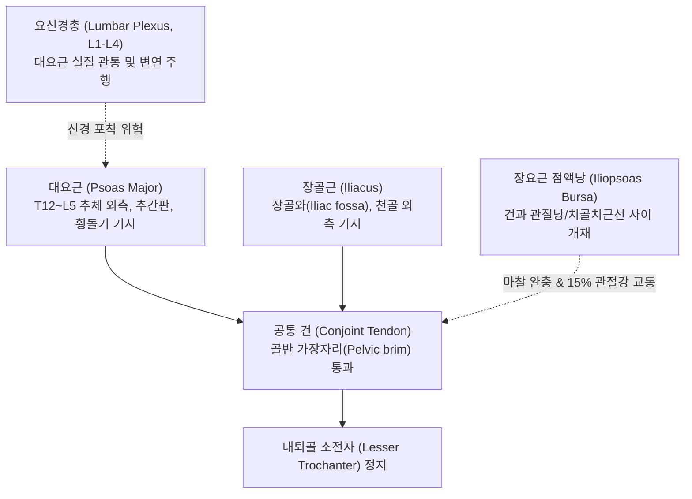
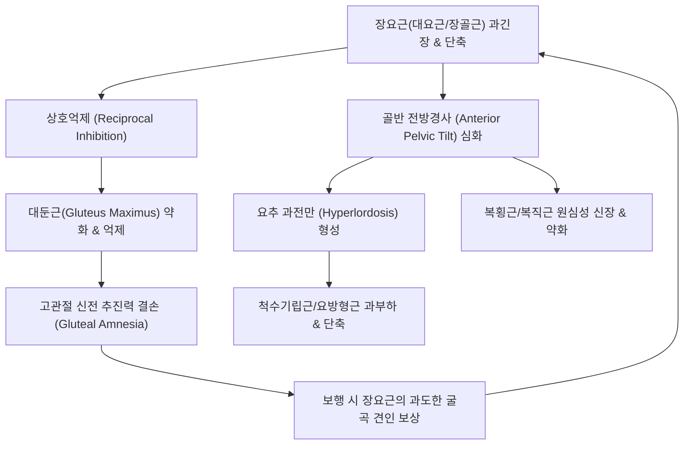
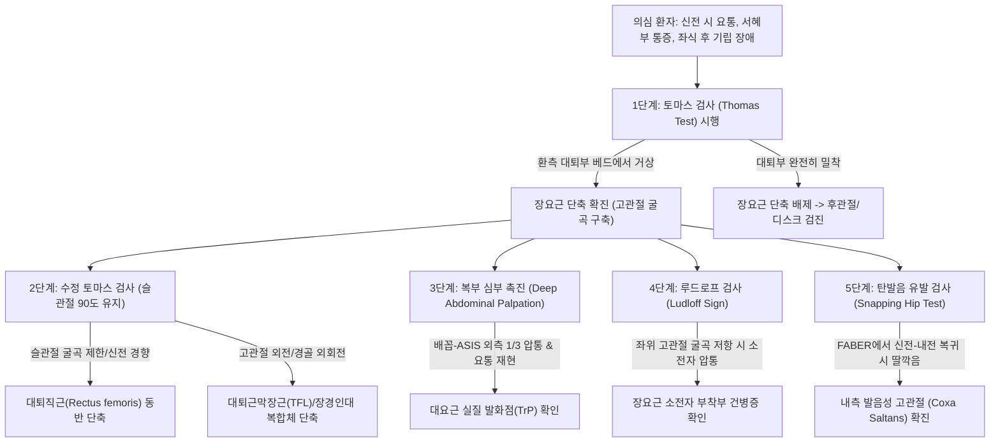
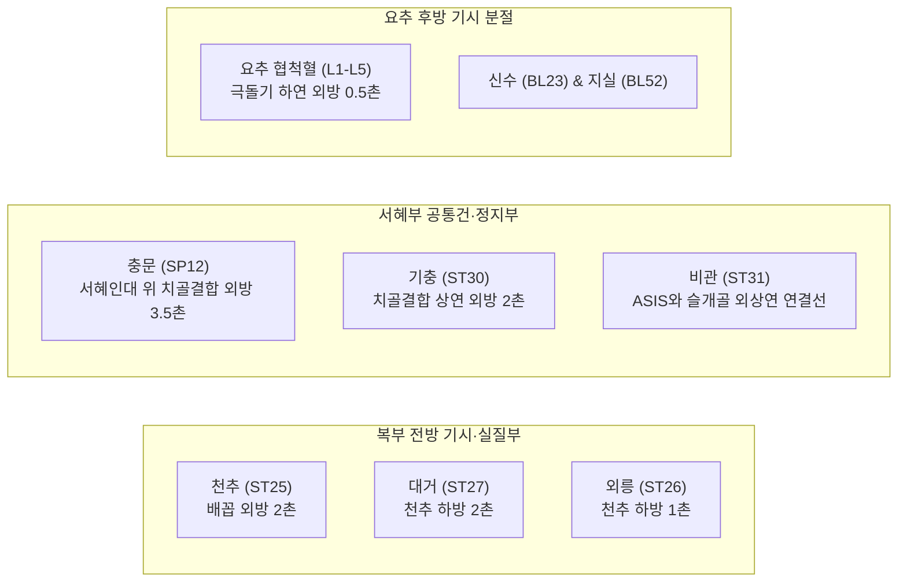
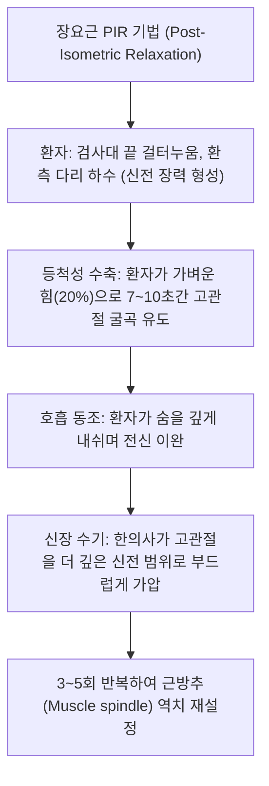
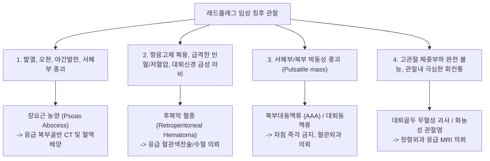

# 🩺 [[장요근 증후군]] (Iliopsoas Syndrome / 腸腰筋症候群, M65.85/M76.8)

> **핵심 3줄 요약 (Key Summary)**:
> - 📍 병소 부위 & 해부·병태생리: 흉·요추체 및 장골와에서 기시하여 [[대퇴골 소전자]]에 정지하는 [[대요근]](Psoas major)과 [[장골근]](Iliacus) 복합체의 만성 연축, 단축 및 건병증, 인체 최대의 [[장요근 점액낭]](Iliopsoas bursa) 염증, 그리고 복강 후벽을 관통하는 [[요신경총]](대퇴·폐쇄·음부대퇴·외측대퇴피신경) 포착이 복합된 요추-골반-고관절 기능부전 증후군.
> - 🚩 전형적 임상 양상 & 3대 징후: 장시간 좌식 후 기립 시 허리가 곧바로 펴지지 않는 기립 장애(Psoas posture), 바닥에 다리를 펴고 누울 때 요추가 바닥에서 붕 뜨며 발생하는 격심한 신전통, 유보행 말기 고관절 신전 시 서혜부 통증 및 절뚝거림(Psoas limp), 그리고 굴곡-외전에서 신전-내전 복귀 시 발생하는 고관절 심부 탄발음(Internal snapping hip).
> - 🛠️ 핵심 감별 검사 & 한·양방 다각적 치료 전략: [[토마스 검사]](Thomas test) 양성(환측 대퇴부 거상) 및 복부 심부/서혜인대 하방 압통으로 [[후관절 증후군]] 및 [[요추 추간판 탈출증]]과 감별하며, 복모혈([[천추]]·[[대거]]·[[외릉]]) 및 서혜부([[충문]]·[[기충]]) 심부 전침, [[신바로약침]]·[[봉약침]] 주입, 장요근 PIR(등척성 수축 후 이완) 추나 및 [[대둔근]]·[[복횡근]] 활성화 훈련을 통합 적용.
> - ⚠️ 응급 의뢰 레드플래그 & 악화 요인: 원인 불명의 발열, 체중 감소, 백혈구 증가를 동반한 장요근 농양(Psoas abscess), 항응고제 복용 환자의 후복막 혈종(Retroperitoneal hematoma), 대퇴삼각 박동성 종괴(복부대동맥류/대퇴동맥류)는 즉각적인 응급 영상의학적 검사 및 상급병원 전원 필수.

---

## 📌 목차
1. [질환 개요 & 해부학적 병태생리](#1-질환-개요--해부학적-병태생리)
2. [병태생리 메커니즘 & 생체역학적 악순환 네트워크](#2-병태생리-메커니즘--생체역학적-악순환-네트워크)
3. [임상 증상 & 이학적 검사 알고리즘](#3-임상-증상--이학적-검사-알고리즘)
4. [감별 진단 매트릭스](#4-감별-진단-매트릭스)
5. [한의 통합 치료 프로토콜](#5-한의-통합-치료-프로토콜)
6. [양방 치료 & 병용·의뢰 기준](#6-양방-치료--병용의뢰-기준)
7. [재활 운동 & 생활습관 티칭 가이드](#7-재활-운동--생활습관-티칭-가이드)
8. [💡 사용자 진료실 핵심 필기 & 임상 노하우 (Melt-In)](#8--사용자-진료실-핵심-필기--임상-노하우-melt-in)
9. [출처 및 학술 참고 문헌](#9-출처-및-학술-참고-문헌)

---

## 1. 🩺 질환 개요 & 해부학적 병태생리

### 1) 장요근 복합체의 기능 해부학
[[장요근]](Iliopsoas muscle complex)은 체간(Trunk)과 하지(Lower extremity)를 직접 연결하는 인체 유일의 다관절 심부 코어 근육 복합체이다. 이는 해부학적으로 독립된 두 개의 근육인 [[대요근]](Psoas major)과 [[장골근]](Iliacus), 그리고 인구의 약 40~50%에서만 관찰되는 퇴화성 근육인 [[소요근]](Psoas minor)으로 구성된다.

* **대요근 (Psoas Major)**:
  * **기시**: 천층(Superficial part)은 T12~L4 척추체 외측면 및 인접 추간판 섬유륜 변연부에서 기시하며, 심층(Deep part)은 L1~L5 요추 횡돌기 기저부에서 기시한다. 두 층 사이에는 건궁(Tendinous arches)이 형성되어 요부 혈관과 신경이 통과한다.
  * **주행**: 척추체를 따라 하외측으로 비스듬히 주행하여 골반 가장자리(Pelvic brim)를 넘어 장골와 전면에서 장골근과 합류한다.
* **장골근 (Iliacus)**:
  * **기시**: 장골와(Iliac fossa)의 상부 2/3, 내측 장골능, 전상장골극(ASIS) 및 천골 외측 날개(Ala of sacrum) 전면에서 부채꼴 형태로 기시한다.
  * **주행**: 섬유가 수렴하여 대요근 외측에서 결합하며, 서혜인대 심부의 근열공(Muscular lacuna)을 통과한다.
* **공통건 및 대퇴골 소전자 정지부**:
  * 두 근육은 서혜인대(Inguinal ligament) 심부에서 하나의 강력한 공통 건(Conjoint tendon)을 형성한다. 대요근 섬유는 주로 건성(Tendinous)으로 이행하고 장골근 섬유는 건의 외측에 근육성(Muscular)으로 직접 부착하여 [[대퇴골 소전자]](Lesser trochanter)에 견고히 부착한다.
* **장요근 점액낭 (Iliopsoas Bursa / Iliopectineal Bursa)**:
  * 장요근 건과 고관절 전면 관절낭, 장골치골 융기(Iliopectineal eminence) 사이에 개재된 인체 최대 크기(평균 길이 5~7cm, 너비 2~4cm)의 점액낭이다.
  * 고관절의 굴곡·신전 시 팽팽한 건이 골성 돌기를 타넘을 때 발생하는 극심한 전단 마찰력을 완충한다. 전체 성인 인구의 약 15%에서는 점액낭이 고관절 활액막강(Hip joint synovial cavity)과 직접 연통되어 있어, 고관절 내부 관절염이 점액낭염으로 파급되거나 역으로 점액낭의 염증이 고관절염을 모방할 수 있다.
* **횡격막(Diaphragm)과의 근막적 연속성**:
  * 대요근의 최상부 기시 섬유는 [[횡격막]]의 내측 활모양인대(Medial arcuate ligament)와 교차 결합하며 결합조직망을 공유한다. 이는 호흡 패턴 부전(과호흡, 흉식 호흡) 시 횡격막 긴장이 대요근의 긴장성 연축으로 직접 전이되고, 반대로 대요근 단축이 흉요추 연접부 안정성과 횡격막 운동성을 제한하는 생체역학적 상호작용의 해부학적 근거가 된다.

---

## 2. ⚡ 병태생리 메커니즘 & 생체역학적 악순환 네트워크

### 1) 생체역학적 역설과 요추 신전 증후군 (Lumbar Extension Syndrome)
장요근은 개방 사슬(Open kinetic chain)과 폐쇄 사슬(Closed kinetic chain)에서 전혀 다른 생체역학적 작용을 발휘한다:
* **하지 자유 상태 (Open Chain)**: 대퇴골을 체간 쪽으로 끌어올리는 인체 최강의 고관절 굴곡근(Primary hip flexor)이자 외회전 보조근으로 작용한다.
* **하지 고정 직립 상태 (Closed Chain)**:
  * 대요근의 벡터는 요추를 전하방(Anteroinferior)으로 강하게 끌어당기는 전단력(Anterior shear force)을 발생시킨다.
  * 장요근이 단축되면 골반을 전방으로 회전시켜 [[골반 전방경사]](Anterior pelvic tilt)를 유발하고, 이에 대한 보상으로 [[요추 전만]](Lumbar lordosis)이 병적으로 심화된다.
  * 요추 전만이 심화되면 후방 [[후관절]](Facet joint)의 관절면 접촉 압력이 급증하고 추간공 및 척추관의 직경이 협소해진다. 따라서 환자는 체간을 뒤로 젖히는 신전(Extension) 동작이나 바닥에 다리를 펴고 눕는 자세에서 극심한 요통을 겪는 전형적인 [[요추 신전 증후군]]을 나타낸다.

### 2) 하부 교차 증후군(Lower Crossed Syndrome)과 근육 불균형 네트워크
얀다(Vladimir Janda)의 [[하부 교차 증후군]]에서 장요근은 중심적인 과긴장-단축 근육군(Hypertonic/Shortened group)에 속한다.

* **상호억제에 의한 둔근 약화**: 장요근의 과긴장은 척수 반사성 상호억제(Reciprocal inhibition)를 통해 길항근인 [[대둔근]](Gluteus maximus)을 억제·약화시킨다('둔근 기억상실증', Gluteal amnesia). 보행 시 고관절 신전 추진력이 상실되면 체간은 이를 보상하기 위해 요추 기립근과 장요근을 더 과도하게 동원하는 악순환에 빠진다.
* **복벽 심부 안정화 실패**: 복횡근(Transverse abdominis)과 내복사근의 긴장도가 떨어져 복압(Intra-abdominal pressure, IAP) 유지 기전이 붕괴되고, 요추 분절의 안정성이 대요근의 장력에만 의존하게 된다.

### 3) 장요근 건병증 및 내측 발음성 고관절(Coxa Saltans Interna)
* **건병증 및 점액낭염**:
  * 고관절 굴곡-신전 동작이 반복될 때 팽팽해진 장요근 건이 장골치골 융기, 대퇴골두 전면, 또는 비구 전방 테두리 위를 활시위처럼 강하게 압박하며 왕복 마찰을 일으킨다.
  * 마찰이 지속되면 장요근 점액낭에 무균성 삼출액이 고이며 비후되는 [[장요근 점액낭염]](Iliopsoas bursitis)이 발생하고, 대퇴골 소전자 부착 건 실질에는 점진적인 교원섬유 파열, 혈관신생, 점액변성 및 석회화가 진행되어 만성 [[장요근 건병증]](Iliopsoas tendinopathy)으로 이행한다.
* **내측 탄발음(Internal Snapping Hip) 발생 기전**:
  * 고관절이 굴곡·외전·외회전(FABER 자세)된 상태에서 신전·내전·내회전 위치로 급격히 전환될 때, 장요근 건이 외측에서 내측으로 이동하며 장골치골 융기나 대퇴골두 전면의 융기를 '튕기듯' 타고 넘어가면서 발생한다.
  * 이는 환자 본인뿐 아니라 진료실 검사자에게도 둔탁한 "뚝" 소리(Audible click/clunk)와 함께 심부 통증을 격발한다.

### 4) 요신경총(Lumbar Plexus) 분지 포착 메커니즘
대요근은 해부학적으로 요신경총(L1~L4)의 신경간들을 근육 실질 내부 또는 변연부에서 직접 감싸고 있다. 대요근의 비후, 섬유화 및 구축은 인접 신경을 기계적으로 포착(Nerve entrapment)하여 복합적인 위성 통증과 가성 하지 방사통을 유발한다:

| 포착 신경 | 주행 분절 및 해부학적 관계 | 포착 시 임상 양상 |
| :--- | :--- | :--- |
| **[[대퇴신경]]** (Femoral N., L2-L4) | 대요근 외측 하부 변연을 뚫고 나와 장골근 사이 구(Groove)를 지나 서혜인대 심부 근열공 통과 | 대퇴 전면부의 찌릿한 방사통, 대퇴사두근 근력 약화, 계단 보행 시 무릎 무너짐(Buckling), 슬개건 반사 저하 |
| **[[폐쇄신경]]** (Obturator N., L2-L4) | 대요근 내측 변연을 따라 골반강으로 하강하여 폐쇄공(Obturator foramen) 통과 | 서혜부 심부 및 사타구니 안쪽, 대퇴 내전근(Adductors) 부위의 뻐근한 연관통 및 내전 저항 시 통증 |
| **[[음부대퇴신경]]** (Genitofemoral N., L1-L2) | 대요근 복측(Ventral) 근육 실질을 직접 관통하여 전면으로 출현, 음부지/대퇴지로 분지 | 서혜부 주름 부위, 대퇴삼각 상부, 음낭/대음순의 작열통(Burning pain), 서혜부 접촉 과민증 |
| **[[외측대퇴피신경]]** (LFCN, L2-L3) | 대요근 외측 변연에서 나와 장골근을 비스듬히 가로질러 ASIS 내하방 서혜인대 통과 | 대퇴 전외측면의 감각 둔마, 저림, 작열통 ([[이상감각성 대퇴신경통]], Meralgia Paresthetica) |
| **[[상둔피신경]]** (Superior Cluneal N., L1-L3 후지) | 대요근 단축에 따른 요추-천골 분절 변위로 2차적으로 요배근막 관통부에서 견인·압박 | 둔부 상부 및 장골능(Iliac crest) 후방을 따라 쑤시는 연관통 및 둔통 |

---

## 3. 🔍 임상 증상 & 이학적 검사 알고리즘

### 1) 체위별 통증 발현 특성과 4대 주소증 (원문 필기 100% 반영)
* **체위 변화에 따른 극명한 악화 양상**:
  1. **오래 앉아 있을 때**: 고관절 90도 굴곡 상태가 지속되면 단축된 장요근 내부 압력과 허혈성 대사산물이 축적되어 하복부 심부 및 요추부에 묵직하고 뻐근한 통증이 발생한다.
  2. **앉아 있다가 일어설 때**: 좌식 상태에서 직립 상태로 전환 시, 단축된 장요근이 급격히 신장 스트레스를 받으면서 요추체를 앞쪽으로 강하게 견인한다. 환자는 허리를 곧바로 펴지 못하고 엉거주춤하게 손으로 무릎이나 허벅지를 짚고 단계적으로 상체를 펴야 한다.
  3. **오래 걸을 때 (Psoas Limp)**: 보행 주기 중 유보행(Terminal stance phase) 말기에 환측 고관절이 후방으로 충분히 신전되어야 하는데, 장요근 구축으로 인해 신전이 차단된다. 이로 인해 보폭(Stride length)이 급격히 짧아지고 환측 골반을 회전시키며 절뚝거리는 파행이 나타난다.
  4. **바닥에 다리를 펴고 똑바로 누울 때 (Supine position)**: 침대나 바닥에 다리를 곧게 펴고 누우면 고관절 신전 장력이 요추를 전방으로 강하게 들어 올려 **요추 아치가 바닥에서 주먹 하나가 들어갈 정도로 붕 뜨게 된다**. 이로 인해 후관절과 신경근이 압박되어 극심한 신전통이 격발되며, 환자는 본능적으로 무릎을 굽히거나 무릎 밑에 베개를 받쳐야만 통증이 경감된다.
* **복합 방사통 영역**:
  * 요추-천추 연접부의 둔통 및 편측 요통.
  * 서혜부(사타구니) 심부 전면 및 치골 결합부 주변의 날카로운 압통.
  * 둔부 상부(상둔피신경 영역) 및 천장관절 주변으로의 연관통.
  * 대퇴 전내측을 타고 무릎 앞쪽(슬개골 상부)까지 이어지는 신경 포착성 저림.

### 2) 이학적 검사 알고리즘
장요근 증후군 확진을 위해서는 단계별 신체 검사가 체계적으로 시행되어야 한다.

1. **토마스 검사 (Thomas Test) - 표준 진단법**:
   * 환자를 검사대 끝에 앙와위로 눕힌 후, 양손으로 건측 무릎을 가슴 쪽으로 완전히 끌어당기게 하여 골반을 후방 경사시키고 요추 전만을 편평하게 제거한다.
   * **양성 판정**: 환측 고관절이 0도 신전 위치에 도달하지 못하고 검사대 바닥에서 허공으로 들려 올라감(Hip flexion contracture).
2. **수정 토마스 검사 (Modified Thomas Test)**:
   * 환자의 둔부를 검사대 가장자리에 걸치게 하여 하지가 베드 밖으로 늘어지도록 자세를 취함.
   * 건측 무릎을 가슴으로 당길 때:
     * 대퇴부가 허공으로 들리면서 무릎은 90도 굴곡을 유지함 $\rightarrow$ **순수 [[장요근]] 단축**.
     * 대퇴부는 바닥에 닿으나 무릎이 90도 이하로 펴짐(신전) $\rightarrow$ **[[대퇴직근]](Rectus femoris) 단축**.
     * 대퇴부가 외전(Abduction)되고 외측 장경인대 띠가 팽팽해짐 $\rightarrow$ **[[대퇴근막장근]](TFL) 및 장경인대 단축** (J-sign).
3. **루드로프 징후 (Ludloff's Sign)**:
   * 환자를 의자에 앉히고 무릎을 90도 굴곡시킨 상태에서, 대퇴부를 위로 들어 올리게(고관절 굴곡) 저항을 가한다.
   * 대퇴골 소전자에 부착된 장요근 건에 강한 장력이 집중되면서 사타구니 깊은 곳에 극심한 통증이 격발되면 양성이다.
4. **복부 심부 촉진 (Deep Abdominal Palpation)**:
   * 환자를 앙와위로 눕히고 양 무릎을 가볍게 세워 복벽 근육을 이완시킨다.
   * 배꼽과 전상장골극(ASIS)을 잇는 가상 선의 외측 1/3 지점(복직근 외측연)에서 손가락을 후복벽 방향으로 비스듬히 깊게 압박한다.
   * 단축된 대요근을 압박할 때 단단한 로프 형태의 긴장 띠(Taut band)가 촉진되며, 환자가 평소 호소하던 요추 및 서혜부 통증이 방사상으로 재현된다.
5. **서혜부 대퇴삼각 심부 압통 촉진**:
   * 서혜인대 바로 아래, 대퇴동맥 맥박의 외측 1~1.5cm 지점을 심부 촉진하여 장요근 건 및 점액낭 부위의 국소 압통과 부종을 확인한다.

---

## 4. 🔀 감별 진단 매트릭스

장요근 증후군은 요통과 서혜부 통증을 동시에 유발하므로, 척추 질환, 고관절 관절내 병변, 내장기 질환과의 정밀 감별이 필수적이다.

| 감별 질환 | 주요 통증 부위 | 신전 시 요통 | 토마스 검사 | 핵심 이학적 검사 및 감별 포인트 |
| :--- | :--- | :---: | :---: | :--- |
| **[[장요근 증후군]]** | 서혜부 전면, 요추-골반부, 대퇴 전내측 | **악화** | **양성 (대퇴 들림)** | 복부 심부/서혜부 압통, 앙와위 다리 펴면 요추 아치 붕 뜸, 기립 시 허리 펴기 곤란 |
| **[[후관절 증후군]]** | 요추 극돌기 외측 1.5cm 국소부, 둔부 | **악화** | 음성 (베드 밀착) | [[켐프 검사]](Kemp test) 양성, 앙와위 직립 시 요통 없음, 다리 들어 올려도 요추 전만 왜곡 없음 |
| **[[요추 추간판 탈출증]]** | 요추 중심부, 둔부, 종아리, 족부 | 완화 (굴곡 시 악화) | 음성 | [[하지직거상 검사]](SLR) 양성, 피부분절(Dermatome) 감각 저하, 기침/복압 상승 시 악화 |
| **[[고관절 대퇴비구 충돌증후군]](FAI) / 비구순 파열** | 서혜부 심부 (C-sign), 고관절 외측 | 무관 (굴곡·내회전 악화) | 음성 (구축 시 위양성) | FADIR 검사(굴곡-내전-내회전 찝힘) 양성, 고관절 회전 시 날카로운 관절내 서혜통, 골반 X-ray 비구 돌출 |
| **[[내전근 건염]](Adductor Tendinopathy)** | 서혜부 내측, 치골 결합부 부착부 | 무관 | 음성 | 고관절 저항 내전 검사(Squeeze test) 시 사타구니 안쪽 통증, 치골 결합부 건 부착부 국소 압통 |
| **[[이상감각성 대퇴신경통]](Meralgia Paresthetica)** | 대퇴 전외측면 (L2-L3 피부분절) | 경미 | 음성 | 순수 감각 신경 장애(근력 약화 없음), ASIS 내측 1cm 지점 티넬 징후(Tinel's sign) 양성 |
| **급성 충수염 (Appendicitis)** | 우하복부(McBurney point) | 우측 신전 시 악화 (Psoas sign) | 위양성 가능 | 반발 압통(Rebound tenderness), 발열, 백혈구 증가증, 복부 초음파/CT 충수 직경 >6mm |
| **장요근 농양 (Psoas Abscess)** | 하복부, 서혜부, 요배부 심부 | 극심한 악화 | 강양성 | 발열, 오한, 야간 발한, 적혈구침강속도(ESR)/CRP 급상승, 당뇨/면역저하 병력, 조영증강 CT 확인 |

---

## 5. 🌿 한의 통합 치료 프로토콜

### 1) 한의학적 변증 분형 (Pattern Identification)
* **기체어혈(氣滯瘀血)**:
  * 장시간 부동 좌식, 급격한 체간 과신전 손상, 또는 무거운 물건을 들다 삐끗한 후 발생.
  * 서혜부와 요추부에 찌르는 듯한 고정성 통증(刺痛), 야간통 심화, 허리를 전혀 펴지 못함. 설암(舌暗), 어반(瘀斑), 맥현삽(脈弦澁).
* **한습조락(寒濕阻絡)**:
  * 한랭하고 습한 환경에 장시간 노출되거나 찬 바닥에서 수면 후 장요근 건막이 수축되어 발생.
  * 요배부 및 서혜부가 무겁고 뻣뻣하게 굳음(重着感), 아침 기상 시 통증이 가장 심하고 따뜻하게 온찜질을 하거나 움직이면 경감됨. 설담태백니(舌淡苔白膩), 맥침완(脈沈緩).
* **간신휴손(肝腎虧損)**:
  * 만성 요통 환자, 고령자, 다산(多産) 여성의 퇴행성 근막 섬유화 및 골반 불균형.
  * 허리와 무릎이 시리고 힘이 없으며(腰膝酸軟), 오래 서 있거나 걸으면 사타구니와 다리가 당기고 힘이 빠짐. 탄발음이 만성화됨. 설홍소태(舌紅少苔), 맥침세무력(脈沈細無力).

### 2) 정밀 침구 및 전침 치료 (Acupuncture & Electroacupuncture)
대요근은 해부학적으로 후복강 깊은 곳에 위치하므로, 복부 전방 접근, 서혜부 정지부 접근, 요추 후방 협척혈 접근의 3차원 배혈을 적용한다.

* **복부 전방 접근 심부 자침**:
  * **주요 혈위**: [[천추]](ST25), [[대거]](ST27), [[외릉]](ST26).
  * **자침 수기법**: 환자를 앙와위로 눕히고 양 무릎을 굴곡시켜 복벽을 완전히 이완시킨 후, 복부 대동맥의 박동(Pulsation)을 엄지손가락으로 촉진하여 내측으로 안전하게 밀어 보호한다. 박동 외측 2~3cm 지점에서 0.30×75mm~90mm 멸균 장침을 사용하여 복직근 후엽과 후복벽을 향해 직자(Perpendicular insertion)로 40~60mm 천천히 진입한다. 대요근 피막에 도달하면 묵직한 득기감(得氣)과 함께 요추 심부 및 서혜부로 방사되는 감각을 유도한다.
* **서혜부 정지부 접근 자침**:
  * **주요 혈위**: [[충문]](SP12), [[기충]](ST30), [[비관]](ST31).
  * **자침 수기법**: 대퇴삼각 부위에서 대퇴동맥의 맥박을 검지로 촉진하여 내측으로 밀착 보호한 뒤, 동맥 외측 1~1.5cm 지점(대퇴신경 주행로 외측 안전 영역)에서 소전자를 향해 후하방으로 30~50mm 진입한다. 대퇴신경 자극으로 인한 전격통(Sharp electric sensation)이 발생하면 즉시 침을 2~3mm 후퇴하여 심부 건막과 점액낭 주위에 위치시킨다.
* **전침 치료 파형**:
  * 천추-대거 또는 요추 협척혈-비관혈 사이에 전침을 연결하고, 2Hz의 저주파 연속파 또는 2/100Hz 혼합파를 20분간 통전하여 강직된 대요근 운동신경종판의 과도한 아세틸콜린 분비를 차단하고 근이완 및 혈류 순환을 촉진한다.

### 3) 초음파 유도하 및 랜드마크 침도치료 (Acupotomy)
* **적응증**: 보존적 침구 치료에 반응하지 않는 만성 장요근 건병증, 대퇴골 소전자 부착부의 석회화 및 섬유성 유착, 극심한 내측 발음성 고관절.
* **시술 방법**:
  * **대퇴골 소전자 부착부 침도 박리**: 환자를 앙와위에서 환측 고관절을 약간 굴곡·외전·외회전시킨 상태(소전자가 전면으로 노출됨)로 위치시킨다. 초음파 유도하 또는 소전자 골성 랜드마크를 확인한 후, 0.6×50mm 소침도를 자입하여 장요근 건 실질의 종축 방향과 평행하게 절개·박리(Longitudinal slicing & release)하여 건 내압을 감압하고 유착을 박리한다.
  * **장골치골 융기부 점액낭 유착 감압**: 장골치골 융기 상방에서 장요근 건과 관절낭 사이의 비후된 섬유성 점액낭 벽을 2~3회 천자하여 활액 내압을 감소시킨다.

### 4) 타깃 약침 요법 (Pharmacopuncture)
* **신바로약침 (GCSB-5)**:
  * 신경근 보호 및 항염증 효과가 입증된 자생 고유 처방 약침.
  * 대요근 복부 기시부(천추/대거 심부) 및 서혜인대 하방 장요근 건초 주변에 각 1.0~2.0cc를 주입하여 국소 염증성 사이토카인(TNF-α, IL-1β) 및 COX-2 발현을 억제하고 신경 포착성 부종을 신속히 소퇴시킨다.
* **중성어혈약침 (中性瘀血藥鍼)**:
  * 급성 연축기 및 기체어혈증 환자에게 적용.
  * 소전자 부착부 및 복모혈에 분할 주입하여 미세혈관 순환을 개선하고 허혈성 근막 연축을 즉각 해소한다.
* **봉약침 (Sweet Bee Venom / Apitoxin)**:
  * 만성 퇴행성 장요근 건병증 및 장기적 탄발음 환자에게 0.1~0.2cc부터 점진적으로 증량 투여.
  * 강력한 항염증(Mellitin) 및 혈관신생 억제 작용을 통해 변성된 건 실질의 콜라겐 리모델링을 유도한다 (사전 알레르기 스킨 테스트 필수).

### 5) 추나의학적 중재 (Chuna Manual Therapy)

* **장요근 등척성 수축 후 이완 기법 (PIR / MET)**:
  * **자세**: 환자를 검사대 끝에 걸터눕히고, 건측 무릎은 환자가 양손으로 가슴에 끌어안게 하여 요추 전만을 제거한다. 환측 하지는 검사대 밖으로 자연스럽게 떨어뜨려 고관절 신전 방향으로 부드러운 사전 장력(Pre-tension)을 형성한다.
  * **수기**: 한의사는 한 손으로 환측 무릎 전면을 지지하고, 다른 손으로 환측 골반 ASIS를 하방으로 고정한다. 환자에게 "제가 누르는 손을 향해 무릎을 천장 쪽으로 약 20%의 가벼운 힘으로 들어 올리세요"라고 지시하며 7~10초간 등척성 저항을 제공한다.
  * **이완**: 환자에게 숨을 천천히 내쉬며 완전히 힘을 빼게 한 직후, 호흡 동조에 맞추어 환측 대퇴부를 하방으로 부드럽게 지그시 눌러 고관절 신전 가동 범위를 확장한다. 이를 3~5회 반복한다.
* **대요근 직접 근막이완술 (Direct Psoas MFR)**:
  * 환자를 앙와위로 눕히고 양 무릎을 굽힌 상태에서 시술자가 복직근 외측연으로 양 손가락을 천천히 복강 후벽 방향으로 침투시켜 대요근 섬유를 직접 접촉한다.
  * 환자의 호흡 주기(호기 시 침투)에 맞추어 장요근 긴장 띠를 외측 및 미측(Caudad)으로 부드럽게 쓸어내리며 신장시킨다.
* **골반 전방경사 교정 추나 (Innominate Posterior Rotation)**:
  * 전방 회전된 장골(Anteriorly rotated innominate)을 교정하기 위해 측와위에서 장골능을 후하방으로 지그시 유도하는 골반 교정 수기를 병행하여 천장관절 정렬을 정상화한다.

### 6) 변증별 대표 한약 처방
* **[[작약감초탕]] (芍藥甘草湯)**:
  * **구성**: 백작약 20~30g, 감초(구) 10~15g.
  * **임상 응용**: 급성기 장요근 연축으로 허리를 펴지 못하고 앙와위 직립이 불가능한 환자의 1차 선택 처방. 백작약의 Paeoniflorin과 감초의 Glycyrrhizin 성분이 상호작용하여 골격근 신경근 접합부의 과흥분을 진정시키고 근소포체 Ca2+ 재흡수를 촉진하여 강력한 진경·진통 효과를 발휘한다.
* **[[독활기생탕]] (獨活寄生湯)**:
  * **구성**: 독활, 상기생, 두충, 우슬, 세신, 진범, 복령, 백작약, 당귀, 천궁, 숙지황, 방풍, 인삼, 육계, 감초.
  * **임상 응용**: 간신부족형으로 요추 전만과 골반 경사가 고착화된 만성 장요근 건병증, 고관절 퇴행성 관절염, 요신경총 포착에 따른 하지 저림을 동반한 환자에게 보기혈(補氣血), 익간신(益肝腎), 거풍습(祛風濕) 목적으로 상용한다.
* **[[서근활혈탕]] (舒筋活血湯)**:
  * **구성**: 당귀, 백작약, 천궁, 숙지황, 창출, 도인, 홍화, 진범, 백지, 위령선, 우슬, 방기, 방풍, 용담초, 생강, 감초.
  * **임상 응용**: 기체어혈 및 풍한습이 결합하여 오래 걷거나 앉아 있을 때 서혜부와 고관절이 당기고 쑤시며 보행 파행이 나타나는 아급성·만성 환자에게 활혈거어(活血祛瘀), 서근활락(舒筋活絡)을 위해 처방한다.

---

## 6. 💊 양방 치료 & 병용·의뢰 기준

### 1) 보존적 양방 치료
* **경구 약물 요법**:
  * 비스테로이드성 소염진통제(NSAIDs: Celecoxib, Meloxicam 등)를 투여하여 급성 건막염 및 점액낭염의 화학적 염증 반응을 억제한다.
  * 중추성 근이완제(Eperisone, Tolperisone 등)를 병용하여 대요근의 반사성 근경련을 완화한다.
* **초음파 유도하 주사 요법 (Ultrasound-guided Injection)**:
  * **장요근 점액낭 주사**: 서혜인대 직하방에서 고관절 장축 초음파 스캔을 통해 장요근 건 심부와 치골치근선 사이의 점액낭에 접근한다. 대퇴동맥과 대퇴신경의 주행을 도플러로 확인한 후, 국소마취제(1% Lidocaine)와 소량의 코르티코스테로이드(Triamcinolone 20~40mg) 혼합액을 정확히 점액낭 내로 주입한다.
  * **진단적 가치**: 국소마취제 주입 직후 15분 이내에 서혜부 통증 및 토마스 검사상 신전 제한이 50% 이상 즉각 호전되면 장요근 점액낭 기인의 병변임을 확진하는 진단적 블록(Diagnostic block) 역할을 한다.
* **체외충격파 치료 (ESWT)**:
  * 대퇴골 소전자 부착부의 만성 건병증 및 석회화 환자에게 방사형(Radial) 또는 초점형(Focused) 충격파를 1,500~2,000회 적용하여 건 실질의 미세 순환을 촉진하고 혈관 재생을 유도한다.

### 2) 수술적 치료 적응증 및 술식
* **수술 적응증**:
  * 6개월 이상의 적극적인 한·양방 보존적 치료(물리치료, 주사, 침도, 추나)에도 호전이 없는 난치성 내측 발음성 고관절.
  * 고관절 전치환술(THA) 후 비구컵의 전방 돌출(Protrusion of acetabular cup)로 인해 지속적인 장요근 건 충돌 및 마찰성 건 파열이 초래된 경우.
* **대표적 수술 기법**:
  * **관절경하 장요근 건 절제술 또는 신연술 (Arthroscopic Iliopsoas Tenotomy / Fractional Lengthening)**:
    * 고관절 관절경을 통해 장골치골 융기 레벨 또는 대퇴골 소전자 부착부 레벨에서 장요근 건의 건성 부분만 선택적으로 절단하고 근육성 섬유는 보존하는 부분 절제술을 시행하여 고관절 굴곡력을 보존하면서 탄발음과 마찰을 소실시킨다.

### 3) 응급 전원 및 레드플래그 (Red Flags)

* **장요근 농양 (Psoas Abscess)**:
  * 원인 불명의 발열, 체중 감소, 백혈구 증가, 적혈구침강속도(ESR)/CRP 상승을 동반하며, 환자가 고관절을 굴곡시키고 조금만 신전해도 비명을 지르는 경우. 당뇨, 면역억제제 복용자, 척추 결핵 환자에서 호발하며 즉각 상급병원 감염내과/정형외과로 의뢰해야 한다.
* **후복막 혈종 (Retroperitoneal Hematoma)**:
  * 와파린, NOAC 등 항응고제를 복용하는 환자가 경미한 외상이나 자발적으로 요배부-하복부의 급격한 팽만과 격통, 어지럼증(저혈압), 진행성 대퇴신경 마비(대퇴사두근 근력 상실)를 보일 경우 혈종에 의한 신경총 압박이므로 즉각 응급실로 전원한다.

---

## 7. 🏃 재활 운동 & 생활습관 티칭 가이드

### 1) 절대 금기 운동 및 동작 티칭 (진료실 필수 티칭)
* ❌ **다리를 고정하고 상체를 일으키는 윗몸일으키기 (Full Sit-up)**:
  * 복직근을 강화하려는 목적으로 발을 바닥이나 기구에 고정하고 상체를 완전히 들어 올리는 싯업을 시행하면, 복직근보다 장요근이 3~4배 이상의 전단력을 발휘하여 요추체를 앞으로 강하게 꺾어버린다. 이는 장요근 증후군과 요추 후관절염을 폭발적으로 악화시킨다.
* ❌ **누워서 양다리를 들어 올리는 레그레이즈 (Double Leg Raise)**:
  * 복부 심부 코어가 약한 상태에서 양다리를 들어 올리거나 내릴 때 골반이 심하게 전방 경사되며 요추 전만이 급격히 꺾여 요추 분절 손상을 유발한다.
* ❌ **과도한 고관절 굴곡 상태로 쪼그려 앉기 (Deep Squat)**:
  * 장요근 건과 점액낭에 최대의 압박 마찰이 가해지므로 급성기에는 90도 이하의 스쿼트를 금한다.

### 2) 단계별 스트레칭 및 신장 운동
1. **하프 닐링 장요근 런지 스트레칭 (Half-Kneeling Hip Flexor Stretch)**:
   * 환측 무릎을 바닥에 대고 꿇어앉고, 건측 다리는 전방으로 90도 굽혀 세운다.
   * **핵심 티칭**: 상체를 단순히 앞으로 밀지 말고, **골반을 후방 경사(배꼽을 명치 쪽으로 끌어당겨 꼬리뼈를 말아 넣는 느낌)시키는 것이 핵심**이다. 복부와 환측 엉덩이([[대둔근]])에 강하게 힘을 준 상태에서 체중을 부드럽게 앞쪽으로 5~10cm 이동시켜 서혜부 앞쪽이 팽팽하게 당겨지도록 유도한다. 20~30초간 유지하며 3회 반복한다.
2. **소파 스트레칭 (Couch Stretch / 대퇴직근 복합 신장)**:
   * 벽면이나 소파 앞에 무릎을 꿇고 환측 발등을 벽에 세워 밀착시킨 후 상체를 직립으로 세운다. 장요근과 대퇴직근이 동시에 강력히 신장된다.

### 3) 길항근 활성화 및 코어 안정화 운동
1. **둔근 활성화 브릿지 운동 (Glute Bridge)**:
   * 앙와위로 누워 양 무릎을 세우고, 발뒤꿈치로 바닥을 밀며 엉덩이를 들어 올린다.
   * 상호억제 기전을 통해 장요근을 이완시키고 약화된 대둔근을 직접 강화한다. 요추가 과전만되지 않도록 늑골을 닫고 복압을 유지하는 것이 중요하다.
2. **복횡근 드로잉-인 (Drawing-in Maneuver) & 컬업 (Curl-up)**:
   * 바닥에 등을 대고 누워 숨을 내쉬며 배꼽을 바닥 쪽으로 납작하게 당겨 요추 아치를 바닥에 완전히 밀착시킨다.
   * 목만 가볍게 들어 올리는 맥길(McGill) 컬업을 통해 장요근의 개입 없이 순수 복벽 코어를 강화한다.

### 4) 일상생활 환경 수정 (Lifestyle Modification)
* **30분 좌식 후 기립 규칙**: 30분 이상 연속으로 앉아 있지 말고, 매 30분마다 일어나 30초간 가볍게 골반을 뒤로 펴는 고관절 신전 기립 스트레칭을 생활화한다.
* **수면 자세 교정**: 바닥에 다리를 펴고 자지 말고, 무릎 아래에 단단한 베개나 쿠션을 받쳐 고관절을 약 20~30도 굴곡 상태로 유지하거나 옆으로 누워 양다리 사이에 베개를 끼우고 수면을 취하도록 지도한다.

---

## 8. 💡 사용자 진료실 핵심 필기 & 임상 노하우 (Melt-In)

### 1) 진료실 실전 감별 3법: "후관절 증후군 vs 장요근 증후군" (원문 필기 심화 집약)
두 질환 모두 허리를 뒤로 젖히는 **신전(Extension)** 동작에서 격심한 요통을 호소하므로 임상에서 매우 빈번하게 오진된다. 다음 3가지 진료실 관찰법으로 즉각 감별한다:

| 감별 포인트 | [[장요근 증후군]] (Psoas Syndrome) | [[후관절 증후군]] (Facet Syndrome) |
| :--- | :--- | :--- |
| **① 토마스 검사 (결정적 가치)** | 건측 무릎을 가슴으로 당길 때 **환측 다리가 공중으로 번쩍 들려 올라감** (고관절 신전 제한) | 반대측 다리가 검사대 바닥에 편안하고 편평하게 밀착됨 (음성) |
| **② 앙와위 척추 아치 관찰** | 다리를 펴고 누우면 **요추가 바닥에서 주먹 하나가 들어갈 정도로 붕 떠서 극심한 신전통**을 호소하며 무릎을 세워달라고 애원함 | 똑바로 누워 다리를 펴도 요추 아치 들림이 없고 편안하게 휴식을 취함 |
| **③ 능동 하지 거상 시 요추 반응** | 누워서 다리를 들어 올릴 때 복근 약화와 장요근 과보상으로 골반이 전방 회전하며 **요추 전만이 순간적으로 꺾이듯 심화**됨 | 다리를 들어 올릴 때 요추가 심하게 꺾이지 않으며 후관절 압박 통증만 일정함 |

### 2) 서혜부 대퇴삼각(Femoral Triangle) V-A-N 안전 법칙 (Zero Complication)
서혜인대 하방 충문(SP12) 및 장요근 건초에 자침할 때는 대퇴부 주요 혈관과 신경의 해부학적 배열을 완벽히 숙지해야 한다:
* **내측에서 외측 배열 순서: V - A - N**:
  * 가장 안쪽: **V** (대퇴정맥, Femoral vein)
  * 가운데: **A** (대퇴동맥, Femoral artery)
  * 가장 바깥쪽: **N** (대퇴신경, Femoral nerve)
* **실전 자침 프로토콜**:
  1. 환자의 서혜인대 바로 아래에서 **시술자의 좌측 검지와 중지로 대퇴동맥의 박동(Femoral artery pulse)을 명확히 촉진**한다.
  2. 촉진한 대퇴동맥을 내측으로 지그시 밀어 혈관을 안전 영역으로 보호한다.
  3. **동맥 박동 지점의 외측 1~1.5cm 지점에서 직자 또는 약간 외측 사자**로 진입한다.
  4. 대퇴신경은 동맥의 바로 외측에 인접해 있으므로, 만약 환자가 허벅지 앞쪽으로 찌릿한 전격통(Electric shock)을 느끼면 신경 외막을 자극한 것이므로 **즉시 1~2mm 후퇴**시켜 침 끝의 위치를 조절해야 신경 손상을 완벽히 방지할 수 있다.

### 3) 복부 심부 자침 시 장관 및 대혈관 보호 수칙
천추(ST25), 대거(ST27), 외릉(ST26) 부위에서 대요근 심부로 장침(75~90mm)을 자입할 때의 안전 원칙:
1. **방광 배뇨 확인**: 자침 전 반드시 환자에게 소변을 보게 하여 팽창된 방광을 완전히 비우도록 한다.
2. **복벽 긴장 완화**: 환자의 양 무릎을 세우고(Flexion) 편안히 복식 호흡을 유도하여 복직근의 긴장을 푼다.
3. **복부 대동맥(Abdominal Aorta) 내측 방어**: 배꼽 좌측에서 엄지손가락으로 복부 대동맥의 박동을 깊게 촉진하여 내측으로 누른 채, 박동선 외측 2~3cm 지점에서 수직 후방으로 부드럽게 진입해야 한다. 장관(Intestine)은 침 끝이 닿으면 연동운동과 유동성으로 인해 자연스럽게 밀려나므로 과도한 염전이나 강자극 없이 일정한 속도로 진입하면 천공 위험이 없다.

---

## 9. 📚 출처 및 학술 참고 문헌

* **PubMed (PMID: 27343394)**: Anderson CN. *Iliopsoas: Pathology, Diagnosis, and Treatment.* Clin Sports Med. 2016;35(3):419-433.
  * [URL](https://pubmed.ncbi.nlm.nih.gov/27343394/)
  * `[연구 요약]` 장요근 건병증, 장요근 점액낭염, 내측 발음성 고관절 및 비구순 충돌 증후군의 기능 해부학적 역학, 초음파 영상 진단 기준 및 보존적 재활 치료 가이드라인을 체계적으로 집대성함.
* **PubMed (PMID: 31869165)**: *Psoas Syndrome.* StatPearls. 2025 Jan.
  * [URL](https://pubmed.ncbi.nlm.nih.gov/31869165/)
  * `[연구 요약]` 대요근 증후군의 병인론, 요추 전만과 골반 경사에 미치는 생체역학적 왜곡, 요신경총 포착 메커니즘 및 도수치료·물리치료 프로토콜을 규명함.
* **PubMed (PMID: 19514254)**: Grgić V. *[Iliopsoas muscle syndrome. Functional disorders: shortening, spasm and weakness of a structurally unchanged muscle].* Lijec Vjesn. 2009;131(3-4):81-86.
  * [URL](https://pubmed.ncbi.nlm.nih.gov/19514254/)
  * `[연구 요약]` 장요근 복합체의 기능적 단축 및 연축이 대퇴신경, 폐쇄신경, 외측대퇴피신경 포착과 가성 하지 방사통을 유발하는 병태생리를 심층 분석함.
* **PubMed (PMID: 32809634)**: Eldemire F, et al. *Osteopathic Manipulative Treatment: Muscle Energy and Counterstrain Procedure - Psoas Muscle Procedures.* StatPearls. 2023 Jan.
  * [URL](https://pubmed.ncbi.nlm.nih.gov/32809634/)
  * `[연구 요약]` 급·만성 대요근 연축에 대한 근에너지기법(MET/PIR) 및 카운터스트레인 수기요법의 신경생리학적 근방추 억제 기전과 임상 유효성을 검증함.
* **PubMed (PMID: 28688837)**: Capogna BM, et al. *Tendon Disorders After Total Hip Arthroplasty: Evaluation and Management.* J Arthroplasty. 2017;32(10):3249-3255.
  * [URL](https://pubmed.ncbi.nlm.nih.gov/28688837/)
  * `[연구 요약]` 인공 고관절 전치환술 후 발생하는 비구컵과 장요근 건의 기계적 충돌, 점액낭염 발생 기전 및 보존적 주사 치료와 수술적 건절제술의 적응증을 분석함.
* **척추신경추대의학회 교과서**: *추나의학 (제3판).* 척추신경추대의학회. 2019.
  * `[임상 요약]` 대요근 직접 근막이완술(MFR), 등척성 수축 후 이완(PIR) 기법, 골반 전방경사 교정 및 대둔근 상호억제 활성화 추나 프로토콜 수록.
