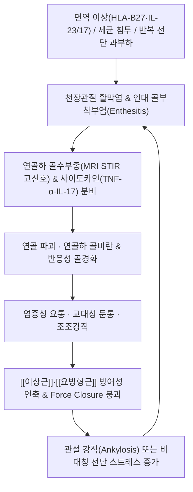

# 🩺 [[천장관절염]] (Sacroiliitis / 薦腸關節炎, ICD-10 M46.1)

> **핵심 3줄 요약 (Key Summary)**:
> - 📍 병소 부위 & 해부·병태생리: 천골([[천골]])과 장골([[장골]]) 사이의 [[천장관절]] 활막 및 하부 인대·연골하 골수(특히 전하방 1/3 활막 관절면)에 발생하는 급·만성 염증성 질환으로, 단순 기계적 [[천장관절 증후군]]과 달리 [[강직성 척추염]]·[[건선성 관절염]] 등 축성 척추관절염(axSpA)이나 세균 감염의 핵심 병변.
> - 🚩 전형적 임상 양상 & 3대 징후: 40세 이전 젊은 성인에서 3개월 이상 서서히 시작되는 **염증성 요통**(조조강직 30분 이상, 휴식 시 악화·운동 시 호전, 야간통)과 좌우 번갈아 나타나는 둔부 깊숙한 통증(Alternating buttock pain), 천장관절 압박·유발 검사 다수 양성.
> - 🛠️ 핵심 감별 검사 & 한·양방 다각적 치료 전략: [[FABER Test]], [[Gaenslen's test]], [[Sacroiliac Compression Test]], [[Sacral Thrust Test]] 등 5종 중 3개 이상 양성 시 의심하며 골반 X-ray(Modified New York) 및 **골반 MRI(STIR T2 골수부종)** 로 조기 확진; 한의 침·약침·추나 치료와 양방 [[NSAIDs]]·생물학적 제제(TNF-α/IL-17 억제제) 병용 및 감염·전신 염증 의뢰가 핵심.
> - ⚠️ 응급 의뢰 레드플래그 & 악화 요인: 고열·오한·극심한 편측 천장관절 통증·체중부하 불능 시 화농성 천장관절염(패혈증·농양 위험) 즉시 응급 의뢰, 강직 진행기·급성 골수부종기 천장관절에 대한 무리한 고강도 HVLA 교정 추나 금기.

---

## 📌 목차
1. [질환 개요 & 해부학적 병태생리](#1-질환-개요--해부학적-병태생리)
2. [병태생리 메커니즘 & 생체역학적 악순환 네트워크](#2-병태생리-메커니즘--생체역학적-악순환-네트워크)
3. [임상 증상 & 이학적 검사(Physical Exam) 알고리즘](#3-임상-증상--이학적-검사physical-exam-알고리즘)
4. [감별 진단 매트릭스 (Differential Diagnosis)](#4-감별-진단-매트릭스-differential-diagnosis)
5. [한의 통합 치료 프로토콜 (침·약침·추나·한약)](#5-한의-통합-치료-프로토콜-침약침추나한약)
6. [양방 치료 & 병용·의뢰 기준 (Conventional Treatment & Referral)](#6-양방-치료--병용의뢰-기준-conventional-treatment--referral)
7. [재활 운동 & 생활습관 티칭 가이드](#7-재활-운동--생활습관-티칭-가이드)
8. [💡 사용자 진료실 핵심 필기 & 임상 노하우 (Melt-In 잔여 심화 집약)](#8--사용자-진료실-핵심-필기--임상-노하우-melt-in-잔여-심화-집약)
9. [출처 및 학술 참고 문헌 (References)](#9-출처-및-학술-참고-문헌-references)

---

## 1. 질환 개요 & 해부학적 병태생리

* **질환 정의 및 분류**:
  * [[천장관절염]](Sacroiliitis)은 한쪽 또는 양쪽 [[천장관절]]에 염증이 발생한 상태를 총칭합니다 ([PubMed 36620475](https://pubmed.ncbi.nlm.nih.gov/36620475/)). 크게 ① **염증성·자가면역성**([[강직성 척추염]], 비방사선적 축성 척추관절염, [[건선성 관절염]], [[염증성 장질환]] 연관 관절염, 반응성 관절염), ② **감염성**(화농성 천장관절염, 브루셀라·결핵), ③ **대사·결정 유발성**([[통풍]]·가성통풍), ④ **기계적·퇴행성·임신 관련 과부하**에 의한 이차성 염증으로 구분합니다.
  * 단순 관절 기능장애인 [[천장관절 증후군]](SI joint dysfunction)과 임상적으로 반드시 감별해야 하며, 특히 척추관절염(SpA) 스펙트럼에서는 **초기 골수부종(MRI) → 연골하 미란 → 경화 및 관절 강직(Ankylosis)** 으로 진행합니다.
* **관련 해부학적 구조물**:
  * **골격 및 관절**: [[천골]] S1~S3 귀모양면(Auricular surface)과 [[장골]] 장골면으로 구성된 C자형 관절. **전하방 1/3**은 활막 관절(Synovial joint)로 초기 염증과 골수부종이 가장 먼저 시작되며, **후상방 2/3**는 골간인대와 후천장인대가 강하게 얽힌 인대 결합부(Syndesmosis)로 골부착부염(Enthesitis)이 호발합니다.
  * **인대 및 근막**: [[후천장인대]], 골간천장인대, [[전천장인대]], 천결절인대, 천극인대와 [[흉요근막]]이 폼 클로저(Form closure)와 포스 클로저(Force closure)를 형성합니다.
  * **근육 및 신경**: [[이상근]], [[대둔근]], [[중둔근]], [[척추기립근]], [[복횡근]], [[골반기저근]]이 관절 안정성을 지배하며, S1~S3 후지 및 L4~S2 신경 분지가 관절낭 감각(주로 둔부·서혜부·허벅지 후외측 연관통)을 전달합니다.

---

## 2. 병태생리 메커니즘 & 생체역학적 악순환 네트워크

### 1) 면역-염증성 손상 및 골부착부염(Enthesitis) 기전
* 축성 척추관절염에 동반되는 천장관절염은 **HLA-B27** 유전적 소인과 장내 미생물 장벽 이상, 기계적 미세손상이 겹치며 **IL-23/IL-17 축과 TNF-α** 경로가 과활성화됩니다. 인대·힘줄이 뼈에 부착하는 부위(Enthesis)와 전하방 활막 관절에 림프구·대식세포가 침윤해 연골하 골수부종(Osteitis)을 일으키고, 파골세포 활성화로 관절면 미란이 진행된 뒤 복구 과정에서 신생골이 자라며 최종적으로 관절 유합(강직)에 이릅니다.

### 2) 생체역학적 전단 부하와 감염 파급
* 외상, 다리 길이 차이, 임신(릴랙신 호르몬에 의한 인대 이완), 또는 일측 고관절·요추 강직으로 천장관절에 반복적 전단력(Shear stress)이 걸리면 후천장인대와 관절낭에 미세열상·무균성 염증이 누적됩니다. 반면 혈행성 세균 파종(주로 *Staphylococcus aureus*)이 전하방 혈관망이 풍부한 천골·장골 골간단에 정착하면 급성 화농성 골수염과 농양으로 급격히 악화됩니다 ([PubMed 36620475](https://pubmed.ncbi.nlm.nih.gov/36620475/)).

---

## 3. 임상 증상 & 이학적 검사(Physical Exam) 알고리즘

### 1) 주소증 및 염증성 요통 감별 소견
* **염증성 요통(Inflammatory Back Pain) 5대 특징**: ① 40세 이전 서서히 발병, ② **3개월 이상 지속**, ③ **30분 이상의 조조강직**, ④ **활동·운동 시 호전되고 휴식·아침 기상 시 악화**, ⑤ **야간 수면 중 후반부 통증**(일어나 걸으면 호전).
* **교대성 둔부 통증(Alternating Buttock Pain)**: 왼쪽과 오른쪽 엉덩이 깊숙한 곳(PSIS 바로 내하방)을 번갈아 가며 쑤시는 통증이 나타나며, 흔히 [[좌골신경통]]과 달리 무릎 아래 발끝까지 내려가는 신경근 결손(근력 약화·반사 소실)은 드뭅니다.
* **전신·관절 외 증상**: 포도막염(안구 충혈·눈부심), [[건선]], [[궤양성 대장염]]·[[크론병]] 병력, 아킬레스건염·족저근막염 등 말초 골부착부염 동반 여부를 반드시 문진합니다.

### 2) 필수 이학적 검사법 및 영상 진단 기준
* **천장관절 통증 유발 클러스터(Laslett Cluster)**: 단일 검사는 특이도가 낮으므로 **아래 5~6가지 유발 검사 중 3개 이상 양성**이고 추간판/중심화 징후가 배제될 때 천장관절 기원 통증의 진단 가치가 크게 올라갑니다 ([PubMed 36620475](https://pubmed.ncbi.nlm.nih.gov/36620475/)).
  * [[Fortin Finger Test]]: 환자가 한 손가락으로 정확히 PSIS 바로 내하방(1cm 이내)을 통증 부위로 지목할 때 양성.
  * [[FABER Test]] (Patrick's Test): 앙와위에서 환측 고관절 굴곡·외전·외회전(4자 다리) 후 반대측 ASIS와 환측 무릎을 아래로 누를 때 **후방 둔부 천장관절 부위** 통증 재현 (서혜부 통증은 고관절 병변 시사).
  * [[Sacroiliac Compression Test]]: 측와위에서 위쪽 장골능(Iliac crest)을 수직 아래로 압박할 때 천장관절 통증 재현.
  * [[Sacroiliac Distraction Test]]: 앙와위에서 양측 ASIS를 후외방으로 벌려 전방 천장인대에 장력을 줄 때 통증 재현.
  * [[Sacral Thrust Test]] / [[Gaenslen's test]] / [[Yeoman's test]]: 복와위 천골 후전방 압박(Sacral thrust) 및 고관절 신전 스트레스 시 천장관절 통증 유발.
* **영상 진단**:
  * **골반 단순 X-ray**: Modified New York 기준(Grade 0 정상 ~ Grade 4 완전 강직; 양측 Grade ≥2 또는 편측 Grade ≥3 시 방사선적 천장관절염). 단, 초기 3~7년은 정상일 수 있습니다.
  * **골반 MRI (STIR / T2 지방억제 영상)**: 방사선 변화 이전의 **활동성 골수부종(Bone marrow edema)** 을 포착하는 표준 조기 확진 검사이며, 치밀화골염(Osteitis condensans ilii)·부전골절·종양 감별에도 필수입니다 ([PubMed 40461872](https://pubmed.ncbi.nlm.nih.gov/40461872/)).

---

## 4. 감별 진단 매트릭스 (Differential Diagnosis)

| 감별 질환 | 호발 병소 및 원인 | 주소증 차이점 | 특이적 검사 및 영상 소견 |
| :--- | :--- | :--- | :--- |
| [[천장관절염]] (본 질환) | [[천장관절]] 활막·골수 염증 (SpA·감염 등) | 30분 이상 조조강직, 휴식 시 악화·운동 시 호전, 교대성 둔통 | 유발검사 3/5 이상 양성, MRI 골수부종, HLA-B27·CRP 상승 |
| 화농성 천장관절염 (응급) | 세균 혈행 감염 (황색포도상구균 등) | **급성 고열·오한**, 극심한 편측 둔통, 보행·체중지지 불가 | WBC·ESR·CRP 급등, 혈액배양 양성, MRI 관절농양·연부조직 침범 |
| [[천장관절 증후군]] | 기계적 염좌·인대 이완·생체역학 부정렬 | 아침 강직 짧고(<30분) 오래 앉아 있거나 계단·기립 시 악화 | 유발검사 양성이나 X-ray·MRI 염증 소견 및 혈액 염증 수치 정상 |
| [[강직성 척추염]] | 전 척추 인대·천장관절(양측 대칭 호발) | 요추 전굴·측굴·흉곽 팽창 제한 진행, 포도막염 동반 | [[Schober test]] 양성, 양측 대칭 천장관절염, 대나무 척추 |
| [[요추 추간판 탈출증]] | L4-5·L5-S1 추간판·[[좌골신경]] 포착 | 기침·전굴 시 악화, 무릎 이하 발끝 저림·근력 약화 | [[SLR test]] 양성, [[Kemp test]]·피부분절 감각 저하, 요추 MRI |
| 치밀화골염 (Osteitis condensans ilii) | 다산부 여성 장골측 기계적 스트레스 | 간헐적 하요통, 조조강직·야간통 없음 | 장골측에만 국한된 삼각형 골경화, 관절면 미란 없음 |

> 🚩 **레드플래그 감별**: 급성 발열과 체중부하 불능을 동반한 **화농성 천장관절염**, 악성 종양 전이, 천골 부전골절([PubMed 40461872](https://pubmed.ncbi.nlm.nih.gov/40461872/))은 절대 놓치지 않도록 최상단에서 배제합니다.

---

## 5. 한의 통합 치료 프로토콜 (침·약침·추나·한약)

* **침구 치료 (Acupuncture)**:
  * **국소·인접 경혈**: 상료(BL31)·차료(BL32)·중료(BL33)·하료(BL34) 팔료혈(八髎穴) 주변 천장관절 열구(관절낭 외측 경계), 관원수(BL26)·방광수(BL28)·질변(BL54)·환도(GB30) 및 단축된 [[이상근]]·[[대둔근]]·[[중둔근]]·[[요방형근]] 트리거포인트 자침.
  * **자침·전침 세팅**: 급성 염증기에는 관절강 내부 직자·과도한 염전을 피하고 인접 근막·인대 부착부에 2Hz/100Hz 혼파 저강도 전침을 15~20분 적용해 통증 전달을 차단합니다.
* **약침 치료 (Pharmacopuncture)**:
  * [[후천장인대]] 부착부 및 PSIS 내측·하방 압통점에 소염·조직 회복 목적의 봉독(과민반응 테스트 후 극소량)·신바로·황련해독 약침 또는 자하거 약침(만성 강직·인대 약화기)을 천층~중층에 분산 주입합니다(화농성 감염 의심 시 약침 전면 금기).
* **추나 치료 (Chuna Manipulation)**:
  * **금기 수기**: 활동성 골수부종·미란·척추 유합이 진행된 [[강직성 척추염]]·화농성 의심 단계에서는 천장관절 및 척추에 **고속저진폭(HVLA) 교정 스러스트를 절대 시행하지 않습니다**.
  * **안전 수기**: 염증 활성기가 가라앉은 아급성·만성기에는 과긴장된 [[이상근]]·[[장요근]]·[[대퇴이두근]]에 대한 MET(근에너지기법) 및 근막이완추나, 부드러운 고관절·요추 신연 가동술만 제한적으로 적용합니다.
* **한약 치료 (Herbal Medicine)**:
  * **습열비증(濕熱痺證 — 급성 염증·야간통·조조강직 뚜렷)**: [[사묘환]] 가감, [[창출]]·[[황백]]·[[우슬]]·[[의이인]]·[[인동등]]·[[연교]] 등 청열조습·통락 배오.
  * **어혈비증(瘀血痺證 — 자통·야간 심화·외상 후유)**: [[신통축어탕]], [[당귀수산]] 가감.
  * **간신휴허·풍한습(만성 강직·근력 약화)**: [[독활기생탕]], [[삼비탕]] 가감으로 근골·인대 지지력 보강.

---

## 6. 양방 치료 & 병용·의뢰 기준 (Conventional Treatment & Referral)

* **약물 치료 (Medication)**:
  * **1차 약제([[NSAIDs]])**: [[나프록센]], [[세레콕시브]], [[멜록시캄]], [[인도메타신]] 등을 2~4주 이상 충분한 항염 용량으로 투여(SpA에서는 단순 진통 목적이 아닌 질환 조절·염증 억제 목적).
  * **생물학적 제제 / 표적합성 DMARDs**: NSAIDs 2종 이상(총 4주)에 반응이 불충분한 활동성 축성 척추관절염에서는 TNF-α 억제제([[아달리무맙]], 에타너셉트 등) 또는 IL-17 억제제(세쿠키누맙 등), JAK 억제제를 류마티스내과에서 투여.
  * **항생제**: 화농성 천장관절염 확진 시 정맥 항생제 장기 투여(4~6주 이상).
* **비약물 시술 (Procedures)**:
  * C-arm(투시) 또는 초음파 유도 천장관절 내 스테로이드 주사(국소 염증·통증 완화), 만성 비염증성 기계적 통증 시 고주파 신경차단술(RFA).
* **한의 병용 판단 (Combination Therapy)**:
  * **병용 가능**: NSAIDs 또는 생물학적 제제 유지 중 통증·근막 연축 완화를 위한 한의 침구·온열·이완 치료. 단, **NSAIDs 장기 복용 환자에게 활혈거어 한약([[단삼]]·[[도인]]·[[홍화]]·[[천궁]] 고용량) 병용 시 위장관 출혈 위험**이 높아질 수 있으므로 위장 보호 및 처방 조절이 필요합니다.
  * **주의/중단**: 생물학적 제제(TNF-α·IL-17 억제제) 투여 중 발열·기침·주사 부위 감염 징후가 있으면 한약·약침(특히 봉독 등 면역 자극 가능 제제) 중단 후 주치의에게 연결합니다.
* **양방·전문과 의뢰 기준 (Referral Criteria)**:
  * **즉시 응급 의뢰**: 38℃ 이상 고열·오한, 극심한 편측 통증으로 체중 지지 불가(화농성 천장관절염 배제), 진행성 하지 근력 저하·대소변 장애(마미증후군).
  * **류마티스내과 정밀 의뢰**: 45세 미만 3개월 이상 염증성 요통, 교대성 둔통, 포도막염·건선·IBD 동반, 가족력 존재 시 조기 HLA-B27·골반 MRI 및 질환 조절 약물 평가를 위해 의뢰.

---

## 7. 재활 운동 & 생활습관 티칭 가이드

* **염증기 주의사항**: 급성 염증이 치솟은 상태에서의 과도한 천장관절 스트레칭(깊은 4자 다리 꺾기·비틀기)이나 고중량 데드리프트·런지는 관절낭을 자극하므로 피합니다.
* **호흡 및 척추 유연성 유지 (SpA 기준 핵심)**: 가슴 호흡(흉곽 팽창 운동), 고양이-소 자세(Cat-Camel), 흉추 신전 운동으로 척추·흉곽 강직을 예방합니다.
* **코어 Force Closure 안정화 운동**: 무통 범위 내에서 복식호흡 기반 [[복횡근]] 브레이싱, 데드버그(Dead bug), 등척성 둔근 수축, 엎드려 수건 위 흉추 펴기, 수영·아쿠아 워킹(관절 전단 부하 최소화)을 하루 15~20분 꾸준히 시행합니다.
* **일상생활 자세**: 다리 꼬고 앉기·짝다리 서기 회피, 30~40분마다 일어나 가볍게 걷기, 딱딱한 의자에 오래 앉을 때 골반 중립 쿠션 활용.

---

## 8. 💡 사용자 진료실 핵심 필기 & 임상 노하우 (Melt-In 잔여 심화 집약)

> [!tip] **진료실 실전 감별 체크리스트 (User Clinical Insight)**
> - **원장님 필기 상태**: 본 노트는 2026-11-18 신규 생성된 표준 개념 노트로, 기존 원장님 수기 필기 원문은 아직 없으며 추후 입력 시 이 블록에 100% 보존합니다.
> - **진료실 3초 감별 포인트 (실전 참고)**:
>   1. 20~30대 환자가 "허리 디스크인 줄 알고 물리치료·쉬면 나을 줄 알았는데, **아침에 일어나면 더 뻣뻣하고 30분 넘게 걸어야 풀린다**"고 하면 [[천장관절 증후군]]이나 [[요추 추간판 탈출증]]보다 축성 척추관절염 기원 [[천장관절염]]을 먼저 의심한다.
>   2. 양측 둔통이 **좌우를 번갈아 가며** 나타나고 눈 충혈(포도막염)이나 손발톱 건선·만성 설사 병력이 겹치면 X-ray가 정상이어도 류마티스내과 골반 MRI 의뢰가 환자 예후를 바꾼다.
>   3. 한쪽 엉덩이가 갑자기 불에 타듯 아프고 열이 나면 추나·약침을 잡기 전에 먼저 체온을 잰다(화농성 배제).

---

## 9. 출처 및 학술 참고 문헌 (References)

1. Lee A et al. (2022). Sacroiliitis: A Review on Anatomy, Diagnosis, and Treatment. *Advances in Orthopedics*, 2022:3283296. [PMID: 36620475](https://pubmed.ncbi.nlm.nih.gov/36620475/)
   - **[연구 요약]**: 천장관절의 활막·인대 해부학, 척추관절염·감염·퇴행성 원인별 병태생리, 이학적 유발 검사 클러스터, 영상 진단 및 주사·수술 치료를 종합 정리한 최신 리뷰.
2. De Leeuw A et al. (2025). When it is not sacroiliitis. *Skeletal Radiology*, 54(11):2433-2442. [PMID: 40461872](https://pubmed.ncbi.nlm.nih.gov/40461872/)
   - **[연구 요약]**: 자기공명영상(MRI)에서 천장관절염과 유사하게 보일 수 있는 치밀화골염·천골 부전골절·감염·종양 등 핵심 감별 질환의 영상 소견과 오진 방지 포인트를 규명한 논문.
3. 대한정형외과학회. 『정형외과학』 제8판 (척추 및 골반 질환 편). 최신의학사.
   - **[임상 교과서]**: 염증성·화농성 천장관절염과 기계적 천장관절 통증의 진단 기준 및 보존·수술 적응증 총람.
