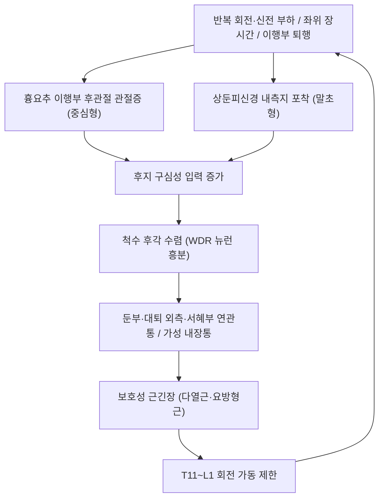

# 🩺 [[Maigne 증후군]] (Maigne Syndrome / 흉요추 이행부 증후군, ICD-10 M54.5)

> **핵심 3줄 요약 (Key Summary)**:
> - 📍 병소 부위 & 해부·병태생리: [[흉추]] 하부–[[요추]] 상부의 흉요추 이행부(T10~L2)가 병소다. 중심형은 이행부 [[후관절]] 관절증이 구심성 입력을 만들어 통증을 일으키고, 말초형은 [[상둔피신경]] 내측지(하부 흉추·상부 요추 후지에서 기원)가 [[장골능]] 부근에서 포착되어 같은 임상을 만든다.
> - 🚩 전형적 임상 양상 & 3대 징후: 허리 아래·[[장골능]] 주변의 심부 둔통, 둔부·대퇴 외측·서혜부로 번지는 연관통, 그리고 서혜부·아랫배·골반으로의 가성 내장통(pseudo-visceral pain). 허리 신전·회전에서 악화되고 굴곡·안정에서 완화되며, 하지 방사통은 있어도 신경학적 결손은 대개 없다.
> - 🛠️ 핵심 감별 검사 & 한·양방 다각적 치료 전략: 후상장골능 압통점, 피부 집기-굴림 검사(pinch-roll test), 흉추 압박 검사, T11~L1 회전 가동 제한 확인이 진단의 축이다. 침·약침은 T11~L2 [[후관절]] 투영부와 포착 신경 경로를 표적으로 하고, 흉요추 이행부 회전 교정 [[추나]]와 [[HVLA]] 수기, 신전 조절 [[운동요법]]을 조합한다.
> - ⚠️ 응급 의뢰 레드플래그 & 악화 요인: 대소변 장애·회음부 감각저하·양측 하지 근력 저하(마미증후군), 진행성 족하수, 야간통·체중감소·발열을 동반한 통증, 최근 외상 후 골절 의심, 악성종양 병력은 이 질환으로 설명하지 말고 즉시 영상검사·전원 대상으로 본다. 골다공증·항응고 치료 중인 환자에서 회전 추력 수기는 금기 또는 저진폭 가동술로 대체한다.

---

## 📌 목차
1. [질환 개요 & 해부학적 병태생리](#1-질환-개요--해부학적-병태생리)
2. [병태생리 메커니즘 & 생체역학적 악순환 네트워크](#2-병태생리-메커니즘--생체역학적-악순환-네트워크)
3. [임상 증상 & 이학적 검사(Physical Exam) 알고리즘](#3-임상-증상--이학적-검사physical-exam-알고리즘)
4. [감별 진단 매트릭스 (Differential Diagnosis)](#4-감별-진단-매트릭스-differential-diagnosis)
5. [한의 통합 치료 프로토콜 (침·약침·추나·한약)](#5-한의-통합-치료-프로토콜-침약침추나한약)
6. [양방 치료 & 병용·의뢰 기준 (Conventional Treatment & Referral)](#6-양방-치료--병용의뢰-기준-conventional-treatment--referral)
7. [재활 운동 & 생활습관 티칭 가이드](#7-재활-운동--생활습관-티칭-가이드)
8. [💡 사용자 진료실 핵심 필기 & 임상 노하우 (Melt-In 잔여 심화 집약)](#8--사용자-진료실-핵심-필기--임상-노하우-melt-in-잔여-심화-집약)
9. [출처 및 학술 참고 문헌 (References)](#9-출처-및-학술-참고-문헌-references)

---

## 1. 질환 개요 & 해부학적 병태생리

![[Maigne증후군_01_척추전장_해부도해.png|460]]
> [그림 1: 척주 전장 측면 도해 — 경추·흉추·요추·천추를 색으로 구분해 표시했다(도해 라벨은 아랍어판). 흉추(T)와 요추(L)가 만나는 흉요추 이행부가 이 질환의 병소이며, T12–L1 분절의 위치를 눈으로 확인하는 용도로 쓴다 — Henry Vandyke Carter, Gray's Anatomy Plate 111 (Wikimedia Commons, Public domain)]

![[Maigne증후군_03_흉요추_정렬_영상.png|460]]
> [그림 2: 흉요추 이행부의 시상정렬 측정 예시 — 퇴행성 흉요추 후만 환자의 전척추 측면 X선과 Cobb 각도 계측(적색 표시). 마이네 증후군 자체의 진단 영상이 아니라, 이행부 정렬을 어떤 방식으로 계측하는지 보여주는 참고 영상이다 — J Pers Med 2024 (PMID 38248737, CC BY)]

* **질환 정의 및 분류**:
  * 흉요추 이행부에서 발생한 통증이 허리·둔부·서혜부로 투사되는 증후군으로, 1980년 Maigne가 '흉요추 기원의 요통'으로 정리한 이래 흉요추 이행부 증후군 또는 마이네 증후군으로 불린다.
  * 두 가지 아형으로 나뉜다. 중심형(central variant)은 흉요추 이행부 [[후관절]]의 관절증이 구심성 입력을 증가시켜 통증을 만들고, 말초형(peripheral variant)은 [[상둔피신경]] 내측지의 포착이 원인이다. 두 아형의 임상 표현은 거의 같고, 감별은 선택적 차단의 반응으로 한다.
  * 호발 연령은 중장년이며, 흉요추 이행부는 생체역학적으로 회전 부하가 집중되는 전환 분절이라 퇴행과 기능장애가 잘 생긴다. 요통 환자에서 흔하지만 진단되지 않는 경우가 많다는 점이 리뷰의 핵심 메시지다.
* **관련 해부학적 구조물**:
  * 골격 및 관절: [[흉추]] T10~T12와 [[요추]] L1~L2, 그 사이 [[후관절]], [[극돌기]], [[횡돌기]], 그리고 하방으로 [[장골]]·[[장골능]]·[[천장관절]]이 경계를 이룬다.
  * 근육 및 근막: [[다열근]], [[척추기립근]], [[요방형근]], [[광배근]] 하부 섬유, [[복직근]]·복사근의 부착부가 이행부 안정성에 관여한다. [[대둔근]]·[[중둔근]]은 연관통이 착각되는 부위다.
  * 신경 및 혈관: [[상둔피신경]]은 하부 흉추·상부 요추 후지에서 나와 [[장골능]] 후방을 지나 둔부 피부를 지배한다. 인접으로 제12늑간신경(늑하신경)과 장골하복신경이 지나가며, 이들이 함께 자극되면 서혜부·아랫배 통증이 동반된다.

---

## 2. 병태생리 메커니즘 & 생체역학적 악순환 네트워크

![[Maigne증후군_04_T12L1_분절표시_영상.png|460]]
> [그림 3: 척추 분절 표기 관례 — 여러 모달리티 영상 패널에 T12·L1 등 분절 레벨이 표시돼 있다. 이행부 병변을 기록할 때 '어느 분절'인지 통일해 적는 훈련용 참고 영상이다 — J Clin Med 2024 (PMID 38337470, CC BY)]

### 1) 해부학적 포착 및 압박 기전
* [[상둔피신경]]은 L1~L3 후지에서 나와 [[장골능]] 후상방을 넘어 둔부 피부로 나간다. 이 통과부에서 근막·건막·지방층의 섬유성 교차부에 눌리면 국소 압통과 함께 둔부·대퇴 외측의 연관통이 생긴다.
* 후상장골능 압통점은 해부학 연구에서 장요인대 부착부 통증과 피부 후지신경 통증이 겹치는 지점으로 확인됐다. 즉 '인대 문제'와 '신경 문제'가 같은 자리에서 구별되지 않는다는 점이 이 증후군의 임상적 함정이다.
### 2) 생체역학적 연쇄 반응 (Kinetic Chain)
* 흉요추 이행부의 회전 제한은 요추 하부와 골반에서 보상성 회전을 유발해 [[천장관절]]과 고관절 부하를 키운다. 그래서 환자는 '엉치가 아프다'고 표현하면서 실제 병소는 한두 분절 위에 있는 경우가 많다.
* 흉추 신전 제한이 있으면 호흡 시 하부 늑곽의 확장이 줄고, 이는 다시 [[요방형근]]·[[다열근]] 긴장을 유지시키는 순환을 만든다.

---

## 3. 임상 증상 & 이학적 검사(Physical Exam) 알고리즘

![[Maigne증후군_02_후상장골능_랜드마크.png|420]]
> [그림 4: 골반 3D 모델에서 장골능(iliac crest)을 적색으로 표시한 도해 — 압통점을 찾는 표면 랜드마크. 실제 촉진은 후상장골능에서 시작해 아래·외측으로 2 cm 범위를 훑는다 — BodyParts3D (Wikimedia Commons, CC BY-SA 2.1 jp)]

### 1) 주소증 및 신경학적 증상
* 감각 이상: 둔부 심부의 무겁고 쑤시는 통증이 대표적이며, 대퇴 외측·서혜부·아랫배로 번지는 비분절성 연관통이 흔하다. 피부분절을 따라가는 띠 모양 저림은 오히려 [[요추 신경근병증]] 쪽 신호다.
* 운동 장애: 근력 저하는 원칙적으로 없다. 근력 저하가 확인되면 이 질환이 아니라 신경근 압박성 병변으로 판단을 바꾼다.
* 자율신경·내장 유사 증상: 하복부 불편감, 생리통 악화, 배뇨 불편 같은 가성 내장통이 동반될 수 있어 부인과·비뇨기 검사에서 이상이 없는 반복성 골반통 환자에서 한 번은 이행부를 확인해야 한다.
### 2) 필수 이학적 검사법 (Physical Examination)
* 후상장골능 압통: [[장골능]] 후방에서 압통점을 찾는다. 국소 압박 시 둔부·서혜부로의 연관통 재현이 양성 신호다.
* 피부 집기-굴림 검사(pinch-roll test): 이행부 피부·피하조직을 집어 굴리며 압통과 피부 당김 제한을 본다. 마이네 증후군 6례 증례보고에서 진단 확인에 쓰인 두 검사 중 하나다.
* 흉추 압박 검사: 흉추 극돌기를 압박·진동시켜 이행부 통증 재현 여부를 본다. 같은 증례보고에서 진단 확인 검사로 사용됐고, 치료 후 6례 중 4례에서 이 검사 소견이 호전됐다.
* T11~L1 회전 가동성: 좌위에서 흉추 회전을 좌우 비교한다. 한쪽 제한과 함께 말단에서 통증 재현이 있으면 이행부 병소를 강하게 시사한다.
* 감별용: [[SLR test]]와 슬럼프 검사는 신경근 압박 감별, 천장관절 유발 검사는 골반 병소 감별에 쓴다.

---

## 4. 감별 진단 매트릭스 (Differential Diagnosis)

| 감별 질환 | 호발 병소 및 원인 | 주소증 차이점 | 특이적 이학적 검사 소견 |
| :--- | :--- | :--- | :--- |
| [[Maigne 증후군]] (본 질환) | 흉요추 이행부 후관절·상둔피신경 | 둔부 심부통 + 서혜부·아랫배 연관통, 근력 정상 | 후상장골능 압통, 집기-굴림 양성, T11~L1 회전 제한 |
| [[요추 신경근병증]] | 추간판·협착에 의한 신경근 압박 | 피부분절을 따르는 방사통, 저림·근력 저하 동반 | [[SLR test]] 양성, 감각·근력 결손 |
| [[척추관 협착증]] | 중앙관·외측함요 협소 | 보행 시 양측 둔부·하지 파행, 굴곡 시 완화 | 신전 악화·굴곡 완화, 보행거리 단축 |
| [[천장관절 증후군]] | 천장관절 낭·인대 | 엉치 한 점 통증, 한쪽 다리로 체중 옮길 때 악화 | 골반 유발 검사 양성, 이행부 압통 없음 |
| [[요추 추간판 탈출증]] | 수핵 탈출 | 급성 방사통, 기침·재채기 악화 | [[SLR test]] 예민, 신경학적 결손 |
| [[섬유근육통]] | 중추성 통증 처리 이상 | 전신 다발성 압통, 수면·피로 문제 | 광범위 압통점, 국소 유발 검사 음성 |

---

## 5. 한의 통합 치료 프로토콜 (침·약침·추나·한약)

![[Maigne증후군_05_도수교정_손위치_실사.jpg|440]]
> [그림 5: 복와위 환자의 요추·골반부에 접촉을 잡고 교정하는 장면(근접 실사) — 접촉수 위치와 체중 전달 자세를 확인하는 용도다. 본 질환에서는 이보다 한 분절 위(T11~L1)에 접촉을 두고 회전을 잠근 뒤 짧은 추력을 준다 — Aleksander Chaibi (Wikimedia Commons, CC BY-SA 3.0)]

> 🖼️ 이미지 미확보 — 환부 실사는 이 질환에 피부 병변이 없어 대체 불가로 슬롯을 비웠고, 침 시술 실사는 CC 라이선스 확인분을 얻지 못했다(마이네 증후군 침 증례보고 Figure는 라이선스 확인 후 다음 회차 재시도).

* 침구 치료 (Acupuncture):
  * 표적은 흉요추 이행부 [[후관절]] 투영부와 포착 신경 경로다. 2023년 국내 증례보고는 T11~L2 [[후관절]]을 주 표적으로 삼고, 포착된 신경(상둔피신경·늑하신경·장골하복신경)에 따라 혈위를 추가하는 방식으로 6례를 치료해 전례에서 요통 호전, 4례에서 흉추 압박 검사 호전을 보고했다. 초록에는 개별 혈위명·자침 깊이·유침 시간이 기재돼 있지 않아, 임상에서는 표적 분절 기준으로 재구성한다.
  * 재구성 예: 협척혈 EX-B2 T11~L2 양측, 신수 BL23, 기해수 BL24, 대장수 BL25, 요양관 GV3, 명문 GV4를 축으로 하고, 둔부 연관통이 우세하면 침골(대둔근·중둔근 부착부)과 후상장골능 주변 아시혈을 더한다. 유침 20~25분, 주 2~3회, 4~6주를 기본으로 하고 반응에 따라 조정한다.
* 약침 치료 (Pharmacopuncture):
  * 이행부 후관절 주변과 후상장골능 압통점에 소량(0.1~0.3 mL/점) 주입한다. 신바로약침·자하거약침 계열을 쓰며, 둔부 심부 근육(대둔근·중둔근)은 근육층 두께를 확인하고 천자한다.
* 추나 치료 (Chuna Manipulation):
  * 중심형은 흉요추 이행부 회전 제한을 먼저 푼다. 측와위에서 골반을 고정하고 상부 체간을 회전시켜 T11~L1을 잠근 뒤 짧고 낮은 진폭의 추력을 1~2회 준다. 이후 요추 교정을 시행하는 순서가 기법 취지에 맞다. [[HVLA]] 회전 추력은 골다공증·항응고 치료·급성 압박골절에서 금기이며, 이때는 [[Maitland 관절가동술]] 등급 II~III의 저속 가동으로 대체한다.
* 한약 치료 (Herbal Medicine):
  * 급성 염증·어혈기에는 활혈거어·거풍습 방제(예: 독활기생탕 가감)를, 만성 재발성에는 보간신·온경 방제를 쓴다. 소화기 장애·와파린 병용 환자에서는 감초·당귀 용량을 조정한다.

---

## 6. 양방 치료 & 병용·의뢰 기준 (Conventional Treatment & Referral)

* 약물 치료 (Medication):
  * 단기 NSAIDs와 근이완제가 일반적이다. 신경병증성 성분이 섞여 있으면 가바펜틴 계열을 고려하나, 이 질환 자체가 신경병증성 통증은 아니라는 점을 먼저 확인한다.
  * 장기 스테로이드 경구 투여는 근거가 약하고 부작용이 커서 반복 처방하지 않는다.
* 비약물 시술 (Procedures):
  * 국소 스테로이드 주입: 흉요추 이행부 증후군에서 운동 프로그램과 국소 스테로이드 주입을 비교한 시험이 있으며, 두 접근이 함께 쓰인다. 주입은 후관절·신경 차단 형태로 시행된다.
  * 진단적 차단: 중심형과 말초형 감별, 그리고 수술적 원인 배제를 위해 영상 유도 선택적 차단을 쓰는 것이 리뷰의 권고다.
  * 도수치료: 요추 신경근병증에서 흉요추 이행부 회전 교정(Maigne 기법)을 1주 간격 3회기 시행한 무작위 시험에서 기능장애(ODI)와 하지직거상 각도가 대조군보다 개선됐다. 다만 2025년 메타분석은 척추 HVLA 추력이 신경근병증에서 단기·중기 통증을 낮추지만 장기 차이는 사라진다고 정리했다. 즉 단기 창을 여는 중재로 이해한다.
* 수술·시술 적응증 (Surgical Indication):
  * 이 질환은 원칙적으로 보존 치료 대상이다. 신경학적 결손이 진행하거나 종양·감염·골절이 확인되면 그 원인 질환의 수술 적응이 된다.
* 한의 병용 판단 (Combination Therapy):
  * 병용 가능: NSAIDs·근이완제와 침·약침·추나의 병용은 일반적이다.
  * 주의: 국소 스테로이드 주입 직후 48시간은 자침 부위 자극을 줄이고, 당뇨 환자는 주입 후 혈당 상승을 감안한다.
  * 금기: 항응고 치료 중 심부 자침·회전 추력, 발열·감염 징후가 있는 부위의 자침.
* 양방·전문과 의뢰 기준 (Referral Criteria):
  * 응급: 대소변 장애, 회음부 감각저하, 진행성 양측 하지 근력 저하.
  * 전문과: 4~6주 보존 치료에 반응이 없거나, 악성종양·골절·감염이 의심되거나, 진단적 차단이 필요한 경우 정형외과·재활의학과·통증의학과에 의뢰한다.

---

## 7. 재활 운동 & 생활습관 티칭 가이드

![[Maigne증후군_06_신전운동_도해.png|400]]
> [그림 6: 볼 위에서 시행하는 허리 신전 운동 도해(선화) — 실제 사진이 아니라 동작 구조를 보여주는 삽화다. 초기에는 신전보다 회전 조절과 복부 압력 유지 훈련을 먼저 넣는다 — Everkinetic (Wikimedia Commons, CC BY-SA 3.0)]

* 이완 및 스트레칭 (Stretching): [[요방형근]]·[[광배근]] 하부·둔부 근막을 30초×3세트로 이완한다. 신전 제한이 뚜렷한 환자에서 먼저 시행한다.
* 강화 및 안정화 운동 (Strengthening): [[다열근]]·[[복횡근]] 활성(복부 당김 10초×10회), [[중둔근]] 측와위 외전, [[척추기립근]] 저부하 등척성 수축을 주 3회 배치한다. 신전 운동은 통증이 3/10 이하일 때만 도입한다.
* 회전 조절 훈련: 흉추 회전 가동성 운동(사각 자세에서 팔 벌려 회전)을 좌우 대칭으로 넣는다. 이행부 회전 제한을 남겨두면 요추 보상이 재발한다.
* 일상생활 자세 티칭 (Ergonomics): 장시간 좌위에서 골반을 말고 앉는 자세를 교정하고, 30~40분마다 일어나 흉추 신전·회전을 10회 시행하도록 지도한다. 무거운 물건은 몸 가까이에서 들고, 회전하며 드는 동작을 피한다.

---

## 8. 💡 사용자 진료실 핵심 필기 & 임상 노하우 (Melt-In 잔여 심화 집약)

* 상부 섹션에 미처 다 담지 못한 고유 원문 필기:
  * 관련 신경 노트([[상둔피신경]])에 남아 있던 원장 필기 — 치료포인트를 L1 레벨 또는 [[요방형근]]에서 잡는다. 이행부 병소를 L1 레벨에서 다루는 관점이 이 질환의 핵심과 정확히 일치한다.
* 진료실 실전 감별 & 치료 노하우:
  * 실전 문진 체크리스트: ① 아픈 곳을 손으로 가리키면 엉치뼈 위·장골능 부근인가 ② 아랫배·서혜부가 같이 불편한가 ③ 부인과·비뇨기 검사에서 이상이 없었는가 ④ 허리를 젖힐 때 아픈가, 숙일 때 편한가 ⑤ 다리 힘이 빠지거나 저린 부위가 피부분절을 따르는가.
  * 치료 순서 및 손맛 노하우: 이행부 회전 제한 확인 → 측와위 저속 가동으로 예비 이완 → 협척혈 T11~L2 자침 → 짧은 회전 추력 1~2회 → 기립 후 회전 재측정. 시술 직후 회전 가동범위가 5~10도 이상 늘고 둔부 연관통이 줄면 반응군으로 본다.
  * 환자 티칭 스크립트: "허리 아랫부분과 등허리가 만나는 관절이 굳어서 엉덩이와 사타구니 쪽으로 통증이 번지는 상태입니다. 다리 신경이 눌린 것과 달리 힘이 빠지지는 않는 것이 특징입니다. 관절을 부드럽게 풀고 그 위·아래가 다시 굳지 않게 움직이는 습관을 만드는 것이 치료의 핵심입니다."

---

## 9. 출처 및 학술 참고 문헌 (References)

1. Maigne R (1980). *Low back pain of thoracolumbar origin*. **Archives of Physical Medicine and Rehabilitation**, 61(9), 389-395. [PMID 6448030](https://pubmed.ncbi.nlm.nih.gov/6448030/)
   - [연구 요약]: 흉요추 기원 요통 개념을 정립한 원저로, 이행부 병소가 허리·둔부 통증을 만든다는 임상 관찰의 출발점이다.
2. Maigne JY, Maigne R (1991). *Trigger point of the posterior iliac crest: painful iliolumbar ligament insertion or cutaneous dorsal ramus pain? An anatomic study*. **Archives of Physical Medicine and Rehabilitation**, 72(10), 734-737. [PMID 1834038](https://pubmed.ncbi.nlm.nih.gov/1834038/)
   - [연구 요약]: 후상장골능 압통점의 정체를 해부학적으로 검토해, 장요인대 부착부 통증과 피부 후지신경 통증이 같은 지점에서 겹친다는 것을 보였다.
3. Randhawa S, Garvin G, Roth M, Wozniak A, Miller T (2022). *Maigne Syndrome - A potentially treatable yet underdiagnosed cause of low back pain: A review*. **Journal of Back and Musculoskeletal Rehabilitation**, 35(1), 153-159. [PMID 34151827](https://pubmed.ncbi.nlm.nih.gov/34151827/) · [DOI](https://doi.org/10.3233/BMR-200297)
   - [연구 요약]: 28편을 정리해 중심형(후관절 관절증)과 말초형(상둔피신경 내측지 포착) 아형, 특이 진찰, 영상 유도 차단 진단, 조기 치료의 중요성을 정리한 종합 리뷰다.
4. Lee H, Chae H, Ryu M, Yang C, Kim S (2023). *Acupuncture for patients with Maigne's syndrome: A case series*. **Medicine (Baltimore)**, 102(23), e33999. [PMID 37335654](https://pubmed.ncbi.nlm.nih.gov/37335654/) · [DOI](https://doi.org/10.1097/MD.0000000000033999)
   - [연구 요약]: 6례에서 집기-굴림 검사·흉추 압박 검사로 진단을 확인하고, T11~L2 후관절과 포착 신경별 혈위에 침을 시행해 전례 요통 호전, 4례에서 흉추 압박 검사 호전을 보고했다.
5. Ségui Y, Ramírez-Moreno J (2021). *Global physiotherapy approach to thoracolumbar junction syndrome. A case report*. **Journal of Bodywork and Movement Therapies**, 25, 6-15. [PMID 33714512](https://pubmed.ncbi.nlm.nih.gov/33714512/)
   - [연구 요약]: 흉요추 이행부 증후군에서 전신적 물리치료 접근(가동·운동·자세 교육)으로 기능이 회복된 증례를 단계별로 기술했다.
6. Alptekin K, Örnek NI, Aydın T (2017). *Effectiveness of Exercise and Local Steroid Injections for the Thoracolumbar Junction Syndrome (The Maigne's Syndrome) Treatment*. **The Open Orthopaedics Journal**, 11, 467-477. [PMID 28694884](https://pubmed.ncbi.nlm.nih.gov/28694884/)
   - [연구 요약]: 흉요추 이행부 증후군에서 운동 프로그램과 국소 스테로이드 주입을 적용한 치료 결과를 보고한 임상 연구로, 보존 치료 축 구성의 근거가 된다.
7. Ghasabmahaleh SH, Rezasoltani Z, Dadarkhah A, et al. (2021). *Spinal Manipulation for Subacute and Chronic Lumbar Radiculopathy: A Randomized Controlled Trial*. **The American Journal of Medicine**, 134(1), 135-141. [PMID 32931763](https://pubmed.ncbi.nlm.nih.gov/32931763/) · [DOI](https://doi.org/10.1016/j.amjmed.2020.08.005)
   - [연구 요약]: 요추 신경근병증 44명에서 흉요추 이행부 회전 교정(Maigne 기법) 3회기가 기능장애와 하지직거상 각도를 개선했고 3개월까지 유지됐다.
8. Giovannico G, Cioeta M, Giannotta G, et al. (2025). *Efficacy of Spine High-Velocity Low-Amplitude Thrust Manipulations in Patients With Radiculopathy: A Systematic Review With Meta-Analysis*. **Journal of Orthopaedic and Sports Physical Therapy**, 55(10), 649-660. [PMID 41002235](https://pubmed.ncbi.nlm.nih.gov/41002235/)
   - [연구 요약]: 11편·991명 메타분석에서 HVLA 추력은 단기·중기 통증을 낮췄으나 장기 차이는 사라졌고 근거 확실성은 매우 낮음~중등도였다.

## 함께 보기
- [[상둔피신경]] · [[흉추]] · [[요추]] · [[후관절]] · [[장골능]] · [[장골]] · [[천장관절]] · [[다열근]] · [[척추기립근]] · [[요방형근]] · [[대둔근]] · [[중둔근]]
- [[요추 신경근병증]] · [[척추관 협착증]] · [[신경인성 파행]] · [[요추 추간판 탈출증]] · [[천장관절 증후군]] · [[섬유근육통]]
- [[추나]] · [[HVLA]] · [[Maitland 관절가동술]] · [[도수치료]] · [[신경가동술]] · [[침]] · [[약침]] · [[전침]] · [[운동요법]] · [[SLR test]]
- [[2026-10-26_근골격계-척추관절_심층리뷰]] · [[2026-10-26_근골격계-척추관절_개념학습]]
