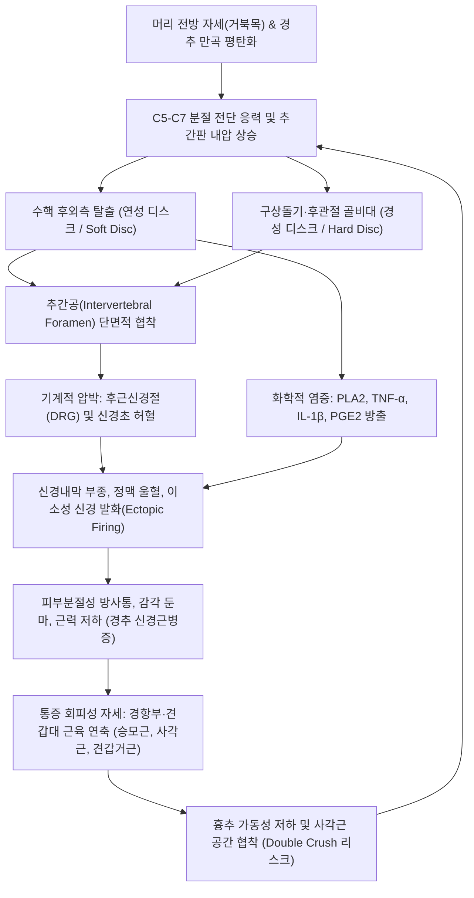
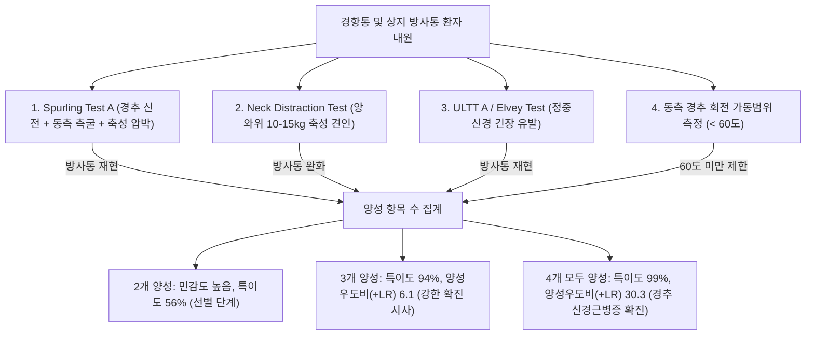
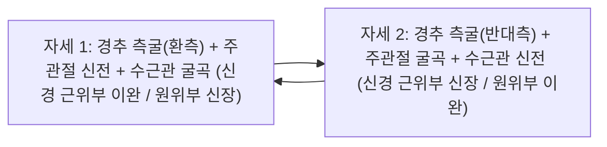

# 🩺 [[경추 신경근병증]] (Cervical Radiculopathy / 頸椎 神經根病症, ICD-10 M54.1 / KCD M54.1)

> **핵심 3줄 요약 (Key Summary)**:
> - 📍 **병소 부위 & 해부·병태생리**: 경추 추간판(주로 C5–C6, C6–C7 분절)의 퇴행성 수핵 탈출([[경추 추간판 탈출증]], 연성 디스크) 및 [[구상돌기]](Luschka 관절)·[[후관절]] 골극 형성(경성 디스크)으로 인해 [[추간공]](Intervertebral foramen)이 협착되어 [[경추 신경근]](Cervical nerve root)이 물리적으로 압박되고, 노출된 수핵 매개 무균성 화학적 신경근염(Chemical radiculitis)이 결합된 전형적인 하위운동신경원(LMN) 질환이다.
> - 🚩 **전형적 임상 양상 & 3대 징후**: ① 경항부에서 견갑골 내측연을 거쳐 상지로 뻗치는 **피부분절성 방사통(Radicular pain)**, ② 해당 신경근 분포 영역을 따르는 **저림 및 감각 이상(Paresthesia)**, ③ 지배 근육분절(Myotome)의 **이완성 근력 저하(Flaccid weakness) 및 심부건반사(DTR) 감약·소실**(C5 이두근 반사, C6 완요골근 반사, C7 삼두근 반사 저하).
> - 🛠️ **핵심 감별 검사 & 한·양방 다각적 치료 전략**: Wainner 4대 임상예측규칙([[Spurling 검사]], [[경추 견인 검사]], [[상지신경긴장검사]](ULTT A), 경추 회전각 <60°)을 통해 척수증 및 말초신경 포착과 감별. 한의 진료실에서는 [[화타협척혈]], [[대추]](GV14), [[견정]](GB21) 심부 침술 및 전침, [[신바로약침]]·[[봉약침]], 축성 견인 [[추나]](8~12kg 부하 용량-반응 근거)를 적용하며, 양방에서는 가바펜티노이드, 경구 스테로이드 테이퍼링, 경막외 신경차단술(ESI) 및 6~8주 불응 시 ACDF 수술을 고려한다.
> - ⚠️ **응급 의뢰 레드플래그 & 악화 요인**: 급속 진행성 상지 운동마비(Drop wrist, 삼두근 마비 MMT Grade 3 이하), 하지 경성 마비·[[Hoffmann 징후]]·보행실조를 동반한 **[[경추 척수증]]으로의 복합 이행**, 대소변 괄약근 장애, 암 전이(체중감소·야간통), 경막외 농양(발열·CRP 상승), 척추기저동맥 허혈 징후(현훈·복시·구음장애) 출현 시 즉시 신경외과적 응급 의뢰를 시행한다.

---

## 📌 목차
1. [질환 개요 & 해부학적 병태생리](#1-질환-개요--해부학적-병태생리)
2. [병태생리 메커니즘 & 생체역학적 악순환 네트워크](#2-병태생리-메커니즘--생체역학적-악순환-네트워크)
3. [임상 증상 & 이학적 검사 알고리즘](#3-임상-증상--이학적-검사-알고리즘)
4. [감별 진단 매트릭스](#4-감별-진단-매트릭스)
5. [한의 통합 치료 프로토콜](#5-한의-통합-치료-프로토콜)
6. [양방 치료 & 병용·의뢰 기준](#6-양방-치료--병용의뢰-기준)
7. [재활 운동 & 생활습관 티칭 가이드](#7-재활-운동--생활습관-티칭-가이드)
8. [💡 사용자 진료실 핵심 필기 & 임상 노하우 (Melt-In)](#8--사용자-진료실-핵심-필기--임상-노하우-melt-in)
9. [📚 출처 및 현대 학술 연구 요약](#9-출처-및-현대-학술-연구-요약)

---

## 1. 🩺 질환 개요 & 해부학적 병태생리

### 1) 질환 정의 및 용어 체계
* **정의**: 경추 신경근(C1–C8)이 척수로부터 분지되어 [[추간공]](Intervertebral foramen)을 통과하는 주행 경로 상에서 물리적 압박, 기계적 견인, 또는 수핵 유래 염증 반응에 의해 자극받아, 해당 신경근이 지배하는 고유 피부분절(Dermatome), 근육분절(Myotome), 건반사(Deep Tendon Reflex, DTR) 영역에 통증, 감각 이상, 운동 마비가 발생하는 신경학적 임상 증후군이다.
* **임상적 용어 구분 (Clinical Differentiation)**:
  * **신경근성 통증(Radicular pain)**: 신경근 또는 [[후근신경절]](Dorsal Root Ganglion, DRG)의 이소성 흥분 발화(Ectopic firing)로 인해 상지 말초로 예리하게 뻗치는 '통증 자체'를 지칭하는 단일 증상적 상태이다.
  * **경추 신경근병증(Cervical Radiculopathy)**: 단순 통증을 넘어 감각 둔마(Hypoesthesia), 저림(Paresthesia), 건반사 감약(Hyporeflexia), 근육 위축 및 운동 마비(Motor paresis) 등 객관적 **신경학적 결손(Neurological deficit)** 이 입증된 기능 장애 상태를 규정한다.
  * 본 질환은 순수한 하위운동신경원(Lower Motor Neuron, LMN) 병변으로 분류되며, 척수 실질이 압박받는 상위운동신경원(Upper Motor Neuron, UMN) 병변인 [[경추 척수증]]과 병태생리학적으로 엄격히 구별된다.

### 2) 역학 및 호발 분절
* **역학**: 인구 1,000명당 약 0.8~1.8명의 연간 발생률을 보이며, 50대에서 발병 정점을 이룬다. 남성에서 약간 더 높은 호발 경향을 보이며, 흡연, 무거운 물건을 들어 올리는 반복적 노동, 진동 공구 사용, 장시간 컴퓨터 및 스마트폰 사용에 따른 머리 전방 자세([[거북목]])가 주요 위험 인자로 작용한다.
* **호발 분절 순위**:
  1. **C7 신경근 침범 (약 60%)**: C6–C7 추간판 병변 또는 C6–C7 추간공 협착에 기인하며, 중지 방사통, 삼두근 위축 및 삼두근 건반사 감약이 전형적이다.
  2. **C6 신경근 침범 (약 20~25%)**: C5–C6 추간판 병변에 기인하며, 엄지 및 전완 요측 방사통, 상완이두근 및 완요골근 약화, 완요골근 반사 저하를 보인다.
  3. **C8 신경근 침범 (약 10%)**: C7–T1 분절 병변에 기인하며, 약지·소지 및 전완 척측 방사통, 수내근(골간근) 약화를 보인다.
  4. **C5 신경근 침범 (약 5%)**: C4–C5 분절 병변에 기인하며, 삼각근 및 상완 외측 방사통, 견관절 외전 약화, 이두근 반사 저하를 보인다.
* **연령대별 병리 형태**:
  * **젊은 연령층 (20~40대)**: 추간판의 급성 수핵 탈출증에 의한 **연성 디스크(Soft disc herniation)** 가 압도적 원인이다.
  * **고령층 (50대 이상)**: 경추증(Cervical spondylosis)에 따른 구상돌기 골극, 후관절 비후, 추간판 높이 감소가 복합된 **경성 디스크(Hard disc / Osteophyte)** 에 의한 추간공 협착이 주 원인이다.

### 3) 경추 및 추간공의 3차원 해부학
* **추간공(Intervertebral Foramen)의 해부학적 경계**:
  * **전방 경계**: 상·하위 척추체 후외측면, [[추간판]](Intervertebral disc), 그리고 경추에만 독특하게 존재하는 [[구상돌기관절]](Uncovertebral joint, Luschka 관절).
  * **후방 경계**: 상·하위 상관절돌기 및 하관절돌기가 결합하는 [[후관절]](Facet joint)과 이를 감싸는 관절낭, [[황색인대]](Ligamentum flavum)의 외측 연장부.
  * **상·하 경계**: 상위 척추경(Pedicle)의 하절흔과 하위 척추경의 상절흔.
* **구상돌기관절(Luschka 관절)의 임상적 중요성**: C3부터 C7까지 추체 외측 상면에 형성된 구상돌기(Uncinate process)는 굴곡·신전 운동을 안내하고 측굴을 제한하는 안정화 역할을 하나, 퇴행성 변화 시 가장 먼저 골극(Bone spur)을 형성하여 추간공의 전내측을 침범하며 신경근을 압박한다.
* **신경근의 공간적 점유율**: 정상 성인의 추간공 단면적 중 경추 신경근이 차지하는 비율은 약 20~35%에 불과하며, 나머지는 후근신경절(DRG), 지방 조직, 척추신경 정맥총, 근동신경(Sinuvertebral nerve)이 채우고 있다. 따라서 경미한 골극 형성이나 디스크 팽윤이라도 관절 비후와 동반되면 급격한 공간 고갈을 초래한다.
* **경추 신경근 주행 특성**: 경추 신경근은 해당 척추경의 상방을 통과한다(예: C6 신경근은 C5–C6 추간공을 통과하며 C6 척추경 위로 주행). 신경근은 수평면에서 약 45도 전하방 각도로 주행하여 상완신경총으로 이어지며, 이 주행 각도로 인해 경추의 측굴 및 회전 운동 시 추간공 가장자리에서 강한 전단 응력(Shear stress)을 받는다.
* **혈관과의 인접성**: 추간공의 외측 바로 전방에는 횡돌기공(Transverse foramen)을 관통하는 [[척추동맥]](Vertebral artery)과 교감신경총이 주행하므로, 추간공 외측 부위의 극심한 골극이나 외측성 디스크 탈출은 척추동맥 순환 부전 또는 현훈을 동반할 수 있다.

---

## 2. ⚡ 병태생리 메커니즘 & 생체역학적 악순환 네트워크

### 1) 기계적 포착 기전 (Mechanical Entrapment)
* **정적 압박(Static Compression)**:
  * 연성 디스크(Soft disc) 탈출에 의해 후외측으로 밀려난 수핵 덩어리가 신경근을 추간공 후벽의 후관절낭 쪽으로 직접 압박한다.
  * 구상돌기 골극(Uncinate spur)은 추간공 전벽에서 신경근의 복측을, 후관절 퇴행성 골비대는 신경근의 배측을 집게처럼 압박하는 샌드위치 형태의 협착을 유발한다.
* **동적 압박(Dynamic Compression)**:
  * 생체역학 연구에 따르면 경추가 **신전(Extension)** 될 때 추간판 후방 높이가 감소하고 황색인대가 함입되며 추간공 면적이 최대 20% 감소한다.
  * 여기에 **동측 회전(Ipsilateral rotation) 및 측굴(Lateral flexion)** 이 결합되면 추간공 단면적이 추가로 15~20% 감소하여 신경근 압박이 극대화된다(이는 Spurling 검사의 핵심 병태역학이다).
  * 반대로 경추를 경미하게 **굴곡(Flexion) 및 축성 견인(Distraction)** 하면 추간공의 상하·전후 직경이 확장되어 신경근 제압박이 완화된다.

### 2) 화학적 염증성 신경근염 (Chemical Radiculitis)
* 단순한 기계적 압박만으로는 심각한 통증을 설명하기 어렵다. 통증 유발의 결정적 인자는 노출된 수핵 기질에서 뿜어져 나오는 화학적 염증 매개체들이다.
* **염증성 캐스케이드(Inflammatory Cascade)**:
  * 수핵 내부의 고농도 **포스포리파아제 A2(Phospholipase A2, PLA2)** 가 세포막 인지질을 분해하여 아라키돈산 대사를 촉발, 대량의 [[프로스타글란딘]](PGE2)과 류코트리엔을 생성한다.
  * 종양괴사인자-알파(**TNF-α**), 인터루킨-1베타(**IL-1β**), 인터루킨-6(**IL-6**) 등 전염증성 사이토카인이 신경초막(Perineurium)의 혈액-신경 장벽(Blood-Nerve Barrier, BNB)을 붕괴시킨다.
  * 모세혈관 투과성 증가로 인해 신경내막 부종(Endoneurial edema)이 발생하고, 신경초 내압이 상승하여 모세혈관 혈류가 차단되는 **미세혈관 허혈(Microvascular ischemia)** 이 초래된다.
* **이소성 발화(Ectopic Pacemaker Formation)**: 기계적 압박과 화학적 염증에 동시에 노출된 [[후근신경절]](DRG)과 신경근 축삭은 전압의존성 나트륨 통로(Nav1.7, Nav1.8)의 비정상적 과발현을 일으켜, 자극이 없는 상태에서도 자발적인 활동전위를 난사하는 이소성 발화 상태(Neuropathic ectopic pacemaker)로 전환된다.

### 3) 생체역학적 악순환 네트워크 및 이중 압박 증후군 (Double Crush Syndrome)
* **머리 전방 자세(Forward Head Posture, 거북목)**: 두부가 전방으로 1인치(2.5cm) 이동할 때마다 경추 하부(C5–C7)에 걸리는 실효 중량 부하는 약 4.5kg씩 증가한다. 이는 C5–C7 추간판의 전단력과 후관절 충돌 압력을 증폭시켜 추간공 골극 형성을 가속한다.
* **근막 연쇄 반응(Myofascial Kinetic Chain)**:
  * 통증을 회피하기 위해 환자는 경추를 경직시키며, 이는 [[상부 승모근]], [[견갑거근]], [[전사각근]]·[[중사각근]]의 지속적인 보호성 근연축(Protective spasm)을 야기한다.
  * 사각근의 단축과 연축은 늑쇄간격을 좁혀 상완신경총 하부 트렁크를 2차 포착하는 [[흉곽출구증후군]](TOS)을 병발시킨다.
* **이중 압박 증후군(Double Crush Phenomenon)**:
  * Upton과 McComas가 제창한 이론으로, 근위부인 경추 신경근에서 축삭 수송(Axoplasmic flow)이 저해되면, 원위부 말초신경의 영양 공급과 저항력이 떨어져 완관절 부위의 [[수근관증후군]](CTS, 정중신경 포착)이나 주관절 부위의 [[주관증후군]](Cubital tunnel syndrome, 척골신경 포착)이 동일 상지에서 동시다발적으로 발병하기 극히 쉬워진다.

---

## 3. 🔍 임상 증상 & 이학적 검사 알고리즘

### 1) 경추 신경근 분절별 정밀 신경학적 평가 매트릭스

경추 신경근병증의 진단은 증상이 호발하는 특정 피부분절, 근육분절, 심부건반사의 일치성을 입증하는 것에서 시작된다.

| 분절 | 원인 디스크 | 감각 이상 영역 (Dermatome) | 약화 근육군 (Myotome) | 심부건반사 (DTR) | 임상적 주소증 및 환자 호소 패턴 |
| :--- | :--- | :--- | :--- | :--- | :--- |
| **C5** | C4–C5 | 상완 외측, 견관절 외측부 | [[삼각근]](외전), [[상완이두근]](굴곡) | **이두근 건반사 (Biceps reflex)** 감약 | "어깨 윗부분이 뻐근하게 아프고 팔을 옆으로 들어 올리기 힘들어요." |
| **C6** | C5–C6 | 전완 외측(요측), **엄지손가락, 검지 요측** | [[완요골근]], 수근신근([[장요측수근신근]]) | **완요골근 반사 (Brachioradialis reflex)** 감약 | "목에서부터 팔 바깥쪽을 타고 엄지손가락까지 찌릿찌릿 저려요." |
| **C7** | C6–C7 | **중지(가운데 손가락)**, 수장부 중심 | [[상완삼두근]](신전), 수근굴근, 수지신근 | **삼두근 건반사 (Triceps reflex)** 감약 | "목 뒤에서 날개뼈 안쪽을 거쳐 팔 뒤쪽, 가운뎃손가락까지 전기가 통해요." |
| **C8** | C7–T1 | 전완 내측(척측), **약지 척측, 소지(새끼손가락)** | [[수지심굴근]], [[수내근]](골간근, 무지내전근) | 건반사 변화 경미 (간혹 수지굴근반사) | "팔 안쪽과 넷째·다섯째 손가락이 저리고, 손가락 사이 힘이 빠져 쥐는 힘이 약해요." |
| **T1** | T1–T2 | 상완 내측면 (겨드랑이 부근) | 수지외전근([[소지외전근]], 배측골간근) | 특이 건반사 없음 | "겨드랑이와 팔 안쪽 상부가 얼얼하고 손가락을 양옆으로 벌리기 어려워요." |

### 2) Wainner 4대 임상예측규칙 (Clinical Prediction Rule, CPR) 알고리즘

2003년 Wainner 연구진(Spine, PMID: 12544957)이 확립한 4대 이학적 검사 조합은 경추 신경근병증 진단의 표준 선별 도구이다.

#### Wainner 4대 검사 세부 시행 프로토콜
1. **[[Spurling 검사]] A (Spurling's Neck Compression Test)**:
   * **시행법**: 환자를 바르게 앉힌 후, 경추를 약 30도 신전(Extension)시키고 환측으로 측굴(Ipsilateral side-bending)시킨 상태에서 검사자가 정수리 부위에 약 7kg 상당의 수직 하향 압박력을 가한다.
   * **양성 기준**: 경항부 국소 통증이 아닌, 해당 신경근의 피부분절을 따라 상지로 예리하게 뻗치는 방사통이 재현될 때 양성이다.
   * **임상 가치**: 특이도가 90~95%로 매우 높아 질환의 확진에 결정적이나, 급성기 심한 디스크 탈출증 환자에서는 증상을 악화시킬 수 있으므로 가벼운 압박부터 단계적으로 진행한다.
2. **[[경추 견인 검사]] (Neck Distraction Test)**:
   * **시행법**: 환자를 앙와위로 편안히 눕힌 후, 검사자가 한 손으로 후두부를 받치고 다른 손으로 하악골을 감싸 쥔 상태에서 약 10~15kg의 힘으로 부드럽게 두부 방향으로 축성 견인력을 적용한다.
   * **양성 기준**: 환자가 호소하던 상지 방사통 및 이상감각이 의미 있게 감소하거나 소실될 때 양성이다.
   * **임상 가치**: 추간공 확장 및 후관절 압박 해소 기전을 입증하며, 견인 추나 치료의 직접적인 적응증 판단 기준이 된다.
3. **상지신경긴장검사 A (Upper Limb Neurodynamic Test A, ULTT A / Elvey Test)**:
   * **시행법 (정중신경 바이어스)**: 환자를 앙와위로 눕히고 다음 동작을 순차적으로 누적 적용한다: ① 견갑대 하강(Depression) 고정 → ② 견관절 90~110도 외전 → ③ 수근관 및 수지 신전 → ④ 전완 회외(Supination) → ⑤ 견관절 외회전 → ⑥ 주관절 신전 → ⑦ 반대측 경추 측굴(대조군 감별).
   * **양성 기준**: 주관절 신전 시 상지 방사통이 재현되고, 반대측 경추 측굴 시 통증이 가중되며, 동측 경추 측굴 시 통증이 완화되는 반응.
   * **임상 가치**: 민감도가 97%에 달하여 이 검사가 음성이면 경추 신경근병증을 거의 배제할 수 있는 강력한 배제 진단 도구이다.
4. **경추 회전 각도 제한 (Cervical Rotation < 60°)**:
   * **시행법**: 경추를 중립위에 두고 환자에게 능동적으로 좌우 회전을 지시하여 각도계(Goniometer)로 측정한다.
   * **양성 기준**: 통증이 있는 환측으로의 회전 가동범위가 60도 미만으로 뚜렷하게 제한될 때 양성이다.

### 3) 보조 이학적 검사 및 척수증 감별 스크리닝
* **바코디 징후([[Bakody 검사]] / Shoulder Abduction Relief Sign)**:
  * 환자가 아픈 쪽 손을 들어 정수리나 머리 위에 얹었을 때(견관절 외전 및 거상) 상지 방사통이 즉각 완화되는 현상이다.
  * 기전: C5–C6 신경근의 긴장이 풀리고 상완신경총이 이완되며 추간공 내 신경근 경로가 단축된다.
  * 감별: 견관절 자체 질환([[회전근개 파열]], 충돌증후군) 환자는 이 자세를 취할 때 극심한 어깨 통증이 유발되므로 두 질환의 즉각적 감별 징후로 매우 유용하다.
* **상위운동신경원(UMN) 배제 3대 검사 (반드시 시행)**:
  * [[Hoffmann 징후]]: 중지 원위지절을 탄발할 때 엄지와 검지의 불수의적 대립 굴곡 반응 확인.
  * [[Babinski 징후]]: 족저 외측을 긁어올릴 때 모지의 배굴 및 족지의 부채꼴 외전 확인.
  * 슬개건 및 아킬레스건 반사: 병적인 반사 항진(Hyperreflexia) 여부 확인.
  * ⚠️ 이 중 하나라도 양성이면 신경근병증 단독이 아닌 [[경추 척수증]] 가능성을 즉시 열고 MRI를 의뢰해야 한다.

---

## 4. 🔀 감별 진단 매트릭스

경추 신경근병증은 상지 통증과 감각 이상을 유발하는 다양한 경추부, 견관절, 말초신경 질환과의 정밀 감별이 필수적이다.

| 감별 질환 | 호발 병소 및 병태생리 | 주요 주소증 및 임상 양상 | 특이적 이학적 검사 소견 | 영상 및 전기진단학적 특징 |
| :--- | :--- | :--- | :--- | :--- |
| [[경추 신경근병증]] (본 질환) | 추간공 내 신경근 압박 및 염증 (LMN 병변) | 피부분절을 따르는 상지 방사통, 저림, 분절성 근력 약화 | **Spurling A (+)**, **경추 견인검사 완화 (+)**, **Bakody (+)**, 건반사 감약 | 경추 MRI: 추간공 협착 및 신경근 압박. 근전도: 해당 신경근 분절 탈신경 전위 |
| [[경추 척수증]] (CSM) | 척수관 협착에 의한 경수 실질 압박 (UMN 병변) | 양측 수부 미세운동 장애(단추, 젓가락), 경직성 보행실조 | **Hoffmann (+)**, **Babinski (+)**, **건반사 항진**, Lhermitte (+), Spurling (-) | 경추 MRI: 척수관 직경 <10mm, T2WI 척수 실질 내 고신호 병변 |
| [[흉곽출구증후군]] (TOS) | 사각근간극, 늑쇄간격, 소흉근하부에서 상완신경총 압박 | 상지 전체의 둔중감, 피로감, 모호한 저림, 냉감, 부종 | **Adson 검사 (+)**, **Wright 검사 (+)**, **Roos 검사 (+)**, 경추 검사 음성 | 경경부 X-ray: 경늑골(Cervical rib) 유무. 쇄골하 혈관 도플러 초음파 |
| [[수근관증후군]] (CTS) | 완관절 횡수근인대 하부에서 정중신경 포착 | 손목 이하 엄지~약지 요측 저림, 야간통으로 손 털기 | **Phalen 검사 (+)**, **Tinel 징후 (+)** (손목), 경추 유발검사 음성 | 근전도/신경전도(NCS): 정중신경 원위부 감각/운동 잠시(Latency) 지연 |
| [[주관증후군]] (Cubital Tunnel) | 주관절 내측 척골신경 포착 | 약지 척측 및 소지 저림, 골간근 위축, 수부 파지력 저하 | **주관 Tinel (+)**, **Elbow Flexion 검사 (+)**, **Froment 징후 (+)** | 근전도/NCS: 주관절 구간 척골신경 전도속도(NCV) 50m/s 이하 저하 |
| **[[회전근개 질환]] / 충돌증후군** | 견봉하 공간 충돌 및 극상근건 파열 | 견관절 국소 통증, 외전 60~120도 통증호, 야간 환측 와위 통증 | **Neer 검사 (+)**, **Hawkins-Kennedy (+)**, Bakody 취할 때 통증 악화 | 견관절 초음파/MRI: 회전근개 건염, 부분/전층 파열, 견봉하 점액낭염 |
| [[경추 후관절증후군]] | 경추 후관절낭의 염증 및 퇴행 | 경항부 및 견갑골 상부의 둔통(연관통), 팔꿈치 이하 방사 없음 | 후관절 압박 검사(+), Spurling 시 방사통 없이 국소통만 유발 | 경추 후관절 차단술(MBB) 시 통증의 50% 이상 즉각 소실 |
| [[근막통증후군]] (MPS) | 승모근, 견갑거근, 사각근 내 발통점(Trigger Point) | 특정 근육 압박 시 고유 연관통(Referred pain) 발생, 방사통과 유사 | **발통점 압통 및 국소연축반응(LTR)**, 신경학적 결손 전무, DTR 정상 | 근전도 정상, 영상의학적 이상 소견 없음 (순수 근막 병변) |
| **파소니지-터너 증후군** (상완신경총염) | 상완신경총의 자가면역성 무균성 염증 | 극심한 견배부 급성 통증 발생 수일 후 통증 소실 및 급격한 마비 | 견관절 거상 불능, 삼각근·전두근 급속 위축, 외상력 없음 | 근전도: 상완신경총 다발성 급성 탈신경 전위, 뇌척수액 검사 |

---

## 5. 🌿 한의 통합 치료 프로토콜

한의 치료는 신경근 압박 부위의 무균성 화학적 염증을 신속히 소퇴시키고, 단축된 심부 척추 근막을 이완하며, 추간공의 동적 감압을 유도하여 수술 없이 구조적·기능적 회복을 달성하는 것을 목표로 한다.

### 1) 침구 치료 (Acupuncture Protocol)
* **경항부 심부 협척혈 자침 술기**:
  * **주요 혈위**: 병변 분절(예: C5–C7)의 [[화타협척혈]](EX-B2, 극돌기 하연 외측 0.5촌) 및 [[대추]](GV14), [[풍지]](GB20), [[천주]](BL10).
  * **자침 기법**: 0.25×40mm 또는 0.30×50mm 멸균 호침을 사용하여 척추 극돌기 방향으로 약 10~15도 내측 경사지게 진침하여 경추 후궁판(Lamina) 골면에 접촉할 때까지 1.5~2.5cm 심자한다. 골면에 닿은 후 1~2mm 후퇴하여 심부 다열근 및 회선근 층에 도달시킨다. (척수 및 척추동맥 손상을 방지하기 위해 외측으로 깊게 찌르는 자침은 절대 금기이다.)
* **원위 원격 배혈(Distal Acupoints) 및 동기침법(動氣鍼法)**:
  * **혈위**: [[후계]](SI3, 독맥 통혈이자 경항부 통증 특효혈), [[외관]](TE5, 양유맥 통혈), [[중저]](TE3), [[곡지]](LI11), [[합곡]](LI4).
  * **임상 운용**: 환자를 앉힌 상태에서 환측 후계(SI3)와 외관(TE5)에 먼저 강자극으로 자침한 뒤 득기(得氣)를 유도하고, 침을 유침한 상태에서 환자에게 경추를 천천히 신전·회전시키는 능동 운동을 1~2분간 시행하게 한다. 즉각적인 경추 가동역 증대와 방사통 감쇠를 현장에서 확인할 수 있다.
* **전침 치료 파라미터 (Electroacupuncture)**:
  * **배합**: 병변 측 경추 협척혈 2개 분절 간 통전, 또는 협척혈–[[견정]](GB21), 견정–[[외관]](TE5) 연결.
  * **주파수 세팅**:
    * **급성기 극통(극심한 방사통)**: 2Hz 저주파 통전. 뇌내 베타 엔도르핀(β-endorphin) 및 다이노르핀 분비를 촉진하여 중추성 진통 작용 유도.
    * **아급성·만성기(근경직 및 둔마 우세)**: 2/100Hz 밀보파(Dense-Disperse Wave) 통전. 관문조절설(Gate Control Theory)에 의한 척수 후각 통증 전도 차단 및 심부 근육 연축 이완.
    * 통전 시간: 20분, 강도는 환자가 통증을 느끼지 않고 율동적인 근수축을 편안하게 느끼는 역치 수준으로 조절.

### 2) 약침 치료 (Pharmacopuncture Protocol)
* **약침 제제 선택 기준**:
  * **[[신바로약침]] (GCSB-5)**: 방풍, 우슬, 오가피, 구척, 두충 등 6가지 생약 복합 추출물로, 신경교세포의 염증성 사이토카인(TNF-α, IL-1β) 발현을 유의하게 억제하고 신경세포 생존율을 높이며 부종을 흡수하는 신경보호 효과가 규명되어 있다. 급성 및 아급성기 1차 선택 약침이다.
  * **[[봉약침]] (Sweet Bee Venom / 건조봉독)**: 멜리틴(Melittin)과 아파민(Apamin) 성분의 강력한 항염증·소염 작용으로 만성 난치성 신경근염에 탁월하다. (시술 전 반드시 전완 내측 스킨테스트를 거쳐 과민반응 여부를 확인하고, 10% 미만의 농도로 점진적 증량한다.)
  * [[중성어혈약침]]: 외상 기왕력이나 정체성 어혈로 인한 극심한 야간통에 적용.
  * [[자하거약침]]: 만성 퇴행성 질환, 고령자, 신경근 압박으로 인한 상지 근위축 및 기혈허증에 영양 공급 목적으로 적용.
* **시술 부위 및 정밀 주입 요령**:
  * **경추 협척혈 심부 다열근층**: 병변 분절 협척혈에 각 포인트당 0.2~0.5cc씩 총 1.0~2.0cc 주입.
  * **경견부 근막 발통점**: 상부 승모근 압통점, 견갑거근 부착부(견갑골 상각), 사각근 긴장 부위에 0.1~0.2cc씩 피하 및 근막층 주입.
  * ⚠️ 주입 시 반드시 흡인(Aspiration) 테스트를 시행하여 혈액이 역류하지 않음을 확인한 후 서서히 주입한다.

### 3) 추나 치료 (Chuna Manipulation Protocol)
* **경추 축성 신연 추나 (Cervical Axial Distraction)**:
  * **환자 체위**: 앙와위(Supine)로 편안히 눕히고 양 무릎을 세워 요추 부하를 줄인다.
  * **술자 자세**: 환자 두부 쪽에 앉아 한 손의 수장부로 후두골을 감싸고, 다른 손으로 하악골을 부드럽게 지지한다.
  * **기법**: 경추를 약 15~20도 굴곡(Flexion)시킨 상태에서 미세하게 축성 견인력을 부드럽게 인가한다. 8~12kg 수준의 일정한 견인력을 10~15초간 유지한 후 서서히 이완하기를 3~5회 반복한다.
  * **기전**: 추간공의 상하 및 전후 직경을 기계적으로 확장시켜 압박된 신경근의 감압과 국소 혈류 개선을 도모한다 (경추 견인 부하 용량-반응 무작위 대조군 임상연구 근거 참조).
* **경추 관절가동추나 (Mobilization, Maitland Grade I~III)**:
  * 급성기 통증이 심한 환자에게 충격식 교정을 배제하고, 후관절의 가동 범위를 부드럽게 회복시키는 저속·저진폭 진동 기법 적용.
* **흉추 신전 교정 추나 (Thoracic Extension Manipulation)**:
  * 경추 추간판의 과도한 전단 부하는 대개 흉추의 과후만과 가동성 소실에서 기인한다. 앙와위 권총 기법(Pistol technique) 또는 복와위 낙하 기법을 통해 중·상부 흉추의 신전 가동성을 회복시키면 경추로 전달되는 기계적 부하가 즉각적으로 분산된다.
* **⛔ 금기 수기**: 신경근병증의 급성 염증기에 경추의 **고속저진폭 회전 교정(HVLA Rotation Thrust)** 은 파열된 추간판 수핵을 추가로 밀어내거나 척수 손상을 유발할 수 있으므로 **절대 금기**이다.

### 4) 한약 치료 (Herbal Medicine Prescription)
* **급성기 (풍한습비·기체혈어 — 발병 0~4주, 극심한 방사통, 야간통 우세)**:
  * **[[갈근탕]](葛根湯) / [[계지가갈근탕]](桂枝加葛根湯)**: 주약인 갈근(葛根)이 경항부 승모근과 심부 척추기립근의 경직을 이완시키고 추간판 주변 혈류를 개선. 계지, 마황, 백작약 배합으로 진통·해경 작용 발휘.
  * **[[신통축어탕]](身痛逐瘀湯) / [[서경탕]](舒經湯)**: 당귀, 천궁, 도인, 홍화, 강활, 방풍 배합으로 신경초막 주변의 정맥성 어혈 울혈을 제거하고 화학적 신경근염을 소퇴시킴.
* **아급성·만성기 (간신부족·기혈양허 — 발병 4주 이후, 만성 저림, 근력 저하, 근위축)**:
  * **[[독활기생탕]](獨活寄生湯)**: 독활, 상기생, 두충, 우슬이 간신(肝腎)을 보하고 근골을 강화하며, 당귀, 백작약, 천궁, 숙지황(사물탕)이 신경 축삭에 영양을 공급.
  * **[[황기계지오물탕]](黃耆桂枝五物湯)**: 황기, 계지, 백작약, 생강, 대조 배합으로 영위(營衛)를 조화롭게 하고 말초 미세순환을 촉진하여 손끝의 완고한 감각 둔마와 저림을 개선.
  * **[[오적산]](五積散) 가감**: 한습(寒濕)에 노출되거나 에어컨 바람 등에 의해 증상이 악화되는 만성 신경통에 적용.

---

## 6. 💊 양방 치료 & 병용·의뢰 기준

한의원 1차 진료 현장에서는 환자가 이미 양방 정형외과나 신경외과에서 약물을 복용 중이거나 주사 치료를 병행하는 경우가 흔하므로, 양방적 치료 옵션의 기전과 부작용, 상호작용을 명확히 이해하고 조율해야 한다.

### 1) 약물 치료 (Conventional Medication)
* **비스테로이드성 소염진통제 (NSAIDs)**:
  * **약제**: Celecoxib 200mg qd/bid, Aceclofenac 100mg bid, Meloxicam 7.5~15mg qd.
  * **기전 및 목적**: COX-2 효소를 억제하여 화학적 신경근염 매개 물질인 프로스타글란딘 합성을 차단.
  * **한의 병용 고려**: 한약과 병용 시 소화기 궤양 및 신독성 위험을 점검해야 하며, 위장관 장애 호소 시 위장 보호 한약재(백출, 사인, 반하 등)를 가미하거나 식후 30분 복용 간격을 둔다.
* **가바펜티노이드 (Gabapentinoids, 신경병성 통증 조절제)**:
  * **약제**: Pregabalin 75~150mg bid, Gabapentin 300~900mg tid.
  * **기전**: 전압의존성 칼슘 채널의 α2-δ 서브유닛에 결합하여 글루타메이트 등 흥분성 신경전달물질 방출을 차단, 이소성 신경 발화를 진정시킴.
  * **부작용 모니터링**: 어지럼증, 졸림, 운동실조, 말초 부종. 고령 환자에서 낙상 위험을 크게 높이므로 복용 여부를 반드시 확인한다.
* **경구 코르티코스테로이드 단기 테이퍼링 (Oral Corticosteroid Tapering)**:
  * **약제**: Methylprednisolone dose pack (Medrol 6일 감량 요법) 또는 Prednisolone 30~60mg으로 시작하여 1~2주 내 감량.
  * **임상 가치**: 급성기 극심한 신경근 부종을 빠르게 가라앉히기 위해 단기 사용되나, 장기 복용 시 무균성 골괴사, 혈당 상승, 면역 저하 위험이 있다.
* **골격근이완제**:
  * **약제**: Eperisone HCl 50mg tid, Afloqualone 20mg tid.
  * **목적**: 경추 통증으로 인한 2차성 근경직 완화.

### 2) 비약물 중재적 시술 (Interventional Procedures)
* **경추 경막외 스테로이드 주사 (Cervical Epidural Steroid Injection, ESI)**:
  * **추간공 접근법 (Transforaminal ESI, TFESI)**: 형광투시(C-arm) 유도 하에 해당 추간공 외측으로 진입하여 신경근 주변에 스테로이드와 국소마취제를 직접 분사. 항염증 효과가 강력하나, 척추동맥 천자 및 혈전성 색전에 의한 **척수경색(Spinal cord infarction)** 및 뇌경색 위험이 존재하여 최근 매우 신중하게 시행된다.
  * **층간 접근법 (Interlaminar ESI, ILESI)**: 주로 C7–T1 간격에서 경막외강으로 진입하여 약물을 확산시키는 방법으로, TFESI보다 혈관 손상 위험이 상대적으로 낮다.
* **기계적 경추 견인 치료 (Mechanical Cervical Traction)**:
  * Saunders 기구 등을 이용하여 체중의 10~20% 수준(대략 5~12kg)으로 15~20분간 간헐적 견인을 적용.

### 3) 수술적 치료 적응증 및 술식
* **수술 적응증**:
  * **절대적 적응증**: 삼두근 또는 수근신근의 진행성 마비(MMT Grade 3 이하의 낙하수/낙하완 등 급격한 운동신경 결손), 척수 압박 징후([[경추 척수증]])의 급성 동반.
  * **상대적 적응증**: 체계적인 보존적 치료(한의 치료 포함)를 6~8주 이상 적극적으로 시행했음에도 불구하고 일상생활이 불가능할 정도의 난치성 극통이 지속되는 경우.
* **대표 수술 술식**:
  * **전방 경추 추간판 절제술 및 유합술(ACDF)**: 경추 전방으로 접근하여 병변 디스크를 완전 제거하고 케이지와 자가/동종골을 삽입하여 분절을 골유합시키는 표준 수술법.
  * **경추 인공디스크 치환술(Cervical Artificial Disc Replacement, ADR / CDR)**: 분절 가동성을 보존하여 인접 분절 퇴행(Adjacent Segment Disease, ASD)을 방지하는 술식.
  * **후방 경추 추간공 절제술(Posterior Cervical Foraminotomy)**: 골극에 의한 외측 추간공 협착 시 전방 유합 없이 후방에서 추간공만 미세 감압하는 술식.

### 4) 한·양방 병용 판단 가이드 (Combination Therapy)
* **시너지 병용**: 급성기 극통 환자에서 경구 NSAIDs/가바펜티노이드로 화학적 통증을 제어하면서, 한방 침·약침·추나 치료로 물리적 감압과 근막 연축을 해소할 때 단독 치료 대비 회복 속도가 현저히 빠르다.
* **스테로이드 감량기 한의 치료 집중 투입**: 경구 스테로이드 중단 시 통증이 다시 튀어 오르는 반동 현상(Rebound pain)이 흔히 발생하는데, 이때 침·신바로약침 치료를 집중 시행하여 스테로이드 중단 후 통증 재발을 성공적으로 방어한다.
* **주의 및 금기**:
  * **항응고제/항혈소판제(와파린, 아스피린, NOAC) 복용 환자**: 경항부 심부 협척혈 자침 및 심부 약침 시술 시 혈종 형성 위험이 있으므로 천자 깊이를 얕게 조절하고 충분히 압박 지혈한다.
  * 주사 시술 직후: 경막외 차단술(ESI)을 받은 당일에는 주사 부위 감염 방지를 위해 침구 치료를 금하고 최소 24~48시간 경과 후 시술한다.

### 5) 양방·전문과 응급 의뢰 기준 (Red Flag Referral)
다음 징후가 발견되면 즉시 보존적 치료를 중단하고 척추신경외과 전문의에게 응급 의뢰한다:
1. **진행성 운동 마비**: 삼두근 마비로 팔꿈치를 펼 수 없거나, 완관절 신전 불능(Drop wrist)이 발생하여 물건을 계속 떨어뜨릴 때.
2. **척수증(Myelopathy) 징후 출현**: 하지 경직, 보행실조(술 취한 듯 비틀거림), [[Hoffmann 징후]] 양성, 발목 클로누스 출현.
3. **대소변 괄약근 기능 장애**: 급성 요정체, 요실금, 변실금(원추/척수 급성 압박 응급).
4. **악성 종양 전이 의심**: 암 기왕력 환자의 원인 모를 체중 감소, 안정 시 및 야간통 악화, 마약성 진통제 무반응.
5. **감염성 척추염 / 경막외 농양**: 오한, 고열, 백혈구 및 CRP 상승, 최근 침습적 시술이나 비뇨기 감염 병력.

---

## 7. 🏃 재활 운동 & 생활습관 티칭 가이드

급성 통증이 제어된 후에는 경추 심부 안정화 근육을 강화하고 흉추 가동성을 회복시키는 재활 운동을 통해 재발을 방지해야 한다.

### 1) 경부 심부 굴곡근 훈련 (Deep Neck Flexors, DNF / Chin-Tuck)
* **목표 근육**: [[경장근]](Longus colli), [[두장근]](Longus capitis).
* **시행 방법**:
  1. 바로 누운 자세(앙와위)에서 뒤통수 아래 얇은 수건을 받친다.
  2. 코끝으로 작은 호(Arc)를 그린다는 느낌으로 턱을 목젖 방향으로 가볍게 당긴다(Nodding motion).
  3. 이때 겉의 큰 근육인 [[흉쇄유돌근]](SCM)에 힘이 들어가지 않도록 손가락으로 SCM을 촉지하여 이완 상태를 감시한다.
  4. 턱을 당긴 상태에서 5~10초간 등척성으로 유지하고 천천히 이완한다. 10회씩 3세트 반복.
* **임상적 의의**: 경추 전만을 회복하고 상부 경추의 과신전과 하부 경추의 전단 변위를 구조적으로 교정한다.

### 2) 견갑 안정화 및 흉추 신전 운동
* **벽 밀기 플러스 (Wall Push-Up Plus)**:
  * 벽을 짚고 푸시업을 한 후, 마지막 단계에서 날개뼈 사이가 멀어지도록 등을 둥글게 밀어내어 [[전거근]](Serratus anterior)을 강화한다. 견갑골 전방 경사를 막아 상완신경총 경로를 확보한다.
* **Prone Y-T-W 운동**:
  * 엎드린 자세에서 양팔을 Y자, T자, W자로 들어 올리며 [[하부 승모근]]과 [[능형근]]을 등척성 강화하여 둥근 어깨(Round shoulder)를 교정한다.
* **폼롤러 흉추 신전 운동**:
  * 폼롤러를 흉추 4~6번 뒤에 가로로 받치고 누워, 양손으로 머리를 받친 채 가슴을 천장 방향으로 펴며 흉추 신전을 유도한다. (절대 경추를 꺾지 않고 흉추에서만 신전이 일어나도록 한다.)

### 3) 신경 가동화/활주 운동 (Neurodynamic Slider)
신경이 주변 연부조직과 유착되는 것을 방지하고 신경내 혈류를 개선하는 신경 활주 술기를 환자에게 교육한다.

* **정중신경 슬라이더 (Median Nerve Slider)**:
  * **원칙**: 신경을 양쪽에서 동시에 당기는 텐셔너(Tensioner) 기법은 급성 신경근염 환자에게 통증을 악화시킬 수 있으므로, 한쪽을 당길 때 다른 쪽을 늦춰주는 슬라이더(Slider) 기법만 적용한다.
  * **동작**: 손목을 신전시킬 때는 고개를 병변 쪽으로 기울이고(근위부 이완), 손목을 굴곡시킬 때는 고개를 반대쪽으로 기울인다(원위부 이완). 부드럽게 10~15회 왕복한다.

### 4) 인체공학적 생활습관 티칭 (Ergonomics)
* **모니터 및 시선 정렬**: 모니터 상단 1/3 지점이 눈높이와 일치해야 하며, 모니터와의 거리는 50~70cm를 유지한다. 고개를 앞으로 뺀 채 화면을 응시하지 않도록 의자 등받이에 엉덩이를 깊숙이 밀착시킨다.
* **스마트폰 사용 원칙**: 스마트폰을 무릎 위에 두고 고개를 숙여 내려다보는 자세는 경추 추간판에 최대 27kg의 파괴적 하중을 가한다. 스마트폰은 반드시 눈높이까지 들어 올려 사용하며, 20분마다 고개를 들어 천장을 바라본다.
* **수면 베개 선택**:
  * 바로 누워 잘 때: 목덜미의 C자 곡선을 받쳐주면서 뒤통수는 바닥에서 3~5cm 정도로 낮게 유지되는 경추형 베개를 선택한다.
  * 옆으로 누워 잘 때: 경추와 흉추가 일직선이 되도록 어깨너비만큼의 높이(10~15cm)를 지지하고, 양 무릎 사이에 베개를 끼워 골반과 척추의 회전을 방지한다.
  * 엎드려 자는 자세는 밤새 경추를 90도 회전시켜 추간공을 극도로 압박하므로 **절대 금지**한다.

---

## 8. 💡 사용자 진료실 핵심 필기 & 임상 노하우 (Melt-In)

> [!IMPORTANT]
> 본 섹션에는 상부 표준 목차에 담긴 이론적 토대를 바탕으로, 원장님의 다년간 진료실 실전 경험에서 우러나온 **생생한 감별 직관, 침술 손맛, 환자 설득 스크립트, 차팅 방어 노하우**를 100% 융합(Melt-In)하여 집약하였다.

### 1) 진료실 실전 초진 5분 문진 체크리스트 (내원 즉시 순서대로 실행)
1. **방사통의 종착점 확인**: "저린 느낌이나 전기가 어디까지 내려가나요? 팔꿈치인가요, 손목인가요, 아니면 특정 손가락 끝인가요?"
   * 손끝까지 도달하면 신경근병증 확률 급상승. 어깨나 팔꿈치에서 멈추면 경추 후관절증후군이나 근막통증후군 의심.
2. **손가락 위치 특정 (손끝 분절 매핑)**:
   * **엄지·검지**가 주도적으로 저리면 → **C6 신경근** (C5–C6 디스크).
   * **가운뎃손가락**이 전형적으로 찌릿하면 → **C7 신경근** (C6–C7 디스크, 최빈발).
   * **새끼손가락과 넷째 손가락** 안쪽이면 → **C8 신경근** (C7–T1 디스크) 또는 [[주관증후군]]/TOS 감별.
3. **자세에 따른 반응 (Bakody vs Spurling)**:
   * "머리 위로 아픈 팔을 얹으면 편안해지시나요?" → Bakody 양성이면 신경근 탈출증 확신도 상승.
   * "고개를 뒤로 젖히고 아픈 쪽으로 돌리면 팔이 찌릿한가요?" → 추간공 협착 시사.
4. **척수증(Myelopathy) 배제 필수 질문**:
   * "단추 잠그기나 젓가락질이 어색해지셨나요? 밥 먹다 숟가락을 떨어뜨리나요?"
   * "걸을 때 다리에 힘이 풀리거나 바닥이 푹신푹신하게 느껴지나요?"
   * ⚠️ 하나라도 해당되면 즉시 [[Hoffmann 징후]] 확인하고 척수증 축으로 전환!
5. **외상력 및 레드플래그**: 최근 교통사고/낙상 여부, 야간 수면을 방해하는 통증, 체중 감소, 발열 여부 확인.

### 2) 침구 & 약침 시술 손맛 노하우 (Needling Pearls)
* **원위혈 선침(先針) 후 즉각적인 ROM 피드백**:
  * 환자를 앉혀두고 경항부부터 손대지 않는다. 환측 [[후계]](SI3)와 [[외관]](TE5)에 먼저 자침하고 강한 득기감을 준 뒤, "고개를 좌우로 천천히 돌려보세요"라고 지시한다.
  * 회전 가동범위가 그 자리에서 10~20도 증가하고 어깨 통증이 30% 이상 줄어드는 것을 환자가 직접 체감하면, 한의 치료에 대한 신뢰도가 극대화된다.
* **경추 협척혈 심자 시 골성 랜드마크 활용법**:
  * 환자를 앙와위 또는 복와위로 편안히 눕힌 뒤, 경추 7번 극돌기([[대추]])를 기준으로 위로 올라가며 병변 분절 극돌기를 촉지한다.
  * 극돌기 외측 0.5촌 지점에서 바늘을 약간 내측(약 10도)으로 기울여 진입하면 1.5~2.5cm 깊이에서 단단한 후궁판(Lamina) 골면이 닿는다.
  * 골면에 톡 닿는 저항감을 확인한 후 1mm 살짝 빼서 유침하거나 전침을 건다. 이 깊이가 심부 척추 다열근의 정확한 타겟이며, 척수나 혈관을 찌를 위험이 전혀 없는 가장 안전하고 효과적인 깊이다.
* **사각근 약침 자침 시 혈관 회피 요령**:
  * 사각근 긴장 부위에 약침을 시술할 때는 반드시 엄지와 검지로 흉쇄유돌근 후연을 집어 올린 상태(Pinch-lift)에서 외경정맥의 주행을 육안으로 확인하고, 맥박이 뛰는 부위를 피해 0.5cm 깊이로 천자한다.
* **전침 통전 팁**: 방사통이 손끝까지 극심한 급성기 환자에게 고주파 전침을 세게 걸면 신경을 자극해 치료 후 통증(Post-treatment flare)으로 컴플레인이 발생한다. 급성기에는 2Hz 저주파로 근육이 보일 듯 말 듯 약하게 깜빡이는 수준으로 부드럽게 세팅해야 한다.

### 3) 추나 및 견인 치료 실전 팁
* **급성기 회전 교정 금기**: 급성 방사통 환자에게 관절 소리를 내는 쓰러스트(Thrust) 교정을 절대 시도하지 않는다. 목에 힘이 잔뜩 들어간 상태에서 무리하게 비틀면 디스크가 파열되어 즉시 응급실로 실려 가게 된다.
* **흉추 선행 치료 원칙**: 경추를 견인하기 전에 환자의 상부 흉추와 견갑대(승모근, 견갑거근)를 먼저 가동화하여 풀어주면, 경추를 견인할 때 환자가 느끼는 거부감과 근긴장이 드라마틱하게 감소한다.
* **견인 반응 확인 후 진입**: 기계적 견인을 걸기 전에 반드시 손으로 후두골을 잡고 앙와위 도수 견인을 1분간 먼저 시행해 본다. 손으로 당겼을 때 방사통이 줄어드는 것이 확인된 환자만 기계 견인이나 추나 견인을 적용해야 안전하다. 만약 견인 시 오히려 통증이 심해진다면 외측성 디스크가 아니거나 극심한 관절낭 염증 상태이므로 견인을 즉시 중단한다.

### 4) 환자 티칭 & 상담 스크립트 (진료실 소통 노하우)
* **디스크 탈출과 염증 비유 멘트**:
  * "환자분, 목 디스크가 튀어나와서 신경을 누르고 있는 것은 맞지만, 지금 환자분을 몹시 괴롭히는 극심한 통증과 저림의 진짜 범인은 **'물리적 압박'보다 디스크에서 흘러나온 수핵이 신경에 일으킨 '화학적 화상(무균성 염증)'** 때문입니다. 마치 상처에 고춧가루를 뿌려놓은 것처럼 신경이 붓고 붉어져 있는 상태입니다."
  * "저희 한의원의 침과 신바로약침, 한약 치료는 이 신경 주변의 고춧가루 같은 염증 물질을 빠르게 씻어내어 신경 부종을 가라앉히는 치료입니다. 염증이 꺼지면 디스크가 조금 튀어나와 있어도 저림과 통증은 깨끗이 사라질 수 있습니다."
* **치료 경과 및 호전 양상 안심 멘트**:
  * "치료를 받으시면서 증상이 좋아질 때 나타나는 중요한 신호가 있습니다. 바로 **'중심화 현상(Centralization)'** 입니다. 손가락 끝까지 내려가던 저림이 점차 팔꿈치, 어깨 쪽으로 올라오고, 대신 목덜미 부위가 묵직하게 아픈 것은 병이 낫고 있다는 아주 좋은 신호입니다. 반대로 목 통증은 줄었는데 저림이 손끝으로 더 내려가거나 힘이 빠진다면 신경이 더 눌리는 것이니 바로 말씀해 주셔야 합니다."
* **베개 및 수면 자세 티칭**:
  * "목 디스크 환자에게 가장 나쁜 자세는 베개를 너무 높게 베거나, 반대로 베개 없이 자는 것, 그리고 엎드려 자는 것입니다. 누웠을 때 목덜미 뒤쪽에 손바닥 하나 들어갈 정도의 공간을 부드럽게 메워주는 C자형 경추 베개를 쓰셔야 밤새 신경 구멍이 좁아지지 않습니다."

### 5) 의무기록 차팅 및 방어 노하우 (Medico-Legal Documentation)
* 초진 시 반드시 기록해야 하는 5대 항목:
  1. Wainner 4대 검사 결과 (Spurling A, Distraction, ULTT A, 회전각도 좌/우).
  2. 분절별 운동 신경 마비 유무(MMT 등급: Deltoid, Biceps, Triceps, Wrist extensor, Interossei).
  3. 심부건반사(Biceps, Brachioradialis, Triceps)의 좌우 대칭성 비교 (Normal / Decreased / Increased).
  4. 척수증 감별 징후([[Hoffmann 징후]], Babinski, 보행 양상) 음성 확인 기록.
  5. 차트 기재 표준 문구: *"상지 방사통 및 피부분절 이상 호소하여 Wainner 4대 검사 시행, Hoffmann(-) Babinski(-)로 척수병증 배제 후 보존적 한의 복합치료 개시함. 근력 저하 진행 시 상급병원 정밀영상 의뢰 가능성 설명함."*

---

## 9. 📚 출처 및 현대 학술 연구 요약

1. **Peene L, Cohen SP (2023)**. *Cervical radicular pain*. **Pain Pract**. PMID: 37272250
   - **연구 요약**: 경추 신경근성 통증의 해부학, 역학, 병태생리, 진단 및 다학제적 치료 접근법을 총망라한 최신 종합 리뷰. 신경근 압박과 수핵 유래 염증성 캐스케이드의 상호작용을 규명하고, 보존적 요법, 가바펜티노이드, 경막외 신경차단술(ESI) 및 수술적 감압의 근거 수준과 치료 알고리즘을 체계적으로 제시함.
2. **Redaelli A, Stephan SR (2024)**. *Is neck pain treatable with surgery?* **Eur Spine J**. PMID: 38191741
   - **연구 요약**: 경추통 및 신경근병증 환자에서 보존적 치료와 수술적 치료(ACDF 등)의 장단기 임상 성적을 비교 분석한 체계적 고찰. 명확한 진행성 신경 결손이 없는 단순 신경근통의 경우 6~8주 이상의 적극적인 비수술적 보존 치료가 수술과 대등한 장기 예후를 보임을 강조하며 보존적 중재의 우선성을 확인.
3. **Alqahtani et al. (2024)**. *Effect of cervical traction on cervicogenic headache in patients with cervical radiculopathy: a preliminary randomized controlled trial*. *BMC Musculoskelet Disord*. PMID: 39448969
   - **연구 요약**: 경추 신경근병증 및 연관 두통 환자를 대상으로 경추 견인 부하의 용량-반응 관계를 규명한 무작위 대조군 임상시험. 저부하(2kg), 중등도 부하(8kg), 고부하(12kg) 견인을 비교한 결과, 12kg 고부하 견인군이 경추 기능장애 지수 및 상지 방사통 통증 척도에서 통계적으로 유의하게 우수한 호전을 나타냈으며 이 효과가 6개월간 지속됨을 입증함(추나 및 견인 요법의 객관적 부하 기준 제공).
4. **Wainner RS, Fritz JM, Irrgang JJ, et al. (2003)**. *Reliability and diagnostic accuracy of the clinical examination and patient self-report measures for cervical radiculopathy*. **Spine (Phila Pa 1976)**. PMID: 12544957
   - **연구 요약**: 경추 신경근병증 진단을 위한 이학적 검사들의 신뢰도와 진단 정확도를 전기진단학적 검사(EMG)와 대조하여 검증한 획기적 랜드마크 연구. Spurling A, Distraction, ULTT A, 경추 회전각 <60도의 4가지 검사 조합 임상예측규칙(CPR)을 개발하였으며, 3개 이상 양성 시 특이도 94%(+LR 6.1), 4개 모두 양성 시 특이도 99%(+LR 30.3)에 달함을 보고함.
5. **Childress MA, Becker BA (2016)**. *Nonoperative Management of Cervical Radiculopathy*. **Am Fam Physician**. PMID: 27175952
   - **연구 요약**: 1차 진료 환경에서 경추 신경근병증의 비수술적 보존 관리에 관한 임상 진료 지침. 자연 경과, 체계적인 약물 요법(NSAIDs, 경구 스테로이드 테이퍼링, 신경병증성 진통제), 도수치료 및 견인 물리치료의 적응증, 신경외과적 전원 레드플래그 기준을 명확히 제시함.
6. **Eubanks JD (2010)**. *Cervical radiculopathy: nonoperative management of neck pain and radicular symptoms*. **Am Fam Physician**. PMID: 20052961
   - **연구 요약**: 경추 신경근병증의 병태생리(연성 디스크 탈출 vs 경성 골극 협착)를 비교하고, 대다수 환자가 수술 없이 4~8주 내에 보존적 중재로 호전된다는 자연 경과를 규명함. 보존 치료의 구성 요소와 수술 의뢰 시점에 관한 실전적 가이드라인 제공.
7. **KMD Cervical Survey Study (2019)**. *Survey of Integrative Treatment Practices of Korean Medicine Doctors for Cervical Disc Herniation: Preliminary Data for Clinical Practice Guidelines*. **Integr Med Res**. PMID: 31534461
   - **연구 요약**: 경추 추간판 탈출증 및 신경근병증에 대한 한의사들의 통합 임상 진료 실태를 조사 분석한 연구. 침, 신바로약침 및 봉약침, 추나 요법(신연 및 가동), 한약 처방의 다빈도 사용 현황과 임상적 안전성·유효성 프로파일을 보고하여 한의 임상진료지침 개발의 기초 근거를 확립함.
---

## 📎 개념 학습 보충 (2026-10-30 논문 연계)

**이 논문에서의 역할** — 경추 신경근통증에서 수기치료 두 축(관절가동술·신경가동술)의 **상대 순위**를 네트워크 메타분석으로 추정한 근거군이 추가됐다 (J Orthop Sports Phys Ther 2025;55(7), [PMID 40576779](https://pubmed.ncbi.nlm.nih.gov/40576779/) / [DOI 10.2519/jospt.2025.12757](https://doi.org/10.2519/jospt.2025.12757), RCT 50편).

- **결론**: 단기 통증에서는 관절가동술+신경가동술+통상치료 조합이 가장 우수했다 — 대기·샴·위약 대비 MD −3.23(95% CI −4.33~−2.12), 통상치료 단독 대비 MD −1.52(95% CI −2.31~−0.73). 장애는 신경가동술+통상치료가 대기·샴·위약 대비 SMD −1.57(95% CI −2.53~−0.61), 통상치료 단독 대비 SMD −1.31(95% CI −1.88~−0.73)이었다.
- **해석의 층위**: 통증은 '병용', 장애는 '신경가동술+통상치료'가 앞섰다. 즉 **증상 축과 기능 축의 최적 조합이 다를 수 있다**는 신호이며, 하나의 정답으로 정리하지 않는 편이 정확하다.
- **용량은 이 논문으로 정해지지 않는다**: 포함 시험들의 관절가동 등급(I~IV)·신경가동 방식(slider 대 tensioner)·세션 시간·빈도가 이질적이어서 통합 용량이 제시되지 않았다(원문 미기재). 기법 선택은 [[Maitland 관절가동술]]·[[신경가동술]] 노트의 등급·강도 원칙으로 결정한다.
- **근거 확실성**: RoB 2상 비뚤림 위험과 이질성 때문에 GRADE는 중등도에서 매우 낮음이었다. 저자들도 "신중히 고려할 수 있다"로 결론을 낮췄다 — 수치 크기보다 **방향성과 병용의 우선순위**를 읽는 것이 정확하다.
- **적응 판정과 안전선**: 진행성 근력 저하, 보행 이상·하지 경직·배뇨 변화 같은 척수증 징후, 6주 이상 호전 없는 심한 방사통은 수기치료 적응이 아니라 영상·수술 상담 적응이다. 경추 도수 중 어지럼·시야 이상·구음장애는 즉시 중단 기준이다.
- **한의 근거로 원용 금지**: 이 분석은 '관절가동술+신경가동술' 조합을 평가한 것이지 [[추나]] 기법 자체를 평가한 것이 아니다.
- 관련: [[신경가동술]] · [[Maitland 관절가동술]] · [[스펄링 검사]] · [[신경병증성 통증]] · [[2026-10-30_신경계통증의학_심층리뷰]] 2번
