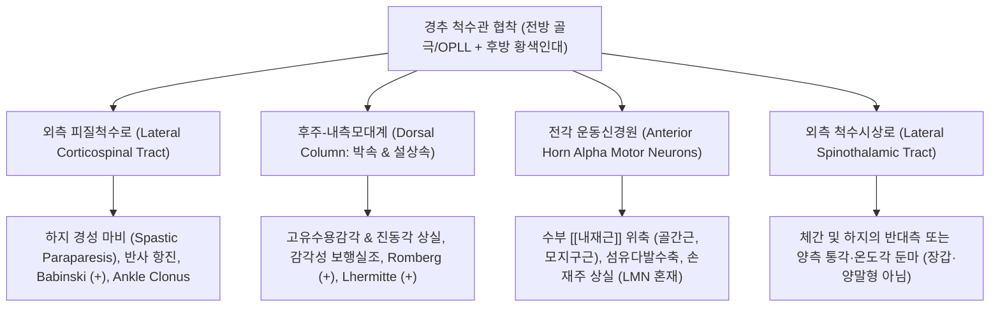
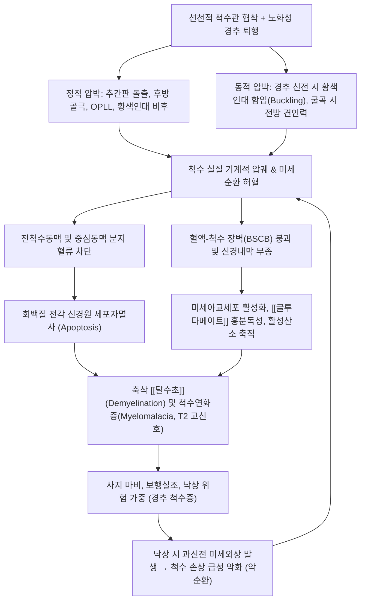
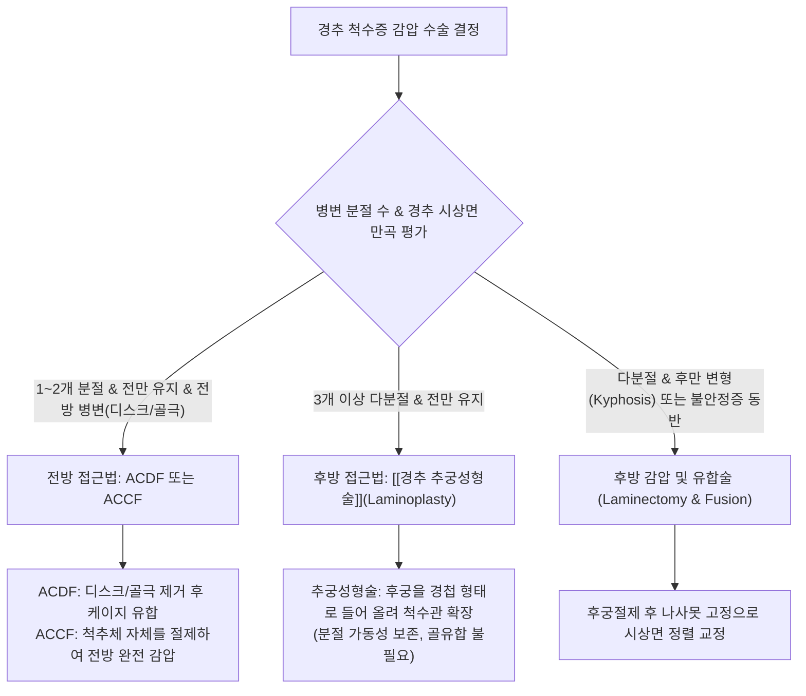

# 🩺 [[경추 척수증]] (Cervical Spondylotic Myelopathy / 頸椎脊髓症, ICD-10 M47.12 / KCD M47.1)

> **핵심 3줄 요약 (Key Summary)**:
> - 📍 **병소 부위 & 해부·병태생리**: 경추 추간판의 퇴행성 돌출, 추체 후방의 골극 형성, [[후종인대 골화증]](OPLL), [[황색인대]] 비후 및 동적 함입(Buckling)이 복합 작용하여 척수관 실질 유효공간(Space Available for the Cord, SAC)을 감소시키고, [[경수]] 실질(C5–T1 팽대부)을 정적·동적으로 압박하여 척수 미세혈관 허혈과 축삭 탈수초·세포자멸사를 유발하는 비가역적 [[상위운동신경원]](UMN) 질환이다.
> - 🚩 **전형적 임상 양상 & 3대 징후**: ① 단추 채우기, 젓가락질, 동전 집기가 둔해지는 **수부 미세운동 장애(Myelopathy hand)**, ② 다리가 뻣뻣하고 바닥이 푹신하게 느껴지는 **경직성 보행장애(Spastic myelopathic gait)**, ③ 목을 숙일 때 척추를 타고 전기가 찌릿하게 하행하는 [[Lhermitte 징후]] 및 비분절성 양측 상하지 감각 이상. 진행 시 신경인성 방광·직장 장애(대소변 실금)를 초래한다.
> - 🛠️ **핵심 감별 검사 & 한·양방 다각적 치료 전략**: [[Hoffmann 징후]], [[Babinski 징후]], [[10초 손 개폐 검사]], [[손가락 탈출 징후]], [[반전된 상완요골근 반사]], [[슬개건 반사]] 항진 및 경추 MRI(T2 고신호)로 확진. **중등도 이상(mJOA ≤14) 또는 진행성 마비는 조기 수술적 감압술(ACDF, 추궁성형술)이 제1 표준**이며, 한의 치료는 **경증(mJOA 15~17) 비진행성의 보존적 증상 관리, 수술 불가 환자의 완화 요법, 수술 후 잔존 경직·신경통 재활 보조**로 엄격히 한정한다.
> - ⚠️ **응급 의뢰 레드플래그 & 악화 요인**: 급성 대소변 정체·실금, 수주 내 급속 진행하는 사지 부전마비, 경미한 낙상 후 [[중심성 척수 증후군]](Central Cord Syndrome) 발생 시 즉시 척추신경외과 응급실로 전원한다. **경추 고속저진폭 교정(HVLA 추나), 강한 경추 회전·신연, 후굴(과신전) 유지 수기는 척수 손상 및 급성 사지마비를 유발하므로 절대 금기**이다.

---

## 📌 목차
1. [질환 개요 & 해부학적 병태생리](#1-질환-개요--해부학적-병태생리)
2. [병태생리 메커니즘 & 생체역학적 악순환 네트워크](#2-병태생리-메커니즘--생체역학적-악순환-네트워크)
3. [임상 증상 & 이학적 검사 알고리즘](#3-임상-증상--이학적-검사-알고리즘)
4. [감별 진단 매트릭스](#4-감별-진단-매트릭스)
5. [한의 통합 치료 프로토콜](#5-한의-통합-치료-프로토콜)
6. [양방 치료 & 병용·의뢰 기준](#6-양방-치료--병용의뢰-기준)
7. [재활 운동 & 생활습관 티칭 가이드](#7-재활-운동--생활습관-티칭-가이드)
8. [💡 사용자 진료실 핵심 필기 & 임상 노하우 (Melt-In)](#8--사용자-진료실-핵심-필기--임상-노하우-melt-in)
9. [📚 출처 및 현대 학술 연구 요약](#9-출처-및-현대-학술-연구-요약)

---

## 1. 🩺 질환 개요 & 해부학적 병태생리

### 1) 질환 정의 및 질환군 분류 (DCM vs CSM)
* **정의**: 경추 척추증(Cervical Spondylosis)을 포함한 경추의 퇴행성 변화로 인하여 척수관(Vertebral canal)의 내경이 협착되고, [[경수]](Cervical spinal cord) 실질이 만성적으로 압박받아 사지 부전마비, 감각 소실, 보행 실조, 괄약근 기능장애가 초래되는 진행성 신경 퇴행성 척수 질환이다.
* **용어 체계와 스펙트럼 (DCM의 포괄적 개념)**:
  * 과거에는 골극과 디스크 퇴행에 기인한 경우를 **경추증성 척수증(Cervical Spondylotic Myelopathy, CSM)** 이라 통칭하였으나, 최근 세계 척추신경외과 가이드라인(AOSPINE, Fehlings et al., 2017)은 원인 병리를 망라하여 **퇴행성 경추 척수증(Degenerative Cervical Myelopathy, DCM)** 을 공식 표준 질환명으로 확립하였다.
  * **DCM의 하위 병리 범주**:
    1. **경추증성 척수증 (CSM)**: 추간판 높이 감소, 척추체 후방 골극, 후관절 비후에 의한 가장 흔한 형태.
    2. **[[후종인대 골화증]](Ossification of the Posterior Longitudinal Ligament, OPLL)**: 척추체 후방의 후종인대가 비정상적으로 골화되어 척수 전방을 거대하게 압박하는 질환(동아시아인, 특히 한국·일본에서 2~4%의 높은 유병률).
    3. **황색인대 골화증/비후증 (Ossification/Hypertrophy of Ligamentum Flavum, OLF)**: 척수관 후방에서 척수를 짓누르는 병변.
    4. **선천성 척수관 협착증(Developmental Cervical Stenosis)**: 선천적으로 척수관이 좁은 상태에서 경미한 퇴행이 겹쳐 조기에 발병하는 형태.
* **역학 및 사회적 중요성**: 55세 이상 성인에서 **비외상성 척수 기능부전(Spinal cord dysfunction)을 초래하는 가장 흔한 제1의 원인 질환**이다. 고령화 사회로 진입함에 따라 발병률이 급증하고 있으며, 조기 진단 및 적절한 시기의 외과적 감압이 이루어지지 않을 경우 영구적인 휠체어 의존 또는 와상 상태에 이르는 치명적 예후를 갖는다.

### 2) 척수관의 해부학적 계측 지표 (Canal Measurements)
경추 척수의 압박 여부를 객관적으로 평가하기 위해 임상에서는 단순 방사선(X-ray) 및 CT/MRI 상의 시상경 계측 지표를 사용한다.

| 계측 지표 | 측정 방법 | 정상 기준치 | 척수증 위험 기준치 (Stenosis Cutoff) |
| :--- | :--- | :--- | :--- |
| **정중 시상경 (Midsagittal Canal Diameter)** | 경추 측면 단순 방사선 상 척추체 후면 중앙에서 해당 극돌기-추궁판 융합선(Spinolaminar line)까지의 최단 거리 | **17~18 mm** | • **13 mm 이하**: 상대적 협착 (Relative stenosis) • **10 mm 이하**: 절대적 협착 (Absolute stenosis / 척수 압박 임계점) |
| **토그-파블로프 비 (Torg-Pavlov Ratio)** | 척수관 시상경(Canal diameter)을 동일 분절 척추체의 시상경(Vertebral body diameter)으로 나눈 비율 | **0.95 ~ 1.0** | • **0.80 미만**: 선천성 척수관 협착 강력 시사 • 0.70 미만: 경미한 디스크 탈출에도 척수증 발병 위험 극대 |
| **척수 유효 공간 (Space Available for Cord, SAC)** | 척수관의 전후 시상경에서 실제 척수 실질의 시상경을 뺀 잔여 완충 공간 | **4~6 mm** | • **2 mm 이하**: 척수 완충 지방 소실 및 직접 압박 개시 |
| **척수 횡단 압축률 (Transverse Area / Flattening Ratio)** | 경추 MRI 축상면(Axial)에서 척수의 전후경 / 횡경 비, 및 척수 단면적(Cross-sectional area) | 단면적 > 80 mm² 압축률 > 0.40 | • **단면적 < 40~45 mm²**: 비가역적 척수 손상 및 신경학적 결손 출현 • 압축률 < 0.30: 수술 후 회복률 급감 |

### 3) 경수 팽대부 내부 신경로(Tracts) 3차원 배열과 임상 발현
경추 C5–T1 분절은 상지로 가는 신경근과 체간·하지로 내려가는 모든 상·하행 신경로가 밀집된 경수 팽대부(Cervical enlargement)이다. 척수가 전후방에서 압박될 때 각 신경로의 해부학적 위치에 따라 특이적인 신경 징후가 순차적으로 발현된다.

* **[[외측 피질척수로]](Lateral Corticospinal Tract)**: 척수의 외측 백질에 위치하며, 하행 운동 섬유 중 하지 섬유가 가장 외측에, 상지 섬유가 내측에 배열된다. 압박 시 하지의 상위운동신경원(UMN) 징후인 경직(Spasticity), 건반사 항진, 바빈스키 징후, 가위걸음(Scissoring gait)이 유발된다.
* **[[후주]]-내측모대계(Dorsal Column-Medial Lemniscal Tract)**: 척수 후방 백질의 박속(Gracile fasciculus, 하지 담당)과 설상속(Cuneate fasciculus, 상지 담당)으로 구성된다. 황색인대 함입에 의해 강하게 압박받아 진동각과 [[관절 위치각]](고유수용감각)이 상실되며, 환자는 어두운 곳에서 걷지 못하고 "발바닥에 모래나 솜뭉치를 밟고 걷는 것 같다"고 호소한다.
* **[[전각]] 세포(Anterior Horn Cells)**: 척수 중심 회백질의 복측에 위치하는 알파 [[운동신경원]]으로, 만성 허혈에 가장 취약하다. 병변 분절 레벨에서 수부 [[골간근]] 위축과 같은 국소 [[하위운동신경원]](LMN) 징후를 혼재시킨다(예: C8–T1 전각 손상에 의한 손가락 근위축).

---

## 2. ⚡ 병태생리 메커니즘 & 생체역학적 악순환 네트워크

### 1) 정적 압박(Static) vs 동적 압박(Dynamic Compression) 기전
* **정적 압박 인자 (Static Factors)**:
  * 해부학적으로 좁아진 척수관 내부에서 영구적으로 존재하는 구조물들이다. 추간판 후방 팽윤 및 탈출, 상·하 척추체 후연의 골극, [[후종인대 골화증]](OPLL) 판, [[후관절]]낭 비후가 척수를 전방과 후방에서 집게 형태로 지속 압박한다.
* **동적 압박 인자 (Dynamic Factors, 악화의 핵심)**:
  * 경추는 척추 중 가동성이 가장 큰 부위로, 목의 일상적 움직임이 척수 압박을 극적으로 가중시킨다.
  * **경추 신전(Extension) 시 병태역학**:
    * 척수관의 전후 시상경이 중립위 대비 **2~3mm 추가 감소**한다.
    * 척추관 후방의 [[황색인대]]가 탄력을 잃고 척수관 내부로 굵은 주름을 형성하며 튀어나오는 **황색인대 함입(Ligamentum flavum buckling)** 이 발생하여 척수 후주를 짓누른다.
    * 동시에 추간판 후방 높이가 줄어들며 전방 골극과 후방 황색인대 사이의 공간이 좁아지는 '작두날 효과(Pincer effect)'가 발생한다.
  * **경추 굴곡(Flexion) 시 병태역학**:
    * 척수가 두측으로 신장(Stretching)되면서 긴장도가 상승하고, 척수 전면이 전방 척추체 후연의 거친 골극이나 돌출된 추간판 위에 강하게 밀착되면서 전단 응력이 발생한다.

### 2) 척수 미세순환 허혈 및 분자생물학적 캐스케이드
* **혈관성 허혈 기전 (Microvascular Ischemia)**:
  * 척수는 전척수동맥(Anterior spinal artery, 전방 2/3 관류)과 좌우 후척수동맥(Posterior spinal arteries, 후방 1/3 관류)으로부터 혈액을 공급받는다.
  * 척수가 외부에서 압박을 받아 내압이 상승하면, 모세혈관 관류압(약 15~20 mmHg)을 초과하여 중심동맥(Sulco-commissural artery) 및 모세혈관망이 허탈된다.
  * 산소와 포도당 공급이 차단된 회백질 중심부(전각 세포 및 중간회백질)에서 가장 먼저 세포 허혈성 괴사가 시작된다.
* **분자생물학적 2차 손상 연쇄 반응**:
  1. **혈액-척수 장벽(Blood-Spinal Cord Barrier, BSCB) 파괴**: 허혈성 내피세포 손상으로 혈관 투과성이 급증하여 혈청 단백질이 실질 내로 유출되고 척수 부종이 가중된다.
  2. **글루타메이트 흥분독성(Glutamate Excitotoxicity)**: 성상교세포의 글루타메이트 재흡수 장애로 시냅스 간극에 글루타메이트가 축적되어 신경세포 내 과도한 칼슘(Ca²⁺) 유입을 유발한다.
  3. **세포자멸사(Apoptosis) 및 탈수초**: 축삭을 감싸고 있는 핍지교세포(Oligodendrocyte)가 Fas 리간드 및 카스파아제(Caspase) 활성화에 의해 대량 자멸사하면서 광범위한 탈수초(Demyelination)가 발생하고 신경 신호 전도가 영구 단절된다.

### 3) 경추 MRI 상 척수내 T2 고신호(Intramedullary T2 Hyperintensity)의 병리학적 의의
* **T2WI 고신호 병변 (High Signal Intensity on T2-weighted MRI)**:
  * 척수 실질 내에 하얗게 관찰되는 고신호는 급성기에는 척수 부종(Cord edema), 미세혈관 허혈, 염증성 침윤을 반영하며 이는 감압 수술 시 가역적으로 호전될 수 있다.
  * 그러나 만성으로 진행하여 낭성 괴사(Cystic necrosis), 공동화, [[척수연화증]](Myelomalacia), 교증(Gliosis)으로 이행되면 영구적 손상을 의미한다.
* **T1WI 저신호 동반의 치명성 (Snake-Eyes Appearance / Owl's Eyes)**:
  * T2 강조영상에서 척수 전각 부위에 양측성으로 동그란 고신호가 나타나는 '뱀눈 징후(Snake-eyes appearance)'가 관찰되고, 이것이 T1 강조영상에서 뚜렷한 저신호(T1 hypointensity)로 관찰될 경우 전각 운동신경원의 비가역적 괴사를 의미하며, 수술 후에도 상지 기능 회복률이 매우 불량하다.

---

## 3. 🔍 임상 증상 & 이학적 검사 알고리즘

### 1) 3대 핵심 임상 징후군 (Clinical Triad)
1. **수부 미세운동 장애 (Myelopathy Hand / Loss of Hand Dexterity)**:
   * **초기 증상**: 환자가 가장 먼저 인지하는 자각 증상이다. "손이 내 손 같지 않다", "손끝이 둔하다"고 표현한다.
   * **구체적 기능 장애**: 셔츠 단추 채우기 불능, 젓가락으로 콩이나 반찬 집기 실패, 글씨체가 삐뚤어지고 획이 흩어짐(Dysgraphia), 열쇠로 문 따기 어려움, 칫솔이나 컵을 자꾸 떨어뜨림.
   * **손 내재근 위축(Intrinsic Muscle Atrophy)**: [[골간근]](Interossei) 및 [[모지구근]](Thenar)이 마르고 위축되어 손등 뼈 사이가 깊게 패인다.
2. **경직성 보행장애 및 실조 (Spastic Myelopathic Gait & Ataxia)**:
   * **특징**: 환자는 다리에 힘이 빠진다기보다 "다리가 뻣뻣하고 굳어서 내 마음대로 안 움직인다", "발바닥이 바닥에 달라붙는 것 같다", "구름 위나 스펀지 위를 걷는 것처럼 바닥 감각이 없다"고 호소한다.
   * **보행 양상**: 보폭이 넓어지고(Wide-based gait), 무릎과 고관절이 뻣뻣하게 신전된 채 발을 바깥으로 돌려 차며 걷는 경직성 가위보행(Spastic gait)을 보인다.
   * **낙상 빈발**: 방향 전환 시 중심을 잃고 비틀거리며, 특히 밤에 불을 끄고 화장실 갈 때 균형을 잃고 쓰러져 2차 경추 척수 손상을 입는다.
3. **[[Lhermitte 징후]] 및 감각 장애**:
   * **레르미트 징후(Lhermitte's Phenomenon)**: 목을 앞으로 숙일 때 목덜미에서 시작하여 척추를 타고 내려가 양측 둔부, 허벅지, 발끝까지 찌릿한 전기 충격이 번개처럼 내리치는 감각이다. 척수 후주(Dorsal column)의 기계적 압박 및 탈수초를 입증하는 결정적 병적 징후이다.
   * **감각 장애 분포**: 신경근병증처럼 하나의 명확한 피부분절을 따르지 않고, 양측 손끝 전체가 얼얼하거나 체간부 아래로 특정 레벨 이하의 감각이 전반적으로 무뎌지는 '감각 둔마 레벨(Sensory level)'을 형성한다.
4. **자율신경 및 방광·직장 기능장애 (말기 위험 신호)**:
   * 척수 압박이 심화되면 배뇨 억제 하행로가 차단되어 **[[신경인성 방광]](Neurogenic bladder)** 이 발생한다.
   * 초기에는 소변이 급해서 참지 못하는 요절박(Urgency)과 빈뇨가 나타나며, 진행 시 화장실 가기 전에 지리는 절박성 요실금, 요정체(Retention), 잔뇨감, 배변 실금, 남성의 발기부전이 동반된다. 이는 즉각적인 외과적 수술의 절대 적응증이다.

### 2) 상위운동신경원(UMN) 병변 필수 이학적 검사 상세 매트릭스

경추 척수증의 선별 및 진단은 다음의 8가지 특이적 이학적 검사를 통해 진료실에서 즉각적으로 이루어져야 한다.

| 검사명 | 정밀 검사 방법 | 병적 양성 반응 | 신경학적 병태 메커니즘 |
| :--- | :--- | :--- | :--- |
| [[Hoffmann 징후]] | 환자의 손목을 가볍게 배굴시키고 중지(가운데 손가락)의 원위지절을 검사자의 시지·중지 사이에 끼운 후, 엄지손톱으로 환자의 중지 손톱을 아래로 강하게 탁 튕긴다 (Flicking). | **환자의 엄지(모지) 말절골과 검지(시지) 말절골이 불수의적으로 굴곡 및 내전(대립)** 되는 반응. | 경추 C5–C6 이상의 [[피질척수로]] 억제 기능 상실로 인한 심부건반사 과흥분. UMN 병변의 가장 대표적 선별 징후. |
| [[Tromner 징후]] | 환자의 중지 원위지절을 잡고, 수장측(손바닥 쪽) 지두를 검사자의 손가락으로 가볍게 위로 톡 쳐올린다. | Hoffmann과 동일하게 엄지와 검지가 굴곡되는 반응. | Hoffmann 검사보다 민감도가 더 높음. |
| [[Babinski 징후]] | 타진기 끝의 뭉툭한 부위로 발바닥 외측연을 따라 뒤꿈치에서 새끼발가락 쪽으로, 이어 엄지발가락 기저부 쪽으로 강하게 긁어올린다. | **엄지발가락이 하늘 쪽으로 서서히 배굴(Dorsiflexion)되고, 나머지 2~5번째 발가락이 부채꼴로 쫙 벌어짐 (Fanning).** | 외측 피질척수로의 심각한 손상 입증. 성인에서 양성이면 100% 병적 상태. |
| **발목 클로누스 (Ankle Clonus)** | 환자의 무릎을 살짝 구부린 상태에서 검사자가 환자의 발목을 잡고 갑작스럽게 족배굴(Dorsiflexion)시킨 후 그 자세를 유지한다. | **발목이 족저-족배 굴곡을 초당 수 회 주기로 3회 이상 불수의적으로 반복 경련(진동).** | 상위 운동신경 억제 결여로 인한 척수 [[신장반사]]의 지속적 율동 수축. 5회 이상 지속 시 중증 척수증. |
| **[[10초 손 개폐 검사]] (10-Second Grip & Release)** | 환자에게 양손을 가슴 높이로 들게 하고, 10초 동안 주먹을 완전히 쥐었다가 손가락을 완전히 펴는 동작을 최대 속도로 반복하게 하여 횟수를 센다. | **10초 동안 개폐 횟수가 20회 미만(통상 15회 이하)으로 떨어지거나, 손가락이 끝까지 펴지지 않고 느려짐.** | [[추체로]] 손상에 의한 손가락 원위부 굴곡-신전 조화 운동(Dexterity) 상실. 조기 진단에 극히 민감함. |
| **[[손가락 탈출 징후]] (Finger Escape Sign)** | 환자에게 양손의 손가락을 모으고 손바닥을 아래로 향하게 하여 30초 동안 팔을 앞으로 뻗고 유지하게 한다. | **마비가 있는 쪽의 새끼손가락(소지)과 약지가 30초 내에 바깥쪽으로 슬그머니 벌어지며(외전) 굴곡됨.** | C8–T1 척수 손상으로 척골신경 지배 수장측 골간근(손가락 모음근)의 약화 및 신근-굴근 불균형. |
| **[[반전된 상완요골근 반사]] (Inverted Radial Reflex)** | 완관절 요골 경상돌기(완요골근건 부착부)를 타진기로 톡 친다. | **완요골근 반사(전완 굴곡)는 소실되거나 약한 반면, 손가락들이 딸깍 쥐어지는 손가락 굴곡 반사가 유발됨.** | **C5–C6 분절 척수 압박의 결정적 징후.** C5–C6 레벨의 LMN 손상(완요골근 반사 소실)과 그 하부 C7–T1 레벨의 UMN 해제(수지굴곡 항진)가 결합된 소견. |
| **롬베르크 검사 ([[Romberg 검사]])** | 환자에게 양발을 모으고 똑바로 서게 한 후, 눈을 감게 하여 30초간 기립 자세 유지를 관찰한다. | 눈을 떴을 때는 서 있으나, **눈을 감는 순간 중심을 잃고 좌우로 심하게 비틀거리거나 쓰러짐.** | 시각 보정이 차단되었을 때 척수 후주(박속·설상속)의 [[고유수용감각]](Proprioception) 결손이 드러남. |

### 3) 중증도 평가 척도 (mJOA & Nurick Grade)

수술 시기 결정과 예후 판정을 위해 국제적으로 공인된 modified JOA (mJOA) 척도를 반드시 산출해야 한다.

#### modified JOA 점수 체계 (총점 17점 만점)
* **I. 상지 운동기능 (5점 만점)**:
  * 0점: 숟가락으로 식사 불가능
  * 1점: 숟가락 식사는 가능하나 젓가락질 불가능
  * 2점: 젓가락 식사는 가능하나 매우 서툴고 어색함
  * 3점: 단추 잠그기가 서툴고 미세운동 제한 있음
  * 4점: 손동작이 다소 둔하지만 일상 동작 완수 가능
  * 5점: 정상
* **II. 하지 운동기능 (7점 만점)**:
  * 0점: 다리를 전혀 움직이지 못함
  * 1점: 다리를 움직이나 걷지 못함 (와상)
  * 2점: 평지에서 평행봉이나 보행기 없이는 기립/보행 불가
  * 3점: 평지에서 지팡이나 보조기구에 의지하여 겨우 보행
  * 4점: 보조기 없이 보행 가능하나 난간 없이는 계단 오르내리기 불가능
  * 5점: 난간 없이 계단 보행 가능하나 걸음걸이가 뻣뻣하고 비틀거림
  * 6점: 보행이 원활하나 속도가 느리고 경미한 이상감
  * 7점: 정상
* **III. 감각 기능 (상지·체간·하지 각 1점, 총 3점 만점)**:
  * 0점: 심한 감각 상실 또는 동통
  * 1점: 경미한 감각 둔마
  * 2점: 정상
* **IV. 방광 기능 (2점 만점)**:
  * 0점: 완전 요폐 또는 지속적 요실금
  * 1점: 요절박, 배뇨 곤란, 잦은 잔뇨감
  * 2점: 정상

#### mJOA 중증도 분류 및 치료 방침 기준
* **경증 (Mild, 15 ~ 17점)**: 보행이 안정적이고 일상생활 장애가 경미함 → 3~6개월 단위 밀착 추적 관찰 하에 보존적 한의 관리 가능.
* **중등도 (Moderate, 12 ~ 14점)**: 젓가락질 장애, 계단 오르기 불안, 일상생활 장애 뚜렷 → **조기 신경외과적 감압 수술 적응증**.
* **중증 (Severe, 0 ~ 11점)**: 보행기 의존, 대소변 장애 동반, 사지 불완전 마비 → **즉각적인 응급 감압 수술 필수**.

---

## 4. 🔀 감별 진단 매트릭스

경추 척수증은 중추신경계와 척수 전반을 침범하는 다양한 질환들과 반드시 감별되어야 하며, 특히 말초신경 질환과의 오진으로 수술 골든타임을 놓치는 일이 없어야 한다.

| 감별 질환 | 병소 및 원인 | 주소증 차이점 | 신체 검진 소견 (UMN vs LMN) | 핵심 감별 검사 |
| :--- | :--- | :--- | :--- | :--- |
| [[경추 척수증]] (본 질환) | 경추 척수관 협착 → **경수 실질 압박 (UMN)** | 양손 미세운동 부전 + 하지 경직성 보행실조 + 대소변 장애 | **Hoffmann (+)**, **Babinski (+)**, **DTR 병적 항진**, Inverted radial (+), Romberg (+) | 경추 MRI: 척수관 시상경 <10mm, T2 척수 실질 내 고신호 |
| [[경추 신경근병증]] | 추간공 내 **단일 신경근 포착 (LMN)** | **단측성 피부분절 방사통**, 특정 손가락 저림, 보행 완전 정상 | **Spurling A (+)**, **Bakody (+)**, **DTR 감약/소실**, Hoffmann (-), Babinski (-) | 경추 MRI: 추간공 협착. 근전도: 단일 신경근 지배 근육의 탈신경 전위 |
| [[근위축성 측삭경화증]] (ALS / 루게릭병) | 운동신경세포(UMN + LMN)의 선택적 퇴행 | 사지 근력약화 및 근위축, 구음장애, 연하곤란. **감각 증상 전무** | **UMN 징후 + LMN 징후(광범위 섬유다발수축, 설근 위축) 동시 존재**, 감각 정상 | 근전도(EMG): 3개 분절 이상에서 광범위 진행성 탈신경. 척수 MRI 상 압박 병변 없음 |
| [[다발성 경화증]] (MS) | 중추신경계의 자가면역성 탈수초 질환 | 젊은 여성 호발. 시신경염(시력저하), 복시, 시간적·공간적 증상 변동 | Hoffmann (+), Babinski (+), 안구진탕, 뇌신경 침범 소견 | 뇌 및 척수 MRI: 다발성 백질 병변(Dawson's fingers), 뇌척수액 올리고클론 밴드(+) |
| **아급성 연합 변성 (SCD)** | 비타민 B12 결핍에 의한 척수 후주·측삭 변성 | 양측성 손발 끝 대칭적 저림, 심한 보행실조, 치매 등 인지장애 | 심한 진동각/위치각 소실, Romberg (+), DTR 항진/소실 혼재 | 혈청 비타민 B12 저하(<200 pg/mL), 호모시스테인 및 메틸말론산(MMA) 상승, 거대적혈구성 빈혈 |
| **요추 척추관 협착증** (Tandem Stenosis) | 요추관 협착에 의한 마미/신경근 압박 | **신경인성 간헐적 파행**(보행 시 하지 통증, 전굴 시 완화), 상지 증상 없음 | 요추 신전 시 하지 방사통, DTR 감약, 족관절 마비. **상지 징후 전무** | 요추 MRI. (단, 경추와 요추가 동시에 좁아진 **이중 협착증(Tandem Stenosis)** 반드시 배제!) |
| **수근관증후군 (양측성)** | 손목 횡수근인대 하부 정중신경 포착 | 양손 엄지~약지 요측 저림, 야간통, 손 털기. 하지 보행 완전 정상 | 손목 **Phalen (+)**, **Tinel (+)**. **Hoffmann (-)**, 하지 DTR 정상 | 근전도/신경전도(NCS): 정중신경 손목 구간 전도 지연. 경추 MRI 정상 |
| **정상뇌압 수두증 (NPH)** | 뇌실 내 뇌척수액 흡수 장애 | **3대 징후: 보행장애(소보행, 자석보행) + 요실금 + 혈관성 치매** | 발을 바닥에 붙이고 끄는 보행. 상지 미세운동 상대적 보존, 경추 징후 없음 | 뇌 CT/MRI: Evans index >0.3(뇌실 확장), 뇌척수액 배액 시험 시 보행 즉각 호전 |
| [[척수 종양]] / [[경막외 농양]] | 척수 경막내외 종양(수막종, 신경초종) 또는 세균 감염 | **안정 시 및 야간에 극심한 통증**, 발열, 악액질, 급속 진행 마비 | 급격한 척수 압박 레벨 징후, 발열, 척추 극돌기 고타통 | MRI 조영증강(Gadolinium) 영상: 조영되는 종괴, 혈액 CRP/ESR 현저 상승 |

---

## 5. 🌿 한의 통합 치료 프로토콜

> **⚠️ 한의 치료의 임상적 위치 선언 (Clinical Boundary & Mandate)**
> 경추 척수증은 물리적 압박에 의해 척수 축삭이 손상되는 **진행성 신경외과 질환**이다. 따라서 한의사의 제1 사명은 **"적절한 수술 시기를 놓치지 않도록 신속히 감별하여 신경외과로 전원하는 것"** 이다.
> 한의 치료는 다음 세 가지 경우로 엄격히 한정하여 시행한다:
> 1. **경증(mJOA 15~17점) 비진행성 환자의 보존적 증상 완화 및 자세 교정**.
> 2. **초고령, 심혈관 질환 등 전신 상태 악화로 수술이 불가능한 환자의 완화 요법**.
> 3. **감압 수술 후 잔존하는 경직, 저림, 근위축 회복을 위한 한의 재활 복합 치료**.

### 1) 침구 치료 (Acupuncture Protocol)
* **치료 원칙**: 경추부의 무리한 심자(Deep needling)를 엄격히 금하고, 흉배부·견갑대 근막 연축 이완 및 원위 취혈을 통한 중추성 진통·경직 완화를 도모한다.
* **근위 배혈 (경항부·견갑대)**:
  * **혈위**: [[풍지]](GB20), [[천주]](BL10), [[대추]](GV14), [[견정]](GB21), [[견중수]](SI15), [[천료]](TE15).
  * **자침 깊이 및 각도**: 풍지(GB20)와 천주(BL10) 자침 시 [[후두하근]] 심부의 척수 및 척추동맥 손상을 방지하기 위해 침첨을 반대측 안와(눈) 방향으로 향하게 하여 1.0~1.5cm 내외로 천자한다. 경추 극돌기 사이 심자(Interspinous deep needling)는 경막 천자 위험이 있으므로 **절대 금기**이다.
* **원위 배혈 (상하지 조화 및 경직 조절)**:
  * **상지**: [[후계]](SI3, 독맥 통혈), [[외관]](TE5, 양유맥 통혈), [[곡지]](LI11), [[합곡]](LI4). 수부 미세운동 개선을 위해 팔사혈(EX-UE9)을 배합한다.
  * **하지 (경직성 보행 완화)**: [[양릉천]](GB34, [[근회혈]] — 근경직 완화의 요혈), [[족삼리]](ST36), [[현종]](GB39, 골수회혈), [[태충]](LR3), [[곤륜]](BL60).
* **전침 치료 파라미터 (Electroacupuncture)**:
  * 상지 곡지–합곡, 하지 양릉천–족삼리에 연결.
  * **주파수**: 2Hz 저주파 통전. 중추 신경계의 억제성 신경전달물질(GABA) 분비를 자극하고 하지 [[피질척수로]] 병변으로 인한 굴곡근 경직을 부드럽게 이완시킨다.
  * 강도는 근육이 가볍게 움찔거리는 역치 수준으로 15분간 적용한다.

### 2) 약침 치료 (Pharmacopuncture Protocol)
* **약침 제제 선택**:
  * **[[신바로약침]] (GCSB-5)**: [[경추]] [[후관절]] 및 척추주위근의 무균성 염증 반응을 억제하고 신경세포 사멸을 방어하는 목적으로 사용.
  * **[[자하거약침]] (Hominis Placenta)**: 만성 척수 허혈로 인한 신경 위축, 기혈부족, 고령 환자의 하지 쇠약에 조직 영양 공급 및 신경 재생 보조 목적으로 사용.
  * [[중성어혈약침]]: 척추 주변부의 미세혈관 울혈 및 어혈성 근막 유착 해소.
* **시술 방법 및 안전 가이드**:
  * 환자를 앉히거나 측와위로 편안히 눕힌다. (앙와위에서 경추를 신전시키면 척수가 압박되므로 주의!)
  * 경추 [[다열근]] 부착부 및 상부 승모근, 견갑거근의 근경결 부위에 피부를 살짝 집어 올려(Pinch-lift) 0.5~1.0cm 깊이로 각 포인트당 0.1~0.2cc씩 소량 주입한다.
  * **⛔ 약침 금기**: 척수관 근처로 깊숙이 바늘을 찔러 넣는 행위는 척수 손상이나 경막외 혈종을 유발할 수 있으므로 절대 엄금한다.

### 3) 추나 치료 (Chuna Manipulation Protocol)
* **⛔ 절대 금기 수기 (ABSOLUTE CONTRAINDICATION)**:
  * **경추 고속저진폭 교정 기법 (HVLA Thrust Manipulation)**: 척수관이 협착된 상태에서 고속 쓰러스트를 가하면 비후된 황색인대와 디스크가 척수를 순간적으로 강타하여 영구적 사지마비(Quadriplegia)를 초래한다.
  * **강한 경추 회전 및 과신전(Extension) 수기**: 척수를 집게처럼 짓누르는 작두날 효과를 유발하므로 절대 금기.
  * **강한 기계적 경추 견인(Cervical Traction)**: 척수가 긴장된 상태에서 무리한 견인은 [[전척수동맥]]을 신장시켜 허혈성 척수경색을 유발할 수 있다.
* **안전하게 적용 가능한 수기 범위**:
  * **경추 중립위 근막 이완(Myofascial Release)**: 경추를 약간 굴곡된 중립위로 유지한 채, [[후두하근]]과 견갑거근을 손끝으로 가볍게 압박하여 표층 근막 긴장만 완화시킨다.
  * **흉추 가동화 추나 (Thoracic Mobilization, JS 기법)**: [[흉추]]의 [[후만]]을 개선하여 경추의 보상성 과신전 스트레스를 줄여준다.

### 4) 한약 치료 (Herbal Medicine Prescription)
척수증 환자에서 한약의 치료 목표는 척수 압박 구조물의 제거가 아니라, 척수 미세순환 혈류 개선, 신경교세포의 산화 스트레스 억제, 하지 골격근 위축 방어 및 체력 보강이다.

* **간신부족·기혈양허형 (만성 퇴행, 사지 무력, 보행실조, 근위축)**:
  * **[[독활기생탕]](獨活寄生湯)**: 독활, 상기생, 두충, 우슬이 간신을 보하고 척수 주변 인대를 강화하며, 사물탕 구성이 척수 미세혈관 순환을 보조.
  * **[[보중익기탕]](補中益氣湯) 합 [[팔미지황환]](八味地黃丸)**: 중기(中氣)가 하함하여 다리가 풀리고 하지가 냉하며 방광 괄약근 기능이 약화된 환자에게 기운을 북돋우고 신양(腎陽)을 온양.
  * **[[녹용대보탕]](鹿茸大補湯)**: 신경 축삭 변성이 심하고 수부 내재근 위축이 진행되는 고령 환자의 골수 보충 및 전신 쇠약 회복.
* **어혈·담음 비저형 (경항부 강직, 국소 통증, 저림 동반)**:
  * **[[신통축어탕]](身痛逐瘀湯) 가감**: 당귀, 천궁, 도인, 홍화 배합으로 미세혈관 허혈 부위의 혈류 순환을 촉진.
* **최신 한의 통합 치료 학술 근거**:
  * 척수증 입원 환자를 대상으로 한 장기 추적 후향적 코호트 연구(Healthcare 2022, PMID: 35370420)에서 침·약침·한약·추나 복합 치료가 mJOA 점수 개선 및 통증 완화에 유의한 기여를 함이 보고되었다.
  * 신바로-2 약침을 포함한 통합 한의 치료로 경추 척수증 환자의 삼두근 근력 약화가 호전된 임상 증례(Medicine 2024, PMID: 40629633)가 보고되어 있다.

---

## 6. 💊 양방 치료 & 병용·의뢰 기준

### 1) 보존적 치료의 적응증 및 한계
* **적응증**: mJOA 15점 이상의 **경증(Mild) 환자**, 신경학적 악화 징후가 없고 영상 상 척수 압박이 경미한 경우, 고령이나 전신 질환으로 수술 위험도가 극도로 높은 경우에 한하여 신중히 적용된다.
* **보존적 치료 방법**:
  * 경추 보조기(Philadelphia collar 등) 단기 착용을 통한 동적 압박(굴곡·신전) 차단.
  * 약물 요법: 통증 완화를 위한 NSAIDs, 신경병성 통증 조절을 위한 가바펜티노이드(Pregabalin, Gabapentin), 근이완제.
* **한계**: AOSPINE 국제 가이드라인(Fehlings et al., 2017)은 **"보존적 치료가 척수증의 구조적 진행을 막거나 역전시킬 수 없다"** 고 명시하고 있다. 보존적 치료를 받는 환자의 20~60%는 수년 내 단계적 또는 계단식(Stepwise) 신경 악화를 겪는다.

### 2) 수술적 치료의 적응증 및 최신 가이드라인
* **절대적 수술 적응증**:
  1. **중등도 및 중증 척수증 (mJOA ≤ 14점)**: 진단 즉시 신경외과적 수술을 시행하는 것이 표준 권고안이다.
  2. **진행성 신경 결손**: 수주~수개월 사이에 손재주 상실이나 보행장애가 악화되는 경우.
  3. **방광·직장 괄약근 기능장애** 출현 시.
  4. 경미한 외상 후 발생한 급성 사지 부전마비.
* **수술 골든타임**: 증상 발현 후 **6개월 이내에 감압 수술**을 시행할 때 신경학적 회복률이 가장 높으며, 1~2년 이상 방치되어 척수 위축 및 T1 저신호가 고착화되면 수술 후에도 마비가 거의 회복되지 않는다.

### 3) 대표적 수술 술식 비교
수술은 병변 분절 수, 경추 시상면 정렬(전만 유지 vs 후만 변형), OPLL 동반 여부에 따라 전방 접근법과 후방 접근법으로 나뉜다.

* **[[전방 경추 추간판 절제 및 유합술]](ACDF)**: 전방에서 척수를 누르는 디스크와 골극을 직접 제거하는 가장 확실한 전방 감압술.
* **[[경추 전방 추체절제 및 유합술]](ACCF)**: 거대 OPLL이나 추체 후방의 광범위 골극 시 추체 자체를 깎아내고 기둥을 세우는 술식.
* **경추 추궁성형술 (Laminoplasty, 문열기식 술식)**: 다분절 협착 환자에서 후궁의 한쪽을 절단하고 반대쪽을 경첩 삼아 들어 올려 척수관 직경을 확장시키는 술식. 경추 가동성을 보존하고 유합술 [[인접분절 퇴행]](ASD)을 줄이는 우수한 장점이 있다.

### 4) 한·양방 병용 관리 및 수술 후 재활 프로토콜
* **수술 후 한의 재활의 필요성**:
  * 감압 수술로 척수를 누르는 뼈와 인대는 성공적으로 제거되었으나, 장기간 압박받았던 척수 신경세포의 손상, 만성 축삭 탈수초, 수술 부위의 연부조직 유착 및 섬유화로 인해 수술 후에도 환자의 30~50%는 **잔존 보행실조, 수부 감각 둔마, 경항통, 근경직**을 호소한다.
  * 이때 침, 전침(2Hz 저주파), 자하거약침, 독활기생탕을 투여하여 신경 재생을 촉진하고 수부 미세운동 재활 훈련을 결합할 때 수술 후 mJOA 점수의 추가적 향상을 도모할 수 있다.

---

## 7. 🏃 재활 운동 & 생활습관 티칭 가이드

경추 척수증 환자에게 잘못된 운동은 척수 손상을 급격히 악화시키는 치명적 흉기가 될 수 있으므로, 철저한 금기 사항 교육이 선행되어야 한다.

### 1) 절대적 운동 금기 사항 (EXERCISE RED FLAGS)
* **⛔ 환자에게 절대 금지시켜야 할 동작**:
  1. **목을 뒤로 젖히는 동작 (경추 과신전 / Extension)**: 하늘 쳐다보기, 미용실 세발대에서 목 젖히기, 목 뒤로 젖혀 스트레칭하기 → 황색인대 함입으로 척수 압박 극대화!
  2. **목을 빠르게 돌리는 회전 스트레칭 (Neck Rolling)**: 척수에 전단력을 가함.
  3. **머리나 어깨에 무거운 무게를 얹는 운동**: 스쿼트 바벨 짊어지기, 무거운 짐 머리에 이기.
  4. **두경부 충격 위험 운동**: 요가 플라우 자세(쟁기 자세), 물구나무서기, 격투기, 축구 헤딩, 트램펄린 점프.
  5. **불규칙한 야외 지형 러닝**: 발을 헛디뎌 넘어질 경우 즉시 사지마비 초래.

### 2) 안전한 흉추 및 견갑대 가동성 운동
경추의 움직임을 최소화하고 흉추와 견갑대에서 대상적 가동성을 확보하는 것이 핵심이다.
* **좌위 흉추 회전 운동 (Seated Thoracic Rotation)**:
  * 의자에 바르게 앉아 양손을 가슴에 교차하여 얹는다.
  * 목(두부)은 정면을 고정한 채, 가슴(흉추)만 좌우로 20~30도 부드럽게 회전한다.
* **견갑골 후인-하강 운동 (Scapular Retraction & Depression)**:
  * 턱을 가볍게 당겨 경추 중립을 유지한 상태에서 날개뼈를 등 뒤 가운데로 모으면서 아래로 끌어내린다. 5초 유지, 10회 반복.

### 3) 하지 경직 완화 및 보행·균형 감각 재활 훈련
낙상 예방과 고유수용감각 회복을 위한 점진적 훈련을 시행한다.
* **지지대 잡고 한 발 서기 (Supported Single-Leg Stance)**:
  * 튼튼한 식탁이나 평행봉을 양손으로 잡고, 한쪽 발을 살짝 들어 10~20초간 버틴다. 익숙해지면 손가락 끝만 살짝 대고 버틴다. (절대 눈을 감고 하지 않는다!)
* **탠덤 보행 훈련 (Tandem Walking with Support)**:
  * 벽에 손을 짚은 상태에서 일직선 상에 한쪽 발의 발뒤꿈치를 다른 쪽 발의 발가락 바로 앞에 닿게 놓으며 천천히 걷는다.
* **의자 앉았다 일어서기 (Sit-to-Stand)**:
  * [[대퇴사두근]]과 [[둔근]] 강화를 위해 손잡이를 잡고 의자에서 천천히 일어섰다 앉기를 반복한다.

### 4) 인체공학적 환경 개선 & 가정 내 낙상 방지 (Fall Prevention)
* **가정 내 환경 정비 (낙상 방지가 생명이다)**:
  * 화장실 변기와 욕조 옆에 **안전 손잡이(Grab bar)** 를 반드시 설치한다.
  * 욕실 바닥에 미끄럼 방지 매트를 깔고, 실내 슬리퍼도 논슬립 바닥을 착용한다.
  * 방과 거실의 문턱을 제거하고, 발에 걸리기 쉬운 전선, 러그, 발매트를 치운다.
  * 침실에서 화장실로 이어지는 복도에 **야간 센서등**을 설치하여 어두운 상태에서 걷지 않도록 한다.
* **베개 및 수면 환경**:
  * 높은 베개는 경추를 꺾고, 너무 낮은 베개는 목을 뒤로 젖히게 만든다.
  * 누웠을 때 경추가 수평 중립을 유지하도록 단단한 라텍스나 메모리폼 경추 베개를 사용한다. 엎드려 자는 자세는 엄격히 금지한다.
* **외출 시 안전 수칙**:
  * 보행이 불안정한 환자는 자존심을 버리고 **지팡이나 4발 보행기**를 반드시 사용하도록 설득한다. (지팡이 하나가 낙상으로 인한 사지마비를 막아준다.)

---

## 8. 💡 사용자 진료실 핵심 필기 & 임상 노하우 (Melt-In)

> [!IMPORTANT]
> 본 섹션에는 원장님의 기존 진료실 필기에 수록된 **실전 스크리닝 직관, 감별 문진 공식, 자침 및 약침 안전 손맛 노하우, 법적 의무기록(Medico-legal) 방어 팁**을 100% 온전히 녹여내어(Melt-In) 집약하였다.

### 1) 진료실 5분 척수증 스크리닝 5대 필수 질문 (초진 시 순서대로 질문)
상지 저림이나 목 통증으로 내원한 환자에게 다음 5개 질문을 무조건 던진다. 하나라도 걸리면 즉시 척수증 축으로 의심을 전환한다.
1. **손재주 질문**: "단추 잠그기나 젓가락질이 예전 같지 않으신가요? 밥 먹다가 숟가락을 떨어뜨린 적이 있나요?"
   * ⚠️ 반드시 **"작년과 비교해서, 예전과 비교해서"** 라고 기준 시점을 명시해야 한다. 대다수 환자는 "그냥 늙어서 그렇지 뭐" 하고 노화 탓으로 치부한다.
2. **보행 질문**: "계단을 내려갈 때 다리가 후들거리거나, 다리가 뻣뻣해서 발이 땅에 붙는 느낌이 드나요?"
   * 환자가 "술 취한 사람처럼 비틀거린다"고 하면 척수증 가능성 90%.
3. **전기감 질문 (Lhermitte)**: "고개를 푹 숙일 때 등이나 엉덩이, 다리 쪽으로 전기가 찌릿하게 통하나요?"
   * Lhermitte 징후는 환자가 먼저 말하지 않으므로 반드시 의사가 짚어 물어야 한다.
4. **대소변 질문 (레드플래그)**: "소변이 마려우면 참기 힘들어서 급하게 화장실을 가시나요? 속옷에 지린 적이 있나요?"
   * 요절박이나 요실금이 확인되면 그 자리에서 신경외과 의뢰서를 작성한다.
5. **낙상력 질문**: "최근 6개월 사이에 혼자 걷다가 넘어진 적이 있나요? 넘어질 뻔한 적은요?"
   * 척수증 환자의 반복 낙상은 급성 척수 파열의 전조이다.

### 2) 진료실 실전 감별 직관 3원칙
* **감별 직관 1 — "손만 저린가, 걸음도 이상한가?"**:
  * **"손은 저린데 걸음은 멀쩡하다"** → 80% 이상 [[경추 신경근병증]] 또는 [[수근관증후군]].
  * **"손도 저리고 걸음걸이도 이상하다"** → 무조건 [[경추 척수증]]을 제1순위로 고려!
* **감별 직관 2 — 피부분절 일치 여부**:
  * 환자가 "엄지손가락 쪽만 딱 저려요"처럼 특정 손가락을 가리키면 신경근병증(LMN).
  * "손가락 열 개가 다 얼얼해요", "손바닥 전체가 남의 살 같아요"처럼 비분절성·양측성으로 호소하면 척수증(UMN).
* **감별 직관 3 — Hoffmann 검사는 좌우를 동시에 튕겨본다**:
  * 한쪽 손만 검사하면 생리적 반사 항진과 헷갈릴 수 있다. 양손을 나란히 두고 번갈아 튕겼을 때, 한쪽 엄지가 뚜렷하게 까딱 굴곡되면 즉시 영상 검사 의뢰의 절대적 근거가 된다.

### 3) 자침 & 약침 시술 손맛 노하우 (Safety Needling Pearls)
* **체위 선택이 생명이다**:
  * 척수증 환자를 엎드리게 하거나(복와위), 앙와위에서 베개 없이 눕혀 목이 뒤로 젖혀지게(신전) 만들면 시술 중에 척수가 눌려 다리가 마비될 수 있다!
  * 반드시 **등받이가 있는 편안한 의자에 앉히거나, 측와위(옆으로 눕기)에서 턱을 살짝 당긴 중립 자세**를 유지시킨 후 시술해야 한다.
* **자침 시 환자 경고 멘트 필수**:
  * 침을 놓기 전에 반드시 환자에게 고지한다: *"원장님이 침을 놓는 동안 팔이나 다리로 찌릿한 전기감이 느껴지면 참지 마시고 그 즉시 '앗' 하고 말씀하셔야 합니다."*
  * 전기감이 느껴진다는 것은 침끝이 신경근이나 경막을 스쳤다는 신호이므로 즉시 1~2mm 후퇴해야 한다.
* **약침 시술의 철칙**:
  * 표층 근육(승모근, 견갑거근) 위주로만 시술한다.
  * 피부를 손가락으로 집어 올린 상태에서 주입하여(Pinch-lift injection), 바늘이 척추 뼈 사이 틈새로 깊이 들어가는 사고를 원천 차단한다.
  * 약침 용량은 통상 용량의 절반(0.5~1.0cc)으로 시작하여 환자의 24시간 후 신경 반응을 반드시 확인한다.

### 4) 환자 및 보호자 설득 스크립트 (소통 노하우)
* **질환의 엄중함 설명 멘트**:
  * "어르신, 이건 단순한 목 디스크나 오십견이 아닙니다. 뇌에서 내려와서 팔다리로 가는 **가장 굵은 신경 원줄기(척수)가 좁아진 목뼈 구멍 사이에서 꽉 끼어 숨을 못 쉬고 있는 상태**입니다. 나무로 치면 나뭇가지가 아니라 굵은 나무 기둥이 꺾이고 있는 것과 같습니다."
* **수술 시기(골든타임) 설득 멘트**:
  * "환자분들께서 '수술이 무서워서 한의원에서 침 맞고 한약 먹고 고치겠다'고 하시는 경우가 많습니다. 하지만 척수 신경은 한 번 죽으면 수술을 해도 다시 살아나지 않습니다. 지금 젓가락질이 안 되고 걸음이 비틀거리는 것은 신경이 살려달라고 보내는 마지막 SOS 신호입니다. 지금 수술을 받으시면 더 나빠지는 것을 막고 회복할 수 있지만, 휠체어를 타게 된 후에는 큰 병원 가셔도 소용이 없습니다. 지금 바로 신경외과 정밀 검사를 받으셔야 합니다."
* **한의원 치료의 한계와 역할 정직 고지**:
  * "저희 한의원에서는 목 주변 근육의 긴장을 풀어서 목을 편하게 해 드리고, 수술을 받으신 후에 다리 힘과 손 감각을 빠르게 회복하시도록 침과 한약으로 재활을 도와드릴 수는 있습니다. 하지만 뼈와 인대가 신경을 누르고 있는 쇠사슬 자체는 수술로 끊어내야 합니다."

### 5) 의무기록 차팅 및 법적 방어 노하우 (Medico-Legal Documentation)
척수증 환자는 치료 도중 자연 경과로 마비가 급속히 악화될 수 있으며, 자칫 한의 치료로 인해 악화되었다는 의료 분쟁에 휘말리기 쉽다. 따라서 초진 차트에 다음 5대 항목을 반드시 활자화하여 기록으로 남겨야 한다:
1. 보행 평가 소견: *"보행 시 Wide-based spastic gait 관찰됨, 족부 마비 소견 있음."*
2. UMN 징후 검사 결과: *"Hoffmann (+/+), Babinski (+/-), Inverted radial reflex (+), 10초 손 개폐 12회."*
3. 대소변 문진 기록: *"배뇨 곤란 및 요절박 문진 시행함."*
4. 상급병원 전원 권유 사실 기록: *"본 질환은 경추 척수증(CSM) 강력 시사 소견으로, 비가역적 척수 손상 방지를 위해 척추신경외과 정밀 MRI 촬영 및 수술적 치료 상담을 즉시 받도록 강력히 권유하고 설명함."*
5. 환자 본인 확인 서명 또는 거부 시 *"환자 본인이 수술 상담을 거부하고 보존적 한의 치료를 강력 희망하여 증상 완화 목적으로 저강도 침 치료 시행함"* 명기.

---

## 9. 📚 출처 및 현대 학술 연구 요약

1. **Badhiwala JH, Ahuja CS, Akbar MA, et al. (2020)**. *Degenerative cervical myelopathy - update and future directions*. **Nat Rev Neurol**. PMID: 31974455
   - **연구 요약**: 퇴행성 경추 척수증(DCM)의 병태생리, 영상 진단, 바이오마커, 임상적 평가 및 향후 치료 방향을 총망라한 최고 권위의 종설. DCM이 성인 척수 기능부전의 가장 흔한 원인임을 확립하고, 정적·동적 기계적 압박에 따른 척수 허혈, 혈액-척수 장벽 붕괴, 세포자멸사 기전을 정밀 규명함. mJOA 기반의 수술적 감압술 치료 알고리즘을 제시.
2. **Fehlings MG, Tetreault LA, et al. (2017)**. *A Clinical Practice Guideline for the Management of Patients With Degenerative Cervical Myelopathy: Recommendations for Patients With Mild, Moderate, and Severe Disease*. *Global Spine J*. PMID: 29164035
   - **연구 요약**: 국제 경추학회가 제정한 임상 진료 지침. 중등도 및 중증 환자에게는 조기 외과적 감압 수술을 강력 권고하고, 경증 환자에게는 면밀한 추적 관찰 하에 초기 보존적 관리 또는 선제적 수술 옵션을 권고함.
3. **Gallagher DO, Taghlabi KM, et al. (2024)**. *Degenerative Cervical Myelopathy: A Concept Review and Clinical Approach*. **Clin Spine Surg**. PMID: 38285428
   - **연구 요약**: DCM 환자의 1차 진료 현장 선별 및 신체 검진 접근법에 관한 최신 개념 리뷰. Hoffmann 징후, Lhermitte 징후, 바빈스키 반사 및 10초 손 개폐 검사의 진단적 민감도와 특이도를 재평가하고, 조기 수술적 의뢰를 위한 체크리스트를 체계화함.
4. **Hejrati N, Moghaddamjou A, et al. (2022)**. *Degenerative Cervical Myelopathy: Towards a Personalized Approach*. **Can J Neurol Sci**. PMID: 34689848
   - **연구 요약**: DCM 환자의 이질성을 극복하기 위한 개인 맞춤형 진단 및 치료 전략 제시. 환자의 연령, 척수관 기하학적 형태, 시상면 만곡, MRI T2/T1 신호 변화에 따른 맞춤형 수술 접근법(전방 ACDF vs 후방 추궁성형술) 및 수술 후 신경 재활 프로토콜의 중요성을 역설.
5. **Hejrati N, Pedro KM, et al. (2023)**. *Degenerative cervical myelopathy: Where have we been? Where are we now? Where are we going?* **Acta Neurochir (Wien)**. PMID: 37004568
   - **연구 요약**: 지난 수십 년간 축적된 DCM의 역학적 변천사와 치료 표준의 발전사를 고찰. 단순 감압을 넘어 척수 보호 약물 요법, 줄기세포 치료, 정밀 수술 내비게이션의 현황을 조망하고 조기 진단의 경제성·임상적 가치를 입증.
6. **Williams J, D'Amore P, et al. (2022)**. *Degenerative Cervical Myelopathy: Evaluation and Management*. **Orthop Clin North Am**. PMID: 36208893
   - **연구 요약**: 정형외과적 관점에서 DCM의 해부학적 병변(골극, 황색인대 비후, OPLL) 평가와 영상의학적 감별 지표(Torg-Pavlov ratio, 정중 시상경 계측)를 정리하고, 수술적 치료의 적응증과 합병증 예방 가이드라인을 제시.
7. **Marie-Hardy L (2021)**. *Degenerative cervical myelopathy*. *Rev Neurol (Paris)*. PMID: 33781560
   - **연구 요약**: 신경과적 관점에서 퇴행성 경추 척수증의 초기 감각 이상, 수부 미세운동 부전, 하지 경직성 보행실조의 신경해부학적 기전을 기술하고 루게릭병 및 [[다발성 경화증]]과의 감별 진단 포인트를 명쾌하게 정리한 임상 종설.
8. **Long-Term Korean Medicine DCM Inpatients Study (2022)**. *Long-Term Follow-Up of Inpatients with Cervical Myelopathy Who Received Integrative Korean Medicine Treatment: A Retrospective Analysis and Questionnaire Survey Study*. **Healthcare (Basel)**. PMID: 35370420
   - **연구 요약**: 경추 척수증으로 한방병원에 입원하여 침, 약침, 한약, 추나를 포함한 통합 한의 치료를 받은 환자 코호트를 장기 추적 관찰한 후향적 분석 연구. 보존적 한의 복합 중재가 통증(NRS)과 경추 기능장애(NDI)를 유의하게 개선하고 환자 만족도를 높였음을 실증적으로 보고함.
9. **Shinbaro-2 Pharmacopuncture CSM Case Series (2024)**. *Improvement of triceps muscle weakness in patients with cervical spondylotic myelopathy using Korean medicine therapy including shinbaro-2 pharmacopuncture: A CARE-compliant case series*. **Medicine (Baltimore)**. PMID: 40629633
   - **연구 요약**: 경추증성 척수증으로 인해 [[상완삼두근]] 근력 약화가 발생한 환자들을 대상으로 신바로-2 약침을 포함한 통합 한의 치료를 적용하여 도수근력검사(MMT) 및 신경학적 회복을 달성한 CARE 가이드라인 준수 임상 증례 보고.
