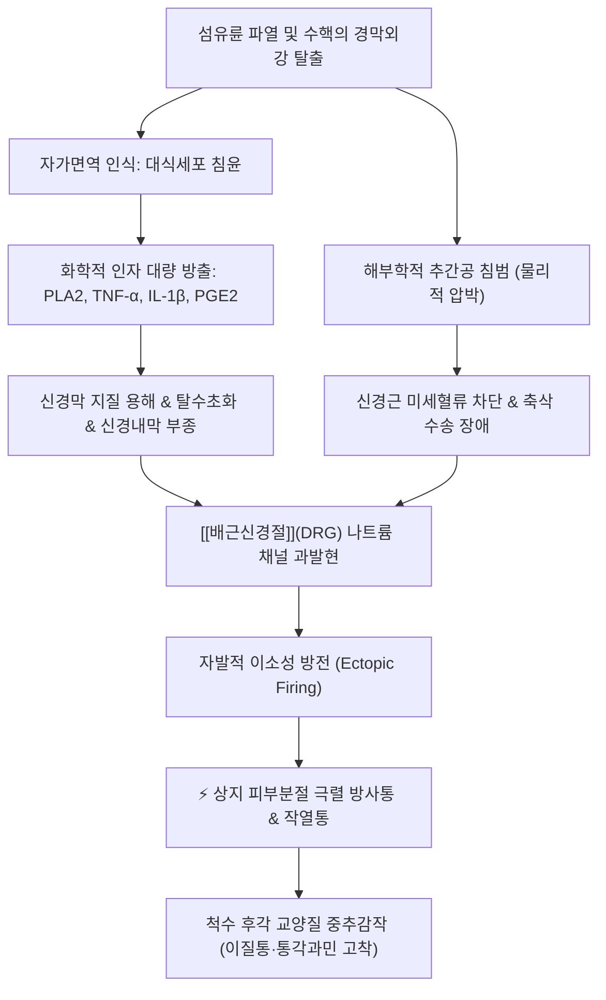
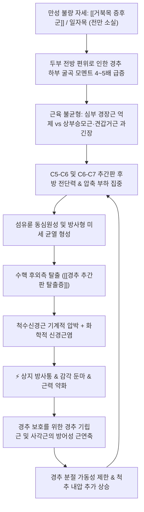
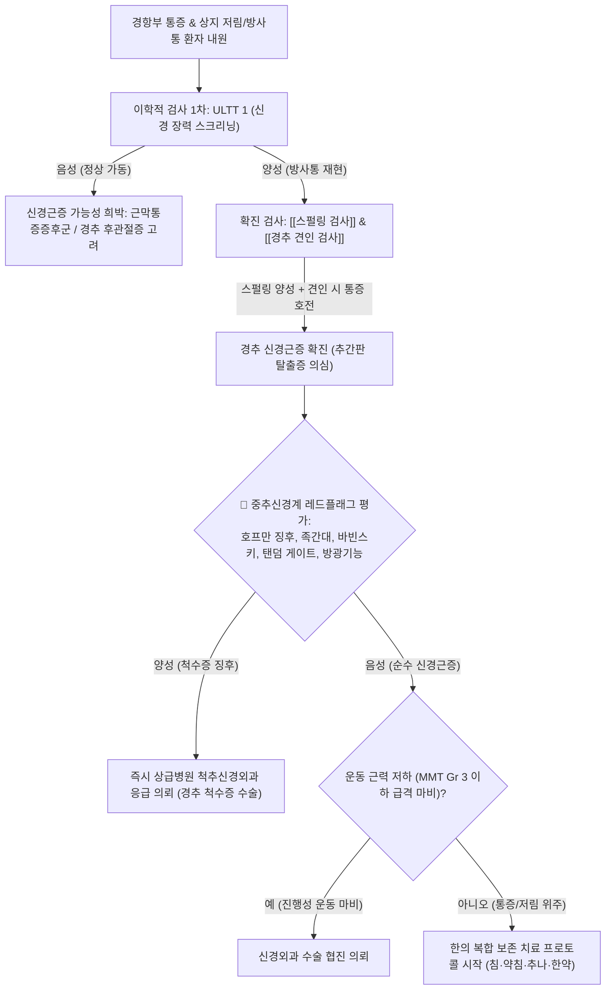

# 🩺 [[경추 추간판 탈출증]] (Cervical Disc Herniation / 頸椎 椎間板 脫出症, ICD-10 M50)

> **핵심 3줄 요약 (Key Summary)**:
> - 📍 병소 부위 & 해부·병태생리: 경추 C4-C5, C5-C6, C6-C7 분절 추간판의 퇴행성 섬유륜 균열로 수핵이 후외측으로 탈출하여 주행하는 경추 척수신경근(C5, C6, C7, C8)을 물리적으로 압박하고, 포스포리파아제 A2 및 염증성 사이토카인 유출로 급성 화학적 신경근염(Chemical radiculitis)을 유발.
> - 🚩 전형적 임상 양상 & 3대 징후: 경항부 동통 및 견갑배부 연관통, 특정 신경근 피부분절을 따르는 날카로운 상지 방사통 및 이상감각, 상완이두근·상완삼두근·수근신근의 근력 약화 및 심부건반사 저하.
> - 🛠️ 핵심 감별 검사 & 한·양방 다각적 치료 전략: [[스펄링 검사]](Spurling test) 및 [[경추 견인 검사]](Distraction test), 경추 MRI 및 근전도 검사; 화타협척혈 심부 자침·전침, [[신바로약침]] 및 중성어혈약침 수압박리술, 경추 축성 신연 추나, 맥켄지 경추 신전-중심화 재활, 양방 경막외 차단술 및 6~12주 보존 치료 실패 시 수술(ACDF) 고려.
> - ⚠️ 응급 의뢰 레드플래그 & 악화 요인: 보행 실조, 하지 강직성 마비, 단추 채우기/젓가락질 장애, 대소변 장애를 동반한 [[경추 척수증]](Cervical Spondylotic Myelopathy) 징후 확인 시 즉시 척추신경외과 수술 의뢰; 급성 신경근염기 과도한 경추 회전 스러스트 추나 절대 금기.

---

## 📌 목차
1. [🩺 질환 개요 & 해부학적 병태생리](#1--질환-개요--해부학적-병태생리)
2. [⚡ 병태생리 메커니즘 & 생체역학적 악순환 네트워크](#2--병태생리-메커니즘--생체역학적-악순환-네트워크)
3. [🔍 임상 증상 & 이학적 검사 알고리즘](#3--임상-증상--이학적-검사-알고리즘)
4. [🔀 감별 진단 매트릭스](#4--감별-진단-매트릭스)
5. [🌿 한의 통합 치료 프로토콜](#5--한의-통합-치료-프로토콜)
6. [💊 양방 치료 & 병용·의뢰 기준](#6--양방-치료--병용의뢰-기준)
7. [🏃 재활 운동 & 생활습관 티칭 가이드](#7--재활-운동--생활습관-티칭-가이드)
8. [💡 사용자 진료실 핵심 필기 & 임상 노하우 (Melt-In)](#8--사용자-진료실-핵심-필기--임상-노하우-melt-in)
9. [📚 출처 및 현대 학술 연구 요약](#9--출처-및-현대-학술-연구-요약)

---

## 1. 🩺 질환 개요 & 해부학적 병태생리

### (1) 질환 정의 및 임상적 의의
[[경추 추간판 탈출증]](Cervical Disc Herniation / Cervical Herniated Nucleus Pulposus, HNP)은 경추골 사이에서 완충 작용을 하는 추간판(Intervertebral disc)의 외곽 [[섬유륜]](Annulus fibrosus)에 균열이 발생하여, 내부의 젤라틴상 [[수핵]](Nucleus pulposus)이 정상적인 해부학적 경계를 벗어나 척추관(Spinal canal)이나 [[추간공]](Intervertebral foramen)으로 탈출하는 질환이다. 이로 인해 주행하는 척수신경근(Spinal nerve root)이 물리적으로 압박되거나 탈출된 수핵에서 누출된 생화학적 염증 인자에 의해 감작되어 경항부 동통 및 상지로 방사되는 극심한 신경병증성 통증, 감각 둔마, 운동 마비를 유발하는 [[경추 신경근증]](Cervical Radiculopathy)의 가장 주요한 원인이 된다.

### (2) 경추 척추-신경 복합체의 특이적 해부학
경추는 흉요추와 구분되는 독특한 해부학적 구조와 신경학적 분지 규칙을 지닌다:
1. **신경근 번호 부여의 역전 규칙 (Exit Rule)**:
   - 경추골은 7개(C1~C7)이지만 경추 신경근은 8쌍(C1~C8)이다.
   - C1~C7 척수신경근은 각 번호에 해당하는 척추골의 **'상부(Superior)'** 추간공을 통해 빠져나온다 (예: C6 신경근은 C5 추골과 C6 추골 사이의 C5-C6 추간공으로 출구 형성).
   - 반면 C8 신경근은 C7 추골과 T1 추골 사이의 추간공을 통과하며, T1 이하의 흉수신경부터는 해당 척추골의 **'하부'**로 주행한다.
   - 따라서 **C5-C6 추간판이 탈출하면 C6 신경근이 압박**되고, **C6-C7 추간판이 탈출하면 C7 신경근이 압박**받게 된다.
2. **[[루슈카 관절]] (Uncovertebral Joint / 구추관절 / Joint of Luschka)**:
   - C3부터 C7까지의 경추체 상면 후외측 경계에 돌출된 구상돌기(Uncinate process)와 상위 척추체 하면 외측이 맞물려 형성하는 가관절(Pseudarthrosis)이다.
   - 추간판의 후외측 탈출을 물리적으로 차단하는 방어벽 역할을 수행하지만, 30대 이후 퇴행성 변화가 진행되면서 골극(Osteophyte)이 자라나 [[추간공]] 전내측을 침범함으로써 '경성 디스크(Hard disc)' 협착을 가속하는 주범이 된다.
3. **[[후종인대]] (Posterior Longitudinal Ligament, PLL)의 해부학적 구조**:
   - 경추체 후방을 지지하는 후종인대는 척추관 중심부에서는 두껍고 치밀하지만, 외측부([[추간공]] 입구)로 갈수록 폭이 좁아지고 얇아진다.
   - 이로 인해 경추 추간판의 탈출은 중심부보다는 저항이 약한 **후외측(Posterolateral)** 방향으로 90% 이상 집중되어 척수신경근을 선택적으로 압박하게 된다.
4. **추간공(Intervertebral Foramen)의 병목 구조**:
   - 경추 신경근은 척수에서 분지된 후 척수경막낭(Dural sac)의 슬리브(Nerve root sleeve)에 싸여 짧은 추간공을 통과한다.
   - 추간공의 전벽은 추체 후외측과 [[루슈카 관절]], 후벽은 경추 후관절(Facet joint)과 [[황색인대]](Ligamentum flavum), 상하벽은 척추경(Pedicle)으로 둘러싸여 있어, 수핵 탈출이나 후관절 골극 형성 시 완충 여유 공간이 극히 부족하여 조기에 신경 압박이 발생한다.

### (3) 연성 디스크 (Soft Disc) vs 경성 디스크 (Hard Disc)
| 감별 지표 | 연성 디스크 (Soft Disc Herniation) | 경성 디스크 (Hard Disc Spondylosis) |
| :--- | :--- | :--- |
| **병리 기전** | 수핵의 급성 탈출 및 파열, 화학적 염증 우세 | 구추관절 및 후관절의 만성 퇴행성 골극 증식, 섬유화 |
| **호발 연령** | 20대 후반 ~ 40대의 젊은 활동기 연령층 | 50대 이상의 중장년 및 고령층 |
| **발병 양상** | 외상, 격렬한 운동, 갑작스러운 목 꺾임 후 급성 발병 | 수개월~수년에 걸친 점진적 악화 및 만성적 경과 |
| **통증 특성** | 타는 듯한 작열통, 야간통, 신경근성 극렬통 | 둔하고 묵직한 경항부 강직감, 날씨나 자세에 따른 악화 |
| **MRI 소견** | T2 고신호 강도의 탈출된 수핵 음영, 수핵 탈수 | 골극 음영, 추간판 간격의 심한 협착, 골비후 소견 |
| **한의 치료 반응** | 수압박리 소염약침 및 한약의 항염증 효과에 신속 반응 | 침도 요법을 통한 골극 주위 인대 박리 및 지속적 관절 가동 추나 필요 |

### (4) 분절별 호발 부위 및 빈도 통계
임상에서 관찰되는 경추 추간판 탈출증의 분절별 호발 비율은 생체역학적 가동성과 밀접하게 연관된다:
- **C6-C7 추간판 (C7 신경근 압박)**: 전체의 약 **45~50%**로 최다 호발. 중지 방사통, 상완삼두근 약화.
- **C5-C6 추간판 (C6 신경근 압박)**: 전체의 약 **35~40%**로 차순위 호발. 모지·시지 방사통, 완골근 반사 저하.
- **C4-C5 추간판 (C5 신경근 압박)**: 약 **5~10%**. 삼각근 부위 및 상완 외측 방사통, 견관절 외전 약화.
- **C7-T1 추간판 (C8 신경근 압박)**: 약 **3~5%**. 환지·소지 및 전완 내측 방사통, 수부 내재근 파지력 약화.
- **C3-C4 추간판 (C4 신경근 압박)**: 약 **1~2%** 미만. 경항부 및 승모근 상부의 국소 연관통, 횡격막신경 연관 호흡 이상 가능성.

### (5) 관련 주요 근육군 해부학
- **심부 경추 굴곡근 (Deep Cervical Flexors)**: `[[경장근]](Longus colli)`, `[[두장근]](Longus capitis)` — 경추의 생리학적 전만을 안정적으로 지지하는 코어 근육으로, 디스크 환자에서 공통적으로 억제·위축됨.
- **심부 경추 신전근 (Deep Extensors)**: `[[두반극근]](Semispinalis capitis)`, `[[경반극근]](Semispinalis cervicis)`, `[[경다열근]](Cervical multifidus)`, `[[후두하근군]](Suboccipital muscles)` — 후방 분절 간 미세 안정성을 담당하며 보상적 과긴장 발생.
- **표재성 지지근 및 호흡 보조근**: `[[상부승모근]](Upper trapezius)`, `[[견갑거근]](Levator scapulae)`, `[[두판상근]](Splenius capitis)`, `[[전사각근]](Scalenus anterior)`, `[[중사각근]](Scalenus medius)`, `[[흉쇄유돌근]](Sternocleidomastoid)`.

---

## 2. ⚡ 병태생리 메커니즘 & 생체역학적 악순환 네트워크

### (1) 이중 손상 메커니즘: 기계적 압박과 화학적 신경근염
경추 추간판 탈출증으로 인한 신경병증성 통증은 단순한 기계적 접촉에 의해서만 발생하는 것이 아니며, 탈출된 수핵에서 유출된 물질에 의한 극심한 생화학적 염증 반응이 결합되어 나타난다.

1. **화학적 신경근염 (Chemical Radiculitis)의 분자 생물학**:
   - 건강한 추간판의 수핵은 혈관과 림프가 통하지 않는 무혈관 조직으로, 태생기 이후 면역계로부터 격리된 면역학적 특권(Immune privilege) 부위이다.
   - 섬유륜이 파열되어 수핵 물질이 경막외강(Epidural space)으로 노출되면 자가면역 체계는 이를 이물질(Foreign body)로 인식하여 대식세포, T림프구, 호중구를 대거 침윤시킨다.
   - 이때 수핵 기질에서 고농도의 **포스포리파아제 A2 ($PLA_2$)**, **종양괴사인자-$\alpha$ ($TNF-\alpha$)**, **인터루킨-1$\beta$ ($IL-1\beta$)**, **인터루킨-6 ($IL-6$)**, **프로스타글란딘 $E_2$ ($PGE_2$)**, 일산화질소(NO) 및 기질금속단백질분해효소(MMP)가 폭발적으로 분비된다.
   - 특히 $PLA_2$는 아라키돈산 대사를 촉발하여 신경막의 지질 이중층을 직접 용해하고 탈수초화(Demyelination)를 유도하며, $TNF-\alpha$는 신경 혈관 장벽을 붕괴시켜 신경근 내부의 부종과 허혈을 초래한다.
2. **[[배근신경절]] (Dorsal Root Ganglion, DRG)의 감작과 이소성 흥분**:
   - 경추 추간공 내에 위치하는 배근신경절은 기계적 자극과 화학적 염증 인자에 극도로 민감한 감각 신경세포체의 집합소이다.
   - 염증 사이토카인은 신경세포막의 나트륨 통로(Nav1.7, Nav1.8)를 과발현시키고 칼륨 통로를 억제하여 휴지 전위를 역치 가까이 상승시킨다.
   - 이로 인해 자극이 없는 상태에서도 자발적 이상 방전(Spontaneous ectopic firing)이 일어나며, 경추를 살짝 움직이거나 스치기만 해도 상지 전체로 타는 듯한 찌릿한 작열통(Burning pain)과 전기 충격 같은 방사통이 유발된다.
3. **신경 내 미세혈류 장애 및 척수 후각 중추감작 (Central Sensitization)**:
   - 신경근 주위의 기계적 압박은 신경내막(Endoneurium) 모세혈관의 정맥성 울혈을 일으키고, 조직압 상승 $\rightarrow$ 국소 허혈 $\rightarrow$ 축삭 수송(Axoplasmic transport) 차단 $\rightarrow$ 신경 섬유 변성으로 이어진다.
   - 지속적인 유해 C섬유 및 A-$\delta$ 섬유의 자극 신호는 척수 후각(Dorsal horn) 교양질(Substantia gelatinosa) 신경원의 과흥분성을 유도하여 정상적인 촉각 자극조차 극심한 통증으로 인지하는 이질통(Allodynia)과 통각과민(Hyperalgesia)을 만성화시킨다.

---

### (2) 생체역학적 파탄과 경추 전단력 (Shear Force) 증폭
인간의 두부 무게는 성인 기준 약 4.5~5.5kg이다. 정상 경추는 전만(Lordosis) 곡선(Cobb 각 20~35도)을 통해 두부 하중을 척추체와 후관절로 2:8 내지 3:7 비율로 균등 분산시킨다.
1. **굴곡 모멘트와 경추 부하 역학**:
   - 머리가 앞으로 15도 숙여지면 경추에 걸리는 유효 부하는 **12kg**, 30도에서는 **18kg**, 45도에서는 **22kg**, 60도 굴곡 시에는 무려 **27kg**으로 급증한다.
   - 만성 스마트폰 사용 및 컴퓨터 작업으로 유발되는 [[거북목 증후군]](Forward Head Posture) 및 일자목(Straight neck) 상태에서는 경추 전만이 소실되어 추간판 전방부에는 과도한 압축력이, 후방 섬유륜에는 강한 인장력(Tensile stress)과 후방 전단력(Shear force)이 지속적으로 부하된다.
2. **상부교차증후군 (Upper Crossed Syndrome)과의 병적 연계**:
   - 두부가 전방 이동하면 지렛대 원리에 의해 심부 굴곡근인 `[[경장근]]`과 `[[두장근]]`은 과도하게 신장되어 억제(Inhibition)되고 약화된다.
   - 이를 보상하기 위해 후방 표재근인 `[[상부승모근]]`, `[[견갑거근]]`, `[[두반극근]]`, `[[후두하근군]]`이 극심한 방어적 과수축을 일으킨다.
   - 전방에서는 `[[흉쇄유돌근]]`과 `[[전사각근]]`, `[[대흉근]]`이 단축되어 경추 하부(C5-C7)를 더욱 앞으로 잡아당겨 후방 추간판 파열을 유도하는 생체역학적 악순환 루프를 형성한다.

---

## 3. 🔍 임상 증상 & 이학적 검사 알고리즘

### (1) 분절별 임상 신경학적 평가 매트릭스
경추 추간판 탈출증은 압박받는 특정 신경근(Root level)에 따라 지배 감각 영역, 운동 근육군, 건반사가 매우 엄격한 규칙성을 보이며 나타난다. 정확한 이학적 평가는 고가의 MRI 검사 전 단계에서 병소 분절을 90% 이상의 정확도로 추정할 수 있게 한다.

| 신경근 | 호발 디스크 | 감각 지배 피부분절 (Dermatome) | 운동 지배 근육 (Myotome) & MMT 검사법 | 심부건반사 (DTR) | 전형적 방사통 주행 경로 |
| :--- | :--- | :--- | :--- | :--- | :--- |
| **C5** | C4-C5 디스크 (약 5~10%) | 어깨 외측 능선, 삼각근 부위의 둥근 패치 영역 | `[[삼각근]]`(Deltoid): 견관절 90도 외전 저항 `[[상완이두근]]`(Biceps): 주관절 굴곡 저항 | **상완이두근 반사 (Biceps reflex)** 저하/소실 | 경항부 $\rightarrow$ 견갑골 상각 $\rightarrow$ 어깨 외측 및 상완 외측 상부 국한 |
| **C6** | C5-C6 디스크 (약 35~40%) | 상완 외측, 전완 요측(엄지손가락 쪽), 엄지(1지) 및 검지(2지) 손가락 | `[[상완요골근]]`(Brachioradialis) `[[장요측수근신근]]`(ECRL) `[[단요측수근신근]]`(ECRB): 손목 요측 신전 저항 | **[[상완요골근]] 반사 (Brachioradialis reflex)** 저하/소실 | 경항부 $\rightarrow$ 승모근 상부 $\rightarrow$ 상완 외측 $\rightarrow$ 전완 요측 $\rightarrow$ **엄지·검지 끝** |
| **C7** | C6-C7 디스크 (약 45~50%, 최다) | 전완 배면 정중앙, **중지(3지)** 손가락 손등 및 손바닥면 | `[[상완삼두근]]`(Triceps): 주관절 신전 저항 `[[요측수근굴근]]`(FCR): 손목 굴곡 저항 `[[지신근]](EDC)`: 2~5지 중수지관절 신전 | **상완삼두근 반사 (Triceps reflex)** 저하/소실 | 경항부 $\rightarrow$ 견갑골 내측연 $\rightarrow$ 상완 후면 $\rightarrow$ 전완 배측 중앙 $\rightarrow$ **중지 손가락** |
| **C8** | C7-T1 디스크 (약 3~5%) | 전완 척측(새끼손가락 쪽) 원위 1/2, **환지(4지) 척측 및 소지(5지)** | `[[심지굴근]](FDP)`: 손가락 끝마디 굴곡 `[[지신근]]` `[[수부 내재근]](골간근·벌레근)`: 손가락 외전/내전, 열쇠 쥐기 파지력 | 특이 건반사 없음 (필요 시 핑거 플렉서 반사 확인) | 경항부 $\rightarrow$ 견갑골 하각 $\rightarrow$ 상완 내측 $\rightarrow$ 전완 척측 $\rightarrow$ **넷째·새끼손가락** |
| **T1** | T1-T2 디스크 (1% 미만) | 상완 내측면 및 액와부 | `[[수부 골간근]](Interossei)`: 손가락 사이 종이 물고 버티기 저항 | 건반사 없음 | 상완 내측부 및 액와부, 흉곽 상부 방사 |

---

### (2) 필수 이학적 검사 상세 프로토콜
경추 신경근증 진단에서 단일 검사의 정확도는 제한적이나, 유효성이 검증된 4가지 핵심 검사(Spurling, Distraction, ULTT, 경추 회전 가동역 <60도)를 결합한 **Wainner의 임상 예측 규칙(Clinical Prediction Rule, CPR)** 적용 시 3가지 이상 양성일 경우 특이도가 **94%**, 4가지 모두 양성일 경우 특이도가 **99%**에 달한다.

1. **[[스펄링 검사]] (Spurling's Test / 경추 축성 압박 검사)**:
   - **수기법**: 환자를 의자에 바르게 앉힌 후, 통증이 있는 환측으로 경추를 약 30도 측굴(Lateral flexion) 및 약간 신전(Extension)시킨다. 검사자는 양손을 환자의 정수리(두정부)에 깍지 끼고 약 7~10kg의 일정한 힘으로 수직 하방 축성 압박을 가한다.
   - **양성 반응**: 경추의 국소 통증이 아닌, 해당 신경근의 피부분절을 따라 상지로 찌릿하게 전기가 통하듯 뻗치는 방사통이 즉각 재현된다.
   - **진단 가치**: 민감도는 30~50%로 다소 낮으나, **특이도가 90~95%**로 확진적 가치가 매우 높다.
   - **기전**: 측굴 및 신전 동작이 이환된 추간공의 단면적을 최대 30~40%까지 축소시키고, 축성 압박이 탈출된 수핵을 신경근 쪽으로 더 밀어붙여 기계적 마찰을 극대화함.
2. **[[경추 견인 검사]] (Cervical Distraction Test)**:
   - **수기법**: 환자를 진찰대에 편안히 앙와위(Supine)로 눕힌다. 검사자는 환자의 머리맡에서 한 손으로 턱(하악골)을 받치고 다른 손으로 후두골(Occiput)을 감싸 쥔 후, 체축 방향으로 10~15kg 정도의 일정한 견인력을 주며 서서히 머리를 위로 들어 올린다.
   - **양성 반응**: 평소 겪던 상지 방사통, 저림, 견갑부 당김 통증이 견인 순간 즉각 완화되거나 완전히 소실된다.
   - **진단 가치**: **특이도 90% 이상**, 민감도 약 40~45%.
   - **기전**: 축성 견인이 추간공의 직경을 넓히고 추간판 내압을 순간적으로 음압으로 만들어 신경근 압박과 허혈을 일시적으로 해소함.
3. **상지 신경 장력 검사 (Upper Limb Tension Test 1 of Elvey / ULTT 1 - 정중신경/C5-C7 바이어스)**:
   - **수기법**: 환자를 앙와위로 눕히고 4단계 연쇄 동작을 순차 적용한다: ① 어깨 하강(Depression) $\rightarrow$ ② 견관절 90도 외전 및 외회전 $\rightarrow$ ③ 손목 및 손가락 완전 신전 $\rightarrow$ ④ 주관절 완전 신전. 마지막 단계에서 경추를 반대측으로 측굴시켜 신경 장력을 극대화한다.
   - **양성 반응**: 4단계 동작 중 주관절 신전 시 상지로 방사통이 재현되고, 반대측 경추 측굴 시 통증이 악화되며 동측 측굴 시 완화되는 구조적 차별화(Structural differentiation)가 확인됨.
   - **진단 가치**: **민감도 97%**로 신경근증 스크리닝의 최고 척도 (음성일 경우 경추 디스크 배제율 매우 높음).
4. **바코디 징후 (Bakody's Sign / 어깨 외전 검사 / Shoulder Abduction Relief Sign)**:
   - **수기법**: 환자에게 통증이 있는 쪽 손을 스스로 들어 올려 정수리나 반대측 머리 위에 얹도록 한다.
   - **양성 반응**: 팔을 들어 머리 위에 얹었을 때 상지 방사통과 어깨 통증이 뚜렷하게 경감된다.
   - **진단 가치**: 특이도 약 80~85%. 주로 C5, C6 분절 압박 시 양성률이 높음 (상완신경총의 주행 거리가 단축되어 신경근 견인 장력이 해소되는 원리).
5. **잭슨 압박 검사 (Jackson Compression Test)**:
   - 환자의 고개를 중립위 또는 좌우로 회전시킨 상태에서 하방 압박을 가하여 방사통 유발을 확인.
6. **어깨 하강 검사 (Shoulder Depression Test)**:
   - 환자의 목을 건측으로 측굴시키고 환측 어깨를 아래로 강하게 누를 때 상완신경총이 견인되며 방사통이 유발되면 신경근 유착 또는 흉곽출구 증후군 시사.

---

## 4. 🔀 감별 진단 매트릭스

경추 추간판 탈출증은 상지 저림과 견배부 통증을 공유하는 다양한 말초신경 포착 증후군, 견관절 자체 질환, 척수 중추 질환과 반드시 감별되어야 한다.

| 감별 질환 | 호발 병소 및 병태생리 | 주소증 및 통증 양상 | 악화 및 완화 요인 | 핵심 감별 이학적 검사 | 영상 및 진단학적 확진 기준 |
| :--- | :--- | :--- | :--- | :--- | :--- |
| [[경추 추간판 탈출증]] (본 질환) | C5~C7 경추 추간판 탈출로 인한 단일 신경근 압박 | 경항부 통증 + 특정 1~2개 피부분절을 따르는 전격성 방사통 | 목 신전/환측 회전 시 악화, 경추 견인 및 팔 거상(Bakody) 시 완화 | **[[스펄링 검사]] 양성** **경추 견인 검사 양성** 심부건반사 저하 | 경추 MRI: 수핵 후외측 탈출 및 신경근 압박 소견 일치 |
| **[[흉곽출구 증후군]] (TOS)** | 사각근 간극, 늑쇄간극, 소흉근 하부에서 상완신경총 하신경간(C8-T1) 및 쇄골하혈관 포착 | 전완 척측 및 4~5지 손가락 둔한 저림, 손의 냉감, 피로감, 부종 | 팔을 머리 위로 들거나 무거운 짐을 들고 보행 시 악화 | **애드슨 검사(Adson) 양성** **루스 검사(Roos) 양성** **라이트 검사(Wright) 양성** | 상지 혈관 도플러 초음파, 흉부 X-ray(경추늑골 유무), 사각근 블록 반응 |
| **[[수근관 증후군]] (Carpal Tunnel)** | 손목 횡수근인대 하부에서 정중신경의 기계적 압박 | 1, 2, 3지 및 4지 요측 손가락 끝의 저림, 야간 작열통, 모지구근 위축 | 밤에 자다가 손이 저려 깨서 털면(Flick sign) 호전 | **팔렌 검사(Phalen) 양성** **틴넬 징후(Tinel) 양성** 경추부 압박 검사는 음성 | 손목 근전도/신경전도 검사(NCV): 정중신경 수근부 전도 지연 |
| **[[회전근개 파열]] / 견관절 질환** | 견관절 극상근·극하근건의 퇴행성 파열 및 견봉하 충돌 | 삼각근 부위의 국소 통증, 야간통, 능동적 팔 거상 불능 | 팔을 옆으로 들어 올릴 때(60~120도) 극심한 통증 호 | **Neer 검사 양성** **Hawkins-Kennedy 검사 양성** **Empty can 검사 양성** 팔꿈치 이하 방사통 없음 | 견관절 초음파 또는 MRI: 회전근개 힘줄 전층/부분 파열 |
| **[[경추 척수증]] (Myelopathy)** | 경추관 중심부 협착, 대형 정중앙 디스크, 후종인대골화증(OPLL)에 의한 경추 척수(Spinal cord) 압박 | 상지의 정밀 동작 장애(단추 채우기, 젓가락질 불능), 하지 강직감, 술 취한 듯한 비틀거림 | 경추 굴곡 시 척추를 타고 전기가 흐르는 느낌([[레르미트 징후]]) | **호프만 징후(Hoffmann) 양성** **바빈스키 반사 양성** **슬개건반사 병적 항진** 10초 파지-해제 검사 <20회 | 경추 MRI: 경수 척수 실질의 압박 및 T2 고신호 강도(Myelomalacia) |
| **상완신경통 (Parsonage-Turner 증후군)** | 상완신경총의 급성 특발성/자가면역성 바이러스성 신경염 | 상지 및 견갑부의 견딜 수 없는 극심한 급성 통증 후 수일 내 통증 소실과 함께 급격한 어깨 마비 | 초기 수일간 자세와 무관하게 24시간 극통 지속 | 초기 이학적 검사 불능, 통증 소퇴 후 삼각근/전거근의 현저한 위축 | 근전도 검사: 다발성 상완신경총 분지 탈신경 전위 확인 |

---

## 5. 🌿 한의 통합 치료 프로토콜

경추 추간판 탈출증의 한의 치료는 급성기 화학적 염증 및 부종의 신속한 차단, 아급성기 신경근 수압박리 및 근막 긴장 완화, 만성기 경추 분절 안정성 회복 및 재발 방지를 목표로 하는 단계별 통합 프로토콜로 구성된다.

### (1) 한의 변증 시치 (Pattern Identification)
1. **기체어혈형 (氣滯瘀血型)**:
   - 급성 외상, 불량한 자세 후 갑작스럽게 발병. 통증이 칼로 찌르는 듯하며(자통) 야간에 극심해지고 환부를 누르면 통증 악화(거안). 설질 자암(紫暗), 어반(瘀斑), 맥 현삽(弦澁).
   - 치료 원칙: 활혈화어(活血化瘀), 행기지통(行氣止痛) $\rightarrow$ `[[서경탕]]`, `[[당귀수산]]` 가감.
2. **풍한습비형 (風寒濕痺型)**:
   - 찬 바람이나 습기에 노출된 후 경항부 강직과 함께 상지가 무겁고 시리며 쑤시는 통증. 온열 자극에 완화되고 날씨가 흐리면 악화. 설태 백니(白膩), 맥 부완(浮緩) 또는 유삽(濡澁).
   - 치료 원칙: 거풍산한(祛風散寒), 제습통락(除濕通絡) $\rightarrow$ `[[오적산]]`, `[[삼비탕]]` 가감.
3. **간신휴허형 (肝腎虧虛型)**:
   - 중장년층의 만성 퇴행성 경추증 동반 디스크. 목과 팔의 은은한 통증, 팔다리에 힘이 빠지고 허리와 무릎이 시큰거리며 피로 시 악화. 설홍 소태(少苔), 맥 세약(細弱).
   - 치료 원칙: 보익간신(補益肝腎), 강근장골(强筋壯骨) $\rightarrow$ `[[독활기생탕]]`, `[[신바로한약]]` 가감.

---

### (2) 침구 및 전침 치료 SOP
1. **타겟 경혈 및 자침 심도**:
   - **협척혈 (Ex-B2, 화타협척)**: 이환된 디스크 분절의 C4-C5, C5-C6, C6-C7 극돌기 하연 외측 0.5~1.0촌.
     - **자침 기법**: 0.30×40mm 또는 0.30×50mm 멸균 호침을 사용하여 척추 후궁(Lamina)을 향해 내하방 15~20도 각도로 25~35mm 진침. 골막에 닿는 느낌(Lamina touch)을 확인하여 척수강 자입을 방지하며 심부 다열근과 척추기저근의 긴장을 해소.
   - **경항부 근위 주혈**: [[풍지]](GB20 - 후두하근군 이완), [[견정]](GB21 - 승모근 긴장 해소), [[대저]](BL11 - 골회혈), 견외수(SI14), [[천종]](SI11 - 견갑상신경 차단 효과).
   - **상지 방사 경로 원위 취혈**:
     - C6 신경근: 곡지(LI11), 수삼리(LI10), 열결(LU7), 합곡(LI4).
     - C7 신경근: 소해(HT3), 곡민, 수삼리, [[외관]](TE5), 중저(TE3).
     - C8 신경근: [[후계]](SI3), 소택(SI1), 통리(HT5), 신문(HT7).
2. **전침 요법 (Electroacupuncture)**:
   - **배혈 방식**: 이환 분절 협척혈(-)과 상지 방사통 경로 상의 원위 혈자리(+)를 짝지어 연결 (예: C6 협척혈 - 수삼리/곡지, C7 협척혈 - [[외관]]).
   - **주파수 세팅**:
     - 급성 신경근염기: **2Hz / 100Hz 혼합파(Dense-Disperse Wave)**를 적용하여 2Hz 자극을 통해 뇌척수액 내 엔도르핀과 엔케팔린 분비를 유도하고, 100Hz 자극으로 척수 후각 레벨에서 다이놀핀 분비를 촉진하여 신경병증성 작열통을 즉각 차단.
     - 통전 시간: 20~25분간 지속하며, 환자가 참을 수 있는 쾌적한 근육 수축 한계 강도로 조절.

---

### (3) 약침 치료 (Pharmacopuncture) & 신경근 수압박리술 (Hydrodissection)
1. **신바로약침 (GCSB-5 정제 복합 생약 추출물)**:
   - **성분**: [[방풍]], [[우슬]], [[오가피]], [[구척]], [[두충]], [[백지]] 등 골관절 보호 생약 복합 추출물.
   - **작용 기전**: 탈출된 수핵 주위에서 $TNF-\alpha$, $IL-1\beta$ 발현을 억제하고 iNOS 및 COX-2 생성을 차단하여 신경내막 부종을 신속히 가라앉힘. 신경성장인자(NGF) 분비를 촉진하여 손상된 축삭의 재생을 유도.
   - **시술법**: 이환된 척추 분절 화타협척혈 및 후관절 주위 심부 연부조직에 26~30G, 38mm 멸균 니들을 사용하여 분절당 0.5~1.0cc씩 총 2.0~3.0cc 분주.
2. **황련해독탕 약침 & 중성어혈약침**:
   - 급성기 타는 듯한 작열통과 극심한 신경근성 부종에는 황련해독탕 약침을, 야간 고정성 자통과 만성 어혈성 저림에는 중성어혈약침을 선택적으로 적용.
3. **봉독 약침 (Bee Venom Pharmacopuncture)**:
   - **작용 기전**: 멜리틴(Melittin)과 아파민(Apamin) 성분이 뇌하수체-부신피질계를 자극하여 내인성 코르티솔 분비를 촉진하고 강력한 항염증 작용을 나타냄.
   - **안전 가이드**: 시술 전 반드시 전완 내측 피내 스킨 테스트(Skin Test, 0.05cc) 시행 후 15분간 관찰하여 팽진 및 발적이 10mm 미만인 경우에만 적용. 급성기 10,000:1 또는 20,000:1 희석액 0.1~0.3cc로 시작하여 점진적 증량.

---

### (4) 추나 치료 (Chuna Manual Therapy) SOP
1. **경추 신연 가동기법 (Cervical Distraction Mobilization - 1차 핵심)**:
   - 환자를 앙와위로 눕히고 시술자는 두부 쪽에 선다.
   - 양손으로 환자의 후두골과 하악골을 부드럽게 감싸 쥔 상태에서, 환자 호흡에 맞추어 호기(Exhalation) 시 경추 축 방향으로 10~15kg 힘으로 부드럽게 신연(견인)한다.
   - 10~15초간 견인력을 유지한 후 천천히 이완하는 동작을 5~7회 반복한다.
   - 경추 분절 간격을 순간적으로 넓혀 추간판 내 음압을 유도하고 탈출된 수핵의 물리적 중심화를 돕는다.
2. **경추 분절 굴곡-신연 관절가동추나**:
   - 경추를 약 15~20도 굴곡시켜 후관절과 추간공을 최대 개방시킨 상태에서 미세 분절별 신연 가동을 적용.
3. **근막이완추나 (Myofascial Release / JS 기법)**:
   - 과긴장된 `[[견갑거근]]`, `[[상부승모근]]`, `[[사각근군]]`, `[[두판상근]]`의 발통점(Trigger point)에 허혈성 압박(Ischemic compression)과 능동적 신장(Active stretch)을 병행하여 쇄골상와 및 상완신경총 주행 통로의 연부조직 긴장을 완전 해소.
4. **⚠️ 추나 치료 절대 주의사항**:
   - 급성 수핵 탈출기 및 신경근 자극기에는 목을 과도하게 비틀거나 회전시키는 **경추 회전 고속 저진폭 스러스트(HVLA Thrust) 기법을 절대 금기**한다 (섬유륜 완전 파열 및 척수 손상 유발 위험).

---

### (5) 한약 치료 (Herbal Medicine)
1. **급성기 염증·어혈 처방 (발병 1~3주)**:
   - **[[서경탕]](舒經湯)**: [[강활]], [[방풍]], [[당귀]], [[적작약]], [[천궁]], [[창출]], [[황기]], [[강황]], [[감초]]. 상지 경락의 어혈과 기체를 통하게 하여 팔 저림과 방사통을 신속 진통.
   - **[[당귀수산]](當歸鬚散)**: 당귀미, [[적작약]], 오약, 향부자, 소목, 홍화, 도인, 계지, [[감초]]. 외상성 디스크 파열 및 극심한 야간 자통에 어혈 제거.
   - **청파전(淸波煎 / 신바로 한약)**: GCSB-5 생약 조성([[구척]], [[두충]], [[방풍]], [[우슬]], [[오가피]], [[백지]] 등)으로 구성되어 디스크 신경 염증의 근본 소퇴 및 신경 보호 작용.
2. **만성기 간신부족 및 척추 퇴행 처방 (발병 4주 이후)**:
   - **[[독활기생탕]](獨活寄生湯)**: 독활, [[상기생]], [[두충]], [[우슬]], [[세신]], [[진교]], 복령, 계심, 방풍, [[천궁]], 인삼, [[감초]], [[당귀]], 작약, [[숙지황]]. 만성 경추증, 근골격 퇴행, 추간판 수분 소실을 보완하고 신경근 주위 결합조직을 강화.
   - **[[오적산]](五積散)**: 한습(寒濕)이 결합된 만성 목디스크 환자로 날씨가 궂으면 쑤시고 결리는 경우 온통경락(溫通經絡) 유도.

---

## 6. 💊 양방 치료 & 병용·의뢰 기준

1차 의료기관 한의사는 대다수 내원 환자가 정형외과나 신경외과에서 진통소염제, 신경병증성 약물을 복용 중이거나 신경차단술을 시술받고 내원한다는 현실을 정확히 파악하고 있어야 한다.

### (1) 양방 약물 치료 분석
1. **비스테로이드성 소염진통제 (NSAIDs)**:
   - **대표 약물**: Celecoxib 200mg qd~bid (선택적 COX-2 억제제로 위장관 출혈 위험 저감), Aceclofenac 100mg bid, Meloxicam 7.5~15mg qd.
   - **임상 의의**: 수핵 유출에 의한 급성 화학적 염증 반응을 억제하여 통증 강도를 낮춤.
   - **한의 병용 시 주의**: NSAIDs를 복용 중인 환자에게 활혈거어제(당귀수산, 도인·홍화 함유 처방)를 장기 고용량 투여할 경우 위장관 궤양 및 출혈 경향이 상승할 수 있으므로 위점막 보호 한약재(백출, 감초, 복령)를 합방 배합.
2. **신경병증성 통증 조절제 (Gabapentinoids)**:
   - **대표 약물**: Pregabalin (리리카캡슐 75mg~150mg bid), Gabapentin (뉴론틴캡슐 300mg tid로 증량).
   - **작용 기전**: 전압 의존성 칼슘 채널의 $\alpha_2\delta$ 서브유닛에 결합하여 흥분성 신경전달물질(Glutamate, Substance P) 방출을 차단함으로써 전격성 방사통과 이상감각을 억제.
   - **부작용 모니터링**: 현훈(Dizziness), 졸림(Somnolence), 체중 증가, 말초 부종. 노인 환자에서 낙상 위험 급증.
   - **감량(Tapering) 가이드**: 한의 치료로 방사통이 50% 이상 호전되어 약물을 줄이고자 할 때는 **갑작스러운 투약 중단을 엄금**해야 한다. 급중단 시 반동성 신경통(Rebound pain), 불면, 불안, 진전이 발생하므로 1~2주 간격으로 용량을 25~50%씩 단계적으로 감량하도록 지도.
3. **단기 경구 스테로이드 (Oral Corticosteroids)**:
   - **Methylprednisolone Dose Pack (메드롤)**: 6일간 24mg에서 4mg까지 매일 감량하며 복용. 급성기 신경근 부종을 단기간에 극적으로 줄이나 소화성 궤양, 불면, 혈당 급상승 주의.
4. **근이완제 (Muscle Relaxants)**:
   - Eperisone HCl 50mg tid, Afloqualone 20mg tid. 척수 반사궁을 억제하여 방어성 사각근 및 승모근 경련 완화.

---

### (2) 비약물 중재 시술 (Interventional Procedures)
1. **경추 경막외 스테로이드 주사 (Cervical Epidural Steroid Injection, CESI)**:
   - **경추궁간 접근법 (Interlaminar CESI)**: 주로 C7-T1 분절을 통해 바늘을 진입시켜 경막외강으로 약물을 확산시키는 방식. 척수 손상 위험을 피하기 위해 C6-C7 상부로는 직접 천자하지 않는 것이 원칙.
   - **경추간공 접근법 (Transforaminal CESI)**: 방사선 투시(C-arm) 하에 압박된 신경근 출구로 약물을 직접 주입. 효과는 국소적이나 **추골동맥(Vertebral artery)의 혈관 내 오천자 및 색전증으로 인한 뇌간/소뇌 경색(Brainstem stroke) 및 척수경색의 치명적 위험**이 존재하여 극도로 제한적으로 시행됨.
   - **한의 치료 병용 시기**: 주사 시술 직후 24~48시간 동안은 주사 부위 감염 예방을 위해 침 시술 및 부항을 피하고, 3일째부터 주위 근육 이완 침 치료와 관절 가동 추나를 병행하는 것이 효과적.
2. **기계적 경추 견인 치료 (Mechanical Traction)**:
   - 체중의 약 10~15%(약 6~10kg) 장력으로 경추 20~25도 굴곡위에서 15~20분간 간헐적 견인 시행.

---

### (3) 수술적 치료 적응증 및 수술 기법
경추 추간판 탈출증 환자의 **90% 이상은 보존적 치료로 6~12주 내에 자연 호전**되지만, 아래의 기준에 부합할 경우 지체 없이 척추신경외과 전문의에게 전원해야 한다.

1. **절대적 수술 적응증 (Immediate Surgical Indications)**:
   - 상지 운동 신경의 급격한 마비 진행 (도수근력검사 MMT 3등급 이하: 팔을 중력을 이겨 들어 올리지 못하거나 손목/손가락이 털썩 떨어지는 Drop wrist/Drop finger 발생).
   - 척수가 직접 압박되어 보행 실조, 대소변 장애, 젓가락질 장애가 나타나는 **[[경추 척수증]](Myelopathy)** 동반 시.
2. **상대적 수술 적응증**:
   - 6~12주간의 적극적인 한의 및 양방 보존적 치료에도 불구하고 마약성 진통제로도 조절되지 않는 극심한 방사통이 지속되어 수면과 일상생활이 완전히 붕괴된 경우.
3. **주요 수술 술식**:
   - **경추 전방 감압 및 유합술 (ACDF - Anterior Cervical Discectomy and Fusion)**: 전경부를 통해 접근하여 파열된 디스크를 완전히 제거하고 뼈나 인공 케이지(PEEK)를 삽입하여 고정하는 골드 스탠다드 수술.
   - **경추 인공디스크 치환술 (CDR / TDR - Total Disc Replacement)**: 유합 대신 인공 관절을 삽입하여 해당 분절의 가동성을 보존함으로써 인접 분절 퇴행성 질환(Adjacent segment disease)을 예방하는 술식 (단, 심한 골다공증이나 후관절 관절증 환자는 금기).
   - **후방 경추 신경근감압술 (Posterior Microscopic Foraminotomy)**: 전방 접근 없이 후방에서 미세현미경이나 내시경으로 신경근을 누르는 외측 디스크 조각만 선택 제거.

---

### (4) 🚨 응급 의뢰 레드플래그 (Red Flags)
진료실에서 다음 증상이 확인되면 보존적 치료를 즉각 중단하고 3차 병원 응급실 또는 척추신경외과로 긴급 의뢰한다:
1. **척수 압박 징후 (Myelopathy Red Flag)**:
   - 보행 시 중심을 잡지 못하고 술 취한 사람처럼 비틀거림 (Tandem gait 불능).
   - 셔츠 단추를 채우거나 젓가락질을 할 때 손가락이 뜻대로 움직이지 않음.
   - 병적 반사 출현: [[호프만 징후]](Hoffmann sign) 양성, 족간대(Ankle clonus) 3회 이상 출현, 바빈스키 반사 양성.
2. **자율신경 및 대소변 장애**:
   - 소변을 보지 못하는 뇨폐(Urinary retention) 또는 조절하지 못하고 지리는 요실금/변실금.
3. **감염성 및 종양성 척추 질환 의심**:
   - 38도 이상의 발열, 오한, 식은땀, 원인 불명의 급격한 체중 감소 동반.
   - 휴식을 취하거나 누워 있어도 통증이 전혀 줄어들지 않고 밤에 깨어나는 야간 안정 시 통증(Night pain) $\rightarrow$ 척추 종양, 전이암, 화농성 추간판염, 결핵성 척추염 의심.
4. **외상성 척추 손상**:
   - 교통사고, 낙상 등 고에너지 외상 후 발생한 경항통 $\rightarrow$ 경추골 골절 및 불안정성 탈구 배제 필요.

---

## 7. 🏃 재활 운동 & 생활습관 티칭 가이드

### (1) 맥켄지 경추 신전-중심화 운동 (McKenzie Cervical Extension Protocol)
맥켄지 운동의 궁극적 목적은 후방으로 탈출된 수핵을 전방으로 이동시켜 신경근 압박을 해소하는 **'통증의 중심화(Centralization)'**를 유도하는 것이다. 통증이 손끝에서 팔꿈치, 어깨, 목 중앙으로 모여드는 것은 호전의 강력한 징후이다.
1. **1단계: 턱 당기기 (Cervical Retraction / Chin-tuck)**:
   - 의자에 허리를 펴고 바르게 앉아 시선을 정면을 바라본다.
   - 손가락을 턱 끝에 대고, 머리를 뒤통수 쪽으로 수평 이동시킨다는 느낌으로 턱을 목젖 쪽으로 지그시 밀어 넣는다 (이중턱 만들기).
   - 5초간 유지 후 힘을 뺀다. 10회 반복 (경추 하부 굴곡 및 경추 상부 신전 유도).
2. **2단계: 턱 당김 상태에서의 경추 신전 (Retraction with Extension)**:
   - 1단계 Chin-tuck 자세를 유지한 상태에서, 코끝이 천장을 향하도록 고개를 천천히 뒤로 젖힌다.
   - 목 뒤가 완전히 접히는 느낌으로 끝 범위에서 2~3초간 부드럽게 머무른 후 천천히 중립위로 돌아온다.
   - 하루 4~5회, 1회당 10회씩 시행.
3. **⚠️ 중심화 vs 말초화 (Peripheralization) 경고**:
   - 신전 운동 시 목 중앙의 뻐근함은 증가하더라도 **팔이나 손가락의 저림이 줄어들면(중심화)** 올바르게 수행되는 것이다.
   - 그러나 고개를 뒤로 젖힐 때 목 통증은 줄어드는데 **팔이나 손끝으로 찌릿한 방사통이 더 뻗어나간다면(말초화)** 탈출된 디스크가 추간공에서 신경을 더 압박하는 상태이므로 신전 운동을 즉시 중단하고 의료진과 상담해야 한다.

---

### (2) 심부 경추 굴곡근 (Deep Neck Flexor, DNF) 강화 훈련
1. **수건을 이용한 앙와위 Chin-tuck 등척성 운동**:
   - 바닥에 편안히 누워 무릎을 세운다.
   - 목 뒤 오목한 곳에 얇게 돌돌 만 수건을 받친다.
   - 머리를 들지 말고, 시선을 발끝 쪽으로 살짝 내리면서 턱을 가슴 쪽으로 당겨 목 뒤 수건을 뒤통수와 목으로 바닥을 향해 지그시 30% 정도의 가벼운 힘으로 누른다.
   - 10초 유지, 10초 휴식, 10회 반복 (3세트 시행).
   - 겉근육인 `[[흉쇄유돌근]]`이 단단하게 튀어나오지 않도록 손으로 목 앞쪽을 만지며 오직 심부 근육만 수축하도록 집중.
2. **압력 바이오피드백 (Stabilizer) 점진적 훈련**:
   - 압력 게이지를 목 뒤에 대고 기본 20mmHg에서 시작하여 22, 24, 26, 28, 30mmHg까지 단계별로 10초씩 유지하는 정밀 훈련 수행.

---

### (3) 견갑배부 안정화 및 흉추 신전 운동
1. **흉추 신전 폼롤러 스트레칭**:
   - 흉추의 신전 가동성이 확보되지 않으면 경추 하부(C5-C7)의 과도한 보상성 움직임이 멈추지 않는다.
   - 폼롤러를 견갑골 하각 부위(흉추 6~8번 레벨)에 가로로 대고 누워 양손으로 머리를 받친 후 가슴을 천장 방향으로 열어주며 흉추 신전을 유도 (15회 반복).
2. **벽 슬라이드 (Wall Slide) & Y-T-W 운동**:
   - 벽에 등을 대고 서서 팔꿈치를 90도로 굽힌 후 벽을 타고 W에서 Y자 모양으로 쓸어 올리는 동작을 통해 `[[하부승모근]]`과 `[[전거근]]`을 강화하여 익상견갑(Winged scapula)과 둥근어깨를 교정.

---

### (4) 일상생활 인체공학 (Ergonomics) 및 수면 티칭
1. **스마트폰 및 컴퓨터 모니터 세팅**:
   - 스마트폰을 사용할 때는 화면을 반드시 **눈높이**까지 들어 올려 고개가 15도 이상 숙여지지 않도록 지지대나 양손을 활용.
   - 컴퓨터 모니터의 상단 1/3 지점이 사용자의 눈높이와 일치해야 하며, 화면과의 거리는 50~70cm 유지.
   - 50분 연속 작업 시 반드시 10분간 자리에서 일어나 가슴을 펴고 맥켄지 턱 당김 신전 스트레칭을 의무화.
2. **이상적인 경추 베개 선택 및 수면 자세**:
   - **앙와위(바로 누울 때)**: 베개 높이는 **6~8cm**가 적정하며, 뒤통수보다 목덜미 부위가 더 높게 받쳐져 정상 경추 전만(C자 커브)을 지지해야 함.
   - **측와위(옆으로 누울 때)**: 어깨 너비를 고려하여 베개 높이가 **10~15cm**로 높아져야 경추와 흉추의 축이 일직선으로 수평을 유지할 수 있음.
   - 엎드려 자는 자세는 경추가 90도 회전된 상태로 장시간 압박되므로 절대 금기.

---

## 8. 💡 사용자 진료실 핵심 필기 & 임상 노하우 (Melt-In)

진료실 1차 임상 현장에서 수많은 경추통 및 방사통 환자를 마주할 때 진단의 정확도를 극대화하고 치료 실패를 방지하는 실전 팁을 집약한다:

### (1) 진료실 문을 열고 들어올 때의 직관적 감별 (Bakody's Sign)
- 환자가 진료실 문을 열고 들어오면서 **아픈 쪽 팔을 들어 머리 위에 얹거나 팔꿈치를 굽혀 이마를 짚는 특유의 자세**를 취하고 있다면, 90% 이상 경추 추간판 탈출증(특히 C5 또는 C6 신경근증) 환자이다.
- 반대로 팔을 아래로 늘어뜨리고 어깨를 축 늘어뜨린 채 반대 손으로 아픈 팔을 받쳐 들고 있다면 견관절 회전근개 파열이나 흉곽출구 증후군을 먼저 의심해야 한다.
- [[스펄링 검사]]를 시행할 때 목을 아픈 쪽으로 돌리고 머리를 쿵 누르는 순간 "선생님, 팔로 찌릿 전기가 통하면서 손가락 끝까지 타들어가요!"라고 외치고, 이어서 침대에 눕혀 머리를 축 방향으로 지긋이 당겨 올렸을 때 **"어? 원장님, 신기하게 머리를 당기니까 팔 저린 게 싹 가시면서 너무 시원해요!"**라고 반응한다면 99% 경추 디스크로 확진할 수 있다.

### (2) 절대 놓치지 말아야 할 레드플래그: 척수증(Myelopathy)의 진료실 신속 진찰
- 상지 저림 환자가 내원했을 때 목만 만지고 침을 놓아서는 절대 안 된다. 반드시 다음 3가지 동작을 진찰실에서 즉석으로 시켜보아야 한다:
  1. **단추 채우기 & 젓가락질 문진**: "최근 몇 달 사이에 단추를 끼울 때 손이 둔해져서 헛손질을 하거나 젓가락질을 하다가 음식을 자주 떨어뜨리지 않습니까?"
  2. **진찰실 바닥 일자 걸음 (Tandem Gait Test)**: 발뒤꿈치와 앞코를 일직선으로 맞대고 10발자국 걷게 한다. 이때 균형을 잃고 비틀거리거나 옆으로 발을 헛디디면 척수 후주(Dorsal column)의 고유수용감각 장애가 시작된 것이다.
  3. **[[호프만 징후]](Hoffmann's Sign)**: 환자의 중지 손가락 끝마디를 가볍게 튕기듯이 아래로 긁어내렸을 때, 엄지와 검지 손가락 끝이 무의식적으로 '탁' 하고 오므라드는 집게 모양 굴곡 반사가 나타나면 중추신경인 피질척수로(Corticospinal tract)가 눌리는 것이다.
- 이 세 가지 징후 중 하나라도 뚜렷하게 관찰된다면 단순 신경근증이 아닌 **[[경추 척수증]](Cervical Spondylotic Myelopathy)**이다. 척수증은 비수술적 한의 치료로 방치할 경우 사지 강직성 완전 마비로 진행될 수 있으므로, 환자에게 병의 중대성을 정중히 설명하고 지체 없이 척추신경외과 정밀 MRI 및 수술 상담을 의뢰해야 한다.

### (3) 화타협척혈 및 척추기저부 자침 시 손맛과 안전 가이드
- 경추 협척혈 자침 시 초심자가 가장 두려워하는 것은 추골동맥(Vertebral artery)과 척수 손상이다. 안전을 확보하는 핵심 랜드마크는 **척추 후궁(Lamina)**이다.
- 극돌기에서 외측 1.0~1.5cm 지점을 취혈하고, 바늘의 각도를 정중선 쪽으로 너무 깊게 찌르지 말고 **약 15도 내하방으로 비스듬히 자입**한다.
- 깊이 25~35mm 전후에서 침끝에 '툭' 하며 단단한 뼈 표주인 후궁(Lamina)에 닿는 느낌(Bone touch)을 손끝으로 확인해야 한다. 후궁에 닿으면 1mm 정도 살짝 뒤로 후퇴하여 심부 다열근막 층에 거치한 뒤 유침하거나 전침을 건다. 이렇게 시술하면 척추관 내부나 추간공 심부 혈관을 침범할 위험이 원천적으로 차단된다.
- 자침 전 반드시 흉쇄유돌근 전연에서 경동맥 박동을, 후두하 삼각 부위에서 후두동맥 주행을 촉진하여 혈관 직자입을 회피한다.

### (4) 상완신경총 경로 상 이중 포착 (Double Crush) 해결의 묘미
- 경추 디스크 환자가 침 치료 후 목 통증은 줄었는데 여전히 손끝의 저림이나 묵직함을 호소할 때가 많다.
- 이는 상위 경추 신경근이 눌린 상태에서 축삭 수송이 저하되어, 하위 경로인 `[[전사각근]]`/`[[중사각근]]` 간극이나 `[[소흉근]]` 하부, 원회내근 부위에서 미세한 근막 긴장에도 신경이 쉽게 포착되는 **'이중 압박 증후군(Double Crush Syndrome)'**이 발생했기 때문이다.
- 반드시 쇄골 상와(결분혈 부위)의 사각근군과 오훼돌기 내하방의 소흉근 부착부를 촉진하여 단단하게 뭉친 결절을 확인하고, 이곳에 침과 약침으로 근막을 완전히 이완시켜 주면 남아있던 손가락 끝 저림이 극적으로 사라진다.

---

## 9. 📚 출처 및 현대 학술 연구 요약

1. Bono CM, Ghiselli G, Gilbert TJ, et al. (2011). An evidence-based clinical guideline for the diagnosis and treatment of cervical radiculopathy from degenerative disorders. *Spine J*, 11(1), 64-72. [PMID: 21168100](https://pubmed.ncbi.nlm.nih.gov/21168100/)
   - [연구 요약]: 북미척추학회(NASS)의 근거 중심 임상 진료 지침으로, 스펄링 검사(Spurling test)와 경추 견인 검사(Distraction test)의 진단적 정확도 및 MRI 영상의 임상적 연관성을 규명하고, 신경학적 급성 결손이 없는 경추 신경근증 환자에서 초기 6주간의 체계적인 보존적 치료를 표준 1차 치료 권고사항으로 확립함.

2. Radhakrishnan K, Litchy WJ, O'Fallon WM, et al. (1994). Epidemiology of cervical radiculopathy. A population-based study from Rochester, Minnesota, 1976 through 1990. *Brain*, 117(2), 325-335. [PMID: 8186959](https://pubmed.ncbi.nlm.nih.gov/8186959/)
   - [연구 요약]: 15년간 인구 집단을 추적 조사한 경추 신경근증의 기념비적 역학 연구로, 연간 발생률이 인구 10만 명당 83.2명이며 C7 신경근(46.3%)과 C6 신경근(17.6%)이 최다 호발 부위임을 입증하고, 전체 환자의 90% 이상이 수술 없이 보존적 치료로 성공적으로 회복됨을 통계학적으로 규명함.

3. Zhang YM, Li RG, Zhang XH, et al. (2026). Needle knife therapy for cervical spondylotic radiculopathy: A systematic review and meta-analysis. *World J Methodol*, 16(2), 1012-1025. [PMID: 42058804](https://pubmed.ncbi.nlm.nih.gov/42058804/)
   - [연구 요약]: 신경근형 경추증 환자를 대상으로 침도(Acupotomy) 치료의 유효성을 분석한 체계적 문헌고찰 및 메타분석으로, 침도 요법이 경추 후관절 및 화타협척 부위의 만성 섬유성 유착을 박리하여 통증 시각아날로그척도(VAS) 및 경추기능장애지수(NDI)를 통상적 보존 치료 대비 유의미하게 개선함을 입증함.

4. Zhao S, Yang J, Liu H, et al. (2025). Network meta-analysis of tuina or acupuncture in combination with adjunctive therapy for cervical spondylotic radiculopathy. *Front Neurol*, 16, 1489201. [PMID: 40860976](https://pubmed.ncbi.nlm.nih.gov/40860976/)
   - [연구 요약]: 네트워크 메타분석을 통해 추나(Chuna manual therapy)와 침 치료를 병용한 복합 한의 치료가 단일 요법 또는 통상적 양방 보존 치료 대비 통증 완화 및 경추 가동역(ROM) 회복에서 최상위 유효성을 나타냄을 통계적 순위 확률로 증명함.

<!-- 보관 태그(1회용·링크오류, 필요시 복원): 경추디스크, 경추신경근증 -->
