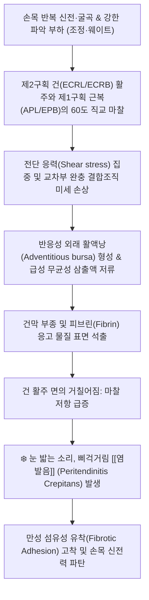
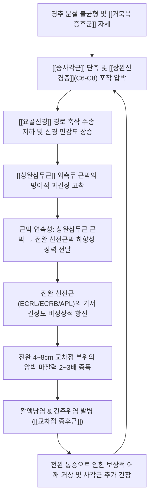
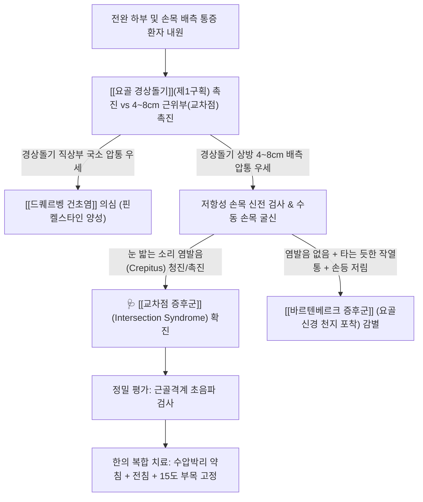

# 🩺 [[교차점 증후군]] (Intersection Syndrome / 交叉點症候群, ICD-10 M70.83 / M65.84)

> **핵심 3줄 요약 (Key Summary)**:
> - 📍 병소 부위 & 해부·병태생리: [[요골 경상돌기]] 근위 약 4~8cm(평균 5cm) 상방 전완 배면에서 무지(엄지)를 움직이는 제1신전구획(`[[장무지외전근]]`, `[[단무지신근]]`)의 근복 및 힘줄이 손목을 신전시키는 제2신전구획(`[[장요측수근신근]]`, `[[단요측수근신근]]`) 건 위를 약 60도 각도로 대각선 교차하며 발생하는 마찰성 외래 [[활액낭염]] 및 건주위염(Peritendinitis crepitans).
> - 🚩 전형적 임상 양상 & 3대 징후: 손목 반복 신전 및 파악 부하 후 전완 하부 요배측의 국소 동통, 달걀 반쪽 모양의 융기성 종창(Squeaker's swelling), 관절 굴신 시 손끝으로 찌릿하게 감지되는 눈 밟는 소리의 독특한 마찰 [[염발음]](Crepitus).
> - 🛠️ 핵심 감별 검사 & 한·양방 다각적 치료 전략: 교차점 국소 압통 검사 및 저항성 손목 신전 검사; `[[드퀘르벵 건초염]]` 및 요골신경 천지 포착증(`[[바르텐베르크 증후군]]`)과의 위치 감별; 급성기 손목 신전 15~20도 콕업 부목 고정, [[편력]](LI6)·[[온류]](LI7)·[[수삼리]](LI10) 전침, [[황련해독탕]]/[[신바로약침]] 건막 간극 수압박리술(Hydrodissection), 만성 유착 박리 침도술, 상위 지배 신경로인 `[[중사각근]]` 및 `[[상완삼두근]]` 외측두 연계 근막 치료.
> - ⚠️ 응급 의뢰 레드플래그 & 악화 요인: 단순 전완 건염으로 오인하여 손목만 국소 치료할 경우 재발률이 높으므로 상위 운동사슬을 필히 병행 치료하며, 38도 이상의 급격한 고열, 전완부 전반으로 번지는 발적 및 파동감을 동반한 화농성·감염성 건초염 의심 시 즉시 정형외과 응급 배농 수술 의뢰.

---

## 📌 목차
1. [🩺 질환 개요 & 해부학적 병태생리](#1--질환-개요--해부학적-병태생리)
2. [⚡ 병태생리 메커니즘 & 생체역학적 악순환 네트워크](#2--병태생리-메커니즘--생체역학적-악순환-네트워크)
3. [🔍 임상 증상 & 이학적 검사 알고리즘](#3--임상-증상--이학적-검사-알고리즘)
4. [🔀 감별 진단 매트릭스](#4--감별-진단-매트릭스)
5. [🌿 한의 통합 치료 프로토콜](#5--한의-통합-치료-프로토콜)
6. [💊 양방 치료 & 병용·의뢰 기준](#6--양방-치료--병용의뢰-기준)
7. [🏃 재활 운동 & 생활습관 티칭 가이드](#7--재활-운동--생활습관-티칭-가이드)
8. [💡 사용자 진료실 핵심 필기 & 임상 노하우 (Melt-In)](#8--사용자-진료실-핵심-필기--임상-노하우-melt-in)
9. [📚 출처 및 현대 학술 연구 요약](#9--출처-및-현대-학술-연구-요약)

---

## 1. 🩺 질환 개요 & 해부학적 병태생리

### (1) 정의 및 역사적 배경
[[교차점 증후군]](Intersection Syndrome)은 전완 원위부 배측에서 엄지손가락을 조절하는 제1신전구획의 근육과 손목을 젖히는 제2신전구획의 힘줄이 해부학적으로 서로 X자 형태로 교차하는 부위에서 반복적인 기계적 마찰로 인해 발생하는 비감염성 건주위염(Peritendinitis), 건막염(Tenosynovitis) 및 [[활액낭염]](Adventitious bursitis) 복합 질환이다.

- **역사적 기술**:
  - 프랑스의 외과의사 Velpeau(1841)가 손목을 움직일 때 피하에서 비단이나 가죽이 비벼지는 소리가 난다 하여 '비단 마찰음 건초염(Crépitation sous-cutanée)'으로 의학 문헌에 최초 보고하였다.
  - 이후 노를 젓는 조정(Rowing) 선수들에게 극도로 호발하여 **'사공의 손목(Oarsman's wrist)'**, 눈 밟는 소리 같은 삐걱거림이 청진된다 하여 **'삐걱거리는 손목(Squeaker's wrist)'**, 혹은 **'크로스오버 증후군(Crossover syndrome)'**, **'부가부 전완(Bugaboo forearm)'** 등 다양한 명칭으로 불려왔다.
  - 1985년 Grundberg와 Reagan이 사체 해부 연구 및 수술 소견을 바탕으로 두 건 구획의 교차 지점에서 발생하는 병리학적 실체를 정립하고 **'Intersection Syndrome'**으로 명명하여 표준 의학 용어로 정착되었다.

---

### (2) 수근부 6개 신전건 구획 (Extensor Compartments)의 해부학적 구조
손목 배측에는 [[신전건지대]](Extensor retinaculum)에 의해 구획화된 6개의 터널이 존재하며, 각 구획을 통과하는 건들은 손가락과 손목의 신전 및 외전을 정밀하게 제어한다:

| 신전 구획 | 통과 근육 및 힘줄 | 주요 해부학적 기능 | 신경 지배 |
| :--- | :--- | :--- | :--- |
| **제1구획** | `[[장무지외전근]](APL)` `[[단무지신근]](EPB)` | 엄지의 외전 및 중수수지관절 신전 (드퀘르벵 호발 부위) | [[후골간신경]] (PIN, C7-C8) |
| **제2구획** | `[[장요측수근신근]](ECRL)` `[[단요측수근신근]](ECRB)` | 손목의 신전(젖힘) 및 요측 편위(Radial deviation) | `[[요골신경]]` 본간 및 심지 (C6-C7) |
| **제3구획** | `[[장무지신근]](EPL)` | 엄지 지절간관절 신전 (리스터 결절을 지렛대로 주행) | [[후골간신경]] (PIN, C7-C8) |
| **제4구획** | `[[지신근]](EDC)` `[[시지신근]](EIP)` | 2~5지 손가락 중수지관절 및 지절간관절 신전 | [[후골간신경]] (PIN, C7-C8) |
| **제5구획** | `[[소지신근]](EDM)` | 5지(새끼손가락)의 독립적 신전 | 후골간신경 (PIN, C7-C8) |
| **제6구획** | `[[척측수근신근]](ECU)` | 손목의 신전 및 척측 편위(Ulnar deviation) | 후골간신경 (PIN, C7-C8) |

---

### (3) 근위 교차점 (Proximal Intersection) vs 원위 교차점 (Distal Intersection)
교차점 증후군은 해부학적 병소의 위치에 따라 근위부와 원위부로 명확히 대별된다:

1. **근위부 교차점 (Proximal Intersection - 전형적 교차점 증후군)**:
   - **위치**: [[요골 경상돌기]](Radial styloid process)로부터 **근위부 약 4~8cm(평균 5cm)** 상방의 전완 요배측 융기부.
   - **교차 양상**:
     - **심층 (Deep layer)**: 제2신전구획을 통과하는 ECRL 및 ECRB의 단단한 힘줄(Tendon).
     - **천층 (Superficial layer)**: 제1신전구획으로 비스듬히 내려가는 APL 및 EPB의 통통한 근복(Muscle belly)과 건 이행부.
   - 제1구획의 근육들이 제2구획의 힘줄 표면을 약 **60도 각도로 대각선 가로질러 주행**한다.
   - 손목을 굴신할 때마다 ECRL/ECRB 힘줄이 전후로 미끄러지며, 이를 내리누르고 있는 APL/EPB 근복의 심층 근막과 끊임없이 전단 마찰을 유발한다. 두 조직 사이에는 마찰을 완충하기 위한 반응성 외래 활액낭(Adventitious bursa)이 형성되며, 과사용 시 이곳에 급성 염증과 삼출액이 저류된다.
2. **원위부 교차점 (Distal Intersection Syndrome)**:
   - **위치**: 요골 원위 배측의 골성 랜드마크인 **[[리스터 결절]](Lister's tubercle) 직하방 및 원위부 약 1~2cm 지점**.
   - **교차 양상**:
     - 제3신전구획을 통과하는 `[[장무지신근]](EPL)` 건이 리스터 결절을 지렛대(Pulley) 삼아 45도 급격히 방향을 틀면서 제2신전구획의 ECRL 및 ECRB 건 위를 대각선으로 가로지른다.
     - 원위 교차점 증후군은 엄지를 과도하게 젖히거나 회전시키는 스포츠(드러머, 당구, 라켓 스포츠)에서 [[리스터 결절]] 부위 통증으로 나타나며, 방치할 경우 EPL 힘줄의 허혈성 자연 파열(Tendon rupture)을 초래할 수 있어 정밀 구별이 요구된다.

---

### (4) 역학 및 호발 조건
- **호발 스포츠**:
  - **조정(Rowing), 카약, 카누**: 노를 젓는 스트로크(Stroke) 단계에서 물을 긁어내고(Drive), 블레이드를 수평으로 눕히는 페더링(Feathering) 동작 시 손목을 순간적으로 강하게 젖히고 꺾는 동작이 분당 30~40회 이상 수천 번 반복됨.
  - **라켓 스포츠 (테니스, 배드민턴, 스쿼시)**: 강력한 백핸드 스트로크 시 손목 신전건에 걸리는 순간적인 편심성(Eccentric) 충격 부하.
  - **역도, 크로스핏, 체조**: 클린 앤 저크(Clean and Jerk), 스내치, 핸드스탠드 푸시업 등 손목이 90도 이상 과신전된 상태에서 고중량을 지탱할 때 교차점 내압 급상승.
  - **스키**: 폴 체킹(Pole planting) 시 손목 굴신 충격 반복.
- **호발 직업군 및 생활 활동**:
  - 도배사, 미장공, 목수, 망치질이나 전단 가위를 다루는 기술직.
  - 주방에서 무거운 프라이팬을 털며 웍질을 하거나 큰 칼로 단단한 식자재를 써는 조리사.
  - 장시간 인체공학적 지지 없이 마우스를 쥐고 손목을 젖힌 채 고속 타이핑을 수행하는 사무직 및 프로게이머.
- **성별 및 연령**:
  - 20~50대의 신체 활동이 왕성한 연령대에서 집중적으로 발생하며 남녀 비율은 대등하다.

---

## 2. ⚡ 병태생리 메커니즘 & 생체역학적 악순환 네트워크

### (1) 마찰성 [[활액낭염]] 및 건주위염의 병리조직학적 메커니즘
교차점 증후군의 병리 발생은 단순한 건초염(Tenosynovitis)을 넘어선 독특한 마찰성 건주위염(Peritendinitis crepitans)과 외래 활액낭(Adventitious bursa)의 병리적 상호작용이다:

1. **전단 응력 (Shear Stress)과 활액낭 삼출**:
   - 손목 신전 시 제2구획의 ECRL/ECRB 건은 근위부로 약 1.5~2cm 활주(Excursion)한다.
   - 이때 제1구획(APL/EPB) 근육이 엄지를 벌리기 위해 수축하면 근복의 횡단면이 두꺼워지면서 심층을 지나는 ECRL/ECRB 건을 직각에 가까운 방향으로 강하게 압박한다.
   - 이 교차각(약 60도)에서 발생하는 반복 전단 응력은 두 근육-건 경계면의 성긴 결합조직을 자극하여 체액이 고이는 외래성 활액낭을 형성시킨다.
   - 과도한 운동 부하가 지속되면 활액낭 내막의 모세혈관 투과성이 급증하여 무균성 삼출액이 차오르고 급성 활액낭염이 유발된다.
2. **피브린 (Fibrin) 석출과 눈 밟는 소리 [[염발음]] (Crepitus)의 음향물리학적 기전**:
   - 지속적인 마찰열과 염증 반응은 삼출액 내의 피브리노겐을 섬유소(Fibrin) 덩어리로 응고·석출시킨다.
   - 건막(Epitenon)과 근막 표면에 끈적끈적한 피브린 막이 불규칙하게 코팅되면, 정상적인 매끄러운 윤활 활주가 불가능해진다.
   - 손목을 움직일 때마다 건 표면의 거친 피브린 섬유망이 서로 부딪치며 뜯겨 나가는 기계적 마찰 진동이 발생하는데, 이것이 진찰 시 검사자의 손끝으로 전해지고 청진기로 들리는 **"뽀드득", "사각사각" 하는 눈 밟는 소리(Snow-crunching crepitus)**의 물리적 실체이다.
3. **만성기 섬유성 유착 (Fibrotic Adhesion)과 구획 증후군 유사 내압 상승**:
   - 염증이 만성화되면 피브린 침착 부위로 섬유아세포가 증식하여 단단한 반흔 콜라겐 조직을 형성한다.
   - 제1구획 근복과 제2구획 건막이 한 덩어리로 유착(Adhesion)되어 건의 독립적 활주가 차단되고, 손목 신전 시 가동범위 제한과 찢어지는 듯한 견인통이 고착화된다.

---

### (2) 상위 운동신경 및 근막 사슬 (Kinetic Chain) 병태생리
교차점 증후군은 결코 전완부 국소만의 고립된 질환이 아니며, 경추에서 손가락 끝으로 이어지는 상지 운동 사슬의 역학적 파탄과 직접 연동된다:

1. **요골신경 (Radial Nerve) 경로의 연계 긴장**:
   - 제2신전구획의 ECRL은 `[[요골신경]]` 본간에서 직접 분지되며, ECRB 및 제1구획(APL/EPB)은 요골신경의 심지인 후골간신경(PIN)의 지배를 받는다 (신경근 기원: C6, C7, C8).
   - 경추 C5-C6-C7 분절의 정렬 이상이나 추간판 퇴행이 존재하면, 요골신경 축삭의 축삭 수송(Axoplasmic transport)이 저하되어 말초 신전근의 근막 긴장도가 병적으로 상승한다 (Double Crush 현상).
2. **근막 사슬 (Myofascial Chain)의 하향성 과부하**:
   - 두부 전방 편위([[거북목 증후군]]) 환자는 상완신경총이 통과하는 `[[중사각근]]`이 단축되고, 상완 후면의 `[[상완삼두근]]` 외측두가 과도하게 경결된다.
   - 삼두근 외측두 근막은 주관절 외측을 거쳐 전완 신전근군(ECRL, ECRB)의 근막 지대와 직접 해부학적으로 연속되어 있다.
   - 따라서 중사각근과 삼두근 외측두의 긴장은 전완 신전근의 기저 긴장도(Resting muscle tone)를 지속적으로 높여, 손목 교차부의 마찰 압력을 상시적으로 증폭시키는 원인으로 작용한다.

---

## 3. 🔍 임상 증상 & 이학적 검사 알고리즘

### (1) 주요 임상 증상 및 단계별 진행 양상
1. **3대 핵심 임상 징후 (Pathognomonic Triad)**:
   - **국소 통증**: 요골 경상돌기에서 근위부로 **4~8cm(손가락 2~3마디 폭) 상방의 전완 요배측**에서 느껴지는 날카롭고 묵직한 통증. 손목을 젖히거나 엄지를 벌릴 때, 무거운 냄비를 들거나 문손잡이를 돌릴 때 극심해짐.
   - **특이적 마찰 염발음 (Snow-crunching Crepitus)**: 손목을 능동적 또는 수동적으로 신전·굴곡시킬 때 환부에서 "사각사각", "뽀드득" 하며 눈을 밟거나 새 가죽을 비비는 듯한 기계적 마찰음이 촉진·청진됨.
   - **달걀형 종창 (Squeaker's Swelling)**: 전완 하부 배측 교차 부위에 달걀 반쪽을 엎어놓은 듯한 둥글고 볼록한 국소 부종, 발적, 온열감이 관찰됨.
2. **병기별 임상 진행 단계**:
   - **급성기 (Acute Stage, 1~2주)**:
     - 외래 활액낭 급성 삼출액 저류, 건초의 급성 혈관성 부종.
     - 환부를 가볍게 스치기만 해도 비명을 지르는 극렬 압통, 열감, 손목을 굽혔다 펼 때마다 매우 뚜렷하고 큰 염발음 발생, 수면을 방해하는 야간통.
   - **아급성기 (Subacute Stage, 3~6주)**:
     - 피브린 석출 및 건막의 섬유성 비후 진행.
     - 삼출액이 다소 흡수되어 염발음의 크기는 줄어들지만, 손목을 끝까지 젖힐 때 뻑뻑한 저항감과 찌르는 듯한 견인통 지속.
   - **만성기 (Chronic Stage, 6주 이상)**:
     - APL/EPB와 ECRL/ECRB 사이의 비가역적 섬유성 유착 형성.
     - 염발음은 소실되거나 둔탁한 덜컥거림(Clicking)으로 변하며, 손목 신전 가동역(ROM) 제한, 쥐는 힘(Grip strength)의 현저한 약화, 일상적인 컴퓨터 작업이나 필기 시의 만성 피로감 및 둔통 고착.

---

### (2) 필수 이학적 검사 알고리즘
교차점 증후군은 정밀한 촉진과 유발 검사만으로 95% 이상 현장에서 감별 확진할 수 있다.

1. **교차점 국소 압통 검사 (Intersection Palpation Test - 확진 1차)**:
   - **수기법**: 환자의 전완을 중립 회내위로 놓고, 검사자는 요골 경상돌기를 먼저 촉지한 후 엄지손가락을 환자의 팔꿈치 방향으로 **4~6cm 근위부로 미끄러져 올라간다**. 이 부위에서 요골 외측연을 향해 수직 압박을 가한다.
   - **양성 반응**: 환자가 깜짝 놀라며 팔을 뒤로 뺄 정도의 날카로운 국소 압통과 함께 손가락 끝으로 팽윤된 결절성 덩어리감(Tender soft-tissue mass)이 만져짐.
2. **저항성 손목 신전 검사 (Resisted Wrist Extension Test)**:
   - **수기법**: 환자에게 팔꿈치를 90도 굽히고 주먹을 가볍게 쥔 채 손목을 힘껏 뒤로 젖히게 하고, 검사자는 손등에 아래 방향으로 강한 저항을 가한다.
   - **양성 반응**: 제2신전구획의 ECRL/ECRB 건이 강하게 수축하면서 전완 4~8cm 교차 부위에서 찢어지는 듯한 통증이 재현되고, 검사자의 반대 손끝으로 비단 비비는 염발음이 생생하게 감지됨.
3. **저항성 엄지 외전 및 신전 검사 (Resisted Thumb Abduction/Extension Test)**:
   - **수기법**: 환자에게 엄지손가락을 손바닥 평면에서 수직으로 벌리게(외전) 하거나 손등 쪽으로 젖히게(신전) 하면서 검사자가 엄지 끝에 저항을 준다.
   - **양성 반응**: 제1신전구획의 APL/EPB 근복이 수축하며 교차점 부위에 국소 통증 재현.
4. **수동적 손목-엄지 동시 굴곡 스트레칭 검사 (Passive Stretch Test)**:
   - **수기법**: 환자의 엄지를 손바닥 안으로 접어 넣은 상태에서 손목을 수동적으로 최대한 굴곡 및 척측 편위시킨다.
   - **양성 반응**: 교차 부위 조직이 팽팽하게 당겨지며 극심한 견인통 유발 (단, 통증의 발생 위치가 경상돌기인지, 4~8cm 상방인지 촉진을 통해 반드시 감별해야 함).

---

### (3) 영상의학적 정밀 진단 기준
1. **근골격계 초음파 (MSK Ultrasound - 최고의 1차 진단 도구)**:
   - **단축 스캔 (Short-axis / Axial view)**:
     - 요골 경상돌기 5cm 상방에 탐촉자를 횡으로 위치시키면, 타원형의 ECRL 및 ECRB 힘줄 바로 천층을 APL 및 EPB의 둥근 근복이 덮고 있는 전형적인 해부학적 랜드마크가 관찰된다.
     - **특이 소견**: 두 구획 사이에 렌즈 모양 또는 반달 모양의 **저에코성 활액 저류(Hypoechoic/anechoic fluid collection)**가 확인되며, 건주위 결합조직이 두껍게 비후되어 있다.
     - **파워 도플러 (Power Doppler)**: 급성기 환부에서 활막 및 건주위 결합조직의 뚜렷한 신생 혈관 증식 및 혈류 충혈 신호 확인.
   - **동적 초음파 (Dynamic Ultrasound)**:
     - 초음파를 보면서 환자에게 손목을 굴신시키면, 비후된 제1구획 근복 아래로 제2구획 건이 부드럽게 활주하지 못하고 걸리다가 순간적으로 튕기듯 빠져나가는 **건 걸림 현상(Tendon snapping / Jerking motion)**과 염발음 발생 순간을 실시간 시각화할 수 있다.
2. **자기공명영상 (MRI)**:
   - **T2 강조 및 지방억제 영상 (T2-weighted Fat-suppressed / STIR)**:
     - 제1신전구획 근육과 제2신전구획 힘줄이 교차하는 계면 주위에 고신호 강도의 부종성 **초승달 징후(Crescent sign)**가 선명하게 관찰된다.
     - 만성 난치성 증례에서는 요골 골막 반응 및 골수 부종(Bone marrow edema)이 동반되기도 한다.

---

## 4. 🔀 감별 진단 매트릭스

교차점 증후군은 손목과 전완부 통증을 유발하는 다양한 질환과 임상 양상이 유사하여 빈번히 오진되므로, 병소 위치와 신경 증상 유무를 기준으로 엄격히 감별해야 한다.

| 감별 질환 | 병변의 정확한 해부학적 위치 | 주 침범 조직 | 결정적 특이 이학적 징후 | 통증의 성상 및 감각 이상 | 특징적 초음파 소견 |
| :--- | :--- | :--- | :--- | :--- | :--- |
| [[교차점 증후군]] (근위부, 본 질환) | **요골 경상돌기 근위 4~8cm 배측** | 제1구획(APL/EPB) 근복 + 제2구획(ECRL/ECRB) 건 교차부 | **눈 밟는 소리의 마찰 염발음(Crepitus)** 교차점 국소 압통 저항성 손목 신전통 | 젖힐 때 삐걱거리는 동통, 시큰거림 **감각 저림 증상 없음** | 제1·2구획 교차부 활액낭 저에코 삼출액 및 파워도플러 충혈 |
| **원위부 교차점 증후군** | **[[리스터 결절]](Lister's tubercle) 원위 1~2cm** | 제3구획(EPL) 건 + 제2구획(ECRL/ECRB) 건 교차부 | 리스터 결절 직하방 국소 압통 저항성 엄지 신전 시 마찰음 | 손등 중앙의 날카로운 국소통, 엄지 신전력 저하 | 리스터 결절 원위부 EPL 건막 비후 및 저에코 삼출 |
| [[드퀘르벵 건초염]] (De Quervain) | **요골 경상돌기 직상부 (제1신전구획 터널)** | 제1구획 건초(APL 및 EPB의 순수 힘줄 부위) | **핀켈스타인 검사(Finkelstein) 양성** 아이히호프 검사(Eichhoff) 양성 경상돌기 국소 골막 압통 | 엄지를 움직일 때 찢어지는 칼로 베는 듯한 통증 감각 이상 없음 | 신전지대 제1구획 터널 내 건막 비후 및 구획 내 격벽(Subcompartment) |
| [[바르텐베르크 증후군]] (Wartenberg) | 요골 경상돌기 근위 약 8cm (완골근과 ECRL 건 사이) | 요골신경 천지(SBRN, Superficial Radial Nerve) 포착 | **티넬 징후(Tinel sign) 양성** 전완 원위 1/3 압박 시 손등 방사통 유발 | 손등 요측 및 엄지·검지 배면의 **타는 듯한 작열통, 저림, 이상감각** | 완골근 건막 출구 부위 SBRN 신경 단면적 부종 및 저에코 변화 |
| [[외측상과염]] (테니스 엘보) | 주관절 외측상과 (Lateral Epicondyle) | 단요측수근신근(ECRB) 기저부 기시건(CBT) | **코젠 검사(Cozen) 양성** 밀 검사(Mill) 양성 외측상과 골성 압통 | 주관절 외측 통증, 물건을 쥐고 들어 올릴 때 방사통 | 외측상과 ECRB 기시건의 비후, 저에코성 건병증 및 미세 파열 |
| **후골간신경 포착증** (Radial Tunnel) | 주관절 전외측 프로세 건궁(Arcade of Frohse) | 요골신경 심지인 후골간신경(PIN)의 [[회외근]] 통과부 | [[회외근]] 침범 부위 심부 압통 중지 신전 저항 검사(Maudsley) 양성 | 전완 배측 심부의 묵직한 둔통, 악력 약화, 수근신전 마비 가능 | [[회외근]] 입구 부위 PIN 직경 부종, 신경 전도 속도 저하 |
| **급성 화농성 건초염** | 손가락 굴곡건초 또는 전완 신전건초 | 세균 감염(황색포도상구균)에 의한 건초 내 화농 | **카나벨의 4대 징후(Kanavel 4 signs)**: 대칭성 부종, 굴곡위 고정, 건초 전장 압통, 수동 신전 시 극통 | 박동성 극통, 38도 이상의 전신 발열, 오한, 림프관염 | 건초 내 불균질한 고에코성 화농성 삼출액 및 광범위한 연부조직 염증 |

---

## 5. 🌿 한의 통합 치료 프로토콜

교차점 증후군은 한의학적으로 반복적인 노역과 근골 과사용으로 기혈이 응체되어 발생하는 **근비(筋痺)**와 힘줄 사이의 마찰로 진액이 마르고 삼출물이 뭉치는 **담음어혈(痰飮瘀血)**의 범주에 속한다.

### (1) 한의 변증 시치 (Pattern Identification)
1. **풍습열비형 (風濕熱痺型 - 급성기 염증)**:
   - 교차 부위에 붉은 발적과 열감이 뚜렷하고 만지면 화끈거리며, 관절을 움직일 때 눈 밟는 소리가 크게 남. 설홍(舌紅), 태 황니(黃膩), 맥 활삭(滑數).
   - 치료 원칙: 청열제습(淸熱除濕), 활혈통락(活血通絡) $\rightarrow$ `[[영계출감탕]]` 합 `[[월비가출탕]]` 가감.
2. **기체어혈형 (氣滯瘀血型 - 아급성기 통증)**:
   - 통증이 고정적이고 밤에 더 심해지며, 손목을 뒤로 젖힐 때 칼로 찌르거나 당기는 듯한 자통(刺痛) 발생. 설질 자암, 맥 현삽.
   - 치료 원칙: 활혈화어(活血化瘀), 소종지통(消腫止痛) $\rightarrow$ `[[서경탕]]` 합 `[[당귀수산]]` 가감.
3. **담음응결 및 간신휴허형 (痰飮凝結·肝腎虧虛型 - 만성 유착기)**:
   - 염발음은 줄었으나 교차 부위 조직이 단단하게 굳어 덩어리가 만져지고, 손목 가동역이 줄어들며 쥐는 힘이 빠짐. 피로 시 악화. 설담(舌淡), 태 백(白), 맥 세약.
   - 치료 원칙: 보익간신(補益肝腎), 화담연견(化痰軟堅), 완경통락(緩痙通絡) $\rightarrow$ `[[독활기생탕]]` 합 `[[당귀연통탕]]` 가감.

---

### (2) 침구 및 전침 치료 SOP
1. **교차 부위 국소 혈자리 자침 SOP**:
   - **[[편력]] (LI6)**: [[양계]](LI5)와 [[곡지]](LI11)를 이은 선상에서 손목 주름([[양계]]) 상방 3촌. 제1신전구획과 제2신전구획 교차점의 바로 원위 경계에 위치.
   - **[[온류]] (LI7)**: 양계혈 상방 5촌. 교차점의 중심부 및 근위 경계에 정확히 일치하는 핵심 요혈.
   - **[[수삼리]] (LI10)**: [[곡지]] 하방 2촌. 제2신전구획 ECRL/ECRB의 근복 이완 주혈.
   - **자침 각도 및 안전 가이드 (🚨 SBRN 신경 손상 회피)**:
     - 전완 원위 1/3 요측 피하에는 `[[요골신경]]` 천지(Superficial Branch of Radial Nerve, SBRN)가 주행하므로, 90도 직자(Perpendicular insertion)할 경우 신경 줄기를 직접 찔러 전격성 방사통과 감각 이상을 초래할 수 있다.
     - 반드시 0.25×40mm 호침을 사용하여 피부 표면과 **15~20도 각도로 눕혀 완만하게 사자(Oblique-tangential insertion)**하며, 바늘 끝이 APL/EPB 근복과 ECRL/ECRB 건막 사이의 가상 간극을 향하도록 10~15mm 부드럽게 진침한다.
2. **원위 및 상위 연계 배혈**:
   - 원위부: [[양계]](LI5), [[양지]](TE4), [[합곡]](LI4) — 손목 신전지대 내압 분산.
   - 근위부: [[곡지]](LI11), [[척택]](LU5) — 전완 신전근 기시부 긴장 해소.
3. **전침 요법 (Electroacupuncture)**:
   - [[편력]](LI6)과 [[수삼리]](LI10)에 전침 전극을 연결.
   - **주파수 세팅**: 2Hz 저주파 또는 2/100Hz 혼합파를 적용하여 환자가 시원한 뻐근함(득기감)을 느끼는 강도로 15~20분간 통전. 미세 연부조직 순환을 촉진하고 건막 사이에 정체된 삼출물 배출을 유도.

---

### (3) 약침 치료 (Pharmacopuncture) & 수압박리술 (Hydrodissection)
1. **수압박리술 (Hydrodissection) 테크닉**:
   - 교차점 증후군의 병리 핵심은 두 건막 사이의 기계적 마찰이므로, 물리적으로 두 층을 벌려주는 수압박리가 가장 신속하고 강력한 효과를 발휘한다.
   - 초음파 가이드 하 또는 정밀 해부학적 랜드마크 하에 27~30G, 25mm 멸균 니들을 진입시킨다.
   - 침끝이 APL/EPB 근복 심층과 ECRL/ECRB 건 천층 사이의 외래 활액낭 공간에 위치하면, 약침액 0.5~1.0cc를 서서히 주입하여 두 조직 면이 수액 압력에 의해 분리되도록 한다 (시술 직후 눈 밟는 소리 염발음이 즉각 소실됨).
2. **약침 제제 선택 기준**:
   - **급성기 염증 및 열감**: **[[황련해독탕]] 약침** (청열해독, 모세혈관 투과성 억제, 급성 삼출액 소퇴).
   - **조직 재생 및 연골·건막 보호**: [[신바로약침]] (GCSB-5 성분, COX-2 억제 및 건 조직 인장 강도 회복).
   - **만성 유착 및 어혈성 자통**: **중성어혈약침** 또는 자하거 약침.

---

### (4) [[소침도]] 요법 (Acupotomy) - 만성 섬유성 유착기
- **적응증**: 발병 6주 이상 경과하여 보존적 침·약침 치료에도 불구하고 교차부에 단단한 반흔 조직이 만져지고 손목 신전 시 제한과 당김통이 지속되는 만성 증례.
- **시술 SOP**:
  - 0.35×40mm 멸균 소침도를 사용.
  - 환자의 손목을 가볍게 굴곡시켜 건막을 팽팽하게 긴장시킨 상태에서 교차점 결절 중심부를 자입점으로 선정.
  - 침도의 날(Blade) 방향을 반드시 **ECRL/ECRB 힘줄의 주행 방향(전완의 장축)과 엄격히 평행(Parallel)**하게 맞춘다 (건 섬유를 횡절단하지 않기 위함).
  - 바늘을 천천히 진입시켜 비후된 제1구획 심층 근막과 제2구획 건막 사이의 섬유성 유착 밴드를 사각사각 2~3회 미세 박리(Peeling)한다.
  - 시술 후 멸균 거즈로 3분간 압박 지혈하여 혈종 형성을 차단.

---

### (5) 상위 운동신경 및 근막 사슬 추나 치료
- **[[중사각근]] 및 상완신경총 이완**:
  - 환자를 앙와위로 눕히고 경추를 반대측으로 가볍게 회전 및 측굴시킨 상태에서, 흉쇄유돌근 후연에서 촉지되는 중사각근의 단축된 근섬유에 부드러운 허혈성 압박(Ischemic compression)과 근막 이완(Myofascial release)을 가함.
- **[[상완삼두근]] 외측두 트리거포인트 압박 추나**:
  - 주관절 외측상과 상방 3~5cm 지점의 삼두근 외측두 발통점을 시술자의 엄지로 압박하면서 환자의 주관절을 수동 굴곡-신전시켜 전완 신전근막으로 전달되는 하향성 장력을 즉각 해소.

---

### (6) 한약 처방 (Herbal Medicine)
1. **급성기 삼출액 저류 및 염발음 극기**:
   - **[[영계출감탕]](苓桂朮甘湯) 가미방**: [[복령]] 12g, [[계지]] 8g, [[백출]] 8g, [[감초]] 4g에 [[의이인]](16g), [[목통]](6g), [[택사]](8g)를 배합하여 건막 사이에 정체된 삼출물(담음)을 이뇨·순환 작용으로 신속히 배출.
   - **[[월비가출탕]](越婢加朮湯)**: 국소 열감과 발적이 극심하고 부종이 탱탱한 급성기 활액낭염에 [[마황]], [[석고]], 생강, 대추, [[감초]], 백출을 처방하여 수습(水濕)과 염증열을 발산.
2. **만성기 유착 및 건 조직 쇠약기**:
   - **[[서경탕]](舒經湯)**: [[강활]], [[방풍]], [[당귀]], [[적작약]], [[천궁]], 창출, [[황기]], [[강황]], [[감초]]. 상지 경락의 기혈 순환을 소통시키고 건막 유착을 풀어줌.
   - **[[당귀연통탕]](當歸拈痛湯)**: 관절과 힘줄 사이의 습열(濕熱)을 맑히고 풍습 비통을 제거하여 만성적인 손목 시큰거림을 근본 치료.

---

## 6. 💊 양방 치료 & 병용·의뢰 기준

### (1) 양방 약물 치료 분석
1. **경구 비스테로이드성 소염진통제 (NSAIDs)**:
   - Ibuprofen 400~600mg tid, Naproxen 250~500mg bid, Celecoxib 200mg qd.
   - 1~2주간 단기 투여하여 급성 활액낭 삼출과 통증을 경감시킴.
   - 한의 치료 병용 시 환자의 위장 장애 유무를 문진하고, 증상이 호전되면 서서히 격일 복용 또는 필요시 복용(PRN)으로 전환하도록 지도.
2. **소염효소제**:
   - Streptokinase·Streptodornase (바리다제 등) 복용으로 건막 주위 피브린 삼출물 분해 촉진.

---

### (2) 비약물 중재 시술 (Interventional Procedures)
1. **국소 코르티코스테로이드 주사 (Corticosteroid Injection)**:
   - **약제 및 용량**: Triamcinolone acetonide 10~20mg + 1% Lidocaine 1.0mL 혼합액.
   - **주사 부위**: 초음파 유도 하에 제1신전구획과 제2신전구획 교차부의 활액낭 내(Intrabursal)로 정확히 주입.
   - **⚠️ 치명적 부작용 및 한의 치료 주의사항**:
     - 주사 바늘이 건 실질(Tendon substance) 내부로 침범하여 약물이 고농도로 주입될 경우 **ECRL/ECRB 힘줄의 콜라겐 괴사 및 건 파열(Tendon rupture)**을 유발할 수 있음.
     - 천층 피하로 약물이 누출될 경우 영구적인 **피하지방 위축(Subcutaneous fat atrophy)** 및 **피부 탈색(Skin depigmentation)**이 발생함.
     - 동일 부위에 연간 2~3회 이상의 스테로이드 주사는 절대 금기.
     - **스테로이드 주사를 맞고 내원한 환자**는 건 조직의 인장 강도가 일시적으로 극도로 취약해져 있으므로, 주사 후 최소 2~3주간은 강한 침도 요법이나 과도한 저항 신장 운동을 피하고 완만한 온열 요법과 뜸 치료 위주로 접근해야 함.
2. **손목 신전 부목 고정 (Cock-up Splinting - 보존 치료의 핵심)**:
   - 손목을 **15~20도 신전(Extension)된 중립 위치로 고정하는 콕업 부목(Cock-up splint)**을 2~3주간 주간 및 야간에 지속 착용.
   - 손목이 굴곡되지 않아야 제2구획 건이 제1구획 근복 아래에서 팽팽하게 당겨지며 발생하는 전단 마찰을 원천적으로 차단할 수 있음.
3. **체외충격파 치료 (ESWT)**:
   - 만성 섬유성 유착기 환자에게 저~중에너지 방사형/집중형 충격파(1,500~2,000타)를 적용하여 미세 혈류 증식 및 조직 재형성을 유도.

---

### (3) 수술적 치료 적응증 및 술식
교차점 증후군 환자의 **95% 이상은 부목 고정, 한의 복합 치료, 생활습관 교정으로 완치**되지만, 극히 드문 난치성 증례에서는 외과적 수술이 고려된다.

1. **수술 적응증**:
   - 최소 3~6개월 이상의 적극적인 보존적 치료(부목, 주사, 침·침도 요법)에도 불구하고 일상생활 및 직업 활동이 불가능할 정도의 심한 통증과 건 활주 장애가 지속되는 경우.
2. **수술 기법 (Surgical Procedures)**:
   - **비후된 외래 활액낭 절제술 (Bursal Debridement)**: 교차 부위를 절개하여 염증성으로 비후된 가성 활액낭 조직을 깨끗이 제거.
   - **제2신전구획 건막 절제술 (Tenosynovectomy)**: ECRL/ECRB 건을 둘러싼 섬유화된 건막을 부분 절제하여 건 활주 공간 확보.
   - **제1신전구획 근막 절개술 (APL/EPB Fasciotomy)**: 제1구획 근육의 심층 근막을 종절개하여 제2구획 건을 짓누르는 압박 압력을 감압.

---

### (4) 🚨 응급 의뢰 레드플래그 (Red Flags)
1. **급성 화농성·감염성 건초염 (Infectious Tenosynovitis)**:
   - 교차 부위에 국한되지 않고 전완부 전반으로 번지는 극심한 발적, 부종, 열감.
   - 38도 이상의 고열, 오한, 림프절 비대, 연부조직 파동감(Fluctuation) 동반 시 감염성 질환이므로 침습적 한의 시술을 즉각 중단하고 정형외과 응급실로 전원하여 정맥 항생제 및 응급 절개배농술(I&D)을 시행해야 함.
2. **힘줄 파열 (Tendon Rupture)**:
   - 반복적인 스테로이드 주사 병력이 있는 환자가 손목을 젖히는 순간 '뚝' 하는 소리와 함께 손목을 뒤로 젖히지 못하거나 엄지 끝마디를 펴지 못하는 신전 탈락(Extensor lag / Drop thumb) 발생 시 힘줄 재건 수술 의뢰.
3. **신경 손상 증상**:
   - 손등 요측(1~3지 배면)에 감각이 완전히 마비되거나 스치기만 해도 극심한 통증이 발생하는 복합부위통증증후군(CRPS) 징후 출현 시 신경과 협진.

---

## 7. 🏃 재활 운동 & 생활습관 티칭 가이드

### (1) 단계별 재활 운동 프로토콜
교차점 증후군의 재활은 조직의 염증 반응 수준에 맞추어 엄격한 단계별 진행이 필수적이다:

1. **1단계: 급성기 보호 및 상대적 안정 (Protection & Relative Rest, 1~2주)**:
   - **손목 신전 15도 부목 착용**: 세수나 식사 등 최소한의 동작 외에는 부목을 24시간 착용하여 교차부 마찰을 차단.
   - **냉찜질 (Cryotherapy)**: 급성기 부종과 열감을 가라앉히기 위해 얼음주머니를 얇은 수건에 싸서 환부에 15분씩 하루 3~4회 적용.
   - 손가락 끝마디의 가벼운 쥐기-펴기 동작만 허용하여 관절 강직 예방.
2. **2단계: 아급성기 무통 관절 가동성 & 신경가동술 (Mobility & Neurodynamics, 3~4주)**:
   - 눈 밟는 소리 염발음과 국소 열감이 소실되면 부목 착용 시간을 점진적으로 줄이고 스트레칭 시작.
   - **전완 신전근 부드러운 수동 신장 운동**:
     - 팔꿈치를 앞으로 쭉 펴고 손바닥이 바닥을 향하게 한다.
     - 반대쪽 손으로 아픈 손등을 잡고 몸 쪽(아래 방향)으로 부드럽게 당겨 손목을 굴곡시킨다.
     - 통증이 없는 뻐근한 한계점에서 15초 유지, 3회 반복 (절대 반동을 주지 말 것).
   - **요골신경 가동술 (Radial Nerve Flossing)**:
     - 팔을 옆으로 내리고 어깨를 하강시킨 상태에서, 손목을 굴곡하고 전완을 회내(안쪽으로 회전)시키면서 고개를 반대쪽으로 기울였다가 돌아오는 동작을 부드럽게 10회 반복하여 요골신경의 활주성을 회복.
3. **3단계: 만성 회복기 원심성 근력 강화 (Eccentric Strengthening, 5주 이후)**:
   - **원심성 손목 신전 운동 (Eccentric Wrist Extension Training)**:
     - 테이블에 전완을 올려놓고 손목만 테이블 밖으로 뺀 상태에서 0.5~1kg의 가벼운 덤벨이나 생수병을 쥔다.
     - 손목을 들어 올릴 때(단축성 수축)는 반대쪽 손으로 받쳐 올려 교차부 마찰 부하를 줄여준다.
     - 올린 상태에서 반대 손을 떼고, 아픈 쪽 손목의 힘만으로 **3~5초에 걸쳐 천천히 아래로 버티며 내린다(원심성 수축)**.
     - 10회 3세트 시행. 원심성 수축은 손상된 건 조직의 콜라겐 섬유를 장축 방향으로 정렬시키고 인장 강도를 극대화함.

---

### (2) 스포츠 및 작업 환경 인체공학적 (Ergonomics) 교정
1. **조정 / 카약 / 카누 선수 티칭**:
   - 노(Oar)를 잡는 손의 페더링(Feathering) 각도를 평소보다 완만하게 조절하고, 그립을 손바닥으로 꽉 쥐지 말고 손가락 갈고리 형태로 쥐도록 교정.
   - 손목을 뒤로 젖혀 블레이드를 돌리지 말고, 어깨와 체간의 회전력을 이용하도록 패들링 메커니즘을 수정.
2. **웨이트 트레이닝 / 크로스핏 사용자 티칭**:
   - 벤치프레스, 오버헤드프레스, 푸시업 시 손목이 90도로 꺾이지 않도록 손목 지지용 리스트 랩(Wrist wrap)을 착용하고, 바벨을 손바닥 아래쪽 힐(Heel of palm)에 얹어 전완 뼈와 일직선 축을 유지.
3. **사무직 및 컴퓨터 사용자 티칭**:
   - 일반 마우스 사용 시 손목이 과도하게 회내되고 젖혀지므로, 손목을 중립 악수 자세로 유지해 주는 **버티컬 마우스(Vertical mouse)** 도입을 적극 권고.
   - 키보드 전면에 푹신한 팜레스트(Palm rest)를 설치하여 손목이 공중에 꺾여 들린 채 타이핑하지 않도록 지지대 마련.

---

## 8. 💡 사용자 진료실 핵심 필기 & 임상 노하우 (Melt-In)

진료실 현장에서 교차점 증후군을 마주했을 때 즉각적인 진단 직관을 발휘하고 치료율을 극대화하는 실전 노하우를 집약한다:

### (1) 드퀘르벵병과의 명확한 위치 감별 노하우 (원장님 시크릿)
- 환자가 진료실에 들어와 "원장님, 손목 엄지 쪽이 너무 시큰거리고 젖힐 때마다 아파요"라고 호소하면 10명 중 9명의 한의사는 무조건 `[[드퀘르벵 건초염]]`으로 지레짐작하고 양계혈이나 요골 경상돌기 주변에만 침을 놓다가 치료에 실패한다.
- **감별의 결정적 술기**:
  - 검사자의 손가락을 먼저 요골 경상돌기(제1구획 터널)에 대고 핀켈스타인 검사를 해본다.
  - 그 다음, **손가락을 환자의 팔꿈치 방향으로 두세 마디 폭(약 4~5cm) 쑥 올려서 전완 배측 융기부를 꾹 누른 채 환자에게 손목을 뒤로 힘껏 젖히게 해보라**.
  - 만약 아래쪽(경상돌기)보다 위쪽 전완에서 환자가 "악!" 소리를 지르며 자지러지고, 검사자의 손끝으로 **마치 눈밭을 뽀드득 밟거나 젖은 가죽을 비비는 듯한 미세한 진동(염발음)**이 생생하게 전해진다면, 그것은 100% 드퀘르벵이 아니라 [[교차점 증후군]]이다. 이 간단한 4cm의 촉진 차이가 명의와 하의를 가른다.

### (2) 상완신경총 및 상완삼두근 외측두 연계 치료의 비밀 (Kinetic Chain 펄)
- 교차점 증후군은 손목 환부만 백날 치료해서는 잘 낫지 않고, 조금만 일하면 쉽게 재발하는 난치성 질환이다.
- 손목을 젖히는 ECRL과 ECRB는 `[[요골신경]]`의 지배를 받는다. 환자의 전완 교차부를 만지기 전에, 반드시 목 옆의 `[[중사각근]]`과 팔꿈치 바로 위쪽의 `[[상완삼두근]]` 외측두를 촉진해보라.
- 교차점 증후군 환자의 90% 이상은 중사각근과 삼두근 외측두가 돌덩이처럼 단단하게 굳어 극심한 압통을 호소한다.
- 손목에 침을 놓기 전에 먼저 목의 중사각근과 팔꿈치 외측 상완삼두근 근막에 [[호침]] 심부 자침과 약침 주입을 통해 근막 긴장을 먼저 풀어주면, 거짓말처럼 전완 신전근의 팽팽한 장력(Muscle tone)이 툭 떨어지며 손목 교차부의 마찰 압력이 드라마틱하게 경감된다. 상위를 풀지 않고 하위만 치료하는 것은 밑 빠진 독에 물 붓기이다.

### (3) 초음파 하이드로다이섹션 (Hydrodissection) 약침의 손맛
- 교차 부위에 약침을 놓을 때 단순히 피하에 얕게 주입하면 효과가 반감된다.
- 침끝이 피부를 뚫고 들어가 피하지방을 지나 제1구획(APL/EPB) 근복을 통과할 때의 묵직한 저항감을 손끝으로 느끼고, 그 심층에서 제2구획(ECRL/ECRB) 건막 표면에 닿는 순간의 미세한 '찰칵' 하는 저항 소실감을 포착해야 한다.
- 이곳에 황련해독탕 약침이나 신바로약침 0.5~1.0cc를 수압을 주어 밀어 넣으면, 두 건막 사이가 생리적으로 벌어지면서 시술 침대에서 일어나는 즉시 "원장님, 손목을 돌릴 때 나던 삐걱거리는 소리가 마법처럼 사라졌어요!"라는 감탄을 듣게 된다.

### (4) 운동침법 (Motion Style Acupuncture)의 절묘한 결합
- 교차점에 침을 유침해 놓은 상태에서 가만히 두지 말고, 침끝을 건막 간극에 거치한 채 환자에게 **손목을 위아래로 천천히 5~10회 까딱거리게 하거나 주먹을 쥐었다 폈다 하는 능동 운동**을 시켜보라.
- 환자가 손목을 움직이는 동안 침체가 건막 사이에 걸려있는 미세한 섬유성 유착 밴드를 물리적으로 털어내고 박리해 주는 효과를 내어, 침을 뽑고 났을 때 관절 가동역이 즉각 정상화된다.

---

## 9. 📚 출처 및 현대 학술 연구 요약

1. Costa CR, Morrison WB, Carrino JA. (2003). MRI features of intersection syndrome of the forearm. *AJR Am J Roentgenol*, 181(5), 1245-1248. [PMID: 14573413](https://pubmed.ncbi.nlm.nih.gov/14573413/)
   - [연구 요약]: 전완부 교차점 증후군 환자를 대상으로 자기공명영상(MRI)의 진단적 특징을 규명한 핵심 연구로, 제1신전구획과 제2신전구획 교차부 계면을 둘러싼 T2 고신호 강도의 외래 활액낭 부종성 초승달 징후(Crescent sign) 및 건주위 연부조직 염증 소견을 영상의학적 표준 진단 기준으로 확립함.

2. Grundberg AB, Reagan DS. (1985). Pathologic anatomy of the forearm: intersection syndrome. *J Hand Surg Am*, 10(2), 299-302. [PMID: 3980951](https://pubmed.ncbi.nlm.nih.gov/3980951/)
   - [연구 요약]: 교차점 증후군이라는 의학 용어를 정립한 사체 해부 및 임상 연구로, 요골 경상돌기 근위 4~8cm 상방에서 APL/EPB 근복과 ECRL/ECRB 건 사이의 60도 교차 마찰성 활액낭염 병태생리를 규명하고, 보존적 치료 실패 시 외과적 활액낭 절제술 및 제2구획 건막 절제술의 성공적인 임상 결과를 보고함.

3. Pijoan-Moratalla C, et al. (2020). Distal intersection syndrome: An unusual cause of forearm pain. *Reumatol Clin (Engl Ed)*, 16(5), 416-418. [PMID: 29627354](https://pubmed.ncbi.nlm.nih.gov/29627354/)
   - [연구 요약]: 리스터 결절 원위부에서 제3신전구획(EPL)과 제2신전구획(ECRL/ECRB)이 교차하며 발생하는 원위부 교차점 증후군(Distal intersection syndrome)의 임상적 증상과 초음파 감별 소견을 기술하고, 근위부 교차점 증후군과의 해부학적 차별화 진단 지침을 제시함.

4. Kimura H, Asaka R, Kobayashi T, et al. (2026). Common Fascial Abnormalities in Five Thumb Pain Conditions: A Fifteen-Point Ultrasound-Guided Fascia Hydrorelease Clinical Protocol. *J Funct Morphol Kinesiol*, 11(3), 120. [PMID: 42647349](https://pubmed.ncbi.nlm.nih.gov/42647349/)
   - [연구 요약]: 무지 및 전완부 통증 질환에서 초음파 유도하 근막 수압박리술(Fascia Hydrorelease)의 임상 프로토콜을 제시한 최신 연구로, 제1신전구획 근막과 제2신전구획 교차 건막 사이의 수액 박리가 마찰성 염발음과 신경학적 견인통을 즉각 완화함을 초음파 영상으로 입증함.

5. Chiou-Tan FY. (2022). Musculoskeletal mimics of cervical radiculopathy. *Muscle Nerve*, 66(1), 20-30. [PMID: 35466429](https://pubmed.ncbi.nlm.nih.gov/35466429/)
   - [연구 요약]: 경추 신경근증과 증상이 유사하여 혼동하기 쉬운 상지 근골격계 질환들을 체계적으로 분석한 종설로, 전완부 교차점 증후군 및 회전근개 병증, 상완신경총 병증의 신경생리학적 근전도 및 이학적 감별 알고리즘을 종합 정리함.

<!-- 보관 태그(1회용·링크오류, 필요시 복원): 손목통증, 교차점증후군 -->
