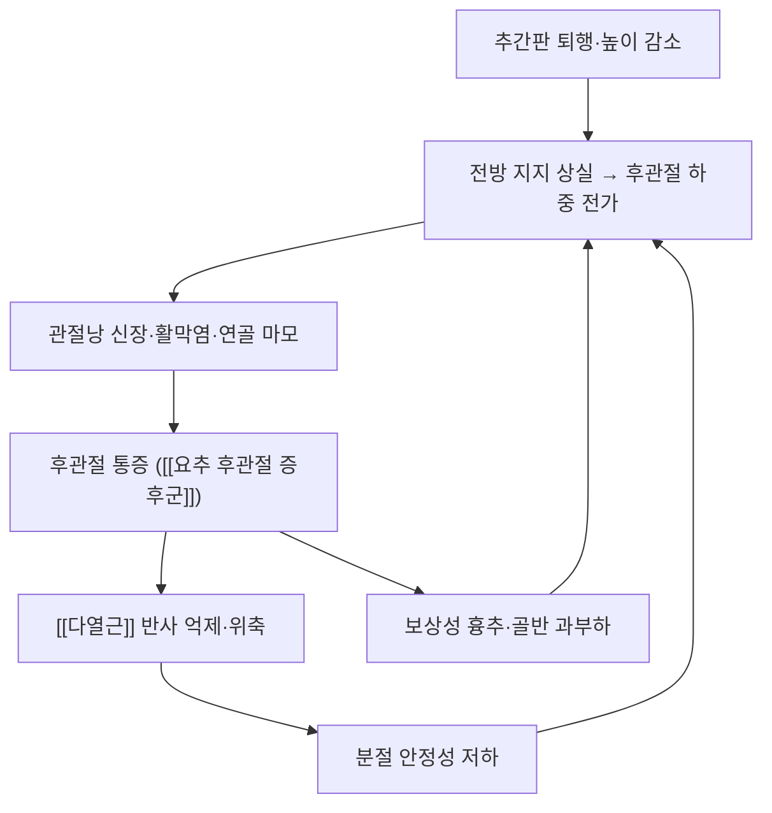

# 🩺 [[요추 후관절 증후군]] (Lumbar Facet Joint Syndrome / 腰椎 後關節 症候群, ICD-10 M53.8)

> 📐 이미지 기록: 5장 수록(해부 도해·정상 축상 CT·퇴행성 변화 등급 도해·관절내 주사 도해·굴곡신전 개념도). 환부 실사·이학적 검사 시연·재활 운동 실사는 확보하지 못해 상단에 사유를 밝힌다 — 통증원이 관절낭 내부라 '환부 실사'로 특정할 대상이 없고, 후관절 통증을 확진하는 단일 이학적 검사가 없기 때문이다.

> **핵심 3줄 요약 (Key Summary)**:
> - 📍 병소 부위 & 해부·병태생리: 요추 [[후관절]](zygapophysial joint)의 관절낭·활막·관절연골. 추간판 퇴행 뒤 하중이 후방으로 전가되면서 관절낭 신장·활막염·연골 마모가 진행되고, [[다열근]] 위축이 분절 안정성을 떨어뜨려 악순환을 만든다.
> - 🚩 전형적 임상 양상 & 3대 징후: 편측 또는 양측 요추부 체성 연관통(둔부·대퇴 후외측까지, 피부분절을 넘지 않음), 신전·회전·기립 신전에서 악화, 아침 뻣뻣함. 하지 방사통·근력저하·감각 저하는 원칙적으로 동반하지 않는다.
> - 🛠️ 핵심 감별 검사 & 한·양방 다각적 치료 전략: 확진은 [[내측지 차단]](진단적 차단)이며 영상·이학적 검사는 보조다. 침·약침·추나로 분절 안정성과 관절낭 긴장을 조절하고, 운동으로 [[다열근]]·[[복횡근]]을 재훈련하며, 양방은 관절내 주사·[[내측지 차단]]·고주파 열응고·[[체외충격파]]를 단계적으로 쓴다.
> - ⚠️ 응급 의뢰 레드플래그 & 악화 요인: 발열·야간통·체중감소(감염·종양), 외상 후 골절 의심, 진행하는 근력저하·대소변 장애(마미증후군), 40세 미만 염증성 조조강직(축성 척추관절염 감별) — 이 경우 차단·수기 전에 영상과 의뢰가 먼저다.

---

## 📌 목차
1. [질환 개요 & 해부학적 병태생리](#1-질환-개요--해부학적-병태생리)
2. [병태생리 메커니즘 & 생체역학적 악순환 네트워크](#2-병태생리-메커니즘--생체역학적-악순환-네트워크)
3. [임상 증상 & 이학적 검사(Physical Exam) 알고리즘](#3-임상-증상--이학적-검사physical-exam-알고리즘)
4. [감별 진단 매트릭스 (Differential Diagnosis)](#4-감별-진단-매트릭스-differential-diagnosis)
5. [한의 통합 치료 프로토콜 (침·약침·추나·한약)](#5-한의-통합-치료-프로토콜-침약침추나한약)
6. [양방 치료 & 병용·의뢰 기준 (Conventional Treatment & Referral)](#6-양방-치료--병용의뢰-기준-conventional-treatment--referral)
7. [재활 운동 & 생활습관 티칭 가이드](#7-재활-운동--생활습관-티칭-가이드)
8. [💡 사용자 진료실 핵심 필기 & 임상 노하우](#8--사용자-진료실-핵심-필기--임상-노하우-melt-in-잔여-심화-집약)
9. [출처 및 학술 참고 문헌 (References)](#9-출처-및-학술-참고-문헌-references)

---

## 1. 질환 개요 & 해부학적 병태생리

![[요추 후관절 증후군_01_해부도해.jpg|460]]
> [그림 1: 요추 측면 도해. 후관절(분홍)과 후지의 내측지(Medial Branch of the Dorsal Ramus)가 표기되어 있다 — 후관절 통증의 해부학적 표적과 차단 지점이 같은 그림에 있다. 출처: Wikimedia Commons, Harrygouvas, CC BY-SA 3.0]

![[요추 후관절 증후군_02_정상_CT_축상_랜드마크.jpg|460]]
> [그림 2: 요추 축상 CT. 추체(Vertebral Body)·척수신경(Spinal nerves)·후관절(Facet joints) 라벨이 표시된 정상 해부 랜드마크 — 시술 전 영상 확인의 기준점. 출처: Wikimedia Commons, Dr.foksha, CC BY-SA 4.0]

* **질환 정의 및 분류**:
  * 요추 후관절(관절돌기 관절)에서 발생하는 축성 요통. 영상에서 퇴행이 보여도 통증원이 되는지는 별개이므로, 임상에서는 '영상 진단'이 아니라 '차단으로 확인된 통증원'으로 정의한다.
  * 만성 요통에서 후관절이 통증원으로 지목되는 비율은 연구 설계·선정 기준에 따라 크게 갈린다(대략 15~45% 범위로 보고). 차단 기준을 엄격히 적용할수록 비율은 낮아진다.
  * 분류: 단일 분절형 / 다분절형, 편측 / 양측, 퇴행성(골관절염성) / 염증성(축성 척추관절염 관련) / 외상 후.
* **관련 해부학적 구조물**:
  * **골격 및 관절**: [[후관절]]은 상위 추골의 하관절돌기와 하위 추골의 상관절돌기가 만드는 활막성 관절. 요추에서는 관절면이 거의 시상면에 가까워 신전·회전 부하를 받는다.
  * **근육 및 근막**: [[다열근]]·[[척추기립근]]·[[복횡근]]. 다열근 위축은 분절 회전 안정성을 떨어뜨려 후관절 부하를 키운다.
  * **신경 및 혈관**: 후관절은 동일 분절과 한 분절 상위의 후지 내측지(medial branch of dorsal ramus)가 지배한다 — 요추에서는 L1~L4 내측지가 주요 표적이고, L5 후관절은 L4 내측지와 L5 후지(천골익 상연 부근)가 관여한다. 이 '한 분절 위' 규칙이 [[내측지 차단]] 설계의 근거다.

---

## 2. 병태생리 메커니즘 & 생체역학적 악순환 네트워크

![[요추 후관절 증후군_03_퇴행성변화_등급_MRI.jpg|520]]
> [그림 3: 후관절 골관절염 Grade 0(정상)~Grade 3(중증) 등급표와 각 등급의 CT·T2 강조 MRI 소견. 관절 간격 협소·경화·골극 형성의 단계적 변화를 보여준다. 출처: Wikimedia Commons, Irina Nefedova, CC BY 4.0]

### 1) 관절 내 병리
* 활막염과 관절낭 신장이 통증의 직접 원인이며, 연골 마모·골극은 부하를 증폭시키는 배경이다. 급성기에는 관절 내 삼출과 주변 골수부종이 영상에서 함께 보일 수 있다.
* 관절 내 음압·활막 추벽(meniscoid) 감돈이 '걸리는' 통증과 급성 잠김을 설명하는 가설로 제시된다.
### 2) 생체역학적 연쇄
* 요추 신전과 회전이 겹칠 때 후관절 압박이 최대가 된다 — 신전-회전 유발 동작이 병력을 청취할 때 가장 재현성이 높다.
* 골반·흉추 가동성 저하가 요추 회전을 대신 받아내면서 다분절 과부하를 만든다(보상 패턴).

---

## 3. 임상 증상 & 이학적 검사(Physical Exam) 알고리즘

> 🖼️ 이학적 검사 시연 실사 미확보 — 후관절 통증을 확진하는 단일 유발 검사가 없어, 아래 검사는 '가중치'로만 쓴다. 확진은 [[내측지 차단]]이다.

### 1) 주소증
* **통증 분포**: 요추부 편측성 또는 양측성, 둔부·대퇴 후외측·슬와부까지의 체성 연관통. 피부분절을 넘어 발까지 내려가면 [[요추 추간판 탈출증]]·신경근병증 쪽을 먼저 본다.
* **악화·완화 요인**: 신전·회전·장시간 기립에서 악화, 앉거나 전굴에서 완화. 기침·재채기로 악화되면 추간판·경막 압력 상승을 시사한다.
* **동반 증상**: 아침 뻣뻣함은 흔하나 30분을 크게 넘기고 야간통으로 깨면 염증성 축질환·감염·종양 감별이 필요하다.

### 2) 필수 이학적 검사
* 신전-회전 검사(Kemp 검사 변형): 기립 또는 좌위에서 요추 신전 + 동측 회전. 동측 둔부·대퇴로 통증 재현 시 후관절 기원 가능성을 올린다 — 민감도·특이도가 확진 수준은 아니다.
* [[SLR test]]·[[Slump test]]: 방사통 감별. 음성이면 신경근 압박 가능성은 낮아진다.
* 분절 압통: 극돌기 외방 1~2 cm 심부 압통. 다열근 위축·경직을 함께 촉진한다.

---

## 4. 감별 진단 매트릭스 (Differential Diagnosis)

| 감별 질환 | 호발 병소 및 원인 | 주소증 차이점 | 특이적 이학적 검사 소견 |
| :--- | :--- | :--- | :--- |
| [[요추 후관절 증후군]] | 후관절 관절낭·활막 | 체성 연관통, 신전·회전 악화 | 신전-회전 재현, 차단 후 50% 이상 감소 |
| [[요추 추간판 탈출증]] | 추간판 후외측 | 피부분절 방사통·저림 | [[SLR test]] 양성, 신경학적 결손 |
| [[천장관절 증후군]] | 천장관절 | 골반 후방·서혜부 통증 | 천장관절 유발 검사 다발성 양성 |
| [[척추관 협착증]] | 황색인대·후관절 비후 | 신경인성 파행, 전굴 완화 | 보행 유발·전굴 완화 |
| 축성 척추관절염 | 천장관절·척추 염증 | 40세 미만, 야간통·조조강직 | 염증 지표·MRI 골수부종 |

---

## 5. 한의 통합 치료 프로토콜 (침·약침·추나·한약)

> 🖼️ 한의 술기 실사 미확보 — 자침·약침 시술 장면을 확보하지 못했다(기전 도해로 대체하지 않는다).

* **침구 치료**:
  * 협척혈(EX-B2) 해당 분절 + [[아시혈]] + 위중(BL40)·곤륜(BL60) 원위 배혈. 유침 20분, 주 2~3회.
  * [[전침]]은 2 Hz 저빈도로 심부 자극을 보강한다 — 국소 혈관·근 긴장 조절이 목표다.
* **약침 치료**: [[약침]] 참조. 후관절 주변·다열근 경결부에 소량(0.1~1 cc/점) 주입하고, 경추·요추 심부는 초음파 유도 또는 해부 랜드마크 확인 하에 시행한다.
* **추나 치료**: [[추나]]의 요추 신연·회전 가동. 급성 염증기에는 추력 조작을 피하고 [[Maitland 관절가동술]] 등급 I~II로 시작한다.
* **한약 치료**: 급성기 활혈거어·이수(예: [[당귀수산]] 계열 변증), 만성기 보간신·온경(예: [[독활기생탕]] 계열). 어혈 변증이 뚜렷하면 활혈 처방, 한습 변증이면 온경산한 쪽으로 간다.

---

## 6. 양방 치료 & 병용·의뢰 기준 (Conventional Treatment & Referral)

![[요추 후관절 증후군_04_후관절주사_시술도해.jpg|440]]
> [그림 4: 후관절 관절내 주사 시술 도해. 측면 척추도에서 주사침이 후관절로 진입하고, 확대도에 관절면과 침끝 위치가 표시되어 있다. 실제 시술 사진이 아닌 도해다. 출처: Wikimedia Commons, Blausen 0391, BruceBlaus, CC BY 3.0]

* **약물 치료**:
  * [[NSAIDs]] 단기 사용, 근이완제, 신경병증성 성상이 동반되면 [[프레가발린]]·[[가바펜틴]]을 검토한다(단, 후관절 통증은 원칙적으로 침해수용성이다).
* **비약물 시술 (단계적)**:
  * 1단계: 관절내 스테로이드 주사([[트리암시놀론]] 등) — 단기 통증 완화.
  * 2단계: [[내측지 차단]] — 진단과 치료를 겸한다. 50% 이상 통증 감소가 진단 기준.
  * 3단계: 고주파 열응고(radiofrequency neurotomy) — 차단으로 반응을 확인한 환자에서 지속 효과를 노린다.
  * 보조: [[체외충격파]] — 2025년 무작위 가짜대조 시험에서 12개월 VAS 64.4% 감소·골수부종 소실 58.8%가 보고됐다(단일기관·논평 다수, §9 참조).
* **수술 적응증**: 후관절 단독 통증은 수술 적응이 아니다. 신경근 압박·불안정성·변형이 동반된 경우에만 기기 고정을 검토한다.
* **한의 병용 판단**:
  * 병용 가능: 주사 후 24~48시간은 국소 자극을 줄이고, 이후 침·약침 재개.
  * 주의: 항응고제 복용자는 차단·약침 전 중단 여부를 처방의와 확인한다.
* **의뢰 기준**: 진행하는 근력저하, 대소변 장애, 발열·야간통·체중감소, 외상 후 골절 의심, 3개월 보존 치료 실패 시 영상 검사와 전문과 의뢰.

---

## 7. 재활 운동 & 생활습관 티칭 가이드

![[요추 후관절 증후군_05_굴곡신전_운동개념도.jpg|440]]
> [그림 5: 굴곡·신전 시 추체·추간판·후관절의 상대 움직임 개념도. 신전에서 후관절 압박이 커지고 추간판 후방 높이가 줄어드는 방향을 보여준다 — 운동 제한선을 설명할 때 쓴다. 출처: Wikimedia Commons, Dr.foksha, CC BY-SA 4.0]

> 🖼️ 재활 운동 실사 미확보 — 동작 사진을 확보하지 못해 개념도로 대체하고, 동작은 글로만 기술한다.

* **이완**: 신전을 피하는 중립 골반 조절 — 바로 누워 무릎 굽히고 골반 후방 경사를 10초 유지 × 10회.
* **강화**: [[다열근]]·[[복횡근]] 재훈련(복부 당김 10초 × 10회, 하루 2회), 점진적으로 데드리프트·힙 힌지 패턴으로 확장.
* **가동성**: 흉추 회전 가동(사이드 라잉 오픈북)과 고관절 굴곡근 스트레칭으로 요추 회전 부담을 분산한다.
* **일상 자세**: 장시간 기립·후방 젖힘 작업을 줄이고, 앉을 때 골반을 살짝 말아 허리 전만을 줄인다.

---

## 8. 💡 사용자 진료실 핵심 필기 & 임상 노하우

* **실전 문진 4문항**: ① 통증이 발까지 내려가는가 ② 뒤로 젖힐 때 vs 숙일 때 어느 쪽이 편한가 ③ 아침에 30분 이상 뻣뻣한가 ④ 기침·재채기에 아픈가. ①②는 후관절 vs 추간판 분기, ③은 염증성, ④는 압력 의존성 감별이다.
* **촉진 순서**: 극돌기 → 극돌기 외방 1.5 cm(후관절선) → 장골능·천장관절 순으로 내려가며 '같은 통증'인지 확인한다. 환자가 "그 자리"라고 짚으면 표적이 맞을 확률이 올라간다.
* **치료 순서**: 가동성(흉추·고관절) → 연부조직 이완 → 협척·아시혈 자침 → 약침 → 능동 운동 순. 수동 치료만 반복하면 다음 날 다시 굳는다.
* **환자 설명 스크립트**: "허리 관절 뒤쪽에서 오는 통증은 디스크처럼 다리로 저리게 하지는 않지만, 뒤로 젖히거나 돌릴 때 더 아픕니다. 관절 주변 근육이 다시 버텨 주게 만드는 게 핵심입니다."
* **반응 판정**: 4주 동안 신전-회전 통증 NRS가 30% 이상 줄지 않으면 표적이 틀렸을 가능성을 먼저 의심한다(차단 검사 의뢰 검토).

---

## 9. 출처 및 학술 참고 문헌 (References)

1. Cohen SP, Raja SN. Pathogenesis, diagnosis, and treatment of lumbar zygapophysial (facet) joint pain. Anesthesiology. 2007;106(3):591-614. [PMID 17325518](https://pubmed.ncbi.nlm.nih.gov/17325518/)
   - **[연구 요약]** 후관절 통증의 병태생리·진단(내측지 차단)·치료(주사·고주파)를 정리한 표준 고찰. 영상 소견과 통증의 불일치, 진단적 차단의 위치를 명확히 한다.
2. Efficacy of high-energy, focused ESWT in treatment of lumbar facet joint pain: a randomized sham-controlled trial. Int J Surg. 2025;111(7):4177-4186. [PMID 40391994](https://pubmed.ncbi.nlm.nih.gov/40391994/)
   - **[연구 요약]** 내측지 차단으로 확진한 만성 후관절 통증 128명에서 고에너지 집속형 ESWT(0.35 mJ/mm², 1200회, 주 1회×5)가 12개월 VAS 64.4% 감소·ODI 42.3% 감소·골수부종 소실 58.8%를 보였다.
3. Ultrasound versus fluoroscopy-guided medial branch block for the treatment of lower lumbar facet joint pain: a retrospective study. Medicine (Baltimore). 2017;96(16):e6655. [PMID 28422871](https://pubmed.ncbi.nlm.nih.gov/28422871/)
   - **[연구 요약]** 하요추 후관절 통증에서 초음파 유도와 투시 유도 내측지 차단을 후향 비교 — 접근법 선택의 실무 근거로 삼는다.
4. ISMST Guidelines for ESWT (2024). [PDF](https://shockwavetherapy.org/wp-content/uploads/2024/01/ISMST-Guidelines-for-ESWT-_-engl-20240103.pdf)
   - **[자료 요약]** 충격파 적응증·금기(척추체·척수·폐 조직 조사 금지, 심박조율기·임신 등)를 정리한 국제 합의문.
